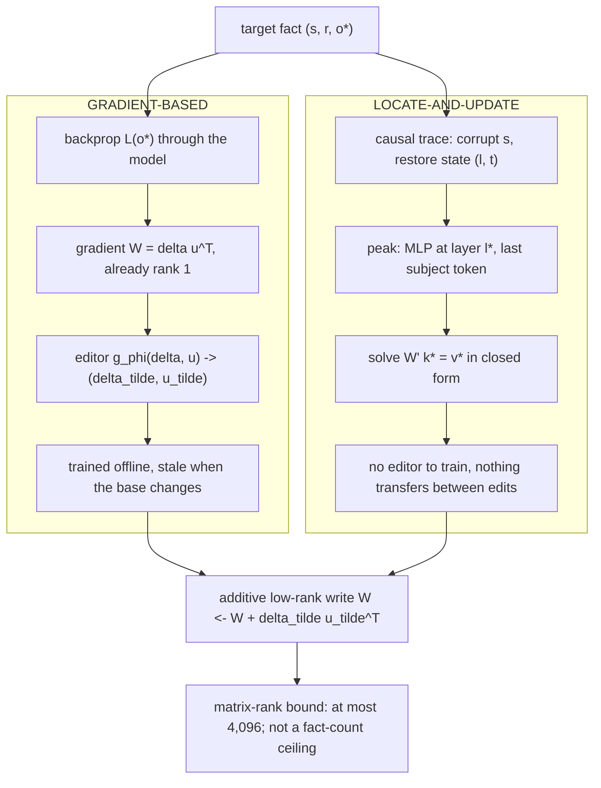
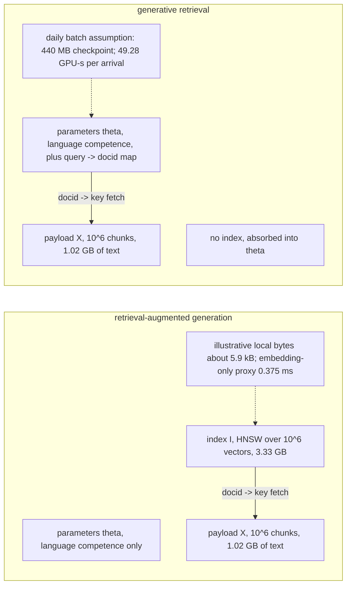
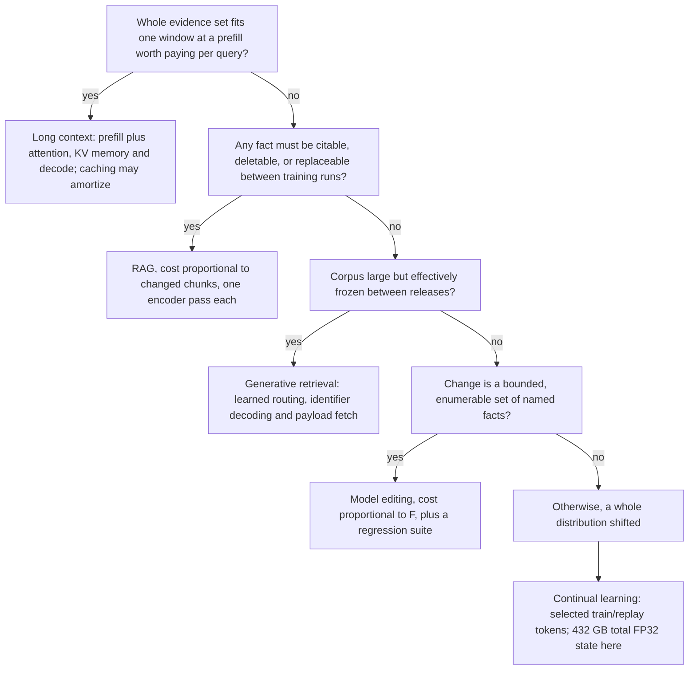

This comparison shows why sending a large collection of documents in every prompt can cost much more than retrieving a few relevant passages. A context window tells you how much text can fit; retrieval chooses how much text the model actually has to process.
### Stuffing the corpus into the prompt
The example sends $`210{,}000`$** tokens**—300 articles—to the model. Before answering, the model must *prefill* the prompt: read it and calculate how its tokens relate to one another.
That work has two parts:
- **Reading the model’s parameters:** about $`3.36`$ quadrillion operations.
- **Attention:** comparing tokens with one another, about $`11.6`$ quadrillion operations here.
Together, that’s about $`14.9`$** quadrillion operations**, or $`43.884\,\mathrm{s}`$ at the assumed processing rate. Attention is the larger cost because its work grows roughly with the *square* of prompt length once prompts are long.
The prompt's KV cache uses $`131{,}072\,\mathrm{B/token}`$, or $`27.52512\,\mathrm{GB}`$ for $`210{,}000`$ tokens. With $`16\,\mathrm{GB}`$ of weights, the remaining $`64\,\mathrm{GB}`$ gives a payload-only upper bound of two requests. Actual concurrency also needs activations, temporary buffers and scheduler headroom; it is not established by this storage division alone.
### Retrieving a small set instead
Instead, retrieval finds eight relevant chunks, then adds 200 tokens of instructions. The resulting prompt is about $`3{,}000`$** tokens**.
The retrieved prompt's prefill proxy is $`50.359296\times10^{12}\,\mathrm{FLOP}`$, approximately $`148.116\,\mathrm{ms}`$. The additional $`1\,\mathrm{ms}`$ retrieval input is not derived here. KV payload is $`0.393216\,\mathrm{GB}`$; dividing the remaining $`64\,\mathrm{GB}`$ by that payload gives an upper bound of $`162`$ requests before runtime overhead, not measured concurrency.
The retrieved prompt is **70 times shorter**, but the estimated compute is **296 times lower**. That larger saving comes from attention: shortening the prompt reduces the number of token-to-token comparisons particularly sharply.
### What that means for cost and scale
At $`\$2.50`$ per GPU-hour, the modeled prefill costs are approximately $`\$0.030475`$ per stuffed query and $`\$0.00010286`$ per retrieved query. At $`100{,}000`$ queries per day, that is approximately $`\$3{,}047.50`$ versus $`\$10.29`$ for prefill work alone. These are not all-in RAG or hosted-API invoices.
The modeled stuffed prefill is approximately $`43.884\,\mathrm{s}`$, versus $`148.116\,\mathrm{ms}`$ for retrieved-context prefill. Two versus $`162`$ requests are payload-memory upper bounds before overhead. Neither calculation is an observed concurrency or p99-latency result.
### The crossover point
The passage estimates where attention’s cost catches up with the cost of reading the model’s parameters:

```math
C^{*} = \frac{N}{Ld}
```

Here, $`N`$ is the number of model parameters, $`L`$ the number of layers, $`d`$ the model’s width, and $`C^{*}`$ the prompt length at which those two costs are equal.
For the stipulated $`8`$B model, the calculated equality point is approximately $`61{,}035`$ tokens. The textbook approximation $`N\approx12Ld^2`$ instead gives $`12d=49{,}152`$ tokens for $`d=4{,}096`$. Parameter accounting and architecture can change that constant; the difference does not independently identify one architectural cause. The stipulated $`70`$B model gives approximately $`106{,}812`$ tokens under the same attention proxy.
**Bottom line:** a large window may let the model accept a huge prompt, but it doesn’t make that prompt cheap to process. For ordinary questions, selecting a few useful passages can save substantial compute, memory, latency, and cost.
# Chapter 2: The Competing Answers to the Same Problem
[00-START-HERE](../00-START-HERE.md) · [01-READING-ROUTES](../01-READING-ROUTES.md) · [01\_what\_a\_rag\_interview\_actually\_tests](01_what_a_rag_interview_actually_tests.md) · [03\_a\_repeatable\_framework\_for\_any\_rag\_design\_question](03_a_repeatable_framework_for_any_rag_design_question.md)
Purpose: Choose among continual learning, model editing, long context, generative retrieval, and retrieval-augmented generation by matching each method to the constraint and cost shape it actually serves.
## TL;DR
- Retrieval-Augmented Generation (RAG) is the default for facts that change, need citations, or must be deleted because its update cost follows changed chunks.
- Continual learning changes a distribution or behavior, but learning grows linearly with the weight step while forgetting grows quadratically.
- Model editing can repair a bounded set of named facts, but the weight matrix has limited independent write directions. Collateral damage, logical inconsistency, and regression work also cap safe scale.
- Long context removes index maintenance only when the evidence fits comfortably, remains usable by position, and is worth paying for on every query.
- Generative retrieval moves the searchable index into model parameters. It does not move the document payload, and it replaces local writes with training runs.
- The decisive question is not which method wins an accuracy contest. It is what the method’s cost scales with and which hard product constraint it satisfies.
- Weights are the right home for a distribution the model should have. A datastore is the right home for a fact the system may need to cite, change, or delete.
## The story
Imagine a legal library that receives a corrected rule every morning. The head librarian has five ways to keep answers current. First, she can retrain every librarian on the new shelves. That is continual learning, which means changing the model’s weights by training on new material. The librarians learn the correction, but some old habits move too. The damage is catastrophic forgetting, which means prior abilities regress even though nobody intentionally erased them. Second, she can alter one association in a librarian’s memory. That is model editing, which means rewriting a small internal key-value association for one named fact. It is fast for a few corrections. It becomes dangerous when many edits compete for the same limited directions in memory. Third, she can place every relevant book on the desk before each question. That is long context, which means putting evidence directly into the prompt. The desk has nominal capacity, but every question pays the reading bill again. Books near the middle may also receive less effective attention than books near either edge. Fourth, she can teach a librarian to say the shelf code directly. That is generative retrieval, which means decoding a document identifier instead of searching a separate index. The shelf-code map is the searchable index, and it moves into the model. The books remain on the shelves, so the payload store, the database that holds document text, still exists. Fifth, she can keep a searchable catalog, fetch a few books, and place only those on the desk. That is RAG, which means using retrieval to select evidence before generation. The catalog pays a local update when a book changes. Each query pays only for the selected passages. The metaphor exposes the real selection rule. Retrain the librarians when their overall behavior or language must change. Edit memory when a bounded set of named facts has no refresh cadence. Use the whole desk when the evidence is small, stable, shared, and positionally usable. Teach shelf codes when the library is effectively frozen and the query-to-code route is worth training. Keep the catalog when facts change, need citations, or must remain independently deletable.
## Decoder table


| Technical term | Plain-English meaning | Why it matters |
| --- | --- | --- |
| Retrieval-Augmented Generation (RAG) | Search for a small evidence set, fetch its text, and place that text in the generator’s prompt. | It keeps mutable evidence citable and ties updates to changed chunks. |
| Continual learning | Continue training a released model on new data. | It is the weight-based choice for a broad behavior or distribution change. |
| Catastrophic interference or catastrophic forgetting | A new training update damages abilities learned from the old distribution. | It explains why weight updates forget or how that damage is priced. |
| Released checkpoint | The fixed starting copy of model parameters before an update. | It explains why weight updates forget or how that damage is priced. |
| Parameter or weight | A learned numeric value inside the model. | It explains why weight updates forget or how that damage is priced. |
| Distribution | The pattern of examples, language, and behaviors represented by a dataset. | It explains why weight updates forget or how that damage is priced. |
| Loss | A numerical measure of model error that training tries to reduce. | It explains why weight updates forget or how that damage is priced. |
| Objective | The loss expression the optimizer is told to minimize. | It explains why weight updates forget or how that damage is priced. |
| Optimizer | The procedure that converts gradients into parameter updates. | It explains why weight updates forget or how that damage is priced. |
| Gradient | The local direction and rate at which a loss changes. | It explains why weight updates forget or how that damage is priced. |
| Learning rate | The scale applied to an optimizer step. | It explains why weight updates forget or how that damage is priced. |
| Step budget | The combined amount of movement allowed across learning rate and training steps. | It explains why weight updates forget or how that damage is priced. |
| Local minimum | A point where nearby moves do not reduce the old loss to first order. | It explains why weight updates forget or how that damage is priced. |
| Taylor expansion | A local approximation of a function by first-order and higher-order terms. | It explains why weight updates forget or how that damage is priced. |
| Hessian | The matrix of second derivatives that describes local curvature. | It explains why weight updates forget or how that damage is priced. |
| Curvature | How sharply old loss rises when weights move in a direction. | It explains why weight updates forget or how that damage is priced. |
| Fisher information matrix | The curvature proxy used here to weight parameter movement by old-distribution sensitivity. | It explains why weight updates forget or how that damage is priced. |
| Diagonal Fisher approximation | A practical version that stores one sensitivity value per parameter. | It explains why weight updates forget or how that damage is priced. |
| Anisotropic damage | Damage that depends on update direction, not only update length. | It explains why weight updates forget or how that damage is priced. |
| Stiff direction | A high-curvature direction where a small move causes large old-task loss. | It explains why weight updates forget or how that damage is priced. |
| Sloppy direction | A low-curvature direction where the same move causes less old-task loss. | It explains why weight updates forget or how that damage is priced. |
| Elastic weight consolidation (EWC) | A regularized continual-learning method that penalizes movement in Fisher-sensitive directions. | It explains why weight updates forget or how that damage is priced. |
| Regularizer | An extra objective term that discourages an unwanted kind of solution. | It explains why weight updates forget or how that damage is priced. |
| Low-rank adaptation (LoRA) | A parameter-efficient update that restricts a weight change to the product of two thin matrices. | It bounds how much a constrained weight update can learn or overwrite. |
| Rank | The dimension of a matrix's column space. | It bounds matrix rank, not the number of learned or editable facts. |
| Rank-one update | A matrix correction formed by one outer product. | It bounds how much a constrained weight update can learn or overwrite. |
| Adapter | A small trainable component that changes model behavior while the base weights stay fixed. | It bounds how much a constrained weight update can learn or overwrite. |
| Manifold | The lower-dimensional set of updates permitted by a constraint such as fixed rank. | It bounds how much a constrained weight update can learn or overwrite. |
| Replay | Mixing old-distribution examples into new training so the old objective remains represented. | It controls or detects regression during a weight update. |
| Synthesized replay | Replay examples sampled from the released model rather than drawn from real held-out data. | It controls or detects regression during a weight update. |
| Model collapse | Repeated self-training that sharpens common modes and thins the tail of the learned distribution. | It controls or detects regression during a weight update. |
| Re-warm and re-decay | Raise the learning rate from an ended schedule, then reduce it again during the update. | It controls or detects regression during a weight update. |
| Regression suite | Frozen questions used to detect damage to behavior unrelated to the update. | It controls or detects regression during a weight update. |
| Canary set | A compact frozen regression set that gates a release. | It controls or detects regression during a weight update. |
| Full fine-tuning | Updating the base model weights rather than a small adapter. | It controls or detects regression during a weight update. |
| Negative log likelihood | The training loss that penalizes low probability on the observed token. | It supports the stated Hessian and Fisher relationship at the old optimum. |
| Floating-point operation (FLOP) | One counted arithmetic operation used to price compute. | It determines accelerator memory, throughput, or compute cost. |
| Graphics processing unit (GPU) | The accelerator used for training or serving in the worked examples. | It determines accelerator memory, throughput, or compute cost. |
| Model FLOPs utilization (MFU) | The fraction of headline accelerator arithmetic sustained by the workload. | It determines accelerator memory, throughput, or compute cost. |
| Brain floating point 16-bit format (bf16) | A 16-bit numeric format used for dense accelerator arithmetic. | It determines accelerator memory, throughput, or compute cost. |
| Floating point 16-bit format (fp16) | A 16-bit storage or compute format used in examples. | It determines accelerator memory, throughput, or compute cost. |
| Floating point 32-bit format (fp32) | A 32-bit format that uses four bytes per stored number. | It determines accelerator memory, throughput, or compute cost. |
| Adam | The optimizer whose gradient and two moment buffers create large training state. | It determines accelerator memory, throughput, or compute cost. |
| Optimizer state | Gradients and moment buffers stored in addition to model weights. | It determines accelerator memory, throughput, or compute cost. |
| Bandwidth-bound decoding | Serving limited by how fast weights can be streamed from memory rather than by arithmetic. | It determines accelerator memory, throughput, or compute cost. |
| Byte units (kB, KB, MB, GB, TB) | Kilobyte, megabyte, gigabyte, and terabyte scales used for memory and bandwidth. | They convert parameter, index, payload, and cache sizes into hardware limits. |
| Encoder | A model that converts text into vectors for indexing or query search. | It defines the addressable retrieval path and its local update unit. |
| Embedding | A vector representation used for similarity search. | It defines the addressable retrieval path and its local update unit. |
| Chunk | A bounded text segment treated as one retrieval unit. | It defines the addressable retrieval path and its local update unit. |
| Index | A searchable structure that maps a query to document identifiers. | It defines the addressable retrieval path and its local update unit. |
| Payload store | The store that holds document text keyed by identifier. | It defines the addressable retrieval path and its local update unit. |
| Re-embedding and re-indexing | Recompute vectors for changed text and update the searchable structure. | It defines the addressable retrieval path and its local update unit. |
| Model editing | A targeted change to an internal association without a full training run. | It explains how a targeted edit is located, written, and capacity-limited. |
| Transformer | The layered sequence model whose attention and feed-forward blocks are analyzed here. | It is the shared base architecture behind every weight and context calculation. |
| Feed-forward block | The transformer sublayer that applies an expansion, nonlinearity, and projection at each token. | It explains how a targeted edit is located, written, and capacity-limited. |
| Multilayer perceptron (MLP) | The feed-forward network inside a transformer block. | It explains how a targeted edit is located, written, and capacity-limited. |
| Swish-Gated Linear Unit (SwiGLU) | The gated MLP variant named in the crossover sanity check. | It explains why measured parameter count raises the crossover above the simple block estimate. |
| Residual stream | The vector stream passed and updated across transformer layers. | It explains how a targeted edit is located, written, and capacity-limited. |
| Associative memory | A key-value interpretation in which patterns activate stored responses. | It explains how a targeted edit is located, written, and capacity-limited. |
| Key-value association | An input pattern paired with the value written back when that pattern activates. | It explains how a targeted edit is located, written, and capacity-limited. |
| Causal tracing | Corrupt a prompt, restore one hidden state, and measure how much the correct answer probability recovers. | It explains how a targeted edit is located, written, and capacity-limited. |
| Subject token | The token span naming the entity whose association is being tested. | It explains how a targeted edit is located, written, and capacity-limited. |
| Hidden state | A layer and token representation inside the model. | It explains how a targeted edit is located, written, and capacity-limited. |
| Indirect effect | The recovered correct-answer probability caused by restoring one hidden state. | It explains how a targeted edit is located, written, and capacity-limited. |
| Gaussian noise | The random corruption applied to subject embeddings during causal tracing. | It explains how a targeted edit is located, written, and capacity-limited. |
| Constrained least squares | Solve for a new mapping while minimizing disturbance to remembered mappings. | It explains how a targeted edit is located, written, and capacity-limited. |
| Uncentered covariance | The key-association matrix used to account for remembered key directions. | It explains how a targeted edit is located, written, and capacity-limited. |
| Outer product | A column vector times a row vector, producing a rank-one matrix. | It explains how a targeted edit is located, written, and capacity-limited. |
| Gradient-based editor | An auxiliary network that transforms raw gradient factors into a controlled edit. | It explains how a targeted edit is located, written, and capacity-limited. |
| Model Editor Networks with Gradient Decomposition (MEND) | The gradient-based editing method named in the source. | It explains how a targeted edit is located, written, and capacity-limited. |
| KnowledgeEditor | The other gradient-based editing method named in the source. | It explains how a targeted edit is located, written, and capacity-limited. |
| Rank-One Model Editing (ROME) | The one-edit-at-a-time locate-and-update method used in the worked example. | It explains how a targeted edit is located, written, and capacity-limited. |
| Mass-Editing Memory in a Transformer (MEMIT) | A method that solves many edits jointly across a band of critical layers. | It explains how a targeted edit is located, written, and capacity-limited. |
| Efficacy | Whether the target edited fact is produced. | It decides whether a successful target edit is safe to ship. |
| Locality or specificity | Whether unrelated facts and behaviors stay unchanged after an edit. | It decides whether a successful target edit is safe to ship. |
| Ripple effect | A logical consequence, inverse relation, composition, or paraphrase that should change with the edited fact. | It decides whether a successful target edit is safe to ship. |
| RippleEdits | The benchmark used to test whether logical consequences follow an edit. | It decides whether a successful target edit is safe to ship. |
| Context window | The maximum prompt capacity a model can accept. | It determines long-context capacity, cost, selection, or answer quality. |
| Long context | Supplying a large evidence set directly in the prompt. | It determines long-context capacity, cost, selection, or answer quality. |
| Corpus stuffing | Sending most or all of a knowledge base on every request and letting attention select. | It determines long-context capacity, cost, selection, or answer quality. |
| Top-k selection | Keep only the k highest-ranked retrieval candidates. | It separates evidence selection from window capacity. |
| Prefill | The computation that reads the prompt before the first output token. | It determines long-context capacity, cost, selection, or answer quality. |
| Attention | The token-to-token computation whose prompt cost grows quadratically with context length. | It determines long-context capacity, cost, selection, or answer quality. |
| Causal mask | The restriction that lets each token attend only to earlier tokens. | It determines long-context capacity, cost, selection, or answer quality. |
| Crossover length | The context length where weight-reading and attention prefill costs are equal. | It determines long-context capacity, cost, selection, or answer quality. |
| Nominal context | The advertised number of tokens the model can hold. | It determines long-context capacity, cost, selection, or answer quality. |
| Effective context | The portion and positions the model can use reliably. | It determines long-context capacity, cost, selection, or answer quality. |
| Closed-book baseline | Accuracy when the model answers without supplied evidence. | It determines long-context capacity, cost, selection, or answer quality. |
| Lost in the middle | The observed drop when the answer-bearing document sits near the middle of a long prompt. | It determines long-context capacity, cost, selection, or answer quality. |
| Key-value (KV) cache | Stored attention keys and values retained per prompt token during serving. | It determines long-context capacity, cost, selection, or answer quality. |
| Grouped-query attention | An attention design with fewer key-value heads than query heads. | It determines long-context capacity, cost, selection, or answer quality. |
| Prefix caching | Reuse the key-value cache for a shared prompt prefix. | It determines long-context capacity, cost, selection, or answer quality. |
| Cache invalidation | Discard cached work after an edit changes the prefix it depends on. | It determines long-context capacity, cost, selection, or answer quality. |
| Reranker | A more accurate later stage that reorders retrieved candidates. | It determines long-context capacity, cost, selection, or answer quality. |
| Recall headroom | Extra candidate capacity kept before final selection. | It determines long-context capacity, cost, selection, or answer quality. |
| Relevance cliff | The rank after which candidate relevance drops sharply. | It determines long-context capacity, cost, selection, or answer quality. |
| Global-synthesis query | A question whose evidence is the whole corpus rather than a top-ranked subset. | It determines long-context capacity, cost, selection, or answer quality. |
| Hierarchical summarization | Repeatedly summarize groups and then combine their summaries for global questions. | It determines long-context capacity, cost, selection, or answer quality. |
| Community summary | A graph-level summary used when evidence spans a connected corpus region. | It determines long-context capacity, cost, selection, or answer quality. |
| Generative retrieval | Decode a document identifier from a query instead of searching a separate index. | It explains which store generative retrieval moves and what training must learn. |
| Document identifier (docid) | The primary-key label emitted or returned by retrieval. | It explains which store generative retrieval moves and what training must learn. |
| Primary key | The exact identifier used to fetch one payload. | It explains which store generative retrieval moves and what training must learn. |
| Posting list | The documents associated with a term in an inverted index. | It explains which store generative retrieval moves and what training must learn. |
| Inverted index | A term-to-document searchable structure. | It explains which store generative retrieval moves and what training must learn. |
| Hierarchical Navigable Small World (HNSW) graph | The approximate vector-search graph used in the examples. | It explains which store generative retrieval moves and what training must learn. |
| Inverted file (IVF) cell | A vector-index partition used to narrow candidate search. | It explains which store generative retrieval moves and what training must learn. |
| Approximate nearest neighbor (ANN) lookup | Fast similarity search that avoids scoring every document. | It explains which store generative retrieval moves and what training must learn. |
| Bijection | A one-to-one assignment between documents and identifier labels. | It explains which store generative retrieval moves and what training must learn. |
| Stirling approximation | The approximation used to price the minimum bits for an arbitrary identifier assignment. | It explains which store generative retrieval moves and what training must learn. |
| Semantically structured identifier | A label derived from document similarity so part of the assignment is computable. | It explains which store generative retrieval moves and what training must learn. |
| Hierarchical clustering | Repeatedly group similar documents to create a structured identifier path. | It lowers the amount of arbitrary document naming the model must memorize. |
| Differentiable Search Index (DSI) | The generative-retrieval setup with indexing and retrieval objectives. | It explains which store generative retrieval moves and what training must learn. |
| DSI++ | The incremental generative-retrieval method measured across sequential corpora. | It explains which store generative retrieval moves and what training must learn. |
| Indexing objective | The training task that teaches document naming. | It explains which store generative retrieval moves and what training must learn. |
| Pseudo-query | A generated query-like training example paired with a document identifier. | It contributes most of the stated generative-retriever refresh tokens. |
| Routing objective | The training task that maps open query phrasings to the right identifier. | It explains which store generative retrieval moves and what training must learn. |
| Superposed map | A mapping distributed across many shared parameters with no local row for one document. | It explains which store generative retrieval moves and what training must learn. |
| Softmax | The output normalization where raising one identifier’s probability takes probability mass from others. | It explains which store generative retrieval moves and what training must learn. |
| Hits at 10 (Hits@10) | Whether a relevant result appears in the first ten outputs. | It measures quality, freshness, or serving constraints in deployment. |
| Staleness service-level agreement (SLA) | The maximum allowed delay before new or retracted material affects retrieval. | It measures quality, freshness, or serving constraints in deployment. |
| Delta index | A small mutable index holding arrivals after the learned base was last trained. | It measures quality, freshness, or serving constraints in deployment. |
| Log-structured pattern | Keep a frozen base and a mutable recent layer, then query and merge both. | It measures quality, freshness, or serving constraints in deployment. |
| Constrained decoding | Restrict which identifiers a generative retriever may emit. | It measures quality, freshness, or serving constraints in deployment. |
| Unlearning | A requirement to remove a learned association, not merely suppress its output. | It measures quality, freshness, or serving constraints in deployment. |
| Adaptive retrieval | Retrieve only when a query needs external evidence. | It measures quality, freshness, or serving constraints in deployment. |
| Quantization | Store model or cache values with fewer bits. | It can lower memory constants but does not change the cost curve. |
| Tail latency at the 99th percentile (p99) | The latency value that 99 percent of requests meet. | It measures quality, freshness, or serving constraints in deployment. |
| Freshness cadence | How often new corpus state becomes available to queries. | It measures quality, freshness, or serving constraints in deployment. |
| Citability | The ability to connect an answer back to a source document. | It is a hard gate that selects the correct architecture. |
| Deletability | The ability to remove a fact through an addressable operation. | It is a hard gate that selects the correct architecture. |
| Replaceability | The ability to update one fact between model training runs. | It is a hard gate that selects the correct architecture. |
| Distribution shift | A broad change in data or desired behavior rather than a bounded list of facts. | It is a hard gate that selects the correct architecture. |


## Core mechanics
### Mathematical conventions
Use decimal storage units unless explicitly marked binary. Compute budgets use $`W_{\mathrm{forward}}\approx2NT`$ and $`W_{\mathrm{train}}\approx6NT`$ for processed tokens $`T`$; these omit architecture, attention and systems overhead unless added explicitly. The common throughput $`P_{\mathrm{GPU}}=3.4\times10^{14}\,\mathrm{FLOP\,s^{-1}}`$ is a rounded assumption, not a benchmark. Wall time on $`G`$ GPUs assumes ideal scaling; GPU-hours count the sum of occupied device-hours. Memory payload is not complete runtime memory. Local Taylor models, rank bounds and empirical benchmark results support different kinds of claims and must not be substituted for one another. Round only after calculating.
### Introduction
An answer sometimes needs knowledge that the released weights do not contain or no longer state correctly. This chapter compares five responses to that one problem. Continual learning writes a broad update into weights. Model editing writes a narrow update into weights. Long context puts evidence into the prompt. Generative retrieval puts the query-to-identifier index into weights while leaving payload text outside. RAG keeps facts in an addressable datastore and selects a small evidence set per query. The methods do not share one cost curve. The correct choice follows the constraint and the quantity that drives cost.
### 2.1 Continual learning and catastrophic forgetting
#### What it is and why it exists
The motivating case is a legal assistant built on an open-weight 27-billion-parameter model. It ships in March. An appellate court reverses a standard in June. Training on the new opinions makes the assistant cite the reversal, but it also damages citation formatting and sends a venue answer to the wrong state. The update wrote 200 million new tokens into 27 billion parameters. Nothing was intentionally deleted. The optimizer simply moved shared parameters that supported more than the target facts. McCloskey and Cohen (1989) named this catastrophic interference in connectionist networks. Luo et al. (2023) found that continual instruction tuning eroded prior ability more severely at 7 billion parameters than at 1 billion. Scale did not remove the failure. Let the released checkpoint be $`\theta_0`$, old and new expected losses be $`L_{\mathrm{old}}`$ and $`L_{\mathrm{new}}`$, and accumulated parameter update be $`\Delta=\theta-\theta_0`$ after $`T`$ optimizer steps at learning rate $`\eta`$.

```math
\Delta = \theta - \theta_0
```

The naive objective minimizes only the new loss. It contains no term that protects the old loss. At a local minimum of the old loss, the old gradient is approximately zero. The first-order Taylor term vanishes. The old-loss increase is therefore approximately quadratic.

```math
\mathcal F(\Delta)
= L_{\mathrm{old}}(\theta_0+\Delta)-L_{\mathrm{old}}(\theta_0)
\approx \frac{1}{2}\Delta^{\mathsf T}H\Delta
\approx \frac{1}{2}\sum_i F_i\Delta_i^2
```

For a correctly specified probabilistic model, an expectation under the model and suitable regularity conditions relate the expected negative-log-likelihood Hessian to the Fisher information. Merely being at a local optimum of an arbitrary empirical loss does not establish that identity. EWC uses Fisher curvature as an approximation, often diagonalized to one value $`F_i`$ per parameter. The quadratic forgetting surrogate is local; away from an old-loss stationary point, the first-order term $`\nabla L_{\mathrm{old}}(\theta_0)^{\mathsf T}\Delta`$ must also be retained. Define $`g=\nabla L_{\mathrm{new}}(\theta_0)`$ for the local new-loss calculation.

```math
\text{new gain} \approx -g^{\mathsf T}\Delta
```

Along a fixed update direction and for sufficiently small steps, the new-loss reduction is first order, while the old-loss increase is second order if the old gradient vanishes. Halving such a step therefore approximately halves the local new-loss change and quarters the quadratic old-loss change; this does not count facts learned or prove an unavoidable global trade-off for every method. Damage is directional: a direction with $`9`$ times the Fisher curvature has $`9`$ times the quadratic cost at equal step length. A merely $`3`$-fold curvature increase gives $`3`$ times the cost, not $`9`$.
#### What breaks and what the alternatives cost
Elastic weight consolidation directly penalizes the derived forgetting term.

```math
L_{\mathrm{new}}(\theta)
+ \frac{\lambda}{2}\sum_i F_i(\theta_i-\theta_{0,i})^2
```

Kirkpatrick et al. (2017) demonstrated EWC in their setting. For the $`27`$B example, an fp32 diagonal Fisher uses $`108\,\mathrm{GB}`$. FP32 Adam weights, gradients and two moments together already use $`432\,\mathrm{GB}`$; optimizer moments alone use $`216\,\mathrm{GB}`$. Fisher estimation also needs representative old-distribution samples and backward passes; these need not literally be the original dataset, but their availability and representativeness are material constraints. LoRA restricts a matrix update to two thin factors, not directly to low-Fisher directions.

```math
\Delta W = BA
```

The permitted rank-r update manifold for a square width d matrix has dimension:

```math
r(2d-r)
```

For $`d=4{,}096`$ and $`r=16`$, the rank-exactly-$`r`$ matrix manifold has local dimension $`r(2d-r)=130{,}816`$, versus $`d^2=16{,}777{,}216`$ coordinates for an unconstrained square matrix—a ratio of approximately $`128.25`$. The stored factors contain $`2dr=131{,}072`$ scalars; the $`r^2`$ difference reflects factorization redundancy. This is a nonlinear manifold dimension, not a fixed linear subspace of independent fact directions or a bound on fact count. The cited Biderman et al. result is empirical evidence about learning and forgetting, not a theorem implied by the dimension ratio. With replay fraction $`\rho`$, sampling the two distributions gives the following expected gradient.

```math
(1-\rho)\nabla L_{\mathrm{new}}+\rho\nabla L_{\mathrm{old}}
```

Ibrahim et al. (2024) report that re-warming and re-decaying the learning rate, plus replay near 5 percent of the original distribution, brings continual pre-training close to retraining on the union. Real held-out replay avoids the self-sampling loop. Synthesized replay repeatedly trains the model on its own outputs, which can amplify peaked modes and thin the tail. Retrieval takes the movement principle to its limit. It writes facts with Delta equal to zero. It cannot supply a new output form, language, or persistent vocabulary behavior.
#### A Worked Example
The worked quarterly update to Gemma 2 27B contains $`200`$ million new tokens. Keep the rounded sustained-throughput assumption $`340`$ trillion FLOPs per second. A stated dense bf16 peak of $`989`$ trillion FLOPs per second times exactly $`34\%`$ would instead be $`336.26`$ trillion; $`340/989\approx34.38\%`$. These are rounded hardware-model inputs, not exact equalities. The training proxy is

```math
6ND
= 6(2.7\times10^{10})(2\times10^8)
= 3.24\times10^{19}\ \mathrm{FLOPs}
```

The base training proxy is approximately $`95{,}294.1\,\mathrm{s}=26.4706`$ GPU-hours. If replay is $`\rho=0.05`$ of the total stream, total tokens are $`200\times10^6/(1-\rho)\approx210.5263`$ million, including approximately $`10.5263`$ million replay tokens. Training is then approximately $`27.8638`$ GPU-hours, a $`5.2632\%`$ increase. The $`432\,\mathrm{GB}`$ total training-state payload—not optimizer moments alone—needs at least six $`80\,\mathrm{GB}`$ cards in aggregate before activations and other overhead.
If the released model synthesizes replay, both memory bandwidth and compute impose limits. Streaming $`54\,\mathrm{GB}`$ of bf16 weights at $`3.35\,\mathrm{TB/s}`$ gives a bandwidth-only floor of approximately $`16.12\,\mathrm{ms}`$ per decode step. But producing a batch of $`256`$ tokens also costs approximately $`2NB/P_{\mathrm{GPU}}=40.66\,\mathrm{ms}`$, a tighter floor. Under this proxy, throughput is at most approximately $`6{,}296.3`$ tokens per second; the original $`15{,}900`$ estimate ignored this compute constraint. Replay synthesis therefore requires at least approximately $`1{,}671.8\,\mathrm{s}=0.4644`$ GPU-hours before attention, KV-cache, scheduling and sampling overhead. This is approximately $`1.667\%`$ of the replay-inclusive training compute, not $`0.7\%`$. A $`256`$-sequence batch must also fit the actual KV-memory budget. Representative replay quality remains a separate problem.
Re-embedding the same $`200`$ million source tokens with a $`110`$-million-parameter encoder gives:

```math
2ND
= 2(1.1\times10^8)(2\times10^8)
= 4.4\times10^{16}\ \mathrm{FLOPs}
```

The embedding proxy is approximately $`129.41\,\mathrm{s}=0.03595`$ GPU-hours. Treating chunking as a packed stream, $`200{,}000{,}000/512=390{,}625`$ vectors with $`768`$ fp32 dimensions use $`1.20\,\mathrm{GB}`$ of vector payload. Per-document ceilings, overlap, padding and index overhead can increase those totals. The compute ratio below assumes the same tokens and the same effective throughput for encoder and generator; it is not independent of different measured utilizations in real systems.

```math
\frac{6N_{\mathrm{gen}}T}{2N_{\mathrm{emb}}T}
=\frac{3N_{\mathrm{gen}}}{N_{\mathrm{emb}}}
=\frac{3(27\times10^9)}{110\times10^6}
\approx736.36.
```

With uniform update arrivals and periodic instantaneous publication, mean waiting time is half the refresh period. A quarter modeled as $`365.25/4`$ days gives approximately $`45.66`$ days, versus $`0.5`$ hours for hourly indexing: a ratio of $`2{,}191.5`$. Training, ingestion, evaluation and rollout delays add to those waits. At $`13\times10^{12}`$ pre-training tokens, the same proxy is $`2.106\times10^{24}\,\mathrm{FLOP}`$, approximately $`1.721`$ million GPU-hours. The new-only $`200`$M-token update is $`1/65{,}000`$ of that token budget; including replay changes the denominator comparison. Training is approximately $`736.36`$ times embedding compute for the matched new-only stream.
#### What You Actually Decide in Practice
- Default to retrieval for facts and continual learning for form.
- Use weights when no datastore can exist, such as the stated edge or air-gapped constraint.
- Freeze 200 to 500 unrelated regression questions.
- Accept the largest eta times T whose regression delta stays inside a stated tolerance.
- Start with LoRA rank 16 before full fine-tuning.
- Move to full fine-tuning only when the adapter underfits the larger new corpus.
- Budget 5 percent replay and a fresh learning-rate warm-up.
- Move toward 10 percent replay for a genuine distribution shift.
- Prefer real held-out replay over synthesized replay.
- Price cadence rather than one run.
- Four base new-only runs cost approximately $`105.88`$ GPU-hours; with $`5\%`$ replay, four training runs cost approximately $`111.46`$ GPU-hours, plus replay synthesis if needed and four regression cycles.
- Quarterly re-indexing costs about $`0.14`$ GPU-hours per year.
- Prefer continual learning for a one-off capability addition that can amortize.
- Prefer retrieval for a recurring knowledge feed that never stops changing.
#### How This Shows Up in Interviews
For weekly documentation, answer with the mechanism and exchange rate. The objective omits old loss; forgetting is quadratic, learning is linear, and weight writing costs 736 times re-indexing in the worked setup. Concede that fine-tuning owns form, style, and vocabulary. For a fully offline regulator deployment, take the no-datastore constraint as binding. Use rank constraint, learning-rate re-warm and re-decay, 5 percent replay, and a frozen canary gate. The idealized replay-generation compute floor is approximately $`1.67\%`$ of replay-inclusive training, but repeated synthesized replay risks model collapse. For a demand to remove an old legal standard, separate current-answer accuracy, suppression of the old rule, and certified removal from weights. Retrieval handles current grounded answers and can keep both versions with effective dates. Continual training cannot certify that the old association is gone.
#### Key Takeaways
Forgetting has a quadratic form. Learning is first order in step length. Damage lands according to Fisher curvature. EWC prices the right mechanism but needs $`108\,\mathrm{GB}`$ of Fisher state and unavailable old data. LoRA and replay reduce damage but preserve the trade. Re-indexing wins recurring factual updates by 736 to one in the worked example.
### 2.2 Model editing: gradient-based and locate-and-update
#### What it is and why it exists
The motivating fact says an enterprise tier includes 24/7 phone support even though the service ended in March. The assistant has told customers this for three months, and the vice president wants the claim gone by Friday. The claim is one sentence inside a 27-billion-parameter model. At FP32, the model needs $`108\,\mathrm{GB}`$ for weights in the forward pass before gradients, optimizer state, or activations. A full retrain is not a Friday repair. A transformer feed-forward block computes:

```math
\mathop{\text{MLP}}(h)
= W_{\mathrm{proj}}\sigma(W_{\mathrm{fc}}h)
```

The residual vector h has width d. The first matrix expands it to the feed-forward width. The projection matrix writes the result back to the residual stream. Geva et al. (2021) interpret these matrices as an associative memory. Rows of the expansion matrix act like keys. Columns of the projection matrix act like values. Editing one fact becomes rewriting one key-value association. Locate-and-update methods first find a site with causal tracing. Meng et al. (2022) run a prompt in three conditions.
1. Run it clean and record the probability of the correct object.
2. Corrupt the subject embeddings with Gaussian noise and observe the probability collapse.
3. Keep the prompt corrupted but restore one hidden state at layer l and token position t.
The recovered probability is the indirect effect of that state. Sweeping all layer and token positions produces a map. The source reports a sharp peak in mid-layer feed-forward modules at the final subject token. Writing at that site is constrained least squares. The goal is to send a new key to a new value while disturbing remembered key-value pairs as little as possible. The solution is rank one.

```math
\begin{aligned}
W'&=W+
\frac{(v^\star-Wk^\star)(C^{-1}k^\star)^{\mathsf T}}
{(k^\star)^{\mathsf T}C^{-1}k^\star},\\
W'k^\star&=v^\star.
\end{aligned}
```

Here $`C`$ is an uncentered second-moment matrix of remembered keys estimated from representative text; the displayed solution assumes $`C`$ is positive definite and $`k^\star\ne0`$, with dimensions matching $`W`$; practical inversion may require regularization. For GPT-J 6B, take $`d=4{,}096`$ and feed-forward width $`d_{\mathrm{mlp}}=16{,}384`$. The projection matrix has $`67{,}108{,}864`$ parameters. A rank-one correction can be represented by two factors totaling $`20{,}480`$ stored scalars: approximately $`0.03052\%`$ of the matrix or $`0.0003413\%`$ of a nominal $`6\times10^9`$-parameter model. Stored factor entries are not automatically independent trainable degrees of freedom; the fixed key and factorization redundancy matter. Such an edit avoids a full training run but still requires key statistics, optimization and evaluation. MEND and KnowledgeEditor learn to transform edit gradients. For one linear-layer input/output instance, the weight gradient has the following outer-product form; a sum over many instances need not remain rank one:

```math
\nabla_W L
= (\nabla_y L)x^{\mathsf T}
= \delta u^{\mathsf T}
```

A hypothetical dense linear map from a vectorized $`4{,}096\times4{,}096`$ gradient to an equally sized edit needs $`(4{,}096^2)^2=281{,}474{,}976{,}710{,}656`$ weights before biases, approximately $`46{,}912`$ times a $`6`$B base. Two independent width-$`4{,}096`$ factor maps would instead use $`2(4{,}096)^2=33{,}554{,}432`$ weights. This illustrates the factorization advantage; it is not an architecture-independent parameter count for every learned editor.
#### What breaks and what the alternatives cost
Both editing families can produce additive low-rank corrections. The following matrix-rank bound is valid, but it must not be reinterpreted as a theorem about the number of editable facts.

```math
\Delta W
= \sum_{i=1}^{n}u_iv_i^{\mathsf T}
```


```math
\mathop{\text{rank}}(\Delta W)
\leq \min(n,d,d_{\mathrm{mlp}})
```

For a $`4{,}096\times16{,}384`$ correction, matrix rank is at most $`4{,}096`$, regardless of how many rank-one terms are summed. This is not a hard limit of $`4{,}096`$ installable facts: many associations can share a full-rank or low-rank map, and interference can occur before or after that number of edits. MEMIT spreads a joint write across a band of layers. A workload of $`2.5`$ million articles times $`20`$ claims is $`50`$ million claims per year; comparing it with $`28\times4{,}096=114{,}688`$ summed matrix-rank bounds gives a numerical ratio near $`436`$, but that ratio is not a proof of a fact-capacity shortfall. Sustained edit quality, locality and sequential-update behavior must be measured. The cited causal-tracing and RippleEdits studies examine distinct edit-location and downstream-consistency failures.
#### A Worked Example
The worked catalog uses GPT-J 6B with $`28`$ layers, residual width $`4{,}096`$ and feed-forward width $`16{,}384`$, receiving $`12{,}000`$ changed facts per quarter. A simplified bf16 training-state budget with $`2`$ bytes for weights, $`2`$ for gradients and $`8`$ for fp32 Adam moments is $`12\,\mathrm{B/parameter}=72\,\mathrm{GB}`$, excluding activations. An fp32 master copy adds another $`4\,\mathrm{B/parameter}`$; implementation choices must be specified. A rank-one ROME correction can be stored in $`20{,}480`$ factor entries for the $`67.1`$M-entry matrix. Summing $`12{,}000`$ rank-one terms still has rank at most $`4{,}096`$, but edit $`4{,}097`$ is not a mathematically established failure threshold.

```math
\sum_{\ell=1}^{6}\mathop{\mathrm{rank}}\nolimits(\Delta W_\ell)
\le6(4{,}096)=24{,}576
\quad\text{(summed matrix ranks, not a fact-count capacity)}.
```

No success guarantee for $`12{,}000`$ facts follows from the rank sum. For the illustrative edit budget, $`25`$ optimization steps over a $`20`$-token prompt process $`500`$ token-steps. Charging a full $`6NT`$ proxy to a nominal $`6`$B model gives $`18\times10^{12}\,\mathrm{FLOP}`$ per edit and $`216\times10^{15}\,\mathrm{FLOP}`$ for $`12{,}000`$ edits. A full training epoch over $`10^9`$ tokens costs $`36\times10^{18}\,\mathrm{FLOP}`$, a ratio of $`166.67`$. This is a rough proxy: optimizing one internal vector need not have the same backward cost as full-parameter training, and edit setup and regression are omitted. MEMIT's reported $`10{,}000`$-fact demonstration is empirical evidence at that experimental scale, not $`41\%`$ of a proven fact-capacity ceiling.
#### What You Actually Decide in Practice
- Default to retrieval for facts with a refresh cadence.
- Reserve editing for bounded facts with no expected refresh.
- Consider editing for persistent behavior that retrieved text cannot reliably suppress.
- Set sequential-edit batch sizes from measured efficacy, locality and general-capability regression. A $`10\%`$ fraction of matrix width is only a proposed checkpointing heuristic, not a capacity theorem.
- For one edited GPT-J matrix, this means a few hundred edits between regression runs.
- Move upward only with a jointly solved batch such as MEMIT.
- Gate on held-out locality and a before-and-after general benchmark.
- Treat 97 percent edit success without unrelated benchmarks as incomplete evidence.
- Test three ripple types for every edit: an inverse relation, a one-hop composition, and a paraphrase.
- Keep the ten-minute ripple test even when the target triple passes.
- Preserve superseded facts in a versioned datastore.
- Treat a legal erasure demand as unlearning, not as an ordinary edit.
- Pin the base checkpoint for a trained gradient editor because changing the base silently invalidates the editor.
#### How This Shows Up in Interviews
For one wrong product fact, compare an editable checkpoint, a grounded retrieval update and the actual retraining budget. A $`27`$B fp32 checkpoint alone is $`108\,\mathrm{GB}`$; that is not the full retraining cost. In a scenario with $`5{,}000`$ sequential edits, $`97\%`$ target efficacy and a four-percentage-point general-benchmark drop, the regression itself is the evidence of collateral damage. Passing $`4{,}096`$ edits does not, by itself, prove a rank-capacity failure.
#### Key Takeaways
Model editing modifies shared internal associations. Causal localization does not by itself identify the safest edit layer, and target-triple efficacy must be accompanied by locality and logical-ripple tests. The worked editing proxy is approximately $`166.67`$ times cheaper than a full billion-token training epoch before regression overhead. Neither that ratio nor matrix-rank bounds establish how many facts can be edited safely; use empirical sequential-edit and locality tests at the expected workload. A versioned datastore remains preferable when historical states and provenance must remain addressable.
### 2.3 Long context vs retrieval
#### What it is and why it exists
The challenge starts with an 8-million-token support corpus and a generator advertised with a million-token window. The proposed shortcut is to prune the corpus, paste it into every prompt, and delete the chunker, embedding job, vector store, and retrieval on-call work. The proposal changes no weights and builds no searchable index. It transfers the cost to serving. Let N be generator parameters, L be layers, d be residual width, and C be prompt tokens. Prefill has two terms. Every token reads every parameter once. Attention also compares token positions and applies the resulting weights. The causal mask leaves the lower triangle, producing:

```math
F_{\mathrm{prefill}}(C)
\approx 2NC+2LdC^2
```

The terms are equal at:

```math
C^{*}=\frac{N}{Ld}
```

For an 8 billion parameter decoder with 32 layers and width $`4{,}096`$, the crossover is $`61{,}035`$ tokens. Below it, doubling context roughly doubles prefill. Above it, attention dominates and doubling context roughly quadruples prefill. A retrieved prompt near $`3{,}000`$ tokens remains in the linear regime. A 210,000-token stuffed prompt is $`3.4`$ times the crossover and pays the quadratic term. A context window is capacity. Retrieval is selection. Capacity is billed on each query. Selection is primarily paid at indexing time and then limits how much evidence reaches prefill. Liu et al. (2023) measured position effects in multi-document question answering and synthetic key-value retrieval. Accuracy was strongest near the start and end and weaker in the middle. With the gold document in the middle, accuracy could fall below the closed-book baseline. Extended-context variants did not materially improve the shape of the curve. Buying a larger window buys capacity, not reliable use of every position. Corpus stuffing loses on compute and latency because it declines to perform the cheapest selection step. It does not prove retrieval always wins. Retrieval can also flip a correct parametric answer to wrong. Use retrieval to select, then spend extra window capacity on candidate and reranking headroom. One query class genuinely needs whole-corpus evidence. The example asks for three complaints recurring across all $`12{,}000`$ tickets. No top-k set of eight chunks can represent that evidence. Route such work to hierarchical summarization or graph community summaries rather than pretending ordinary retrieval solved it.
This passage compares **giving a model a large prompt** with **retrieving a small, relevant set of evidence**. A larger context window lets the model hold more text, but it doesn’t guarantee that the model will use every part of that text well—and processing a very long prompt can become expensive.
The cost estimate has two parts:
- **Reading the model’s parameters:** roughly $`2NC`$, where $`N`$ is the number of parameters and $`C`$ is the number of prompt tokens. This grows roughly in proportion to prompt length.
- **Comparing tokens with one another through attention:** roughly $`2LdC^2`$, where $`L`$ is the number of layers and $`d`$ is the model’s width. This grows roughly with the *square* of prompt length.
Under this arithmetic model, the two terms are equal at $`C^\star=N/(Ld)`$. The $`2LdC^2`$ attention term assumes that causal triangular work is exploited; a full-square implementation has a different constant. For $`N=8\times10^9`$, $`L=32`$, and $`d=4{,}096`$, $`C^\star\approx61{,}035`$ tokens. This is equality of two smooth cost terms, not a sudden regime transition, a latency benchmark, or a universal retrieval decision boundary.
The key distinction is **capacity versus selection**. A context window is capacity: it determines how much text can fit. Retrieval is selection: it chooses which text to include. Retrieval has its own costs, but it can avoid repeatedly sending a large corpus to the model on every query.
More context also doesn’t guarantee more reliable answers. The cited research found that models often used evidence near the beginning or end of a long prompt better than evidence in the middle. So a document can fit in the window yet still be hard for the model to use. Conversely, retrieval isn’t foolproof either: it may supply misleading evidence and turn an answer the model already knew correctly into a wrong one.
Finally, some questions need evidence from **across the whole collection**, not just a few top-ranked passages. For example, identifying complaints that recur across $`12{,}000`$ tickets may require combining evidence broadly. Retrieving only eight chunks could miss that pattern, so a summarization method that works across groups of documents may be more appropriate.
#### A Worked Example
The support corpus contains $`12{,}000`$ articles at 700 tokens each, or $`8.4`$ million tokens. Chunking at 350 tokens creates $`24{,}000`$ chunks. The generator has 8 billion parameters, 32 layers, width $`4{,}096`$, and eight grouped-query key-value heads of width 128. It runs in FP16 on one $`80\,\mathrm{GB}`$ card at 340 trillion effective FLOPs per second and $`2.50`$ dollars per GPU-hour. The KV cache per token is:

```math
\begin{aligned}
b_{\mathrm{KV/token}}
&=2Lh_{\mathrm{KV}}d_h b_{\mathrm{scalar}}\\
&=2(32)(8)(128)(2\,\mathrm B)\\
&=131{,}072\,\mathrm B
=131.072\,\mathrm{kB}
=128\,\mathrm{KiB}.
\end{aligned}
```

Corpus stuffing keeps $`300`$ articles, or $`210{,}000`$ tokens. The linear term is $`3.36\times10^{15}\,\mathrm{FLOP}`$; the attention term is $`1.15605504\times10^{16}\,\mathrm{FLOP}`$, about $`3.44`$ times the linear term. Total modeled prefill is $`1.49205504\times10^{16}\,\mathrm{FLOP}`$, or approximately $`43.884\,\mathrm{s}`$. KV payload is $`27.52512\,\mathrm{GB}`$. With $`16\,\mathrm{GB}`$ of weights, a nominal $`80\,\mathrm{GB}`$ card has a payload-only upper bound of $`\lfloor64/27.52512\rfloor=2`$ such requests, not a benchmarked concurrency limit.
Retrieval selects eight $`350`$-token chunks and adds $`200`$ instruction tokens, totaling $`3{,}000`$. The linear term is $`48\times10^{12}\,\mathrm{FLOP}`$ and attention is $`2.359296\times10^{12}\,\mathrm{FLOP}`$, $`4.68\%`$ of the total. Total prefill is approximately $`148.116\,\mathrm{ms}`$. The source's additional $`1\,\mathrm{ms}`$ for embedding and HNSW is a separate assumed or measured input, not derived by this FLOP calculation. KV payload is $`0.393216\,\mathrm{GB}`$, giving the payload-only upper bound $`\lfloor64/0.393216\rfloor=162`$ requests. Runtime buffers, activations, fragmentation and scheduler limits lower practical capacity.
The $`70`$-fold token ratio produces approximately $`296.28`$ times the modeled prefill compute. At $`\$2.50`$ per GPU-hour, prefill alone costs approximately $`\$0.030475`$ versus $`\$0.00010286`$ per query. At $`100{,}000`$ queries per day, those are approximately $`50.79`$ versus $`0.1714`$ GPU-days per day, or $`\$3{,}047.50`$ versus $`\$10.29`$ daily. The ideal utilization floor for the stuffed case rounds up to $`51`$ cards; capacity for p99 latency requires additional headroom. Output decoding, search and fixed operating costs are not included.
For the textbook approximation $`N\approx12Ld^2`$, equality occurs at $`C^\star\approx12d=49{,}152`$ tokens. The $`61{,}035`$ result from the stipulated parameter count is approximately $`24.18\%`$ larger; it is calculated, not measured. Embeddings, MLP design, grouped-query projections and other architectural details change the parameter constant, so this discrepancy cannot be uniquely attributed to one component. A stipulated $`70`$B model with $`80`$ layers and width $`8{,}192`$ gives $`C^\star\approx106{,}812`$ tokens under the same attention model.
#### What breaks and what the alternatives cost
Prefix caching is the strongest case for corpus stuffing. If a small, static corpus is shared by every request, prefill it once and reuse the KV cache. This converts recurring compute into resident memory. The argument fails as the prefix grows or changes. At $`131{,}072\,\mathrm{B/token}`$, an $`800{,}000`$-token prefix needs $`104.8576\,\mathrm{GB}`$ of KV payload. It does not fit on one $`80\,\mathrm{GB}`$ card before a user-specific suffix arrives. Changing one article invalidates the cached suffix from that position to the end. A daily-changing corpus repays the prefill each day. Quantizing KV state to eight bits or using fewer KV heads can reduce the memory constant by a factor of two to four. It does not remove the linear memory curve or the quadratic attention term. Long context also exposes distractor and position effects. If reducing k from 20 to 5 raises accuracy, two mechanisms may explain it. The removed chunks may be noise. The surviving gold chunk may also move away from the weak middle. Hold k at 20 and reorder candidates to isolate position from content.
#### What You Actually Decide in Practice
- Compute the generator’s crossover before the design meeting.
- Defend retrieval above about $`61{,}000`$ tokens for the stated 8 billion parameter model.
- Defend retrieval above about $`107{,}000`$ tokens for the stated 70 billion parameter model.
- Deviate for a small, static, shared corpus whose prefix can be cached once.
- Quote KV bytes per token rather than only the advertised window length.
- Spend a larger window on about 20 reranker candidates rather than on the full corpus.
- Stop after chunk three when relevance falls off after rank three.
- Plant a known fact at ten positions across the real prompt and measure the accuracy curve.
- Once a reranker fixes order, focus the continuing test on the top three positions.
- Route global-synthesis queries toward long context or hierarchical operators.
#### How This Shows Up in Interviews
For a 200,000-token knowledge base and a 256,000-token window, price prefill before stating a preference. At $`210{,}000`$ tokens in the example, 70 times more context costs 296 times more compute, $`43.884\,\mathrm{s}`$, and $`27.5\,\mathrm{GB}`$ of KV cache. Retrieval gives 148 milliseconds and 162 concurrent requests per card. For k falling from 20 to 5 and accuracy rising, name distractor removal and positional movement. Keep k at 20 and reorder to distinguish the two. If reordering fixes accuracy, position was the problem. If it does not, ranks 6 through 20 were noise. For an 800,000-token static prefix and a 1 million token window, concede that shared prefix caching can amortize the prefix prefill. New suffix attention, decoding over the cached prefix, cache storage and invalidation still cost work per query. Then price the $`105\,\mathrm{GB}`$ KV cache and the daily invalidation cost. Use the cached path for global synthesis and retrieval for ordinary local questions.
#### Key Takeaways
The stipulated model's two prefill terms are equal near $`61{,}035`$ tokens. The worked $`70`$-fold context ratio yields about $`296.28`$ times the prefill compute. Two versus $`162`$ requests are payload-only memory bounds, not measured throughput or concurrency. Decide from end-to-end latency, usable evidence and resource headroom, not the equality point alone.
“Crossover” is the prompt length where the model’s two main prefill costs are equal: reading its parameters and comparing tokens through attention. In this example, that point is about $`61{,}035`$** tokens**. Below it, parameter-reading costs more; above it, attention costs more and grows faster as the prompt gets longer.
### 2.4 Generative retrieval: putting the index back in the weights
#### What it is and why it exists
A classical retrieval stack has three stores.
1. Parameters theta hold language competence and whatever training absorbed.
2. Index I maps a query to a short list of document identifiers.
3. Payload X stores document text by identifier.
A classical RAG query searches I, receives identifiers, fetches text from X, and puts that text into theta’s context. The index can be an inverted index, an HNSW graph, or IVF cells. Generative retrieval deletes only I. The model reads a query and decodes a docid one token at a time. That docid still performs a primary-key fetch from X. The method replaces the card catalog, not the shelves. The distinction controls what capacity is buying. Take 1 million chunks of 256 tokens and a T5-base retriever with 220 million fp16 parameters. Assigning arbitrary identifiers to documents requires at least:

```math
\log_2(N!)
\approx N\log_2N-N\log_2e
```


```math
\log_2\bigl((10^6)!\bigr)
\approx10^6\log_2(10^6)-10^6\log_2 e
\approx1.84889\times10^7\,\mathrm{bits}
\approx2.31111\,\mathrm{MB}.
```

The nominal $`220`$M fp16 parameters contain $`3.52\times10^9`$ physical bits. Stirling's leading terms for $`\log_2(N!)`$ at $`N=10^6`$ give approximately $`18.489`$ million bits, or $`2.311`$ decimal MB, about $`0.525\%`$ of that bit count. This is the entropy of an arbitrary permutation between fixed labels and documents, not a universal document-naming lower bound: deterministic or structured identifiers need not encode an arbitrary permutation. Nor does checkpoint bit count prove usable learned routing capacity. DSI learns naming and query routing jointly. At $`4\,\mathrm{B/token}`$, payload text is $`1.024\,\mathrm{GB}`$. Vectors occupy $`3.072\,\mathrm{GB}`$; a stipulated $`256\,\mathrm{B/vector}`$ HNSW base-link budget adds $`0.256\,\mathrm{GB}`$, giving $`3.328\,\mathrm{GB}`$ before other overhead.
#### What breaks and what the alternatives cost
A conventional index accepts a local write. An inverted index appends posting-list entries. An HNSW index allocates a node and rewires a bounded neighborhood. A generative retriever has no local parameter region for one document. The query-to-identifier map is superposed across all 220 million parameters. Its write primitive is a gradient update over the model. Model editing does not repair this write path. Locate-and-update expects a canonical subject key that can be localized. The query side is an open set of paraphrases with no single surface form. Fine-tuning only the new documents also steals softmax probability mass from existing identifiers. Mehta et al. (2023) report in DSI++ that sequential corpus indexing substantially forgets documents indexed earlier. Generative retrieval changes how the system finds documents. It does not change where payload knowledge lives. Its constant query latency and quality ceiling are retrieval-architecture properties.
#### A Worked Example
The corpus has 1 million chunks of 256 tokens. The embedding encoder has 110 million parameters and width 768. The generative retriever has 220 million parameters in fp16. The HNSW graph uses 32 neighbors. Each accelerator sustains 150 trillion FLOPs per second. The ingestion rate is 400 documents per day. One RAG upsert embeds a 256-token document:

```math
2(1.1\times10^8)(256)
= 5.63\times10^{10}\ \mathrm{FLOPs}
```

At the assumed $`150`$ trillion FLOPs per second, the embedding-only proxy is $`0.37547\,\mathrm{ms}`$; it is not the complete index-upsert latency. The vector plus stipulated base-layer links use $`3{,}328`$ bytes. The source additionally budgets $`32\log_2(10^6)\approx638`$ four-byte back-link writes, totaling about $`5.9\,\mathrm{kB}`$ with the new-node payload. This is an illustrative write budget, not an HNSW algorithmic guarantee: visited nodes and rewritten links depend on insertion policy, upper layers, construction search and allocation. It cannot certify that exactly $`99.9998\%`$ of every physical index remains bit-for-bit unchanged. Source text is appended separately. The generative scenario charges $`64+10(16)=224`$ training tokens per document per epoch, totaling $`2.24\times10^9`$ over ten epochs; pseudo-query generation, target identifiers, padding and architecture-specific encoder/decoder work are omitted from that proxy.

```math
6PT
= 6(2.2\times10^8)(2.24\times10^9)
= 2.96\times10^{18}\ \mathrm{FLOPs}
```

Eight stipulated accelerators provide $`1.2\times10^{15}\,\mathrm{FLOP\,s^{-1}}`$. The refresh proxy is $`2{,}464\,\mathrm{s}`$ wall time, $`41.067`$ minutes and $`5.4756`$ GPU-hours. If one such refresh handles $`400`$ arrivals and deployment rewrites a full fp16 checkpoint, the budget is $`49.28`$ GPU-seconds per arrival and a $`440\,\mathrm{MB}`$ checkpoint write. This does not mean every parameter necessarily changes. Comparing against the stipulated $`5.9\,\mathrm{kB}`$ local-write budget gives roughly $`75{,}000`$ by bytes; comparing GPU compute with embedding-only compute gives $`131{,}250`$. Both ratios depend on these batch, model and accounting assumptions.
DSI++'s reported $`21.1\%`$ average Hits@10 improvement and sixfold reduction in model-update count across five sequential corpora are empirical inputs, not proof of a sixfold FLOP reduction in this separate setup. If total refresh compute hypothetically fell sixfold, the arithmetic would be $`49.28/6\approx8.213`$ GPU-seconds per arrival, still $`21{,}875`$ times the embedding-only proxy. Do not present that conditional scenario as a measured DSI++ serving result.
#### What You Actually Decide in Practice
- Ask when an employee can find a document published this morning.
- Treat seconds for an upsert and 41 minutes plus queue, evaluation, and rollout as different freshness regimes.
- Deviate toward generative retrieval for a genuinely frozen versioned corpus updated quarterly.
- Keep the payload store even when deleting the vector index.
- Remove the payload only when the identifier itself is the product, such as a route or label.
- Size parameters against the routing map, not the $`2.31\,\mathrm{MB}`$ naming floor.
- Consider a larger model when queries are lexically far from documents.
- Write the staleness SLA before prototyping.
- A $`41.07`$-minute rebuild may fit within an hourly processing budget only with sufficient queue, evaluation and rollout margin; a once-daily batch still gives arrivals up to roughly a day of waiting. Measure arrival-to-searchable freshness, not rebuild duration alone.
- Put fresh arrivals in a mutable ANN delta index, query both paths, and merge.
- Expect two retrieval paths to cost more than the deleted index below roughly 1 million documents.
#### How This Shows Up in Interviews
When asked what a generative retriever memorizes, separate parameters, index, and payload. The searchable index dissolves into weights. The $`1.02\,\mathrm{GB}`$ payload remains, and the docid still performs a primary-key fetch. For a legal retraction within one hour, separate suppression, payload deletion, and unlearning. Masking the identifier during constrained decoding stops return immediately. Deleting X removes the payload, while removing the learned association from theta still needs rebuilding plus evaluation and rollout. For growth from 1 million to 100 million chunks, query identifier length grows only logarithmically. Per-document parameter capacity falls one hundredfold. The 41-minute rebuild rises to 68 hours, so a generative-only architecture loses the freshness regime. The source closes by keeping the index and using the parametric route as an additive source of candidate context, not as a universal replacement for retrieval.
#### Key Takeaways
The arbitrary-permutation entropy example is approximately $`2.311\,\mathrm{MB}`$, not a universal routing-capacity floor. The local embedding-only proxy is approximately $`0.3755\,\mathrm{ms}`$; the speculative local-write budget is about $`5.9\,\mathrm{kB}`$ before other overhead. The separate daily full-refresh scenario amortizes to $`49.28`$ GPU-seconds per arrival and may rewrite a $`440\,\mathrm{MB}`$ checkpoint. Measure real insertion, refresh and freshness costs.
### 2.5 Choosing between them out loud in an interview
#### What it is and why it exists
The design prompt says an application programming interface assistant answers from internal documentation. The docs change every sprint. Customers still hear about endpoints deprecated two releases ago. Saying “build RAG” is often correct and still incomplete. The interviewer is testing whether the candidate can rule methods out by constraint and cost shape. Let N be generator parameters. Let F be facts changed in one update cycle. Let T be evidence tokens read per query. Continual learning costs depend on the chosen new-token and replay budgets; only a specified fixed full-replay baseline is flat in the changed-fact count $`F`$. For a 27-billion-parameter model trained in FP32 with Adam, weights, gradients, and two moments use 16 bytes per parameter.

```math
27\times10^9(16\ \mathrm{bytes})
= 432\ \mathrm{GB}
```

A fixed full-replay baseline can cost the same for one or many changed facts, but this is a selected training policy, not a universal law. A $`3\%`$ corpus change does not mathematically require complete retraining; update tokens, replay, adaptation method and regression targets determine the actual budget. Model editing has per-edit work plus setup, joint-solve and locality/regression costs. Long context adds prefill, attention, KV and decoding costs per query, with possible prefix amortization. Generative retrieval learns routing and still fetches a payload; identifier length, decoding and refresh policy matter. RAG embeds changed chunks, maintains an index and supplies selected context. The linear $`2NT`$ forward proxy is only the starting point for large contexts. Weights suit learned behavior; a datastore provides addressable evidence and removal handles. None of these cost shapes proves a universal performance ordering.
#### Decision gates in source order
1. Ask whether the whole evidence set fits one window at a prefill cost worth paying on every query.
2. Ask whether any fact must be citable, deletable, or replaceable between training runs.
3. Ask whether the corpus is large but effectively frozen between releases.
4. Ask whether the change is a bounded, enumerable set of named facts.
5. Treat the remaining case as a whole distribution shift.
Fitting is not the same as being usable. A corpus inside a 128,000-token window can perform worse than closed-book when the relevant passage sits in the middle. Read the first gate as fitting with room to spare while keeping the answer near an edge. A 30,000-token corpus may make an embedding model, vector store, and reranker unnecessary.
#### A Worked Example
The documentation contains $`12{,}000`$ chunks of 512 tokens, or $`6{,}144{,}000`$ tokens. Each two-week sprint changes 3 percent. That is 360 chunks and $`184{,}320`$ tokens. The generator has 27 billion parameters. The specified FP32 Adam weights, gradients and moments together use $`432\,\mathrm{GB}`$ before activations. An eight-card node with $`80\,\mathrm{GB}`$ per card has $`640\,\mathrm{GB}`$ total and leaves $`208\,\mathrm{GB}`$ of aggregate payload headroom before activations, communication buffers, fragmentation and other runtime allocations; this is not a fit guarantee. The fit is tight rather than comfortable. The team repeats it 26 times per year to move 3 percent each time. Model editing sees about eight checkable statements per changed chunk. That is $`2{,}880`$ edits. At a generous one second per edit, raw execution takes $`2{,}880`$ seconds or 48 minutes. The edits are affordable. Proving that they left the other $`11{,}640`$ chunks’ behavior unchanged is the costly part. The result still lacks citations. Long context over only the changed subset costs:

```math
2(27\times10^9)(184{,}320)
= 9.95\times10^{15}\ \mathrm{FLOPs\ per\ query}
```

Pasting the full $`6{,}144`$,000-token corpus costs 332 quadrillion FLOPs per query under the same linear approximation. RAG with five chunks reads $`2{,}560`$ tokens.

```math
2(27\times10^9)(2{,}560)
= 1.38\times10^{14}\ \mathrm{FLOPs\ per\ query}
```

It is 72 times cheaper than pasting the changed subset and $`2{,}400`$ times cheaper than pasting the whole corpus on every query. Re-embedding $`184{,}320`$ changed tokens with a 110 million parameter encoder costs $`40.6`$ trillion FLOPs. An entire sprint’s re-index is about one eight-thousandth of one full-corpus long-context query. As a sanity check, the same bytes-per-parameter method gives $`810\,\mathrm{GB}`$ for LLaMA $`3.1`$ 405B at fp16 inference. That exceeds the $`640\,\mathrm{GB}`$ eight-card node. The arithmetic correctly predicts a need for multiple nodes or reduced precision.
#### What You Actually Decide in Practice
- Name proportionality before method.
- Say that a 3 percent update needs a cost that follows changed chunks, then select RAG.
- Put citable, deletable, or replaceable facts in a datastore.
- Put behavior, format, refusal style, and domain vocabulary in weights.
- Start with small k and stop where relevance falls off.
- Use long context for whole-document or whole-corpus synthesis.
- Use adaptive retrieval when the model already knows popular facts.
- Mallen et al. (2023) found retrieval flipped roughly 10 percent of otherwise-correct answers to wrong, concentrated on high-popularity entities. Correction: Mallen et al. (2023, arXiv 2212.10511) found that for about 10 percent of PopQA questions, retrieval augmentation made GPT-3 (text-davinci-003) answer incorrectly a question it answered correctly without retrieval. The 10 percent is a share of all questions, not of otherwise-correct answers.
- Retrieve unconditionally for private or post-cutoff domains with no correct parametric answer to protect.
- Re-walk the gates when window size, compliance rules, corpus cadence, or another binding constant changes.
#### How This Shows Up in Interviews
Do not claim that $`3\%`$ churn necessarily forces a full run; price the specified update and replay policy and evaluate retention. Under the linear forward proxy, the $`184{,}320`$-token changed subset is $`72`$ times a $`2{,}560`$-token RAG prompt, while the $`6{,}144{,}000`$-token full corpus is $`2{,}400`$ times. These are arithmetic token/FLOP ratios, not feasible latency measurements: both stuffed prompts require sufficient supported context, and attention and position effects add further costs. A $`400\,\mathrm{ms}`$ p99 target also needs measured retrieval, reranking, queue and generation budgets.
#### Key Takeaways
Use cost models with explicit policies and units. Continual and generative updates depend on train/replay tokens, model size and cadence, not universally a constant cost per change set. Editing includes per-edit work and workload-dependent joint solving and regression. Long context scales with traffic and prompt/decode work, with caching where applicable. RAG adds ingestion, index maintenance, search and selected-context work. Revisit the choice whenever a binding workload or quality constraint changes.
## Diagrams
### Figure 2.1
```plain text
(a) iso-forgetting contours of F(Delta) = 1/2 Delta^T F Delta

                              step l up: F = 9
                                      ^
                                      |
                 .--------------------|--------------------.   F = 9
              .-----------.           |           .-----------.
            .------.        .         |         .        .------.
  sloppy  <-   9        4       F = 1 theta0 ------> same step l right: F = 1
  Fi small                            |
                                      |
                                      v
                                stiff, Fi large

(b) what one step buys and what it costs

normalized amount
1      |                              *
       |                         _.-'  :
1/2    |-------------*------.-'       :  learned proportional to step
       |           . :    .'          :
1/4    |-------o-----:---'             :  forgotten proportional to step squared
       |    .-'      :                 :
0      +-------------+-----------------+----> step size
                    1/2                1

At step 1/2, learned = 1/2 and forgotten = 1/4.
```
> Figure $`2.1`$: Near an old-loss stationary point, the local surrogate is $`\mathcal F(\Delta)\approx\frac12\Delta^{\mathsf T}F\Delta`$. Equal-length moves along directions with a $`9{:}1`$ curvature ratio have a $`9{:}1`$ quadratic cost ratio. Along a fixed small-step direction, halving the step approximately halves the first-order new-loss change and quarters the quadratic old-loss change; these are loss approximations, not counts of knowledge gained or destroyed.
### Figure 2.2

> Figure $`2.2`$: Both editing families can yield additive low-rank matrix corrections. The bound $`\mathop{\mathrm{rank}}\nolimits(\Delta W)\le\min(n,d,d_{\mathrm{mlp}})`$ limits matrix rank, not the number of facts that can be represented or safely edited. Determine sequential-edit limits with efficacy, locality and general-regression tests.
### Figure 2.3
```plain text
(a) prefill time, 8B decoder at 3.4 x 10^14 FLOP/s

100 s |                                            quadratic 2LdC^2
      |                                  * stuffed, 210k tokens
43.9 s|                                .'
 10 s |                     o C* = N/(Ld) = 61,035
      |                  _.'
  1 s |              _.-'       linear 2NC
0.1 s | * k = 8, 3k tokens, 148 ms
      +---------+----------+----------+----------> context tokens C
             10^3       10^4       10^5       10^6

(b) one 80 GB card, 131 kB of KV cache per token

stuffed, 2 concurrent
0 GB  [weights 16 GB][KV 27.5 GB][KV 27.5 GB][idle]  80 GB

retrieved, 162 concurrent
0 GB  [weights 16 GB][162 x 0.39 GB of KV cache.........]  80 GB
```
> Figure $`2.3`$: Under the causal-attention proxy, linear and quadratic terms are equal at $`C^\star=N/(Ld)\approx61{,}035`$ tokens. A $`70`$-fold context ratio gives approximately $`296.28`$ times the prefill compute. The two-versus-$`162`$ request comparison is a payload-only memory upper bound; actual runtime concurrency is lower and must be benchmarked. The stuffed prefill proxy is approximately $`43.884\,\mathrm{s}`$, not a measured latency.
### Figure 2.4

> Figure $`2.4`$: Generative retrieval can move the query-to-identifier index into weights while retaining an external payload store. The write ratios here compare a specified full-refresh batch with an embedding-only/local-byte scenario; they are not universal lower bounds for every generative indexing algorithm or guarantees about HNSW physical writes.
### Figure 2.5

> Figure $`2.5`$: Each gate tests a constraint you already have - window size, citability, corpus volatility - rather than which method scores best, and every leaf is labeled by what its cost scales with.
## Whiteboard pack
### Numbered drawing order
1. Write the target problem at the top: knowledge outside or wrong inside released weights.
2. Draw the first gate for whole-evidence fit and per-query prefill.
3. Send its yes branch to long context.
4. Draw the hard gate for citation, deletion, and replacement.
5. Send its yes branch to RAG.
6. Draw the frozen-corpus gate and send yes to generative retrieval.
7. Draw the bounded named-fact gate and send yes to model editing.
8. Send the remaining distribution-shift case to continual learning.
9. Label every leaf with its cost driver.
10. Add the closing rule: weights for distributions, datastore for mutable facts.
### 90 to 100 word script
Start with the constraint, not the favorite method. If all evidence fits comfortably and remains usable, choose long context. If facts must be cited, deleted, or replaced between training runs, choose retrieval-augmented generation. If the corpus is large but frozen, generative retrieval can move the index into weights while keeping the payload store. If changes are a bounded set of named facts, model editing may fit, but regression burden grows. Otherwise, use continual learning for a distribution shift. The key is proportionality. Weights suit behavior, while a datastore suits facts that change, need provenance, or must disappear.
## Interview traps
### 1. Our documentation changes every week. Why not fine-tune every week?
The new objective omits old loss, so learning grows linearly with the update while forgetting grows quadratically. In the worked setup, writing the same tokens into weights costs 736 times re-indexing, so use RAG for facts and reserve fine-tuning for form, vocabulary, or an offline deployment with no datastore.
### 2. One product fact is wrong in a 27 billion parameter model. What should we do?
Full retraining needs $`108\,\mathrm{GB}`$ for fp32 weights before training state, while one edit writes about $`20{,}000`$ numbers and one datastore update changes an addressable row. Choose retrieval for a product fact with a refresh cadence, and choose editing only when the fact is bounded, persistent, and worth a complete locality and ripple regression.
### 3. The knowledge base fits the advertised context window. Why keep retrieval?
Fit is only the first gate because prefill crosses into quadratic attention cost at $`61{,}035`$ tokens for the stated 8-billion-parameter model, and middle-position accuracy can fall below closed-book. Use long context when the corpus fits with room, stays positionally usable, and can share a cached prefix, but use retrieval when each request would otherwise require large compute and KV memory.
### 4. Does generative retrieval memorize the corpus into weights?
It can move a learned query-to-docid map into weights while retaining the $`1.024\,\mathrm{GB}`$ modeled text payload for primary-key fetch and citation. In the stated batch setup, embedding one document has a $`0.3755\,\mathrm{ms}`$ arithmetic proxy and the generative rebuild has a $`41.07`$-minute wall-time proxy before evaluation and rollout. These are not matched end-to-end upsert measurements; assess the actual arrival-to-searchable SLA.
### 5. How do we choose among all five methods without hand-waving?
Walk the cheapest hard gates in order: usable window fit, citability and deletion, corpus volatility, then whether changes are a bounded fact set. The resulting cost shapes select long context, RAG, generative retrieval, model editing, or continual learning, and the choice must be revisited when a binding constant changes.
## Key numbers


| Area | Number or threshold | Meaning |
| --- | --- | --- |
| Continual-learning example | 27 billion parameters and 200 million new tokens | Scale of the legal-assistant update. |
| Scale finding | 7 billion versus 1 billion parameters | Prior ability eroded more at the larger scale in the cited continual-instruction result. |
| Step trade-off | Half a sufficiently small fixed-direction step | Approximately half the first-order new-loss change and one quarter of the quadratic old-loss change at an old stationary point; not literal knowledge fractions. |
| Direction trade-off | $`9`$ times Fisher curvature | Gives $`9`$ times quadratic cost at equal step length; $`3`$ times curvature would give $`3`$ times cost. |
| EWC memory | $`108\,\mathrm{GB}`$ | Diagonal fp32 Fisher for 27 billion parameters. |
| Adam memory | $`432\,\mathrm{GB}`$ | Training state at 16 bytes per parameter for the 27 billion parameter model. |
| LoRA example | $`d=4{,}096`$, $`r=16`$ | Local manifold dimension $`130{,}816`$ versus $`16{,}777{,}216`$ matrix entries; factor storage $`131{,}072`$ scalars. Not a fact-capacity bound. |
| Default replay | 5 percent | Starting replay share for continual pre-training. |
| Shifted replay | Toward 10 percent | Suggested increase for a genuine distribution shift. |
| Continual update hardware | H100 at 989 trillion dense bf16 FLOPs per second | Headline arithmetic used in the example. |
| Sustained utilization | $`340\times10^{12}\,\mathrm{FLOP/s}`$ assumed | $`989\times0.34=336.26`$, whereas $`340/989\approx34.38\%`$; do not claim an exact equality. |
| Continual update compute | $`32.4`$ quintillion FLOPs | Compute for 200 million tokens on the 27 billion parameter model. |
| Continual update time | $`95{,}300`$ seconds or $`26.5`$ GPU-hours | Base quarterly training run. |
| Replay-expanded stream | $`210.5263`$ million total tokens | $`200/(1-0.05)`$; replay is a fraction of the total, not a $`5\%`$ addition to new tokens. |
| Replay run time | Approximately $`27.8638`$ GPU-hours | Training on the replay-expanded stream under the common proxy. |
| Replay volume | Approximately $`10.5263`$ million tokens | Old-distribution replay tokens before rounding. |
| Card floor | At least six $`80\,\mathrm{GB}`$ cards in aggregate | Holds $`432\,\mathrm{GB}`$ of total FP32 training-state payload, not optimizer moments alone; overhead is extra. |
| Replay decoding | $`16.12\,\mathrm{ms}`$ bandwidth-only floor | $`54\,\mathrm{GB}/(3.35\,\mathrm{TB/s})`$ omits the tighter compute constraint at the stated batch. |
| Replay batch | $`B=256`$ | Compute floor $`2NB/P\approx40.66\,\mathrm{ms}`$ per step; ideal throughput at most about $`6{,}296.3`$ tokens per second, before attention and other overhead. |
| Replay generation | At least $`1{,}671.8\,\mathrm{s}\approx0.4644`$ GPU-hours in the proxy | Approximately $`1.667\%`$ of replay-inclusive training compute, not $`0.7\%`$; actual synthesis can cost more. |
| Encoder size | 110 million parameters | Re-embedding model in the continual-learning comparison. |
| Re-embedding compute | 44 quadrillion FLOPs | Takes 129 seconds or $`0.036`$ GPU-hours. |
| Chunking | 512 tokens per chunk | Produces $`390{,}625`$ new vectors. |
| Vector storage | 768 dimensions at four bytes | Adds $`1.2\,\mathrm{GB}`$ to the index. |
| Weight-to-index ratio | Approximately $`736.36{:}1`$ | Matched new-only tokens and equal effective-throughput assumption. |
| Quarterly freshness | Approximately $`45.66`$ days of mean waiting | Uniform arrivals, instantaneous quarterly publication; ingestion, training and rollout add delay. |
| Freshness ratio | $`2{,}191.5`$ under a $`365.25`$-day year | Half-quarter waiting divided by half-hour waiting. |
| Gemma pre-training | 13 trillion tokens | Implies $`2.11`$ times 10 to the power 24 FLOPs and $`1.7`$ million GPU-hours. |
| Relative update size | One sixty-five-thousandth | Quarterly continual run versus full Gemma 2 27B pre-training. |
| Regression suite | 200 to 500 questions | Frozen unrelated canaries for selecting the largest safe step budget. |
| Annual cadence | $`105.88`$ base or $`111.46`$ replay-inclusive training GPU-hours; $`0.1438`$ embedding GPU-hours | Four runs of each, excluding synthesis, indexing, evaluation and rollout. |
| Model-editing forward memory | $`108\,\mathrm{GB}`$ | fp32 weights alone for a 27 billion parameter model. |
| GPT-J shape | 6 billion parameters, 28 layers, width $`4{,}096`$, MLP width $`16{,}384`$ | Editing example architecture. |
| Edited matrix | $`67.1`$ million parameters | One $`4{,}096`$ by $`16{,}384`$ projection. |
| Rank-one edit | $`20{,}480`$ stored factor entries | Approximately $`0.03052\%`$ of the matrix and $`0.0003413\%`$ of a nominal $`6`$B model; not all independent trained degrees of freedom. |
| Naive full-gradient editor | $`281{,}474{,}976{,}710{,}656`$ linear-map weights | Approximately $`46{,}912`$ times a $`6`$B model, before biases. |
| Factor editor | $`33{,}554{,}432`$ weights in the illustrative two-square-map design | Not a universal parameter count for all learned gradient editors. |
| Per-matrix ceiling | Matrix rank at most $`4{,}096`$ | Does not imply a hard limit of $`4{,}096`$ editable facts. |
| Literature stream | $`2.5`$ million articles times 20 claims | Produces 50 million edits per year. |
| All-layer capacity | $`28(4{,}096)=114{,}688`$ summed per-layer rank bounds | A numerical ratio near $`436`$ against $`50`$M claims does not prove a fact-count capacity shortfall. |
| Catalog churn | $`12{,}000`$ facts per quarter | Worked model-editing workload. |
| Fine-tuning state | $`12\,\mathrm{B/parameter}=72\,\mathrm{GB}`$ under the specified layout | bf16 weights and gradients plus two fp32 moments; an fp32 master copy adds $`24\,\mathrm{GB}`$ for $`6`$B. |
| Sequential failure | No universal edit-$`4{,}097`$ breakpoint | Rank saturation is not a theorem that every subsequent association must fail or damage an earlier fact. |
| MEMIT band | Six layers; summed maximum ranks $`24{,}576`$ | Not a proved ceiling on editable fact count. |
| Edit optimization | 25 steps over a 20-token prompt | Equals 500 training tokens per edit. |
| Edit compute | 18 trillion FLOPs each | Twelve thousand edits cost 216 quadrillion FLOPs. |
| Fine-tuning comparison | $`36\times10^{18}`$ versus $`216\times10^{15}\,\mathrm{FLOP}`$ | Approximate full-model proxy ratio $`166.67`$; edit-specific backward cost and regression are omitted. |
| Demonstrated MEMIT scale | $`10{,}000`$ facts in the cited experiment | Empirical scale, not $`41\%`$ of a proved fact-capacity ceiling. |
| Sequential edit budget | A proposed $`10\%`$-of-width regression checkpoint | A heuristic to validate, not a safe capacity guarantee. |
| Ripple test | Three consequences in ten minutes | Check inverse, one-hop composition, and paraphrase. |
| Failure example | $`5{,}000`$ edits, $`97\%`$ target efficacy, four-percentage-point benchmark drop | The measured regression establishes harm; crossing a matrix-rank number does not establish its cause. |
| Prefill crossover | $`61{,}035`$ tokens | Equal linear and quadratic terms for the stated 8 billion parameter model. |
| Stuffed context | $`210{,}000`$ tokens | About $`3.4`$ times the crossover. |
| Global query example | $`12{,}000`$ tickets and top k of eight | Whole-corpus evidence has no correct eight-chunk answer. |
| Support corpus | $`12{,}000`$ articles at 700 tokens | Totals $`8.4`$ million tokens. |
| Support chunks | 350 tokens | Produces $`24{,}000`$ chunks. |
| Decoder shape | 8 billion parameters, 32 layers, width $`4{,}096`$ | Long-context worked model. |
| Attention layout | Eight grouped-query KV heads of width 128 | Produces the stated KV cache constant. |
| Serving card | $`80\,\mathrm{GB}`$ at 340 trillion FLOPs per second | Costs $`2.50`$ dollars per GPU-hour. |
| KV cache | $`131{,}072\,\mathrm{B/token}=131.072\,\mathrm{kB/token}=128\,\mathrm{KiB/token}`$ | Two KV tensors, $`32`$ layers, eight heads, width $`128`$, fp16. |
| Pruned stuffing | 300 articles and $`210{,}000`$ tokens | Stuffed request size. |
| Stuffed weight term | $`3.36`$ quadrillion FLOPs | Linear prefill component. |
| Stuffed attention term | $`11.6`$ quadrillion FLOPs | $`3.4`$ times the weight component. |
| Stuffed total | $`1.49205504\times10^{16}\,\mathrm{FLOP}`$; approximately $`43.884\,\mathrm{s}`$ | Arithmetic prefill proxy, not measured latency. |
| Stuffed memory | $`27.52512\,\mathrm{GB}`$ KV plus $`16\,\mathrm{GB}`$ weights | Payload-only upper bound of two requests, before other allocations. |
| Retrieved prompt | Eight chunks plus 200 instructions equals $`3{,}000`$ tokens | Selected context size. |
| Retrieved prefill | $`48\times10^{12}+2.359296\times10^{12}\,\mathrm{FLOP}`$ | Attention is approximately $`4.68\%`$ of the total under the stated model. |
| Retrieved latency | $`148.116\,\mathrm{ms}`$ prefill proxy | The additional $`1\,\mathrm{ms}`$ retrieval input is not derived here; output decoding and queues are excluded. |
| Retrieved memory | $`0.393216\,\mathrm{GB}`$ KV | Payload-only upper bound of $`162`$ requests from $`64\,\mathrm{GB}`$; not measured concurrency. |
| Token and compute ratios | $`70`$ times tokens, approximately $`296.28`$ times prefill compute | Specific to the stipulated linear-plus-causal-attention model. |
| Per-query price | Approximately $`\$0.030475`$ versus $`\$0.00010286`$ | Prefill only, excluding output, retrieval and fixed serving costs. |
| Daily stuffed load | Approximately $`4.3884`$ million GPU-seconds, $`50.79`$ GPU-days and $`\$3{,}047.50`$ daily | $`100{,}000`$ queries; ideal utilization floor $`51`$ cards before p99 headroom. |
| Daily retrieved load | Approximately $`14{,}811.6`$ GPU-seconds and $`\$10.29`$ daily | About $`17.14\%`$ of one GPU-day of prefill work, not all-in service cost. |
| Width approximation | Crossover near 12d or $`49{,}152`$ tokens | Simple standard-block estimate. |
| Measured difference | Calculated $`61{,}035`$ versus textbook $`49{,}152`$ tokens | Approximately $`24.18\%`$ larger; not a measured value or a uniquely identified architectural effect. |
| Larger decoder | 70 billion parameters, 80 layers, width $`8{,}192`$ | Crosses at $`106{,}812`$ tokens. |
| Context decision thresholds | About $`61{,}000`$ and $`107{,}000`$ tokens | Stated 8 billion and 70 billion retrieval defense points. |
| KV optimization | Factor of two to four | Possible constant change from eight-bit KV or fewer KV heads. |
| Recall headroom | About 20 candidates | Suggested use of extra window capacity. |
| Relevance cliff | After chunk three | Send three when scores collapse there. |
| Position test | Ten prompt positions, then top three | Measures effective context and narrows after deterministic reranking. |
| Cached prefix | $`800{,}000`$ tokens | Needs $`105\,\mathrm{GB}`$ of KV cache and exceeds one $`80\,\mathrm{GB}`$ card. |
| Generative corpus | 1 million chunks at 256 tokens | Base scale for store accounting. |
| Generative model | T5-base with 220 million fp16 parameters | Holds $`3.52`$ billion parameter bits or $`440\,\mathrm{MB}`$. |
| Identifier floor | Approximately $`18.489`$ million bits or $`2.311\,\mathrm{MB}`$ | Arbitrary-permutation entropy, not a universal naming floor or learned-capacity guarantee. |
| Payload | Four bytes per token and $`1.02\,\mathrm{GB}`$ total | Remains outside weights. |
| Vector index | $`3.072\,\mathrm{GB}`$ vectors plus $`0.256\,\mathrm{GB}`$ stipulated base links | Scoped $`3.328\,\mathrm{GB}`$ before upper layers, identifiers, text and metadata. |
| HNSW setting | 32 neighbors | Used for local write accounting. |
| Ingestion | 400 documents per day | Amortization base. |
| Accelerator rate | 150 trillion FLOPs per second each | Eight devices provide $`1.2`$ quadrillion per second. |
| One upsert | $`5.632\times10^{10}\,\mathrm{FLOP}`$; $`0.37547\,\mathrm{ms}`$ embedding-only proxy | Complete index insertion also needs graph search and writes. |
| Local bytes | About $`5.9\,\mathrm{kB}`$ under the stated speculative back-link budget | Not a bound implied by HNSW asymptotics; physical writes vary by implementation. |
| Unchanged index | No exact physical unchanged-byte guarantee from these inputs | The earlier $`99.9998\%`$ figure assumed a fixed write budget and excluded overhead. |
| Refresh examples | First 64 tokens plus ten pseudo-queries of 16 tokens | Equals 224 tokens per document per epoch. |
| Refresh training | Ten epochs and $`2.24`$ billion tokens | Costs $`2.96`$ quintillion FLOPs. |
| Refresh time | $`2{,}464`$ seconds, 41 minutes, $`5.5`$ GPU-hours | Full generative retriever update. |
| Amortized refresh | $`49.28`$ GPU-seconds per arrival | One $`5.4756`$-GPU-hour refresh per $`400`$ arrivals; a full checkpoint write is $`440\,\mathrm{MB}`$, not proof every parameter changes. |
| Write ratios | Roughly $`75{,}000`$ by stipulated bytes and $`131{,}250`$ by compute | Batch-refresh versus local-byte/embedding-only scenarios, not universal architecture lower bounds. |
| DSI++ result | $`21.1`$ percent Hits@10 gain, six times fewer updates, five corpora | Best stated incremental comparison. |
| Improved refresh | $`8.213`$ GPU-seconds per arrival only if total compute falls sixfold | Hypothetical $`21{,}875`$-fold comparison with embedding-only work; update-count savings alone do not prove this. |
| Freshness threshold | Approximately $`41.07`$ minutes of rebuild processing | Arrival waiting depends on batch cadence; queue, evaluation and rollout must fit the SLA too. |
| Hybrid threshold | Roughly 1 million documents | Below this, two retrieval paths may cost more than the index they replace. |
| Growth case | 1 million to 100 million chunks | Per-document capacity falls one hundredfold and rebuild time reaches 68 hours. |
| Decision model | 27 billion parameters at 16 bytes each | Continual-learning state is $`432\,\mathrm{GB}`$. |
| Small-window caution | $`128{,}000`$ tokens can still be unusable | Mid-context evidence can underperform closed-book. |
| Overengineering caution | 30,000-token corpus | Long context may beat a full retrieval stack. |
| Application programming interface corpus | $`12{,}000`$ chunks at 512 tokens | Totals $`6{,}144{,}000`$ tokens. |
| Sprint update | Every two weeks, 3 percent, 360 chunks, $`184{,}320`$ tokens | Repeats 26 times per year. |
| Node capacity | $`640\,\mathrm{GB}`$ aggregate minus $`432\,\mathrm{GB}`$ total state gives $`208\,\mathrm{GB}`$ | Payload headroom, not a fit guarantee for activations and all runtime buffers. |
| Edit count | Eight statements per changed chunk | Produces $`2{,}880`$ edits. |
| Edit execution | One second each and 48 minutes total | Regression over the other $`11{,}640`$ chunks dominates. |
| Changed-subset prefill | $`9.95`$ quadrillion FLOPs per query | Long-context cost for $`184{,}320`$ changed tokens. |
| Full-corpus prefill | 332 quadrillion FLOPs per query | Long-context cost for $`6{,}144{,}000`$ tokens. |
| RAG prompt | Five chunks and $`2{,}560`$ tokens | Costs 138 trillion FLOPs per query. |
| RAG ratios | $`72`$ and $`2{,}400`$ under the linear token/FLOP proxy | Changed-subset and whole-corpus prompts also require feasible supported windows and attention budgets. |
| Sprint re-index | $`40.6`$ trillion FLOPs | About one eight-thousandth of one full-corpus query. |
| Large-model check | 405 billion parameters at two bytes | Needs $`810\,\mathrm{GB}`$, above a $`640\,\mathrm{GB}`$ node. |
| Adaptive retrieval | Roughly 10 percent of all PopQA questions flipped from correct to wrong (corrected from roughly 10 percent of correct answers) | Concentrated on high-popularity facts in the cited result. |
| Latency budget | 400 milliseconds p99 | ANN lookup and reranking consume real tens of milliseconds. |
| Cost shape | Chosen training and replay token budget | Continual and generative update work is not universally independent of the number of changed facts. |
| Cost shape | Linear in F | Model editing. |
| Cost shape | Per query and at least linear in T | Long context. |
| Cost shape | Linear in changed chunks and selected k | RAG. |


[00-START-HERE](../00-START-HERE.md) · [01-READING-ROUTES](../01-READING-ROUTES.md) · [01\_what\_a\_rag\_interview\_actually\_tests](01_what_a_rag_interview_actually_tests.md) · [03\_a\_repeatable\_framework\_for\_any\_rag\_design\_question](03_a_repeatable_framework_for_any_rag_design_question.md)
