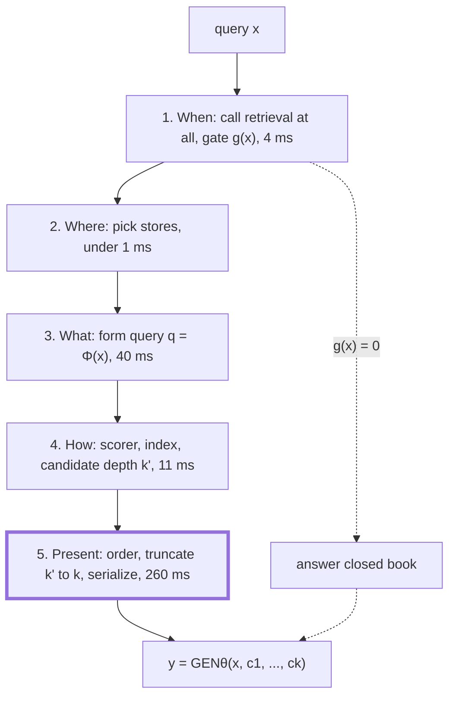
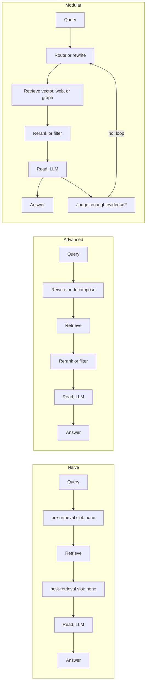
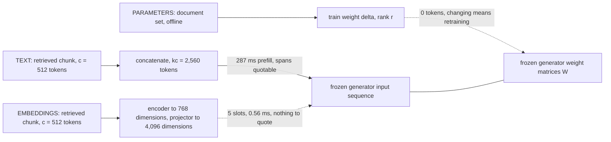
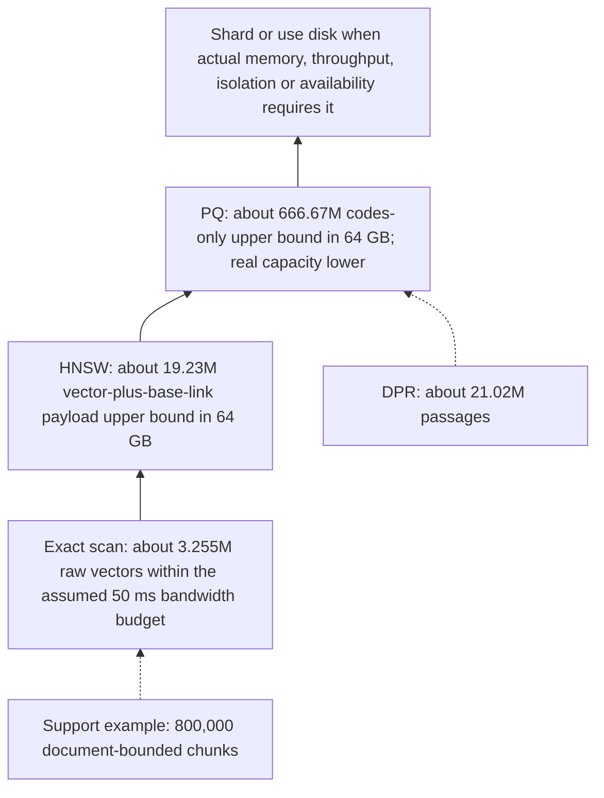
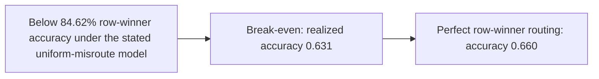

# Chapter 3: A Repeatable Framework for Any Retrieval-Augmented Generation (RAG) Design Question
[00-START-HERE](../00-START-HERE.md) · [01-READING-ROUTES](../01-READING-ROUTES.md) · [02\_the\_competing\_answers\_to\_the\_same\_problem](02_the_competing_answers_to_the_same_problem.md) · [04\_what\_the\_llm\_brings\_and\_what\_it\_breaks](../part-02-generator/04_what_the_llm_brings_and_what_it_breaks.md)
This chapter gives one repeatable way to turn an underspecified retrieval design prompt into explicit choices, priced trade-offs, and a defensible interview answer.
## TL;DR
- Start with five decisions in order: when to retrieve, where to retrieve, what query to issue, how to retrieve, and how to present evidence to the generator.
- Name a design’s maturity by the measured failure it fixes. Naive, advanced, and modular RAG describe graph connectivity, not engineer quality.
- Retrieved knowledge can enter as text, projected embeddings, or parameter updates. Text preserves citation, embeddings save input slots, and parameters trade query cost for update delay.
- Ask for chunk count, peak queries per second, and end-to-end latency before choosing an index. These numbers select the architecture rather than merely tune it.
- Price generation before optimizing search. In the worked sizing example, the idealized retrieval stack uses approximately $`8.61\,\mathrm{ms}`$ of a $`935.02\,\mathrm{ms}`$ full-answer budget; this does not establish p95.
- Separate candidate depth from presentation depth. Retrieving 50 and presenting 5 can preserve recall without paying generation cost for all 50.
- Treat adaptivity as a measured routing problem. Ship a router only when its accuracy or cost dividend clears its own break-even threshold.
## The story
Picture a busy airport control tower that must answer one vague radio call: “Get this passenger to the right destination.” The weak controller starts naming equipment before asking where the passenger is going. The strong controller starts with five decisions.
Does this passenger need a connecting flight at all? That is the retrieval gate, meaning the choice to search or answer from the model’s own knowledge. If a connection is needed, which airport should handle it? That is source selection among documentation, tickets, a wiki, or the open web. What should the flight plan say? That is query compression, expansion, rewriting, or decomposition.
How should the tower find a route? That is scoring and indexing, meaning the machinery that ranks evidence and makes a corpus searchable. Which passengers and bags should enter the final cabin, and in what order? That is reranking, truncation, serialization, and prompt placement. Rebuilding the airplane is parameter training, not retrieval, so it sits outside the five decisions.
The same airport explains maturity and interfaces. Naive RAG is a direct flight. Advanced RAG adds planning before takeoff and inspection before boarding. Modular RAG adds switches and return routes, but every stop adds delay and another failure point. The aircraft also has three loading doors. Text keeps readable passages, projected embeddings save input slots but lose quotable spans, and parameter updates add no context tokens but delay new facts until training.
Before assigning a runway, the tower sizes chunk count, rush-hour query rate, and passenger wait time. A small airport scans every option exactly, a larger one needs a graph, and a still larger one compresses or shards. Passengers also differ. Some need no connection, some need one fact, some need several hops, and some carry a spreadsheet. Adaptivity is the dispatcher, whose gain is the gap between segment winners and the best single route. Misroutes give that gain back, so route only after the segment table proves break-even.
## Decoder table


| Term | Plain-language decoding | Why it matters here |
| --- | --- | --- |
| Retrieval-Augmented Generation (RAG) | A generator answers with information fetched from an external datastore. | It is the system being designed. |
| Query | The user’s information request or its retrieval-ready transformation. | It is the input to gating, routing, and search. |
| Corpus | The full collection of source material available for indexing. | Its token and chunk count determine architecture. |
| Token | One model input or output unit. | Prefill and decode cost scale with token counts. |
| Prompt | The serialized input given to the generator. | Evidence count and placement change its cost and behavior. |
| Model parameter | One learned numeric value in a model’s weights. | Parameter count drives model compute and adapter size. |
| Index | A data structure that makes a corpus searchable. | Its family determines memory, recall, and operations. |
| Vector database | A service that stores vectors and answers similarity queries. | The source compares it with an in-process exact array. |
| Context window | The maximum input and output token capacity available to a model. | A naive 8,000-token retrieval nearly fills an 8,192-token window. |
| Frequently asked questions (FAQ) | Repeated common questions served by a support system. | The source gives a small single-hop FAQ counterexample. |
| Hyperparameter | A setting chosen outside model training, such as HNSW search breadth. | It adds tuning and retuning work. |
| efConstruction | The HNSW parameter that controls graph construction effort. | It joins M and efSearch in the tuning surface. |
| Streaming | Returning generated tokens before the full answer is complete. | It changes the defended latency from completion time to first token. |
| Network hop | A request crossing from one process or service to another. | A managed vector service adds this dependency. |
| Eventual consistency | A state where replicas or stores may agree only after a delay. | A separate vector service can lag the source of truth. |
| Cache hit rate | The fraction of requests that can reuse cached computation. | Low reuse removes the value of document KV caches. |
| Schema | The required structure of an output. | Stable schema behavior can live in an adapter. |
| Wall-clock latency | Elapsed real time seen by the request. | Small arithmetic work can still take about $`2\,\mathrm{ms}`$ in the router example. |
| Portable document format (PDF) | The document format in the $`50\,\mathrm{GB}`$ sizing prompt. | Its layout extraction quality controls token estimates. |
| Millisecond (ms) | One thousandth of a second. | Most latency budgets in the chapter use this unit. |
| Queries per second (QPS) | Request throughput measured each second. | Peak QPS sizes machine bandwidth and replicas. |
| Generator | The model that produces the final answer. | It consumes the query and selected evidence. |
| Retriever | The function that searches a datastore for evidence. | Four of the five decisions shape its use. |
| Datastore | One or more external stores of searchable content. | Choosing among stores can prevent contradiction. |
| Gate | A rule that decides whether retrieval runs for a query. | Retrieval can hurt an answer that was already correct. |
| Closed-book answer | An answer produced without external retrieval. | It is the bypass branch of decision one. |
| Classifier | A model that assigns a query to a decision class. | It can implement retrieval gating or source routing. |
| Confidence threshold | A cutoff on the generator’s estimated certainty. | It is one gate family. |
| Perplexity threshold | A cutoff based on how surprising the generator finds the query or output. | It is another gate family named in the source. |
| Self-reflective retrieval | A scheme in which the model signals that it wants to search. | It makes the gate part of generation. |
| Search token | A generated control token that requests datastore access. | It expresses self-reflective retrieval. |
| Unified Active Retrieval (UAR) | A gate that combines intent, knowledge, time sensitivity, and self-awareness classifiers. | It supplies the worked gate pattern. |
| Large language model (LLM) | The language model used for control or answer generation. | Control calls and final generation have different costs. |
| Hidden state | An internal vector produced by a model layer. | UAR reads hidden states and embedding injection writes into them. |
| Frozen model | A model whose weights are not changed during a training step. | xRAG trains a projector while keeping endpoints frozen. |
| Source router | A controller that selects which datastore to query. | It avoids indiscriminate fan-out. |
| Fan-out | Searching several stores or shards at once. | It can improve recall but increase contradiction and merge work. |
| Contradiction rate | The probability that retrieved evidence conflicts with current truth. | It is the main risk of poor source selection in the worked example. |
| Query transformation | A function that converts the user input into a retrieval query. | It resolves missing context or complex information needs. |
| Compression | Removing irrelevant query content. | It is one query transformation. |
| Expansion | Adding related retrieval terms or context. | It is one query transformation. |
| Rewriting | Restating a query so the retriever can resolve it. | It helps conversational follow-ups. |
| Decomposition | Splitting one request into several sub-queries. | It can recover evidence spread across documents. |
| Scoring function | A rule that assigns relevance scores to query-document pairs. | It determines candidate ranking. |
| Sparse retrieval | Retrieval based on sparse lexical features. | Best Matching 25 and its learned successors are examples. |
| Inverted index | A mapping from terms to documents that contain them. | It makes sparse retrieval searchable. |
| Best Matching 25 (BM25) | The sparse scorer named in the source. | It represents a lexical retrieval family. |
| Sparse Lexical and Expansion model (SPLADE) | A learned sparse retrieval method named in the source. | It is a learned successor to BM25. |
| DeepImpact | A learned sparse retrieval method named in the source. | It is another learned successor to BM25. |
| Dense retrieval | Retrieval based on compact numeric vectors. | It supports single-vector approximate search. |
| Bi-encoder | A model that encodes queries and documents separately. | Separate vectors make large-scale retrieval practical. |
| Dense Passage Retrieval (DPR) | The dense single-vector retriever named in the source. | Its 21 million passage corpus anchors a sizing check. |
| Cross-encoder | A model that scores a query and document jointly. | It gives stronger reranking at a per-pair compute cost. |
| Late interaction | A design that encodes tokens separately, then combines query-document token matches late. | It preserves more detail than one vector per document. |
| Contextualized Late Interaction over Bidirectional Encoder Representations from Transformers (ColBERT) | The source’s multi-vector late-interaction retriever. | Its per-token vectors multiply index size. |
| Maximum similarity (MaxSim) | The ColBERT operation that keeps the strongest token match. | It combines the many token vectors. |
| Candidate depth | The number of items retrieved before reranking, written as k’. | It should be separate from presentation depth. |
| Presentation depth | The number of chunks actually placed in the generator input, written as k. | It drives prefill cost. |
| Reranker | A stage that reorders retrieved candidates with a stronger scorer. | It can preserve recall while shrinking the prompt. |
| Serialization | The format and order used to turn evidence into generator input. | It is part of decision five. |
| Prompt placement | Where evidence and the query appear in the input sequence. | It affects caching and generator behavior. |
| Time to first token | Delay from request arrival to the first generated token. | It is the main latency budget in section 3.1. |
| 95th percentile (p95) | A latency level that 95 percent of requests meet. | The worked service target uses it. |
| Service level objective (SLO) | A committed operating target such as p95 latency. | It constrains retrieval and presentation choices. |
| Floating-point operation (FLOP) | One numerical operation used to estimate model compute. | Prefill, reranking, and control work are priced with it. |
| Tera floating-point operations per second (TFLOP/s) | Trillions of FLOPs completed each second. | It converts model work into time. |
| Giga floating-point operations (GFLOP) | Billions of FLOPs. | It sizes the small routing encoder. |
| Bfloat16 (bf16) | A 16-bit numeric format used for model weights and arithmetic. | The first worked generator and accelerator use it. |
| 16-bit floating point (FP16) | A 16-bit floating-point format. | Later sizing and adaptivity examples use it. |
| 32-bit floating point (FP32) | A 32-bit floating-point format. | Flat vectors use four bytes per dimension. |
| Model FLOP utilization (MFU) | The share of peak arithmetic throughput achieved in practice. | The worked examples assume 40 percent. |
| Prefill | Processing all input tokens before decoding begins. | Retrieved text makes this stage expensive. |
| Decode | Producing output tokens one at a time. | Weight bandwidth often dominates it. |
| Prefix caching | Reusing computation for a shared prompt prefix. | It cannot recover a query placed after changing passages. |
| Graphics processing unit (GPU) | The accelerator running the model. | Daily costs are stated in GPU-hours. |
| A100 | The accelerator model used in the first and third worked examples. | Its throughput and memory anchor the arithmetic. |
| Memory bandwidth | How many bytes an accelerator or machine can move per second. | It bounds decode, scan, and random vector reads. |
| Hierarchical Navigable Small World (HNSW) | A graph-based approximate vector index. | It trades memory, tuning, and approximate recall for faster search. |
| efSearch | An HNSW parameter controlling search breadth. | It affects how many neighbors are touched. |
| M | The HNSW neighbor count per node. | It changes memory and search work. |
| Random-access bandwidth | Effective throughput for scattered memory reads. | It is lower than sequential peak bandwidth in the worked search. |
| Naive RAG | Retrieve, concatenate, then generate. | It is the baseline graph. |
| Advanced RAG | Naive RAG with pre-retrieval and post-retrieval processing. | It fixes measured candidate or augmentation failures. |
| Modular RAG | A library of modules connected as a graph that may branch or loop. | It adds routing and feedback when justified. |
| Retrieval failure | The answer evidence never enters the candidate set. | Later stages cannot recover from it. |
| Generation failure | The evidence is present but the generator reasons incorrectly. | A better retriever does not automatically fix it. |
| Augmentation failure | Evidence is badly ordered, redundant, noisy, or stitched. | It calls for post-retrieval processing. |
| Pre-retrieval slot | Processing before candidate retrieval, such as rewriting. | It repairs a wrong candidate set. |
| Post-retrieval slot | Processing after retrieval, such as reranking or filtering. | It repairs noise, redundancy, and ordering. |
| Control call | An LLM call for rewrite, route, judge, or stop decisions. | Each call adds latency and cost. |
| Intermediate generation | Reasoning text produced inside a retrieval loop. | Loops multiply this work by round count. |
| Recall@k | Whether relevant evidence appears within the first k candidates. | Comparing recall@5 and recall@50 locates ranking failures. |
| Multi-hop query | A question whose evidence spans more than one step or document. | It can justify decomposition or iteration. |
| Agentic design | A module graph that makes control decisions and may loop. | It needs measured value and stage instrumentation. |
| Injection interface | The point where retrieved knowledge enters the generator. | It fixes cost, update speed, and citation properties. |
| Tokenizer | The mapping from text into model input tokens. | Embedding injection bypasses it for documents. |
| Embedding | A numeric vector representing content. | It can index text or enter the generator through a projector. |
| Projector | A learned mapping from retrieval-vector space to generator hidden space. | It fixes modality mismatch. |
| Modality mismatch | A mismatch between the objective and geometry of two representation spaces. | Raw retrieval vectors are not native generator inputs. |
| Alignment data | Training examples that teach a projector how representations should correspond. | They are the expensive part of the projector project. |
| Instruction tuning | Training on examples that map instructions to desired behavior. | xRAG uses it with paraphrase objectives. |
| Attention sink | Concentration of attention on an early sequence position. | It helps explain why one projected state can be readable. |
| xRAG | The embedding-injection method named in the source. | It freezes encoder and generator, then trains the projector. |
| Low-Rank Adaptation (LoRA) | A low-rank matrix update attached to a base model. | File-level removability requires a separate, unmerged adapter. |
| Adapter | A small learned weight delta attached to a model. | It suits stable behavior better than fast-changing facts. |
| Rank | The inner dimension of a low-rank factorization. | It controls adapter parameter count. |
| Retrieval-Augmented Language Model pre-training (REALM) | Joint retrieval-aware pre-training with an external corpus. | REALM still retrieves at inference; it is not pure compilation of the corpus into weights. |
| Span-level citation | Linking an answer claim to exact readable source text. | Projected vectors cannot provide spans. |
| Key-value (KV) cache | Stored attention keys and values for earlier tokens. | Reusing document caches can save recomputation without changing interfaces. |
| Position identifier | The token position carried into attention. | Concatenated caches retain original positions and need correction. |
| Chunk | A retrievable slice of a document. | Chunk length and overlap determine index size. |
| Chunk overlap | Repeated content between adjacent chunks. | It increases the number of indexed vectors. |
| Peak query rate | The busiest queries per second, written as lambda. | It sizes throughput and replicas. |
| End-to-end latency | Total request time from query through answer. | It prevents local search optimization from hiding generation cost. |
| Exact scan | Comparing the query with every eligible vector. | It returns exact neighbors under the chosen metric, not guaranteed semantic evidence recall. |
| Approximate nearest neighbor (ANN) | Search that avoids comparing every vector. | It lowers search work at the cost of approximate recall. |
| Quantization | Compressing vectors into lower-cost codes. | It raises single-node capacity with lossy distances. |
| Product quantization (PQ) | Splitting a vector into subvectors and storing compact centroid codes. | The source uses 96 bytes per vector. |
| Inverted file with product quantization (IVF-PQ) | A coarse partitioned index with product-quantized vectors. | It is the one-node regime above HNSW capacity. |
| Facebook AI Similarity Search (FAISS) | The vector-search library whose HNSW memory formula is cited. | It supplies bytes-per-vector arithmetic. |
| Centroid | A representative vector used by quantization. | Centroid count affects the codebook. |
| Codebook | The stored set of quantization centroids. | It must be retrained when embedding distributions drift. |
| Random-access memory (RAM) | Memory available to hold an index on one node. | A $`64\,\mathrm{GB}`$ usable budget sets two thresholds. |
| Shard | A partition of an index placed on a separate machine. | Crossing one-node capacity adds routing and merge systems. |
| Replica | Another copy of a service or index. | Peak load can require more copies. |
| Tombstone | A deletion marker retained until rebuild. | It is an HNSW operational cost. |
| Duty cycle | The share of one machine’s capacity used over time. | It shows that the support example fits one process. |
| Peak-to-mean ratio | Peak traffic divided by average traffic. | The worked sizing example assumes 5 times. |
| Per-tenant filtering | Restricting results to one customer’s data. | It can trigger a managed shared index earlier. |
| Mixture | A query stream made of distinct information-need segments. | One average configuration can be wrong for every segment. |
| Segment | A group of queries on which configurations behave similarly. | It forms a row in the payoff matrix. |
| Payoff matrix | Accuracy of each configuration on each segment. | It makes adaptive value computable. |
| Fixed policy | One configuration used for all segments. | It supplies the baseline accuracy Afix. |
| Oracle routing | Always choosing the best configuration for each segment. | It supplies the ceiling A\*. |
| Adaptivity dividend | The gap D between oracle accuracy and best fixed accuracy. | It is the most accuracy a router can earn from the current menu. |
| Misroute penalty | Mean accuracy lost when the router chooses the wrong branch. | It determines router break-even. |
| Controller | The router that selects a branch. | Its quality and drift can erase adaptive gains. |
| Abstention | Falling back when router confidence is thin. | It can cap accuracy loss at the best fixed policy. |
| Off-distribution behavior | Behavior on traffic unlike the controller’s training data. | It causes operational pages and routing drift. |
| Parametric-sufficient query | A query the generator can answer from its weights. | Retrieval can disturb it. |
| One-shot RAG | One retrieval and generation pass. | It is the middle configuration in the adaptive menu. |
| Iterative RAG | Several retrieve-and-reason rounds. | It is accurate for some multi-hop queries but expensive. |
| Exact match | A strict answer-accuracy measure. | The opening adaptive system reports 63 percent overall. |
| Reflection token | A learned token signaling search or self-evaluation. | Self-RAG uses distilled reflection tokens. |
| Silver label | A generated supervision label rather than a directly human-authored one. | Adaptive-RAG uses it to train routing. |
| Interleaving Retrieval with Chain-of-Thought (IRCoT) | A style that alternates retrieval with reasoning steps. | Re-reading accumulated context raises loop cost. |
| Table-aware configuration | A branch that preserves row and column structure. | It can raise a weak segment rather than just reroute it. |
| TAPAS | A table-aware model line named in the source. | It represents a missing fourth branch. |
| TableFormer | A table-aware model line named in the source. | It also represents a missing fourth branch. |
| Service level agreement (SLA) | An externally meaningful service commitment. | The adaptive staff prompt treats latency as an SLA. |


## Core mechanics
### Mathematical conventions
Use decimal storage units, with $`1\,\mathrm{GB}=10^9\,\mathrm B`$. Model-forward work is the proxy $`W\approx2NT`$, not measured latency. The A100 examples assume $`P=312\times10^{12}\times0.40=1.248\times10^{14}\,\mathrm{FLOP\,s^{-1}}`$; the later H100-style examples separately assume $`3.4\times10^{14}\,\mathrm{FLOP\,s^{-1}}`$. A byte-stream estimate $`t\approx B_{\mathrm{read}}/B_{\mathrm{bandwidth}}`$ is an idealized bandwidth budget, not a latency guarantee. These models omit queueing, communication, attention-length effects and other overhead. Per-request arithmetic does not establish a p95 SLO or sustained throughput. Carry unrounded values through calculations, then round the displayed result.
### 3.1 The five retrieval decisions as an answer skeleton
#### The formal boundary
Let $`x`$ be user input, $`D`$ the datastore, $`\theta`$ generator weights, $`c_1,\ldots,c_k`$ retrieved chunks, and $`y`$ the answer. A simple retrieval-then-generation pipeline is:

```math
c_1,\ldots,c_k = \mathop{\text{RET}}(x,D)
```


```math
y = \mathop{\text{GEN}}_{\theta}(x,c_1,\ldots,c_k)
```

The five choices organize the retrieval contract; they are not a mathematical enumeration of every free parameter of a production system. The two-line abstraction also hides ingestion, security, caching, decoding, evaluation and serving policies. Changing generator weights is outside these five retrieval choices, not outside the full design space.
The component walk loses because ingest, chunk, embed, index, retrieve, rerank, and generate appear in nearly every design. It cannot express the highest-leverage option, which is not retrieving. In the opening prompt, a candidate has 38 minutes and only “design retrieval for our support assistant.” The weak pattern spends 20 minutes naming six components and makes zero explicit decisions. The staff interviewer has seen the loop 40 times and listens for decision order.
#### The five decisions


| Decision | What it is | Why it exists | What breaks without it | Stated cost or complexity |
| --- | --- | --- | --- | --- |
| 1. When | Compute a gate $`g(x)\in\{0,1\}`$. | Some queries need retrieval and some are harmed by it. | Always retrieving flips roughly 10 percent of otherwise-correct answers to wrong in the cited Mallen et al. (2023) result. | A classifier, generator threshold, or search-token scheme adds control work. |
| 2. Where | Form $`D=D_1\cup\cdots\cup D_m`$, then select $`D_j\subseteq D`$. | Different stores have different authority and freshness. | Conflicting stores give the generator a contradiction that it may resolve silently. | Routing is cheap in the example, but conflict is not. |
| 3. What | Form $`q=\Phi(x)`$ by compression, expansion, rewriting, or decomposition. | The literal query may omit conversational referents or hide multiple needs. | The correct evidence never enters the candidate set. | Rewriting can require another model decode. |
| 4. How | Choose scorer $`s(q, d)`$, index, and candidate depth $`k'`$. | The system needs a searchable ranking mechanism. | Recall, memory, and reranking cost become accidental. | Sparse, dense, cross-encoder, and late-interaction families have different compute and storage. |
| 5. Present | Order, rerank, truncate $`k'`$ to $`k`$, serialize, and place evidence. | The generator pays for every presented token. | Relevant evidence can be buried, duplicated, or made too expensive to process. | This decision owns $`260\,\mathrm{ms}`$ and 82 percent of the first worked budget. |


Decision one has three gate families. A query classifier predicts whether search is needed. A generator confidence or perplexity threshold uses the model’s own signal. A self-reflective scheme lets the model emit a search token. Unified Active Retrieval combines four lightweight classifiers over frozen LLM hidden states. They are intent-aware, knowledge-aware, time-sensitive-aware, and self-aware, then joined in one decision tree. Decision four includes BM25, SPLADE, DeepImpact, DPR, joint query-document cross-encoders, and ColBERT. ColBERT stores one vector per token and aggregates token matches with MaxSim. The five items form a decision list, not a control-flow graph. Iterative and agentic systems can re-enter decisions one and three on every hop.
#### Worked support-assistant budget
The example has $`10^7`$ chunks of $`400`$ tokens, $`5`$ sustained queries per second, and $`432{,}000`$ queries per day. The generator has $`8\times10^9`$ bf16 parameters. An $`80\,\mathrm{GB}`$ A100 is the costing unit; its assumed dense peak is $`312\,\mathrm{TFLOP/s}`$ and sustained throughput at $`40\%`$ MFU is $`124.8\,\mathrm{TFLOP/s}`$. The product target is $`800\,\mathrm{ms}`$ p95 time to first token. The following is a serial work budget, not evidence that one card meets that throughput or tail target.
- Decision one reads a $`30`$-token query: $`2(8\times10^9)(30)=4.8\times10^{11}\,\mathrm{FLOP}`$, or approximately $`3.85\,\mathrm{ms}`$, budgeted as $`4\,\mathrm{ms}`$.
- The final generator also reads the query; the separate gate and final call do not share that work in this layout.
- A measured $`35\%`$ bypass slice represents $`151{,}200`$ queries per day. Avoided right-to-wrong flips would be $`151{,}200\,p_{\mathrm{correct\mid bypass}}h_{\mathrm{bypass}}`$ only under a matched counterfactual outcome model; a global $`10\%`$ rate alone does not imply $`15{,}000`$ avoided errors.
- Decision two reuses gate hidden states and is allocated $`1\,\mathrm{ms}`$ for its classifier head.
- If each of three ticket chunks independently contradicts current documentation with probability $`0.12`$, the probability of at least one such chunk is $`1-0.88^3=0.318528`$. Dependence changes this result, and contradictory evidence does not automatically produce a wrong answer.
- Decision three uses a $`10^9`$-parameter bf16 rewriter on conversational follow-ups. Streaming its $`2\,\mathrm{GB}`$ weights at $`2\,\mathrm{TB/s}`$ gives a $`1\,\mathrm{ms/token}`$ bandwidth proxy, or $`40\,\mathrm{ms}`$ for $`40`$ decoded tokens, before prefill and other overhead.
- Decision four uses HNSW with $`M=32`$ and $`\mathrm{efSearch}=128`$. Assume a separate budget of $`8{,}192`$ vector reads; $`\mathrm{efSearch}\times2M`$ is not a guaranteed number of visited nodes.
- Those reads move $`25.165824\,\mathrm{MB}`$ at $`3{,}072\,\mathrm{B/vector}`$. At an assumed $`10\,\mathrm{GB/s}`$ effective random-read rate, this is approximately $`2.52\,\mathrm{ms}`$.
- Reranking $`50`$ pairs of $`430`$ tokens with a $`22`$-million-parameter cross-encoder uses $`9.46\times10^{11}\,\mathrm{FLOP}`$, or approximately $`7.58\,\mathrm{ms}`$. Search plus reranking is approximately $`10.10\,\mathrm{ms}`$; allocate $`11\,\mathrm{ms}`$ in the rounded budget.
- Decision five presents five chunks plus the query: $`T=2{,}030`$ and $`W=3.248\times10^{13}\,\mathrm{FLOP}`$. The prefill proxy is approximately $`260.26\,\mathrm{ms}`$, budgeted as $`260\,\mathrm{ms}`$.
The rounded serial budget is $`4+1+40+11+260=316\,\mathrm{ms}`$, with presentation contributing $`260/316\approx82.28\%`$. Raising presentation depth to $`20`$ gives $`8{,}030`$ input tokens and approximately $`1{,}029.49\,\mathrm{ms}`$ of prefill. Adding the same $`56\,\mathrm{ms}`$ other-stage allowance gives approximately $`1{,}085.49\,\mathrm{ms}`$, or $`35.69\%`$ above the target even before queueing. At five chunks, daily prefill consumes approximately $`31.23`$ GPU-hours and costs $`\$62.46`$ at $`\$2`$ per GPU-hour; at twenty chunks, approximately $`123.54`$ GPU-hours and $`\$247.08`$. The difference is approximately $`\$184.62`$ per day or $`\$67{,}385`$ over $`365`$ days. Crucially, prefill alone at five sustained QPS requires $`5(0.260256)\approx1.30`$ GPU-seconds per second: at least two such cards under this proxy, versus at least six at twenty chunks, before decode and other work. One card therefore cannot sustain the stated load. The peak-only parameter-work bound for $`8{,}030`$ tokens is $`8030/(312\times10^{12}/(16\times10^9))\approx0.412\,\mathrm{s}`$ within this dense arithmetic model, not a universal hardware-independent floor.
#### Practice defaults and deviations
- State “when, where, what, how, present” in about 60 seconds, then ask for corpus size, query rate, and latency. If the prompt pins one decision, name the other four in one sentence.
- Default to gating. Retrieve on every query when attribution is contractually required, because citation rather than accuracy then sets the rule.
- Default to one routed store per query. Fan out when stores are disjoint or a downstream reranker can arbitrate conflicts.
- Budget presentation first. In this example, present 5 after retrieving 50.
- Keep $`k'`$ and $`k`$ separate. Without a reranker they collapse to the same value and the index must buy recall.
- Short 100-token chunks allow $`k = 20`$ at the same prefill cost as five 400-token chunks.
### 3.2 Naive, advanced, and modular RAG as design maturity
#### Failure class before paradigm name
The opening maturity prompt arrives 25 minutes into a design loop. The bad reflex is to promise a rewriter, reranker, router, and loop because they sound advanced. The source gives a counterexample. Query decomposition and a cross-encoder tripled latency for an internal FAQ bot with single-hop questions and $`4{,}000`$ documents, while fixing a failure class the product did not have. Lewis et al. (2020) named the naive two-stage pattern. Retrieve passages, concatenate them, then generate. Gao et al. (2023) organize its failures into three classes.


| Failure class | What it is | Correct repair location | What breaks if misdiagnosed |
| --- | --- | --- | --- |
| Retrieval | The correct evidence is absent from candidates. | Before retrieval, through rewrite, expansion, or decomposition. | Every later stage chooses among wrong evidence. |
| Generation | Correct evidence is present, but reasoning fails. | In prompting or generator capability. | A better retriever leaves the failure unchanged. |
| Augmentation | Evidence is noisy, redundant, badly ordered, or stitched. | After retrieval and before generation. | Concatenation repeats or buries facts. |


The source’s generation example asks a model trained through 2023 for total H-1B filing cost in 2026. The correct pages are present, but the model lists base, training, and fraud-prevention fees without summing them. If all components occupy one chunk, a prompt instruction to sum adds zero modules and zero retrieval latency. Decomposition is justified only when the components are spread across documents. Advanced RAG fills a pre-retrieval slot and a post-retrieval slot. Modular RAG turns the modules into a graph that may route, branch, judge, and loop. Naive RAG is already the small module graph $`retrieve -\gt  read`$. Advanced RAG adds a rewriter and reranker to the same graph. The right design is the least connected graph that closes a measured failure.
#### Additive and multiplicative latency
Let $`L_r`$ be retrieval latency, $`L_g`$ final generation, $`L_c`$ one control call, $`L_k`$ reranking, $`L_{g'}`$ an intermediate generation, and $`T`$ the number of sequential retrieve-reason rounds. The simplified serial budgets are:

```math
L_{\text{naive}} = L_r + L_g
```


```math
L_{\text{advanced}} = L_c + L_r + L_k + L_g
```


```math
L_{\text{modular}}(T) = T(L_c + L_r + L_k + L_{g'}) + L_g
```

Naive to advanced adds $`L_c+L_k`$ only when the unchanged stages really retain their latency. A loop pays for each control, retrieval, rerank and intermediate-generation round before the final answer. Parallel work contributes the maximum branch latency rather than the sum, but only with enough capacity and no additional contention.
#### Worked maturity budget
The example uses 10 million chunks at 400 tokens behind HNSW. Query embedding is $`8\,\mathrm{ms}`$ and ANN search is $`5\,\mathrm{ms}`$, so retrieval latency is $`13\,\mathrm{ms}`$. A cross-encoder scores $`1{,}000`$ query-document pairs per second. A control LLM call is $`250\,\mathrm{ms}`$, final generation is $`1{,}200\,\mathrm{ms}`$, and an intermediate generation is $`600\,\mathrm{ms}`$. Generator input costs 3 dollars per million tokens. The control model costs $`0.15`$ dollars per million tokens.
- Naive presents $`20`$ chunks: $`13+1{,}200=1{,}213\,\mathrm{ms}`$. Its $`8{,}000`$ retrieved input tokens cost $`\$0.0240`$ at the assumed $`\$3`$ per million input tokens.
- Advanced decomposes into three subqueries, retrieves $`20`$ for each in parallel, reranks $`60`$, and keeps five. Assuming the parallel searches still finish in $`13\,\mathrm{ms}`$, total latency is $`250+13+60+1{,}200=1{,}523\,\mathrm{ms}`$.
- The final retrieved input is $`2{,}000`$ tokens costing $`\$0.0060`$, plus an assumed $`\$0.0001`$ control allowance. This $`\$0.0061`$ scoped component is approximately $`3.93`$ times lower than the naive component; output and other input charges are not included.
- Modular uses two retrieve-reason rounds at $`250+13+60+600=923\,\mathrm{ms}`$ each, then final generation: $`2(923)+1{,}200=3{,}046\,\mathrm{ms}`$, approximately $`2.51`$ times naive.
- Ten accumulated chunks cost $`\$0.0120`$ in the final call's retrieved input alone. This is not the total loop bill: intermediate calls, repeated context, control and output tokens must also be counted.
Advanced reduces the final retrieved-input component by $`75\%`$ for $`310\,\mathrm{ms}`$ more modeled latency. The loop adds another $`1{,}523\,\mathrm{ms}`$ and doubles that final-context component; its full token bill cannot be inferred from the final context alone. Adding the most modules does not prove that a system is more mature or more accurate.
#### Practice defaults and deviations
- Ship naive RAG first and call it naive. Add a module only for a measured retrieval, generation, or augmentation failure.
- Compare recall@5 with recall@50. High recall@50 and low recall@5 call for post-retrieval reranking. Low recall@50 calls for pre-retrieval repair or a corpus audit.
- Budget $`250\,\mathrm{ms}`$ for each full control-model round trip. Under a one-second target, this example already fails because final generation alone is $`1{,}200\,\mathrm{ms}`$; no additional sequential control call fits without changing that stage. Overlap and streaming change the metric and must be specified.
- Label a few hundred production queries to measure the multi-hop rate. Below roughly 20 percent, default to advanced RAG. Above that, route only the multi-hop slice through the $`3{,}046\,\mathrm{ms}`$ loop.
- Log candidates, reranked results, and final context separately before adding another module.
For a product with a $`2\,\mathrm{s}`$ target and a $`12\%`$ multi-hop slice, routing $`88\%`$ through $`1{,}523\,\mathrm{ms}`$ and $`12\%`$ through $`3{,}046\,\mathrm{ms}`$ gives mean latency $`0.88(1523)+0.12(3046)=1{,}705.76\,\mathrm{ms}`$. This does not establish a two-second p95 SLO. Even with deterministic branch times and no queueing, $`12\%`$ exceed two seconds and the mixture's p95 is $`3{,}046\,\mathrm{ms}`$. Define whether the SLO concerns a mean, a percentile, first token or completion before claiming compliance.
### 3.3 The three injection interfaces
#### One distribution, three entry points
Let $`q`$ be the query, $`\mathcal D_q=\{d_1,\ldots,d_k\}`$ selected documents, $`\theta`$ generator weights, $`h`$ hidden width, $`e(\cdot)\in\mathbb R^d`$ the retrieval encoder, and $`W_p:\mathbb R^d\to\mathbb R^h`$ a projector. Three schematic injection paths are:

```math
p_{\theta}(y \mid \mathop{\text{tok}}(d_1) \oplus \cdots \oplus \mathop{\text{tok}}(d_k) \oplus \mathop{\text{tok}}(q))
```

The text interface converts documents into tokens and concatenates them with the query.

```math
p_{\theta}(y \mid W_p e(d_1), \ldots, W_p e(d_k), \mathop{\text{tok}}(q))
```

The embedding interface projects retrieval vectors into generator hidden states and uses one input slot per document in the worked design.

```math
p_{\theta + \Delta\theta(D)}(y \mid \mathop{\text{tok}}(q))
```

The parameter interface compiles the corpus into a weight delta before the query arrives.


| Interface | What it is | Why it exists | What breaks without care | Stated cost or complexity |
| --- | --- | --- | --- | --- |
| Text | Put retrieved text into the input sequence. | It needs no training and preserves readable spans. | Prefill repeats for every query and grows with chunk count and length. | Five 512-token chunks add $`2{,}560`$ input tokens and $`287\,\mathrm{ms}`$ in the example. |
| Embeddings | Project one retrieval vector per document into hidden space. | It compresses input slots by the chunk length. | Raw vectors have the wrong objective, citations vanish, and multi-hop structure can be lost. | A $`3.1`$ million parameter projector and alignment corpus are required. |
| Parameters | Train a weight delta from the corpus. | It removes retrieved-content tokens from each query. | Fast-changing facts wait for retraining. | Per-query context cost is zero, but every update is a training run. |


#### Text and embedding arithmetic
Dense-transformer forward work is approximated as 2 FLOPs per parameter per token. For a 7 billion parameter generator, 5 chunks, and 512 tokens per chunk, retrieved prefill is $`3.58 x 10^{13}`$ FLOPs.
At the assumed A100 sustained rate of $`124.8\,\mathrm{TFLOP/s}`$, the $`3.584\times10^{13}\,\mathrm{FLOP}`$ retrieved-text term takes approximately $`287.18\,\mathrm{ms}`$. This is the document-prefill component, not total request latency.
Five projected document vectors use five input slots rather than $`2{,}560`$. Under the same parameter-work proxy, the retrieved-document component falls by $`2560/5=512`$. Query tokens, encoder and projector work, search, training, answer decoding and attention effects are outside this ratio; total end-to-end latency need not fall by that factor.
A $`768`$-dimensional fp32 vector has $`768\times32=24{,}576`$ physical storage bits. A $`512`$-token passage at an assumed four characters per token has about $`2{,}048`$ characters. Comparing storage bits with a historical estimate of one bit per character gives the numerical ratio $`24{,}576/2{,}048=12`$. Float bit count is not a demonstrated usable information capacity, and the source-entropy assumption does not prove that a retrieval embedding preserves the passage.
Capacity is therefore not settled by the bit-count comparison. Morris et al. (2023) demonstrate embedding inversion in their tested setting, including sequences around $`32`$ tokens; that does not establish near-exact reconstruction of a $`512`$-token passage. Longer passages and different encoders require their own fidelity tests.
Retrieval vectors are trained for ranking. Generator hidden states are trained for next-token prediction. xRAG, attributed to Cheng et al. (2024), freezes the retrieval encoder and generator, then trains only the projector using paraphrase-style and instruction-tuning objectives.
A bias-free linear projector from $`768`$ to $`4{,}096`$ dimensions contains $`768\times4{,}096=3{,}145{,}728`$ parameters, approximately $`0.04494\%`$ of a $`7`$B generator. A bias adds $`4{,}096`$ more. Parameter count alone does not price alignment-data creation or training.
The source notes near-diagonal local attention in the first two layers and concentration on the first position from roughly layer two upward, citing Xiao et al. (2024). This attention-sink behavior makes one hidden-state slot a shape the transformer already reads.
#### Parameter arithmetic and losses
LoRA, attributed to Hu et al. (2021), represents a matrix update with $`r(d_{\mathrm{in}}+d_{\mathrm{out}})`$ stored factor values rather than $`d_{\mathrm{in}}d_{\mathrm{out}}`$ full-matrix values. These are storage counts, not counts of independently editable facts. A separate, unmerged adapter can be removed as a file; arbitrary merged training updates do not retain that guarantee.
REALM, attributed to Guu et al. (2020), jointly trains retrieval and generation with access to an external corpus. It still retrieves at inference; it is not evidence that a corpus has been compiled entirely into weights with no serving-time retrieval. The pure parameter-injection expression instead describes a separately trained weight delta, whose update cost and factual retention must be evaluated directly.
Embedding injection loses when the product must quote source spans. It also weakens on multi-hop questions in the xRAG evaluation because one vector per document may not preserve cross-document structure.
Parameter injection loses when corpus changes happen faster than retraining. Text loses when repeated chunks make prefill dominate the measured budget.
Precomputed KV caches are not a fourth interface. They retain the text tokens and citation ability while memoizing computation. Concatenated per-document caches lose cross-document attention and retain original position identifiers, so both need correction.
#### Worked interface budget
The example uses 10 million chunks, 512 tokens per chunk, 5 retrieved documents, a 7 billion parameter generator with hidden size $`4{,}096`$, a 768-dimensional retrieval encoder, and 1 million queries per day.
- Raw text uses $`2{,}560`$ retrieved-content slots, $`3.584\times10^{13}\,\mathrm{FLOP}`$ and approximately $`287.18\,\mathrm{ms}`$ under the A100 proxy.
- At $`\$2`$ per GPU-hour, this component costs approximately $`\$1.59544\times10^{-4}`$ per query, or $`\$159.54`$ for $`10^6`$ queries.
- Five projected slots use $`7.0\times10^{10}\,\mathrm{FLOP}`$ and approximately $`0.56090\,\mathrm{ms}`$, costing approximately $`\$0.31161`$ per million queries for this component.
- A $`4{,}096\times4{,}096`$ projection has $`16{,}777{,}216`$ weights. Rank-eight factors store $`8(4096+4096)=65{,}536`$ values, a $`256`$-fold storage reduction for that update.
- Parameter injection adds no retrieved-content input tokens, but still incurs query/answer serving work and training on every refresh.
- A change rate of one document in $`10{,}000`$ per hour means $`1{,}000`$ changes per hour for this $`10^7`$-document scale. It is an argument to price refresh and staleness, not a theorem that every parameter design is invalid.
- The retrieved-slot cost difference is approximately $`\$159.23`$ per day or $`\$58{,}120`$ per $`365`$ days, excluding training and the other serving components.
The $`512`$-fold result concerns input-slot arithmetic, not demonstrated reconstruction fidelity. A $`32`$-token inversion experiment and a proposed $`512`$-token chunk differ by $`16`$ in source length, but neither a $`32{:}1`$ recoverable compression guarantee nor a $`16`$-fold fidelity gap follows from that comparison.
#### Practice defaults and deviations
- Default to text because it supports span citation, needs no training, and updates through the index.
- Measure prefill before changing interfaces. Suspicion is not enough.
- Reuse KV caches first when chunks repeat. A low cache-hit rate removes this advantage.
- Reject embedding injection when generated quotes need exact spans. Document-level metadata may be enough only when the generator never quotes.
- Use adapters for stable behavior such as tone, format, and schema, not hourly facts. Re-check the assumed change cadence every quarter.
- Treat a projector as a training project bound to one frozen encoder-generator pair.
For $`400`$ customers requiring independently refreshed adapters every hour, a naive one-run-per-customer policy entails $`400`$ training runs per hour. Batching, shared training and update scheduling can change that count, but then tenant isolation and freshness guarantees also need scrutiny. A retrieval datastore with stable behavior adapters is the source's recommended starting point, not an arithmetic impossibility result for all other designs.
### 3.4 Size the problem before selecting the architecture
#### The three numbers
The opening design interview lasts 45 minutes. The weak candidate names HNSW, a 768-dimensional bi-encoder, and a top-20 cross-encoder by 90 seconds, then learns at minute 30 that the corpus has only $`200{,}000`$ articles.
Ask first for chunk count $`N`$, peak query rate $`\lambda`$, and end-to-end latency budget $`L`$. Index family, quantization, shards, replicas, and reranker depth follow from them.
Document count alone is misleading. Let document $`i`$ contain $`t_i\gt 0`$ tokens, chunk length be $`c`$, and positive stride be $`s=c(1-\rho)`$ with $`0\le\rho\lt 1`$. For fixed-stride chunks that stay inside each document and retain the final partial chunk, the exact count is:

```math
\begin{aligned}
n_i&=\max\!\left(1,\ 1+\left\lceil\frac{t_i-c}{s}\right\rceil\right),\\
N&=\sum_{i=1}^{D}n_i,\\
N&\approx\frac{D\bar t}{c(1-\rho)}
\quad\text{only as a long-document approximation}.
\end{aligned}
```

One million $`30`$-token tweets give one million chunks when each tweet is kept intact. One million filings of exactly $`50{,}000`$ tokens, $`c=400`$ and $`s=300`$ give $`1+\lceil(50000-400)/300\rceil=167`$ chunks each, hence $`167`$ million chunks. Average lengths alone do not uniquely determine these document-wise ceilings.
For extracted plain English text, the source uses roughly four bytes per token as a planning approximation. Characters and bytes differ for non-ASCII text; compressed PDF file size is not extracted-text size. Extraction, tables, OCR, language and tokenizer all affect the conversion.
#### Bytes per vector and architecture thresholds
At dimension $`d = 768`$, a flat FP32 vector uses $`4d = 3{,}072`$ bytes.
The scoped HNSW estimate $`4d+8M`$ budgets fp32 vectors plus up to $`2M`$ four-byte neighbor identifiers in the base layer. At $`d=768`$ and $`M=32`$, this is $`3{,}328\,\mathrm{B/vector}`$. It omits upper layers, identifiers outside the links, allocator overhead, metadata and source text; it is not an all-in memory measurement.
Product quantization with $`m=96`$ subvectors and $`256`$ centroids uses $`96`$ one-byte codes per vector, $`32`$ times smaller than the $`3{,}072`$-byte raw payload. An fp32 codebook contains $`256\times768\times4=786{,}432\,\mathrm B`$. IVF-PQ also needs identifiers, coarse centroids, inverted lists and other overhead; code bytes alone do not establish node capacity.


| Regime | Derived boundary | What exists there | What breaks on crossing |
| --- | --- | --- | --- |
| Flat exact | Up to approximately $`3.255`$ million vectors in the stated bandwidth budget | Exact top-$`k`$ under the chosen scoring function. | The idealized scan alone exceeds $`50\,\mathrm{ms}`$. |
| One-node HNSW | At most approximately $`19.23`$ million by vector-plus-base-link payload | A $`64\,\mathrm{GB}`$ payload upper bound, before other memory. | Real capacity is lower once overhead and headroom are included. |
| One-node IVF-PQ | At most approximately $`666.67`$ million by codes alone | A $`64\,\mathrm{GB}`$ code-only upper bound. | Identifiers, lists and headroom can force an earlier move. |
| Sharded or disk | When measured one-node memory or throughput is exhausted | Routing, merging or disk access become subsystems. | There is no universal $`670`$-million-vector transition. |


At $`200\,\mathrm{GB/s}`$ sequential bandwidth and a $`50\,\mathrm{ms}`$ scan allowance, the byte budget is $`10\,\mathrm{GB}`$. The raw-vector limit is $`10^{10}/3072\approx3{,}255{,}208`$ vectors. This ignores scoring arithmetic, filters, output selection and contention. Exact scan returns exact nearest neighbors under the same metric and tie/filter rules; it does not guarantee semantic evidence recall of one.
The corresponding payload-only memory bounds are $`64\times10^9/3328\approx19.23`$ million HNSW vectors and $`64\times10^9/96\approx666.67`$ million PQ codes. Their per-vector budget ratio is $`3328/96\approx34.67`$. Both are upper bounds before the omitted components, so neither is a hard production sharding threshold.
Crossing a threshold changes the index family, recall behavior, build time, training requirements, and operating model. The three sizing numbers take under two minutes to compute. Between the HNSW and IVF-PQ regimes, rebuild time can move from seconds to hours. A 100 times larger-corpus follow-up tests this architecture change. It does not merely tune the same design.
An uncompressed ColBERT-style representation with $`400`$ fp32 token vectors of $`128`$ dimensions uses $`400\times128\times4=204{,}800\,\mathrm B`$ per chunk. This is approximately $`66.67`$ times the $`768`$-dimension single-vector payload; $`3`$ million such chunks use $`614.4\,\mathrm{GB}`$. Compression and implementation choices can change this substantially.
#### Generation-first latency budget
For a $`7`$B generator at the assumed $`3.4\times10^{14}\,\mathrm{FLOP\,s^{-1}}`$, parameter prefill work is approximately $`0.041176\,\mathrm{ms/token}`$. A separate batch-one weight-stream model reads $`14\,\mathrm{GB}`$ at $`3.35\,\mathrm{TB/s}`$, giving approximately $`4.1791\,\mathrm{ms}`$ per decoded token. The latter is a bandwidth proxy with no cache traffic or other overhead, not a measured latency or an impossibility bound for batching and quantized implementations.
Five $`400`$-token chunks plus $`200`$ instruction tokens give $`2{,}200`$ prefill tokens and approximately $`90.59\,\mathrm{ms}`$. A $`200`$-token answer contributes approximately $`835.82\,\mathrm{ms}`$ under the batch-one weight-bandwidth proxy.
Embedding a $`32`$-token query with a $`110`$M encoder costs $`7.04\times10^9\,\mathrm{FLOP}`$, or approximately $`0.02071\,\mathrm{ms}`$ of arithmetic. Here assume a separate $`110`$M cross-encoder: reranking $`20`$ pairs of $`432`$ tokens uses $`1.9008\times10^{12}\,\mathrm{FLOP}`$, or approximately $`5.59\,\mathrm{ms}`$. This differs from the $`22`$M reranker in section 3.1. Adding an assumed $`3\,\mathrm{ms}`$ ANN allowance gives approximately $`8.61\,\mathrm{ms}`$ for retrieval plus reranking, $`99.20\,\mathrm{ms}`$ through prefill, and $`935.02\,\mathrm{ms}`$ through the modeled full answer. Retrieval is approximately $`0.92\%`$ of that full-answer budget. None of these arithmetic sums determines p95.
Choose the index for memory and cost unless retrieval dominates. The named exceptions are retrieval-only products, very large $`k`$, and corpora above the sharding threshold where each query fans out.
#### Worked support-corpus sizing
The brief has $`200{,}000`$ support articles, 3 million queries per month, and an answer target of about 1 second.
With exactly $`1{,}200`$ tokens per article, the support corpus contains $`2.4\times10^8`$ source tokens. At $`c=400`$ and stride $`300`$, each article yields four chunks, so $`N=800{,}000`$. An average alone is insufficient if lengths are heterogeneous.
The flat vector payload is $`800{,}000\times3072=2.4576\,\mathrm{GB}`$. This is approximately $`24.58\%`$ of the $`10\,\mathrm{GB}`$ raw scan budget, before other memory and work.
Three million monthly queries are $`1.16`$ average queries per second over 30 days. A 5 times peak-to-mean ratio gives $`5.8`$ peak queries per second.
One scan reads $`2.4576\,\mathrm{GB}`$, giving $`12.288\,\mathrm{ms}`$ at the assumed bandwidth. The unrounded peak rate is approximately $`5.7870`$ QPS, for bandwidth duty $`5.7870(0.012288)\approx0.07111`$, or $`7.11\%`$. This leaves bandwidth headroom but does not establish an end-to-end service capacity or tail latency.
HNSW vector-plus-base-link payload is $`800{,}000\times3328=2.6624\,\mathrm{GB}`$. A $`1\,\mathrm{ms}`$ search is an illustrative measured-or-to-be-benchmarked allowance, not a consequence of that byte count. It introduces $`M`$, $`\mathrm{efConstruction}`$ and $`\mathrm{efSearch}`$ tuning; deletion and rebuild policies depend on the implementation.
Flat search uses the $`2.4576\,\mathrm{GB}`$ vector payload and the $`12.288\,\mathrm{ms}`$ scan proxy. It has no ANN-approximation hyperparameters, but still has scoring, filtering, numerical and implementation choices. Exact top-$`k`$ agreement under that metric is not relevance recall of one. Refresh and deletion work must be priced for either design.
Against the assumed $`1\,\mathrm{ms}`$ HNSW search, flat scan adds $`11.288\,\mathrm{ms}`$, approximately $`1.21\%`$ of the $`935.02\,\mathrm{ms}`$ HNSW-based full-answer proxy. Flat scan is a reasonable starting point here when its operational simplicity is worth that budget; this is not a general rule for every latency target.
The scan-only $`50\,\mathrm{ms}`$ limit is crossed at $`3{,}255{,}209`$ vectors. At four chunks per homogeneous article, the first article count above it is $`813{,}803`$, approximately $`814{,}000`$. Shrinking chunks to $`100`$ tokens at stride $`75`$ gives $`16`$ chunks per $`1{,}200`$-token article, hence $`3.2`$ million vectors: close to, but still below, this idealized limit.
The DPR reference has $`21{,}015{,}324`$ passages. At $`768`$ dimensions, fp32 vector payload is approximately $`64.559\,\mathrm{GB}`$; vector-plus-HNSW-base-link budget is approximately $`69.939\,\mathrm{GB}`$; $`96`$-byte PQ codes use approximately $`2.0175\,\mathrm{GB}`$. This is approximately $`26.27`$ times the support corpus's chunk count. These scoped sizes do not include complete index overhead.
#### Practice defaults and deviations
- Ask for tokens or text bytes rather than document count unless records are truly homogeneous.
- Default to exact search below a few million vectors. Deviate when $`\lambda b_{\mathrm{vector}}N/B`$ approaches one machine.
- At $`3{,}072`$ bytes per vector and $`200\,\mathrm{GB}`$/s, one million vectors consume a full machine near 65 queries per second.
- In a retrieval-only product, even $`12\,\mathrm{ms}`$ can be material because search is the whole budget.
- Quantize before sharding. A full-precision rerank of top candidates largely recovers the lossy distance. Deviate when exact filtering or high-churn per-tenant deletion makes codebook retraining costly.
- Budget from decode backward. A $`200`$-token answer has an approximately $`835.82\,\mathrm{ms}`$ batch-one weight-stream proxy under this configuration; benchmark actual decode and distinguish it from other batching or precision choices.
- With streaming, defend time to first token instead. The consistent retrieval-plus-prefill proxy is approximately $`99.20\,\mathrm{ms}`$ before first-token and other serving overhead, not $`85\,\mathrm{ms}`$.
- Size the reranker with candidate depth $`k'`$ and the index with corpus size $`N`$; generator presentation depth $`k`$ is a separate budget. Shard-local candidates multiply reranker depth by shard count.
One million $`768`$-dimension fp32 vectors occupy $`3.072\,\mathrm{GB}`$, while their $`96`$-byte PQ codes occupy $`96\,\mathrm{MB}`$ before overhead. If—and only if—$`50\,\mathrm{GB}`$ refers to extracted plain text and an assumed $`4\,\mathrm{B/token}`$ is appropriate, it implies $`1.25\times10^{10}`$ tokens, approximately $`4.17\times10^7`$ long-document chunks at effective stride $`300`$, and approximately $`4.0\,\mathrm{GB}`$ of codes. A $`50\,\mathrm{GB}`$ compressed PDF collection does not by itself establish this token count.
The source also flags extraction quality. A PDF corpus is a layout-extraction problem before it is an index problem, so the token estimate inherits extractor quality.
For the 800,000-chunk support corpus, a managed vector database adds a network hop, availability dependency, and eventual-consistency window relative to an in-process array. The exception should expire at $`3.3`$ million chunks, when per-tenant filtering arrives, or when more than one service needs the vectors.
### 3.5 Adaptivity as the default answer
#### Mixtures, menus, and ceilings
The opening shipped pipeline uses recursive character chunks of 512 tokens, one embedding model, HNSW, top 5, and a cross-encoder. Overall exact match is 63 percent, yet support users remain unhappy.
Traffic separates into four needs. A fifth is parametric-sufficient, and retrieval can disturb it. Half is one fact in one paragraph. The remaining 30 percent is split between multi-hop evidence and tabular or numeric questions.
Let segment weights $`\pi_i`$ sum to 1. Let $`a_{ij}`$ be the accuracy of configuration $`j`$ on segment $`i`$.

```math
A_{\text{fix}} = \max_j \sum_i \pi_i a_{ij}
```

The best fixed policy chooses one column for all traffic.

```math
A^{*} = \sum_i \pi_i \max_j a_{ij}
```

Oracle routing chooses the best cell in every row.

```math
D = A^{*} - A_{\text{fix}} \ge 0
```

The adaptivity dividend $`D`$ is zero exactly when one configuration is at least as good as every other configuration on each segment with positive weight.
Let $`\rho`$ be the probability of choosing a row-optimal branch, and let $`L_{\mathrm{loss}}`$ be mean accuracy loss conditional on a misroute. Then $`A(\rho)=A^\star-(1-\rho)L_{\mathrm{loss}}`$. The conditional loss depends on the router's actual confusion pattern; a single aggregate route-accuracy value does not determine it. For $`L_{\mathrm{loss}}\gt 0`$, beating the best fixed column requires:

```math
A(\rho) = A^{*} - (1-\rho)L_{\text{loss}}
```


```math
\rho \ge 1 - \frac{D}{L_{\text{loss}}}
```

The numerator is only the improvement over the already-best compromise. The denominator includes every wrong route, including closed-book handling of a multi-hop query or an expensive loop on a known fact.
The source names UAR’s four-criterion tree, Self-RAG’s distilled reflection tokens, and Adaptive-RAG’s silver-label supervision as examples of controller engineering.
Always retrieve, rerank, and iterate is a legitimate fallback when $`D`$ is small and no buildable router clears break-even. It still pays the most expensive branch on all traffic and inherits the roughly 10 percent retrieval flip rate on identifiable parametric-sufficient queries.
#### Worked payoff matrix


| Segment and weight | No retrieval | One-shot RAG | Iterative RAG | Row winner |
| --- | --- | --- | --- | --- |
| Parametric-sufficient, $`0.20`$ | $`0.78`$ | $`0.68`$ | $`0.66`$ | No retrieval |
| Single-hop factoid, $`0.50`$ | $`0.31`$ | $`0.72`$ | $`0.71`$ | One-shot RAG |
| Multi-hop, $`0.15`$ | $`0.18`$ | $`0.34`$ | $`0.58`$ | Iterative RAG |
| Tabular or numeric, $`0.15`$ | $`0.22`$ | $`0.36`$ | $`0.38`$ | Iterative RAG |
| Fixed-policy accuracy | $`0.371`$ | $`0.601`$ | $`0.631`$ | Best fixed is iterative RAG |


Oracle routing scores 0.660. The dividend is $`0.660 - 0.631 = 0.029`$, or $`2.9`$ accuracy points.
The bottom row’s best score is only $`0.38`$ because none of the three text configurations preserves table structure. A fourth TAPAS or TableFormer-style branch raises that row rather than reallocating existing strengths.
This principle applies to all five decisions. Retrieval gating is only the narrow paper usage of “adaptive retrieval.” Source choice, chunk size, hop count, query transformation, and injection interface can also vary by segment.
#### Worked adaptive latency and break-even
The matrix comes from $`100{,}000`$ queries per day, one week of logs, and offline runs of all three configurations. The generator has 7 billion parameters in FP16 and $`14\,\mathrm{GB}`$ of weights.
The separate adaptive example uses $`3.35\,\mathrm{TB/s}`$ weight bandwidth and $`3.4\times10^{14}\,\mathrm{FLOP\,s^{-1}}`$. Its decode proxy is approximately $`4.1791\,\mathrm{ms/token}`$. For the following payoff calculation, keep explicitly rounded serial branch budgets $`L_A=260\,\mathrm{ms}`$, $`L_B=425\,\mathrm{ms}`$ and $`L_C=1{,}007\,\mathrm{ms}`$ as scenario inputs. These are not benchmarked p95 values.
- Configuration A budgets approximately $`8\,\mathrm{ms}`$ for the $`200`$-token question and $`252\,\mathrm{ms}`$ for a $`60`$-token answer, giving the rounded $`260\,\mathrm{ms}`$ branch.
- Configuration B adds an assumed $`83\,\mathrm{ms}`$ retrieval stack and an $`82\,\mathrm{ms}`$ rounded allowance for $`2{,}000`$ retrieved tokens: $`260+83+82=425\,\mathrm{ms}`$.
- Configuration C uses three rounded retrieve-prefill cycles at $`83+82=165\,\mathrm{ms}`$, plus two $`30`$-token intermediate steps budgeted at $`252\,\mathrm{ms}`$ together: $`3(165)+252+260=1{,}007\,\mathrm{ms}`$.
- The exact FLOP/bandwidth proxies would give slightly different component values; mixing them with these rounded branch totals would create false precision.
For illustration, assume the same route accuracy on every segment and uniform choice between the two non-winning branches when a route is wrong. Then the segment losses are $`0.11`$, $`0.21`$, $`0.32`$ and $`0.09`$. Their weighted conditional mean is $`0.20(0.11)+0.50(0.21)+0.15(0.32)+0.15(0.09)=0.1885`$. Different confusion matrices produce different losses.
Under that misroute model, break-even is $`\rho^\star=1-0.029/0.1885\approx0.846154`$, or approximately $`84.62\%`$. The rounded $`85\%`$ is a planning shorthand, not an exact cutoff or a universal router-quality requirement.
Oracle mean latency under those branch budgets is $`0.20(260)+0.50(425)+0.30(1007)=566.6\,\mathrm{ms}`$. Relative to fixed iterative RAG, the saving is $`440.4\,\mathrm{ms}`$, or approximately $`43.73\%`$. A serial $`2\,\mathrm{ms}`$ router would bring the oracle-routed mean to $`568.6\,\mathrm{ms}`$. Real-router latency depends on its full confusion matrix; a mean does not prove a tail-latency SLO.
The router is a 110 million parameter encoder over 32 query tokens. Its work is 7 GFLOP, described as microseconds of arithmetic and roughly $`2\,\mathrm{ms}`$ wall-clock time.
A table-aware fourth configuration raising the bottom row from $`0.38`$ to $`0.61`$ adds $`0.15 x 0.23 = 0.0345`$, or $`3.5`$ points. This beats the 2.9-point ceiling of a perfect router over the original three branches.
The iterative-to-one-shot ratio is $`1{,}007 / 425 = 2.4 times`$. Adaptive-RAG, attributed to Jeong et al. (2024), reports a multi-step baseline closer to an order of magnitude slower than a single step.
At 5 rounds, iterative latency becomes $`5 x 165 + 4 x 126 + 260 = 1{,}589 \,\mathrm{ms}`$, or $`3.7`$ times one-shot. IRCoT-style chains can cost more because they run to a step cap and reread accumulated context each round.
#### Practice defaults and deviations
- Build a segment table from a few thousand labeled production queries and run every candidate configuration on it.
- Before launch, ship the best fixed pipeline and make the segment table the first post-launch artifact.
- Keep the best fixed column until the router can clear the relevant threshold.
- A weaker router may still buy latency because a wrong cheap route can cost less than always running the expensive route.
- Enlarge the menu before tuning the controller when every branch is weak on one segment.
- State whether routing buys accuracy, latency, or cost. These currencies have different break-even points.
- Abstain into the best fixed column when controller margin is thin. If cost binds and that fallback is expensive, fall back cheap and alert on the accuracy change.
- Monitor route-distribution drift because traffic weights move with product launches.
Replacing oracle routing with the best fixed iterative branch loses $`2.9`$ accuracy percentage points and adds $`1007-566.6=440.4\,\mathrm{ms}`$ to the scenario mean before router overhead. The source's $`421\,\mathrm{ms}`$ does not follow from the displayed branch budgets. For a real router, compare measured accuracy and the latency distribution rather than substituting the oracle ceiling.
## Diagrams
### Figure 3.1

**Figure **$`3.1`$**:** The five choices organize the simplified contract $`y=\mathop{\mathrm{GEN}}\nolimits_\theta(x,\mathop{\mathrm{RET}}\nolimits(x,D))`$; they are not all free parameters of production RAG. The labels use the rounded $`316\,\mathrm{ms}`$ serial budget. Presentation is $`260/316\approx82.28\%`$ of that budget. Throughput and p95 still require separate capacity and latency measurements.
### Figure 3.2

**Figure **$`3.2`$**:** Advanced RAG is naive RAG with two empty slots filled. Modular RAG is those same slots plus routing and a feedback edge - the three names describe connectivity, not quality.
### Figure 3.3

**Figure **$`3.3`$**:** Text and projected embeddings enter the input sequence; a separate adapter changes weights. The shown document-only prefill proxies are approximately $`287.18\,\mathrm{ms}`$ versus $`0.56090\,\mathrm{ms}`$. Their $`512`$-fold slot-work ratio does not establish matching fidelity or a $`512`$-fold total speedup. Zero retrieved tokens in the parameter path does not mean zero query or training cost.
### Figure 3.4

**Figure **$`3.4`$**:** The illustrative limits are $`B L_s/(4d)\approx3.255\times10^6`$, $`R/(4d+8M)\approx19.23\times10^6`$ and $`R/m\approx666.67\times10^6`$ under the stated inputs. The latter two omit material index overhead, and exact neighbors do not imply semantic recall of one. Use document-wise chunk counts and measured workload constraints before choosing a regime.
### Figure 3.5
#### A. Which configuration wins each segment


| Segment and weight | A. No retrieval | B. One-shot RAG | C. Iterative RAG |
| --- | --- | --- | --- |
| Parametric-sufficient, pi = $`0.20`$ | $`0.78`$ | $`0.68`$ | $`0.66`$ |
| Single-hop factoid, pi = $`0.50`$ | $`0.31`$ | $`0.72`$ | $`0.71`$ |
| Multi-hop, pi = $`0.15`$ | $`0.18`$ | $`0.34`$ | $`0.58`$ |
| Tabular or numeric, pi = $`0.15`$ | $`0.22`$ | $`0.36`$ | $`0.38`$ |
| Fixed-policy accuracy | $`0.371`$ | $`0.601`$ | $`0.631`$ |


Oracle routing is 0.660. The dividend $`D`$ is 0.029.
#### B. What the router must achieve before it is worth having

**Figure **$`3.5`$**:** The menu's oracle dividend is $`0.660-0.631=0.029`$, or $`2.9`$ percentage points. With conditional misroute loss $`0.1885`$ under the stated uniform-error model, $`\rho^\star\approx0.846154`$. Other confusion patterns and menu changes require recomputing the threshold.
## Whiteboard pack
### Numbered drawing order
1. Write the retrieval and generation contract.
2. Draw five boxes: When, Where, What, How, Present.
3. Add the closed-book bypass.
4. Label the first example's rounded serial allowances $`4,1,40,11,260\,\mathrm{ms}`$.
5. Mark presentation's approximately $`82.28\%`$ share, then separately check QPS capacity and p95.
6. Draw naive, advanced and looped pipelines.
7. Add text, projected-vector and separate-adapter entry paths.
8. Write the scoped limits: approximately $`3.255`$ million raw scan vectors, $`19.23`$ million HNSW payload rows, and $`666.67`$ million PQ codes; overhead lowers real capacity.
9. Finish with the payoff matrix and model-dependent router threshold $`\rho^\star\approx0.846154`$.
### 90-100 word script
I start with five decisions: when to retrieve, where to search, what query to issue, how to rank candidates, and what evidence to present. The last decision often owns the latency because generation pays for every presented token. I name the least connected graph that fixes a measured failure, then choose text, embeddings, or parameters based on citation and update needs. Before selecting an index, I ask for chunk count, peak traffic, and latency. Finally, I segment the workload and route only when the measured dividend exceeds the controller’s misroute penalty.
## Interview traps
### 1. “Why not begin with the standard ingest, chunk, embed, index, retrieve, rerank pipeline?”
That walk lists components shared by almost every design, so it does not expose choices. It also has no place for “do not retrieve,” even though retrieval can flip roughly 10 percent of otherwise-correct answers.
### 2. “Why not call every serious production system modular RAG?”
Modular describes connectivity rather than quality. A loop multiplies control, retrieval, reranking, and intermediate-generation cost by the round count, so use the least connected graph that fixes a measured failure and instrument each added stage.
### 3. “Would a single vector per document solve prefill latency?”
It can reduce document input slots by the chunk length, 512 times in the example, but it requires a trained projector and removes quotable spans. Default to text and try KV-cache reuse first unless measured prefill dominates and product requirements allow document-level rather than span-level attribution.
### 4. “The corpus has 200,000 articles. Why not use HNSW immediately?”
Article count is not chunk count. Under the homogeneous fixed-stride scenario, $`800{,}000`$ raw vectors use $`2.4576\,\mathrm{GB}`$ and an idealized scan takes $`12.288\,\mathrm{ms}`$. Against the assumed $`1\,\mathrm{ms}`$ HNSW search, the difference is $`11.288\,\mathrm{ms}`$, about $`1.21\%`$ of the $`935.02\,\mathrm{ms}`$ modeled full answer. Exact-neighbor agreement is not perfect evidence recall, and actual latency needs benchmarking.
### 5. “Is adaptive routing always better than one fixed pipeline?”
No. The original menu's oracle dividend is $`2.9`$ percentage points. Under equal per-segment route accuracy and uniform selection of wrong branches, mean conditional misroute loss is $`0.1885`$ and break-even route accuracy is approximately $`84.62\%`$. A different confusion matrix changes it. A table-aware branch that improves the bottom segment by $`0.23`$ adds $`0.15(0.23)=0.0345`$, or $`3.45`$ points, to the oracle menu ceiling before routing errors.
## Key numbers
### Decision skeleton and support budget


| Number | Meaning and committed trade-off |
| --- | --- |
| 38 minutes | Time available in the opening design prompt. |
| 40 loops | Number of similar loops the staff interviewer has run. |
| 20 minutes, 6 components, 0 decisions | The weak component-first pattern. |
| Roughly 10 percent | Correct closed-book answers flipped wrong by retrieval in the cited measurement. |
| 5 decisions | When, where, what, how, and present. |
| 10 million chunks | Worked support corpus size. |
| 400 tokens | Worked chunk length. |
| 5 queries per second | Sustained traffic. |
| $`432{,}000`$ queries per day | Daily traffic at 5 queries per second. |
| 8 billion parameters | Worked generator size. |
| $`80\,\mathrm{GB}`$ | A100 memory capacity. |
| $`800\,\mathrm{ms}`$ p95 | Time-to-first-token objective. |
| 312 TFLOP/s | Published dense bf16 arithmetic peak. |
| $`2.0\,\mathrm{TB}`$/s | A100 memory bandwidth used in the examples. |
| $`40\%`$ and $`124.8\,\mathrm{TFLOP/s}`$ | Assumed MFU and sustained arithmetic throughput. |
| 30 tokens | Gate input length. |
| $`4.8\times10^{11}`$ FLOPs, $`3.8\,\mathrm{ms}`$, rounded to $`4\,\mathrm{ms}`$ | Gate work and budget. |
| 35 percent and $`151{,}200`$ per day | Traffic that needs no store lookup. |
| Not established by the stated counts | Avoided flips require the bypass slice's conditional correctness and harm rates. |
| Under $`1\,\mathrm{ms}`$ | Marginal source-router cost. |
| $`12\%`$, three chunks, $`31.8528\%`$ | At least one contradictory chunk only under the independent-chunk assumption. |
| 1 billion parameters and 40 output tokens | Conversational rewrite model and output length. |
| $`2\,\mathrm{GB}`$, $`1.0\,\mathrm{ms}`$ per token, $`40\,\mathrm{ms}`$ | Rewriter weight size and bandwidth-bound latency. |
| M = 32 and efSearch = 128 | HNSW settings. |
| $`8{,}192`$ assumed vector reads | Illustrative search-work budget, not a guarantee from efSearch times the base-layer degree. |
| 768 dimensions and $`3{,}072`$ bytes | FP32 vector size. |
| $`25\,\mathrm{MB}`$, $`10\,\mathrm{GB}`$/s, $`2.5\,\mathrm{ms}`$ | Scattered search traffic, effective bandwidth, and latency. |
| 50 candidates | Candidate depth before reranking. |
| 22 million parameters and 430 tokens | Cross-encoder size and pair length. |
| $`9.5\times10^{11}`$ FLOPs and $`7.6\,\mathrm{ms}`$ | Reranking work and latency. |
| $`11\,\mathrm{ms}`$ | Search plus reranking. |
| 5 chunks and $`2{,}030`$ tokens | Presentation depth and resulting input length. |
| $`3.25\times10^{13}`$ FLOPs and $`260\,\mathrm{ms}`$ | Presentation prefill work and latency. |
| $`316\,\mathrm{ms}`$ and 82 percent | Total time and presentation share. |
| 20 chunks, $`1{,}029\,\mathrm{ms}`$, $`1{,}085\,\mathrm{ms}`$ | Deeper presentation and resulting prefill and request time. |
| 36 percent | Amount over the $`800\,\mathrm{ms}`$ target at 20 chunks. |
| $`56\,\mathrm{ms}`$ | Decisions one through four at the deeper presentation setting. |
| $`31.2`$ and $`123.5`$ GPU-hours per day | Prefill use at 5 and 20 chunks. |
| 2 dollars per hour | A100 rental assumption. |
| $`\$62.46`$ and $`\$247.08`$ per day | Incremental prefill proxy, not the complete serving bill. |
| $`\$184.62`$ per day and approximately $`\$67{,}385`$ per year | Difference of unrounded prefill costs, over 365 days. |
| $`19{,}500`$ tokens per second | Theoretical prefill ceiling at peak throughput. |
| $`8{,}030`$ tokens and $`412\,\mathrm{ms}`$ | Deep prompt size and hard prefill floor. |
| 60 seconds | Recommended time for the initial five-decision skeleton. |
| About 15 percent | Retrieval share that would falsify the senior latency prediction in the source prompt. |
| $`769\,\mathrm{ms}`$ | Extra prefill caused by raising presentation depth from 5 to 20. |
| 100-token chunks | Chunk length that allows 20 chunks at the five-by-400-token prefill cost. |


### Design maturity


| Number | Meaning and committed trade-off |
| --- | --- |
| 25 minutes | Point when the maturity challenge arrives in the opening scene. |
| $`4{,}000`$ documents and 3 times latency | FAQ example where advanced machinery fixed no measured need. |
| 3 failure classes | Retrieval, generation, and augmentation. |
| Through 2023 and in 2026 | Training horizon and target year in the filing-fee reasoning example. |
| 10 million chunks and 400 tokens | Maturity worked corpus. |
| $`8\,\mathrm{ms}`$ plus $`5\,\mathrm{ms}`$ equals $`13\,\mathrm{ms}`$ | Embedding, ANN search, and retrieval latency. |
| $`1{,}000`$ pairs per second | Cross-encoder throughput. |
| $`250\,\mathrm{ms}`$, $`1{,}200\,\mathrm{ms}`$, $`600\,\mathrm{ms}`$ | Control call, final generation, and intermediate generation. |
| 3 dollars and $`0.15`$ dollars per million tokens | Generator and control-model prices. |
| 20 chunks, $`8{,}000`$ tokens, $`1{,}213\,\mathrm{ms}`$ | Naive prompt and latency. |
| $`0.0240`$ dollars | Naive cost per query. |
| 3 sub-queries, 60 candidates, 5 kept | Advanced retrieval and reranking shape. |
| $`60\,\mathrm{ms}`$ and $`1{,}523\,\mathrm{ms}`$ | Rerank time and advanced total latency. |
| $`1.26`$ times | Advanced latency relative to naive. |
| $`2{,}000`$ tokens, $`0.0060`$ dollars, $`0.0001`$ dollars | Advanced prompt and component costs. |
| $`0.0061`$ dollars and $`3.9`$ times cheaper | Advanced total cost and saving relative to naive. |
| 2 rounds, $`923\,\mathrm{ms}`$ each, $`3{,}046\,\mathrm{ms}`$ total | Modular loop. |
| $`2.5`$ times | Modular latency relative to naive. |
| $`10`$ chunks, $`4{,}000`$ tokens, $`\$0.0120`$ | Final accumulated retrieved-input component only, not the complete loop bill. |
| 75 percent and $`310\,\mathrm{ms}`$ | Advanced token reduction and latency tax. |
| $`1{,}523\,\mathrm{ms}`$ | Additional latency from advanced to the loop. |
| $`8{,}192`$, $`8{,}000`$, 192 tokens | Context window, retrieved context, and space left for everything else. |
| $`6{,}000`$ tokens and $`0.018`$ dollars | Tokens removed and per-query saving. |
| Recall@5 and recall@50 | Diagnostic depths for ranking versus candidate failure. |
| $`1\,\mathrm{s}`$ target, already missed by $`1{,}200\,\mathrm{ms}`$ final generation | No sequential control call fits without changing the existing budget. |
| A few hundred and roughly 20 percent | Production labels for the multi-hop check and its routing threshold. |
| $`12\%`$, $`88\%`$, $`1{,}705.76\,\mathrm{ms}`$ mean | The deterministic mixture still has p95 $`3{,}046\,\mathrm{ms}`$, not below two seconds. |
| 2 second SLO | Product latency constraint in the staff prompt. |


### Injection interfaces


| Number | Meaning and committed trade-off |
| --- | --- |
| 5 chunks and 512 tokens | Text-interface example. |
| $`2{,}560`$ slots versus 5 slots | Text and embedding input sizes. |
| $`512`$ times | Retrieved-document input-slot work ratio, not total latency or fidelity. |
| 7 billion parameters | Generator size. |
| $`3.58\times10^{13}`$ FLOPs and $`287\,\mathrm{ms}`$ | Raw-text prefill. |
| 768 dimensions and $`24{,}576`$ bits | Retrieval-vector capacity. |
| Roughly $`2{,}048`$ characters and 1 bit per character | Source’s passage information estimate. |
| $`12`$ times, numerically | Physical float bits divided by a historical passage-entropy estimate; not usable information headroom. |
| 768 by $`4{,}096`$ equals $`3{,}145{,}728`$ | Projector shape and parameter count. |
| $`3.1`$ million and $`0.045`$ percent | Projector size and share of the generator. |
| First 2 layers and roughly layer 2 upward | Attention behavior described in the source. |
| 10 million chunks and 1 million queries per day | Worked scale. |
| 2 dollars per hour and $`5.56\times10^{-4}`$ dollars per second | GPU price conversion. |
| $`\$1.59544\times10^{-4}`$ per query and $`\$159.54`$ per day | Document-prefill proxy for one million daily queries. |
| $`7.0\times10^{10}`$ FLOPs, $`0.56\,\mathrm{ms}`$, $`0.31`$ dollars per day | Embedding prefill work, latency, and cost. |
| $`4{,}096`$ by $`4{,}096`$ equals $`1.68\times10^{7}`$ | Attention projection size. |
| Rank 8, $`65{,}536`$ values, 256 times fewer | Adapter example. |
| 1 in $`10{,}000`$ per hour | Change rate that disqualifies parameter storage. |
| $`\$159.23`$ per day and approximately $`\$58{,}120`$ per $`365`$ days | Document-prefill gap before other serving and training costs. |
| $`32`$ versus $`512`$ source tokens, a $`16`$-fold length difference | Inversion experiment length does not establish a recoverable compression or fidelity ratio. |
| Six months, every quarter, 400 customers, 400 runs per hour | Silent-interface-constraint warning, cadence recheck, and adapter update burden. |


### Sizing and index selection


| Number | Meaning and committed trade-off |
| --- | --- |
| 45 minutes, 90 seconds, minute 30, under 2 minutes | Interview duration, premature design point, late sizing reveal, and sizing arithmetic time. |
| $`200{,}000`$ articles | Small opening corpus. |
| 3 required numbers | Chunk count, peak query rate, and latency. |
| 1 million tweets and 30 tokens | Small-document example yielding 1 million chunks. |
| 1 million filings, $`50{,}000`$ tokens, 400-token chunks, 25 percent overlap | Large-document example. |
| $`1.67\times10^{8}`$ chunks and 167 times | Filing chunk count and growth over tweets. |
| 4 characters per token | English conversion used for text bytes. |
| 768 dimensions, $`3{,}072`$ bytes | Flat FP32 vector. |
| M = 32 and $`3{,}328`$ bytes | HNSW memory per vector. |
| m = 96, 256 centroids, 96 bytes | Product-quantized vector. |
| 32 times and $`786{,}432`$ bytes | PQ compression and total codebook size. |
| $`200\,\mathrm{GB}`$/s, $`50\,\mathrm{ms}`$, $`10\,\mathrm{GB}`$ | Exact-scan bandwidth, budget, and scan capacity. |
| Approximately $`3.255`$ million raw vectors | Idealized scan-only $`50\,\mathrm{ms}`$ bandwidth limit. |
| $`64\,\mathrm{GB}`$ and approximately $`19.23`$ million | Vector-plus-HNSW-base-link payload upper bound, not all-in node capacity. |
| Approximately $`666.67`$ million PQ codes | Code-only memory upper bound; actual complete index capacity is lower. |
| 34 times source-stated, about $`34.7`$ times derived, 100 times, seconds to hours | Quantized headroom, changed-corpus follow-up, and rebuild regime shift. |
| 128 dimensions, 400 token vectors, $`204{,}800`$ bytes | ColBERT chunk footprint. |
| 67 times and $`614\,\mathrm{GB}`$ | ColBERT blow-up and size for 3 million chunks. |
| $`3.4\times10^{14}`$ FLOP/s and $`0.041\,\mathrm{ms}`$ per token | Prefill throughput and unit latency. |
| $`14\,\mathrm{GB}`$, $`3.35\,\mathrm{TB}`$/s, $`4.2\,\mathrm{ms}`$ per token | Decode weight size, bandwidth, and latency. |
| 5 chunks, 400 tokens, 200 instruction tokens | Generator input shape. |
| $`2{,}200`$ tokens and approximately $`90.59\,\mathrm{ms}`$ | Parameter-prefill proxy. |
| $`200`$ output tokens and approximately $`835.82\,\mathrm{ms}`$ | Batch-one weight-stream proxy, not measured latency. |
| 32 tokens, 110 million parameters, $`7.0`$ GFLOP, $`0.021\,\mathrm{ms}`$ | Query embedding. |
| 20 pairs, 432 tokens, $`1.90`$ TFLOP, $`5.6\,\mathrm{ms}`$ | Cross-encoder rerank. |
| $`3\,\mathrm{ms}`$ ANN allowance; $`8.61\,\mathrm{ms}`$ stack; $`935.02\,\mathrm{ms}`$ full answer | Retrieval is approximately $`0.92\%`$ of this idealized full-answer budget. |
| $`1{,}200`$ tokens per article and $`2.4\times10^{8}`$ tokens | Worked support corpus content. |
| $`800{,}000`$ chunks and $`2.46\,\mathrm{GB}`$ | Worked flat index. |
| 3 million per month, $`1.16`$ average QPS, 5 times, $`5.8`$ peak QPS | Traffic conversion. |
| $`12.3\,\mathrm{ms}`$, $`71\,\mathrm{ms}`$ per second, 7 percent | Exact scan latency and duty cycle. |
| $`2.66\,\mathrm{GB}`$ and roughly $`1\,\mathrm{ms}`$ | HNSW footprint and search. |
| 3 hyperparameters | M, efConstruction, and efSearch. |
| $`11.3\,\mathrm{ms}`$ and $`1.2`$ percent | HNSW saving and request share. |
| $`813{,}803`$ homogeneous articles | First four-chunk article count above the unrounded scan limit. |
| $`100`$-token chunks and $`3.2`$ million vectors | At stride $`75`$, approaches but does not exceed the stated scan-only threshold. |
| $`21{,}015{,}324`$ passages | DPR reference size. |
| $`64.559\,\mathrm{GB}`$, $`69.939\,\mathrm{GB}`$, $`2.0175\,\mathrm{GB}`$ | DPR vector, vector-plus-base-link and PQ-code payload budgets. |
| 26 times | DPR size relative to the support corpus. |
| 65 QPS per million vectors | Approximate full-bandwidth trigger. |
| Approximately $`99.20\,\mathrm{ms}`$ | Consistent retrieval-plus-prefill proxy; not a p95 measurement. |
| $`3.07\,\mathrm{GB}`$ and $`96\,\mathrm{MB}`$ | One million vectors flat and quantized. |
| $`50\,\mathrm{GB}`$ extracted text, $`1.25\times10^{10}`$ tokens, approximately $`4.17\times10^7`$ chunks, $`4.0\,\mathrm{GB}`$ codes | Conditional on extracted-text size and the stated byte/token and long-document assumptions; not inferable from PDF file size. |


### Adaptivity


| Number | Meaning and committed trade-off |
| --- | --- |
| 512 tokens and top 5 | Shipped fixed pipeline settings. |
| 63 percent | Overall exact match before segmentation. |
| $`0.20`$, $`0.50`$, $`0.15`$, $`0.15`$ | Segment weights. |
| $`0.78`$, $`0.68`$, $`0.66`$ | Parametric-sufficient row. |
| $`0.31`$, $`0.72`$, $`0.71`$ | Single-hop row. |
| $`0.18`$, $`0.34`$, $`0.58`$ | Multi-hop row. |
| $`0.22`$, $`0.36`$, $`0.38`$ | Tabular or numeric row. |
| $`0.371`$, $`0.601`$, $`0.631`$ | Fixed-policy column accuracies. |
| $`0.660`$ and $`0.029`$ | Oracle accuracy and adaptive dividend. |
| Roughly 10 percent and 100 percent | Retrieval flip rate and traffic share paid by an always-maximal pipeline. |
| $`100{,}000`$ queries per day, 1 week, and 1 quarter | Worked traffic, labeling window, and router-versus-menu decision horizon. |
| 7 billion parameters and $`14\,\mathrm{GB}`$ | Adaptive generator. |
| 200 question tokens, $`8\,\mathrm{ms}`$, 60 output tokens, $`252\,\mathrm{ms}`$, $`260\,\mathrm{ms}`$ | No-retrieval path. |
| $`8\,\mathrm{ms}`$, $`15\,\mathrm{ms}`$, $`60\,\mathrm{ms}`$, $`83\,\mathrm{ms}`$ | One-shot embedding, ANN, reranking, and retrieval subtotal. |
| 5 chunks, 400 tokens, $`2{,}000`$ tokens, $`82\,\mathrm{ms}`$, $`425\,\mathrm{ms}`$ | One-shot context and total. |
| 3 rounds, $`165\,\mathrm{ms}`$ each, 2 reasoning steps, 30 tokens each | Iterative structure. |
| $`1{,}007\,\mathrm{ms}`$ | Three-round iterative total. |
| $`0.11`$, $`0.21`$, $`0.32`$, $`0.09`$ | Row-wise misroute penalties. |
| $`0.1885`$ and approximately $`84.62\%`$ | Conditional misroute loss and break-even under uniform wrong-branch selection and equal route accuracy by segment. |
| $`566.6\,\mathrm{ms}`$ and approximately $`43.73\%`$ | Oracle mean and reduction before router overhead; not a tail-latency guarantee. |
| 110 million parameters, 32 tokens, 7 GFLOP, roughly $`2\,\mathrm{ms}`$ | Router size and cost. |
| $`0.38`$ to $`0.61`$, $`0.0345`$, $`3.5`$ points | Table-aware branch improvement. |
| $`2.9`$ points | Perfect-router ceiling with the original menu. |
| $`2.4`$ times | Three-round iterative to one-shot ratio. |
| 5 rounds, $`1{,}589\,\mathrm{ms}`$, $`3.7`$ times | Deeper iterative path. |
| $`440.4\,\mathrm{ms}`$ | Mean-latency gap from oracle routing to fixed iterative under the displayed branch budgets. |


[00-START-HERE](../00-START-HERE.md) · [01-READING-ROUTES](../01-READING-ROUTES.md) · [02\_the\_competing\_answers\_to\_the\_same\_problem](02_the_competing_answers_to_the_same_problem.md) · [04\_what\_the\_llm\_brings\_and\_what\_it\_breaks](../part-02-generator/04_what_the_llm_brings_and_what_it_breaks.md)
