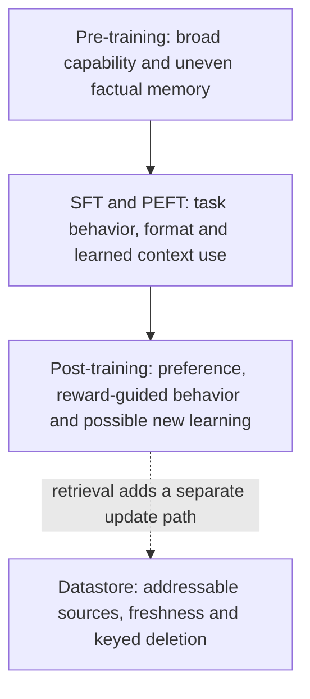
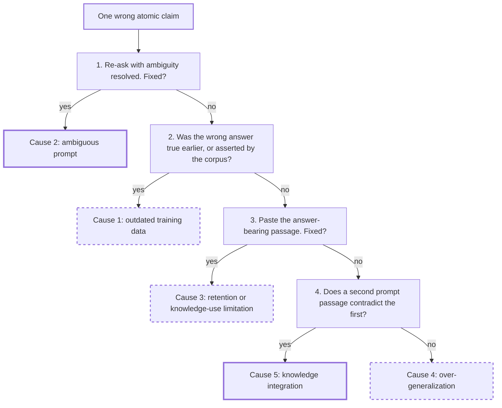
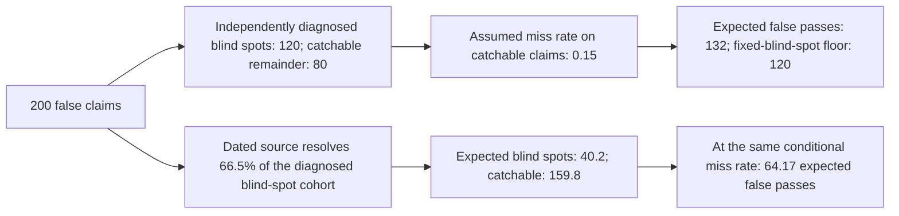

# Chapter 4: What the LLM Brings and What It Breaks
[00-START-HERE](../00-START-HERE.md) · [01-READING-ROUTES](../01-READING-ROUTES.md) · [03\_a\_repeatable\_framework\_for\_any\_rag\_design\_question](../part-01-landscape/03_a_repeatable_framework_for_any_rag_design_question.md) · [05\_data\_privacy\_and\_the\_legal\_surface](05_data_privacy_and_the_legal_surface.md)
This chapter explains what the Large Language Model (LLM) contributes to Retrieval-Augmented Generation (RAG), what it breaks, and how to assign each failure to the right owner before choosing a fix.
## TL;DR
- Pre-training installs capability and uneven factual memory. Supervised fine-tuning shapes answers. Post-training shapes preferences. A datastore owns facts that change.
- Memorized text becomes easier to extract as model size, corpus duplication, and supplied context length rise.
- The model knows common facts better than rare facts. Retrieval helps the rare tail, but an off-target passage can overwrite a correct answer on common facts.
- Faithfulness asks whether a claim follows the supplied context. Factuality asks whether it is true in the world. One score cannot replace the other.
- Factual errors come from outdated data, ambiguous prompts, retention limits, over-generalization, or failed knowledge integration. Retrieval shrinks some causes and enlarges others.
- Verification is statistical because generation varies. It also faces moving truth and shared blind spots between generator and judge.
- Diagnose the stage, error bucket, traffic slice, and verifier oracle before spending money on more training, more retrieval, or a stronger judge.
## The story
Picture one newsroom. The reporter is the LLM. Pre-training is the reporter’s broad education from years of reading. It gives writing ability and uneven memory, but it ends at a cutoff date. Supervised fine-tuning is the newsroom stylebook. It teaches the reporter to answer the assignment instead of continuing a random conversation. Post-training is the editor who shapes tone, refusal, and when to say “I do not know.” The datastore is the live news wire. It owns current prices, office holders, policies, provenance, and deletions because editors can update it without retraining the reporter. The archive clerk is the retriever. The clerk is most useful for an obscure local story that the reporter barely saw during training. On a famous story, however, the reporter may already be right, and a bad clipping can make the answer worse. Faithfulness asks whether the reporter copied the supplied clipping correctly. Factuality asks whether the story is actually true today. A stale clipping can produce a faithful but false article. The copy desk sorts each wrong claim by cause. It asks whether the source was stale, the assignment was ambiguous, the reporter forgot a rare fact, the reporter followed a familiar pattern, or several sources were combined badly. The final verifier is another copy editor. If that editor learned the same false rumor as the reporter, greater editing skill does not help. The verifier needs a dated, independent source that the reporter did not already use. The newsroom lesson is simple. Train the reporter for capability and behavior. Use the live wire for changing facts. Retrieve selectively. Grade against the right source. Verify with independent evidence.
This passage uses a newsroom to explain what different parts of a retrieval-augmented language model do—and why neither training nor retrieval alone guarantees a correct answer. Its main point: let the model handle language and reasoning, use an updatable datastore for changing facts, retrieve evidence when it helps, and check answers against sources that can independently establish what is true.
- **The reporter is the LLM.** Pre-training gives it broad language ability and a store of facts picked up from its training material. That memory is uneven, and it may be out of date because training ends at a cutoff.
- **The stylebook and editor represent later training.** Supervised fine-tuning teaches the model how to answer a task rather than simply continue text. Post-training shapes preferences such as tone, refusal, and when to say “I don’t know.” These stages affect *how* the model responds; they do not automatically keep its facts current.
- **The live news wire is the datastore.** It holds facts that may change—such as prices, policies, or office holders—and can be updated or corrected without retraining the model. The retriever is like an archive clerk who finds relevant passages and supplies them to the reporter.
- **Retrieval can help or hurt.** It is especially useful for obscure facts the model may not know. But if the model already knows a common fact, an irrelevant or incorrect passage can steer it toward a worse answer.
- **Faithfulness and factuality are different checks.** Faithfulness asks, “Did the answer follow the supplied passage?” Factuality asks, “Is the answer true in the world?” A model can faithfully repeat an outdated passage and still be wrong.
- **Errors need different fixes.** A stale source calls for updating the datastore; an unclear assignment may need clarification; a forgotten rare fact may need retrieval; a familiar but misleading pattern may need correction; and conflicting passages may need better source handling.
- **A verifier also needs good evidence.** A second model that shares the first model’s mistaken belief may confirm the error. A dated, independent source is more useful because it gives the verifier evidence beyond what the generator already saw.
So the practical lesson is to assign each job to the right component: train for capability and behavior, use the datastore for changing facts, retrieve selectively, and verify against independent evidence.
## Decoder table


| Technical term | Plain-English meaning | Why it matters |
| --- | --- | --- |
| Large Language Model (LLM) | A generator trained to predict and produce text | It supplies capability, memory, and fluent answers, but it also creates the chapter’s failure modes |
| Retrieval-Augmented Generation (RAG) | A system that retrieves passages and gives them to a generator | It moves some knowledge outside the weights and into editable context |
| Parametric memory | Information represented inside model weights | It can answer without retrieval, but it becomes stale and is hard to delete |
| Datastore | An external collection queried at answer time | It owns freshness, provenance, and per-document deletion |
| Pre-training | Large-scale next-token learning on collected text | It installs capability and uneven latent knowledge |
| Causal next-token objective | The rule that rewards predicting the next true token from earlier tokens | It explains why the base model learns continuations rather than instructions |
| Capability | An ability such as reading a table or doing arithmetic | Later stages and retrieval cannot reliably add reasoning that pre-training never installed |
| Latent knowledge | Facts absorbed into weights during training | It helps common questions but weakens on rare and changing facts |
| Training cutoff | The latest date represented in training data | Facts after this date were preventable at no training stage |
| Supervised fine-tuning (SFT) | Training on curated input and desired-output pairs | It teaches output shape, instruction following, and use of supplied passages |
| InstructGPT | The cited supervised fine-tuning and preference-training recipe | It anchors the source’s claim about how instruction-following behavior is installed |
| Output shape | The required form of an answer | It includes prose, JavaScript Object Notation (JSON), tone, and citation format |
| Grounding discipline | The behavior of using or ignoring supplied evidence correctly | A model can possess a fact yet still answer against the passage |
| Post-training | Preference or reward training after SFT | It shapes helpfulness, refusal, abstention, and elicited reasoning |
| Reinforcement learning from human feedback (RLHF) | Training from human rankings of candidate answers | Ranking is cheaper than asking annotators to write every ideal answer |
| Direct preference optimization (DPO) | Preference training without a separate reward model | It targets the same preference layer with a different procedure |
| Reinforcement learning from verifiable rewards (RLVR) | Reward training where correctness can be checked automatically | It removes the human judge when outcomes are decidable |
| Abstention | Declining to answer when evidence is inadequate | It trades answer coverage for fewer unsupported claims |
| Continual pre-training | Re-running next-token training on fresh data | It can refresh weights, but it risks forgetting and demands replay data |
| Catastrophic forgetting | Loss of earlier knowledge during new training | It makes frequent weight refreshes operationally expensive |
| Replay data | Older training data mixed into a refresh run | It protects prior knowledge but may no longer be available |
| Model editing | Changing weights tied to a chosen association | It requires enumerating facts to change and can damage neighbors |
| Unlearning | A gradient procedure intended to remove named training influence | It does not scale to unknown future deletion requests |
| Parameter-efficient fine-tuning (PEFT) | Updating a small set of added parameters | It changes behavior more cheaply than full-parameter training |
| Low-Rank Adaptation (LoRA) | A PEFT method that trains low-rank matrices beside frozen weights | It moves format and grounding behavior without refreshing stale facts |
| Rank | The small inner dimension of a LoRA update | It sets adapter parameter count and capacity |
| Floating-point operations (FLOPs) | A measure of compute work | The chapter uses it to compare retraining, auditing, and serving |
| Gigabyte (GB) | A billion-byte storage unit in the source’s decimal accounting | It converts weight and accelerator capacity into hardware counts |
| 32-bit floating point (FP32) | A four-byte numeric format used in the weight-memory calculation | It turns 27 billion weights into $`108\,\mathrm{GB}`$ before training state |
| Adam optimizer state | Weights, gradients, and two moment estimates stored for training | Its 16-byte-per-parameter footprint makes a refresh a multi-accelerator job |
| Prefill | Processing all prompt tokens before generation | Retrieved chunks add prefill cost and latency |
| Graphics processing unit (GPU) | An accelerator used to train and serve models | GPU memory and hours convert designs into capacity and dollar costs |
| $`k`$-extractability | Exact reproduction of a training continuation after $`k`$ prefix tokens | It makes memorization measurable for a specific probe |
| Greedy decoding | Always selecting the highest-probability next token | The standard extraction definition depends on this decoding rule |
| GPT-Neo family | The 125-million through 6-billion parameter family used in the memorization measurements | It supplies the measured capacity ordering in Figure $`4.2`$ |
| Duplication count | How often a sequence appears in the corpus | More copies make verbatim extraction more likely |
| Context length | The number of prompt tokens supplied at inference | Longer matching prefixes make memorized continuations easier to unlock |
| Induction head | Attention circuitry that copies what followed a matched pattern | It supports both useful in-context learning and verbatim regurgitation |
| In-context learning | Learning a pattern from examples inside the prompt | It shares machinery with memorized copying, so the two cannot be cleanly separated |
| Divergence attack | A prompt that pushes a chat model away from aligned behavior | It can expose raw pre-training continuations missed by normal probes |
| Application Programming Interface (API) | The paid query interface used in the outside extraction experiment | It makes the external attack cost comparable with the internal audit cost |
| Deduplication | Removing duplicate or near-duplicate training text | It cuts memorized emissions without the capability loss of shrinking the model |
| Perplexity | A held-out next-token prediction measure | Unchanged perplexity shows that deduplication did not reduce measured language quality |
| $`n`$-gram containment check | A search for long generated spans that match licensed text | It catches continuation beyond a retrieved chunk boundary |
| MinHash | A compact near-duplicate detector | It estimates duplicate rates and wasted retrieval slots |
| Personally identifiable information (PII) | Person-linked information named among sensitive corpus contents | It is one kind of material the chapter says should remain outside weights when extraction is unacceptable |
| Long-tail knowledge | Facts supported by very few training documents | These facts remain weak even in large models |
| Fact triple | A subject, relation, and object representation of one fact | It makes support and co-occurrence countable |
| Support count $`d`$ | The number of pre-training documents containing a fact’s subject and object | Accuracy rises roughly with $`\log_{10}d`$ |
| Co-occurrence bias | Preference for the word most often seen near a subject | It explains confident wrong answers when the true object is rare |
| Modal companion | The object most frequently associated with a subject | Greedy decoding can choose it instead of the relation’s true object |
| Stock keeping unit (SKU) | A catalog product identifier | It represents a private tail entity in the chapter’s support example |
| Copy path | The mechanism that reads a relation from supplied context | It can rescue a tail fact or faithfully copy an off-target passage |
| Popularity threshold $`\tau`$ | The traffic-dependent point where weights overtake retrieval | It separates queries that should retrieve from queries that should trust memory |
| Adaptive retrieval | Retrieving only for selected queries | It can avoid overwriting correct head answers and save context cost |
| PopQA | The cited question-answering benchmark used to measure retrieval flips and popularity routing | It supports the crossover between trusting weights and retrieving |
| Zipfian traffic | A distribution where a small head receives much of the demand | Entity share and traffic share can differ sharply |
| Faithfulness | Whether a claim follows the supplied context | It is computable per request because the context is available |
| Factuality | Whether a claim is true in the world | It requires an external oracle and usually an offline audit |
| Oracle | The evidence source used to grade a claim | Changing the oracle can change the verdict without changing the answer |
| Large Language Model judge | A model used to grade generated claims | It can share false beliefs with the generator and hide its own oracle |
| Gold label | A reference answer used to grade a system | It can rot when the underlying fact changes after annotation |
| Entailed claim | A claim supported by the context | It passes faithfulness but can still be false if the context is stale |
| Not enough information (NEI) | The label for a claim the source does not address | It is the fact-checking name for the extrinsic column of the taxonomy |
| Extrinsic hallucination | An unsupported claim not addressed by the context | It points to retrieval coverage or abstention policy |
| Intrinsic hallucination | A claim that contradicts the supplied context | It points to the generator, distractors, position, or context limits |
| Atomic claim | One independently checkable proposition | Claim decomposition makes long answers measurable |
| FActScore | A method that decomposes long text into atomic claims for factuality checks | It supplies the unit of analysis used in the chapter |
| RAGAS faithfulness | The fraction of emitted claims entailed by retrieved context | It measures grounding with the retrieved corpus as oracle |
| Corpus correctness $`q`$ | The chance that a context-entailed claim is true in the world | It sets the ceiling of perfectly grounded output |
| Closed-book accuracy $`p_\theta`$ | Accuracy on the same traffic with retrieval removed | It values unsupported fallback to parametric memory |
| Inaccurate or outdated data | A source that was false or became stale | Retrieval helps only if it brings a corrected source |
| Ambiguous prompt | A query with multiple plausible readings | Retrieval can amplify the wrong reading with confident-looking evidence |
| Retention limit | A fact that training included too rarely to survive in weights | Retrieval can repair it when the answer passage arrives |
| Over-generalization | Answering from a familiar surface pattern | An on-target passage can correct it, while an off-target passage can reinforce it |
| Knowledge integration error | Bad reconciliation of several sources or entities | More retrieved passages can increase this error |
| Answer-passage recall $`r`$ | The chance that retrieval places the answer-bearing passage in the prompt | It controls residual knowledge-absence errors |
| Error multiplier $`m_i`$ | The factor by which retrieval scales cause $`i`$ | It exposes that retrieval helps some causes and hurts others |
| Retrieval flip rate $`\varphi`$ | The share of previously correct answers made wrong by retrieval | It creates an error floor that better recall cannot remove |
| Break-even error $`\varepsilon_0^{*}`$ | The closed-book error below which retrieval loses overall | It supports per-query routing instead of always retrieving |
| Approximate nearest-neighbor (ANN) lookup | A fast index search for candidate passages | It is the inference-time alternative to buying more parameter decades |
| Cross-encoder reranker | A model that scores query-passage pairs after broad retrieval | It can retrieve many candidates while feeding only a few to the generator |
| Black-box generator | A model whose internal cause is not visible from its output | Verification can observe samples but cannot directly localize faults |
| Sampling temperature $`T`$ | A control over generation randomness | At $`T>0`$, one test run is only one draw |
| Bernoulli draw | One yes-or-no observation of whether a claim appeared | Repeated draws are needed to estimate an emission probability |
| Normal approximation | The sample-size estimate applied to repeated Bernoulli draws | It produces the 385-sample worst-case requirement |
| Emission rate | The probability that a generator produces a claim | It is more informative than one pass or fail |
| SelfCheckGPT | A detector that resamples answers and flags unstable claims | It uses black-box variation without inspecting weights |
| Feature attribution | A method that connects outputs to influential inputs or features | It can partially localize black-box failures at a cost |
| Mechanistic interpretability | Analysis of internal model circuits | It seeks causal explanations but is expensive |
| Poisson change process | A model where truth-changing events arrive randomly at a fixed rate | It converts fact lifetime into a label-refresh cadence |
| Mean lifetime $`\tau`$ | The average time before a fact changes | It determines how quickly answers and gold labels decay |
| Label rot | A gold answer becoming wrong as the world changes | It can be as large as the measured system gain |
| FreshQA | The cited benchmark separating fast-changing from never-changing questions | It shows why model evaluation must classify facts by lifetime |
| PageRank | A link-graph prestige signal used by search systems | It contrasts source authority with a model’s frequency signal |
| Allowlist and blocklist | Explicit rules admitting or rejecting sources | They are authority controls that parametric frequency does not provide |
| $`n`$-gram frequency | The model’s repetition-based evidence signal | Frequency can support learning without establishing source trust |
| Shared blind-spot share $`s`$ | The fraction of false claims the verifier also believes | It creates a residual floor that judge quality cannot cross |
| Independent miss rate $`\mu_0`$ | The verifier’s miss rate on errors outside shared blind spots | Better judge capacity can reduce only this term |
| Macro-averaged $`F_1`$ (macro-$`F_1`$) | The cited aggregate attribution-judge score | Its roughly 80 percent value motivates the incorrect independence baseline |
| Information-access symmetry | The judge and annotator seeing the same amount of source evidence | Violating it causes attribution errors unrelated to judge capability |
| Self-consistency | Resampling and voting within one model distribution | It misses confident falsehoods that sit at the mode |
| Oracle independence | Giving the verifier evidence the generator did not have | It reduces shared blind spots more than a same-source judge upgrade |
| VeriScore | A correction that separates unverifiable claims and rewards factual recall | It prevents precision-only scoring from rewarding silence |


## Core mechanics
### Mathematical conventions
Use decimal bytes unless a binary unit is explicit. Forward and training compute use the simplified proxies $`2NT`$ and $`6NT`$ at assumed sustained throughput $`3.4\times10^{14}\,\mathrm{FLOP\,s^{-1}}`$ and $`\$2.50`$ per GPU-hour. These are compute-equivalent costs, not measured end-to-end latency, resource reservations or invoices. They omit attention-length effects, bandwidth, communication, search and other overhead. Fractions, percentage points and relative percentage changes are different units. A fitted empirical trend is not a theorem outside its measured range; calculate before rounding.
### 4.1 Pre-training, SFT, post-training: which stage owns which failure
#### Stage ownership
The opening assistant was shipped last quarter with a 27-billion-parameter open-weight model fine-tuned on $`40{,}000`$ internal tickets. It names a vice president who left in March, returns prose when the frontend expects JSON, and invents a refund window for a product line launched six weeks earlier. The stale name, wrong output form, and absent new fact belong to different owners. Pre-training maximizes the next-token objective over collected text:

```math
\sum_t \log P_\theta\!\left(x_t \mid x_{<t}\right)
```

Here $`\theta`$ is the full parameter vector. Next-token targets are derived from the text rather than human-written task labels; that does not make curation irrelevant. Pre-training supplies broad capability and uneven factual memory. SFT maximizes $`\log P_\theta(Y\mid X)`$ over curated input-output examples, shaping instruction following, output format and context use. Preference and verifiable-reward methods further change behavior. The source's view that later stages mainly elicit pre-existing competence is a working hypothesis, not a theorem that SFT or post-training cannot add facts or skills. Test the base checkpoint to diagnose the starting limitation, then measure what the chosen adaptation actually changes. No stage label by itself proves a hard downstream capability ceiling.
#### What training cannot own
The stale vice president is not a capability, shape, or preference failure. The model learned the fact correctly; then the world changed after the cutoff. Continual pre-training can refresh it, but models with only a few hundred million parameters can suffer substantial catastrophic forgetting. Each refresh then needs replay data that may no longer exist. Model editing changes named associations, but it inherits the enumeration problem of unlearning. You must know every future fact or sequence that will need a change. It also cannot guarantee complete removal and can damage neighboring associations. Scale cannot close the tail economically. Kandpal et al. (2023) extrapolated competitive accuracy on sparsely supported facts to about $`10^{18}`$ parameters. At two bytes per weight, storage is $`2\times10^{18}`$ bytes. Dividing by $`8\times10^{10}`$ bytes per $`80\,\mathrm{GB}`$ accelerator gives $`2.5\times10^{7}`$ accelerators before processing one token. The datastore owns facts that outlive gradient descent because it supports freshness, provenance, and deletion. Deleting a datastore row removes future retrieved exposure, but it cannot erase text the base model already memorized during pre-training. Domain SFT loses as a knowledge patch. It raises $`P_\theta(Y \mid X)`$ for written examples but does not erase far more frequent contradictory pre-training evidence. It creates internal conflict and returns the bill when the fact changes again.
#### Worked example and costs
The assistant fails $`370`$ of $`1{,}000`$ queries: $`180`$ stale facts, $`90`$ contradictions of correct context, $`60`$ format violations and $`40`$ low-support-entity errors. These are diagnostic buckets, not guaranteed repair yields. A weight refresh with $`N=27\times10^9`$ and $`D=10^{10}`$ uses $`108\,\mathrm{GB}`$ of fp32 weights. A specified $`16\,\mathrm{B/parameter}`$ Adam layout totals $`432\,\mathrm{GB}`$ before activations, an aggregate six-card minimum at $`80\,\mathrm{GB}`$ each, not six cards reserved solely for optimizer moments. Training work is approximately $`1.62\times10^{21}\,\mathrm{FLOP}`$, equivalent to $`4.76471\times10^6\,\mathrm{s}`$, $`1{,}323.53`$ GPU-hours and $`\$3{,}308.82`$ at the stated rate. Whether it fixes any of the stale or tail answers must be tested.
Five $`400`$-token chunks add $`2{,}000`$ prefill tokens: approximately $`1.08\times10^{14}\,\mathrm{FLOP}`$, $`0.31765`$ compute-equivalent GPU-seconds or $`\$2.20588\times10^{-4}`$ per query. One refresh bill equals $`15{,}000{,}000`$ such incremental prefill components—not that many complete RAG requests. Retrieval still needs search, embedding, source maintenance and answer decoding.
For behavior repair, supervised examples can target format and context-use failures but do not guarantee their elimination. Rank-$`16`$ factors for a $`4{,}096\times4{,}096`$ update store $`16(4096+4096)=131{,}072`$ values instead of $`16{,}777{,}216`$, a $`128`$-fold update-storage reduction. That is not a $`128`$-fold reduction in total model memory or training work, nor proof that the update changes no factual answer. The $`405`$B, $`15.6`$T cross-check gives $`6ND=3.7908\times10^{25}\,\mathrm{FLOP}`$, approximately $`0.242\%`$ below the rounded reported $`3.8\times10^{25}`$. Dividing the proxy by $`30.84`$ million GPU-hours implies approximately $`3.4144\times10^{14}\,\mathrm{FLOP\,s^{-1}}`$; the chapter deliberately uses the rounded $`3.4\times10^{14}`$ rate.
#### Practical decisions
- Reproduce a failure on the base checkpoint before blaming SFT. If that checkpoint cannot run, probe the smallest sibling in its family.
- Put any fact with a change cadence shorter than retraining in the datastore. For fewer than roughly 100 bounded facts, a templated system prompt can beat an index on latency and operational surface.
- Use LoRA for shape and full-parameter training for capability. Frozen embeddings may not add a language or domain vocabulary the tokenizer never saw.
- Ask refresh cadence before model size. A static million-document domain on an annual cadence can justify continual pre-training.
- Keep a retrieval-free capability probe. About a dozen supplied-text arithmetic and two-hop questions can separate base-model regressions from index regressions. Run it on each base-model swap rather than each index rebuild.
### 4.2 Memorization: three laws and their consequences
#### Definition and laws
A probe samples $`3{,}000`$ training documents, supplies $`50`$ tokens, greedily decodes $`50`$ more and finds two exact matches. The observed sample hit rate is $`2/3000\approx0.0667\%`$. It describes that sampling scheme, model, prefix length and decoding rule, with sampling uncertainty; it is not a certified upper bound on extractability under other prompts. Define a sequence as extractable when some specified allowed prefix and decoding procedure reproduce the target continuation. The reported family-level trends can be written as a local empirical regression:

```math
\Pr\!\left[k\text{-extractable}\right] \approx \alpha\log N + \beta\log d + \gamma\log k + \delta,\qquad \alpha,\beta,\gamma > 0
```

The positive fitted coefficients describe trends within the tested model families, duplication ranges and matching-prefix lengths, not universal laws for every aligned model. The linear-in-log form requires $`N,d,k>0`$ and can predict values outside $`[0,1]`$ if extrapolated, so it is not a globally valid probability model. Repetition can strengthen memorization, and a longer matching prefix can better identify a document. Shared copying mechanisms also support in-context behavior, but that observation is not an impossibility proof that every useful intervention must destroy in-context learning.
#### Why the short audit fails
The $`50`$-token result covers only a short matching-prefix regime. A long production prompt is not automatically a long prefix of one training document: five unrelated $`400`$-token chunks do not form a contiguous $`2{,}000`$-token prefix of a single source. Audit both the actual prompt structure and targeted contiguous-prefix extraction. Alignment refusal behavior is not a deletion guarantee. The cited divergence attack recovered more than $`10{,}000`$ unique training examples for roughly $`\$200`$ in its tested setting; those observations do not supply the extraction rate for this assistant.
#### Audit cost
Take a $`7`$B generator and $`100{,}000`$ sampled sequences. A $`500`$-token prefix plus $`500`$-token continuation gives $`10^8`$ processed tokens and $`1.4\times10^{18}\,\mathrm{FLOP}`$. The compute proxy is approximately $`4{,}117.65\,\mathrm{s}`$, $`1.14379`$ GPU-hours and $`\$2.85948`$. A separate contiguous-prefix experiment with $`k=2{,}000`$ and the same $`500`$-token continuation processes $`2.5\times10^8`$ tokens and $`3.5\times10^{18}\,\mathrm{FLOP}`$: approximately $`10{,}294.12\,\mathrm{s}`$, $`2.85948`$ GPU-hours and $`\$7.14869`$, exactly $`2.5`$ times the short-probe work under the proxy. This is not a claim that five unrelated chunks provide such a matching prefix. At an assumed $`1\%`$ hit rate, expected yield is $`1{,}000`$ matching generations, costing approximately $`\$0.00715`$ each; uniqueness requires deduplication. Applying an independently reported tenfold deduplication effect would produce a hypothetical $`100`$ hits, not a guaranteed post-rebuild result. A hosted attack's $`\$0.02`$ per unique example has a different outcome unit and serving setup, so it does not validate this local compute price.
#### Practical decisions
- Probe actual production prompt layouts and separately test long contiguous prefixes of known works; total prompt length is not the matching-prefix length. Use the fixed template maximum when the product caps context.
- Deduplicate before shrinking a model. If pre-training is outside your control, keep licensed text out of later gradient updates.
- If a license permits indexing but forbids training, do not fine-tune on retrieved licensed passages. Popular passages repeat across pairs, so epoch count becomes a legal parameter. Train grounding on permissively licensed, consented or appropriately synthetic passages and keep the licensed corpus at test time.
- Report a lower bound with $`k`$, duplication threshold, and sample frame. Bias sampling toward highly duplicated sequences.
- Flag generated spans of roughly 50 or more tokens that match a licensed-content index. Log rather than block when verbatim extraction is the requested product.
- Measure the datastore’s duplication distribution with near-duplicate checks. A curated single-source manual is a reasonable exception.
### 4.3 Long-tail knowledge and co-occurrence bias
#### Support and wrong-answer selection
A 70-billion-parameter model correctly names Microsoft’s founders, their birth years, and the company’s founding date while missing an internal product rule documented across 40 pages. For stock keeping unit (SKU) 4471, it says 30 days instead of the true 14 days with equal confidence. This gap can produce 90 percent accuracy on head-heavy public benchmarks and 40 percent on tail-heavy product traffic. Represent a fact as subject $`s`$, relation $`r`$, and object $`o`$. Let $`d(f)`$ count pre-training documents containing both $`s`$ and $`o`$. Question-answering accuracy follows:

```math
A(d) \approx \beta\log_{10} d + c
```

The fitted log form applies only for $`d>0`$ in the observed regime; $`\log 0`$ is undefined. Absence of direct support does not mathematically rule out correct compositional inference or later learning. A local two-variable fit $`A(N,d)\approx\alpha\log_{10}N+\beta\log_{10}d+c`$ gives the following constant-accuracy relation, assuming positive fitted $`\alpha,\beta`$:

```math
\alpha\,\Delta\log_{10}N+\beta\,\Delta\log_{10}d=0,
\qquad
\Delta\log_{10}N=-\frac{\beta}{\alpha}\,\Delta\log_{10}d.
```

If support falls by a positive number of decades $`u=-\Delta\log_{10}d`$, the fitted compensation is $`\Delta\log_{10}N=(\beta/\alpha)u`$. The source's long-tail extrapolation compares models near $`2\times10^{11}`$ parameters with a projected $`10^{18}`$ and support from $`10^{0.5}`$ to $`10^4`$ documents. That spans far beyond measured model sizes; the implied slope ratio is a schematic extrapolation, not a validated engineering exchange rate:

```math
\frac{\beta}{\alpha}
\approx\frac{\log_{10}(10^{18}/(2\times10^{11}))}{4-0.5}
=\frac{6.69897}{3.5}\approx1.91399.
```

At fixed training-token count and precision, a tenfold parameter increase multiplies the $`6ND`$ training proxy and parameter memory by ten; serving latency still depends on hardware and batching. A larger datastore can expand factual coverage, but incurs index, search and retrieved-token costs—it is not literally free beyond one lookup. Fivefold support is $`\log_{10}5\approx0.699`$ decades, and repeated crawls need not provide independent new evidence. A co-occurrence sketch $`P_\theta(o\mid\mathop{\mathrm{context}}\nolimits(s))\propto\mathop{\mathrm{count}}\nolimits(s,o)`$ illustrates a possible bias, not the actual decoder's full conditional distribution: relation words and wider context matter. A frequent companion can outvote a rare true relation object. The cited study reports roughly $`30\%`$ of its measured failures selecting a high-co-occurrence word; that percentage is not a universal error decomposition.
#### Retrieval crossover
A retrieved passage can override a memorized association, but no universal ratio says that one prompt occurrence defeats $`10^5`$ training occurrences. Wrong context can also disturb a correct answer. The cited PopQA result reports retrieval harm in a particular evaluation; a pointwise crossover depends on conditional rescue and harm rates as well as closed-book competence. Traffic weights set the value of a routing policy and capacity trade-off, not the pointwise crossover by themselves. Repeated domain training can affect freshness and retained behavior, but catastrophic forgetting is a risk to measure, not an inevitable result of every update. Route on fact/relation support, not entity popularity alone.
#### Routing example
The scenario handles $`10{,}000`$ questions per day across $`5{,}000`$ products. Assume a Zipf traffic law with exponent one. Using exact harmonic sums $`H_n=\sum_{j=1}^n1/j`$ gives $`H_{50}\approx4.499205`$ and $`H_{5000}\approx9.094509`$, hence head share $`w=H_{50}/H_{5000}\approx0.494717`$. The top $`1\%`$ of products therefore receive approximately $`49.472\%`$ of traffic under this assumption. Rank $`50`$ is an assumed routing split, not a threshold proved by $`500`$ labels.
Take closed-book accuracy $`0.82`$ on the head and $`0.24`$ on the tail, and RAG accuracy $`0.68`$ on the tail. For the head, additionally assume a conditional correct-to-wrong rate $`0.10`$ and no wrong-to-right rescues, giving $`0.82(1-0.10)=0.738`$. Then always-retrieve accuracy is approximately $`70.869\%`$, never-retrieve accuracy $`52.694\%`$, and perfect head/tail routing accuracy $`74.926\%`$. Selective routing gains approximately $`4.057`$ percentage points over always retrieving; a real router needs its own confusion/error audit.
Five $`400`$-token chunks add $`2{,}000`$ input tokens per retrieved query. Always retrieving adds $`20`$ million daily input tokens at $`\$6.00`$ under $`\$0.30`$ per million. Routing adds approximately $`10.10567`$ million tokens, costing approximately $`\$3.0317`$ per day, for approximately $`\$1083.43`$ over $`365`$ days in this input-only component. An assumed $`120\,\mathrm{ms}`$ retrieval-stack saving applies only to bypassed head queries; it does not establish the whole service latency distribution.
This example shows why a system may do better by **retrieving only for less familiar products** instead of retrieving for every question. The model is assumed to answer common-product questions more accurately from memory, while retrieved information helps more with less familiar products.
- **Traffic is uneven.** Under the assumed Zipf law, the first $`50`$ of $`5{,}000`$ products receive approximately $`49.47\%`$ of queries.
- **Retrieval can hurt the head.** The scenario assumes head RAG accuracy $`73.8\%`$, including no rescues of initially wrong head answers.
- **The routing split is illustrative.** A production threshold needs labeled, held-out outcomes and monitoring, not popularity alone.
	- **Always retrieve:** approximately $`70.87\%`$ scenario accuracy; retrieval helps on the tail but can hurt on the head.
	- **Never retrieve:** approximately $`52.69\%`$ scenario accuracy, with weaker closed-book performance on the tail.
	- **Route selectively:** answer common-product questions from memory and retrieve for the tail, giving approximately $`74.93\%`$ scenario accuracy under the stated oracle split.
Selective routing adds approximately $`10.106`$ million retrieved input tokens per day, versus $`20`$ million when always retrieving. The input-only daily cost falls from $`\$6.00`$ to approximately $`\$3.03`$. The stronger argument here is the assumed accuracy gain; cost and latency savings need the same workload and serving scope.
#### Practical decisions
- Stratify accuracy by $`\log d`$ and weight by query logs. Entity share does not size traffic cost.
- If every entity is internal, treat every query as tail and skip threshold fitting.
- Start with always-retrieve until a labeled set measures $`\tau`$. Routing becomes attractive when head traffic exceeds roughly one third. Refit $`\tau`$ when campaigns change traffic, weekly in the source scenario.
- Use popularity and relation support before model confidence. Co-occurrence bias can make the modal wrong answer highly confident. For novel or internal entities with no frequency signal, use confidence and accept its calibration risk.
- Build one co-occurrence trap per relation. Use search hit counts when direct corpus counts are unavailable.
- Put tail facts in the datastore. A small, closed, static domain on an annual update cadence is the defensible exception for repeated domain training.
### 4.4 Hallucination taxonomy: factuality versus faithfulness, intrinsic versus extrinsic
#### Two oracles and three source relations
One reviewer compares a claim with supplied evidence and measures faithfulness; another checks an authoritative current source and measures factuality. These are different oracles. Classify each atomic claim as entailed, contradicted or unaddressed by the supplied context. Let $`f=P(E)`$ be the entailed fraction, $`q=P(T\mid E)`$ the probability that an entailed generated claim is true, and $`p_U=P(T\mid\neg E)`$ the probability that an unentailed generated claim is true. Staleness alone does not determine $`q`$: old claims can remain true and fresh sources can be wrong. Closed-book task accuracy is not automatically $`p_U`$. With these claim-level conditional definitions, the law of total probability gives:

```math
\Pr(T)=f q+(1-f)p_U.
```

Grounding changes factuality at rate:

```math
\left.\frac{\partial\Pr(T)}{\partial f}\right|_{q,p_U\ \mathrm{fixed}}
=q-p_U.
```

If $`q`$ and $`p_U`$ remain fixed, increasing the entailed share improves factuality when $`q>p_U`$. Real grounding interventions can change claim composition and both conditional rates, so this is not an unconditional causal guarantee. The metric gap is:

```math
\Pr(T)-f=(1-f)p_U-f(1-q).
```

The first term is true but unsupported content; the second is false but entailed content. As $`f\to1`$ with fixed $`q,p_U`$, the signed gap tends to $`-(1-q)`$, not $`+(1-q)`$. Perfect faithfulness can still reproduce a source error. Intrinsic hallucinations contradict supplied evidence; extrinsic ones are unaddressed by it. Their causes need diagnosis rather than automatic assignment to retrieval or generation. Instruction and arithmetic errors also need separate checks.
#### Worked example
Audit $`200`$ questions. The first setup emits $`1{,}000`$ claims: $`700`$ entailed, $`80`$ contradicted and $`220`$ unaddressed. Suppose direct truth checking establishes $`q=0.96`$ for the entailed cohort and $`p_U=0.30`$ for the unentailed cohort. Then $`672`$ entailed and $`90`$ unentailed claims are true, totaling $`762`$ or $`76.2\%`$. Faithfulness is $`70\%`$, understating truth by $`6.2`$ percentage points. These conditional rates are explicit scenario measurements, not quantities inferred from corpus staleness or closed-book accuracy.
The grounded-or-abstain setup declines $`50`$ questions and emits $`750`$ claims: $`700`$ entailed, $`10`$ contradicted and $`40`$ unaddressed. Assuming the same conditional truth rates, factuality is $`(700/750)(0.96)+(50/750)(0.30)=0.916`$, giving $`687`$ true claims. Faithfulness is $`700/750\approx93.333\%`$, exceeding factuality by approximately $`1.733`$ percentage points. Across all $`200`$ questions, true claims fall from $`3.81`$ to $`3.435`$ per question and false claims from $`1.19`$ to $`0.315`$. Answer coverage falls from $`100\%`$ to $`75\%`$; this differs from the source's separate $`20`$-point compliance illustration.
This removes $`175`$ false claims while losing $`75`$ true claims. If costs per false and missing-true claim are $`C_{\mathrm{wrong}}`$ and $`C_{\mathrm{missing}}`$, the change reduces linear expected loss when $`175C_{\mathrm{wrong}}>75C_{\mathrm{missing}}`$, or $`C_{\mathrm{wrong}}/C_{\mathrm{missing}}>3/7\approx0.428571`$. The reciprocal $`175/75=7/3`$ is false claims removed per true claim lost, not the required wrong-to-missing cost ratio.
At $`200`$ judge calls and an assumed $`440{,}000`$ input tokens, the input-only check costs $`\$0.132`$ at $`\$0.30`$ per million. The outside summarization study's hallucination and truth rates describe its own cohorts; they do not establish this assistant's $`p_U`$ or closed-book accuracy.
#### Practical decisions
- Report faithfulness, sampled factuality, and the intrinsic-extrinsic split. If no world oracle exists, make faithfulness the contract and corpus freshness the service obligation.
- Gate on faithfulness online. Audit factuality offline unless a high-stakes error justifies a second retrieval loop.
- Route contradictions to generation and unsupported claims to retrieval or abstention. A post-update contradiction spike may instead signal disagreeing documents.
- Sample supported claims to estimate $`q`$. Start with 100 entailed claims per corpus per month and increase frequency when freshness exceeds 30 days or documents have legal owners.
- Pair faithfulness with true claims per question. In regulated settings, state the precision-coverage trade and obtain explicit ownership. Require attribution for answer-bearing claims while allowing a stated policy for extrinsic background claims.
### 4.5 The five causes of factual error
#### Cause model
The paired evaluation has closed-book error $`\varepsilon_0=0.38`$ and RAG error $`0.235`$. Diagnose five operational causes: outdated data, ambiguity, retention failure, over-generalization and integration. For outcome accounting, let $`S=P(\text{RAG wrong}\mid\text{closed-book wrong})`$ and $`\varphi=P(\text{RAG wrong}\mid\text{closed-book correct})`$. These paired conditional probabilities lie in $`[0,1]`$. The valid error identity is:

```math
\varepsilon_R=\varepsilon_0 S+(1-\varepsilon_0)\varphi,
\qquad 0\le S,\varphi\le1.
```

Cause-specific diagnostic counts can change labels after retrieval. If $`n_i`$ initially wrong claims are assigned cause $`i`$ and $`b_i`$ remaining-wrong claims are reclassified after retrieval, the descriptive ratio $`m_i=b_i/n_i`$ may exceed one because claims can move between labels. Then $`S=\sum_i(n_i/\sum_j n_j)m_i`$, but $`m_i`$ is not the survival probability of the original cause-$`i`$ cohort. A joint cause-transition table is needed to infer that. Retrieval recall $`r`$ alone does not imply $`S=1-r`$ or $`m_1=m_3=1-r`$: retrieving evidence and successfully using it differ. With $`S,\varphi`$ held fixed and $`1-S+\varphi>0`$, retrieval helps above the break-even error:

```math
\varepsilon_0^{*} = \frac{\varphi}{1-S+\varphi}
```

The threshold follows from $`\varepsilon_0(1-S)>(1-\varepsilon_0)\varphi`$. It is a comparative-static calculation with fixed paired rates; a new retriever or prompt can change both. Possible pairwise source comparisons are $`\binom{k+1}{2}=k(k+1)/2`$, or $`15`$ at $`k=5`$ and $`210`$ at $`k=20`$, when weights are treated as one additional source. These are counts of potential comparisons, not conflict probabilities. Operational cause labels can overlap, and an ordered diagnostic cascade makes the reported labels mutually exclusive by policy rather than proving unique causal ownership.
#### Audit and alternatives
Of $`1{,}000`$ questions, $`380`$ are initially wrong. Their diagnostic counts are $`140,60,120,40,20`$ across the five causes. Suppose paired testing finds $`173`$ still wrong after RAG, reclassified as $`21,78,18,16,40`$. The ambiguity and integration counts can exceed their original counts only because these are post-retrieval labels, not survivors confined to the same original buckets. The ratios $`0.15,1.30,0.15,0.40,2.00`$ are descriptive count ratios; they cannot be used as independent survival probabilities. The aggregate $`S=173/380\approx0.455263`$ is valid. A separate $`\varphi=0.10`$ produces $`62`$ newly wrong answers from the $`620`$ initially correct, so total error is $`(173+62)/1000=23.5\%`$ and net improvement is $`14.5`$ percentage points.
For a counterfactual budgeting illustration only, reducing the first and third post-RAG counts from $`21,18`$ to $`7,6`$ while keeping everything else fixed gives $`147+62=209`$ wrong answers, a $`2.6`$-point improvement. Raising recall from $`0.85`$ to $`0.95`$ does not by itself guarantee these count changes. A hypothetical clarification removing $`26`$ of the $`78`$ ambiguity-labeled errors gives the same arithmetic improvement; the new descriptive ratio is $`52/60\approx0.866667`$, not an exact $`0.87`$ product. A user clarification and an automated rewrite are different interventions with different costs.
Increasing generator presentation from five to twenty $`400`$-token chunks adds $`6{,}000`$ input tokens per query, $`6`$ million over $`1{,}000`$ questions, costing $`\$1.80`$ at the stated input rate. It does not automatically increase reranker candidate depth; if candidate depth itself changes from five to twenty, the increment is $`15`$ scored pairs, not $`20`$. Potential source pairs rise from $`15`$ to $`210`$. The paired-rate threshold is $`\varepsilon_0^\star=0.10/(1-173/380+0.10)\approx0.155102`$, corresponding to approximately $`84.490\%`$ closed-book accuracy under fixed rates.
#### Practical decisions
- Triage 100 failures through the four tests before changing retrieval. About two engineer-days can estimate the cause vector.
- Track ambiguity and integration separately. A single authoritative source with $`k\le2`$ is the main low-conflict exception.
- Set generator top-$`k`$ against conflict, not recall alone. Retrieve 50 candidates, rerank them, and feed 5 unless near-duplicate canonical passages justify more.
- Run the same evaluation closed-book to measure flips in both directions. A 14.5-point net gain can hide 62 newly wrong answers.
- Gate retrieval once a slice falls below roughly 15 percent closed-book error. Retrieve anyway when contractual attribution, rather than accuracy, is the requirement.
### 4.6 Why verification is hard: black box, moving truth, biased verifiers
#### Three structural difficulties
The radiology example illustrates a judge sharing the generator's mistaken impression; an expert with the right evidence can disagree. A faithfulness percentage is meaningful only with its reference, scoring unit and judge error understood. For a fixed prompt, decoder and claim-emission event, repeated trials can be modeled as Bernoulli draws only if the event is binary and the sampling assumptions hold. Positive temperature alone does not guarantee independent or varying outcomes. For nominal $`95\%`$ planning precision within an absolute $`\pm0.05`$ on that event probability, use:

```math
n = \frac{z^{2}p(1-p)}{\Delta^{2}}
```

For independent Bernoulli repetitions of a specified event, the normal-approximation planning formula at $`p=0.5`$, $`z=1.96`$ and absolute half-width $`\Delta=0.05`$ gives $`n_{\mathrm{plan}}=384.16`$, rounded upward to $`385`$. This is not an exact finite-sample coverage guarantee, and correlated samples can require a different design. Model resampling measures variation under the chosen prompt and decoder; it does not directly establish truth or locate the faulty stage. Separately, suppose changes follow a Poisson process with mean lifetime $`\tau`$. The probability of no change by age $`t`$ is $`e^{-t/\tau}`$, giving a maximum-age rule for tolerated probability $`\delta`$ of at least one change:

```math
t^{*} = \tau\ln\!\left(\frac{1}{1-\delta}\right)
```

With $`\tau=2`$ years and $`\delta=1\%`$, $`t^\star=-2\ln(0.99)\approx0.0201007`$ years, or approximately $`7.34`$ days at $`365.25`$ days per year. This bounds the probability that a fact has changed since its last check under the model, not the probability that every old answer is wrong. Production truth can change at different rates or change back, so validity dates and authoritative sources still matter.

```math
\varepsilon_{\mathrm{post}} = \varepsilon\left[s+(1-s)\mu_0\right] \ge s\varepsilon
```

In this verifier scenario, $`s`$ is the fraction of initially false claims in a diagnosed blind-spot cohort that the verifier always misses; $`\mu_0`$ is its conditional miss probability on the remainder. The formula assumes detected false claims are blocked and verification introduces no new false claims. Its denominator is all original claims, not only accepted claims. A better judge may change both $`s`$ and $`\mu_0`$ in practice; holding $`s`$ fixed illustrates a structural floor, not a universal limit on model upgrades. False-positive rejection and emitted-claim coverage need separate measurement. Unsettleable claims should be excluded from both scored numerator and denominator, with their share reported, rather than silently marked true or false.
#### Verifier audit and costs
Audit $`1{,}000`$ claims, $`200`$ of which are false. Suppose an independent diagnostic—not the judge's pass count alone—identifies $`120`$ structural blind spots, giving $`s=0.60`$. Assume miss probability $`\mu_0=0.15`$ on the other $`80`$ false claims. Expected false passes are $`120+80(0.15)=132`$, or $`13.2\%`$ of all original claims. A single observed pass fraction cannot separately identify $`s`$ and $`\mu_0`$: if only $`120`$ of $`200`$ passed and $`\mu_0=0.15`$, the implied scenario value would instead be $`(0.60-0.15)/(1-0.15)\approx0.5294`$.
Now suppose an independent dated-source check works specifically on the blind-spot cohort with on-target probability $`0.70`$ and conditional correctness $`0.95`$, and that this resolves those cases. The usable-check probability is $`0.70(0.95)=0.665`$, so the residual blind-spot share is $`s'=0.60(1-0.665)=0.201`$. Keeping $`\mu_0=0.15`$ on all newly catchable cases gives expected residual false claims $`200[0.201+0.799(0.15)]=64.17`$, or $`6.417\%`$ of the original claims. Fractional counts are expectations, not rounded observed claims. The expected gain over $`132`$ is $`6.783`$ percentage points; eliminating only independent misses at fixed $`s=0.60`$ offers at most $`1.2`$ points, a ratio of approximately $`5.65`$ under these assumptions.
A small judge with $`800`$ input tokens per claim costs $`\$0.24`$ for this input-only component at $`\$0.30`$ per million. One extra $`400`$-token passage per claim adds $`\$0.12`$, totaling $`\$0.36`$ before search, embedding and other serving costs. A $`\$3`$-per-million judge at the original input length costs $`\$2.40`$, approximately $`6.67`$ times that scoped token bill; its actual effect is not established by the price. Macro-$`F_1`$ of $`0.8`$ does not imply a $`0.2`$ conditional false-claim miss rate. Only if a separate miss probability $`0.20`$ is explicitly assumed would an independent model predict $`200(0.20)=40`$ false passes; $`132/40=3.3`$ compares two assumed models, not a deduction from $`F_1`$.
If $`300`$ labels have $`\tau=2`$ years, expected labels with at least one change after six months are $`300(1-e^{-0.25})\approx66.36`$. This is $`6.636\%`$ potentially affected labels, not a measured $`6.636`$-point score bias: the net accuracy effect depends on which labels changed, whether old answers remain valid and model behavior.
#### Practical decisions
- Estimate $`s`$ before upgrading a judge. Replay confirmed false claims to measure total misses, then use an independent diagnostic or additional interventions to separate structural blind spots from conditional misses.
- Give the verifier a retrieved passage with a web address and timestamp that the generator did not have. Supplied context is the reference for faithfulness, but a judge can still misread it; shared access is not statistical independence.
- Check information-access symmetry. Roughly one quarter of attribution-judge errors arise when judges and annotators see different amounts of source text.
- Stamp gold labels with validity dates and lifetime classes. Recheck the $`\tau = 2`$ year, 1 percent-tolerance slice weekly, stable facts annually, and fast-changing prices, headcounts, or org charts daily.
- Report claim emission rates at production temperature. Start with five samples per item because three emissions in five differ from five in five. Use temperature zero only for explicitly labeled regression gates.
- Send clinical, legal, and financial claims to experts when generator and judge share a distribution and $`s\to1`$. Use an authoritative curated source instead when one exists.
## Diagrams
### Figure 4.1

Figure $`4.1`$: Stage labels are diagnostic starting points, not hard mathematical ceilings. Training and retrieval can each change behavior, but a keyed datastore preserves a different update and deletion mechanism from shared parameters.
### Figure 4.2
```plain text
fraction k-extractable, log scale
^
|          x10 duplication                              6B
|              ^                           ____________/
|              |                 __________           1.3B
|                    - - - - - -
|          . . . . . . . . . . . . . . . . . .       125M
|
+----------|------------|----------|----------------|----> context tokens k, log scale
          50           200        500             2,000
       audit probe                     matching source prefix
          [ range a probe at k = 50 never measures ]
```
Figure $`4.2`$: The cited experiments report increasing extractability with model scale, duplication and matching-prefix length within their measured regimes. The axes and curves are schematic. A short probe does not characterize longer source-prefix attacks, and a long multi-document prompt need not be one matching training prefix.
### Figure 4.3
```plain text
answer accuracy (%)
^
| 80                                      / weights only
|                                      __/ | answers retrieval flips wrong
|                         . . . . . . X . . weights plus retrieval
| 60              . . . .             | tau
|           . . .                     |
| 40                         _________/
|                    _______/
| 20          ______/
|
+---------|---------|---------|---------|---------|----> supporting documents d, log scale
         10^0      10^1      10^2      10^3      10^4
         retrieve                         trust the weights
```
Figure $`4.3`$: This is a schematic crossover, not a universal accuracy curve. Low direct support can reduce parametric recall without proving zero ability to infer an answer. Retrieval can help or harm depending on evidence and the generator. A policy cutoff should be fitted to paired outcomes and the workload's utility, not inferred from popularity alone.
### Figure 4.4


| World verdict | Supported, attributable. Faithfulness passes | Not addressed, extrinsic. Faithfulness fails | Contradicted, intrinsic. Faithfulness fails |
| --- | --- | --- | --- |
| True. Factuality passes | SHADED: grounded. Context says 14 days and so does the world. Ship it. Owner: none | True, unsupported. Adds a correct fact the context never had. Owner: policy call | True, contradicting. Memory overrides a stale passage. Owner: corpus |
| False. Factuality fails | Faithful, false. Copies the stale 30-day policy page. Owner: corpus freshness | Extrinsic, false. Invents a number nobody supplied. Owner: coverage and abstention | Intrinsic, false. Contradicts a passage that was in the prompt. Owner: generator |


Figure $`4.4`$: Faithfulness grades the columns and factuality grades the rows, so the two verdicts differ in three of the six cells - most dangerously in the faithful-but-false cell directly below the shaded one, which no faithfulness metric can ever see. Each cell names a different owner, which is the taxonomy’s operational value.
### Figure 4.5

Figure $`4.5`$: Ordered tests assign one operational label per audited failure; they do not prove unique causal ownership. Compare the same diagnostic order across systems and retain paired outcome cohorts. Cause growth can reflect relabeling, so it is not a greater-than-one probability that an original error survives.
### Figure 4.6

Figure $`4.6`$: Under the stated fixed-cohort model, the original verifier leaves $`132`$ false claims and dated sources reduce the expectation to $`64.17`$. The $`6.783`$-point expected improvement exceeds the $`1.2`$-point headroom from eliminating only independent misses at fixed blind-spot share. These outcomes require the conditional source-success assumptions; neither shared model family nor a single pass rate identifies that share.
## Whiteboard pack
### Numbered drawing order
1. Draw a vertical stack labeled pre-training, SFT, and post-training.
2. Write capability beside pre-training, shape beside SFT, and preference beside post-training.
3. Draw a dotted boundary under gradient descent.
4. Add a datastore below it with freshness, provenance, and deletion.
5. Draw two accuracy curves against fact support $`d`$. Mark their crossover $`\tau`$.
6. Label the left side retrieve and the right side trust the weights.
7. Draw a two-row by three-column grid for factuality and faithfulness.
8. Add the five-cause diagnostic cascade beside the grid.
9. Finish with two verifier boxes. Give one the same model family and the other a dated source.
10. Circle the shared blind-spot floor and write oracle independence first.
### 90 to 100 word script
Start by separating what lives in the model from what lives outside it. Pre-training gives the model capability and uneven memory. Supervised fine-tuning shapes how it answers, and post-training shapes preferences and abstention. A datastore owns facts that change. Retrieval helps rare facts, but it can overwrite a correct memory with a bad passage. So I grade claims on two axes: faithful to the supplied context and factual in the world. Then I bucket errors by cause. Finally, I verify with dated evidence the generator did not see, because a stronger judge cannot detect a blind spot both models share.
## Interview traps
### 1. Would you fine-tune on a new price list?
No, unless the prices are static for longer than the retraining cycle. SFT fixes output shape and grounding behavior, while a datastore fixes freshness cheaply and supports immediate deletion.
### 2. A 50-token probe found 0.07 percent extractability. Is licensed content safe?
The observed $`2/3000\approx0.0667\%`$ is a finite-probe sample rate, not a safety guarantee. Test actual prompt layouts and longer contiguous prefixes of known sources separately; five unrelated chunks are not a single $`2{,}000`$-token document prefix. Deduplication and deployment-length probes can reveal risk, but a failed extraction search does not prove absence or settle permission to use the work.
### 3. When should retrieval be skipped?
Skip it on traffic where closed-book memory already beats retrieval, or where closed-book error falls below the measured break-even. An off-target passage can flip a correct head answer, so measure the popularity crossover and route by fact support rather than retrieve everywhere.
### 4. Does higher faithfulness mean higher truth?
Under fixed claim composition, factuality rises with the entailed fraction when $`q=P(T\mid E)`$ exceeds $`p_U=P(T\mid\neg E)`$. Those are not automatically corpus freshness and closed-book accuracy. Perfect faithfulness can still repeat false source claims, so report source-based support, independently checked truth and answer coverage separately.
### 5. Should verification budget buy a stronger judge or dated sources?
Measure the verifier's actual blind spots and conditional misses before upgrading it. In a model holding the blind-spot cohort fixed, improving only the remaining miss rate has limited headroom; independent authoritative sources can resolve some shared errors. Real model upgrades may change both terms, so compare measured outcomes rather than assuming source access always beats judge capacity.
## Key numbers


| Topic | Number or threshold | Meaning |
| --- | --- | --- |
| Opening assistant | 27B parameters and $`40{,}000`$ tickets | Scale and domain data of the deployed model |
| Opening failures | Vice president left in March. Product launched six weeks earlier | Examples of stale and post-cutoff facts |
| Weight-scale extrapolation | $`10^{18}`$ parameters | Estimated scale for competitive long-tail accuracy |
| Weight storage | 2 bytes per parameter and $`2\times10^{18}`$ bytes total | Weight-only storage assumption at the extrapolated scale |
| Accelerator count | $`80\,\mathrm{GB}`$ each and $`2.5\times10^{7}`$ accelerators | Capacity needed just to hold $`10^{18}`$ two-byte weights |
| Evaluation mix | $`1{,}000`$ queries and 370 failures | Baseline for the stage-ownership example |
| Failure buckets | 180 stale, 90 context contradictions, 60 format, 40 tail | Symptoms assigned to datastore, behavior, and coverage owners |
| Refresh data | $`10^{10}`$ tokens | Continual pre-training volume in the worked example |
| FP32 storage | 4 bytes per weight and $`108\,\mathrm{GB}`$ | Weight memory for $`27\times10^{9}`$ parameters |
| Adam state | 16 bytes per parameter, $`432\,\mathrm{GB}`$, six $`80\,\mathrm{GB}`$ accelerators | Training-state memory before activations |
| Refresh compute | $`6ND`$ and $`1.62\times10^{21}`$ FLOPs | Estimated work for the 27B refresh |
| Sustained rate | $`3.4\times10^{14}\,\mathrm{FLOP\,s^{-1}}`$ | Rounded assumed compute rate; not a measured rate for every stage |
| Refresh time and cost | $`4.76471\times10^6\,\mathrm{s}`$, $`1{,}323.53`$ GPU-hours, approximately $`\$3{,}308.82`$ | Compute proxy before communication, activation and rollout overhead |
| Retrieval context | $`5\text{ chunks}\times400\text{ tokens} = 2{,}000\text{ tokens}`$ | Added prefill per query |
| Retrieval work | $`1.08\times10^{14}\,\mathrm{FLOP}`$ and approximately $`0.31765`$ GPU-seconds | Incremental retrieved-context parameter-prefill component |
| Retrieval price | Approximately $`\$2.20588\times10^{-4}`$ per added-context prefill; $`15`$ million such components per refresh | Not complete end-to-end RAG query costs |
| LoRA example | Rank 16 on a $`4{,}096\times4{,}096`$ projection | Adapter setup for behavior repair |
| LoRA parameters | $`131{,}072`$ instead of $`16{,}777{,}216`$, a 128-fold reduction | Trainable parameter savings |
| Scale sanity check | 405B parameters and 15.6T tokens | Llama 3 run used to check $`6ND`$ |
| Reported compute check | $`3.79\times10^{25}`$ estimated versus $`3.8\times10^{25}`$ reported FLOPs | Agreement of the compute approximation |
| Hardware-time check | $`30.84`$ million H100-hours | Source of the sustained rate |
| Small changing set | Fewer than roughly 100 facts | Range where a system-prompt template may beat an index |
| Forgetting regime | A few hundred million parameters | Scale where continual pre-training can substantially degrade prior knowledge |
| Behavior data | A few thousand supervised pairs | Order of data needed to move format and most context-use failures in the example |
| Capability probe | About 12 questions | Small retrieval-free regression set |
| Deletion requirement probe | Within 24 hours | Example where datastore deletion dominates unlearning |
| Initial extraction audit | $`3{,}000`$ documents, 50-token prefixes, 50-token continuations, two hits | Short-context security probe |
| Initial extraction result | $`2/3000\approx0.0667\%`$ | Observed rate for the chosen sampling and decoding scheme, not a universal extraction bound |
| Production leak | Four supplied paragraphs and 300 extra words | Verbatim continuation missed by the audit |
| Measured model sizes | 125M through 6B, with 1.3B shown between | Capacity ordering in the memorization law |
| Divergence attack | More than $`10{,}000`$ examples for about $`\$200`$ | Extraction outside normal instruction-following prompts |
| Deduplication effect | About 10 times fewer emissions | Reduction with no measured held-out perplexity loss |
| Toxic-corpus estimate | 2 to 4 percent | Threshold-dependent estimate in web-crawled corpora |
| Figure $`4.2`$ contexts | 50, 200, 500, and $`2{,}000`$ tokens | Schematic context-axis points |
| Memorization audit model | 7B parameters and $`100{,}000`$ sequences | Cost example setup |
| Short audit | $`k = 500`$ and $`1{,}000`$ total tokens per sequence | Prefix plus continuation work |
| Short audit compute | $`1.4\times10^{13}`$ FLOPs per sequence and $`1.4\times10^{18}`$ total | Work for $`100{,}000`$ samples |
| Short audit cost | $`4{,}117.65\,\mathrm{s}`$, $`1.14379`$ GPU-hours, approximately $`\$2.85948`$ | Compute-only proxy at the assumed sustained rate |
| Deployment audit | $`k=2{,}000`$ matching-prefix tokens; $`2{,}500`$ total processed tokens | A separate contiguous-source-prefix experiment, not five arbitrary chunks |
| Deployment audit compute | $`3.5\times10^{13}`$ FLOPs per sequence, $`3.5\times10^{18}`$ total, and $`1.03\times10^{4}`$ seconds | Long-context work |
| Deployment audit cost | $`2.85948`$ GPU-hours, approximately $`\$7.14869`$ | Exactly $`2.5`$ times short-probe work under the same proxy |
| Confirmed extraction example | Assumed $`1\%`$ yield, $`1{,}000`$ matching generations, approximately $`\$0.00715`$ each | Unique examples require deduplication; yield is a scenario input |
| After deduplication | $`100`$ hits only if a tenfold effect transfers | Hypothetical, not a guaranteed post-rebuild extraction count |
| Outside attack unit cost | Approximately $`\$0.02`$ per unique example | Different outcome units and serving setup prevent a matched internal-cost validation |
| Generated-span check | Roughly 50 or more matching tokens | Licensed-content containment flag |
| Tail example | 70B model, 40 internal pages, 30-day answer versus 14-day truth | Common-versus-rare knowledge contrast |
| Benchmark shift | 90 percent versus 40 percent | Head-heavy benchmark against tail-heavy traffic example |
| Capacity extrapolation base | About $`2\times10^{11}`$ measured parameters to beyond $`10^{18}`$ | Starting and extrapolated scales |
| Support regimes | About $`10^{0.5}`$ tail documents versus $`10^{4}`$ head documents | Support gap used for the exchange rate |
| Scale-to-data exchange | $`\Delta\log_{10}N=-(\beta/\alpha)\Delta\log_{10}d`$; implied ratio $`\approx1.91399`$ | Correct signed constant-accuracy relation; far-out extrapolation remains uncertain |
| Extra web data | 5 times data equals $`0.70`$ decades | Logarithmic support gain |
| Co-occurrence prior | Tokyo with Toyota 10 times Toyota City | Example of a modal companion outvoting truth |
| Co-occurrence failures | About 30 percent | Failures choosing a high-co-occurrence word |
| Context override | No universal prompt-to-training frequency exchange rate | A retrieved occurrence can override memory, but the numerical outcome must be measured |
| Retrieval flips | Around 10 percent | Previously correct PopQA answers made wrong |
| Routing traffic | $`10{,}000`$ questions per day and $`5{,}000`$ entities | Adaptive retrieval example |
| Traffic law | Zipf exponent 1 | Assumed traffic and mention distribution |
| Harmonic values | $`H_{50}\approx4.499205`$, $`H_{5000}\approx9.094509`$ | Exact harmonic sums used before weighted rounding |
| Head concentration | Top $`50`$, $`1\%`$ of catalog, approximately $`49.472\%`$ of traffic | Under the exact finite-Zipf harmonic weights |
| Routing labels | $`500`$ questions; rank-$`50`$ split assumed in the example | Sample size alone does not establish an optimal cutoff |
| Closed-book accuracy | 82 percent head and 24 percent tail | Parametric performance by support |
| Retrieval accuracy | 68 percent tail and pessimistic $`73.8`$ percent head | Retrieval performance after head flips |
| Routing scores | $`74.926\%`$ selective, $`70.869\%`$ always, $`52.694\%`$ never | Scenario accuracies using unrounded traffic weights |
| Routing gains | $`4.057`$ points over always; $`22.232`$ over never | Absolute accuracy percentage-point changes |
| Retrieval share | $`50.528\%`$ | Tail-query traffic under perfect head/tail routing |
| Daily input volume | $`20`$ million always; approximately $`10.10567`$ million selective | Additional retrieved input tokens only |
| Input price | $`\$0.30`$ per million tokens | Cost assumption in several examples |
| Routing cost | $`\$6.00`$ versus approximately $`\$3.0317`$ daily; $`\$1083.43`$ over $`365`$ days | Input-only proxy before router and retrieval operating costs |
| Routing latency | Roughly 120 milliseconds removed from half of queries | Latency benefit |
| Routing check | $`(H_{50}/H_{5000})(0.82-0.738)\times100\approx4.057`$ points | Check the same unrounded harmonic weights |
| Routing activation | Head traffic above roughly one third | Suggested point where labeling can pay |
| Campaign shift | 40 percent of traffic on three new SKUs at $`d\approx0`$ | Example that invalidates an old $`\tau`$ |
| Campaign constraint | Latency budget cut by 150 milliseconds | Reason to route rather than always retrieve |
| Taxonomy example | 14 days in the world versus 30 days in context | True but unfaithful claim |
| Metric shift | Faithfulness $`0.70`$ to $`0.93`$ | Change that can hide staleness and abstention |
| Taxonomy audit | 200 questions and about five claims each | Worked example sample size |
| Corpus and model reliability | $`q=P(T\mid E)=0.96`$; $`p_U=P(T\mid\neg E)=0.30`$ | Claim-level scenario truth rates, not inferred from staleness or closed-book task accuracy |
| Ungrounded claims | $`1{,}000`$ total, 700 entailed, 80 contradictory, 220 unaddressed | First configuration |
| Ungrounded truth | 28 stale entailed errors, 8 true contradictions, 82 true unsupported | External-oracle allocation |
| Ungrounded scores | $`0.70`$ faithfulness and $`76.2`$ percent factuality | Faithfulness understates truth by $`6.2`$ points |
| Grounded-or-abstain | 50 of 200 questions declined and 750 claims emitted | Coverage trade-off |
| Grounded claim split | 700 entailed, 10 contradictory, 40 unsupported | Second configuration |
| Grounded scores | $`700/750\approx93.333\%`$ faithful; $`687/750=91.6\%`$ factual | Approximately $`1.733`$ points of faithfulness overstatement |
| Compliance variant | 20-point answer-coverage drop and 30-day refresh | Perfect support does not repair stale truth |
| Claims per question | $`3.81`$ true and $`1.19`$ false versus $`3.435`$ true and $`0.315`$ false | All 200 questions remain in the per-question denominator |
| Exchange rate | $`175/75=7/3`$ false claims removed per true claim lost | Linear loss falls when $`C_{\mathrm{wrong}}/C_{\mathrm{missing}}>3/7`$, not $`7/3`$ |
| Faithfulness audit cost | Five claims per call, 200 calls, $`440{,}000`$ tokens, about $`\$0.13`$ | Online-available metric cost |
| Summarization audit | More than 70 percent contained hallucinations and about 90 percent were false | Outside comparison |
| Unsupported truth comparison | Not transferable from the outside summarization cohort | Hallucination truth rates do not establish this assistant's $`p_U`$ or task accuracy |
| Freshness sample | 100 entailed claims per corpus per month | Default corpus-correctness audit |
| Freshness trigger | More than 30 days | Condition for increasing audit cadence |
| Error-rate headline | 38 percent closed-book and $`23.5`$ percent with retrieval | Five-cause opening result |
| Conflict pairs | 15 at $`k = 5`$ and 210 at $`k = 20`$ | Pair growth as context expands |
| Error audit | $`1{,}000`$ questions and 380 closed-book errors | Five-cause worked example |
| Cause counts | 140 outdated, 60 ambiguous, 120 retention, 40 over-generalization, 20 integration | Ordered attribution |
| Retrieval settings | top-$`k = 5`$ and $`r = 0.85`$ | First retrieval configuration |
| Multipliers | $`0.15,1.30,0.15,0.40,2.00`$ descriptive count ratios | Post-RAG causes can be relabeled; these are not original-cohort survival probabilities |
| Carried buckets | $`21,78,18,16,40`$ among $`173`$ still-wrong paired cases | Post-retrieval diagnostic labels, not five isolated survivor cohorts |
| Carried mass | $`173`$ and $`S=173/380\approx0.455263`$ | Valid aggregate paired wrong-to-wrong fraction |
| Flip mass | $`\varphi = 0.10`$ and 62 of 620 correct answers flipped | New errors caused by retrieval |
| Retrieval total | 235 errors, $`23.5`$ percent, 14.5-point net gain | Result after carried and flipped errors |
| Enlarged-cause share | 118 of 173, or 68 percent | Ambiguity plus integration share |
| Recall upgrade | $`r`$ from $`0.85`$ to $`0.95`$ | Larger pool and reranker change |
| Recall-upgrade result | Hypothetical counts $`7,6`$; $`209`$ total errors | A fixed-other-count counterfactual, not guaranteed by a recall increase |
| Disambiguation match | Remove $`26`$ errors; descriptive ratio $`52/60\approx0.866667`$ | Same hypothetical 2.6-point gain; clarification and rewriting have different costs |
| Prefill expansion | $`2{,}000`$ to $`8{,}000`$ tokens | Five versus twenty 400-token chunks |
| Recall-upgrade cost | $`6`$ million extra generator input tokens and $`\$1.80`$ | Reranker depth is separate; five-to-twenty candidates would add 15 pairs, not 20 |
| Retrieval break-even | $`\varepsilon_0^\star\approx0.155102`$; closed-book accuracy $`\approx84.490\%`$ | Conditional on the specified fixed $`S`$ and $`\varphi`$ |
| Triage sample | 100 failures and about two engineer-days | Suggested diagnostic investment |
| Low-conflict exception | $`k\le2`$ | Single-authority setting where conflict stays small |
| Candidate strategy | Retrieve 50 and feed 5 | Separate candidate recall from generator conflict |
| Radiology judge | $`0.91`$ faithfulness and four seconds of expert review | Shared-blind-spot example |
| Dashboard challenge | 94 percent faithful | Metric that requires an oracle explanation |
| Sampling target | $`\pm0.05`$ at 95 percent confidence | Desired emission-rate precision |
| Worst-case sample | $`n=\lceil384.16\rceil=385`$ | Normal-approximation planning size at $`0.05`$ absolute half-width; not exact coverage |
| Verification growth | About two orders of magnitude | Cost rise from testing to estimation |
| Moving presidency | Four correct answers in sixteen years | Example of fast-changing truth |
| Label cadence | $`\tau = 2`$ years and $`\delta = 1\%`$ gives $`0.0201`$ years or $`7.3`$ days | Derived re-verification interval |
| Verifier audit | $`1{,}000`$ claims, $`\varepsilon = 0.20`$, 200 false | Shared-bias example setup |
| Same-family blind spot | $`120`$ independently diagnosed blind-spot claims; $`s=0.60`$ | The judge pass fraction alone cannot identify this latent partition |
| Judge performance | $`\mu_0=0.15`$ conditional miss rate on the catchable remainder | An assumed conditional rate, not derived from overall macro-F1 |
| Same-family residual | 132 claims or $`13.2`$ percent | 6.8-point verification gain |
| Perfect-judge floor | 120 claims or $`12.0`$ percent | Only $`1.2`$ points of judge-quality headroom |
| External-oracle availability | $`70\%\text{ on target}\times95\%\text{ correct} = 0.665`$ | Usable dated-source probability |
| External blind spot | $`s'=0.201`$; $`40.2`$ expected blind-spot claims | Fractional counts are expectations under the source-success model |
| External residual | $`64.17`$ expected false claims; $`6.417\%`$ of original claims | $`40.2+159.8(0.15)`$ before rounding |
| Oracle advantage | $`6.783`$ versus $`1.2`$ points; ratio approximately $`5.65`$ | Expected source-check gain versus fixed-blind-spot judge headroom |
| Small-judge cost | $`1{,}000\times800\text{ tokens}\times\frac{\$0.30}{10^{6}\text{ tokens}} = \$0.24`$ | Base verification bill |
| Dated-source cost | Add 400 tokens per claim and $`\$0.12`$, total $`\$0.36`$ plus lookups | Independent-oracle bill |
| Frontier-judge cost | $`\$2.40`$ input-only versus $`\$0.36`$; ratio approximately $`6.67`$ | Price does not establish the frontier judge's effect |
| Independence baseline | $`40`$ false passes only with a separately assumed $`0.20`$ miss rate | Not a consequence of macro-F1 being $`0.8`$ |
| Automatic-judge baseline | Macro-$`F_1\approx0.8`$ | Does not determine conditional false-claim miss probability |
| Correlation gap | $`132/40=3.3`$ | Contrast between two explicit scenario models, not an observed effect inferred from F1 |
| Gold-label rot | $`300(1-e^{-0.25})\approx66.36`$ potentially changed labels | Not necessarily stale errors or a 6.636-point net score bias |
| Blind-spot replay | $`100`$ to $`200`$ known-false claims as an initial audit | Replay measures total misses; diagnosing $`s`$ needs additional evidence |
| Information asymmetry | Roughly one quarter of attribution-judge errors | Errors caused by judges and annotators seeing different source amounts |
| Production sampling | Five samples per item | Default emission-rate report |
| Regression exception | $`T = 0`$ | Deterministic gate that does not represent a sampled production setting |


[00-START-HERE](../00-START-HERE.md) · [01-READING-ROUTES](../01-READING-ROUTES.md) · [03\_a\_repeatable\_framework\_for\_any\_rag\_design\_question](../part-01-landscape/03_a_repeatable_framework_for_any_rag_design_question.md) · [05\_data\_privacy\_and\_the\_legal\_surface](05_data_privacy_and_the_legal_surface.md)
