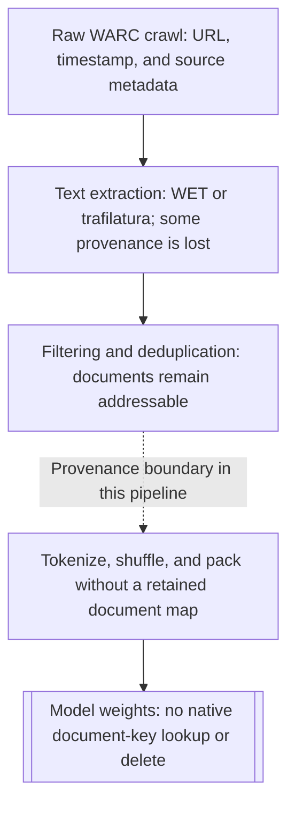
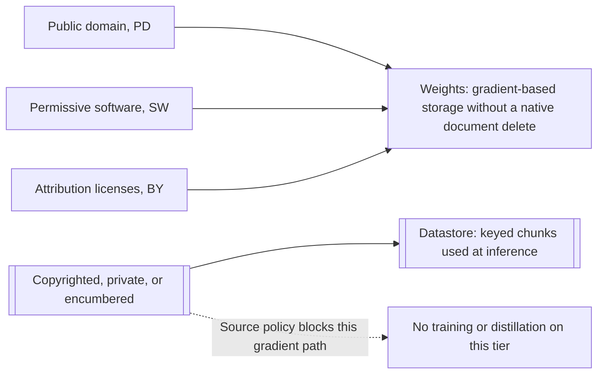

# Chapter 5: Data, Privacy, and the Legal Surface
[00-START-HERE](../00-START-HERE.md) · [01-READING-ROUTES](../01-READING-ROUTES.md) · [04\_what\_the\_llm\_brings\_and\_what\_it\_breaks](04_what_the_llm_brings_and_what_it_breaks.md) · [06\_scaling\_laws\_and\_the\_economics\_of\_retrieval\_vs\_parameters](06_scaling_laws_and_the_economics_of_retrieval_vs_parameters.md)
This chapter prepares you to explain how Retrieval-Augmented Generation (RAG) architecture changes the cost, evidence, and reversibility of data decisions without claiming that it resolves the underlying legal questions.
## TL;DR
- A training pipeline destroys provenance in stages, so a trained model cannot answer document-level questions about its own corpus.
- Alignment can suppress memorized text in ordinary prompts, but it does not delete that text from the weights.
- Duplication makes a sequence easier to extract, and a divergence prompt can move generation outside the behavior covered by alignment.
- Copyright exposure starts with acquisition and copying, while output filters only test a limited class of later emissions.
- Exact unlearning targets equivalence to training without the target data; this chapter uses retraining as its baseline. Approximate unlearning is cheaper, but it does not solve target enumeration or guarantee zero side effects.
- Repeated approximate deletion can compound small capability losses into a large system loss.
- SILO keeps low-risk content in weights and revocable content in a keyed datastore, where removal is selectable and verifiable. The datastore boundary changes the available remedy. It does not by itself make copying lawful or eliminate legal risk.
## The story
Imagine a library that must answer a publisher’s request to remove a collection. The receiving clerk starts with shipping records, dates, and license labels. The scanning clerk turns each book into plain text and throws away much of that paperwork. The cleaning clerk removes duplicates and low-quality pages, but keeps whole documents that can still be sampled. The shredding clerk then cuts every document into tokens, mixes the pieces, and packs them into anonymous boxes. Those boxes feed an apprentice who learns patterns and stores them in memory. The library can no longer point to the publisher’s books inside the apprentice’s memory. It can only ask questions and observe what the apprentice recites.
A manners coach later teaches the apprentice to refuse sensitive requests. The coaching changes normal behavior, but it does not remove remembered names, addresses, or passages. An attacker can force the apprentice outside the coached routine with a long repetition task. Once there, the apprentice may recite heavily repeated material because repetition made that material easy to learn. The library can compare a recited passage with a known book, but that only detects a literal match. It does not reconstruct how the copy was acquired. It also does not settle broader questions about non-literal similarity.
The director next proposes memory surgery. Exact surgery means training a new apprentice without the collection. Approximate surgery punishes the apprentice for repeating examples that a probe found. The probe cannot reveal every relevant example, and the surgery can also damage unrelated knowledge stored in shared memory. Doing this once may look cheap. Doing it for hundreds of requests can steadily erode the apprentice’s capability.
The better library design uses two shelves. Permanent, low-risk material may train the apprentice. Revocable material stays in a cataloged reading room. At answer time, a librarian retrieves relevant pages from that room and gives them to the apprentice. When a publisher revokes a license, the librarian selects the publisher’s rows, blocks them immediately, rebuilds the index later, and verifies that the pages no longer appear. The library still needed a lawful basis to make and hold the reading-room copy. The architectural gain is narrower and concrete: the library preserved a key, a delete operation, and evidence that the removal took effect.
## Decoder table


| Technical term | Plain-English meaning | Why it matters |
| --- | --- | --- |
| Retrieval-Augmented Generation (RAG) | A generator answers with text retrieved from an external store | It keeps some knowledge outside model weights and therefore addressable |
| pre-training corpus | The text collection used to train a base model | Its composition determines what the weights can memorize |
| Common Crawl | The recurring web crawl that supplies raw pages to many corpus pipelines | Its monthly snapshot begins the chapter’s provenance funnel |
| Colossal Clean Crawled Corpus (C4) | A filtered English web corpus used for the chapter’s funnel numbers | It supplies the $`20\,\mathrm{TB}`$, $`750\,\mathrm{GB}`$, and token figures |
| The Pile | The $`825\,\mathrm{GiB}`$ mixture assembled from $`22`$ named sources | Its composition shows why a corpus cannot be summarized as merely the web |
| Books3 | A roughly $`196{,}000`$-book shadow-library corpus included in The Pile | It anchors the copyright, acquisition, and revocability example |
| corpus funnel | Crawl, extraction, filtering, tokenization, and training in sequence | Each stage removes metadata needed by later audits |
| Web ARChive (WARC) | A raw crawl record that can retain source metadata | It preserves more provenance than extracted text |
| Web Extracted Text (WET) | Plain text extracted from a web crawl | It can carry boilerplate while dropping license-bearing markup |
| trafilatura | A tool for extracting main text from raw web records | Extractor choice changes the corpus and therefore the model |
| HyperText Markup Language (HTML) extraction | Turning web pages into training text | It acts like a model hyperparameter because it changes the input distribution |
| language identification | A classifier that keeps text in selected languages | It removes large parts of a crawl before training |
| heuristic filter | A hand-written content rule | It can reduce noise while introducing blind spots and coverage bias |
| blocklist | A list of forbidden strings | It guarantees literal exclusions but cannot capture broad semantic categories |
| quality classifier | A learned filter that predicts document quality | It can outperform simple keyword rules but still does not prove a corpus is clean |
| deduplication | Removing repeated text | It lowers duplication-driven memorization without requiring a smaller model |
| provenance | Evidence of source, ownership, license, and history | It determines whether a later claim about a document can be checked |
| provenance boundary | The pipeline point where document identity disappears | Above it removal can be a file operation. Below it removal means model work |
| tokenization | Splitting text into model units | Shuffling and packing tokens dissolves the document as an addressable object |
| sampled audit | Reviewing a random subset to estimate a rate | It yields a confidence interval at tractable cost |
| enumeration | Listing every matching instance | Many legal and deletion questions ask for it, but trained weights do not provide it |
| confidence interval | A range that quantifies uncertainty around an estimated rate | It replaces an unsupported claim of zero contamination |
| extraction probe | Prompts designed to test whether a model emits target training text | It measures behavior when corpus membership cannot be listed |
| parametric weights | Knowledge compressed into learned parameters | It is cheap to use but lacks keys and exact delete operations |
| non-parametric datastore | An external collection read at inference time | Its rows remain selectable, deletable, and auditable |
| personally identifiable information (PII) | Information tied to an identifiable person | It includes combinations that a simple regular expression cannot recognize |
| General Data Protection Regulation (GDPR) Article 4(1) | The personal-data definition quoted by the source | It makes clear why formatted-field redaction does not cover every identifying combination |
| GDPR Article 12(3) | The response-window provision cited by the source | The chapter uses its one-month window when discussing verifiable datastore deletion |
| alignment | Post-training that shapes assistant behavior | It changes reachable continuations but does not erase pre-training memories |
| $`\theta`$ and $`\phi`$ | The pre-training parameters and the later aligned parameters | Their distinction separates stored associations from ordinary refusal behavior |
| supervised fine-tuning | Gradient updates on labeled demonstrations | It changes behavior in covered contexts and can also memorize private examples |
| preference optimization | Training toward preferred assistant responses | It discourages outputs but is not a deletion operation |
| maximum-likelihood training | Training that raises probability on observed corpus sequences | It drives the model distribution toward the duplication-weighted empirical marginal |
| empirical marginal | A sequence’s observed frequency in a corpus | It explains why duplicated sequences dominate unconditional sampling |
| duplication count $`d`$ | The number of times a sequence appears | Higher $`d`$ can make lock-on and extraction more likely |
| aligned manifold | The region of contexts represented by alignment demonstrations | Ordinary prompts tend to stay inside it |
| off-support prompt | A context unlike any alignment demonstration | It can expose pre-training behavior that alignment never changed |
| divergence attack | A prompt that drives generation outside aligned behavior | Long token repetition sharply increases training-data emission |
| indirect prompt injection | Retrieved adversarial text that rewrites instructions | It attacks the datastore path, unlike a divergence attack on the weights |
| output-side redaction | A filter that removes detected sensitive strings from responses | It must work on every response and cannot recognize all personal data |
| release gate | A test that must pass before a model ships | It turns a known extraction method into a repeatable decision point |
| verbatim continuation | Exact reproduction of a known work after a prefix | It provides strong evidence of memorization, but the chapter does not call it proof of training membership |
| induction head | A model mechanism that copies what followed a matching earlier token | It copies text already in the context, and continuing a known document beyond the prompt relies on memorized weights (corrected from helping a model lock onto a known document and continue it) |
| lock-on | A state where the model recognizes and follows a specific source text | It creates long exact runs that independent token errors do not predict |
| $`p`$, $`q`$, and $`\pi(d,k)`$ | Independent next-token accuracy, locked-on accuracy, and document lock-on probability | Together they distinguish rapid independent-error decay from a slower mixture tail |
| longest exact run | The largest consecutive literal match to a known work | It targets the tail that can become an exhibit |
| mean overlap | Average shared text across many outputs | It hides rare but very long copied passages |
| n-gram filter | A detector for exact short text sequences | It bounds literal matches only against indexed works |
| substantial similarity | A broader comparison that can include non-literal expression | A clean n-gram result does not address it |
| exact unlearning | A result equivalent in distribution to training without the target set | Full retraining is the chapter’s exact baseline; exactness is the target guarantee |
| approximate unlearning | Gradient updates that suppress a written forget set | It is cheap but depends on an incomplete target and causes interference |
| TOFU | A benchmark that inserts fictitious author profiles before testing forgetting | It supplies the true forget set by construction and therefore does not test production enumeration |
| WMDP | A benchmark with a curated hazardous-knowledge forget domain | It measures the optimizer under a named scope rather than discovery of an unknown forget set |
| forget set $`F`$ | The true training sequences that an obligation asks to remove | Production systems may not be able to enumerate it when provenance is missing |
| observed candidate forget set $`\widehat F`$ | Candidates surfaced and written down by probes | The optimizer can act on it, but recall and membership against $`F`$ may be unknown |
| retain set $`R`$ | Training data that should remain | Unlearning should preserve its capability |
| replay sample | Retained examples mixed into approximate unlearning | It reduces collapse but cannot guarantee zero side effects |
| interference | A weight update for one sequence changing performance on another | Shared parameter directions can prevent perfectly local deletion |
| superposition | Many facts sharing the same parameter space | It explains why no fact owns an isolated delete direction |
| retained-capability loss $`\delta`$ | The fraction of remaining capability lost in one run of the scenario model | Constant relative losses compound as $`(1-\delta)^n`$ |
| sharded exact unlearning | Training many corpus slices so one slice can be retrained | It makes deletion cheaper while multiplying serving cost and memory |
| SILO | A design that separates training data by license risk | Only lower-risk tiers reach gradients while higher-risk tiers stay revocable |
| Open License Corpus | The $`228\times10^9`$-token corpus built from the three low-risk tiers | Unique corpus tokens differ from cumulative tokens processed during training |
| OpenWebText2 | The evaluation corpus used for the reported low-risk quality tax | Its perplexity gap measures composition rather than unmatched compute |
| Pythia-1.4B | The compute-matched model trained on The Pile | Its $`11.5`$ perplexity is the comparison point for the SILO quality gap |
| public domain (PD) tier | Content treated as public domain in the source system | It is the first low-risk tier admitted to weights |
| permissive software (SW) tier | Software content under permissive licenses | It expands the low-risk training corpus |
| attribution license (BY) tier | Content whose license requires attribution | It enters weights only when attribution obligations can be honored |
| license field | A key stored with every document or chunk | It turns a publisher removal into a database selection |
| perplexity | A language-model uncertainty score where lower is better | It measures the quality tax of restricting the training corpus |
| nats per token | A log-loss unit | It makes perplexity gaps additive; the $`90\%`$ closure calculation assumes this space |
| nearest-neighbor language model (kNN-LM) | A model that mixes token probabilities with a datastore lookup | It can repair corpus-composition gaps but uses a very large datastore |
| retrieved-in-context language model (RIC-LM) | A system that puts retrieved chunks in the prompt | It is much smaller and works with a hosted generation interface |
| mixture weight $`\lambda`$ | The fraction assigned to parametric predictions under this chapter’s convention | Setting $`\lambda=1`$ removes the datastore’s contribution for that computation |
| $`32`$-bit floating point (fp32) | $`4\,\mathrm{B}`$ per vector dimension | It determines the roughly $`123.23\,\mathrm{GB}`$ Books3 vector-payload estimate |
| $`16`$-bit floating point (fp16) | $`2\,\mathrm{B}`$ per vector dimension or model parameter | It determines parameter and vector-payload storage estimates |
| Hierarchical Navigable Small World (HNSW) graph | A graph index for approximate nearest-neighbor search | Its neighbor links add storage and support fast retrieval |
| tombstone | A deletion marker checked during reads | It blocks revoked rows before a full index rebuild |
| ablation | An evaluation with one source or tier removed | It measures the quality impact of a future revocation in advance |
| low-rank adaptation (LoRA) adapter | A small separate file of learned parameter updates | A tenant-specific adapter can be deleted if it is never merged |
| residual risk | Exposure that remains after the available controls | It must be stated rather than hidden behind an unverified claim |


## Core mechanics
### Mathematical conventions and assumptions
Storage uses decimal units unless explicitly marked binary: $`1\,\mathrm{kB}=10^3\,\mathrm{B}`$, $`1\,\mathrm{GB}=10^9\,\mathrm{B}`$, $`1\,\mathrm{TB}=10^{12}\,\mathrm{B}`$, and $`1\,\mathrm{GiB}=2^{30}\,\mathrm{B}`$. Keep full precision during calculation and round only the reported result; $`\approx`$ denotes a rounded value or modeling approximation.
For the worked compute estimates, let $`N`$ be parameter count, $`T`$ the tokens processed, $`P_{\mathrm{GPU}}=3.4\times10^{14}\,\mathrm{FLOP\,s^{-1}}`$ the assumed sustained throughput per GPU, $`r=\$2.50`$ per GPU-hour, and $`G`$ the number of equally utilized GPUs. Then

```math
\begin{aligned}
W_{\mathrm{infer}}&\approx 2NT,&
W_{\mathrm{train}}&\approx 6NT,\\
H_{\mathrm{GPU}}&=\frac{W}{3600P_{\mathrm{GPU}}},&
C&=rH_{\mathrm{GPU}},&
t_{\mathrm{wall}}&\approx\frac{3600H_{\mathrm{GPU}}}{G}.
\end{aligned}
```

These are idealized FLOP-based estimates, not measured latency or invoices. They omit attention-length effects, memory-bandwidth limits, communication, queuing, retrieval I/O, and other overhead; using one throughput for prefill, decode, and training is an explicit simplification. Perfect multi-GPU scaling is assumed where wall time is quoted. Corpus statistics and empirical attack rates are reported inputs, not conclusions proved by the arithmetic. A contractual $`30`$-day window is also distinct from one calendar month.
### 5.1 What is actually in the pre-training corpus
#### The lossy funnel
A monthly Common Crawl snapshot begins at roughly $`20\,\mathrm{TB}`$ of scraped text. Raffel et al. report that filtering leaves about $`750\,\mathrm{GB}`$. The filters include English-only classification, deduplication, terminal-punctuation rules, code-brace rules, and blocklisted terms. The surviving byte fraction is $`750/20{,}000=0.0375=3.75\%`$. The cleaned corpus contains about $`1.56\times10^{11}`$ tokens, implying approximately $`4.81\,\mathrm{B/token}`$. The conversion matters because corpus reports alternate between bytes and tokens.

```math
\begin{aligned}
f_{\mathrm{survive}}&=\frac{750\,\mathrm{GB}}{20{,}000\,\mathrm{GB}}=0.0375=3.75\%,\\
b_{\mathrm{token}}&=\frac{750\times10^9\,\mathrm{B}}{1.56\times10^{11}\,\mathrm{tokens}}
\approx 4.80769\,\mathrm{B/token}.
\end{aligned}
```

A run of $`15.6\times10^{12}`$ tokens corresponds to about $`75\,\mathrm{TB}`$ under that byte conversion. Bidirectional Encoder Representations from Transformers (BERT) used a $`16\,\mathrm{GB}`$ training corpus according to Liu et al. The implied ratio is $`75{,}000/16=4{,}687.5\approx4{,}700`$, which the source places across six years. Review, licensing, and consent processes did not scale at the same rate. Without the funnel view, an engineer may call the corpus “the internet” and miss every stage that changed it.
#### Composition and extractor choice
The Pile contains $`825\,\mathrm{GiB}`$ from $`22`$ sources. Its sources include web text, PubMed Central, GitHub, arXiv, FreeLaw, Stack Exchange, Wikipedia, and Books3. Using the reported $`101\,\mathrm{GiB}`$ for Books3 gives $`101/825\approx12.2\%`$ of The Pile by bytes. Dodge et al. found that patents.google.com was the largest single source domain in C4. That result undercuts the casual assumption that Wikipedia or news dominates the corpus. Gehman et al. found $`2\%`$ to $`4\%`$ of documents above a toxicity threshold after cleaning. If the affected documents have the same average length as the corpus, a $`2\%`$ document share would also be a $`2\%`$ byte share, or $`0.02\times750\,\mathrm{GB}=15\,\mathrm{GB}`$, roughly BERT’s full training corpus. The document percentage alone does not establish that byte total. Common Crawl WET files preserve navigation menus, cookie banners, and footer links as text. Penedo et al. instead re-extracted raw WARC records with trafilatura and deduplicated aggressively. They reported that carefully processed web data could match corpora built from human-selected sources. The same crawl therefore produces a different model when the extractor changes. Without extractor name, version, and thresholds, the training recipe is incomplete and unrecoverable.
#### The provenance boundary
Raw crawl records can retain a Uniform Resource Locator (URL), timestamp, and license header. Text extraction keeps the URL but can drop license-bearing markup. Filtering retains document objects, so an auditor can still sample and estimate a rate. Tokenization, shuffling, and packing dissolve document identity. Below that point, prompting is an extraction test rather than a lookup. A closed-data model therefore supports behavior measurements, not exact claims about corpus membership. Open weights do not imply open training data. Composition reports for released corpora do not establish the composition of a different closed corpus.
The curation-first alternative also fails as a complete answer. Reading a paragraph reveals content but not who owns it, whether the site could post it, or when a license may end. That information is provenance metadata discarded earlier in the funnel. Without a retained key, removing a document changes from a file operation into a retraining problem.
#### Worked audit economics
Using a planning prevalence $`p=0.02`$, a nominal $`95\%`$ normal-approximation interval, and half-width $`e=0.005`$ (that is, $`0.5`$ percentage points), the sample-size formula gives $`n\approx3{,}011.81`$. Round upward to $`n=3{,}012`$ documents. This assumes approximately independent random sampling from a large corpus and a credible planning value for $`p`$; it is not a prevalence-free coverage guarantee. If no prevalence estimate is available, the conservative choice $`p=0.5`$ gives $`n=38{,}416`$ instead.

```math
\begin{aligned}
n_{\mathrm{plan}}
&=\frac{z_{0.975}^{\,2}p(1-p)}{e^2}
=\frac{1.96^2(0.02)(0.98)}{0.005^2}
=3{,}011.8144,\\
n&=\left\lceil n_{\mathrm{plan}}\right\rceil=3{,}012.
\end{aligned}
```

At $`5`$ minutes per document, the $`3{,}012`$-document audit takes $`251`$ person-hours and costs $`\$3{,}765`$ at $`\$15`$ per hour. With two reviewers each working $`40`$ hours per week, the elapsed time is $`251/(2\times40)=3.1375`$ working weeks, not less than one week. This assumes each sampled document receives one review; independent double review would double the labor.
Enumeration has a different scale. A reader at $`250`$ words per minute, assuming about $`5.7\,\mathrm{B/word}`$ and $`4.8\,\mathrm{B/token}`$, covers roughly $`300`$ tokens per minute. Using the explicitly rounded planning rate of $`18{,}000`$ tokens per person-hour, reading $`15.6\times10^{12}`$ tokens takes approximately $`8.67\times10^8`$ person-hours. At $`2{,}000`$ hours per person-year, that is $`4.33\times10^5`$ person-years; at $`\$15`$ per hour, it costs approximately $`\$13.0`$ billion.

```math
\begin{aligned}
H_{\mathrm{read}}
&=\frac{15.6\times10^{12}\,\mathrm{tokens}}
{1.8\times10^4\,\mathrm{tokens/(person\!-\!hour)}}
\approx8.67\times10^8\,\mathrm{person\!-\!hours},\\
Y_{\mathrm{read}}
&=\frac{H_{\mathrm{read}}}{2{,}000\,\mathrm{hours/year}}
\approx4.33\times10^5\,\mathrm{person\!-\!years}.
\end{aligned}
```

The Llama 3 405-billion-parameter run used $`30.84\times10^6`$ H100 graphics processing unit (GPU) hours. At $`\$2.50`$ per GPU-hour, the worked cost is $`\$77.1`$ million. The $`\$13.0`$ billion reading estimate is about $`169`$ times that training cost and $`3.45\times10^6`$ times the $`\$3{,}765`$ sampled-audit cost. The audit-to-training cost fraction is approximately $`4.88\times10^{-5}`$, or $`4.88`$ parts in $`100{,}000`$. A $`300`$-page book is approximated as $`100{,}000`$ words and $`120{,}000`$ tokens. The corpus is therefore $`15.6\times10^{12}/120{,}000=1.30\times10^8`$ book-equivalents. The chapter compares that order with Google’s 2010 count of $`129{,}864{,}880`$ distinct published books. This is only an order-of-magnitude check, not evidence that the corpus contains that many distinct books.
#### Practice decisions
Default to a sampled audit with a stated interval. Do not replace the interval with the word “clean.” The source suggests switching toward exact matching with a hash or n-gram index when prevalence falls below roughly $`p=0.005`$. Treat this as a workflow heuristic, not a universal statistical threshold: sample requirements depend on absolute or relative error targets, confidence, and the detection task. Exact matching also needs reference material. Record the extractor, its version, and all filter thresholds next to the seed and learning rate. Route content that can be revoked in under one year to a datastore by default. The source allows an exception for public-domain and permissively licensed text where revocation risk is treated as zero. Prefer a trained quality classifier to a keyword blocklist, except where a legal prohibition names literal strings. The source reports that C4’s blocklist removed documents about minority identities at a disproportionate rate, so its toxicity benefit also costs long-tail coverage. For a corpus you did not build, report an extraction probe rather than asserting that a filter removed the content. Treat a stated $`0.3\%`$ training mixture as a mixing weight, not as an extraction rate, because a small duplicated source can be easier to extract than a larger diverse source.
### 5.2 PII extraction and the divergence attack
#### Alignment changes behavior, not stored associations
Pre-training fits parameters $`\theta`$ to a next-token distribution over the corpus. Supervised fine-tuning and preference optimization produce later parameters $`\phi`$ from a much smaller set of demonstrations. Those updates reshape likely continuations in covered contexts. They are not a selective deletion procedure for a phone number repeated hundreds of times in pre-training. Memorized associations can remain after alignment; refusal behavior is not proof that sensitive data is absent.
#### Duplication and marginal sampling
If a corpus contains $`M`$ equally weighted sequence instances and sequence $`s`$ appears $`d(s)`$ times, its empirical sequence probability is $`\widehat p(s)=d(s)/M`$. Maximum-likelihood training favors fitting that distribution. The approximation below is schematic: finite model capacity, conditioning, and optimization prevent an automatic equality between the trained model and the empirical distribution.

```math
\widehat p(s)=\frac{d(s)}{M},
\qquad
p_\theta(s)\approx\widehat p(s)
\quad\text{under an idealized distributional fit}.
```

An unconditional sample therefore favors heavily duplicated sequences. Regurgitation in this regime is sampling that reflects the corpus distribution. Alignment normally starts sampling inside contexts covered by assistant demonstrations. Its security property belongs to that starting region, not to deletion from weights.
#### Divergence
A repetition instruction can drive the model outside contexts represented in alignment data. A long repeated context carries little information about the intended topic or task. When the loop breaks, generation may expose pre-training associations, including duplicated text; approaching the unconditional pre-training marginal is a heuristic explanation, not a distributional identity. Nasr et al. measured roughly $`150`$ times more training-data emission under divergence than during normal behavior. They found memorized PII in $`16.9\%`$ of tested divergent generations. About $`\$200`$ in hosted queries recovered more than $`10{,}000`$ unique verbatim training examples. Carlini et al. sampled from a $`1.5`$-billion-parameter Generative Pre-trained Transformer 2 (GPT-2) model and hand-checked $`1{,}800`$ candidates. They confirmed $`604`$ verbatim training examples, giving $`604/1{,}800\approx33.6\%`$ precision. One example combined a person’s name, email address, phone number, fax number, and physical address. The chapter cites General Data Protection Regulation (GDPR) Article 4(1) for the definition of personal data as information relating to an identifiable natural person. A name beside an employer and city can qualify under that definition even when no regular expression marks it. This chapter preserves that legal statement as reported and does not extend it into case-specific advice.
#### Why the common defenses lose
Blocking the literal repeat-forever string patches one prompt, not every way to reach an off-support context. The limitation is coverage and generalization, not a contrast between an “unbounded” prompt space and an “enumerable” blocklist: bounded-context prompt spaces are finite, and unrestricted finite token strings are themselves enumerable. Output redaction also faces an attacker making many attempts, who may need only one failure. It recognizes only a subset of information that can identify a person. These controls do not by themselves erase the underlying associations. A divergence attack is not indirect prompt injection. Injection uses adversarial text retrieved from a datastore; divergence need not touch the index, so retrieval-side controls alone do not stop it.
#### Worked probe economics
The worked example uses a generator with $`N=7\times10^9`$ parameters, fine-tuned on $`200{,}000`$ support transcripts. It applies the forward-pass proxy $`2N=1.4\times10^{10}\,\mathrm{FLOP/token}`$ to both prompt and completion tokens, with the common throughput and price assumptions above. Combining the reported $`16.9\%`$ PII-bearing-generation rate with the $`150`$-fold training-data-emission multiplier gives a constructed baseline of $`0.169/150\approx0.00112667`$, or $`0.112667\%`$. This combination assumes the multiplier transfers to that PII metric; it is not a directly measured normal-prompt rate.
For $`10{,}000`$ normal queries with $`100`$ prompt and $`200`$ completion tokens, the total is $`3.00\times10^6`$ tokens. The idealized estimate is $`123.53\,\mathrm{s}`$, $`0.03431`$ GPU-hours, and $`\$0.08578`$. The expected count is $`11.27`$ PII-bearing generations, giving about $`\$0.00761`$ per such generation. For $`10{,}000`$ divergence queries with $`50`$ prompt and $`2{,}000`$ completion tokens, the total is $`20.5\times10^6`$ tokens, giving $`844.12\,\mathrm{s}`$, $`0.23448`$ GPU-hours, and $`\$0.58619`$.

```math
\begin{aligned}
t_{\mathrm{normal}}
&\approx\frac{(3.00\times10^6)(1.4\times10^{10})}{3.4\times10^{14}}\,\mathrm{s}
\approx123.53\,\mathrm{s},\\
t_{\mathrm{divergence}}
&\approx\frac{(20.5\times10^6)(1.4\times10^{10})}{3.4\times10^{14}}\,\mathrm{s}
\approx844.12\,\mathrm{s}.
\end{aligned}
```

At the assumed $`16.9\%`$ rate, the divergence probe has an expected $`1{,}690`$ PII-bearing generations and an idealized cost of approximately $`\$3.47\times10^{-4}`$ per PII-bearing generation. It uses $`20.5/3\approx6.83`$ times the compute of the normal probe, while the modeled cost per PII-bearing generation is about $`21.95`$ times lower. These are output counts, not counts of unique records or customers: a generation may identify multiple people, and the same person may recur. The $`200{,}000`$ training transcripts do not supply a distinct-customer denominator, so a customer-exposure percentage cannot be inferred.
The hosted attack’s rounded $`\$0.02`$ per unique training example is numerically about $`57.7`$ times the local cost per PII-bearing generation, but those are different outcome units. The local proxy is approximately $`\$0.0286`$ per million processed tokens; comparing it with the cited $`\$2.00`$ per million hosted output tokens gives a numerical ratio of about $`69.9`$. Prompt versus output billing, unique-example deduplication, different target models, and omitted serving overhead prevent these ratios from validating each other.
#### Practice decisions
Use a divergence probe as a release gate. The source’s default is $`10{,}000`$ repetition prompts at the production completion limit. On the worked $`7`$-billion-parameter model, the FLOP proxy gives about $`\$0.59`$ and $`14.1`$ minutes on one GPU; actual latency and cost must be benchmarked. For a third-party Application Programming Interface (API), use a smaller $`500`$-query sample when flooding is not possible and label extrapolation as extrapolation. Do not fine-tune the generator on records subject to erasure requests. Use synthetic or consented transcripts for tone when that satisfies the product goal. Treat output PII redaction as a detector, not as the control that proves release safety. The source permits a narrower exception for checksum-verifiable fields such as card numbers. Limit completion length to product need because divergence needs a long run. The source’s suggested relationship between completion caps and attacker cost is a hypothesis to measure, not a universal linear law. On long-form surfaces, stop repeated n-grams before the model clears the repetition phase. Report PII-bearing generations per dollar separately from deduplicated records or people per dollar. Route a confirmed finding to the weights-datastore boundary rather than treating more guardrails as a durable repair.
### 5.3 Copyright, Books3, and verbatim continuation
#### What the evidence can and cannot show
Books3 contains roughly $`196{,}000`$ English-language books. It was assembled in 2020 from a shadow library and released as about $`101\,\mathrm{GiB}`$ of plain text. The Pile included it as roughly $`12\%`$ of $`825\,\mathrm{GiB}`$. The chapter reports that Books3 was named in the complaint in Kadrey v. Meta Platforms, filed in the Northern District of California in July 2023. It also reports that the Danish Rights Alliance had the dataset removed from public distribution in 2023. That removal did not change models already trained on the dataset. Given a canonical book, a team can prefix the model with $`k`$ tokens and measure its longest exact continuation. A long verbatim continuation is strong evidence of training exposure, but the chapter does not call it proof of corpus membership. The opening legal exhibit is a $`400`$-word exact continuation from a novel. Without that calibration, an engineering measurement can be overstated in a legal setting.
#### Independent errors versus lock-on
The naive model assigns independent probability $`p`$ to each correct next token, conditional on a fixed supplied prefix. The probability that the next $`L`$ tokens are all correct is then $`p^L`$. With $`p=0.95`$, the $`100`$-token probability is approximately $`5.92053\times10^{-3}`$, and the $`300`$-token probability is approximately $`2.07530\times10^{-7}`$. These are small probabilities, not impossibility claims; the chance of at least one success also depends on the number of attempts.

```math
\begin{aligned}
\Pr(L_{\mathrm{run}}\ge L\mid\text{fixed prefix})&=p^L
\quad\text{under independent token errors},\\
0.95^{100}&\approx5.92053\times10^{-3},\\
0.95^{300}&\approx2.07530\times10^{-7}.
\end{aligned}
```

A long exhibit motivates questioning the independence assumption; one observed run alone does not mathematically refute it without a sampling model and attempt count. Each correct token can give more evidence that the context is a specific document. Induction heads can match a token against earlier context and copy what followed it. Correction: Induction heads copy only text that is already in the context, so a continuation beyond the supplied prefix comes from training text memorized in the weights, which is the memorization that Carlini et al. (2023, arXiv 2202.07646) measure. The schematic model assigns lock-on probability $`\pi(d,k)`$, increasing with duplication count $`d`$ and supplied prefix length $`k`$. Conditional on lock-on, take per-token accuracy $`q=0.999`$. Then the probability of $`300`$ further correct tokens is $`q^{300}\approx0.740707`$.

```math
q^{300}=0.999^{300}\approx0.740707.
```

About three quarters of already locked-on generations therefore run $`300`$ further tokens clean in this toy model. A two-regime survival model makes the conditioning explicit:

```math
\Pr(L_{\mathrm{run}}\ge L)
\approx \bigl(1-\pi(d,k)\bigr)p^L+\pi(d,k)q^L.
```

The $`0.740707`$ value is not the unconditional extraction probability; it must be weighted by $`\pi(d,k)`$, with the non-locked contribution also included. A mixture can create an initially steep decay followed by a much slower tail. It does not automatically prove bimodality, and for $`p,q\lt 1`$ both terms eventually approach zero rather than a permanent nonzero plateau. Mean overlap can obscure a rare long exact run. Track the maximum run for tail exposure, but compare maxima only at matched attempt counts and generation caps.
#### Output filters and reported legal holdings
An n-gram filter can block literal matches to indexed works. The chapter cites a roughly $`150`$-character public-code match window documented for GitHub Copilot. That filter misses works not present in its index. It also does not test non-literal copying. The chapter states that substantial similarity can reach structure, sequence, and expression beyond exact text. A clean report should therefore say “no literal matches above $`150`$ characters against the works we indexed.” It should not be restated as “no infringement.” The chapter reports that in Bartz v. Anthropic, in June 2025, Judge Alsup held training on lawfully acquired books transformative fair use and separately held that downloading and retaining pirated copies for the training library was not. It reports that the case settled in 2025 for roughly $`\$1.5`$ billion. It reports that Kadrey granted summary judgment to Meta on the record those plaintiffs built while stating that the ruling did not establish that training on pirated books is lawful. These are the chapter’s descriptions of specific proceedings, not a general legal rule or present legal advice. An output filter cannot reach an acquisition act that occurred before training.
#### Three Books3 configurations
The worked example assumes $`196{,}640`$ books, $`80{,}000`$ words per book, and $`1.3`$ tokens per word, giving $`104{,}000`$ tokens per book and $`20{,}450{,}560{,}000`$ tokens in total. Dividing the reported $`\$1.5`$ billion settlement by an assumed $`500{,}000`$ works gives $`\$3{,}000`$ per work. Applying that scenario rate to Books3 gives $`\$589.92`$ million. At $`\$15`$ per ebook, the purchase-price scenario is $`\$2{,}949{,}600`$, and the ratio is exactly $`200{:}1`$ under these assumptions. This is a sensitivity comparison, not an estimate of actual liability or a claim that buying an ebook grants training rights.
For a test-time datastore, use non-overlapping $`512`$-token chunks and do not let a chunk cross a book boundary. Retaining the final partial chunk gives $`\lceil104{,}000/512\rceil=204`$ vectors per book and $`196{,}640\times204=40{,}114{,}560`$ vectors overall. At $`768`$ dimensions in fp32, each vector uses $`768\times4=3{,}072\,\mathrm{B}`$. The vector payload is therefore $`123{,}231{,}928{,}320\,\mathrm{B}\approx123.23\,\mathrm{GB}`$, excluding source text, graph links, identifiers, and metadata. Embedding the unpadded source tokens at $`\$0.02`$ per million tokens costs about $`\$409.01`$. Removing one modeled title selects $`204`$ vectors. The datastore does not make acquisition lawful by itself; it changes the mechanics of a later opt-out.
The chapter reports United States Copyright Act Section 504(c) statutory damages of $`\$750`$ to $`\$30{,}000`$ per work, rising to $`\$150{,}000`$ for willful infringement. The $`\$3{,}000`$ scenario rate is $`4`$ times the stated floor and $`2\%`$ of the cited willful ceiling. Multiplying $`196{,}640`$ by $`\$150{,}000`$ gives $`\$29.496`$ billion as an arithmetic upper-sensitivity scenario, not a predicted award; eligibility and legal findings are separate questions.
#### Practice decisions
Require acquisition provenance before accepting a training corpus. Use a receipt, license, or public-domain designation per source. Probe at production prefix length and report the maximum exact run alongside the number of attempts and the completion cap. The source suggests drawing a few thousand prefixes from works that can be named. Use a high percentile for a stable trend only when the strict maximum remains the gate. Ship an n-gram filter as a symptom control, not as the complete risk control. Deduplicate before reducing model size because the chapter cites roughly a $`10`$-fold reduction in memorized emission after deduplication with no held-out perplexity cost. Route revocable content to a datastore before training. Record a retirement date for checkpoints trained on data with unproven provenance. When a retrieval-only license costs $`4`$ times a training-inclusive license, price revocation, termination notice, and retraining before treating the cheaper license as lower cost.
### 5.4 Unlearning and why it cannot scale
#### Exact and approximate objectives
Let $`\mathcal D_{\mathrm{train}}`$ be the training corpus, $`F`$ the true training sequences to forget, and $`R=\mathcal D_{\mathrm{train}}\setminus F`$ the retained corpus. Exact unlearning targets the same model-output distribution as training on $`R`$ with the specified training procedure and randomness. The chapter’s baseline obtains this by retraining on $`R`$; exactness is the equivalence requirement, not a theorem that every possible exact method must rerun all training. This guarantee requires correctly identifying and excluding $`F`$ and all relevant prior exposure.

```math
R=\mathcal D_{\mathrm{train}}\setminus F,
\qquad
\theta_R=\mathop{\mathrm{Train}}\nolimits(R;\xi),
```

where $`\xi`$ denotes the training randomness. An exact unlearning procedure should match the distribution of $`\mathop{\mathrm{Train}}\nolimits(R;\xi)`$ under the same prescribed randomness law.
Bourtoule et al. made exact deletion cheaper for classifiers by sharding data and retraining one shard. For the chapter’s $`7`$-billion-parameter generator, the full-retraining baseline costs approximately $`\$1.338`$ million and $`22.30`$ days on $`1{,}000`$ GPUs under ideal scaling. Approximate unlearning instead tries to lower probability on the observed candidate forget set $`\widehat F`$ while replaying retained examples $`R'`$. Let $`\beta\ge0`$ weight forgetting against retention; $`\beta`$ is distinct from the retrieval-mixture weight $`\lambda`$ used later. One normalized surrogate objective is

```math
J(\theta)=
\frac{1}{|R'|}\sum_{x\in R'}\log p_\theta(x)
-
\frac{\beta}{|\widehat F|}\sum_{x\in\widehat F}\log p_\theta(x),
\qquad
\theta\leftarrow\theta+\eta\nabla_\theta J(\theta).
```

This surrogate encourages suppression of supplied examples but does not guarantee that every example’s probability falls. Without constraints or regularization, the negative log-probability term can make the objective unbounded above as forget probabilities approach zero; practical methods need safeguards such as regularization and early stopping. The worked update-plus-evaluation compute estimate is about $`\$0.663`$ per request. Enumeration and interference remain separate problems even if that compute is cheap.
#### Enumeration failure
An erasure request names a person, book, or customer; the optimizer consumes token sequences. If document-to-token provenance was discarded during tokenization and packing, $`\widehat F`$ contains only candidates surfaced by finite probes. Recall against the true set is $`\lvert\widehat F\cap F\rvert/\lvert F\rvert`$ for $`\lvert F\rvert\gt 0`$, and cannot be measured without knowing $`F`$. A candidate also need not be a verified member of $`F`$. Re-running the same prompts after optimization tests suppression on those prompts, not absence under untried prompts. Benchmarks can make a stronger claim because they supply the forget set by construction. The chapter cites a fictitious-author benchmark and a curated hazardous-knowledge benchmark as legitimate optimizer tests that do not measure production enumeration. It also cites evaluations where reported forgetting reappears under adjacent-data relearning or another language.
#### Interference failure
Consider the forget-only component of an update. With $`g_{\widehat F}`$ defined as the gradient of the mean forget-set log-likelihood, suppressing that likelihood requires a negative step, $`\theta'=\theta-\eta g_{\widehat F}`$ for $`\eta\gt 0`$. A positive step would increase forget-set likelihood to first order. For a retained sequence $`y`$, the first-order change is controlled by the gradient inner product. It vanishes when the gradients are orthogonal, but a zero first-order term does not rule out higher-order changes. The full surrogate update also includes the replay gradient.

```math
\begin{aligned}
g_{\widehat F}
&=\nabla_\theta\left[
\frac{1}{|\widehat F|}\sum_{x\in\widehat F}\log p_\theta(x)
\right],
&g_y&=\nabla_\theta\log p_\theta(y),\\
\theta'&=\theta-\eta g_{\widehat F},\\
\log p_{\theta'}(y)-\log p_\theta(y)
&=-\eta\,g_y^{\mathsf T}g_{\widehat F}+O(\eta^2).
\end{aligned}
```

Shared parameters need not provide isolated directions for deleting individual facts. Applying the chapter’s empirical estimate of $`3.6`$ memorized bits per parameter to $`7\times10^9`$ parameters gives $`3.15\times10^9\,\mathrm{B}=3.15\,\mathrm{GB}`$, or about $`3.2\,\mathrm{GB}`$. This is an extrapolated memorized-information estimate, not the physical checkpoint size or a universal model-capacity bound.

```math
\frac{(7\times10^9\,\mathrm{parameters})(3.6\,\mathrm{bits/parameter})}
{8\,\mathrm{bits/B}}
=3.15\times10^9\,\mathrm{B}
=3.15\,\mathrm{GB}.
```

The $`75\,\mathrm{TB}`$ corpus is about $`75{,}000/3.15\approx23{,}810`$ times this memorized-information estimate. Corpus bytes and memorized information are different quantities, so this ratio alone does not prove a particular interference rate or storage mechanism. Shared representations and superposition explain why a forgetting update can change retained behavior in either direction. Replay can reduce damage but cannot guarantee orthogonality to every retained gradient.
#### Stream compounding
Under the illustrative assumption that each run loses the same fraction $`\delta`$ of the remaining retained capability, with no recovery or other changes, the normalized capability after $`n`$ runs is $`(1-\delta)^n`$. More generally it is $`\prod_{i=1}^n(1-\delta_i)`$. These are scenario models, not measured laws of unlearning.

```math
\begin{aligned}
\frac{K_n}{K_0}&=(1-\delta)^n,\\
(1-\delta)^{400}\ge0.95
&\Longleftrightarrow
\delta\le1-0.95^{1/400}
\approx 1.28225\times10^{-4}.
\end{aligned}
```

At $`\delta=1\%`$ and $`n=400`$, normalized retention is $`0.99^{400}\approx1.795\%`$. At $`\delta=0.1\%`$, it is $`0.999^{400}\approx67.019\%`$. Retaining at least $`95\%`$ after $`400`$ runs requires the exact bound $`\delta\le1-0.95^{1/400}`$, approximately $`1.28225\times10^{-4}`$ as a fraction, or $`0.0128225\%`$ of remaining capability per run. That is approximately $`1.28225`$ parts in $`10{,}000`$. Measurement precision depends on the metric and test design, as calculated below. At $`12`$ requests per month, $`n=144`$ in one year; the same $`1\%`$ relative-loss scenario leaves $`0.99^{144}\approx23.517\%`$. The system pays for a request stream, not one apparently cheap request.
#### Why sharding loses for generation
With $`S=100`$ separately served shard models of $`N=7\times10^9`$ parameters each, the system carries $`SN=7\times10^{11}`$ parameters. At fp16, parameter storage is $`1.4\,\mathrm{TB}`$ rather than $`14\,\mathrm{GB}`$ for one model, excluding activations, caches, and other overhead. If every query evaluates all $`S`$ models and combines their predictions, inference work is approximately $`100`$ times a single forward pass; this is an all-shard-ensemble assumption, not an unavoidable cost of every routed or sharded design. Each shard is assigned roughly $`1/S`$ of the training data, not necessarily $`1/S`$ of distinct facts. This baseline makes occasional deletion cheaper by adding recurring serving cost. A datastore keeps keyed row deletion without this model-ensemble multiplier.
#### Worked erasure economics
The example contains $`200{,}000`$ support transcripts. One customer appears in $`40`$ transcripts of $`500`$ tokens each, giving $`20{,}000`$ forget tokens. Take $`400`$ annual erasure requests as an independent workload assumption. A $`0.2\%`$ annual customer rate would imply $`400`$ requests only with a separately established population of $`200{,}000`$ distinct customers; a transcript count does not establish that population.
Training uses $`6N=4.2\times10^{10}\,\mathrm{FLOP/token}`$. The full-retraining baseline processes $`15.6\times10^{12}`$ tokens, requiring about $`535{,}294`$ GPU-hours and $`\$1.338`$ million. On $`1{,}000`$ ideally scaling GPUs, one run takes about $`22.30`$ days. Four hundred sequential runs take about $`8{,}922`$ days, or $`24.4`$ years.
Approximate unlearning uses a replay set $`100`$ times the $`20{,}000`$-token forget set. Three epochs process $`6.06\times10^6`$ tokens. The idealized update takes $`748.59\,\mathrm{s}`$ and costs about $`\$0.51985`$. A $`5{,}000`$-question evaluation with $`1{,}000`$ processed tokens per question takes $`205.88\,\mathrm{s}`$ and costs about $`\$0.14297`$ under the forward-pass proxy.

```math
\begin{aligned}
T_{\mathrm{update}}&=3(20{,}000+100\times20{,}000)=6.06\times10^6,\\
T_{\mathrm{eval}}&=5{,}000\times1{,}000=5.00\times10^6,\\
C_{\mathrm{approx}}
&\approx\frac{r}{3600P_{\mathrm{GPU}}}
\left(6NT_{\mathrm{update}}+2NT_{\mathrm{eval}}\right)
\approx\$0.662827,\\
C_{\mathrm{annual}}&=400C_{\mathrm{approx}}
\approx\$265.13.
\end{aligned}
```

Thus the total is about $`\$0.663`$ per request and $`\$265`$ for $`400`$ requests when calculated before rounding. Full retraining is about $`2.02\times10^6`$ times more expensive per request under this compute model.
To compare evaluation uncertainty with the relative-loss budget, the metric must be specified. Suppose retained capability means accuracy normalized to a known baseline $`a_0=0.5`$, and evaluation items are independent Bernoulli trials. A single $`5{,}000`$-item accuracy estimate has nominal $`95\%`$ half-width $`h\approx1.386`$ percentage points. The allowable absolute accuracy loss for one run is $`a_0\delta_{\max}\approx0.006411`$ percentage points, not $`\delta_{\max}`$ percentage points. The illustrative half-width is therefore about $`216.2`$ times that absolute budget.

```math
\begin{aligned}
h(n)&\approx1.96\sqrt{\frac{a_0(1-a_0)}{n}},\\
\Delta a_{\max}&=a_0\delta_{\max}
\approx6.41125\times10^{-5},\\
n_{\mathrm{target}}
&=\left\lceil
\frac{1.96^2a_0(1-a_0)}{(a_0\delta_{\max})^2}
\right\rceil
\approx2.34\times10^8.
\end{aligned}
```

Under those assumptions, targeting that half-width needs approximately $`233.65`$ million items, or $`46{,}730`$ times the original sample. This is a confidence-interval illustration, not a universal evaluation lower bound or a powered regression test: paired comparisons, discordance rates, correlated questions, baseline uncertainty, and a different capability metric change the requirement.
For a cost cross-check, the source reports $`1.3`$ million GPU-hours for Llama 3 8B, or $`\$3.25`$ million at the same hourly rate. Scaling the worked $`7`$B estimate linearly to $`8`$B gives about $`\$1.529`$ million, a ratio of roughly $`2.13`$. The source attributes the discrepancy to assumed versus implied model FLOPs utilization, about $`34\%`$ versus $`16\%`$, and bandwidth limits for small models; the cost ratio alone does not establish that explanation.
#### Practice decisions
Answer erasure requests against datastores and logs when those are the serving systems that hold the records. The chapter cites the one-calendar-month GDPR Article 12(3) response window in support of an operational deletion workflow; this is not identical to a fixed $`30`$ days and should not be interpreted here as a universal, exception-free deletion deadline. It recommends refusing an unverifiable promise of removal from model weights. The source proposes a narrower operational promise: delete from systems that serve the customer’s data and exclude the data from later training within $`30`$ days. That proposed language is the source’s framing, not legal advice from this chapter file. Batch requests into one approximate-unlearning run when such a run is required, while measuring the resulting batch’s damage rather than assuming it equals the damage from one small request. Use an independent team to build the verification probe. Report evaluation uncertainty and test design beside any claim of no detected regression. Protect $`\widehat F`$ as sensitive data because it is a concentrated list of target sequences.
### 5.5 SILO: low-risk weights, high-risk datastore
#### Two memories and one boundary
SILO combines parametric weights $`\theta`$ and a non-parametric datastore $`D`$. Let $`x`$ be the request and $`\mathop{\mathrm{RET}}\nolimits(x,D)`$ the retrieved context. A generated output $`Y`$ is sampled from the conditional distribution

```math
Y\sim p_\theta\!\left(\,\cdot\mid x,\mathop{\mathrm{RET}}\nolimits(x,D)\right).
```

Both sides may require a copy of source text. The architecture does not claim that making the datastore copy is lawful. The difference is what the system can do after the copy exists. $`D`$ can enumerate rows, select them by key, delete them, and check that the serving path excludes them. Weights do not expose those exact document-level operations. The source therefore partitions data by license before any gradient step. Public-domain, permissive-software, and attribution-license tiers may train the parametric model under the source’s policy. Copyrighted, private, or otherwise encumbered content stays in a datastore read at inference. Min et al.’s Open License Corpus has $`228\times10^9`$ tokens across the three low-risk tiers. They trained $`1.3`$-billion-parameter models cumulatively on $`60\times10^9`$, $`250\times10^9`$, and $`350\times10^9`$ tokens for the PD, PD+SW, and PD+SW+BY configurations. Cumulative processed tokens can exceed unique corpus tokens through repeated sampling; those are different counts. Without a license field at ingestion, the later removal operation loses its key.
#### The measured quality tax
On OpenWebText2, reported parametric-only perplexity is $`37.8`$ for PD, $`21.1`$ for PD+SW, and $`18.8`$ for PD+SW+BY. The compute-matched Pythia-1.4B comparison trained on The Pile reaches $`11.5`$. The strongest low-risk model therefore has perplexity ratio $`18.8/11.5\approx1.63478`$. Since perplexity is the exponential of mean token log loss, the corresponding loss gap is $`\Delta\mathcal L=\ln(18.8/11.5)\approx0.49151`$ nats per token.

```math
\rho=\frac{18.8}{11.5}\approx1.63478,
\qquad
\Delta\mathcal L=\ln\rho\approx0.49151\,\mathrm{nats/token}.
```

The source attributes the compute-matched quality gap primarily to corpus composition; matched compute alone does not rule out every other experimental difference. If the reported $`90\%`$ gap closure is applied to this specific gap in log-loss space, the remaining loss gap is $`0.1\Delta\mathcal L\approx0.04915`$ nats per token, and the implied perplexity is approximately $`12.08`$:

```math
\begin{aligned}
\mathrm{PPL}_{\mathrm{implied}}
&=11.5\exp\!\left(0.1\ln\frac{18.8}{11.5}\right)
\approx12.0794,\\
\frac{\mathrm{PPL}_{\mathrm{implied}}}{11.5}-1
&\approx0.0504.
\end{aligned}
```

Thus the implied residual perplexity premium is about $`5.04\%`$, versus $`63.48\%`$ for the parametric-only ratio. This is a conditional derivation, not a separately reported OpenWebText2 measurement, and it is not a $`90\%`$ reduction in perplexity itself. The benefit is not monotonic across every task: adding BY changes OpenWebText2 from $`21.1`$ to $`18.8`$ but Amazon from $`34.8`$ to $`37.0`$.
#### How the datastore changes removal
kNN-LM mixes the parametric distribution $`p_\theta(y\mid x)`$ with a normalized neighbor distribution $`p_{\mathrm{kNN}}(y\mid x,D)`$. Here $`\lambda\in[0,1]`$ is explicitly the weight on the parametric term; some references use the opposite convention.

```math
p(y\mid x)=
\lambda\,p_\theta(y\mid x)
+(1-\lambda)\,p_{\mathrm{kNN}}(y\mid x,D),
\qquad \lambda\in[0,1].
```

Setting $`\lambda=1`$ removes the datastore contribution exactly for that computation. Deleting rows changes the neighbor set on the next query, provided all reads enforce the deletion state. If no training or distillation used those rows, their text was not integrated into the weights through that path. Removal is addressable as a key query, such as all rows for one publisher. Verification should check the selected keys and the read path; one unsuccessful retrieval query alone does not prove universal absence. This structural gain is distinct from suppressing a finite list of model probes. The split does not settle fair use or make retrieval indexing categorically lawful. The chapter states that no court has held indexing for retrieval categorically fair use. It frames SILO as management of a risk-performance trade-off, not elimination of risk.
#### Treatise collection configurations
The worked collection has $`2\times10^6`$ pages at $`500`$ tokens per page, totaling $`10^9`$ tokens, divided approximately equally among three publishers. Each license has a contractual $`30`$-day revocation clause, and the system receives $`10^6`$ queries per month. Using the chapter’s full-retraining baseline for one publisher gives approximately $`\$1.338`$ million and $`22.30`$ days, leaving $`30-22.3039\approx7.70`$ days of idealized schedule margin. That compute baseline assumes a full rebuild of the large training corpus, not merely training over the $`10^9`$ treatise tokens. Rebuilding from a known retained corpus is a procedural guarantee; tests of the resulting weights alone do not reconstruct historical membership.
RIC-LM uses non-overlapping $`250`$-token chunks, giving $`4\times10^6`$ vectors. At $`768`$ dimensions in fp16, each vector uses $`1{,}536\,\mathrm{B}`$, so the vector payload is $`6.144\,\mathrm{GB}`$. Under the common HNSW base-layer allocation convention, $`M=32`$ gives up to $`2M=64`$ neighbor slots of $`4\,\mathrm{B}`$ each. This budgets $`256\,\mathrm{B/vector}`$, or $`1.024\,\mathrm{GB}`$ for base-layer links. The combined payload-plus-base-layer estimate is therefore $`7.168\,\mathrm{GB}`$, not a complete all-in index size: upper layers, identifiers, source chunks, allocation overhead, and metadata are omitted.
One publisher accounts for approximately $`4\times10^6/3\approx1.33\times10^6`$ rows; exact integer counts depend on the partition. A $`4`$-million-bit tombstone bitmap uses $`4\times10^6/8=500{,}000\,\mathrm{B}=500\,\mathrm{kB}`$. Read-time checks can block revoked rows while rebuilding later. This is logical serving exclusion, not necessarily complete erasure of replicas, backups, logs, or caches.
kNN-LM stores one vector per token at $`2{,}048`$ dimensions. At fp16, the vector payload alone is $`10^9\times2{,}048\times2=4.096\times10^{12}\,\mathrm{B}=4.096\,\mathrm{TB}`$. Compared with the RIC-LM payload-plus-base-layer budget, the ratio is $`4{,}096/7.168\approx571.4`$. These are explicitly scoped storage estimates, not all-in serving-memory measurements. The source reports stronger quality and better datastore-size scaling for kNN-LM. It also notes that kNN-LM requires control of the token-probability serving path rather than only a hosted text-generation interface.
#### Retrieval serving cost
RIC-LM retrieves $`k=5`$ chunks of $`250`$ tokens each, adding $`1{,}250`$ prompt tokens per query. The FLOP proxy gives approximately $`0.05147\,\mathrm{s}`$ of extra prefill work and $`\$3.574\times10^{-5}`$ per query. At $`10^6`$ queries per month, this is about $`\$35.74`$ monthly. It is only the incremental generation-prefill estimate, excluding search, embedding, storage, fixed serving capacity, and other operating costs.

```math
\begin{aligned}
C_{\mathrm{prefill/query}}
&\approx\frac{(1{,}250)(1.4\times10^{10})}
{3.4\times10^{14}}
\frac{\$2.50}{3600}
\approx\$3.574\times10^{-5},\\
\frac{C_{\mathrm{retrain}}}{C_{\mathrm{prefill/month}}}
&\approx37{,}440\ \mathrm{months}
=3{,}120\ \mathrm{years}.
\end{aligned}
```

The $`37{,}440`$-month comparison uses unrounded costs on both sides; it is an illustrative ratio, not a forecast of stable prices for millennia. The source cross-checks the $`4.096\,\mathrm{TB}`$ vector payload against a published $`10^9`$-vector, $`2{,}048`$-dimension datastore. It also reports a $`1.4\times10^{12}`$-token datastore where quality improved with datastore size and a smaller model plus a large datastore beat a larger model alone on knowledge-intensive tasks.
#### Practice decisions
Stamp every document with PD, SW, BY, or high-risk at ingestion. Carry that field onto every chunk and training shard. The source defaults to RIC-LM for hosted APIs; the worked storage comparison is about $`571`$-fold under the stated budgets, not a universal compression ratio. Use kNN-LM when domain shift makes quality the binding constraint and you own the serving stack. Soft-delete at read time, then rebuild on the normal schedule. The source suggests an immediate rebuild when the removed tier exceeds roughly $`1/5`$ of the index and per-publisher ablation when one source exceeds $`1/4`$ of retrieved context. These are workload heuristics to validate, not mathematical recall guarantees. Do not fine-tune on high-risk text or synthetic paraphrases distilled from it under the source’s policy. The source characterizes a generated paraphrase of a licensed treatise as a derivative work that crosses the boundary without the original provenance. The chapter treats content owned outright as an exception. For a tenant-specific quality gain, a separate LoRA adapter can remain deletable if it is never merged, never served across tenants, and contains the only gradients from that tenant. The interview scenario assigns that adapter an $`8`$-percentage-point exact-match gain, not an $`8\%`$ relative gain, then makes deletion rather than quality the deciding requirement. Merging the adapter destroys that file-level deletion guarantee. Name residual risk in a contract rather than promising unverifiable removal from weights.
## Diagrams
The manifest records five figures and zero source tables. All five figures appear below.
### Figure 5.1

Figure 5.1: In this pipeline, discarding the document map changes a keyed removal into a model-rebuilding problem. The reported C4 funnel is $`20\,\mathrm{TB}\to750\,\mathrm{GB}`$, retaining $`3.75\%`$ of bytes and yielding approximately $`1.56\times10^{11}`$ tokens. Byte and token figures are as reported by Raffel et al. (2020). Tokenization does not inherently prohibit retaining an external provenance map; the boundary is the decision to discard it.
### Figure 5.2

```math
\begin{aligned}
x_{\mathrm{ordinary}}\in\mathcal C_{\mathrm{align}}
&\longrightarrow p_\phi(\,\cdot\mid x_{\mathrm{ordinary}}),\\
x_{\mathrm{repeat}}\notin\mathcal C_{\mathrm{align}}
&\longrightarrow p_\phi(\,\cdot\mid x_{\mathrm{repeat}}),\\
\widehat p(s)&=\frac{d(s)}{M}.
\end{aligned}
```

Figure 5.2: This is a conceptual context schematic, not a literal geometric fence or a proof that off-support generation equals the pre-training distribution. $`\mathcal C_{\mathrm{align}}`$ denotes contexts represented by alignment data; both ordinary and repetition prompts are evaluated by the later model $`p_\phi`$. Duplication count $`d(s)`$ affects a sequence’s empirical frequency. Alignment is not a certified deletion operation. Nasr et al. (2023) measured roughly $`150`$-fold higher training-data emission in their divergence setting.
### Figure 5.3

```math
\begin{aligned}
S_{\mathrm{ind}}(L)&=p^L,\\
S_{\mathrm{mix}}(L)&=(1-\pi)p^L+\pi q^L,
\qquad \pi=\pi(d,k),\\
S_{\mathrm{ind}}(300)&=0.95^{300}
\approx2.07530\times10^{-7},\\
S_{\mathrm{mix}}(300)&\approx
(1-\pi)(2.07530\times10^{-7})+\pi(0.740707),\\
\frac{S_{\mathrm{mix}}(L)}{S_{\mathrm{ind}}(L)}
&=(1-\pi)+\pi\left(\frac{q}{p}\right)^L.
\end{aligned}
```

Figure 5.3: The independence and two-regime mixture models use $`p=0.95`$ and $`q=0.999`$. Without a measured $`\pi(d,k)`$, an unconditional plateau height or a fixed vertical gap cannot be assigned. For fixed $`\pi\gt 0`$ and $`q\gt p`$, the ratio of the two survival probabilities grows with $`L`$, but their absolute difference does not grow without bound: both probabilities approach zero when $`p,q\lt 1`$. The independence model predicts rare long runs, not impossible exhibits. These equations are schematic, not a measured run-length curve.
### Figure 5.4
Panel a:

```math
\begin{aligned}
\mathcal D_{\mathrm{train}}&=F\cup R,\qquad F\cap R=\varnothing,\\
\mathop{\mathrm{recall}}\nolimits(\widehat F;F)
&=\frac{|\widehat F\cap F|}{|F|},\qquad |F|\gt 0,\\
B_{\mathrm{corpus}}&\approx75\times10^{12}\,\mathrm{B},\\
B_{\mathrm{memorized\ estimate}}&=3.15\times10^9\,\mathrm{B}.
\end{aligned}
```

Panel b:

```math
\begin{aligned}
\frac{K_n}{K_0}&=(1-\delta)^n,\\
\delta=0.01,\ n=400
&\Longrightarrow K_{400}/K_0\approx0.0179506,\\
\delta=0.001,\ n=400
&\Longrightarrow K_{400}/K_0\approx0.670186,\\
K_{400}/K_0\ge0.95
&\Longrightarrow\delta\le1-0.95^{1/400}
\approx1.28225\times10^{-4}.
\end{aligned}
```

Figure 5.4: (a) The obligation concerns $`F`$, while the optimizer receives the probed candidate set $`\widehat F`$; its recall cannot be established without knowing $`F`$. The corpus-byte and memorized-information figures are not directly comparable storage capacities and do not prove a particular interference rate. (b) Under constant relative damage and no recovery, $`400`$ runs at $`\delta=1\%`$ retain approximately $`1.795\%`$ of baseline capability; at $`\delta=0.1\%`$, approximately $`67.019\%`$ remains. The exact per-run bound for a $`95\%`$ floor is $`1-0.95^{1/400}`$, approximately $`1.28225\times10^{-4}`$.
### Figure 5.5
Panel a:

Panel b:

```math
\begin{aligned}
t_{\mathrm{datastore,\ logical\ block}}
&\approx1\,\mathrm{s}\quad\text{(illustrative, not benchmarked)},\\
t_{\mathrm{weights,\ rebuild}}
&\approx1.92706\times10^6\,\mathrm{s}
\approx22.3039\,\mathrm{days},\\
t_{\mathrm{contract}}&=30\,\mathrm{days},\\
t_{\mathrm{margin}}
&\approx30-22.3039
\approx7.6961\,\mathrm{days}.
\end{aligned}
```

The contractual $`30`$-day window leaves approximately $`7.70`$ days after the idealized full retrain. A keyed read-time block can be much faster, but the illustrative $`1\,\mathrm{s}`$ is not a measured bound or a claim that all copies, caches, replicas, and backups are erased in that time.
Figure 5.5: (a) Under the source’s policy, the three low-risk tiers may reach gradients while high-risk material remains keyed in datastore $`D`$. (b) The comparison is between an illustrative logical serving block and the chapter’s full-retraining baseline, approximately $`\$1.338`$ million and $`22.30`$ days on $`1{,}000`$ ideally scaling GPUs. These are different operational remedies. A rebuild from a correctly identified retained corpus has a procedural input guarantee; probes of the weights alone do not establish corpus membership. The architecture preserves a removal handle but does not settle the lawfulness of the original copy.
The source chapter contains no tables.
## Whiteboard pack
### What to draw
1. Draw a vertical pipeline with crawl, extract, filter, tokenize, and weights.
2. Add a dashed line between filtering and tokenization. Label it “provenance boundary.”
3. Write “file delete” above the line and “retrain” below it.
4. Draw a small aligned region inside a larger weight space. Add a repetition prompt leaving the small region.
5. Draw two run-length survival curves. Show rapid independent-error decay and a slower mixture tail, not a permanent nonzero plateau.
6. Label the true forget set $`F`$ and the probed candidate set $`\widehat F`$; do not assume every candidate is verified. Add the scenario formula $`(1-\delta)^n`$.
7. Split the final board into weights and datastore. Route PD, SW, and BY to weights, and route high-risk text to the datastore.
8. End with the scoped comparison: an illustrative $`1\,\mathrm{s}`$ logical block versus approximately $`\$1.338`$ million and $`22.30`$ days for a full retrain. Distinguish keyed serving checks from historical membership claims.
### Spoken script
Think of the model as two memories. Weights are compressed memory. They are cheap to query, but tokenization erased document identity, so you cannot list or delete one source. Alignment changes behavior without erasing memorized sequences, and approximate unlearning acts only on examples a probe found while risking collateral damage. A datastore is addressable memory. If every chunk keeps a license key, a revocation becomes a filtered write that you can verify. SILO therefore sends low-risk text to gradients and keeps revocable text behind retrieval. That boundary manages reversibility and performance. It does not decide whether the copy was lawful.
## Interview traps
### 1. “Legal asks whether partner content is in a closed model’s corpus. Do you certify that it is absent?”
No, because tokenization erased the membership list and absence is not enumerable from the weights. Offer a sampled audit with a confidence interval or a targeted extraction probe, then state the residual uncertainty. The trade-off is that sampling estimates a rate cheaply while exact matching needs a retained source index.
### 2. “The aligned assistant refuses PII. Why run a divergence probe?”
Alignment fences ordinary sampling into covered contexts but does not delete associations in the weights. A long repetition prompt can leave that region and expose duplicated training text. The probe costs more tokens than a normal evaluation, but the worked example returns records far more cheaply.
### 3. “Mean overlap with protected works is low. Is that enough?”
No. A mixture of locked and non-locked continuations can create a slow-decaying tail, so many harmless outputs can hide one long exact continuation. Gate on the maximum run at production prefix length and completion cap, and compare matched numbers of attempts. Use a high percentile for stable trend tracking. An n-gram filter reduces literal emission against indexed works but does not answer acquisition or non-literal similarity questions.
### 4. “Approximate unlearning costs only $`\$0.663`$. Why not run it after every request?”
Compute is not the only limit. The optimizer sees $`\widehat F`$, not a verified enumeration of $`F`$, and updates can interfere with retained behavior. Under the illustrative constant-relative-loss scenario, $`\delta=1\%`$ over $`400`$ runs leaves $`(1-0.01)^{400}\approx1.795\%`$ of baseline capability. Batching can reduce the number of updates, but its damage must be measured; it does not solve enumeration or establish complete deletion.
### 5. “When would you not put high-risk content in a datastore?”
The source permits weights for content classified as public domain, permissively licensed, or attribution-licensed when its obligations can be honored and revocation risk is treated as zero. Use a datastore when content can be withdrawn, when provenance must remain selectable, or when per-source ablation matters. The datastore adds retrieval latency, storage, and a copy that still needs its own lawful basis.
## Key numbers


| Section | Number | What it measures | Why it matters |
| --- | --- | --- | --- |
| 5.1 | About $`20\,\mathrm{TB}`$ | One monthly Common Crawl snapshot | Starting scale of the corpus funnel |
| 5.1 | About $`750\,\mathrm{GB}`$ | Text left after the cited filter cascade | Shows the loss before tokenization |
| 5.1 | $`3.75\%`$, under $`4\%`$ | Surviving bytes | Quantifies funnel selectivity |
| 5.1 | $`1.56\times10^{11}`$ tokens | Cleaned C4 corpus | Connects byte and token accounting |
| 5.1 | About $`4.8`$ bytes per token | $`750\,\mathrm{GB}`$ divided by $`1.56\times10^{11}`$ | Conversion used throughout the chapter |
| 5.1 | About $`5.7`$ bytes per English word | Worked word-to-token assumption | Converts reading speed to about $`300`$ tokens per minute |
| 5.1 | $`15.6`$ trillion tokens | Llama $`3`$ pre-training scale used in examples | Sets modern corpus size |
| 5.1 | About $`75\,\mathrm{TB}`$ | Byte equivalent of $`15.6`$ trillion tokens | Supports review and unlearning costs |
| 5.1 | $`16\,\mathrm{GB}`$ | Reported BERT training corpus | Historical comparison point |
| 5.1 | About $`4{,}700`$ times in six years | Growth from $`16\,\mathrm{GB}`$ to $`75\,\mathrm{TB}`$ | Shows governance did not scale with data |
| 5.1 | $`825\,\mathrm{GiB}`$ and $`22`$ sources | The Pile size and composition count | Shows heterogeneous sources |
| 5.1 | $`101/825\approx12.2\%`$ | Books3 share of The Pile by bytes | Uses the reported binary-unit sizes on both sides |
| 5.1 | $`2\%`$ to $`4\%`$ | Documents above a toxicity threshold after cleaning | Shows filters leave significant residuals |
| 5.1 | $`15\,\mathrm{GB}`$, conditionally | Two percent of $`750\,\mathrm{GB}`$ only if document and byte shares coincide | Document prevalence alone does not establish affected bytes |
| 5.1 | $`p=0.02`$ | Worked contamination rate | Input to sample sizing |
| 5.1 | $`95\%`$ | Confidence level | States audit certainty |
| 5.1 | e = $`0.005`$ | Confidence-interval half-width | Means half a percentage point |
| 5.1 | $`n=3{,}012`$ documents | Ceiling of the normal-approximation planning size | Assumes $`p=0.02`$, independent random sampling, and $`e=0.005`$ |
| 5.1 | Five minutes per document | Review speed | Converts sample size to labor |
| 5.1 | $`251`$ person-hours | Sample review labor at five minutes per document | Two reviewers at $`40`$ hours per week need approximately $`3.14`$ working weeks |
| 5.1 | $`\$15`$ per hour and $`\$3{,}765`$ total | Review wage and audit cost | One review per sampled document; double review doubles labor |
| 5.1 | $`250`$ words per minute | Enumeration reading rate | Input to full-corpus review cost |
| 5.1 | About $`300`$ tokens per minute | Converted reading rate | Connects words to corpus tokens |
| 5.1 | $`18{,}000`$ tokens per hour | Reader throughput | Makes enumeration arithmetic explicit |
| 5.1 | $`8.67\times10^8`$ person-hours | Full-corpus reading time | Uses the explicitly rounded $`18{,}000`$ tokens per hour |
| 5.1 | $`4.33\times10^5`$ person-years | Full-corpus reading at $`2{,}000`$ hours per year | Human-scale interpretation of the rounded reading-throughput model |
| 5.1 | Approximately $`\$13.0`$ billion | Full-corpus reading cost | Approximately $`169`$ times the worked training cost |
| 5.1 | $`30.84`$ million H100 GPU-hours | Reported 405B pre-training compute | Training-cost reference |
| 5.1 | $`\$2.50`$ per GPU-hour | Worked hardware price | Gives $`\$77`$ million training cost |
| 5.1 | $`\$77.1`$ million | Worked 405B training cost | $`30.84`$ million GPU-hours multiplied by $`\$2.50`$ per GPU-hour |
| 5.1 | Approximately $`169`$ times | Reading cost divided by training cost | Computed from unrounded costs |
| 5.1 | Approximately $`3.45\times10^6`$ times | Enumeration cost divided by sampled-audit cost | Uses the corrected $`\$3{,}765`$ audit |
| 5.1 | $`4.88`$ parts in $`100{,}000`$ | Audit cost divided by training cost | Approximately $`4.88\times10^{-5}`$ as a fraction |
| 5.1 | $`300`$ pages and $`100{,}000`$ words | Book-equivalent assumption | Sanity check only |
| 5.1 | About $`120{,}000`$ tokens per book | Converted book size | Used for corpus book-equivalents |
| 5.1 | About $`130`$ million books | $`15.6`$-trillion-token corpus equivalent | Order-of-magnitude illustration |
| 5.1 | $`129{,}864{,}880`$ books | Google’s $`2010`$ published-book census | External sanity check reported by the source |
| 5.1 | Below roughly $`p=0.005`$ | Source’s rare-target workflow heuristic | Not a universal sample-size threshold |
| 5.1 | Under one year | Revocability test | Route the source to a datastore by default |
| 5.1 | $`0.3\%`$ | Example training mixture weight | Does not equal extraction probability |
| 5.2 | About $`400`$ repetitions in the opening scene | Point before divergence produced sensitive text | Illustrates long-context risk |
| 5.2 | $`200{,}000`$ transcripts | Fine-tuning set in the worked system | Defines exposed population |
| 5.2 | $`400`$ repeated sightings in the example explanation | Duplicated phone-number association | Shows why $`d`$ matters |
| 5.2 | $`500`$-token repetition | Example off-support context | Alignment has no matching demonstration |
| 5.2 | About $`150`$ times | Divergent versus normal emission rate | Main measured attack amplification |
| 5.2 | $`16.9\%`$ | Divergent generations with memorized PII | Main measured attack rate |
| 5.2 | About $`\$200`$ and over $`10{,}000`$ examples | Hosted attack spend and unique yield | Demonstrates practical extraction |
| 5.2 | 1.5B parameters | GPT-$`2`$ extraction target | Shows the issue is not limited to larger models |
| 5.2 | $`1{,}800`$ candidates and $`604`$ confirmed | Manual check results | About $`34\%`$ precision |
| 5.2 | 7B parameters | Worked generator size | Basis for compute estimates |
| 5.2 | $`1.4\times10^{10}`$ FLOPs per token | Forward compute | Converts tokens to time |
| 5.2 | $`3.4\times10^{14}`$ FLOPs per second | Sustained throughput | Converts FLOPs to seconds |
| 5.2 | Approximately $`0.112667\%`$ | Constructed normal-prompt PII baseline | Assumes the $`150`$-fold emission multiplier transfers to the PII metric |
| 5.2 | $`10{,}000`$ queries | Default full divergence gate | Main release-test size |
| 5.2 | $`100`$ prompt and $`200`$ completion tokens | Normal-probe lengths | Totals $`3`$ million tokens |
| 5.2 | $`123.53\,\mathrm{s}`$, $`0.03431`$ GPU-hours, $`\$0.08578`$ | Idealized normal-probe compute and cost | Expected $`11.27`$ PII-bearing generations, not unique people |
| 5.2 | Approximately $`\$0.00761`$ per PII-bearing generation | Constructed normal-probe unit cost | Not a distinct-record or customer rate |
| 5.2 | $`50`$ prompt and $`2{,}000`$ completion tokens | Divergence-probe lengths | Totals $`20.5`$ million tokens |
| 5.2 | $`844.12\,\mathrm{s}`$, $`0.23448`$ GPU-hours, $`\$0.58619`$ | Idealized divergence-probe compute and cost | Expected $`1{,}690`$ PII-bearing generations |
| 5.2 | Approximately $`\$3.47\times10^{-4}`$ per PII-bearing generation | Divergence-probe unit cost | Approximately $`21.95`$ times lower under the constructed baseline |
| 5.2 | Approximately $`6.83`$ times | Divergence compute divided by normal-probe compute | More processed tokens, but a lower modeled cost per PII-bearing generation |
| 5.2 | Not inferable from these counts | Distinct-customer exposure | Needs deduplicated people and a known customer population, not transcript count |
| 5.2 | $`\$0.02`$ per unique example | Hosted attack result | Real-world price check |
| 5.2 | Numerical ratios of about $`57.7`$ and $`69.9`$ | Unlike-for-like hosted/local comparisons | Different output units and billing denominators prevent mutual validation |
| 5.2 | $`\$0.0286`$ per million processed tokens versus $`\$2.00`$ per million output tokens | Idealized local compute price and cited hosted output price | Not a matched end-to-end cost comparison |
| 5.2 | Approximately $`\$0.59`$ and $`14.1`$ minutes | Idealized $`10{,}000`$-query divergence probe on one GPU | Benchmark actual latency and invoices; not a measured release cost |
| 5.2 | $`500`$ queries | Suggested third-party API sample | Reduced-load alternative |
| 5.3 | Roughly $`196{,}000`$ books | Books3 scale | Sets corpus and exposure size |
| 5.3 | $`400`$ words | Opening exact-continuation exhibit | Strong evidence but not stated as membership proof |
| 5.3 | $`196{,}640`$ books | Worked Books3 count | Used in all three configurations |
| 5.3 | $`2020`$ and about $`101\,\mathrm{GiB}`$ | Assembly year and plain-text size | Dataset provenance facts reported by source |
| 5.3 | July $`2023`$ | Kadrey complaint timing reported by source | Preserves case chronology |
| 5.3 | $`2023`$ | Public-distribution takedown timing | Shows upstream deletion did not change weights |
| 5.3 | $`p=0.95`$ | Naive per-token accuracy | Independence baseline |
| 5.3 | $`0.95^{100}\approx5.92053\times10^{-3}`$ | Independent-error $`100`$-token run probability | Conditional on the supplied prefix |
| 5.3 | $`0.95^{300}\approx2.07530\times10^{-7}`$ | Independent-error $`300`$-token run probability | Small is not impossible |
| 5.3 | $`q=0.999`$ | Locked-on per-token accuracy | Produces a long tail |
| 5.3 | $`0.999^{300}\approx0.740707`$ | $`300`$-token success probability conditional on lock-on | Unconditional exposure also needs $`\pi(d,k)`$ and the non-locked term |
| 5.3 | Roughly $`150`$ characters | Cited Copilot literal-match window | Defines the output filter’s narrow measurement |
| 5.3 | June $`2025`$ | Bartz holding timing reported by source | Preserves case-specific statement |
| 5.3 | About $`\$1.5`$ billion | Reported $`2025`$ Bartz settlement | Observed pricing input |
| 5.3 | $`500{,}000`$ assumed works and $`\$3{,}000`$ per work | Settlement-division scenario | Not a predicted liability rate |
| 5.3 | $`80{,}000`$ words and $`1.3`$ tokens per word | Average-book assumptions | Gives $`104{,}000`$ tokens per book |
| 5.3 | $`\$589.92`$ million | Books3 multiplied by the settlement scenario rate | Sensitivity arithmetic, not actual liability |
| 5.3 | $`\$15`$ per ebook and $`\$2{,}949{,}600`$ total | Purchase-price scenario | Buying an ebook does not itself establish training rights |
| 5.3 | $`200{:}1`$ | Settlement-scenario cost divided by purchase-price scenario | Exact under the stated per-work prices |
| 5.3 | $`20{,}450{,}560{,}000`$ tokens | Books3 modeled token total | $`196{,}640\times80{,}000\times1.3`$ before rounding |
| 5.3 | $`512`$-token chunks and $`40{,}114{,}560`$ vectors | Non-overlapping chunks kept within book boundaries | $`204`$ chunks per modeled book, including a final partial chunk |
| 5.3 | $`768`$ dimensions and $`3{,}072`$ bytes in fp32 | Vector configuration | Determines storage |
| 5.3 | Approximately $`123.23\,\mathrm{GB}`$ | Books3 vector payload | Excludes text, graph, identifiers and metadata |
| 5.3 | $`\$0.02`$ per million source tokens and approximately $`\$409.01`$ total | One-time embedding-price estimate | Uses unpadded source tokens before rounding |
| 5.3 | $`204`$ vectors per modeled title | One book’s addressable chunk rows | $`\lceil104{,}000/512\rceil`$ without crossing book boundaries |
| 5.3 | $`\$750`$ to $`\$30{,}000`$ per work | Reported statutory range | Source’s exposure check |
| 5.3 | $`\$150{,}000`$ per work | Reported willful ceiling | Upper sensitivity calculation |
| 5.3 | Four times and $`2\%`$ | $`\$3{,}000`$ relative to floor and willful ceiling | Places settlement rate in range |
| 5.3 | $`\$29.496`$ billion | $`196{,}640`$ works multiplied by the stated willful ceiling | Arithmetic upper sensitivity, not a predicted award |
| 5.3 | Roughly ten times less emission | Reported effect of deduplication | Favors deduplication over model shrinking |
| 5.3 | A few thousand prefixes | Suggested probe scale | Measure maximum run on named works |
| 5.3 | Four times the price | Retrieval-only license premium in the staff scenario | Must be weighed against revocation and retraining |
| 5.4 | $`30`$ days | Contract deletion promise in opening example | Exposes the operational gap |
| 5.4 | $`11`$ more requests in the same month | Early request stream | Shows one request is not the unit of cost |
| 5.4 | $`3.6`$ bits per parameter | Memorization-capacity estimate | Gives $`3.2\,\mathrm{GB}`$ for a 7B model |
| 5.4 | $`3.15\,\mathrm{GB}\approx3.2\,\mathrm{GB}`$ | Extrapolated memorized-information estimate | Not the checkpoint’s physical byte size |
| 5.4 | Approximately $`23{,}810{:}1`$ | Corpus bytes divided by estimated memorized-information bytes | The ratio alone does not prove interference |
| 5.4 | $`\delta=1\%`$, $`n=400`$ | Constant-relative-loss scenario | Leaves $`0.99^{400}\approx1.795\%`$ of baseline capability |
| 5.4 | $`\delta=0.1\%`$, $`n=400`$ | Smaller constant-relative-loss scenario | Leaves $`0.999^{400}\approx67.019\%`$ of baseline capability |
| 5.4 | $`95\%`$ normalized-retention floor | Desired retained capability after $`400`$ runs | Exact bound is $`\delta\le1-0.95^{1/400}`$ |
| 5.4 | $`1-0.95^{1/400}\approx1.28225\times10^{-4}`$ | Maximum constant relative loss per run | Approximately $`0.0128225\%`$, or $`1.28225`$ parts in $`10{,}000`$ |
| 5.4 | Over $`90\%`$ suppression at under $`1\%`$ degradation | Benchmark claim in the staff scenario | Does not transfer when $`F`$ is unknown or requests repeat |
| 5.4 | $`12`$ per month, $`144`$ per year, approximately $`23.517\%`$ retained | Scenario with $`\delta=1\%`$ each run | $`0.99^{144}`$, not a measured forecast |
| 5.4 | $`S=100`$ | Shard count | Makes deletions touch one slice |
| 5.4 | 700B parameters | $`100`$ models of 7B | Serving burden |
| 5.4 | $`1.4\,\mathrm{TB}`$ versus $`14\,\mathrm{GB}`$ | Sharded versus single-model fp16 memory | $`100`$-fold memory tax |
| 5.4 | Approximately $`100`$ times forward-pass work | All-shard ensemble inference | Assumes every query evaluates all shard models |
| 5.4 | $`40`$ transcripts at $`500`$ tokens | One customer’s appearances | $`20{,}000`$ forget tokens |
| 5.4 | $`400`$ annual requests assumed independently | Request workload is not derived from transcript count | A $`0.2\%`$ rate would require $`200{,}000`$ separately established customers |
| 5.4 | $`4.2\times10^{10}`$ FLOPs per training token | Training compute constant | Prices exact and approximate updates |
| 5.4 | Approximately $`535{,}294`$ GPU-hours and $`\$1.338`$ million | One full 7B retraining baseline | Idealized compute model, not a measured invoice |
| 5.4 | $`1{,}000`$ GPUs and approximately $`22.30`$ days | Full-retraining deployment | Assumes perfect scaling at the stated sustained throughput |
| 5.4 | Approximately $`8{,}922`$ days, or $`24.4`$ years | Four hundred sequential full retrains | Uses unrounded per-run duration |
| 5.4 | $`100`$ times replay and three epochs | Approximate-unlearning configuration | Processes $`6.06`$ million tokens |
| 5.4 | $`748.59\,\mathrm{s}`$ and approximately $`\$0.51985`$ | Idealized approximate-unlearning update | Compute can be cheap without a deletion guarantee |
| 5.4 | $`5{,}000`$ questions at $`1{,}000`$ tokens | Acceptance evaluation | Costs $`206`$ seconds and $`\$0.14`$ |
| 5.4 | Approximately $`\$0.663`$ per request and $`\$265`$ for $`400`$ requests | Update plus evaluation, computed before rounding | Approximately $`2.02\times10^6`$ times less than full retraining per request |
| 5.4 | Approximately $`1.386`$ percentage points | Nominal $`95\%`$ half-width of one IID accuracy estimate at $`a_0=0.5`$ | About $`216`$ times the absolute loss budget $`a_0\delta_{\max}`$ in that illustration |
| 5.4 | Approximately $`46{,}730`$ times and $`233.65`$ million items | Target half-width under the stated known-baseline Bernoulli illustration | Not a universal lower bound or a powered paired-regression test |
| 5.4 | $`1.3`$ million GPU-hours and $`\$3.25`$ million | Reported Llama $`3`$ 8B cross-check | Validates million-dollar order |
| 5.4 | Approximately $`\$1.529`$ million and a ratio of $`2.13`$ | Linearly scaled 8B estimate versus the reported training cost | The cost discrepancy alone does not identify its cause |
| 5.4 | $`34\%`$ versus $`16\%`$ | Assumed versus implied model FLOPs utilization | Explains cross-check difference |
| 5.4 | $`40`$ requests per batch | Source batching example | Batch damage must be measured; it need not equal one small request’s damage |
| 5.5 | $`228`$ billion tokens | Open License Corpus size | Low-risk source pool |
| 5.5 | $`1.3`$ billion parameters | SILO experimental model size | Quality comparison scale |
| 5.5 | $`60\times10^9`$, $`250\times10^9`$, and $`350\times10^9`$ processed tokens | Cumulative PD, PD+SW, and PD+SW+BY training | Processed-token counts differ from unique corpus size |
| 5.5 | $`37.8`$, $`21.1`$, and $`18.8`$ | Tiered OpenWebText2 perplexities | More low-risk tiers improve this task |
| 5.5 | $`11.5`$ | Pythia-1.4B comparison perplexity | Compute-matched baseline |
| 5.5 | $`\rho\approx1.63478`$ and $`\Delta\mathcal L\approx0.49151\,\mathrm{nats/token}`$ | Parametric-only perplexity ratio and log-loss gap | Approximately $`63.48\%`$ perplexity premium |
| 5.5 | $`90\%`$ gap closure, conditionally in log loss | Reported closure applied to this worked gap | Not a $`90\%`$ reduction in perplexity itself |
| 5.5 | $`0.04915\,\mathrm{nats/token}`$, implied perplexity $`12.08`$, about $`5.04\%`$ premium | Conditional residual after the log-loss-gap calculation | Derived scenario, not a separately reported benchmark measurement |
| 5.5 | $`34.8`$ to $`37.0`$ | Amazon perplexity after adding BY | More low-risk data is not monotonic |
| 5.5 | $`\lambda\in[0,1]`$ | Weight on the parametric term in this chapter | $`\lambda=1`$ removes the datastore term for that computation |
| 5.5 | $`2`$ million pages at $`500`$ tokens | Treatise collection | Totals $`1`$ billion tokens |
| 5.5 | Three publishers | Equal license partitions | One revocation removes one third |
| 5.5 | $`30`$ contractual days and approximately $`7.70`$ days of margin | Revocation window minus idealized full-retrain duration | A fixed contractual day count is not one calendar month |
| 5.5 | $`1`$ million queries per month | Serving traffic | Retrieval cost basis |
| 5.5 | $`250`$-token chunks and $`4`$ million rows | RIC-LM chunking | Defines index size |
| 5.5 | $`768`$ dimensions and $`1{,}536`$ bytes | fp16 RIC-LM vector | Gives $`6.1\,\mathrm{GB}`$ vectors |
| 5.5 | $`M=32`$ and $`2M=64`$ base-layer neighbor slots | HNSW base-layer allocation convention | At $`4\,\mathrm{B}`$ per identifier, budgets $`256\,\mathrm{B/vector}`$ |
| 5.5 | $`1.024\,\mathrm{GB}`$ base-layer links; $`7.168\,\mathrm{GB}`$ with vectors | Scoped RIC-LM payload-plus-base-layer budget | Excludes upper layers, text, identifiers, allocator overhead and metadata |
| 5.5 | $`1.33`$ million rows | One publisher’s share | Selected on license field |
| 5.5 | $`4\times10^6`$ bits and $`500\,\mathrm{kB}`$ | Tombstone bitmap payload | Logical serving exclusion is not complete backup erasure |
| 5.5 | $`2{,}048`$ dimensions and $`4.096\,\mathrm{TB}`$ | kNN-LM vector payload alone | One fp16 vector per source token |
| 5.5 | Approximately $`571.4`$ times | kNN vector payload divided by RIC vector-plus-base-layer budget | Explicitly scoped estimates, not all-in serving memory |
| 5.5 | $`k=5`$ and $`1{,}250`$ extra tokens | Retrieved context per query | Prefill overhead |
| 5.5 | $`0.05147\,\mathrm{s}`$ and approximately $`\$3.574\times10^{-5}`$ | Incremental query prefill proxy | Excludes retrieval and fixed serving costs |
| 5.5 | Approximately $`\$35.74`$ per month | Incremental prefill proxy at one million queries | Not total monthly RAG operating cost |
| 5.5 | $`37{,}440`$ months, or $`3{,}120`$ years | Prefill-cost ratio equivalent to one full retrain | Uses unrounded costs; not a long-term price forecast |
| 5.5 | $`1.4`$ trillion tokens | Larger published datastore reported by source | Quality improved with datastore size |
| 5.5 | Roughly $`1/5`$ of the index | Source’s immediate-rebuild heuristic | Validate against workload; not a mathematical recall guarantee |
| 5.5 | More than $`1/4`$ of retrieved context | Source’s per-publisher ablation heuristic | Measure source dependence on the actual workload |
| 5.5 | $`8`$ exact-match percentage points | Tenant-adapter scenario’s absolute score gain | Not an $`8\%`$ relative gain; deletion requirement still controls the design |


[00-START-HERE](../00-START-HERE.md) · [01-READING-ROUTES](../01-READING-ROUTES.md) · [04\_what\_the\_llm\_brings\_and\_what\_it\_breaks](04_what_the_llm_brings_and_what_it_breaks.md) · [06\_scaling\_laws\_and\_the\_economics\_of\_retrieval\_vs\_parameters](06_scaling_laws_and_the_economics_of_retrieval_vs_parameters.md)
