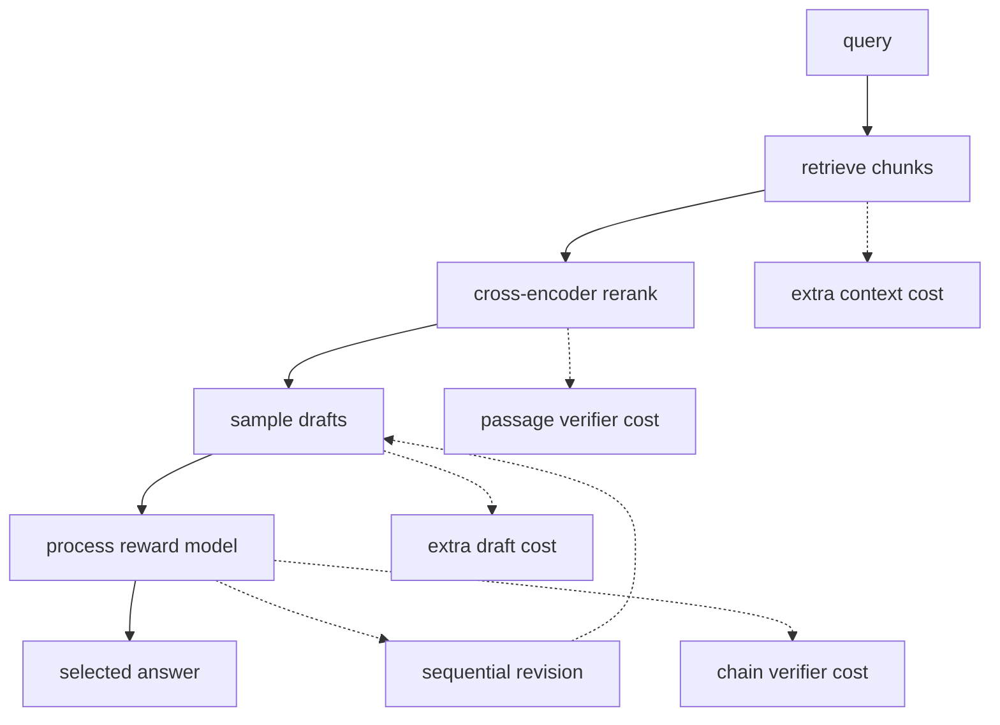
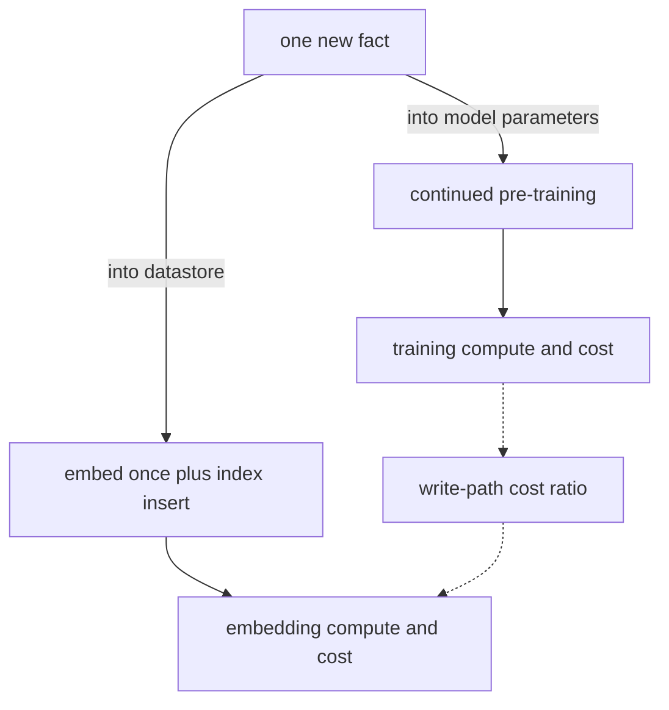

# Chapter 6: Scaling Laws and the Economics of Retrieval vs Parameters
[00-START-HERE](../00-START-HERE.md) · [01-READING-ROUTES](../01-READING-ROUTES.md) · [05\_data\_privacy\_and\_the\_legal\_surface](05_data_privacy_and_the_legal_surface.md) · [07\_in\_context\_learning\_the\_mechanism\_rag\_rides\_on](07_in_context_learning_the_mechanism_rag_rides_on.md)
This chapter explains how to allocate training, serving, memory, and retrieval budgets for a Retrieval-Augmented Generation (RAG) system.
## TL;DR
- Training compute is approximately $`6ND`$ floating-point operations (FLOPs), while generation costs $`2N`$ FLOPs per token.
- Kaplan allocation drives the token-to-parameter ratio down with budget, while Chinchilla keeps it near $`20`$ at its scale.
- Chinchilla minimizes training compute, not lifetime cost. Serving overtakes training at $`D_{\mathrm{inf}} = 3D_{\mathrm{tr}}`$.
- Memory has three bills: weights, optimizer state, and the key-value (KV) cache. Retrieval controls the variable cache bill through context length.
- At fixed non-embedding parameter count, architecture shape changes loss only a few percent. Shape still changes cache size and decode latency.
- Test-time search can help when proposals contain better candidates and selection is reliable; lifetime cost comparisons require both serving slopes and training costs.
- Retrieval can replace parameters that store facts. It cannot replace the competence needed to read and use retrieved evidence. Datastore growth can worsen the rank distribution. Measured deep candidate retrieval plus successful reranking can keep generator presentation depth fixed; mean rank alone does not guarantee recall.
## The story
Think of the system as a library with a skilled clerk. Model parameters pay for the clerk’s reading and reasoning skill, while the datastore pays for shelves that can be updated cheaply. A larger clerk may remember more books, but every answer then costs more to serve. A smaller clerk can consult the shelves, but only if the clerk can read the right passage and the catalog can surface it. The economic choice is therefore not simply big model versus small model. It is how much permanent skill to buy, how much factual content to store externally, and how much search and verification to purchase per query. As the library grows, a reranker prevents the clerk from receiving an ever larger pile of passages.
## Decoder table


| Term | Meaning in this chapter | Decision it controls |
| --- | --- | --- |
| $`N`$ | Parameter count under the explicitly stated model or scaling-fit convention | Compute proxies use the applicable dense body/output work; hardware sizing uses all stored parameters. |
| $`D`$ | Number of processed training tokens | Training allocation and repeated-data cost |
| $`C`$ | Training compute in FLOPs | Budget constraint |
| $`L`$ | Test cross-entropy in nats per token | Scaling-law outcome |
| $`\alpha_N`$ | Parameter scaling exponent, about $`0.076`$ under Kaplan | Loss reduction from more parameters |
| $`\alpha_D`$ | Data scaling exponent, about $`0.095`$ under Kaplan | Loss reduction from more tokens |
| $`B`$ | Batch size in Kaplan’s allocation result | Part of the token-count scaling |
| $`S`$ | Training steps in Kaplan’s allocation result | Part of the token-count scaling |
| $`D_{\mathrm{tr}}`$ | Training-token volume in the lifetime bill | One-time training cost |
| $`D_{\mathrm{inf}}`$ | Processed inference tokens under the parameter-work proxy | Include input prefill and output decode; it is not automatically output tokens alone. |
| $`b`$ | Bytes used to store one number | Weight and cache memory |
| $`L_{\mathrm{layers}}`$ | Transformer layer count | Attention work and KV cache |
| $`d`$ | Model width | Attention work, body size, and cache |
| $`s`$ | Context length in tokens | Attention work and per-request cache |
| $`n_{\mathrm{kv}}`$ | Number of key and value heads | KV-cache width |
| $`d_{\mathrm{head}}`$ | Head dimension | KV-cache width |
| $`N_{\mathrm{body}}`$ | Transformer-body parameter count | Compute-relevant model size |
| $`V`$ | Vocabulary size | Embedding-table memory and tokenization |
| $`n_{\mathrm{layer}}`$ | Model depth | Body size, cache, and sequential decode |
| $`T_{\mathrm{in}}`$ | Input tokens for one query | Prefill cost |
| $`T_{\mathrm{out}}`$ | Output tokens for one query | Decode cost |
| $`Q`$ | Lifetime query count | Amortization of pre-training |
| $`m`$ | Per-query compute multiplier of a test-time method | Breakeven against larger pre-training |
| $`Q^\star`$ | Positive intersection of two complete lifetime-cost functions, when one exists | Requires both training intercepts and per-query slopes. |
| $`\theta`$ | Model parameters | Parametric storage path |
| $`\rho`$ | Mean normalized number of chunks outranking gold | A scenario trend for mean rank, not a recall guarantee or fixed universal retriever constant. |
| $`\bar{r}`$ | Mean rank of the gold chunk | Empirical input to $`\rho`$ |
| corpus size | Number of datastore chunks | Retrieval depth and index memory |
| $`k`$ | Chunks passed toward the generator | Recall, context, and answer-bearing fraction |
| $`k_{\mathrm{ret}}`$ | Deep retrieval count before reranking | Corpus-growth cost |
| $`k_{\mathrm{max}}`$ | Maximum chunks that fit the context window | Retrieval ceiling |
| $`f`$ | Token-count reduction from a better tokenizer | Prefill, cache, and context savings |
| Floating-point operation (FLOP) | One numerical operation in the chapter’s compute estimates | Prices training, serving, embedding, and reranking |
| Cosine learning-rate schedule | A schedule that decays the training rate over a run’s actual length | Explains the methodological correction behind Chinchilla |
| Numeric precision | $`32`$-bit floating point (fp32), bfloat16 (bf16), $`8`$-bit floating point (fp8), $`8`$-bit integer (int8), or $`4`$-bit integer (int4) storage | Determines weight memory and card boundaries |
| Concurrency | Requests served at the same time | Multiplies the per-request KV-cache bill |
| Gold chunk | The labeled passage containing the evidence needed for an answer | Supports reading tests, rank measurement, and reranking decisions |
| Kaplan allocation | $`N`$ grows as $`C^{0.73}`$ and $`D`$ grows as $`C^{0.27}`$ | Favors parameters increasingly at larger budgets |
| Chinchilla allocation | $`N`$ and $`D`$ each grow as $`C^{0.50}`$ | Holds the token-to-parameter ratio constant |
| Post-Chinchilla allocation | Smaller models trained on far more tokens | Trades a small loss penalty for lower serving cost |
| Iso-FLOP curve | Loss across model and token allocations at fixed compute | Finds an allocation minimum |
| Compute-optimal | Minimum training compute for a target loss | Correct only for a training-only objective |
| Over-trained | More tokens per parameter than Chinchilla | Reduces parameter count and serving cost |
| Weight memory | $`Nb`$ bytes | Fixed serving cost |
| Training state | Weights, gradients, master weights, and Adam moments | Full fine-tuning feasibility |
| KV cache | Keys and values retained for every token and request | Serving concurrency |
| Attention correction | Parameter-free attention work omitted by $`6ND`$ | Long-context compute accuracy |
| Low-rank adaptation (LoRA) | Small trainable matrices added to frozen weights | Fine-tuning state reduction |
| Activation checkpointing | Recompute selected forward activations during backward | A full extra-forward proxy adds $`33\frac13\%`$, but actual policies differ. |
| Mixture-of-experts (MoE) | Store many parameters but activate only some per token | Splits memory sizing from compute sizing |
| Shape independence | Loss changes only a few percent across a wide shape range at fixed $`N`$ | Moves shape choice to serving constraints |
| Embedding table | Vocabulary lookup parameters, plus a separate output projection when untied | Input lookup and output-vocabulary scoring have different compute costs. |
| Convergence | Validation loss plateau for one model-data pair | Not a compute-budget allocation rule |
| Repeated-data ceiling | A study-specific regime of near-fresh returns through roughly four epochs | A heuristic to validate, not a hard universal ceiling. |
| Proposer | Produces candidate answers | Uses test-time compute to explore |
| Verifier | Scores passages or answer chains. Pass-at-$`16`$ checks whether any of $`16`$ proposals is correct. | Converts exploration into accuracy |
| Best-of-$`N`$ | Generate $`m`$ complete answers and select the top score | Default search at larger budgets |
| Beam search | Prune partial solutions using verifier scores | Stronger at small budgets on easier tasks |
| Lookahead search | Add Monte Carlo rollouts to beam search | Loses at matched budget in the cited result |
| Process reward model (PRM) | Scores reasoning steps | Stronger signal than final-answer-only scoring |
| Outcome reward model | Scores only the final answer | Weaker verifier signal in the cited comparison |
| Competence parameters | Support syntax, instructions, attention, and copying | Cannot be outsourced to retrieval |
| Content parameters | Support closed-book factual production | Can be partly substituted by a datastore |
| Write path | Cost to add or update one fact | Main economic advantage of retrieval |
| Reranker | Cheap discriminator over retrieved candidates | Holds generator context flat |
| Product quantization | Compresses stored vectors | Makes large index memory practical |


## Core mechanics
### Mathematical conventions
Storage units are decimal except explicit binary units: $`1\,\mathrm{GB}=10^9\,\mathrm B`$, $`1\,\mathrm{KiB}=1024\,\mathrm B`$. Here $`4\mathrm{k},8\mathrm{k},32\mathrm{k}`$ context lengths mean $`4096,8192,32768`$ tokens. Parameter counts and token counts are distinct quantities; the letter $`\mathrm B`$ means billion only in an explicitly labeled model/count abbreviation, not in byte expressions. Use the stated $`2NT`$ forward and $`6NT`$ training proxies at assumed $`P=3.4\times10^{14}\,\mathrm{FLOP\,s^{-1}}`$ and $`\$2.50`$ per GPU-hour. These are compute-equivalent estimates, not measured latency or invoices, and omit material bandwidth, communication, retrieval and serving overhead. State the relevant parameter-count convention for each model; scaling-fit conventions and full checkpoint size need not match. Keep full precision through the calculation, then use $`\approx`$ for rounded results.
### 6.1 Kaplan, Chinchilla, and post-Chinchilla token-to-parameter ratios
#### What the scaling laws say
The basic compute relation is:

```math
C \approx 6ND
```

Kaplan et al. fit separate power laws for parameters and data. The straight-line log-log fits span seven orders of magnitude:

```math
L(N) = \left(\frac{N_c}{N}\right)^{\alpha_N},
\qquad
\alpha_N \approx 0.076
```


```math
L(D) = \left(\frac{D_c}{D}\right)^{\alpha_D},
\qquad
\alpha_D \approx 0.095
```

Their allocation rule is:

```math
N_{\mathrm{opt}} \propto C^{0.73}
```


```math
D_{\mathrm{opt}} \propto C^{0.27}
```

Kaplan also reports batch size proportional to $`C^{0.24}`$ and steps proportional to $`C^{0.03}`$. Those exponents combine to give $`D \propto C^{0.27}`$.
The token-to-parameter ratio therefore obeys:

```math
\frac{D_{\mathrm{opt}}}{N_{\mathrm{opt}}} \propto C^{-0.46}
```

The ratio falls as the compute budget grows. GPT-3 uses $`175\,\mathrm{B}`$ parameters and $`300\,\mathrm{B}`$ tokens, or $`1.7`$ tokens per parameter. Gopher uses $`280\,\mathrm{B}`$ parameters and $`300\,\mathrm{B}`$ tokens, or $`1.1`$ tokens per parameter.
#### Why Chinchilla changed the answer
Hoffmann et al. matched the cosine learning-rate schedule to each run’s actual length. Kaplan had used one schedule across runs of different lengths. That choice undervalued longer training because some runs were evaluated before the schedule finished decaying. Hoffmann et al. also counted embedding parameters.
Three estimation routes agreed on exponents near one half:

```math
N_{\mathrm{opt}} \propto C^{0.50}
```


```math
D_{\mathrm{opt}} \propto C^{0.50}
```

Thus:

```math
\frac{D_{\mathrm{opt}}}{N_{\mathrm{opt}}} \propto C^{0}
```

The ratio is constant. At Chinchilla’s scale, its level is about $`20`$ tokens per parameter. The statement that model size and tokens scale one-to-one refers to exponents. It does not mean one token per parameter. Reading it that way creates a $`20`$ times error.
Chinchilla uses $`70\,\mathrm{B}`$ parameters and $`1.4\,\mathrm{T}`$ tokens. Its ratio is $`20`$. Gopher uses $`280\,\mathrm{B}`$ parameters and $`300\,\mathrm{B}`$ tokens. Its ratio is $`1.1`$.
The matched-budget check is:

```math
C_{\mathrm{Gopher}}
=6(2.8\times10^{11})(3.0\times10^{11})
=5.04\times10^{23}\,\mathrm{FLOP}.
```


```math
C_{\mathrm{Chinchilla}}
=6(7.0\times10^{10})(1.4\times10^{12})
=5.88\times10^{23}\,\mathrm{FLOP}.
```

Under this parameter-work proxy, Chinchilla's budget is $`(5.88/5.04)-1=1/6\approx16.67\%`$ larger than Gopher's, using Gopher as the denominator. Their parameter counts differ by four. The cited MMLU scores are $`67.6\%`$ and $`60.0\%`$, a $`7.6`$-percentage-point difference, not a $`7.6\%`$ relative gain.
At the stated sustained throughput and hourly price, the unrounded Gopher proxy $`5.04\times10^{23}\,\mathrm{FLOP}`$ corresponds to approximately $`1.48235\times10^9`$ compute-equivalent GPU-seconds, $`411{,}764.71`$ GPU-hours and $`\$1.02941`$ million. This is not the measured cost of the reported run, and parallel wall time requires a separate scaling assumption.
#### Why the training-only optimum fails after deployment
Chinchilla's reported optimum concerns a training-compute/loss objective within its fitted regime. A parameter-forward serving proxy scales with $`N`$ and processed inference tokens; it has no explicit training-token term, but actual serving cost also depends on attention, bandwidth, precision, batching and hardware.
The lifetime bill is:

```math
C_{\mathrm{total}} = 6ND_{\mathrm{tr}} + 2ND_{\mathrm{inf}}
```

Training and serving are equal when:

```math
6ND_{\mathrm{tr}} = 2ND_{\mathrm{inf}}
```

Therefore:

```math
D_{\mathrm{inf}} = 3D_{\mathrm{tr}}
```

With the same $`2N`$ and $`6N`$ token-work conventions and $`N>0`$, $`N`$ cancels and the two proxy work totals are equal at $`D_{\mathrm{inf}}=3D_{\mathrm{tr}}`$. Here $`D_{\mathrm{inf}}`$ counts processed input and output tokens under the proxy, not only generated tokens unless input work is negligible. For the stated Chinchilla training volume, the equality is $`4.2\times10^{12}`$ processed inference tokens. Different utilization or dollar rates can shift a monetary crossover.
Once expected inference volume enters the objective, the optimum moves toward a smaller model trained on more tokens. The shift grows with serving demand. Llama 1 at $`7\,\mathrm{B}`$ saw $`1.0\,\mathrm{T}`$ tokens, or $`143`$ per parameter. Llama 2 at $`7\,\mathrm{B}`$ saw $`2.0\,\mathrm{T}`$ tokens, or $`286`$ per parameter. Llama 3 at $`8\,\mathrm{B}`$ saw over $`15\,\mathrm{T}`$ tokens, or $`1{,}875`$ per parameter. The last ratio is $`94`$ times Chinchilla’s ratio.
#### Worked budget comparison
Use $`C = 7.2 \times 10^{23}`$ FLOPs.
For Chinchilla, impose $`D = 20N`$:

```math
C = 120N^2
```


```math
N=\sqrt{\frac{7.2\times10^{23}}{120}}
\approx7.7459667\times10^{10}.
```


```math
D=20N\approx1.5491933\times10^{12}.
```

This scenario is approximately $`77.46`$B parameters on $`1.5492`$T processed tokens. Bf16 parameter payload is approximately $`154.919\,\mathrm{GB}`$, excluding caches and serving overhead, so it cannot fit on one $`80\,\mathrm{GB}`$ card.
For the post-Chinchilla ratio, impose $`D = 1{,}875N`$:

```math
C = 11{,}250N^2
```


```math
N = \sqrt{\frac{7.2 \times 10^{23}}{1.125 \times 10^4}}
=
8.0 \times 10^9
```

This is $`8\,\mathrm{B}`$ parameters on $`15\,\mathrm{T}`$ tokens. The bf16 weights use $`16\,\mathrm{GB}`$.
The parameter-forward work is approximately $`1.54919\times10^{11}\,\mathrm{FLOP/token}`$ for the $`77.46`$B allocation and $`1.6\times10^{10}`$ for the $`8`$B allocation. Their ratio is approximately $`9.68246`$ under identical token accounting.
At $`10^{13}`$ processed inference tokens, serving work is approximately $`1.54919\times10^{24}`$ versus $`1.6\times10^{23}\,\mathrm{FLOP}`$. Adding the shared $`7.2\times10^{23}`$ training budget gives approximately $`2.26919\times10^{24}`$ versus $`8.8\times10^{23}\,\mathrm{FLOP}`$, a ratio of approximately $`2.57863`$. These are work totals, not full ownership cost or a proof of equal task quality.
The source expects a quality trade-off between these allocations, but the two ratios alone do not prove which has lower loss on a new workload. Iso-FLOP minima can be flat nearby; verify quality, data repetition and hardware constraints on the actual task before interpreting the serving-work saving.
The $`405`$B, $`15.6`$T cross-check gives $`6ND=3.7908\times10^{25}\,\mathrm{FLOP}`$. Relative to the rounded reported $`3.8\times10^{25}`$, the difference is approximately $`0.242\%`$. Agreement with a rounded work estimate is a consistency check, not an independent validation of measured training efficiency.
#### Practical decision
Ask for expected lifetime processed-token volume before choosing $`N`$. A ratio near $`20`$ is a reported training-only reference at one regime, not a universal floor for every served model. Smaller models trained on more data can lower serving work when quality holds up, but token availability, repetition, training budget and required competence also bind. Use iso-FLOP experiments rather than maximizing a token/parameter ratio without constraints.
### 6.2 FLOPs, attention, and memory arithmetic
#### What $`6ND`$ contains
For a dense linear layer, forward matrix multiplication is approximately two FLOPs per weight per token, counting multiplication and addition; backward input and weight gradients each add a similar matrix-multiply cost. Biases, nonlinearities, norms, embeddings and attention are separate. This approximation motivates the parameter-work constants below, not exact operation counts for every architecture.
Backward computes a gradient for the inputs and a gradient for the weights. Each costs $`2n`$. Backward is therefore $`4N`$.

```math
2N + 4N = 6N
```

Across $`D`$ training tokens:

```math
C \approx 6ND
```

Generation has no backward pass. Its parameter term is $`2N`$ per token.
#### What $`6ND`$ omits
For a causal prefill of length $`s`$, triangular query-key scores and value aggregation together contribute approximately $`2L_{\mathrm{layers}}ds^2`$ forward FLOPs, or $`2L_{\mathrm{layers}}ds`$ averaged per prompt token. A standard dense body with roughly $`12L_{\mathrm{layers}}d^2`$ parameters has forward parameter work approximately $`24L_{\mathrm{layers}}d^2`$ per token. This particular comparison is a forward-prefill approximation. Training needs the attention backward work too; decode at current context length uses a different per-step attention count.
The omitted-to-parameter ratio is:

```math
\frac{2L_{\mathrm{layers}}sd}{24L_{\mathrm{layers}}d^2}
=
\frac{s}{12d}
```

For the body approximation, attention-to-parameter forward work is $`s/(12d)`$. The condition $`d>s/12`$ says only that this ratio is below one, not that it is negligible. At $`d=4096`$, equality occurs at $`s=49{,}152`$; at $`s=8192`$ the ratio is $`1/6`$, and at $`s=32768`$ it is $`2/3`$. Using an actual $`8`$B parameter proxy rather than the $`12Ld^2`$ body estimate changes those ratios, as in the worked prefill below.
#### The three memory tiers
Weight payload is $`Nb`$ bytes, with nominal $`b=4`$ for fp32, $`2`$ for bf16, $`1`$ for int8 and $`0.5`$ for packed int4. Quantized formats also need scales, zero points, packing and sometimes higher-precision tensors; nominal bits alone do not give complete checkpoint or serving memory.
A $`27\,\mathrm{B}`$ model uses $`108\,\mathrm{GB}`$ at fp32. It uses $`54\,\mathrm{GB}`$ at bf16. It uses $`27\,\mathrm{GB}`$ at int8. The fp32 weights already overflow one $`80\,\mathrm{GB}`$ card.
Full Adam fine-tuning uses $`16`$ bytes per parameter before activations. The source counts $`2`$ bytes of bf16 weights, $`2`$ of gradients, $`4`$ of fp32 master weights, $`4`$ of momentum, and $`4`$ of variance. Pure fp32 also totals $`16`$ bytes through four $`4`$-byte states. An $`8\,\mathrm{B}`$ model needs $`128\,\mathrm{GB}`$. A $`27\,\mathrm{B}`$ model needs $`432\,\mathrm{GB}`$.
The KV cache uses:

```math
2L_{\mathrm{layers}}n_{\mathrm{kv}}d_{\mathrm{head}}b
```

bytes per token.
For Llama $`3.1`$ 8B, use $`32`$ layers, $`8`$ key-value heads, head dimension $`128`$, and bf16.

```math
2(32)(8)(128)(2)
=
131{,}072 \text{ bytes}
=
128 \text{ KiB per token}
```

Cache payload multiplies by resident sequence length and concurrent sequences. After $`16\,\mathrm{GB}`$ parameter payload on an $`80\,\mathrm{GB}`$ card, the residual $`64\,\mathrm{GB}`$ is only an upper budget before workspaces, allocator reserve, activations and other serving state. At $`4096`$, $`8192`$ and $`32768`$ tokens per resident sequence, cache-only ceilings are respectively $`119`$, $`59`$ and $`14`$ requests. Reserving output growth or overhead lowers them; they are not measured throughput figures.
Pricing deployment by parameter count alone fails because context length changes concurrency. It also fails for MoE models. Mixtral 8x7B stores $`46.7\,\mathrm{B}`$ parameters but activates $`12.9\,\mathrm{B}`$ per token. Its memory resembles a $`47\,\mathrm{B}`$ model. Its compute resembles a $`13\,\mathrm{B}`$ model.
#### Fine-tuning choices
Serving the $`27\,\mathrm{B}`$ at fp32 fails at $`108\,\mathrm{GB}`$. Serving it at bf16 uses $`54\,\mathrm{GB}`$ and leaves $`26\,\mathrm{GB}`$. That cuts free cache memory from $`64\,\mathrm{GB}`$ to $`26\,\mathrm{GB}`$, or by $`2.5`$ times. A deeper and wider model also caches more per token.
With the stated $`16\,\mathrm{B/parameter}`$ training-state layout, $`8`$B and $`27`$B use $`128\,\mathrm{GB}`$ and $`432\,\mathrm{GB}`$. Two and six $`80\,\mathrm{GB}`$ cards are aggregate state-capacity lower bounds before activations and communication; fit still depends on sharding and the actual optimizer/precision layout.
A rank-$`r`$ LoRA matrix trains $`r(d_{\mathrm{in}} + d_{\mathrm{out}})`$ values. Rank-$`16`$ LoRA on the query and output projections of all $`32`$ layers in the $`8\,\mathrm{B}`$ model trains:

```math
16(4096+4096)(2)(32)=8{,}388{,}608.
```

parameters.
The corresponding full matrices contain $`1{,}073{,}741{,}824`$ values. The factor count is exactly $`1/128=0.78125\%`$ as large, with reduction $`d/(2r)=128`$ for these square matrices. At a specified $`16`$-byte trainable-state layout, adapter state is $`134{,}217{,}728\,\mathrm B\approx134.22\,\mathrm{MB}`$ above the $`16\,\mathrm{GB}`$ frozen bf16 base, excluding activations. This is not the ratio of total training memory or total backward compute.
If activation checkpointing recomputes one full extra forward pass, parameter work rises from approximately $`6ND`$ to $`8ND`$, an increase of $`1/3=33\frac13\%`$. Selective checkpoint policies, frozen weights and attention recomputation change the actual overhead; “exactly $`33\%`$” would be false precision.
#### RAG prefill check
An $`8\mathrm{k}`$ prompt on $`8\,\mathrm{B}`$ has a parameter prefill term of:

```math
2(8\times10^9)(8192)=1.31072\times10^{14}\,\mathrm{FLOP}.
```

FLOPs.
Attention adds:

```math
2(32)(4096)(8192^2)
=1.7592186044416\times10^{13}\,\mathrm{FLOP}.
```

FLOPs.
The combined forward proxy is approximately $`1.48664186\times10^{14}\,\mathrm{FLOP}`$, corresponding to $`0.43725`$ compute-equivalent seconds at the assumed throughput, before other first-token work. Attention is approximately $`13.42\%`$ of this example's parameter term, not $`1/6`$ of an actual $`8`$B model. Cache payload is exactly $`1{,}073{,}741{,}824\,\mathrm B=1\,\mathrm{GiB}\approx1.07374\,\mathrm{GB}`$ per $`8192`$-token sequence; the cache-only concurrency ceiling is $`59`$.
At $`32768`$ tokens, cache payload is $`4{,}294{,}967{,}296\,\mathrm B=4\,\mathrm{GiB}`$, leaving a cache-only ceiling of $`14`$ requests in the nominal residual budget. Parameter work is $`5.24288\times10^{14}\,\mathrm{FLOP}`$ and causal forward attention approximately $`2.81474977\times10^{14}`$, for total approximately $`8.05762977\times10^{14}`$. The compute-equivalent time is approximately $`2.36989\,\mathrm{s}`$, or $`5.420`$ times the $`8192`$-token estimate for four times the prompt length. Actual latency and concurrency need a serving benchmark.
The bf16 weight rule also predicts $`810\,\mathrm{GB}`$ for Llama $`3.1`$ 405B. An eight-card node with $`80\,\mathrm{GB}`$ per card holds $`640\,\mathrm{GB}`$. The model therefore cannot fit on one such node at bf16. The source notes a $`405\,\mathrm{GB}`$ $`8`$-bit floating-point (fp8) variant and a multi-node path for bf16.
#### Practical decision
Answer fit questions with weights, training state, and KV cache. Use LoRA by default above about $`7\,\mathrm{B}`$ on single-node hardware. Buy concurrency first by shortening and reranking context. Add attention and checkpointing corrections to $`6ND`$. Use active parameters for MoE compute and stored parameters for memory. Use bf16 serving weights unless a card boundary forces int8 or int4. The source calls quantization the cheapest $`2`$ to $`4`$ times memory reduction in the stack. Use $`4`$-bit frozen base weights for quantized LoRA when fine-tuning memory is the binding constraint.
### 6.3 Three observations that change decisions: shape, embeddings, convergence
#### Shape is nearly free in loss
At fixed $`N`$, changing feed-forward ratio, aspect ratio, and head dimension moves loss only a few percent across the measured range. Doubling $`N`$ changes loss by:

```math
\frac{L(2N)}{L(N)}=2^{-0.076}\approx0.948684.
```

That is a $`5.1\%`$ reduction.
A ten-fold increase gives:

```math
10^{-0.076}\approx0.839460.
```

That is a $`16.1\%`$ reduction.
A shape sweep can cost more compute than its loss gain. The loss result does not make shape irrelevant. It moves shape selection to serving.
Under ordinary multi-head attention, cache payload is $`2n_{\mathrm{layer}}db`$ bytes per token. It depends explicitly on depth and width, which also affect $`N`$; saying it is independent of parameter count would be misleading. Grouped-query attention instead uses KV width. More sequential layers can increase decode latency, but layer count alone is not a throughput law.
The result only holds within a wide practical range for dense decoder-only transformers. One layer remains bad at any width. A head dimension of $`8`$ remains bad. MoE breaks a single-$`N`$ comparison because stored and active parameters differ.
#### Embeddings distort parameter comparisons
A standard transformer body is approximately:

```math
N_{\mathrm{body}} \approx 12n_{\mathrm{layer}}d^2
```

The embedding table is:

```math
N_{\mathrm{embed}} = Vd
```

The body grows quadratically with width. The table grows linearly. Counting both bends the scaling fit because the embedding share changes with model size.
GPT-2 small uses $`12`$ layers, width $`768`$, and vocabulary $`50{,}257`$. Its body is $`84.9\,\mathrm{M}`$ parameters. Token and positional lookup tables total $`39.4\,\mathrm{M}`$. The lookup share is $`32\%`$.
Llama 3 70B uses width $`8{,}192`$ and vocabulary $`128{,}256`$ with untied embeddings. Its embedding count is $`2.10\,\mathrm{B}`$ against $`70.6\,\mathrm{B}`$ total. The share is $`3.0\%`$.
Using the stated body approximation, GPT-2's token-plus-position tables add $`39{,}383{,}808/84{,}934{,}656\approx46.37\%`$ over its body, and are approximately $`31.68\%`$ of the resulting total. Llama's $`2{,}101{,}346{,}304`$ untied input-plus-output parameters are approximately $`2.98\%`$ of the stated $`70.6`$B total and add approximately $`3.07\%`$ over the remainder. The difference in log inflation is approximately $`0.15233`$ decades. Shares of total and additions over the body are different denominators.
XLM-R base and BERT-base have comparable transformer bodies near the $`84.9`$M approximation. At vocabularies $`250{,}002`$ and $`30{,}522`$ and width $`768`$, the input-table difference is $`(250002-30522)768=168{,}560{,}640`$ parameters, not that many vocabulary rows. Bf16 payload difference is approximately $`0.33712\,\mathrm{GB}`$. Input embedding lookup does not multiply by every vocabulary row, so a body-only encoder-forward proxy is near $`1.7\times10^8\,\mathrm{FLOP/token}`$ for both; masked-LM or generation heads that score the whole vocabulary add work. Advertised total sizes are not directly body-compute ratios.
A larger vocabulary can still help by emitting fewer tokens. If it reduces token count by a factor $`f`$, prefill and cache fall by $`f`$. A fixed context can also hold $`f`$ times as much evidence. Choose vocabulary for tokenization efficiency on the actual corpus. Do not treat lookup rows as reasoning capacity.
#### Convergence misallocates a fixed budget
At fixed compute, a larger model stopped before convergence can outperform a smaller converged model. Reused tokens may have lower marginal value than fresh ones. The cited study finds a roughly four-epoch near-fresh regime in its experiments; this is not a hard rule that all later epochs have zero value or that every domain should stop at four.
The failed rule is to train the biggest model that converges on the available corpus. That lets the validation plateau choose $`N`$. The plateau has no direct relationship to the approved compute budget.
#### Worked budget comparison
The corpus contains $`20\,\mathrm{B}`$ tokens. The budget is $`1.2 \times 10^{21}`$ FLOPs. At $`3.4 \times 10^{14}`$ FLOP/s and USD $`2.50`$ per accelerator-hour, that is $`980`$ accelerator-hours and about USD $`2{,}450`$.
A $`300\,\mathrm{M}`$ model converging after $`20`$ passes processes $`4 \times 10^{11}`$ tokens.

```math
C_1
=
6(3 \times 10^8)(4 \times 10^{11})
=
7.2 \times 10^{20}
```

The small scenario spends $`60\%`$ of the approved work budget and leaves $`4.8\times10^{20}\,\mathrm{FLOP}`$ unspent, approximately $`392.16`$ GPU-hours or $`\$980.39`$ at the proxy rate. Its first four of twenty passes account for $`20\%`$ of spent work, hence $`12\%`$ of the approved budget. Calling only those passes “productive” is a heuristic illustration: later passes need not have zero value.
Cap repeats at four epochs. Then $`D = 8 \times 10^{10}`$.

```math
N
=
\frac{1.2 \times 10^{21}}{6(8 \times 10^{10})}
=
2.5 \times 10^9
```

The larger allocation gets $`32`$ processed tokens per parameter and spends the full proxy budget. Its parameter count is $`8.3333`$ times larger. Applying the parameter-only fit gives $`(8.3333)^{-0.076}\approx0.851173`$, or a $`14.88\%`$ predicted reduction in that asymptotic component. The two runs also differ in data exposure and convergence, so this is not a controlled prediction of their actual final loss.
For a shape illustration, body estimates are approximately $`2.416`$B for $`48`$ layers at width $`2048`$ and $`2.389`$B for $`24`$ layers at width $`2880`$; these are close, not identical total models. Ordinary MHA cache payloads are $`384\,\mathrm{KiB/token}`$ and $`270\,\mathrm{KiB/token}`$, or approximately $`3.2212\,\mathrm{GB}`$ and $`2.2649\,\mathrm{GB}`$ at $`8192`$ tokens. With an independently rounded $`4.8\,\mathrm{GB}`$ weight budget and no other overhead, cache-only ceilings are $`23`$ and $`33`$. The $`33/23-1\approx43.48\%`$ gain is concurrency headroom, not demonstrated throughput: per-token work and scheduling still matter.
For GPT-2 small, the body estimate is $`84.93\,\mathrm{M}`$. Token embeddings are $`38.60\,\mathrm{M}`$. Positional embeddings are $`0.79\,\mathrm{M}`$. The sum is $`124.3\,\mathrm{M}`$ against a published $`124\,\mathrm{M}`$. Agreement is $`0.2\%`$.
#### Practical decision
Use parameter conventions appropriate to the question: body parameters can help compare encoder work or scaling fits, whereas all stored tensors matter for memory and output-vocabulary scoring adds compute. Select shape using measured cache, latency and quality constraints. Validate repetition policies on the corpus rather than treating four epochs as a universal ceiling. Size both model and token budget explicitly; convergence alone is not a compute-allocation objective.
### 6.4 Test-time compute versus pre-training compute
#### Lifetime breakeven
Pre-training is a fixed cost:

```math
C_{\mathrm{pre}} = 6ND_{\mathrm{pre}}
```

A RAG query costs:

```math
C_{\mathrm{query}}
=
2N(T_{\mathrm{in}} + T_{\mathrm{out}})
```

Compare complete policies, not an added training bill with an unrelated added serving bill. Let $`F_P,F_T`$ be their training costs in the same units and $`c_P,c_T`$ their per-query work or cost. Then $`F_P+Qc_P=F_T+Qc_T`$ has a positive intersection only when the intercept and slope differences have compatible signs. If $`F_P>F_T`$ and $`c_T>c_P`$, the crossover is:

```math
Q^\star=\frac{F_P-F_T}{c_T-c_P},
\qquad F_P>F_T,\quad c_T>c_P.
```

The specialized expression $`\Delta C_{\mathrm{pre}}/[(m-1)C_{\mathrm{query}}]`$ applies only if one policy's query cost is $`mC_{\mathrm{query}}`$ and the more-pretrained policy's query cost is exactly $`C_{\mathrm{query}}`$. A larger model usually changes that baseline. Quality must also be matched before cost amortization decides the better policy.
#### Search needs a verifier
The proposer generates candidate answers. The verifier scores them and selects one. Sampling without a verifier has the same expected accuracy as drawing one answer and choosing at random.
The cited reasoning experiments compare best-of-$`N`$, beam search, lookahead and process/outcome reward models in particular budget and difficulty regimes. They are useful candidate policies, not a universal ordering for every RAG task. Selection quality depends on whether proposals contain correct answers and whether the verifier can identify them.
The source boundary is conditional. Extra test-time compute is the better purchase for easy and moderate problems under modest inference load. Extra pre-training compute wins for genuinely hard problems under large inference load.
Batch-one decode can be memory-bandwidth limited, while parallel proposals can reuse a prompt and batch their token steps. Sequential revisions depend on earlier outputs and cannot batch across those dependent steps. This can change utilization and latency at equal FLOPs, but does not guarantee that every sequential implementation costs more dollars without a serving benchmark. Shared-prefix KV storage, branch output caches and verifier memory also grow with sampling.
A $`3\,\mathrm{B}`$ model run $`256`$ times uses $`1.54 \times 10^{12}`$ FLOPs per output token. One $`70\,\mathrm{B}`$ pass uses $`1.4 \times 10^{11}`$. The smaller model uses $`11`$ times more compute. Its bf16 weights use $`6\,\mathrm{GB}`$ instead of $`140\,\mathrm{GB}`$. That is $`23`$ times less weight memory.
#### Worked RAG query
The assistant serves $`10{,}000`$ queries per day. Each query retrieves $`10`$ chunks of $`400`$ tokens. Question and instructions add $`100`$ tokens. The answer adds $`300`$. $`T_{\mathrm{in}} = 4{,}100`$. $`T_{\mathrm{out}} = 300`$. The total is $`4{,}400`$ tokens.
For the $`4100`$-token prompt and assumed $`32`$ layers of width $`4096`$, causal forward attention is approximately $`4.40664\times10^{12}\,\mathrm{FLOP}`$, about $`6.72\%`$ of the $`6.56\times10^{13}`$ parameter-prefill term. The following comparison deliberately uses parameter-only proxies. Attention does not generally cancel: proposal branches, reward models, prompt lengths and the $`70`$B architecture can differ.
An $`8\,\mathrm{B}`$ greedy pass costs:

```math
2(8 \times 10^9)(4{,}400)
=
7.04 \times 10^{13}
```

FLOPs. That is $`0.207`$ seconds of accelerator time. It costs USD $`0.144`$ per thousand queries.
Best-of-$`16`$ assumes one reusable $`4100`$-token proposer prefill costing $`6.56\times10^{13}\,\mathrm{FLOP}`$, sixteen $`300`$-token decode branches costing $`7.68\times10^{13}`$, and a separate $`8`$B reward model scoring sixteen chains at an assumed $`400`$ processed tokens each, costing $`1.024\times10^{14}`$. Total parameter work is $`2.448\times10^{14}\,\mathrm{FLOP}`$, or $`3.47727`$ times the $`8`$B baseline and approximately $`\$0.50`$ per thousand queries under the common-rate proxy. If the reward model also reads the full question/evidence for each chain, those tokens must be added; sharing the proposer prefill does not automatically share a different verifier's computation.
A $`70\,\mathrm{B}`$ greedy pass costs $`6.16 \times 10^{14}`$ FLOPs. That is $`8.75`$ times baseline and USD $`1.26`$ per thousand queries. Its $`140\,\mathrm{GB}`$ of bf16 weights also forces a second card.
Pre-training the $`70\,\mathrm{B}`$ at $`20`$ tokens per parameter costs $`5.88 \times 10^{23}`$ FLOPs. The $`8\,\mathrm{B}`$ comparison costs $`7.68 \times 10^{21}`$. The difference is $`5.80 \times 10^{23}`$.
A numerical added-work equivalence, not a complete-policy crossover, can still be calculated:

```math
Q_{\mathrm{extra}}
=\frac{5.8032\times10^{23}}
{\,2.448\times10^{14}-7.04\times10^{13}\,}
\approx3.32752\times10^9.
```

queries.
This added-work equivalence is approximately $`911`$ years at $`10{,}000`$ queries per day or $`332.75`$ days at $`10`$ million per day. It is not the intersection of $`70`$B-greedy and $`8`$B-best-of-$`16`$ lifetime costs: the $`70`$B policy has both more training work and more per-query work ($`6.16\times10^{14}`$ versus $`2.448\times10^{14}\,\mathrm{FLOP}`$). Under these proxies there is no positive cost crossover between those two policies. They may deliver different quality, which is the unresolved decision variable.
One extra $`300`$-token branch costs $`4.8\times10^{12}`$ parameter FLOPs if it reuses the prompt. Three hundred additional input tokens have the same parameter term, but different attention/cache effects. Five extra $`400`$-token chunks add $`3.2\times10^{13}`$ parameter FLOPs, equivalent to $`6.6667`$ such decode branches before verifier and serving overhead. These arithmetic ratios alone do not identify which purchase improves accuracy.
A $`110`$M cross-encoder over $`100`$ pairs of $`400`$ total tokens uses $`8.8\times10^{12}\,\mathrm{FLOP}`$, or $`0.125`$ times the baseline query proxy. If $`400`$ is document length only, add the query tokens to every pair. Passage relevance scoring is not the same task as verifying the truth of a generated chain, so this is not proof that reranking is a substitute for every verifier.
The deployment consumes $`1.61 \times 10^{10}`$ inference tokens per year. The $`70\,\mathrm{B}`$ pre-training run uses $`1.4 \times 10^{12}`$. The ratio is $`0.011`$. It lies two orders of magnitude below one.
#### Practical decision
Compare quality-matched complete lifetime policies and check whether a positive crossover actually exists. Try retrieval/reranking repairs for evidence failures and proposal/verifier changes for reasoning failures; neither an extra sample nor an extra chunk is always the better purchase. Benchmark search policies on the failing workload rather than importing a universal winner. Pass-at-$`16`$ measures proposal coverage, not the accuracy of the selected answer; a verifier cannot select an answer that the finite proposal set does not contain.
### 6.5 The small-model-plus-datastore argument and its limit
#### What retrieval can replace
Parameters perform two jobs. Competence supports syntax, instruction following, attending to context, and copying. Content supports closed-book recall. Retrieval can substitute for content. It cannot substitute for the competence required to read the retrieved passage.
The cited controlled experiments estimate factual storage near two bits per parameter in their studied regime. Treat this as an empirical estimate, not a universal stable ceiling or a guarantee that arbitrary text is stored losslessly. Applying that coefficient to a $`7`$B model gives:

```math
2(7 \times 10^9)
=
1.4 \times 10^{10}
```

bits.
The arithmetic is $`1.4\times10^{10}`$ bits, or $`1.75\,\mathrm{GB}`$ of estimated factual information, not physical weights. A comparison with Wikipedia and textbooks requires a compatible compressed-information measure and a defined corpus; raw corpus bytes do not prove that all its useful facts fit and can be recovered. The following write-path comparison instead prices two explicit update scenarios.
Embedding one $`400`$-token chunk with a $`110\,\mathrm{M}`$ bi-encoder costs:

```math
2(1.1 \times 10^8)(400)
=
8.8 \times 10^{10}
```

FLOPs.
The vector payload is $`3072\,\mathrm B`$. Embedding work alone costs approximately $`\$1.7974\times10^{-7}`$ under the proxy; index insertion, metadata, source retention, padding, batching and fixed service costs are excluded. Calling this the full price of a datastore write would understate its scope.
Continued pre-training of a $`7\,\mathrm{B}`$ model on $`1\,\mathrm{B}`$ replay tokens costs:

```math
6(7 \times 10^9)(1 \times 10^9)
=
4.2 \times 10^{19}
```

FLOPs.
The replay proxy is approximately $`34.3137`$ GPU-hours or $`\$85.7843`$. Relative to one chunk's embedding arithmetic, the work ratio is $`4.2\times10^{19}/(8.8\times10^{10})\approx4.77273\times10^8`$. This compares a specified billion-token replay scenario with a single embedding pass; it is not a lower bound on every possible model edit or a measured end-to-end update speedup.
A keyed datastore offers a local update operation whose scope is explicit. One fact may occupy multiple chunks or sources, and model-editing procedures need not always replay a billion tokens. The comparison shows why retained provenance and selectable rows are operationally useful, not a theorem that every factual change has exactly these two costs.
Kandpal et al. report that factual question-answering accuracy is log-linear in relevant pre-training documents per question, then extrapolate scale-only long-tail coverage to about $`10^{18}`$ parameters. RETRO at $`7.5\,\mathrm{B}`$ matches GPT-3 at $`175\,\mathrm{B}`$ and Jurassic-1 at $`178\,\mathrm{B}`$ on the Pile with $`25`$ times fewer parameters and a $`2`$-trillion-token database. Atlas at $`11\,\mathrm{B}`$ exceeds $`42\%`$ on Natural Questions from $`64`$ examples. It is three points above a $`540\,\mathrm{B}`$ model with $`50`$ times fewer parameters. A $`k`$-nearest-neighbor language model trained on $`100\,\mathrm{M}`$ tokens with a datastore from $`3\,\mathrm{B}`$ beats the same architecture trained on all $`3\,\mathrm{B}`$. The source also reports a roughly $`350\,\mathrm{M}`$ phrase-prediction system that uses retrieval to distinguish a poor-quality sense from an inexpensive sense. Local retrieval is personalization rather than federated learning because no gradient or model update crosses the device boundary.
#### The datastore growth limit
Define $`\rho`$ from mean gold rank:

```math
\rho
=
\frac{\bar{r} - 1}{\lvert D\rvert}
```

For a particular query, let $`R_q`$ be the actual gold-chunk rank under a fixed scorer and tie policy. The number of chunks outranking gold is $`R_q-1`$. Averaging over queries gives $`\rho|D|=\mathbb E[R_q-1]`$ by definition. Mean rank does not guarantee that every query, or a specified recall fraction, survives a top-$`k`$ cutoff. The correct condition is:

```math
\text{gold retained for query }q
\iff R_q\le k,
\qquad
\mathop{\mathrm{Recall@}}\nolimitsk=\Pr(R_q\le k).
```

Assuming $`\rho`$ stays constant as a datastore grows produces the scenario trend $`\mathbb E[R_q]=1+\rho|D|`$. Distribution shift, new distractors and retriever changes can alter $`\rho`$. To meet a recall target, measure the rank distribution or its required quantile; rounding the mean up to an integer does not yield a guaranteed sufficient depth.
With $`32768`$ context tokens and $`400`$ reserved for question and answer, at most $`\lfloor(32768-400)/400\rfloor=80`$ full $`400`$-token chunks fit. If exactly one retrieved chunk is answer-bearing, its token share is $`1/k`$ for equal-size chunks. This fraction is a composition measure, not an accuracy law.
Retrieve to a depth chosen from the observed recall curve, rerank the candidates, and pass a fixed small number of chunks to the generator. This can hold generator context constant while reranker work grows with candidate depth, but search, index memory and update costs also grow. Reranking cannot recover a gold passage absent from the candidate set.
#### Worked support assistant
The index holds $`50\,\mathrm{M}`$ chunks of $`400`$ tokens. That is $`2 \times 10^{10}`$ corpus tokens. Queries add $`100`$ input tokens and emit $`300`$ output tokens.
A closed-book $`70\,\mathrm{B}`$ query over $`400`$ tokens costs $`5.6 \times 10^{13}`$ FLOPs. It costs USD $`0.114`$ per thousand queries. Its bf16 weights occupy $`140\,\mathrm{GB}`$ and require two accelerators.
Training that model over the $`2 \times 10^{10}`$ corpus tokens costs $`8.4 \times 10^{21}`$ FLOPs. That is $`6{,}863`$ accelerator-hours and USD $`17{,}157`$ per refresh. The corpus is $`1.4\%`$ of the model’s $`1.4\,\mathrm{T}`$ Chinchilla-optimal training tokens.
An $`8\,\mathrm{B}`$ model with $`10`$ retrieved chunks processes $`4{,}400`$ tokens. It costs $`7.04 \times 10^{13}`$ FLOPs and USD $`0.144`$ per thousand queries. That is $`1.26`$ times the $`70\,\mathrm{B}`$ closed-book query. Retrieval does not save per-query compute in this comparison. It saves weight memory and update cost.
The $`8\,\mathrm{B}`$ weights occupy $`16\,\mathrm{GB}`$ on one card. A daily refresh of $`20{,}000`$ changed chunks costs $`1.76 \times 10^{15}`$ FLOPs. That is USD $`0.0036`$ instead of USD $`17{,}157`$.
The full-precision index costs:

```math
(5 \times 10^7)(768)(4)
=
1.536 \times 10^{11}
```

bytes.
Fp32 vector payload is $`153.6\,\mathrm{GB}`$; $`96`$-byte PQ codes use $`4.8\,\mathrm{GB}`$ before codebooks, identifiers, coarse centroids, lists and source text. Compression is needed only if the chosen machine or cost budget cannot accommodate the full representation; it is not intrinsically required by this corpus size.
If the corpus grows to $`5 \times 10^{9}`$ chunks, use the original mean rank of $`3`$:

```math
\rho
=
\frac{2}{5 \times 10^7}
=
4 \times 10^{-8}
```

If the mean-rank trend transfers to $`5\times10^9`$ chunks, the mean becomes $`201`$. A depth $`k=201`$ is an illustrative choice at that mean, not an exact minimum or a guarantee of any target recall. Its retrieved content is $`80{,}400`$ tokens, exceeding the stated context budget. With exactly one answer-bearing equal-size chunk, its share is $`1/201\approx0.4975\%`$, compared with $`20\%`$ at five chunks.
Stuffing those $`201`$ chunks, plus $`100`$ input and $`300`$ output tokens, totals $`80{,}800`$ processed tokens and $`1.2928\times10^{15}`$ parameter FLOPs. This is a hypothetical work comparison outside the stated $`32768`$-token context window; it is not an executable configuration on that window.
Reranking $`201`$ query-document pairs of $`100+400=500`$ tokens with a $`110`$M cross-encoder uses $`2.211\times10^{13}\,\mathrm{FLOP}`$. Passing five chunks to the $`8`$B generator gives $`2400`$ total processed input/output tokens and $`3.84\times10^{13}`$ parameter FLOPs. Combined work is $`6.051\times10^{13}`$, so the hypothetical stuffing ratio is approximately $`21.37`$, not $`23`$, once repeated query tokens are included in reranking. If a pair's total length were explicitly only $`400`$ tokens, the alternative ratio would be approximately $`23.05`$. Neither ratio guarantees that the mean-depth candidate set contains gold or that the reranker puts it in the final five.
The worked generator-size ratio is $`70/8=8.75`$. The cited RETRO and Atlas comparisons use different tasks, data and evaluation setups; their reported roughly $`25`$-fold and $`50`$-fold parameter substitutions do not quantitatively validate this scenario's quality or make its assumptions provably conservative.
#### Practical decision
Choose the smallest generator that passes a representative gold-evidence reading evaluation, including difficult compositional cases. Keep changing factual sources addressable in the datastore. Measure retrieval rank distributions, recall targets, reranker success and serving costs before promising scale; mean rank alone is insufficient. Quantization and model size should be chosen against actual memory and quality budgets, not a universal ordering.
## Diagrams
### Figure 6.1
#### Panel a: allocation policies and observed models


| Policy or model | Parameters $`N`$ | Training tokens $`D`$ | Tokens per parameter | Figure marker or rule |
| --- | --- | --- | --- | --- |
| Kaplan rule | grows with $`C^{0.73}`$ | grows with $`C^{0.27}`$ | falls with $`C^{-0.46}`$ | $`D \propto N^{0.37}`$ |
| GPT-3 | $`175\,\mathrm{B}`$ | $`300\,\mathrm{B}`$ | $`1.7`$ | open square |
| Gopher | $`280\,\mathrm{B}`$ | $`300\,\mathrm{B}`$ | $`1.1`$ | open square |
| Chinchilla rule | grows with $`C^{0.50}`$ | grows with $`C^{0.50}`$ | $`20`$ at this scale | $`D = 20N`$ |
| Chinchilla | $`70\,\mathrm{B}`$ | $`1.4\,\mathrm{T}`$ | $`20`$ | filled circle |
| Llama 1 | $`7\,\mathrm{B}`$ | $`1.0\,\mathrm{T}`$ | $`143`$ | filled diamond |
| Llama 2 | $`7\,\mathrm{B}`$ | $`2.0\,\mathrm{T}`$ | $`286`$ | filled diamond |
| Llama 3 | $`8\,\mathrm{B}`$ | $`15\,\mathrm{T}`$ in the worked comparison | $`1{,}875`$ | filled diamond |


#### Panel b: lifetime compute under the same training budget


| Configuration | Training compute | Serving compute for $`10^{13}`$ tokens | Lifetime total |
| --- | --- | --- | --- |
| Training-ratio reference, approximately $`77.46`$B on $`1.5492`$T | $`7.2\times10^{23}\,\mathrm{FLOP}`$ | Approximately $`1.54919\times10^{24}\,\mathrm{FLOP}`$ | Approximately $`2.26919\times10^{24}\,\mathrm{FLOP}`$ |
| Over-trained, $`8\,\mathrm{B}`$ on $`15\,\mathrm{T}`$ | $`0.72 \times 10^{24}`$ FLOPs | $`0.16 \times 10^{24}`$ FLOPs | $`0.88 \times 10^{24}`$ FLOPs |


**Figure **$`6.1`$**:** The table contrasts reported model/token allocations, not every post-Chinchilla release. The equal-training-budget scenario gives approximately $`2.57863`$ times as much lifetime parameter work for the $`77.46`$B allocation at $`10^{13}`$ processed inference tokens. Equal training work does not establish equal task quality or complete ownership cost.
### Figure 6.2
#### Panel a: fixed memory steps


| Operation | Arithmetic | Memory |
| --- | --- | --- |
| Serve $`8\,\mathrm{B}`$ at bf16 | $`8 \times 2`$ | $`16\,\mathrm{GB}`$ |
| Serve $`27\,\mathrm{B}`$ at bf16 | $`27 \times 2`$ | $`54\,\mathrm{GB}`$ |
| Serve $`27\,\mathrm{B}`$ at fp32 | $`27 \times 4`$ | $`108\,\mathrm{GB}`$ |
| Fine-tune $`8\,\mathrm{B}`$ with Adam | $`8 \times 16`$ | $`128\,\mathrm{GB}`$ |
| Fine-tune $`27\,\mathrm{B}`$ with Adam | $`27 \times 16`$ | $`432\,\mathrm{GB}`$ |
| One-card boundary | $`1 \times 80`$ | $`80\,\mathrm{GB}`$ |


#### Panel b: variable KV-cache slopes


| Context $`s`$ | Cache per request | Requests at $`64\,\mathrm{GB}`$ free |
| --- | --- | --- |
| $`4\mathrm{k}`$ | about $`0.54\,\mathrm{GB}`$ | $`119`$ |
| $`8\mathrm{k}`$ | $`1.07\,\mathrm{GB}`$ | $`59`$ |
| $`32\mathrm{k}`$ | $`4.29\,\mathrm{GB}`$ | $`14`$ |


**Figure **$`6.2`$**:** The weight and stated optimizer layouts establish tensor-payload budgets. Cache-only ceilings of $`119,59,14`$ at $`4096,8192,32768`$ tokens use the nominal $`64\,\mathrm{GB}`$ after weights, with no workspaces or output-growth reserve. These are not measured concurrency, throughput or complete training-fit guarantees.
### Figure 6.3
#### Panel a: loss sensitivity


| Change | Loss reduction |
| --- | --- |
| Shape at fixed $`N`$ | a few percent |
| Double $`N`$ | $`5.1\%`$ |
| Increase $`N`$ ten times | $`16.1\%`$ |


#### Panel b: lookup-table share


| Model | Lookup-table share |
| --- | --- |
| XLM-R base, vocabulary $`250\mathrm{k}`$ | $`69\%`$ |
| GPT-2 small | $`32\%`$ |
| BERT-base, vocabulary $`30.5\mathrm{k}`$ | $`22\%`$ |
| Llama 3 8B | $`13\%`$ |
| Llama 3 70B | $`3.0\%`$ |


#### Panel c: allocation of the $`1.2 \times 10^{21}`$ FLOP budget


| Configuration | Productive four-epoch share | Other outcome |
| --- | --- | --- |
| $`300\,\mathrm{M}`$ to convergence over $`20`$ epochs | $`12\%`$ spent in the first four passes | Later-pass value is study-dependent; $`40\%`$ of the approved budget remains unspent. |
| $`2.5\,\mathrm{B}`$ at four epochs | $`100\%`$ allocated to four passes | A budgeted scenario, not a universal fresh-data-equivalent guarantee. |


**Figure **$`6.3`$**:** The parameter-only fit predicts approximately $`5.13\%`$ and $`16.05\%`$ reductions for doubling and tenfold scaling within its regime. Vocabulary shares use model-specific counting conventions; input lookup differs from full output scoring. The four-epoch budget comparison is a repetition-policy illustration, not a proof that all later epochs are unproductive. Cache-only concurrency gains do not automatically equal throughput gains.
### Figure 6.4
#### Panel a: proposer and verifier in a RAG stack



| Diagram label | Value or notation |
| --- | --- |
| Query | $`q`$ |
| Retrieve chunks | $`k`$ chunks |
| Sample drafts | $`m`$ drafts |
| Extra context cost | $`+0.45\times`$ per $`5`$ chunks |
| Passage verifier cost | $`0.125\times`$ at $`100`$ candidates |
| Extra draft cost | $`+0.068\times`$ per draft |
| Chain verifier cost | $`1.455\times`$ at $`m = 16`$ |


#### Panel b: cost against one $`8\,\mathrm{B}`$ generation pass


| Knob | Relative per-query FLOPs |
| --- | --- |
| One extra sample | $`0.068\times`$ |
| Rerank $`100`$ candidates with $`110\,\mathrm{M}`$ | $`0.125\times`$ |
| Five extra chunks | $`0.45\times`$ |
| Baseline $`8\,\mathrm{B}`$, $`k = 10`$, one sample | $`1.00\times`$ |
| Process reward model over $`16`$ chains | $`1.455\times`$ |
| Best-of-$`16`$ plus process reward model | $`3.48\times`$ |
| $`70\,\mathrm{B}`$, one sample | $`8.75\times`$ |


**Figure **$`6.4`$**:** The work ratios use one shared proposer prefill and the stated reward-input budget. Additional prompt tokens for the reward model, attention, branching caches and hardware efficiency are excluded. Reranking relevance and checking a chain's truth are different jobs. The actual $`70`$B-greedy and $`8`$B-best-of-$`16`$ policies have no positive FLOP-cost crossover under the stated training and serving costs; quality remains to be compared.
### Figure 6.5
#### Panel a: two write paths for one fact



| Diagram label | Compute, cost, or size |
| --- | --- |
| One new fact | A $`400`$-token chunk |
| Continued pre-training | $`1\,\mathrm{B}`$ replay tokens, $`7\,\mathrm{B}`$ model |
| Embed once plus index insert | $`110\,\mathrm{M}`$ encoder plus index insert |
| Training compute and cost | $`4.2 \times 10^{19}`$ FLOPs and USD $`85.8`$ |
| Embedding compute and cost | $`8.8 \times 10^{10}`$ FLOPs and USD $`1.8 \times 10^{-7}`$ |
| Write-path cost ratio | $`4.8 \times 10^8`$ times |


#### Panel b: retrieval depth against datastore size


| Datastore chunks | $`\rho\lvert D\rvert`$ at $`\rho=4\times10^{-8}`$ | Rounded mean-rank illustration, not a recall guarantee | Generator chunks after reranking |
| --- | --- | --- | --- |
| $`5 \times 10^{6}`$ | $`0.2`$ | $`2`$, illustrative | $`5`$ if enough candidates exist and reranking succeeds |
| $`5 \times 10^{7}`$ | $`2`$ | $`3`$, illustrative | $`5`$ if enough candidates exist and reranking succeeds |
| $`5 \times 10^{8}`$ | $`20`$ | $`21`$, illustrative | $`5`$ if enough candidates exist and reranking succeeds |
| $`2 \times 10^{9}`$ | $`80`$ | $`81`$, illustrative | $`5`$ if enough candidates exist and reranking succeeds |
| $`5 \times 10^{9}`$ | $`200`$ | $`201`$, illustrative | $`5`$ if enough candidates exist and reranking succeeds |


Under this assumed mean-rank trend, $`\mathbb E[R_q]=80`$ at $`|D|=(80-1)/(4\times10^{-8})=1.975\times10^9`$ chunks. That is a mean crossing, not the corpus size at which a specified recall target becomes impossible. The $`80`$-chunk context bound is separate from the measured rank quantile needed for recall.
**Figure **$`6.5`$**:** The two update scenarios compare a billion-token replay with one chunk's embedding arithmetic, a ratio approximately $`4.77\times10^8`$ before index and serving overhead. The growth table shows an assumed mean-rank trend, not an exact sufficient retrieval depth. Reranking can hold presentation depth at five only when candidate recall and reranker quality support it; retrieval and index costs do not disappear.
There are no source tables in this chapter.
## Whiteboard pack
### Numbered drawing order
1. Write training compute as $`6ND`$.
2. Add generation cost as $`2N`$ per token.
3. Draw the lifetime bill with training and serving terms.
4. Mark $`D_{\mathrm{inf}} = 3D_{\mathrm{tr}}`$ as the crossover.
5. Split memory into weights, Adam state, and KV cache.
6. Draw the proposer and verifier path for test-time search.
7. Split model parameters into competence and factual content.
8. Draw datastore growth, deep retrieval, reranking, and a fixed five-chunk generator input.
### 90-100 word script
Start with the lifetime bill: training costs $`6ND`$, and generation costs $`2N`$ per token. Ask for expected query volume before choosing model size. Chinchilla fixes the training-only ratio near $`20`$ tokens per parameter, but a shipped system often favors a smaller model trained longer because serving scales with $`N`$. Next price weights, Adam state, and the KV cache separately. For retrieval, test whether the small model can answer when given the gold chunk. If it can, keep facts in the datastore. As the corpus grows, retrieve deeply, rerank cheaply, and keep the generator context flat.
## Interview traps
### 1. Is $`20`$ tokens per parameter the final scaling rule?
No, it is the Chinchilla level for a training-compute objective at that scale. Serving crosses training at $`D_{\mathrm{inf}} = 3D_{\mathrm{tr}}`$, so a heavily served system can justify a smaller model trained on far more tokens. The trade is a small loss penalty against lower memory and lower cost for every generated token.
### 2. Does a $`27\,\mathrm{B}`$ model fit on one $`80\,\mathrm{GB}`$ card?
Precision and workload decide. Weights use $`108\,\mathrm{GB}`$ at fp32 or $`54\,\mathrm{GB}`$ at bf16, while full Adam state uses $`432\,\mathrm{GB}`$ before activations. The KV cache then scales with context and concurrency, so the trade is quality against card count, interconnect traffic, and request capacity.
### 3. Should multi-step failures trigger an $`8\,\mathrm{B}`$ to $`70\,\mathrm{B}`$ upgrade?
First measure proposal coverage, verifier selection accuracy and complete serving costs. Under the chapter's scoped parameter proxies, best-of-$`16`$ plus the assumed reward input uses $`3.47727`$ times an $`8`$B greedy pass, while $`70`$B greedy uses $`8.75`$ times. The training and serving totals do not produce a positive cost crossover between those actual alternatives; the task-quality comparison cannot be assumed.
### 4. Does RAG always reduce per-query compute?
No. The worked $`8\,\mathrm{B}`$ with $`10`$ chunks costs $`1.26`$ times the $`70\,\mathrm{B}`$ closed-book query, so its wins are $`16\,\mathrm{GB}`$ rather than $`140\,\mathrm{GB}`$ of weights and a USD $`0.0036`$ rather than USD $`17{,}157`$ refresh bill. Use the smallest model that answers with the gold chunk, then retrieve deeply and rerank as the corpus grows because stuffing $`201`$ candidates costs $`1.29 \times 10^{15}`$ FLOPs while rerank-then-read costs $`5.61 \times 10^{13}`$.
### 5. Should a fixed training budget fund a shape sweep or a small model trained to convergence?
Choose the experiment from the quality, token and hardware constraints rather than a universal preference for a shape sweep or convergence. The $`300`$M scenario leaves $`40\%`$ of its approved work budget unspent; four-pass $`2.5`$B uses it fully. The parameter-only fit's approximately $`14.88\%`$ component reduction does not predict the full final-loss difference because data exposure also changes. Four epochs is a study-informed starting point to validate, not a universal optimum.
## Key numbers
### Allocation and lifetime


| Scope | Values and committed relationship |
| --- | --- |
| Kaplan allocation | Kaplan uses $`\alpha_N = 0.076`$, $`\alpha_D = 0.095`$, $`N \propto C^{0.73}`$, batch proportional to $`C^{0.24}`$, steps proportional to $`C^{0.03}`$, $`D \propto C^{0.27}`$, and $`\frac{D}{N} \propto C^{-0.46}`$. GPT-3 is $`175\,\mathrm{B}`$ on $`300\,\mathrm{B}`$ at $`1.7`$. Gopher is $`280\,\mathrm{B}`$ on $`300\,\mathrm{B}`$ at $`1.1`$. |
| Chinchilla allocation | Approximately half/half fitted exponents give a scale-specific ratio near $`20`$. Gopher and Chinchilla proxy work is $`5.04\times10^{23}`$ versus $`5.88\times10^{23}\,\mathrm{FLOP}`$, a $`16.67\%`$ increase over Gopher. Reported MMLU scores differ by $`7.6`$ percentage points. |
| Cost and crossover | At assumed $`3.4\times10^{14}\,\mathrm{FLOP\,s^{-1}}`$ and $`\$2.50`$ per GPU-hour, the Gopher work proxy is approximately $`411{,}764.71`$ GPU-hours and $`\$1.02941`$ million. Training and inference parameter work cross at $`D_{\mathrm{inf}}=3D_{\mathrm{tr}}`$ only under the same token/rate conventions; inference includes input and output tokens. |
| Post-Chinchilla comparison | At $`7.2\times10^{23}\,\mathrm{FLOP}`$, ratio $`20`$ gives approximately $`77.46`$B on $`1.5492`$T with $`154.919\,\mathrm{GB}`$ bf16 payload; ratio $`1875`$ gives $`8`$B on $`15`$T with $`16\,\mathrm{GB}`$. Serving parameter-work ratio is approximately $`9.68246`$; lifetime work at $`10^{13}`$ inference tokens differs by approximately $`2.57863`$. Quality and complete ownership costs are separate. The $`405`$B check gives $`3.7908\times10^{25}`$, approximately $`0.242\%`$ below the rounded reported work. |


### Compute and memory


| Scope | Values and committed relationship |
| --- | --- |
| Compute relation | Parameter proxies are $`2N`$ forward and $`6N`$ training FLOPs per processed token. Causal forward-prefill attention averages approximately $`2Lds`$ per token. Relative to the $`12Ld^2`$ body estimate the ratio is $`s/(12d)`$; a ratio below one need not be negligible. Training backward and per-step decode attention require their own counts. |
| Precision and training state | Storage is $`4`$ bytes for fp32, $`2`$ for bf16, $`1`$ for int8, and $`0.5`$ for int4. Quantization is the cheapest stated route to a $`(2\text{–}4)\times`$ reduction. A $`27\,\mathrm{B}`$ uses $`108\,\mathrm{GB}`$, $`54\,\mathrm{GB}`$, and $`27\,\mathrm{GB}`$ at the first three precisions. Adam uses $`16`$ bytes per parameter, or $`128\,\mathrm{GB}`$ for $`8\,\mathrm{B}`$ and $`432\,\mathrm{GB}`$ for $`27\,\mathrm{B}`$. Moving $`27\,\mathrm{B}`$ to bf16 cuts free memory from $`64\,\mathrm{GB}`$ to $`26\,\mathrm{GB}`$, a $`2.5\times`$ loss. |
| Cache and mixture of experts | Llama $`3.1`$ 8B uses $`32`$ layers, $`8`$ key-value heads, and head dimension $`128`$. Its cache is $`131{,}072`$ bytes or $`128\,\mathrm{KiB}`$ per token. With $`64\,\mathrm{GB}`$ free, concurrency is $`119`$ at $`4\mathrm{k}`$, $`59`$ at $`8\mathrm{k}`$, and $`14`$ at $`32\mathrm{k}`$. Mixtral stores $`46.7\,\mathrm{B}`$ but activates $`12.9\,\mathrm{B}`$. |
| LoRA and long context | Rank-$`16`$ factors on two square projections in $`32`$ layers store $`8{,}388{,}608`$ values versus $`1{,}073{,}741{,}824`$, exactly $`0.78125\%`$. A specified $`16`$-byte trainable-state layout adds $`134.22\,\mathrm{MB}`$ before activations. At $`8192`$ tokens the forward proxy is approximately $`1.48664\times10^{14}\,\mathrm{FLOP}`$ and $`0.43725\,\mathrm{s}`$; at $`32768`$, approximately $`8.05763\times10^{14}`$ and $`2.36989\,\mathrm{s}`$. The time ratio is approximately $`5.420`$. One full recomputed forward raises $`6ND`$ to $`8ND`$, or $`33\frac13\%`$; actual checkpoint policies differ. |


### Shape, embeddings, and convergence


| Scope | Values and committed relationship |
| --- | --- |
| Shape sensitivity | Shape changes loss a few percent. Doubling $`N`$ gives $`0.949`$ or $`5.1\%`$ lower loss. Ten times $`N`$ gives $`0.839`$ or $`16.1\%`$ lower loss. Figure lookup shares are $`69\%`$, $`32\%`$, $`22\%`$, $`13\%`$, and $`3.0\%`$. |
| Embedding shares | GPT-2's modeled body is $`84{,}934{,}656`$ parameters and token-plus-position tables total $`39{,}383{,}808`$: approximately $`31.68\%`$ of total or $`46.37\%`$ added over body. Llama's untied input-plus-output count is $`2{,}101{,}346{,}304`$, approximately $`2.98\%`$ of the stated $`70.6`$B total and $`3.07\%`$ added over the remainder. Differential log inflation is approximately $`0.15233`$ decades. |
| Encoder vocabularies | At width $`768`$, vocabulary difference $`250002-30522=219480`$ rows gives $`168{,}560{,}640`$ additional input-table parameters, approximately $`0.33712\,\mathrm{GB}`$ at bf16. Input lookup does not multiply by all rows; a full output-vocabulary head does add work. |
| Repeat and shape budget | The $`20`$B-token, $`1.2\times10^{21}`$-FLOP scenario permits $`2.5`$B at four passes; four passes are a study-informed heuristic, not a hard productive boundary. The parameter-only loss factor $`0.85117`$ does not control all data-exposure differences. Shape examples give cache-only concurrency ceilings $`23`$ versus $`33`$, a $`43.48\%`$ increase in headroom, not a measured throughput gain. |


### Test-time compute


| Scope | Values and committed relationship |
| --- | --- |
| Small repeated model | A $`3\,\mathrm{B}`$ run $`256`$ times uses $`1.54 \times 10^{12}`$ FLOPs per output token, $`11\times`$ one $`70\,\mathrm{B}`$ pass at $`1.4 \times 10^{11}`$. Weight memory is $`6\,\mathrm{GB}`$ versus $`140\,\mathrm{GB}`$, or $`23\times`$ less. |
| Baseline query | At $`10{,}000`$ daily queries, $`4100`$ input plus $`300`$ output tokens gives $`7.04\times10^{13}`$ parameter FLOPs, approximately $`\$0.144`$ per thousand at the proxy rate. Prompt attention adds approximately $`6.72\%`$ to parameter prefill in the specified $`8`$B shape; it does not generally cancel between alternatives. |
| Best-of-$`16`$ and $`70\,\mathrm{B}`$ | Shared proposer prefill $`6.56\times10^{13}`$ plus branches $`7.68\times10^{13}`$ plus assumed reward input $`1.024\times10^{14}`$ totals $`2.448\times10^{14}\,\mathrm{FLOP}`$, or $`3.47727`$ times baseline. The $`70`$B greedy proxy is $`6.16\times10^{14}`$, or $`8.75`$ times. Full reward context, memory and hardware effects require separate costing. |
| Breakeven and marginal FLOPs | Training intercept difference is $`5.8032\times10^{23}\,\mathrm{FLOP}`$. Dividing it by added $`8`$B search work gives an added-work equivalence $`Q_{\mathrm{extra}}\approx3.32752\times10^9`$, not the intersection of the actual $`70`$B and best-of-$`16`$ lifetime costs. The former has both higher training and higher query work. One cached-prefix $`300`$-token branch is $`4.8\times10^{12}`$ FLOPs; five $`400`$-token chunks add $`3.2\times10^{13}`$ parameter FLOPs. Reranking $`100`$ pairs of $`400`$ total tokens is $`0.125`$ times baseline, but relevance scoring is not complete answer verification. |


### Retrieval versus parameters


| Scope | Values and committed relationship |
| --- | --- |
| Capacity and write paths | The two-bit coefficient is a controlled empirical estimate, not a universal capacity guarantee; $`7`$B gives $`1.4\times10^{10}`$ bits or $`1.75\,\mathrm{GB}`$ estimated factual information. One chunk's embedding arithmetic costs approximately $`\$1.7974\times10^{-7}`$ versus $`\$85.7843`$ for the specified billion-token replay. The approximately $`4.77273\times10^8`$ ratio excludes local-index and serving costs and is not a lower bound on every possible model edit. |
| Published substitutions | Scale-only long-tail recall extrapolates to about $`10^{18}`$ parameters. RETRO at $`7.5\,\mathrm{B}`$ uses a $`2\,\mathrm{T}`$-token database and matches $`175\,\mathrm{B}`$ and $`178\,\mathrm{B}`$ models with $`25\times`$ fewer parameters. Atlas at $`11\,\mathrm{B}`$ exceeds $`42\%`$ from $`64`$ examples, beats $`540\,\mathrm{B}`$ by $`3`$ points, and uses $`50\times`$ fewer parameters. The nearest-neighbor result compares $`100\,\mathrm{M}`$ training tokens with a $`3\,\mathrm{B}`$-token datastore. The phrase system is roughly $`350\,\mathrm{M}`$. |
| Context limit and large-model refresh | A $`32768`$-token window with $`400`$ reserved fits at most $`80`$ full chunks of $`400`$ tokens. One gold chunk's token share is $`1/k`$, not an accuracy law. A $`70`$B query over $`400`$ tokens uses $`5.6\times10^{13}`$ parameter FLOPs; its bf16 payload is $`140\,\mathrm{GB}`$. A $`20`$B-token refresh uses $`8.4\times10^{21}`$ FLOPs, approximately $`\$17{,}156.86`$ at the common proxy rate, not a guaranteed successful update. |
| Retrieved small model and corpus growth | The $`8`$B ten-chunk query uses $`7.04\times10^{13}`$ parameter FLOPs, $`1.25714`$ times the $`70`$B closed-book example. Fifty million raw vectors use $`153.6\,\mathrm{GB}`$; PQ codes alone use $`4.8\,\mathrm{GB}`$. Fixed $`\rho=4\times10^{-8}`$ implies mean rank $`201`$ at five billion chunks, not a sufficient minimum depth. The illustrative $`201`$-candidate reranker includes repeated query tokens and uses $`2.211\times10^{13}`$ FLOPs; five-chunk generation uses $`3.84\times10^{13}`$, totaling $`6.051\times10^{13}`$. The out-of-window stuffing proxy is approximately $`21.37`$ times larger, conditional on candidate/reranker success. |


[00-START-HERE](../00-START-HERE.md) · [01-READING-ROUTES](../01-READING-ROUTES.md) · [05\_data\_privacy\_and\_the\_legal\_surface](05_data_privacy_and_the_legal_surface.md) · [07\_in\_context\_learning\_the\_mechanism\_rag\_rides\_on](07_in_context_learning_the_mechanism_rag_rides_on.md)
