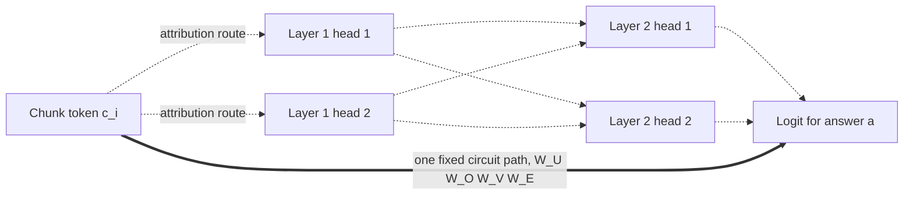
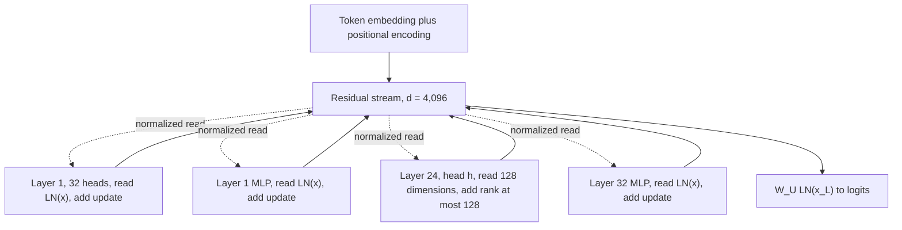
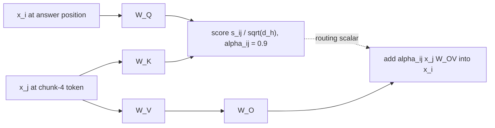
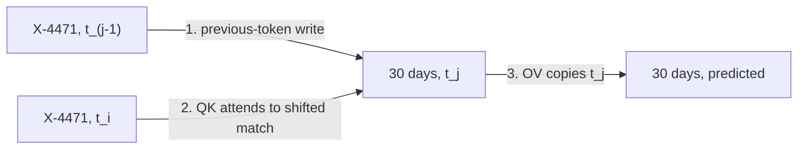
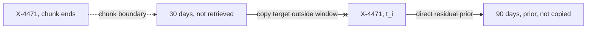
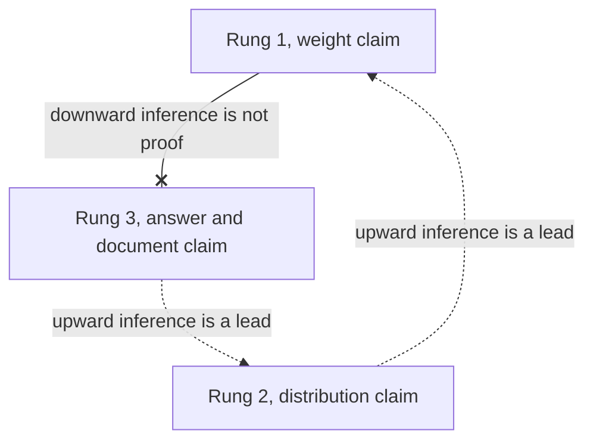

# Chapter 8: Reading the Machine: Circuits, Induction Heads, and Attribution
[00-START-HERE](../00-START-HERE.md) · [01-READING-ROUTES](../01-READING-ROUTES.md) · [07\_in\_context\_learning\_the\_mechanism\_rag\_rides\_on](07_in_context_learning_the_mechanism_rag_rides_on.md) · [09\_prompting\_for\_retrieval\_augmented\_systems](../part-03-prompting/09_prompting_for_retrieval_augmented_systems.md)

| Aspect | Explanation |
| --- | --- |
| **Purpose** | Distinguish evidence about one model run from evidence about fixed model weights, then use residual streams, query-key circuits, output-value circuits, and induction heads to reason about Retrieval-Augmented Generation (RAG) failures without claiming more than the evidence supports. |

## TL;DR
- RAG attribution scores one input. A circuit describes a fixed weight path that can transfer to later inputs.
- Attention mass shows where information could flow. It does not prove that removing a chunk would change the answer.
- Leave-one-out ablation directly tests document use, but duplicate chunks can hide each other’s contribution.
- The residual stream is a fixed-width information bus. Every layer reads and adds updates in one shared coordinate system.
- A query-key (QK) circuit decides where a head reads. An output-value (OV) circuit decides what it writes.
- An induction head implements the pattern $`[A][B]\ldots[A]\to[B]`$. Literal token matching explains both unseen-string copying and chunk-boundary failures.
- Circuit evidence can support capability and distribution claims. Only an input-level document counterfactual can show that one answer used one document.
## The story
Picture the generator as a fixed-width information bus running from token embeddings to answer logits. Retrieved chunks wait at many positions along the route. Attention routes content across positions. The residual stream carries that content through depth while every block reads the same coordinates and adds an update. The bus never widens when retrieval adds chunks. At the answer stop, one $`4{,}096`$-dimensional vector must contain everything needed for the next token. The QK circuit selects the route. The OV circuit sets the cargo. A strong route score cannot certify the cargo, and two heads can follow the same route while writing opposite logit effects. An induction circuit adds a two-head transfer. The first head shifts the previous token forward. The second matches the current token against that shifted token and copies what followed. This lets the bus carry an identifier absent from training. A chunk boundary can preserve the matching token while placing the payload outside the window. The route recognizes the key, but the cargo is gone. The direct residual route then supplies a fluent answer from the parametric prior. Attribution audits one completed bus trip. A gradient measures local sensitivity, a probe reads decodable information, and a Shapley value averages causal credit across chunk combinations. A circuit inspection studies a fixed part of the bus design and can reveal copying capability across inputs. It cannot prove which document controlled one answer. For that claim, remove the document and rerun the trip. The evidence must use the same unit as the claim.
## Decoder table

| Technical term | Plain-English meaning | Why it matters |
| --- | --- | --- |
| RAG | Retrieval-Augmented Generation | A system that places retrieved chunks in the generator context. Limit: Retrieval does not prove that the generator used a chunk |
| $`I`$ | Prompt instruction | A fixed part of the model input. Limit: Its effect remains input-specific |
| $`C`$ | Retrieved set of chunks | The candidate evidence placed in context. Limit: Presence in $`C`$ is not use |
| $`c_i`$ | Retrieved chunk $`i`$ | One attribution or ablation unit. Limit: Overlap can make it redundant with another chunk |
| $`n`$ | Number of retrieved chunks | Controls exact and leave-one-out attribution cost. Limit: It does not measure chunk independence |
| $`q`$ | Query | The question supplied to the generator. Limit: Changing $`q`$ changes run-level attribution |
| $`a`$ | Answer | The generated sequence whose score is measured. Limit: Its probability is a margin over many paths |
| Logit and answer margin | A pre-softmax token score and its gap over competing scores | The emitted token depends on the full margin, not one circuit contribution |
| Softmax | Normalization that turns routing scores into attention weights | Saturation can make a heavily used route have a small local gradient |
| Parametric prior | The answer tendency carried in model weights without retrieved evidence | It produces a fluent fallback when a context-copying path fails |
| $`S`$ | A subset of $`C`$ | One coalition in Shapley attribution. Limit: Exact enumeration scales as $`2^{n}`$ |
| $`v(S)`$ | Log probability of $`a`$ under $`I`$, $`S`$, and $`q`$ | A causal score for comparing chunk subsets. Limit: It applies to one answer and one input setup |
| $`\phi_i`$ | Attribution assigned to chunk $`i`$ | A per-chunk contribution score. Limit: It changes with the input |
| Gradient times input | Sum of embedding times answer-score gradient over a chunk | A one-run differential saliency score. Limit: Saturation can make strong reliance look weak |
| Integrated gradients | A differential method motivated by saturation failures | A less local gradient attribution. Limit: It is still run-level attribution |
| Probe | A classifier trained on an intermediate activation | Evidence that a property is decodable. Limit: Accuracy does not prove that the model uses the direction |
| Selectivity baseline | Probe performance relative to control labels | A check against probe memorization. Limit: It still does not establish causality |
| Leave-one-out | Drop one chunk, rerun, and measure the change | A direct document counterfactual. Limit: Duplicate chunks can each receive zero |
| Cosine threshold | Similarity cutoff for grouping near-duplicate chunks | It turns redundant chunks into one ablation unit before attribution |
| Shapley value | Average marginal contribution over chunk orderings | Credit for specified input interventions under redundancy; not proof of true provenance. Exact enumeration is exponential |
| Sampled Shapley | Approximation from sampled coalitions | Offline causal attribution at lower cost. Limit: It is not suitable for the request path in the chapter example |
| Attention weight | A scalar route weight across positions | Evidence about where information could flow. Limit: It is not exclusive evidence of use |
| Mechanistic circuit | One fixed chain of weight products from embedding to logit | A weight-level claim that transfers across inputs. Limit: It covers one path, not the full answer |
| Residual stream | Fixed-width vector carried through model depth at each position | A shared space for patching, decoding, and steering. Limit: Its width does not grow with retrieval |
| Pre-norm and post-norm | Normalization before versus after an additive sublayer | The clean shared-bus account applies to the pre-norm arrangement in the source |
| Positional and rotary embeddings | Position information added to token representations, with rotary embeddings rotating query and key by relative offset | Residual addition preserves position information but does not create it |
| Superposition | Several features sharing nonorthogonal residual directions | The dimension count suggests shared-coordinate pressure but does not prove a particular feature packing or interference rate |
| $`x_t`$ | Embedding of token t | Input to gradient attribution. Limit: The associated derivative is local |
| $`x_l`$ | Residual stream at layer l | State read and updated by the next block. Limit: One layer-position state does not certify a document |
| $`d`$ | Residual-stream width | The number of shared bus coordinates. Limit: Width alone does not prevent superposition |
| $`L`$ | Number of layers | Depth of the stack. Limit: Path count grows exponentially in $`L`$ |
| $`H`$ | Number of heads per layer | Per-layer attention count. Limit: Single-head evidence may be small relative to the full stream |
| $`d_h`$ | Width of one attention head | Maximum rank of one head update. Limit: A head touches only a low-rank slice |
| Layer normalization (LN) | Normalization applied before a pre-norm sublayer read | Stabilizes the read into each additive block. Limit: It adds a per-position scale to QK scores |
| Multilayer perceptron (MLP) | Non-attention sublayer that adds to the stream | Up to rank $`d`$ write demand per layer. Limit: It contributes to oversubscription and later overrides |
| $`W_E`$ | Token embedding matrix | Maps vocabulary tokens into the residual space. Limit: Token-level circuit formulas are approximate with some serving details |
| $`W_U`$ | Unembedding matrix | Maps the final residual state to logits. Limit: It reads the same shared basis under the pre-norm bus view |
| $`W_Q`$ | Query projection | One factor in the QK product. Limit: It is not individually identifiable |
| $`W_K`$ | Key projection | One factor in the QK product. Limit: It is not individually identifiable |
| $`W_V`$ | Value projection | One factor in the OV product. Limit: It is not individually identifiable |
| $`W_O`$ | Head output projection | Returns a head update to the residual stream. Limit: It is not individually identifiable |
| $`W_{QK}`$ | Product $`W_QW_K^T`$ | Determines the attention pattern. Limit: It does not determine what the head writes |
| $`W_{OV}`$ | Product $`W_VW_O`$ | Determines the channel update. Limit: It does not determine where the head reads |
| $`A`$ | Attention matrix | Mixes positions on the left of $`X`$. Limit: It says nothing by itself about the OV content |
| $`\alpha_{ij}`$ | Attention from position $`i`$ to position $`j`$ | One run’s routing factor. Limit: It is recomputed for every input |
| $`s_{ij}`$ | Pre-softmax attention score | Pairwise routing score. Limit: A one-layer score only sees the two current token identities |
| $`\mathrm{QK}_{\mathrm{full}}`$ | Vocabulary-expanded QK bilinear form | Scores query-token and key-token pairs. Limit: It has no copying eigenspectrum |
| $`\mathrm{OV}_{\mathrm{full}}`$ | Vocabulary-expanded OV linear map | Maps an attended token to logit changes. Limit: Materializing it is prohibitively large |
| Gauge freedom | Invertible basis change inside one head | Explains why only projection products are identifiable. Limit: Individual matrix columns are coordinate conventions |
| Eigenvalue $`\lambda_i`$ | Spectral value of the reduced OV operator | Indicates copying or suppression direction. Limit: The result is a weight-level statistic |
| Copying score $`\kappa`$ | Mean normalized real part of OV eigenvalues | Cheap copier scan across heads. Limit: Its null floor changes with $`d_h`$ |
| Skip-trigram copying | One-layer memorized association such as are to perfect | Copying of learned token patterns. Limit: It does not generalize to an unseen identifier |
| Previous-token head | Layer-1 head that shifts token j-1 into position $`j`$ | Creates the key-side state needed for induction. Limit: The payload still must remain in the window |
| Induction head | Two-layer circuit implementing $`[A][B]\ldots[A]\to[B]`$ | Context copying for unseen strings. Limit: Production-scale causal evidence remains limited |
| Virtual attention head | Functional unit visible through a composition of heads | A composed mechanism not found in either head alone. Limit: Composition search grows rapidly with depth |
| Prefix-matching score | Attention from a current token to the position after an earlier copy | One-pass correlational locator for induction heads. Limit: Causality requires ablation |
| In-context learning score | Later-minus-earlier token loss under a specified evaluation distribution; distinct from random-repeat prefix matching | Regression signal for copying behavior. Limit: It does not prove document use on one answer |
| Fuzzy induction | Approximate matching by synonym, translation, or nearby direction | A mechanism for nonliteral context reuse. Limit: It can copy the neighboring wrong span |
| Constrained decoding | A sampler rule that restricts output to an allowed source string | It gives a quotation guarantee that a copying spectrum cannot provide |
| Quantization | Lower-precision model representation used for serving | Copying behavior can change across a precision swap before fluency reveals it |
| Direct residual path | Non-head path that continues to influence logits | Explains fluent fallback when copying fails. Limit: It can override a correct copying contribution |
| Activation patching | Replace an activation in one run with the corresponding clean activation | Causal localization at a layer and position. Limit: Its unit is a model coordinate, not a document |
| Logit lens | Apply the unembedding to intermediate residual states | Shows when a candidate token becomes decodable. Limit: Early-layer readout can be degenerate |
| Tuned lens | A trained layer-specific readout | Improves early-layer decoding. Limit: It is still a readout rather than proof of use |
| Steering vector | Additive intervention in residual space | Behavioral control that respects the additive bus. Limit: Addition does not directly delete a direction |
| Rung 1 | Claim about fixed weights and every input | Circuit scan and prefix-matching evidence. Limit: It cannot prove a specific answer used a chunk |
| Rung 2 | Claim in expectation over a query distribution | Head knockout on held-out queries. Limit: It transfers only to the sampled distribution |
| Rung 3 | Claim about one answer and one document | Document counterfactual. Limit: It says nothing about other inputs |
| top-$`k`$ | Maximum retrieved chunks passed into the generator | It caps document-level ablation cost while model head count keeps growing |

## Core mechanics
### Mathematical conventions
Use natural logarithms and nats for likelihoods. Row-vector convention is used throughout: $`X\in\mathbb R^{n\times d}`$, $`W_E\in\mathbb R^{V\times d}`$, $`W_U\in\mathbb R^{d\times V}`$, $`W_Q,W_K,W_V\in\mathbb R^{d\times d_h}`$ and $`W_O\in\mathbb R^{d_h\times d}`$. The four-projection and gauge counts assume an ordinary independent-head, non-rotary attention model; grouped-query sharing and rotary position encoding require adjustments. Attention includes a causal mask where appropriate, omitted only in schematic products. Storage is decimal except explicit KiB, MiB, GiB or TiB. Replay costs combine a $`2NT`$ prefill proxy with a weight-bandwidth decode proxy; neither is measured end-to-end latency. Coalition budgets charge every replay the full-context cost for illustration, although shorter coalitions and fixed-answer likelihood scoring can be cheaper. Keep precision until display.
### 8.1 Feature attribution versus mechanistic interpretability
#### The attribution object

| Aspect | Explanation |
| --- | --- |
| **What** | The model sees an instruction, retrieved chunks, and a query. It emits answer $`a`$. The subset value is: $`\displaystyle v(S)=\log p(a\mid I,S,q)`$ An attribution method returns one value per chunk. |
| **Why** | The value lets an incident review compare the same answer under different evidence subsets. |
| **Failure without it** | Attention mass can look decisive while the answer still comes from the parametric prior. |
| **Cost or complexity** | The cost depends on whether the method differentiates, probes, ablates, or enumerates coalitions. |

#### Differential attribution

| Aspect | Explanation |
| --- | --- |
| **What** | For row embeddings, gradient-times-input gives the scalar score $`\phi_i=\sum_{t\in c_i}x_t(\nabla_{x_t}\log p(a))^{\mathsf T}`$. This is a local differential score, not a unique decomposition of causal source use. |
| **Why** | It obtains a chunk score from one backward pass after the forward pass. |
| **Failure without its limit** | A saturated softmax can hide total reliance. For one attention weight: $`\displaystyle \frac{\partial \alpha}{\partial z}=\alpha(1-\alpha)`$ At $`\alpha=0.98`$, sensitivity is $`0.0196`$. The maximum is $`0.25`$ at $`\alpha=0.5`$. The relative attenuation is $`12.8\times`$. |
| **Cost or complexity** | One backward pass is cheap, but the result is a first-order local approximation. Sundararajan et al. (2017) used saturation as the motivating axiom failure for integrated gradients. |

#### Probing

| Aspect | Explanation |
| --- | --- |
| **What** | A probe predicts a property such as grounding from a residual activation. |
| **Why** | High accuracy shows that the property is linearly decodable. |
| **Failure without its limit** | Decodability does not show that the model reads that direction. Hewitt and Liang (2019) showed that capable probes can fit random control labels. |
| **Cost or complexity** | Training and a selectivity baseline are required before the accuracy is informative. An intervention is still required before calling the direction a mechanism. |

#### Shapley attribution

| Aspect | Explanation |
| --- | --- |
| **What** | For a fixed answer $`a`$, exact Shapley credit averages marginal changes in the chosen score: $`\phi_i=\sum_{S\subseteq C\setminus\{c_i\}}\frac{\lvert S\rvert!(n-\lvert S\rvert-1)!}{n!}[v(S\cup\{c_i\})-v(S)]`$. Use cardinalities, not vector norms. |
| **Why** | It allocates the effect of specified input-subset interventions, including interactions. This is not proof of source truth, historical training membership or unique internal provenance. |
| **Failure without it** | Two redundant chunks can have zero individual leave-one-out effect. In a separate binary or normalized utility game, let $`v(\varnothing)=0`$ and $`v(\{4\})=v(\{11\})=v(\{4,11\})=1`$. Each gets $`0.5`$ Shapley credit. These utility values are not literal log probabilities from the earlier score. |
| **Cost or complexity** | Exact memoized enumeration needs $`2^n`$ subset-score evaluations, not necessarily $`2^n`$ generations. At $`n=20`$, this is $`1{,}048{,}576`$ values. Charging the full replay proxy gives about $`9.24`$ single-GPU-equivalent days; $`2{,}048`$ evaluations give about $`25.99`$ minutes. Monte Carlo variance, coalition weighting, interactions and estimator choice determine accuracy. |

#### Circuits and attention

| Aspect | Explanation |
| --- | --- |
| **What** | A circuit isolates one direct product of weight matrices. For one head’s direct OV route to logits, the chapter uses: $`\displaystyle W_EW_VW_OW_U`$ |
| **Why** | The weight product is fixed, but its actual contribution depends on the run-specific attention, activation state and downstream nonlinear processing; it does not prove use on every later query. |
| **Failure without the distinction** | A gradient aggregates all routes for one run, while a circuit isolates one route across runs. Jain and Wallace (2019) found weak correlation between attention and gradient importance in attention-based classifiers. They also produced very different attention distributions with equivalent predictions. Wiegreffe and Pinter (2019) argued that adversarial attention needs a baseline. Their narrower conclusion allows attention to remain plausible evidence. The defensible claim here is only that attention weight is not exclusive evidence of use. |
| **Cost or complexity** | Expanding all routes creates: $`\displaystyle (H+1)^L`$ end-to-end terms in an attention-only stack. At $`L=2`$ and $`H=12{,}`$ the count is $`169`$. Elhage et al. (2021) enumerated that small case. At $`L=32`$ and $`H=32{,}`$ the count is $`3.9\times10^{48}`$. Even depth-two compositions in the $`32`$-layer, $`32`$-head model produce $`507{,}904`$ head pairs. Three query, key, and value composition routes make $`1{,}523{,}712`$ norms. |

#### Worked attribution budget

| Aspect | Explanation |
| --- | --- |
| **What** | The $`8`$-billion-parameter model uses the prefill proxy $`2N=1.6\times10^{10}\,\mathrm{FLOP/token}`$ at $`3.4\times10^{14}\,\mathrm{FLOP\,s^{-1}}`$: $`0.0470588\,\mathrm{ms/token}`$ or $`188.2353\,\mathrm{ms}`$ for $`4{,}000`$ tokens. A single-batch weight-bandwidth decode proxy is $`16\,\mathrm{GB}/(3.35\,\mathrm{TB/s})\approx4.77612\,\mathrm{ms/token}`$, or $`573.1343\,\mathrm{ms}`$ for $`120`$ tokens. Their sum is $`761.3696\,\mathrm{ms}`$. KV traffic, kernels, compute limits, batching and intervention overhead can change the measured time. |
| **Why** | This price converts abstract evidence choices into incident and serving budgets. |
| **Failure without it** | Teams can fund exhaustive analysis for a question that a cheap document ablation settles. |
| **Cost or complexity** | Leave-one-out takes $`21`$ replays and $`16.0\,\mathrm{s}`$ for $`20`$ chunks. Exact Shapley takes $`1{,}048{,}576`$ replays and $`9.2`$ days. Sampled Shapley takes $`2{,}048`$ replays and $`26`$ minutes. De-duplicate before attribution. Collapse near-duplicates above a cosine threshold into one ablation unit. If six chunks repeat one fact, treat the retrieval budget as the finding. Use saliency only to rank the first ten ablation candidates when $`n`$ reaches the hundreds. Lundberg and Lee (2017) introduced sampled kernel estimation to make Shapley attribution usable at this scale. Run attribution offline, and log the prompt, retrieved chunk identifiers, and sampling seed for replay. Use generation-time citation when per-answer provenance is required. Treat a $`0.90`$ AUC probe as a monitor until an intervention shows use. Reserve circuit work for failures that repeat across hundreds of unrelated queries. |

### 8.2 The residual stream as an information bus
#### Plain composition and its two failures

| Aspect | Explanation |
| --- | --- |
| **What** | A plain deep stack computes: $`\displaystyle x_l=f_l(x_{l-1})`$ $`\displaystyle x_L=f_L\circ\cdots\circ f_1(x_0)`$ |
| **Why** | This form exposes why residual addition changes more than gradient flow. |
| **Failure without residuals** | A plain-stack gradient is a product of Jacobians. In the special scalar or isotropic-gain illustration, $`0.9^{32}\approx0.03434`$ and $`1.1^{32}\approx21.1138`$. A mean singular value of $`0.9`$ or $`1.1`$ alone does not determine the product norm because directions and layer alignment matter. Residual coordinates facilitate comparisons, but not every non-residual network is uninterpretable or ill-typed. |
| **Cost or complexity** | The issue grows with depth through a product of Jacobians. |

#### Additive pre-norm blocks

| Aspect | Explanation |
| --- | --- |
| **What** | A residual block computes: $`\displaystyle x_l=x_{l-1}+b_l(x_{l-1})`$ The chapter’s pre-norm attention and MLP update is: $`\displaystyle\begin{aligned}x_l&=x_{l-1}\\&+\sum_{h=1}^{H}A_{lh}(\mathop{\text{LN}}(x_{l-1}))\\&+M_l\left(\mathop{\text{LN}}\left(x_{l-1}+\sum_hA_{lh}\right)\right)\end{aligned}`$ |
| **Why** | Every block reads and writes the coordinate system created by the embedding. The gradient contains a pure identity route because: $`\displaystyle \frac{\partial x_l}{\partial x_{l-1}}=I+J_l`$ He et al. (2016) provide the residual-network anchor for that identity path. |
| **Failure without it** | Activation patching, the logit lens, and steering lose their shared basis. |
| **Cost or complexity** | For linearized blocks, $`(I+A_4)(I+A_3)(I+A_2)(I+A_1)`$ expands into ordered products, including the identity. Matrix order matters; writing a commutative scalar product is only a mnemonic. Nonlinear blocks do not yield a literal fixed linear-path expansion without further assumptions. |

#### One head on the bus

| Aspect | Explanation |
| --- | --- |
| **What** | One head reads through $`W_V`$ and writes through $`W_O`$. $`\displaystyle W_{OV}=W_VW_O`$ For $`d=4{,}096`$ and $`d_h=128{,}`$ the update rank is at most $`128`$. |
| **Why** | The linear map $`W_VW_O`$ has rank at most $`128`$ and nullity at least $`4{,}096-128=3{,}968`$. This identifies a nullspace, not $`3{,}968`$ untouched coordinate axes or a guarantee that the whole head leaves those directions unchanged once routing depends on the input. |
| **Failure without the distinction** | Teams patch a small head when the full answer-position stream is the causal state they need. |
| **Cost or complexity** | Counting $`32`$ attention heads plus one MLP per layer gives $`24(32+1)=792`$ writes. If writes are independent isotropic unit vectors with zero cross terms in expectation, the root mean square norm is $`\sqrt{792}\approx28.14`$; one unit is about $`3.55\%`$ of that scale. Real correlated or unequal writes need not obey this model, and norm share is not causal answer importance. |

#### Oversubscription and superposition

| Aspect | Explanation |
| --- | --- |
| **What** | Standard parameterization uses: $`\displaystyle Hd_h=d`$ Attention writes $`d`$ dimensions per layer. The MLP can write another $`d`$. |
| **Why** | The sum of maximal attention and MLP output ranks over $`L`$ layers is at most $`2Ld`$, yielding the dimension-counting ratio $`2L=64`$ at $`L=32`$. This is a heuristic for repeated writes into shared coordinates, not a theorem that $`64`$ independent feature sets must collide or that a specific amount of superposition is necessary. |
| **Failure without enough independent directions** | Features share nonorthogonal directions. Elhage et al. (2022) call this superposition. Some heads and neurons also appear to delete information, as reported by Elhage et al. (2021). |
| **Cost or complexity** | Independent isotropic unit vectors in $`d=4{,}096`$ have root mean square inner product $`1/\sqrt d=0.015625`$. The RMS projected norm onto a fixed $`128`$-dimensional orthogonal subspace is $`\sqrt{128/4096}\approx0.17678`$, with expected squared norm $`0.03125`$. These random-geometry values are not measured readout interference. The illustrative $`2L`$ factors are $`24,192,64`$ for depths $`12,96,32`$; they do not alone measure feature demand. |

#### The retrieval funnel

| Aspect | Explanation |
| --- | --- |
| **What** | With row-vector states, the next-token logit row is $`\mathop{\mathrm{LN}}\nolimits(x_L)W_U`$. The same dimensions are used in the vocabulary-expanded maps. |
| **Why** | Each next-token prediction reads a $`d`$-dimensional current state, but later decoding steps can attend again to the retained context KV cache. This is not a one-time compression of the whole context into one permanently closed state. |
| **Failure without enough selection** | Distractors can impair evidence use, but fixed residual width or a context-to-position count alone does not prove such impairment or an information-capacity threshold. Measure answer quality and interventions. |
| **Cost or complexity** | Fifty chunks of $`500`$ tokens create $`25{,}000`$ positions. One layer of half-precision residual states occupies $`195`$ mebibytes (MiB). The answer position occupies $`8`$ kibibytes (KiB). The funnel is $`25{,}000:1`$. Reducing $`k`$ from $`50`$ to $`5`$ cuts layer storage from $`195\,\mathrm{MiB}`$ to $`19.5\,\mathrm{MiB}`$. It leaves the answer state at $`8\,\mathrm{KiB}`$. |

#### Caveats and practical choices

| Aspect | Explanation |
| --- | --- |
| **What** | The clean shared-bus statement applies to the pre-norm arrangement. |
| **Why** | The original Transformer used post-norm and rescaled the bus in place. Xiong et al. (2020) analyzed the training stability of pre-norm. |
| **Failure without the caveat** | Pre-norm addition preserves an identity residual route, not immunity to all changes in representation. Positional information may enter through embeddings or through attention rotations such as RoPE. Unmasked attention without position signals is permutation-equivariant; a causal mask already distinguishes prefixes, so the blanket statement needs that unmasked-attention qualification. |
| **Cost or complexity** | Patch aligned layer/position states and measure effects; a tuned lens may improve decoding. Keep retrieval depth evidence-driven, not determined by the $`8\,\mathrm{KiB}`$ per-position payload. Projection can remove a chosen activation component without deleting a fact from the model. Comparing $`5`$  • and $`50`$-chunk states requires aligned answer positions and appropriate baseline/patch runs; two arbitrary forwards do not establish a complete causal test. |

### 8.3 QK and OV circuits
#### One attention head

| Aspect | Explanation |
| --- | --- |
| **What** | For context matrix $`X`$ with $`n`$ positions and width $`d`$: $`\displaystyle A=\mathop{\text{softmax}}\left(\frac{XW_QW_K^{T}X^{T}}{\sqrt{d_h}}\right)`$ $`\displaystyle h(X)=AXW_VW_O`$ |
| **Why** | The equation separates routing from channel transformation. |
| **Failure without the split** | A $`0.9`$ attention weight gets mistaken for proof that the right content was written. |
| **Cost or complexity** | Each head has four projection matrices. For $`d=4{,}096`$ and $`d_h=128{,}`$ one head has $`2{,}097{,}152`$ projection parameters. |

#### Gauge-invariant products

| Aspect | Explanation |
| --- | --- |
| **What** | For any invertible matrix $`R`$: $`\displaystyle W_Q'=W_QR`$ $`\displaystyle W_K'=W_KR^{-T}`$ The product $`W_QW_K^T`$ stays fixed. The same basis freedom holds for $`W_V`$ and $`W_O`$. |
| **Why** | Only the products describe the model function independently of the head’s internal coordinate choice. |
| **Failure without it** | A statement about one column of $`W_Q`$, $`W_K`$, $`W_V`$, or $`W_O`$ becomes a statement about an arbitrary basis. |
| **Cost or complexity** | For full-rank independent projections without rotary transformations, two $`\mathrm{GL}(128)`$ gauge actions have dimension $`2(128)^2=32{,}768`$, or $`1.5625\%`$ of $`2{,}097{,}152`$ projection parameters. Degeneracy and sharing can change this count. With fixed RoPE rotations, an arbitrary QK basis transform need not preserve scores; it must satisfy the relevant rotation-commutation conditions. |

#### Where to look and what to move

| Aspect | Explanation |
| --- | --- |
| **What** | Define: $`\displaystyle W_{QK}=W_QW_K^{T}`$ $`\displaystyle W_{OV}=W_VW_O`$ Then: $`\displaystyle A=\mathop{\text{softmax}}\left(\frac{XW_{QK}X^{T}}{\sqrt{d_h}}\right)`$ $`\displaystyle h(X)=(AX)W_{OV}=A(XW_{OV})`$ |
| **Why** | $`A`$ mixes position rows and $`W_{OV}`$ mixes channels. The equality $`(AX)W_{OV}=A(XW_{OV})`$ is matrix associativity with fixed $`A`$, not a claim that these differently shaped matrices commute or that $`A`$ is independent of $`X`$. |
| **Failure without it** | A correct QK route can hide an OV write that copies, suppresses, or changes the wrong token. |
| **Cost or complexity** | The split is exact for the head computation and drops no term. |

#### Vocabulary-expanded circuits

| Aspect | Explanation |
| --- | --- |
| **What** | The expanded maps are: $`\displaystyle \mathop{\text{OV}}_{full}=W_EW_{OV}W_U`$ $`\displaystyle \mathop{\text{QK}}_{full}=W_EW_{QK}W_E^{T}`$ |
| **Why** | One OV entry gives the logit shift from an attended source token to a target token. One QK entry gives a score contribution from a query-side token and a key-side token. |
| **Failure without the type distinction** | A bilinear QK form gets treated as an operator with a copying spectrum. Only the linear vocabulary-to-vocabulary OV map has that spectrum. |
| **Cost or complexity** | The full OV map for a $`128{,}256`$-token vocabulary has $`1.645\times10^{10}`$ entries. It occupies $`32.9\,\mathrm{GB}`$, or $`30.6`$ gibibytes (GiB), in half precision per head. Across $`1{,}024`$ heads, it would occupy $`30.6`$ tebibytes (TiB). |

#### Low-rank spectrum

| Aspect | Explanation |
| --- | --- |
| **What** | Factor the expanded OV map: $`\displaystyle W_EW_{OV}W_U=AB`$ $`\displaystyle A=W_EW_V`$ $`\displaystyle B=W_OW_U`$ The nonzero eigenvalues of $`AB`$ equal those of $`BA`$. $`\displaystyle BA=W_OW_UW_EW_V`$ |
| **Why** | $`BA`$ is only $`128\times128`$. |
| **Failure without the reduction** | The vocabulary-expanded map is too large to materialize. |
| **Cost or complexity** | The reduced matrix has $`128^2=16{,}384`$ entries, or $`32\,\mathrm{KiB}`$ at two bytes each, and $`32\,\mathrm{MiB}`$ across $`1{,}024`$ heads. The entry-count ratio is $`128{,}256^2/128^2=1{,}004{,}004`$. These are payload sizes, not eigensolver workspace or an accuracy recommendation for half precision. An $`\mathcal O(LHd_h^3)`$ eigensolver-work proxy is about $`2.15\times10^9`$ operations before algorithm constants; forming the reduced products can cost much more and is omitted. Laptop runtime must be benchmarked. The GPT-2 entry ratio is $`50{,}257^2/64^2\approx616{,}658`$. |

#### Copying score and null

| Aspect | Explanation |
| --- | --- |
| **What** | As an explicitly defined heuristic, let $`\kappa=d_h^{-1}\sum_{i=1}^{d_h}f(\lambda_i)`$, with $`f(\lambda)=\mathop{\mathrm{Re}}\nolimits(\lambda)/\lvert\lambda\rvert`$ for $`\lambda\ne0`$ and $`f(0)=0`$. Eigenvalues summarize the reduced OV operator; positive real parts are not by themselves a token-by-token copying guarantee. |
| **Why** | A copier raises the logit of the token it attends to. |
| **Failure without a null** | A sign-symmetric random-product ensemble can have mean zero for this odd score. The heuristic $`1/\sqrt{2d_h}=0.0625`$ follows an independent uniform-angle approximation; real-matrix eigenvalues are dependent and conjugate-paired, and trained/tied embeddings violate simple ensemble assumptions. This is not a calibrated null standard deviation for a deployed model. |
| **Cost or complexity** | $`3/\sqrt{2(128)}=0.1875`$ suggests a rough $`0.19`$ screening flag only under that null approximation. Estimate an empirical null and account for scanning $`1{,}024`$ heads; this is not a conservative family-wise significance threshold. |

#### Serving-model caveats

| Aspect | Explanation |
| --- | --- |
| **What** | The expanded formulas are exact for the one-layer attention-only model with learned absolute positions analyzed by Elhage et al. (2021). |
| **Why** | Layer normalization rescales each position before a read. Rotary embeddings insert a relative rotation between query and key. $`\displaystyle x_iW_QR_{i-j}W_K^{T}x_j^{T}`$ |
| **Failure without the caveat** | RoPE changes QK routing; layer normalization changes the activations read by the value path and the final logit mapping. The weight product $`W_VW_O`$ remains fixed, but its vocabulary-expanded contribution is not untouched by normalization or nonlinear downstream computation. |
| **Cost or complexity** | Move the gold chunk between first and last position to classify QK-side failures. If attention is diffuse rather than misplaced, cut $`k`$. Inspect $`W_{QK}`$ and $`W_{OV}`$ rather than individual projections. Per-matrix deltas remain meaningful only when two checkpoints share a fixed basis. Use the OV spectrum to scan copying machinery and attention statistics to inspect routing. Route persistent OV-side failures to a low-rank adapter, steering, a different base model, constrained decoding, or another decode-level intervention. Changing retrieval, reranking, chunking, or ordering changes $`X`$ and the QK route. It does not change $`W_{OV}`$. Record $`\kappa`$ across all $`1{,}024`$ heads on each base-model change and rederive its floor when $`d_h`$ changes. |

### 8.4 Induction heads and advanced copying
#### The one-layer ceiling

| Aspect | Explanation |
| --- | --- |
| **What** | The token-only term of a one-layer score is $`s_{ij}=t_iW_EW_{QK}W_E^{\mathsf T}t_j^{\mathsf T}`$ up to the attention scale. Real scores also include position and mask effects. This isolated term cannot read the predecessor identity at $`j`$ unless it is already represented in its input. |
| **Why** | The score depends only on the identities of $`t_i`$ and $`t_j`$. |
| **Failure without another layer** | The desired location is marked by $`t_{j-1}`$, not by payload token $`t_j`$. An unseen part number has no trained bigram entry that points to its payload. |
| **Cost or complexity** | One-layer heads can implement memorized skip-trigram associations. They cannot implement the general unseen-token pointer by this score alone. |

#### The two-layer construction

| Aspect | Explanation |
| --- | --- |
| **What** | Using row vectors, a previous-token head contributes $`x_j^{(1)}=t_jW_E+t_{j-1}W_EW_{OV}^{P}`$. The induction score contains the dimensionally valid term $`s_{ij}^{\mathrm{ind}}=t_iW_EW_{QK}^{I}(W_{OV}^{P})^{\mathsf T}W_E^{\mathsf T}t_{j-1}^{\mathsf T}`$, omitting scaling, mask, position terms and other residual contributions. The transposed predecessor write is a $`d\times1`$ column, giving a scalar score. |
| **Why** | Training can make the composed vocabulary map close to a positive multiple of the identity. Then the score is high when the current token matches the predecessor copied into position $`j`$. The layer-2 OV circuit copies $`t_j`$ into the logits. |
| **Failure without the composed identity** | The circuit would depend on the specific content $`A`$ and $`B`$. The near-identity composition names no specific identifier or payload. |
| **Cost or complexity** | The mechanism implements $`[A][B]\ldots[A]\to[B]`$ with two layers. Elhage et al. (2021) call the pair an induction head and the composition a virtual attention head. |

#### Why chunk boundaries break copying

| Aspect | Explanation |
| --- | --- |
| **What** | Literal identity matching finds an earlier occurrence of the current token. The payload is the token immediately after that earlier occurrence. |
| **Why** | A retrieved chunk can therefore support an identifier never seen in training. In the source example, X-4471-B and $`30`$ days become a confident $`90`$ days two weeks after rechunking into $`512`$-token windows with no overlap. The weights, retriever, and correct indexed row do not change. |
| **Failure without the payload in the window** | A boundary can preserve the key and remove the next token. The direct residual path then produces a plausible prior answer. That explains a fluent wrong number rather than an abstention. |
| **Cost or complexity** | Keep atomic records within one chunk. Apply the same normalization to query and corpus text. Use one delimiter template across demonstrations, chunks, and questions. Use lexical retrieval for identifiers that must appear literally. |

#### Claim limits

| Aspect | Explanation |
| --- | --- |
| **What** | Olsson et al. (2022) observed a training phase change where the in-context learning score rose as induction heads formed. They causally knocked out heads in small attention-only models. |
| **Why** | The joint change and knockout support the induction account in those settings. |
| **Failure without the boundary** | Correlational production-scale evidence gets reported as a causal explanation of the served model. Models with real depth also contain fuzzy heads that can match synonyms, translations, or fixed strides. Fuzzy copying can select a neighboring wrong span. |
| **Cost or complexity** | Copying is a mechanism, not a faithfulness guarantee. Verbatim quotation requires constrained decoding. |

#### Random-repeat probe

| Aspect | Explanation |
| --- | --- |
| **What** | Double a random $`256`$-token sequence. A uniform predictor over $`V=128{,}256`$ tokens has loss $`\ln V\approx11.761783`$ nats or $`\log_2 V\approx16.968667`$ bits per token. A second-copy loss of $`3.5`$ nats is a relative log-loss reduction $`1-3.5/\ln V\approx70.24\%`$, not a copying probability or accuracy. Its geometric mean probability on observed next tokens is $`e^{-3.5}\approx0.03020`$. |
| **Why** | The repeated prefix provides a controlled source of next-token predictability; other mechanisms can exploit it too. Neither loss reduction nor prefix matching alone identifies a unique circuit. |
| **Failure without the probe** | A base-model or quantization change can degrade copying before a RAG evaluation set catches it. |
| **Cost or complexity** | A $`512`$-token parameter-work proxy is $`24.09\,\mathrm{ms}`$; $`32`$ sequences give $`0.77101\,\mathrm{s}`$. Multiplying by $`1{,}025`$ baseline/ablation conditions gives $`790.29\,\mathrm{s}`$ or $`13.17`$ minutes before intervention and logging overhead. Distinguish the random-repeat prefix-matching test from the published later-minus-earlier token-loss ICL metric; the formula alone does not specify the same test distribution. Probe serving precision and context length, not just bf16. |

#### Chunking cost example

| Aspect | Explanation |
| --- | --- |
| **What** | A $`5{,}000`$-row table at $`18`$ tokens per row contains $`90{,}000`$ tokens. |
| **Why** | It makes record fragmentation measurable. |
| **Failure without overlap** | For fixed $`18`$-token rows starting at offset zero, $`512`$-token windows make $`176`$ chunks and $`175`$ internal boundaries. Boundary $`512j`$ is row-aligned exactly when $`18\mid512j`$, or $`9\mid j`$. Thus $`\lfloor175/9\rfloor=19`$ are aligned and $`156`$ split a row, affecting $`156/5000=3.12\%`$ of rows. The earlier $`17/18`$ calculation incorrectly treated deterministic modular positions as uniform random offsets. |
| **Cost or complexity** | A $`32`$-token overlap gives stride $`480`$ and $`1+\lceil(90{,}000-512)/480\rceil=188`$ chunks, a $`188/176\approx1.06818`$ index-row factor. With final partial chunks retained, processed text is $`90{,}000+187(32)=95{,}984`$ tokens, an embedding-token factor $`1.06649`$, not exactly the chunk-count factor. Because overlap exceeds the record length, each record is wholly present in at least one chunk in this setup; retrieval still must return that chunk. Real variable-length/tokenized rows require record-aware handling. Delimiter tokenization must be checked with the actual tokenizer. |

### 8.5 What circuits license and what they do not
#### Routing factor and weight factor

| Aspect | Explanation |
| --- | --- |
| **What** | One head’s source-position influence factors into a run-specific route and a fixed weight map. $`\displaystyle \Delta x_i^{(h)} = \sum_jA_{ij}^{(h)}x_jW_{OV}^{(h)}`$ After unembedding, source position $`j`$ contributes: $`\displaystyle A_{ij}^{(h)} \times t_jW_EW_{OV}^{(h)}W_U`$ |
| **Why** | Circuit analysis freezes the left factor and reads the right factor from the weights. |
| **Failure without the distinction** | Naming an induction head gets treated as proof that it used chunk $`4`$ on this input. |
| **Cost or complexity** | The attention factor must be recomputed on every run. The fixed circuit transfers across runs but does not identify one document’s causal role. |

#### One addend versus the answer

| Aspect | Explanation |
| --- | --- |
| **What** | For fixed activations and attention, one can trace head contributions. A production nonlinear transformer’s final logits are not generally a finite sum of fixed weight-only paths with no activation, normalization or MLP terms. |
| **Why** | The emitted token depends on the margin over the entire sum. |
| **Failure without this limit** | One correct circuit contribution gets mistaken for control of the answer. The source example gives the right token a $`3.1`$-nat push from one copier. The rest of the stack gives the wrong token a $`3.4`$-nat push. The wrong token wins by $`0.3\,\mathrm{nats}`$ while the copier still behaves exactly as predicted. |
| **Cost or complexity** | Head-by-head explanation scales with the model’s head count and path count. |

#### Three evidence rungs

| Aspect | Explanation |
| --- | --- |
| **What** | Rung 1 concerns weight-level structural capability, not a guarantee that the behavior occurs on every input. OV products are weight statistics; prefix matching is a run/distribution statistic and is not a property read from weights alone. |
| **Why** | It supports a capability statement such as this stack copies from context. |
| **Failure without the quantifier** | A weight-level property gets applied downward to one answer. |
| **Cost or complexity** | The chapter’s scan costs $`0.771\,\mathrm{s}`$ per model. |
| **What** | Rung 2 concerns expectation over a query mix. Head knockout on held-out queries licenses this claim. |
| **Why** | It shows that selected heads carry copying on the sampled distribution. |
| **Failure without the quantifier** | The result gets transferred beyond the query distribution. |
| **Cost or complexity** | The chapter’s causal scan costs $`13.2`$ minutes per model. |
| **What** | Rung 3 concerns one answer and one document. Dropping the chunk and rerunning licenses this claim. |
| **Why** | It answers whether the answer changed when that document disappeared. |
| **Failure without matching units** | Head patching returns a layer or head when legal asks about a document. |
| **Cost or complexity** | A $`20`$-chunk answer takes $`21`$ replays and $`16.0\,\mathrm{s}`$. Inference can move upward as a lead. It never moves downward as proof. |

#### Why head-level causal tracing loses the audit

| Aspect | Explanation |
| --- | --- |
| **What** | Activation patching can causally localize an input-specific effect. Meng et al. (2022) patch clean activations into corrupted runs. |
| **Why** | The method can reach an input-specific claim. |
| **Failure without unit alignment** | Its output is a model coordinate rather than a document. Once positions map to chunks, direct chunk ablation answers the document question more cheaply. |
| **Cost or complexity** | Patching all $`1{,}024`$ heads plus a baseline takes $`1{,}025`$ replays. At $`0.7615\,\mathrm{s}`$ each, that is $`780.40\,\mathrm{s}`$, or $`13.0`$ minutes per answer. Document ablation takes $`15.99\,\mathrm{s}`$. The ratio is $`48.8\times`$, exactly $`\frac{1{,}025}{21}`$. |

#### Audit-scale economics

| Aspect | Explanation |
| --- | --- |
| **What** | Audit $`1\%`$ of $`40{,}000`$ daily answers. That creates $`400`$ audited answers. |
| **Why** | The calculation compares evidence in document units with evidence in head units. |
| **Failure without the comparison** | A team pays for more expensive evidence that does not answer the stated question. |
| **Cost or complexity** | Document ablation costs approximately $`6395.50\,\mathrm s`$ or $`1.77653`$ single-GPU-equivalent hours per day. Head patching costs approximately $`312161.55\,\mathrm s`$ or $`86.71154`$ hours. Their ratio is $`1025/21\approx48.81`$ when every replay is charged equally. Continuous-capacity equivalents are $`7.402\%`$ of one GPU versus $`3.613`$ GPUs; batching and overhead change actual reservations. |

#### Licensed claims and remaining limits

| Aspect | Explanation |
| --- | --- |
| **What circuits license** | • Capability claims that survive the next query.   • Predictions about chunk boundaries, one-sided normalization, and retokenized delimiters.   • Cheap regression probes for base-model and quantization changes.   • Distribution-tested interventions that act on heads. A calibration-set intervention can locate gullible heads and reduce their attention to low-credibility spans at inference. |
| **What circuits do not license** | • A claim that one answer used one cited chunk.   • A guarantee that copied content is true.   • A guarantee that fuzzy copying selected the correct neighboring span.   • A causal production-scale explanation merely because a copying head was located. |
| **Evidence and limitations** | Rashkin et al. (2023) define attribution as a predicate over a source and a statement. That operational instance-level definition already uses document units. Min et al. (2023) found that more than $`30\%`$ of both supported and unsupported sentences carried citations. Citation presence therefore did not discriminate support in that result. Olsson et al. (2022) provide knockout evidence for small attention-only models. Their production-scale evidence remains correlational. “Our model has induction heads” is not a finding by itself. Their absence or a score collapse after quantization would be a finding. Copying a stale or poisoned source can be mechanically faithful and factually wrong. Mechanism is not warrant. |
| **Operating rule** | Run rung 1 per model build, rung 2 per release when head identity matters, and rung 3 per incident or audit slice. Use generation-time citation with sampled document ablation for provenance. Pair copying claims with source credibility unless ingestion already settled a single curated internal store. |

## Diagrams
### Figure 8.1

| Method over $`20`$ chunks | Forward passes | Time in the figure |
| --- | --- | --- |
| Saliency map | $`1`$ forward plus a backward pass | Forward proxy alone is $`0.76\,\mathrm s`$; total saliency time is not priced |
| Leave-one-out | $`21`$ | $`16.0\,\mathrm{s}`$ |
| Sampled Shapley | $`2{,}048`$ | $`26`$ min |
| Exact Shapley | $`2^{20}`$ | $`9.2`$ days |

Figure $`8.1`$: Saliency is a local derivative, a probe tests decodability, and Shapley values allocate a chosen subset-intervention score. None proves unique historical provenance or source truth. A fixed OV weight map is reusable across inputs but does not guarantee that its path controls the next answer. With equal full-replay charges, $`21`$ document conditions take approximately $`15.99\,\mathrm s`$, $`2{,}048`$ sampled coalition evaluations take $`25.99`$ minutes, and exhaustive $`2^{20}`$ values take $`9.24`$ GPU-equivalent days. Fixed-answer scoring, shorter subsets and caching can change these budgets.
### Figure 8.2

| Context side | Answer side |
| --- | --- |
| $`50\,\text{chunks}\times500\,\text{tokens}=25{,}000\,\text{positions}`$ | One answer position |
| $`25{,}000\times8\,\mathrm{KiB}=195\,\mathrm{MiB}`$ at one layer | $`4{,}096\times2\,\mathrm{B}=8\,\mathrm{KiB}`$ |
| All positions can hold retrieved content | This vector decides the next token |

Figure $`8.2`$: A $`25{,}000`$-position layer contains approximately $`195.31\,\mathrm{MiB}`$ of bf16 residual values while one position contains $`8\,\mathrm{KiB}`$. This $`25{,}000{:}1`$ count ratio is not an information-loss or recall bound: each subsequent token can read the context KV cache again. Fixed width motivates testing selection and interference, not asserting that more retrieved tokens must hurt.
### Figure 8.3

| Circuit | Matrix shape | Maximum rank | Question |
| --- | --- | --- | --- |
| $`W_{QK}=W_QW_K^T`$ | $`4{,}096\times4{,}096`$ | $`128`$ | Where to look |
| $`W_{OV}=W_VW_O`$ | $`4{,}096\times4{,}096`$ | $`128`$ | What to move |

| OV spectrum | Visual pattern from the figure | Copying score |
| --- | --- | --- |
| Copying head | Eigenvalues cluster near the positive real axis | $`\kappa\to+1`$ |
| Random initialization | Eigenvalues spread across a disk | $`\kappa\approx0\pm0.0625`$ |

Figure $`8.3`$: QK routing and the fixed OV map separate two aspects of a head. The reduced OV spectrum is an efficient weight-level heuristic, not proof that a particular attended token is copied or that a cited chunk caused the answer. A deployed null requires model-specific calibration, especially with rotary positions, normalization and shared projections.
### Figure 8.4

Figure $`8.4`$: The induction circuit is what lets a generator quote a string absent from its training data: a layer-1 head shifts every token onto the following position, and a layer-2 head attends wherever that shifted token matches the current one, then copies what came next. Because the match is on literal token identity and the payload is the next token, a chunk boundary that separates the two (b) removes the copy target while leaving the match intact, and the direct residual path answers from the parametric prior - fluent, and wrong.
### Figure 8.5

| Rung and claim | Evidence that licenses it | Unit and cost |
| --- | --- | --- |
| Weight-level structural capability, not behavior on every input | OV/QK products and architecture; a prefix-matching scan is separately input-dependent | Weight products or sampled activations; $`0.771\,\mathrm s`$ is only the repeat-probe work proxy |
| Distribution-level intervention effect | Ablate identified heads on held-out queries with matched baselines | Heads by queries; about $`13.17`$ minutes only for the stated $`32`$-sequence scan |
| One-answer input intervention effect | Remove or replace a named chunk and compare under controlled decoding; test redundancy | Document units; $`21`$ equal-cost conditions give about $`15.99\,\mathrm s`$ |

Figure $`8.5`$: Weight-level capability, held-out intervention effects and one-answer document interventions are different evidence units. A fixed path does not guarantee behavior on every input; a prefix-matching scan itself samples inputs. Document ablation measures the effect of the chosen removal intervention, not unique provenance or source truth. Redundancy, stochastic decoding and prompt-length changes need controls.
## Whiteboard pack
### Drawing order
$`1`$. Draw a vertical box labeled residual stream with width $`d`$. $`2`$. Add token embedding and positional encoding at the top. $`3`$. Draw two sublayers beside the box. Use dashed arrows for normalized reads and solid arrows for additive writes. $`4`$. Draw two token positions. Show attention moving information sideways between them. $`5`$. Split one head into $`W_{QK}`$ for where to look and $`W_{OV}`$ for what to move. $`6`$. Add a previous-token head, then a second head that matches \[A\] and copies \[B\]. $`7`$. Finish with the three evidence rungs. Cross out any downward move from circuit evidence to one-answer proof.
### 90 to 100 word script
Start with the residual stream as a fixed-width bus. Each block reads a normalized copy and adds an update in the same coordinates. Attention moves information across positions. The stream carries it through depth. Split one head into QK, which chooses where to read, and OV, which determines what to write. Compose a previous-token head with a copying head and you get induction: \[A\]\[B\] followed later by \[A\] predicts \[B\]. That explains unseen-string copying and chunk-boundary failures. But a circuit describes fixed weights, not one answer. To prove document use, drop that chunk, rerun, and compare.
## Interview traps
### 1. “The answer attends 0.9 to the policy chunk. Did the model use it?”
No, because the weight shows strong routing but does not show whether the OV write changed the final answer margin. Drop the chunk and rerun. For $`20`$ chunks, the worked cost is $`21`$ replays and $`16.0\,\mathrm{s}`$.
### 2. “Leave-one-out says no chunk mattered, but the answer came from context. Is ablation broken?”
Check redundancy first. If chunks $`4`$ and $`11`$ both contain the fact, dropping either leaves the other, so both leave-one-out marginals become zero. Group near-duplicates before ablation or use sampled Shapley, because exact Shapley costs $`2^{20}`$ replays in the example even though it splits credit correctly.
### 3. “Why do residual connections matter beyond gradient flow?”
Additivity preserves one shared basis from embedding to unembedding, so activation patching, layerwise logit decoding, and steering remain well-defined. The answer-position stream stays fixed at $`4{,}096`$ dimensions as $`k`$ grows, while position signals can be introduced at input or through attention rotations; a causal mask also breaks unrestricted permutation symmetry.
### 4. “The correct chunk gets 0.9 attention, but the model attaches its number to the wrong entity. Is retrieval at fault?”
The observed route says QK may have worked, but the failure can live in OV or in later layers that overwrite the correct update. Permute chunk positions to test routing sensitivity, then patch and decode the answer-position stream layer by layer. Do not interpret $`W_Q`$ or $`W_K`$ alone because gauge freedom makes each projection basis-dependent.
### 5. “We found induction heads. Can we claim this answer used chunk 4?”
No, because a circuit fixes a weight-level transformation across inputs but does not fix the run-specific attention factor or the full logit sum. Use document ablation for the one-answer claim, and state the quantifier on every finding.
## Key numbers

| Topic | Value | Meaning |
| --- | --- | --- |
| Example generator | $`8\,\mathrm{B}`$ parameters | Model used throughout the chapter |
| Opening incident | $`30`$-minute review, $`60`$-day answer, $`30`$-day chunk at position $`4`$ of $`20`$ | Attribution separates two fixes that each cost a quarter |
| Prompt length | $`4{,}000`$ tokens | Prefill example |
| Answer length | $`120`$ tokens | Decode example |
| Sustained throughput | $`3.4\times10^{14}`$ FLOP/s | Replay-cost assumption |
| Prefill work | $`1.6\times10^{10}`$ FLOPs per token | Twice the parameter count |
| Prefill time | $`0.0471\,\mathrm{ms}`$ per token | Derived from throughput |
| Full prefill | $`188.2353\,\mathrm{ms}`$ | Unrounded $`4{,}000`$-token parameter-work proxy |
| Half-precision weights | $`16\,\mathrm{GB}`$ | Decode bandwidth example |
| High-bandwidth memory rate | $`3.35\,\mathrm{TB/s}`$ | Decode bandwidth assumption |
| Decode time | $`4.78\,\mathrm{ms}`$ per token | Weight-read time |
| Full decode | $`573.1\,\mathrm{ms}`$ | $`120`$-token answer |
| One replay | $`761.37\,\mathrm{ms}`$ | Sum of idealized prefill and bandwidth decode proxies |
| Saturated attention example | $`\alpha=0.98`$ | Sensitivity falls to $`0.0196`$ |
| Maximum softmax sensitivity | $`0.25`$ | Reached at $`\alpha=0.5`$ |
| Saturation attenuation | $`12.8\times`$ | $`\frac{0.25}{0.0196}`$ |
| Leave-one-out at $`n=20`$ | $`21`$ replays | Baseline plus one drop per chunk |
| Leave-one-out time | $`16.0\,\mathrm{s}`$ | One answer |
| Chunk overlap example | $`20\%`$ | Creates duplicate “$`30`$ days” chunks $`4`$ and $`11`$ |
| Duplicate Shapley credit | $`0.5`$ each | Credit splits across the two duplicate chunks |
| Sampled Shapley | $`2{,}048`$ replays | Sampled coalition count |
| Sampled Shapley time | $`26`$ min | Offline audit scale |
| Exact Shapley | $`1{,}048{,}576`$ replays | $`2^{20}`$ coalitions |
| Exact Shapley time | Approximately $`221.76`$ GPU-equivalent hours | Constant full-replay-cost budget, not measured subset-scoring time |
| Mechanistic paths at $`L=2{,}`$ $`H=12`$ | $`169`$ | Full attention-only path expansion |
| Mechanistic paths at $`L=32{,}`$ $`H=32`$ | $`3.9\times10^{48}`$ | Production-depth path expansion |
| Depth-two head pairs | $`507{,}904`$ | $`32`$-layer, $`32`$-head stack |
| Depth-two composition norms | $`1{,}523{,}712`$ | Query, key, and value routes |
| Residual width $`d`$ | $`4{,}096`$ | Chapter model |
| Vanishing-gradient example | $`0.9^{32}=0.034`$ | Signal left through a plain stack |
| Exploding-gradient example | $`1.1^{32}=21.1`$ | Signal multiplier through a plain stack |
| Layers $`L`$ | $`32`$ | Chapter model |
| Heads per layer $`H`$ | $`32`$ | Chapter model |
| Head width $`d_h`$ | $`128`$ | Chapter model |
| Total heads | $`1{,}024`$ | $`L\times H`$ |
| Head update rank | At most $`128`$ | Low-rank OV write |
| Untouched directions | Nullity at least $`3{,}968`$ for the fixed linear OV map | Not untouched coordinate axes or whole-head invariance |
| Write-demand factor | $`2L=64`$ | Sum-of-maximal-ranks heuristic, not a measured capacity overload |
| Total write demand | $`2Ld=262{,}144`$ summed rank units | Repeated writes need not be independent features |
| Random-vector root mean square inner product | $`0.0156`$ | Geometry at $`d=4{,}096`$ |
| Unrelated write captured by one read subspace | $`0.177`$ | $`\sqrt{\frac{128}{4{,}096}}`$ |
| Writes through layer $`24`$ | $`792`$ | $`24\times33`$ |
| Approximate stream norm | $`28.1`$ | $`\sqrt{792}`$ |
| One unit write share | $`3.6\%`$ | $`\frac{1}{28.1}`$ |
| Context example | $`50\times500`$ tokens | $`25{,}000`$ positions |
| Context stream at one layer | $`195\,\mathrm{MiB}`$ | Half-precision residual states |
| Answer-position stream | $`8\,\mathrm{KiB}`$ | $`4{,}096`$ half-precision values |
| Retrieval funnel | $`25{,}000:1`$ | Context positions to answer position |
| $`k`$ increase example | $`5`$ to $`50`$ | Tenfold tighter context-to-answer funnel |
| Smaller $`k`$ context stream | $`19.5\,\mathrm{MiB}`$ | Five chunks rather than $`50`$ |
| Large-window warning | $`200{,}000`$ tokens versus an $`8\,\mathrm{KiB}`$ answer state | Context capacity does not widen the output funnel |
| Early intervention range | Layers $`0`$ through $`2`$ | One write is a larger share before the stream accumulates many edits |
| One-head parameters | $`2{,}097{,}152`$ | Four $`4{,}096\times128`$ projections |
| Gauge directions | $`32{,}768`$ | Two copies of $`\mathrm{GL}(128)`$ |
| Gauge fraction | $`1.5625\%`$ | Function-preserving coordinate freedom |
| Vocabulary size | $`128{,}256`$ | Chapter model |
| Expanded OV entries | $`1.645\times10^{10}`$ | One head |
| Expanded OV storage | $`30.6\,\mathrm{GiB}`$ | One head in half precision |
| Expanded OV decimal storage | $`32.9\,\mathrm{GB}`$ | Same one-head map in decimal units |
| Expanded OV storage for all heads | $`30.6\,\mathrm{TiB}`$ | $`1{,}024`$ heads |
| Reduced OV eigenproblem | $`128\times128`$ | Same nonzero spectrum |
| Reduced storage | $`32\,\mathrm{KiB}`$ per head | $`16{,}384`$ numbers |
| Reduced storage for all heads | $`32\,\mathrm{MiB}`$ | $`1{,}024`$ heads |
| Spectrum reduction | $`1.0\times10^{6}`$ | Expanded entries divided by reduced entries |
| GPT-2 spectral sanity check | $`50{,}257`$ vocabulary, $`d_h=64{,}`$ $`2.526\times10^{9}`$ versus $`4{,}096`$ entries, $`6.2\times10^{5}`$ reduction | Low-rank reduction transfers across model shape |
| All-head eigendecomposition | $`\mathcal O(LHd_h^3)`$, about $`2.15\times10^9`$ before constants | Omits forming the reduced products and eigensolver workspace |
| Random $`\kappa`$ mean | $`0`$ only under a sign-symmetric ensemble | Not a universal model-initialization guarantee |
| Kappa noise floor | $`1/\sqrt{2d_h}=0.0625`$ | Independent-angle heuristic, not a calibrated deployed null |
| Copying-score screen | $`\kappa\gt 0.19`$ as a heuristic flag | Not a multiple-comparison-corrected significance test |
| Probe monitoring example | $`0.90`$ area under the curve (AUC) | Decodability without proof of use |
| Saliency triage | First $`10`$ candidates when $`n`$ is in the hundreds | Rank candidates before causal ablation |
| Random-repeat sequence | $`256`$ tokens repeated | $`512`$-token context |
| Uniform loss | $`11.762\,\mathrm{nats}`$ or $`16.97\,\mathrm{bits}`$ | Vocabulary size $`128{,}256`$ |
| Published in-context learning score | Loss at token $`500`$ minus loss at token $`50`$ | Olsson et al. probe anchor |
| Example copy-2 loss | $`3.5\,\mathrm{nats}`$ | Approximately $`70.24\%`$ relative log-loss reduction; not $`70\%`$ copying accuracy |
| One probe prefill | $`24.1\,\mathrm{ms}`$ | $`512`$ tokens |
| Thirty-two probes | $`0.771\,\mathrm{s}`$ | All-head prefix scan |
| Causal head scan | $`1{,}025`$ runs | One baseline plus $`1{,}024`$ ablations |
| Causal head scan time | $`790.29\,\mathrm s\approx13.17`$ min | $`32`$ repeat sequences under each of $`1{,}025`$ intervention conditions |
| Parts table | $`5{,}000`$ rows | Chunking example |
| Row length | $`18`$ tokens | Atomic record size |
| Table length | $`90{,}000`$ tokens | $`5{,}000\times18`$ |
| No-overlap chunks | $`176`$ | $`512`$-token windows |
| Internal boundaries | $`175`$ | No-overlap chunking |
| Clean boundaries | $`19`$ of $`175`$ boundaries aligned in this deterministic setup | Alignment occurs at every ninth boundary |
| Split rows | $`156`$ rows, or $`3.12\%`$ | Exact fixed-row/offset count, not the erroneous random-offset estimate |
| Overlap | $`32`$ tokens | Exceeds row length |
| Overlap stride | $`480`$ | $`512`$ minus $`32`$ |
| Overlap chunks | $`188`$ | Worked count |
| Index-cost factor | $`188/176\approx1.06818`$ | Chunk-count factor; embedding-token factor is $`95{,}984/90{,}000\approx1.06649`$ |
| Record-aware split threshold | About one tenth of a chunk | Point where overlap becomes the expensive guarantee |
| Correct head contribution | $`3.1\,\mathrm{nats}`$ | Example push toward $`30`$ |
| Competing contribution | $`3.4\,\mathrm{nats}`$ | Example push toward $`90`$ |
| Wrong-answer margin | $`0.3\,\mathrm{nats}`$ | Difference between contributions |
| Per-answer head patching | $`1{,}025`$ replays | Baseline plus each head |
| Per-answer head patch time | $`780.40\,\mathrm{s}`$ | Approximately $`13.01`$ compute-equivalent minutes |
| Head versus document ratio | $`48.8`$ | $`\frac{1{,}025}{21}`$ |
| Daily answers | $`40{,}000`$ | Audit example |
| Audit slice | $`1\%`$ | $`400`$ answers |
| Document-ablation audit | $`6395.50\,\mathrm{s/day}`$ | Approximately $`1.77653`$ GPU-equivalent hours/day |
| Document audit capacity | $`7.4\%`$ | Fraction of one continuous accelerator |
| Head-patching audit | $`312161.55\,\mathrm{s/day}`$ | Approximately $`86.71154`$ GPU-equivalent hours/day |
| Head-patching capacity | $`3.6`$ accelerators | Continuous capacity |
| Citation observation | More than $`30\%`$ | Both supported and unsupported sentences in the cited result |

[00-START-HERE](../00-START-HERE.md) · [01-READING-ROUTES](../01-READING-ROUTES.md) · [07\_in\_context\_learning\_the\_mechanism\_rag\_rides\_on](07_in_context_learning_the_mechanism_rag_rides_on.md) · [09\_prompting\_for\_retrieval\_augmented\_systems](../part-03-prompting/09_prompting_for_retrieval_augmented_systems.md)
