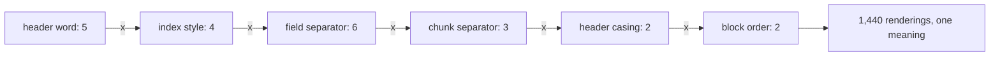
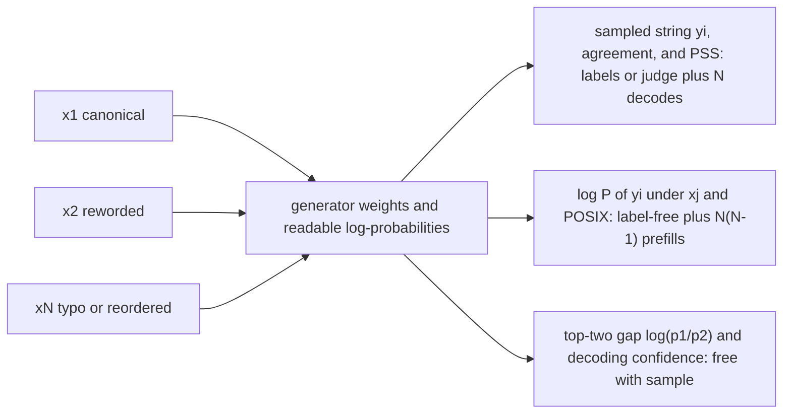
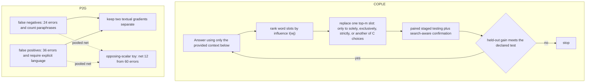

# Chapter 10: Prompt Sensitivity
[00-START-HERE](../00-START-HERE.md) · [01-READING-ROUTES](../01-READING-ROUTES.md) · [09\_prompting\_for\_retrieval\_augmented\_systems](09_prompting_for_retrieval_augmented_systems.md) · [11\_abstention\_and\_calibration](11_abstention_and_calibration.md)
This chapter explains how meaning-preserving prompt changes can alter Retrieval-Augmented Generation (RAG), how to measure the effect, and how to make defensible template and optimization decisions.
## TL;DR
- Six meaning-free wrapper choices create $`1{,}440`$ renderings of one request. Published spreads reach 76 accuracy points, so prompt format is a tuned system parameter.
- A single score measures one wrapper; it is a draw over formats only if that wrapper was randomly sampled. Compare retrievers only after controlling or independently optimizing the format for each arm.
- The prompt sensitivity index (POSIX) measures how much an answer’s log-likelihood moves across equivalent prompt variants. It needs no correctness labels.
- Available token scores can be a low-overhead warning signal. A small top-two logit gap permits a flip under a sufficiently directed perturbation; it does not predict the rewrite’s actual effect.
- Sensitivity can rank candidate prompts, but it cannot certify correctness. A generator can trust a wrong retrieved passage and stay confidently wrong under every rewrite.
- In-format examples reduce sensitivity more than model scale or ordinary instruction tuning. They still do not eliminate the spread, and they consume context and key-value cache capacity.
- Prompt optimization needs a restricted search, paired comparisons, staged allocation, and held-out confirmation. Otherwise selection noise can fully explain a reported gain.
## The story
Imagine a restaurant where a pantry runner retrieves the ingredients and a chef prepares the answer. The order ticket is the prompt. The retrieved chunks are the ingredients placed beside that ticket. The wrapper is the ticket layout, including its header, numbering, separators, casing, and where the cooking instruction appears.
Two tickets can request the same meal but use different boxes and punctuation. The chef still sees different marks in different positions. That is why an identical request can produce a different dish.
The manager first lists every harmless ticket layout. Six layout choices multiply into $`1{,}440`$ tickets for one meaning. The manager treats the winning layout as a kitchen setting, not as decoration. The manager also checks whether the finished plate follows the required serving format, because an unreadable plate fails even when its food is correct.
Labels are slow, so the manager needs a faster fragility test. For each equivalent ticket, the chef exposes how strongly it prefers the dish it produced. POSIX compares those preference scores across tickets. Large movement means the chef depends heavily on ticket layout.
The top-two choice gap is another clue. A chef barely choosing soup over salad can flip after a tiny layout change. A chef with a wide preference gap needs a larger change. The manager must not confuse steadiness with correctness. If the pantry runner supplies the wrong ingredient, the chef can prepare the wrong dish with complete confidence every time. Sensitivity therefore helps rank ticket layouts, but a groundedness or labeled check must still inspect the meal.
The kitchen can pin a few correctly filled sample tickets beside the station. Those in-format examples show the chef how this exact layout maps to an answer. A larger kitchen or more general training can improve average cooking, but neither directly teaches indifference to ticket layout. The examples narrow the spread, though they use counter space and eventually add less help.
Finally, an optimizer edits the ticket wording. It changes one influential word slot at a time because every-word combinations are too numerous to search. The manager tastes candidate dishes on the same orders, advances only clear winners, and confirms the survivor on untouched orders. The manager also puts overly inclusive and overly exclusive mistakes in separate trays. Mixing those trays gives the editor opposing instructions that cancel.
The lesson stays consistent across the kitchen. Control the ticket, measure the chef’s reaction, inspect the retrieved ingredients, and distrust any winner selected on the same tasting set that created it.
## Decoder table


| Technical term | Plain-English meaning | Why it matters |
| --- | --- | --- |
| Retrieval-Augmented Generation (RAG) | A system that retrieves passages and gives them to a generator | Prompt format can change how the generator uses the retrieved evidence |
| Prompt | The token sequence that asks the generator to act | The model consumes exact tokens, not only human meaning |
| Prompt template | Reusable text and structure around each request | It must be versioned and evaluated like any other configuration |
| Context wrapper | The headers and separators around retrieved chunks | Meaning-free wrapper edits can move accuracy and parse rate |
| Retrieved chunk | A passage supplied as evidence | Its placement and wrapper affect the generator’s token context |
| Meaning-preserving format | A different spelling or layout with the same intended request | It isolates sensitivity to form rather than task meaning |
| Format family $`F`$ | The complete set of allowed equivalent renderings | Accuracy should be viewed across this family, not at one arbitrary member |
| Format grammar | Independent slots and choices that generate prompt variants | It turns prompt formatting into a countable search space |
| FormatSpread | A tool that enumerates meaning-preserving prompt formats | Its reported spreads show that formatting effects can be very large |
| Token | One model input unit | Equivalent human text can become different token sequences |
| Tokenization | Conversion from text into token identifiers | A format change can alter length, position, and all later computation |
| Activation | A model’s internal numeric state | Equivalent meanings need not create equivalent states |
| Key-value set | Attention memory created from earlier tokens | Retokenization changes what later tokens attend to |
| Residual stream | The evolving internal representation at each position | Format changes can move computation into a different region |
| Pre-training | Learning next-token likelihood from a corpus | It matches observed format frequencies and does not enforce format invariance |
| Instruction tuning | Training on instruction and response pairs | It improves instruction following but normally shows one rendering per instruction |
| Invariance | Equal behavior under meaning-preserving changes | Standard objectives do not explicitly require it |
| Low-density format | A format that appeared rarely in training data | Behavior there can be less smooth |
| Hyperparameter | A configuration chosen outside learned weights | The context wrapper can have a larger effect than many retriever changes |
| Accuracy $`A(f)`$ | Correctness under format $`f`$ | One reported value is a draw from the format family |
| Parse rate | Share of outputs that a parser can read | End-to-end quality can fall even when parsed-answer accuracy looks stable |
| Valid-response rate | Share of outputs that follow the required output form | It must be logged beside correctness |
| Regular expression | A text pattern used to extract fields such as citations | Format changes can break extraction without changing answer content |
| Exhaustive grid | Evaluation of every candidate format | It is reliable but can be expensive |
| Successive halving | Repeatedly test candidates and keep only the strongest fraction | It cuts format-search cost while preserving a small finalist set |
| Search split | Examples used to rank candidates | Reusing it for final proof creates selection bias |
| Held-out split | Untouched examples used only for confirmation | It is the clean fix for the winner’s curse |
| Winner’s curse | Inflation caused by selecting the best noisy score | Best-of-many gains can vanish on fresh data |
| Standard error | Expected sampling variation in an estimated score | It sets the noise floor for a claimed gain |
| Selection floor | A leading best-of-many noise scale under a stated model | Not an acceptance test or guaranteed lower bound |
| Paired test | Comparison on the same examples for both systems | Only discordant outcomes carry the difference signal |
| Per-arm maximum | Best score after tuning each system separately | It is the fair target when formats interact with retrievers |
| Generator | The model that writes the answer | Its model family and tokenizer determine format preferences |
| Open-weight model | A generator whose weights can be run and scored directly | It enables teacher-forced log-likelihood evaluation |
| Hosted generator | A model accessed through a vendor service | Missing token probabilities can block POSIX computation |
| Application programming interface (API) | A service boundary for model calls | Its probability access determines available monitors |
| Variation operator | A rule that creates equivalent prompt variants | The chosen family defines what sensitivity means |
| Output agreement | How often variants produce the same answer | It is easy to understand but discards probability margins |
| Exact match | Equality only when answer strings are identical | It is too brittle for free-form grounded answers |
| Embedding threshold | A similarity cutoff for deciding whether answers match | It is not a complete equality rule for grounded answers |
| Log-likelihood | The model’s score for an entire answer under a prompt | Its movement across variants is the core sensitivity signal |
| Ordered pair | A source prompt and target prompt where direction matters | Canonical-to-typo and typo-to-canonical scoring can differ |
| Prompt sensitivity index (POSIX) | Average absolute per-token log-likelihood shift across ordered prompt pairs | It measures distributional consistency without correctness labels |
| Prompt sensitivity score (PSS) | An instance-level score built from correctness or judge-score differences across prompt variants, which ProSA pairs with decoding confidence (corrected from an instance-level sensitivity score paired with generation confidence) | It exposes risky queries that a dataset mean can hide, but it needs labels or a judge |
| Decoding confidence | Strength of the model’s emitted-token preferences | More confident generations tend to be more consistent under rewording |
| Logit | An unnormalized score before token probabilities | Top-two logit distance is the flip barrier |
| Argmax | The option with the largest score | The answer changes when perturbation crosses the winner’s margin |
| Top-two gap | Log ratio between the two leading token probabilities | A small gap means higher fragility |
| Mean per-token log-probability | Average emitted-token log score | Often cheap to expose on an owned stack, but not universally free or available |
| Nat | A log-likelihood unit using natural logarithms | It gives prompt drift and decoding margin shared units |
| Teacher-forced scoring | Scoring a supplied continuation token by token | POSIX needs it for answers not sampled from the scoring prompt |
| One-sided sensitivity | Score one canonical answer under the rewrites | It is much cheaper but misses reverse-direction effects |
| Full POSIX matrix | Score every variant answer under every other variant | It preserves asymmetry at higher compute cost |
| Prefill | Parallel processing of prompt and supplied answer tokens | POSIX rescoring mostly uses this cheaper phase |
| Decode | Sequential generation of new tokens | It is slower per token for the worked hardware case |
| bfloat16 (bf16) | A 16-bit numeric format for model weights and compute | It sets the worked memory and throughput arithmetic |
| Graphics processing unit (GPU) | Hardware used to run the generator | Compute time and memory set evaluation cost |
| Floating-point operation (FLOP) | One arithmetic operation used in compute accounting | Prefill cost is estimated from parameter and token counts |
| Trillion floating-point operations per second (TFLOP/s) | A compute throughput rate | It converts prefill work into time |
| Memory bandwidth | Rate at which weights can be read | It bounds decode speed in the worked example |
| Operations-to-byte ratio | Compute rate divided by memory bandwidth | It checks the maximum prefill-to-decode speed gap |
| Label-free proxy | A measurable signal used without gold correctness labels | It can reduce labeling, but it cannot replace correctness evidence |
| Correlation $`\rho`$ | Linear association between sensitivity and accuracy | A negative value supports ranking but leaves residual error |
| Absolute correlation $`r`$ | Magnitude of the sensitivity-accuracy correlation | It controls ranking accuracy and captured oracle gain |
| Best linear prediction | Accuracy estimate derived from sensitivity and correlation | Its residual shows why sensitivity is not an accuracy meter |
| Residual standard deviation | Accuracy variation left after using the proxy | It quantifies uncertainty that the proxy cannot remove |
| Gaussian copula | A joint model used to connect correlation with rank agreement | It yields the pairwise ordering probability in the chapter |
| Kendall’s tau | A rank association measure | It turns correlation into expected pairwise ranking accuracy |
| Confident error | A stable, high-margin answer that is wrong | Sensitivity can mark it safe even when retrieval misleads the generator |
| Retrieved distractor | A fluent but wrong passage used as evidence | It can make a wrong answer both grounded-looking and stable |
| Self-consistency | Agreement among repeated samples from one fixed prompt | It measures sampling variation, not prompt variation |
| Temperature | A control on sampling randomness | Temperature zero can be self-consistent while still format-sensitive |
| Mean accuracy over formats | Average accuracy across the format family | Scale and instruction tuning can lift it |
| Variance over formats | Accuracy spread across equivalent renderings | Prompt robustness is a claim about this quantity |
| Few-shot prompting | Adding solved examples to the prompt | In-format examples supply a local pattern that narrows sensitivity |
| In-format demonstration | A solved example using the live wrapper exactly | Matching typography is part of the proposed mechanism |
| Copy mechanism | Attention from a current pattern to earlier matching patterns | It adds evidence for the demonstrated continuation |
| Local prior | Pattern evidence placed in the current prompt | It replaces dependence on how common that typography was in training |
| Softmax attention | Normalized attention over available context | Does not alone prove diminishing accuracy benefit or constant per-demo margin gains |
| Key-value (KV) cache | Stored attention state for prompt tokens | More demonstrations reduce concurrency unless the prefix is shared |
| Prefix cache | One stored KV state reused for a shared prompt prefix | It can remove most repeated cache cost for fixed demonstrations |
| Grouped-query attention | Attention with fewer key-value heads than query heads | It can reduce KV bytes per token |
| Low-Rank Adaptation (LoRA) | A cheaper parameter adaptation method | It lowers instruction-tuning cost but still optimizes the wrong robustness statistic |
| Automatic prompt optimization | Programmatic search over prompt wording | Search gains depend on proposal restrictions and accept tests |
| COPLE | A black-box framework for combinatorial optimization over a prompt’s lexicon | It makes exponential word choices tractable through coordinate moves and influence ranking |
| Lexicon | The allowed word choices in a prompt | Its size determines the raw combinatorial space |
| Coordinate move | Change one word slot while holding all others fixed | It gives credit assignment but misses word interactions |
| Coordinate-wise local optimum | A prompt no single allowed word replacement improves | COPLE can reach this result but cannot claim a global optimum |
| Leave-one-out influence | Score change after removing one word | It ranks word slots before spending on replacements |
| Proxy-task score | Noisy development-set objective used during search | Its noise floor can dominate reported gains |
| Accept rule | Test that decides whether a candidate replaces the incumbent | It determines whether improvements survive held-out evaluation |
| Best-arm identification | Allocate more evaluation to promising candidates | It reduces the cost of selecting a winner |
| ProTeGi (Prompt Optimization with Textual Gradients) | A method that uses textual feedback and staged candidate evaluation | Its best-arm step supports disciplined prompt search |
| Textual gradient | Natural-language critique that suggests an opposite prompt edit | It converts error examples into an edit direction |
| Minibatch | A small sample of errors used for feedback | Pool composition can cancel opposing signals |
| False positive | A negative case incorrectly classified as positive | Its critique calls for a stricter instruction |
| False negative | A positive case incorrectly classified as negative | Its critique calls for a more inclusive instruction |
| P2G | A method that keeps opposing error pools as separate improvement directions | It prevents false-positive and false-negative feedback from canceling |
| Pooled critic | One critique written from mixed error types | Opposing corrections can shrink its useful signal to zero |
| Credit assignment | Knowing which edit caused a score change | Whole-prompt rewrites obscure it |
| Semantic drift | An edit that quietly changes the task meaning | It can create a false proxy-set win |
| APE (Automatic Prompt Engineer) | A named whole-prompt rewriting approach | It can escape a coordinate basin but loses per-edit attribution |
| OPRO (Optimization by PROmpting) | A named whole-prompt rewriting approach | It shares the higher-variance accept-test problem of free-form rewriting |


## Core mechanics
### Mathematical conventions
Use natural logarithms and nats for probabilities; percentages of accuracy changes are percentage points unless explicitly relative. Distinguish population accuracy $`A_R(f)`$ from its sample estimate $`\widehat A_R(f)`$. Search and confirmation splits are separate; maxima selected on development data are not unbiased test scores. Compute examples use idealized $`2NT`$ prefill at $`156\times10^{12}\,\mathrm{FLOP\,s^{-1}}`$ and a one-weight-read decode proxy at $`2\,\mathrm{TB/s}`$; these are not measured latency, throughput or complete invoices. Attention, cache traffic, utilization, interconnect, queuing and runtime buffers are omitted. Storage is decimal unless marked binary. A teacher-forced answer score is not a bound on the change of a competing next-token logit gap. Round only after calculation.
### 10.1 How much formatting alone moves accuracy
#### Count the format family
- **What:** Decompose the context wrapper into independent choices.
- Headers are Document, Passage, Context, Source, or Excerpt. Indices are 1, 01, \[1\], or (a). Field separators are colon-space, colon-newline, space-hyphen-space, bare newline, space-pipe-space, or space-double-colon-space. Chunk separators are one newline, two newlines, or a horizontal rule. Header casing and instruction position each have 2 choices.
- Their product is $`1{,}440`$ renderings of one meaning.
- **Why:** The count makes the supposedly cosmetic format a real search space.
- **Failure without it:** A team treats one inherited string as neutral and attributes its effect to the retriever or model.
- **Cost or complexity:** The raw family is small enough for a grid once, but not cheap enough to repeat carelessly on every release.

```math
\lvert F\rvert=5\times4\times6\times3\times2\times2=1{,}440.
```

#### Explain the mechanism
- **What:** A format change retokenizes the prompt.
- Different token lengths move later positions, attention inputs, and residual-stream states.
- Pre-training assigns likelihood according to corpus frequency.
- It does not supply an operator that makes equivalent renderings identical.
- **Why:** This explains why typography can change behavior even when human meaning stays fixed.
- **Failure without it:** Engineers assume model scale or instruction tuning must remove the effect.
- **Cost or complexity:** The effect persisted in LLaMA-2-70B and GPT-3.5. No single format won across models.
#### Preserve the observed claim limits
- Sclar et al. (2024) measured a worst-to-best spread of up to 76 accuracy points on one LLaMA-2-13B task.
- A Japanese-template study reported GPT-4 moving from roughly $`49\%`$ to $`25.44\%`$ under a meaning-preserving restructure.
- The chapter reports worse robustness for less-studied languages than for English.
- These findings establish large possible effects.
- They do not make every observed four-point change real.
#### Treat accuracy as format-indexed
- **What:** Report accuracy as $`A(f)`$, where $`f`$ identifies the wrapper.
- A fixed $`A(f_0)`$ is one format-specific population value; its measured estimate has sampling uncertainty. It is a random draw over formats only if $`f_0`$ is randomly selected under a specified format distribution.
- A shared $`f_0`$ comparison estimates the difference at that one format.
- A tuned comparison searches each arm with a declared, comparable budget and evaluates the selected wrappers on untouched test data.
- **Why:** A retriever change alters the context content and can alter which wrapper works best.
- **Failure without it:** Format noise can be larger than the retriever delta.
- **Cost or complexity:** Separate format searches cost one sweep per arm. Fixing $`f_0`$ is cheaper, but then the format and its spread must be published.
The same retrieval system can get different accuracy scores depending on how its prompt is formatted. So accuracy should be written as $`A(f)`$, where $`f`$ identifies the prompt wrapper—for example, its headers or separators. A score measured with one wrapper, $`f_0`$, is just one result for that format, not a format-independent measure of the system.
The first formula compares two retrievers using the **same fixed wrapper**:

```math
\widehat\Delta_{f_0}=\widehat A_{R_1,\mathrm{test}}(f_0)-\widehat A_{R_2,\mathrm{test}}(f_0).
```

That tells you which retriever scored higher under *that particular* format. It does not necessarily tell you which retriever can perform better overall, because changing the retrieved content may also change which wrapper works best.
The next equations distinguish the population-optimal wrapper from a development-selected wrapper evaluated on held-out data:

```math
\begin{aligned}
f_R^\star&\in\mathop{\mathrm{arg\,max}}_{f\in F}A_R(f),\\
\Delta^\star&=A_{R_1}(f_{R_1}^\star)-A_{R_2}(f_{R_2}^\star),\\
\widehat f_R&=\mathop{\mathrm{Search}}\nolimits(R,F;\mathcal D_{\mathrm{dev}},B),\\
\widehat\Delta_{\mathrm{tuned}}&=\widehat A_{R_1,\mathrm{test}}(\widehat f_{R_1})-\widehat A_{R_2,\mathrm{test}}(\widehat f_{R_2}).
\end{aligned}
```

A tuned-system comparison is appropriate when both systems are allowed to choose their wrappers. Match the search budget and search family, then report held-out performance of each selected wrapper. Taking the largest noisy score on the same test set is not a fair confirmation. A shared fixed-wrapper experiment answers a different, valid question.

```math
\widehat\Delta_{f_0}=\widehat A_{R_1,\mathrm{test}}(f_0)-\widehat A_{R_2,\mathrm{test}}(f_0).
```


```math
\begin{aligned}
f_R^\star&\in\mathop{\mathrm{arg\,max}}_{f\in F}A_R(f),\\
\Delta^\star&=A_{R_1}(f_{R_1}^\star)-A_{R_2}(f_{R_2}^\star),\\
\widehat f_R&=\mathop{\mathrm{Search}}\nolimits(R,F;\mathcal D_{\mathrm{dev}},B),\\
\widehat\Delta_{\mathrm{tuned}}&=\widehat A_{R_1,\mathrm{test}}(\widehat f_{R_1})-\widehat A_{R_2,\mathrm{test}}(\widehat f_{R_2}).
\end{aligned}
```

#### Search efficiently and control selection bias
- Use successive halving on development data, then confirm the selected wrapper on untouched questions.
- A full $`1{,}440\times500`$ grid uses $`720{,}000`$ generations. At $`1{,}400`$ input tokens at $`\$0.60`$ per million and $`120`$ output tokens at $`\$2.40`$ per million, one generation costs $`\$0.001128`$, totaling $`\$812.16`$.
- Charging each stage in full, $`1{,}440(20)+360(40)+90(80)+22(160)+5(500)=56{,}420`$ generations, or $`7.836111\%`$ of the grid and $`\$63.64176`$.
- These are search costs; untouched confirmation, labels and additional search are extra. Reused scores need separate incremental accounting.
#### Read the worked result correctly
- The search observes $`71.2\%`$ best, $`52.8\%`$ worst and $`64.0\%`$ incumbent: an $`18.4`$-percentage-point range and $`7.2`$-point development gain.
- Near $`p=0.64`$ on $`n=500`$ independent questions, one-arm $`\mathop{\mathrm{SE}}\nolimits=\sqrt{0.64(0.36)/500}\approx0.021466`$, or $`2.1466`$ points.
- The heuristic $`\sigma\sqrt{2\ln F}`$ gives about $`8.19`$ points for $`F=1{,}440`$. For independent Gaussian errors it is a leading extreme-value approximation and an upper scale for expected maxima, not an exact bias, a minimum required gain, or a universal bound for these correlated bounded scores.
- Correlation and score heterogeneity change selection bias; correlation alone does not justify a guaranteed smaller value without a joint model.
- A four-point difference cannot be declared significant or insignificant by comparing it with one arm's standard error. Use paired discordances, search-aware selection accounting, and untouched confirmation before rollback or release.
#### Own the full output contract
- **What:** Log valid-response rate $`v`$ and accuracy conditional on a valid response $`a`$.
- **Why:** If invalid responses count as failures, end-to-end correctness is $`A_{\mathrm{service}}=va`$.
- **Failure without it:** A $`0.02`$ loss in conditional accuracy and a $`0.05`$ loss in validity change service accuracy by $`va-(v-0.05)(a-0.02)=0.02v+0.05a-0.001`$, not automatically $`0.07`$. For $`v=0.95`$ and $`a=0.80`$, the loss is $`0.058`$, or $`5.8`$ points.
- **Cost or complexity:** Log the joint counts and define the denominator; parsing accuracy measured over all requests is a different metric.
#### Practical decision rule
- Version the template with measured accuracy, parse rate, and an owner.
- Search again after a generator, version, vendor, or tokenizer change.
- Use exhaustive search only when the family is under about 50 candidates.
- Report each system as the best format searched over $`F`$.
- If transfer matters, test the old top 5 plus 20 random formats on the new model.
- Keep the old winner only if it lands in the new top quintile under the stated tie-breaker. A shared tokenizer and shared instruction-tuning lineage favor transfer, but do not prove it.
### 10.2 Measuring sensitivity with POSIX, PSS, and decoding confidence
#### Replace agreement with probability movement
- **What:** Build $`N`$ intent-preserving variants for each query.
- Variants can include a paraphrase, typo, option reorder, or wrapper-header change.
- Agreement decodes all $`N`$ variants and asks whether their outputs match.
- POSIX instead measures how the generated answer’s log-likelihood moves under other variants.
- **Why:** Likelihood movement adds information beyond exact agreement, but average sequence movement is not a distance-to-flip guarantee.
- **Failure without it:** Exact match and embedding thresholds do not provide a reliable equality rule for free-form grounded answers.
- Agreement also treats a one-nat margin and a twenty-nat margin as equally stable if both emitted strings match.
- **Cost or complexity:** Agreement needs $`N`$ full decodes. POSIX needs decodes plus cheaper teacher-forced scoring passes.
#### POSIX definition and design choices
- **What:** Generate response $`y_i`$ from prompt $`x_i`$. Chatterjee et al. (2024) call the resulting index POSIX.
- Score $`y_i`$ under every other $`x_j`$.
- Take the absolute log-likelihood ratio.
- Divide by answer length.
- Average over all ordered pairs.
- **Why:** Absolute value prevents opposing shifts from canceling.
- Length normalization reports nats per token rather than rewarding short answers.
- Ordered pairs preserve directional asymmetry.
- **Failure without it:** A variant that raises one answer’s likelihood and lowers another’s can average to false calm.
- **Cost or complexity:** The full matrix uses $`N(N - 1)`$ scoring passes after $`N`$ generations.

```math
\mathop{\mathrm{POSIX}}\nolimits=\frac1{N(N-1)}\sum_{i=1}^N\sum_{j\ne i}
\frac1{\lvert y_i\rvert}\left\lvert\ln\frac{P(y_i\mid x_j)}{P(y_i\mid x_i)}\right\rvert,
\qquad N\ge2,\quad\lvert y_i\rvert\gt 0.
```

- A $`40`$-token response moving from total log likelihood $`-12.0`$ to $`-13.6`$ contributes $`1.6/40=0.040\,\mathrm{nats/token}`$. Probabilities must be positive or scores need an explicit zero-probability convention.
#### Connect sensitivity to the decoding margin
- **What:** Let $`p_1`$ and $`p_2`$ be the top two next-token probabilities.
- Their logit gap is $`\log(p_1 / p_2)`$.
- For top-two logit gap $`\Delta\gt 0`$, if every logit changes by at most $`\varepsilon`$ and $`2\varepsilon\lt \Delta`$, the top token cannot change. A small gap permits, but does not guarantee, a flip; a third token can also overtake the original winner.
- **Why:** Drift and margin now share units.
- **Failure without it:** A raw agreement bit discards how close the answer was to changing.
- **Cost or complexity:** The logits are computed during decoding, but extracting normalized token scores can require additional access, storage and some computation. This is often cheap on an owned stack, not universally free or exposed by a hosted API.

```math
\Delta z = \log \frac{p_1}{p_2}
```


```math
\bar{\ell}(y) = \frac{1}{|y|} \sum_{t=1}^{|y|} \log p(y_t \mid x, y_{1:t-1})
```

- A confident $`0.90`$ versus $`0.05`$ split has a 2.89-nat barrier.
- A hesitant $`0.35`$ versus $`0.30`$ split has a 0.154-nat barrier.
- The gap ratio is $`\ln18/\ln(7/6)\approx18.75`$. This compares two gaps only if the perturbation changes their competing-logit differences by the same amount; it is not a measured probability of a flip.
#### Use PSS for tails
- **What:** PSS pairs instance-level sensitivity with confidence.
- **Why:** Production failures concentrate in the tail, not necessarily in the mean.
- **Failure without it:** A mean can look calm when $`5\%`$ of queries sit at $`0.09`$ nats per token and the other $`95\%`$ sit at $`0.005`$.
- **Cost or complexity:** Tail quantiles require storing per-query scores, but not new labels. Correction: PSS (PromptSensiScore) from ProSA (Zhuo et al., 2024, arXiv 2410.12405) averages the absolute difference in correctness or LLM-judge score across prompt-variant pairs of one instance, so it needs a label or a judge call for every variant. Only per-query POSIX, which the nats-per-token example above uses, gives label-free tail quantiles.
#### Respect scoring access limits
- **What:** POSIX needs teacher-forced log-likelihood for an arbitrary answer under another prompt.
- **Why:** The score cannot be reconstructed from only the tokens a hosted model chose to emit.
- **Failure without it:** A monitor is designed around a capability the vendor does not expose.
- **Cost or complexity:** Open weights permit direct scoring. Many hosted chat APIs do not provide it.
- A judge model is a fallback only when the generator hides token probabilities.
- A judge-based alternative has its own sensitivity and is not the original likelihood-based POSIX. A full ordered-pair judge design would need $`8(8-1)=56`$ judge calls per query, in addition to answer generation.
#### Price full and one-sided measurement
- The worked $`7`$B bf16 model has $`14\,\mathrm{GB}`$ of weights. At $`156\,\mathrm{TFLOP/s}`$, $`1{,}400`$ input tokens have a $`0.125641\,\mathrm{s}`$ prefill proxy; the weight-bandwidth decode proxy is $`0.84\,\mathrm{s}`$ for $`120`$ tokens. One generation totals $`0.965641\,\mathrm{s}`$.
- A teacher-forced $`1{,}520`$-token score costs $`0.136410\,\mathrm{s}`$ under the same parameter-work proxy.
- Eight variants on $`500`$ queries need $`4{,}000`$ generations, approximately $`3{,}862.56`$ GPU-equivalent seconds, and $`4{,}000`$ correctness judgments if labeled.
- Full POSIX uses $`8`$ generations plus $`56`$ cross-scores: $`15.364103\,\mathrm{s/query}`$, or $`7{,}682.05`$ seconds and $`2.1339`$ GPU-hours for $`500`$ queries.
- One-sided measurement uses one generation plus seven scores: $`1.920513\,\mathrm{s/query}`$, or $`960.26`$ seconds. The full-to-one-sided ratio is exactly $`8`$ for these homogeneous costs.
- One-sided measurement misses some directional effects; escalate when variants disagree or the omitted directions matter. Actual throughput and caching must be measured.
#### Interpret a score without inventing a threshold
- Six absolute ordered-pair shifts summing to $`5.7`$ nats for equal $`40`$-token answers give $`\mathop{\mathrm{POSIX}}\nolimits=5.7/(6\times40)=0.02375\,\mathrm{nats/token}`$.
- If the same average rate applied to $`120`$-token answers, the average absolute sequence-log-likelihood shift would be $`2.85`$ nats. Its exponential is $`e^{2.85}\approx17.29`$, a geometric scale for likelihood-ratio magnitudes, not a bound on every answer.
- This sequence score does not measure the change in the gap between two competing next tokens. Dividing it by a next-token gap does not establish a flip-barrier share or certify stability.
- Compare scores only under matched variants, queries, tokenization, lengths and scoring conventions. Use a separately measured token-gap perturbation for a token-level robustness argument; rebaseline after model or tokenizer changes.
### 10.3 Sensitivity as a label-free performance predictor
#### Separate ranking from measurement
- **What:** Sensitivity $`S`$ and accuracy $`A`$ have a reported strong negative correlation.
- Let $`\rho`$ be their correlation and $`r`$ its absolute value.
- Best linear prediction gives a point estimate and a residual standard deviation.
- **Why:** The residual quantifies what the proxy cannot know.
- **Failure without it:** A team writes that the lowest-sensitivity template is the most accurate without labels.
- **Cost or complexity:** Estimating $`r`$ requires a labeled vertical with the same model, task, and variant family.

```math
\widehat{A} = \mu_A + \rho \frac{\sigma_A}{\sigma_S}(S - \mu_S)
```


```math
\begin{aligned}
\mathop{\mathrm{sd}}\nolimits(A-\widehat A)&=\sigma_A\sqrt{1-\rho^2},\\
Z_A&=\rho Z_S+\sqrt{1-\rho^2}\,\varepsilon
\quad\text{under a standardized joint-Gaussian model}.
\end{aligned}
```

- At $`r = 0.7`$, the residual is $`0.714\,\sigma_A`$.
- This reduces residual standard deviation by $`1-\sqrt{1-0.7^2}\approx28.59\%`$; the fraction of variance explained is $`r^2=49\%`$. Neither quantity is a $`70\%`$ removal of uncertainty.
- If $`\sigma_A`$ is $`4.5`$ points, one residual standard deviation is $`3.2`$ points.
- Under a correctly specified joint-Gaussian population model with known parameters, an illustrative central $`95\%`$ conditional interval is approximately $`\pm6.30`$ points. Fitted-parameter uncertainty, bounded accuracies and selection can change coverage.
#### Convert correlation into ranking quality
- **What:** Under the chapter’s bivariate normal assumption, the Gaussian copula connects correlation to Kendall’s tau.
- The probability of ordering a random pair correctly depends on $`\arcsin r`$.
- **Why:** Ranking only needs the sign of a difference.
- **Failure without it:** The phrase “strong correlation” hides a substantial reversal rate.
- **Cost or complexity:** Even a high $`r`$ leaves some pairs backwards.

```math
\tau = \frac{2}{\pi}\arcsin \rho, \qquad \Pr[\text{correct order}] = \frac{1}{2} + \frac{1}{\pi}\arcsin r
```

- $`r = 0.3`$ gives $`59.7\%`$ pairwise accuracy.
- $`r = 0.5`$ gives exactly two thirds.
- $`r = 0.7`$ gives $`74.7\%`$.
- $`r = 0.9`$ gives $`85.6\%`$, so about one pair in seven is still backwards.
#### Explain the correlation and its blind quadrant
- **What:** Sensitivity and correctness both depend partly on decoding margin.
- Small margins can make tokens easier to flip under a specified perturbation, but the connection with correctness is empirical, not a mathematical consequence of the margin.
- **Why:** A shared cause explains the negative correlation.
- **Failure without it:** The proxy is mistaken for the target variable.
- A retrieved distractor can create a wide-margin wrong answer.
- That answer stays stable under paraphrases, reorders, and typos.
- Low sensitivity therefore covers both confidently correct and confidently wrong answers.
- **Cost or complexity:** Pair sensitivity with a check that reads the retrieved evidence, plus labels on the finalist slice.
#### Do not substitute self-consistency
- **What:** Self-consistency samples repeatedly from one fixed prompt.
- Prompt sensitivity changes the prompt while holding the requested meaning fixed.
- **Why:** They probe different sources of variation.
- **Failure without it:** Temperature zero appears perfectly self-consistent while formatting can still move accuracy by 76 points.
- **Cost or complexity:** Sampling $`k`$ completions adds $`k`$ decodes and still does not isolate wrapper sensitivity.
#### Use a shortlist-then-label protocol
- Six templates on $`500`$ queries require $`3{,}000`$ correctness judgments. At two minutes each this is $`100`$ expert-hours or $`\$3{,}000`$ at $`\$30`$ per hour. Nine elapsed days is a staffing assumption, not a consequence of those hours.
- Reusing the one-sided cost above, ranking all six costs $`5{,}761.54`$ GPU-equivalent seconds, $`1.6004`$ GPU-hours and $`\$4.0011`$ at $`\$2.50`$ per hour; this replaces the inconsistent $`\$3.20`$ later value.
- Under six IID joint-Gaussian template pairs, $`r=0.7`$ and $`\sigma_A=4.5`$ points, the expected oracle gain is $`4.5\times1.2672\approx5.70`$ points, and choosing the best proxy captures $`r`$ times that expectation, about $`3.99`$ points. This is a model-based expectation, not an observed launch gain.
- The $`15`$ template pairs have expected $`11.20`$ correctly ordered and $`3.80`$ reversed under that model; pair events need not be independent for this expectation.
- Labeling $`200`$ paired questions for two finalists costs $`400`$ judgments, $`13.33`$ hours and $`\$400`$. The labor ratio is $`13.33\%`$; elapsed time depends on staffing.
- With $`30`$ discordances among $`200`$ paired binary outcomes, the plug-in SE is $`\sqrt{30/200-\widehat\Delta^2}/\sqrt{200}`$, at most $`2.739`$ points; the win/loss split is needed for an exact value. Budget confirmation uncertainty, not just label count.
#### Practical decision rule
- Use sensitivity to shortlist and labels to decide.
- Report a rank such as “lowest sensitivity of six candidates.”
- Do not publish predicted accuracy from sensitivity alone.
- Ship on sensitivity alone only when the residual cannot change the decision.
- Estimate $`r`$ on a labeled vertical before transferring it. Fix the candidate count $`F`$ before looking at the scores.
- Re-estimate $`r`$ after any generator change.
- Pair the monitor with a groundedness check for confident errors.
### 10.4 Few-shot beats scale for reducing sensitivity
#### Name the statistic being optimized
- **What:** Accuracy across formats has a mean and a variance.
- Scale and ordinary instruction tuning target expected likelihood and tend to lift mean accuracy.
- Prompt robustness concerns variance over the meaning-preserving format family.
- **Why:** The three candidate interventions do not act on the same statistic.
- **Failure without it:** A team buys a 10-times larger serving bill to solve a variance problem the objective never names.
- **Cost or complexity:** Measuring variance requires evaluating a format family rather than one leaderboard prompt.

```math
\mu_M = \mathbb{E}_{f \sim F}[A_M(f)]
```


```math
\sigma_M^2 = \mathop{\text{Var}}_{f \sim F}[A_M(f)]
```

#### Why scale and standard instruction tuning do not impose invariance
- **What:** Pre-training minimizes expected negative log-likelihood under observed corpus frequencies.
- Standard instruction tuning keeps cross-entropy and swaps in instruction-response data.
- Neither objective normally ties two renderings of one request to the same output distribution.
- **Why:** A missing constraint receives no direct gradient.
- **Failure without it:** Better average accuracy is reported as format robustness.
- **Cost or complexity:** Sclar et al. found formatting spread persisting from 13B to 70B and into GPT-3.5.
- GPT-4 was reported as more robust than smaller models while still sensitive.
- Format preferences did not transfer across model families.
#### Why in-format demonstrations help
- **What:** Put $`k`$ solved examples in the exact live wrapper before the query.
- Attention can match the current pattern to prior examples and add evidence to the demonstrated continuation.
- Model each demonstration as adding $`g`$ nats to the top-two margin.
- **Why:** The prompt supplies a local typography prior that does not depend on corpus frequency.
- **Failure without it:** A demonstration rendered in a different wrapper uses context without supplying the intended pattern match.
- **Cost or complexity:** The constant-$`g`$ equation is a local toy model, not a law of attention. A saturating model would instead use $`\Delta z(k)=\Delta z_0+\sum_{i=1}^k g_i`$ with diminishing $`g_i`$; attention normalization alone does not prove this pattern.

```math
\Delta z(k) = \Delta z_0 + kg
```

- For the illustrative constant-gain equation, $`\Delta z_0=0.154`$ and $`g=0.35`$ give gaps $`0.154,0.504,0.854,1.554,2.954`$ nats at $`k=0,1,2,4,8`$.
- These assumed gaps are not measured effects of adding examples. The $`0.02375`$ POSIX average cannot be used as a competing-logit perturbation, so the former $`15.5\%`$ to $`0.81\%`$ “barrier shares” do not establish robustness.
- Compare measured next-token gap changes under rewrites if that is the desired claim. The cited few-shot result concerns empirical sensitivity; it is not proved by this additive toy equation.
#### Price the three interventions
- **Scale to **$`70`$**B:** bf16 weight payload is $`140\,\mathrm{GB}`$. Two equal shards stream $`70\,\mathrm{GB}`$ per token each, giving $`35\,\mathrm{ms/token}`$ and $`4.2\,\mathrm{s}`$ for $`120`$ tokens under ideal bandwidth and no communication overhead. This is $`5`$ times decode latency and $`10`$ times GPU-seconds for decode only, not a measured end-to-end multiplier or proof that all runtime state fits.
- **Instruction-tune **$`7`$**B:** $`50{,}000\times1{,}500=75\times10^6`$ processed tokens for one epoch give $`3.15\times10^{18}\,\mathrm{FLOP}`$, or $`5.609`$ GPU-hours at the stated compute rate. More epochs multiply work. LoRA savings and serving overhead are method-dependent; merged adapters can avoid extra inference projections.
- **Four demonstrations:** $`1{,}000`$ extra tokens increase the prefill proxy from $`0.125641`$ to $`0.215385\,\mathrm{s}`$ and the total from $`0.965641`$ to $`1.055385\,\mathrm{s}`$, an increase of approximately $`9.293\%`$. KV capacity and attention overhead are additional constraints.
This section compares three ways to improve a model, focusing on their costs:
- **Use a much larger model (70B parameters):** In the stated 16-bit format, its weights need about $`140\,\mathrm{GB}`$ of memory—too much for one $`80\,\mathrm{GB}`$ GPU. Using two GPUs makes it possible, but each generated token takes longer: about 35 milliseconds instead of 7. For a 120-token answer, that’s $`4.2`$ seconds of generation instead of $`0.84`$ seconds. The decode-only proxy is five times longer and uses two GPUs, so decode GPU-seconds are ten times higher; complete request latency and cost require prefill and communication accounting.
- **Instruction-tune the 7B model:** This means further training the existing model on examples of instructions and good responses. The estimate assumes $`50{,}000`$ examples, each about $`1{,}500`$ tokens long. For one epoch this is about $`5.609`$ GPU-hours under the compute proxy. LoRA compute savings depend on the method; serving projection work can remain unchanged after a compatible adapter is merged, but quality and runtime overhead still need measurement.
- **Add four examples to each prompt:** These “demonstrations” show the model examples of the desired input-and-answer pattern. Four 250-token examples add $`1{,}000`$ tokens to every prompt. Processing that longer input raises the prompt-reading time, called *prefill*, from $`0.126`$ to $`0.215`$ seconds. Overall request time rises from $`0.97`$ to $`1.06`$ seconds, about $`9\%`$.
**Main trade-off:** A larger model is much more expensive to run; tuning costs extra upfront but leaves per-request serving cost unchanged; examples in the prompt are relatively cheap in latency here, but add work to every request. These figures are estimates under the hardware and workload assumptions in the passage.[1](10_prompt_sensitivity.md)
#### Account for KV cache and concurrency
- A standard $`32`$-layer, $`4{,}096`$-wide $`7`$B attention model with two-byte KV values uses $`2\times32\times4{,}096\times2=524{,}288\,\mathrm{B/token}`$ of KV payload.
- With an idealized $`66\,\mathrm{GB}`$ cache-only budget, prompt-only capacity is $`\lfloor66\times10^9/(1{,}400\times524{,}288)\rfloor=89`$ requests versus $`52`$ at $`2{,}400`$ tokens, a $`41.57\%`$ reduction in those integer capacity estimates.
- Reserving the $`120`$ output tokens changes those ceilings to $`82`$ and $`49`$, respectively. Runtime buffers, allocator behavior and caches reduce usable memory further.
- This is a KV-residency bound, not a guaranteed throughput reduction. Batch scheduling and the bottleneck determine throughput. Prefix sharing can alter the memory budget substantially.
- The stated $`70`$B GQA architecture uses $`2\times80\times8\times128\times2=327{,}680\,\mathrm{B/token}`$ across the model, before sharding and overhead.
#### Practical decision rule
This passage says that adding examples to a prompt has a **memory cost**, not just a time cost. Each request needs memory to hold its growing context while the model works.
- **KV cache** is the model’s working memory for tokens it has already processed. In the 7B example, each token takes about $`0.524\,\mathrm{MB}`$ of that memory.
- With $`66\,\mathrm{GB}`$** available**, the system can handle about **89 simultaneous requests** at $`1{,}400`$ tokens each. Adding demonstrations increases prompts to $`2{,}400`$ tokens, reducing capacity to **52 simultaneous requests**. That is about a $`41.57\%`$ reduction in prompt-only cache slots, not a throughput measurement. Reserving $`120`$ output tokens gives $`82`$ versus $`49`$ slots; runtime overhead can reduce both.
- The suggested workaround is to put fixed demonstrations **before** the retrieved passages. Since that shared prefix is identical across requests, a **prefix cache** may let the system reuse its stored working memory instead of rebuilding it each time.
- The 70B example uses less cache per token—$`0.328\,\mathrm{MB}`$—because its attention setup stores fewer key-value heads. “70B” describes the model’s parameter count; it doesn’t mean every part of its memory use is larger.
In short: examples can make prompts more robust, but longer prompts can reduce how many requests the system handles concurrently. The figures are estimates under the passage’s stated setup.
- Spend the first robustness budget on two to four in-format demonstrations.
- Start at $`k = 4`$ and measure sensitivity against prompt tokens.
- Do not jump directly to $`k = 16`$ because marginal gains shrink.
- Use scale when the failure is missing knowledge or reasoning depth.
- Few-shot cannot recover an answer document that retrieval never supplied.
- Keep demonstrations byte-identical to the live wrapper.
- Place a fixed block before retrieved chunks for prefix caching. Select demonstrations per query only when task diversity justifies losing that cache.
- Re-measure after a model swap instead of carrying $`k`$ forward.
- When trading examples for retrieved chunks, score grounded accuracy and sensitivity for both arms.
This passage gives practical advice for making prompts more robust without letting examples crowd out useful context or reduce system capacity.
- **Start with two to four examples that use the exact same format as the live prompt.** These examples show the model how to handle the task in the specific layout it will see. The suggested starting point is **four**; then measure whether adding robustness is worth the extra prompt tokens.
- **Don’t assume more examples always help.** The benefit tends to taper off, while longer prompts use more context and memory. So jumping straight to 16 examples may add cost for relatively little improvement.
- **Choose the fix that matches the problem.** Examples can help with sensitivity to prompt formatting. A larger model may be more appropriate when the issue is missing knowledge or weak reasoning. But examples cannot supply a source document that retrieval failed to find.
- **Keep the examples’ formatting identical to the real prompt.** If the examples use a different wrapper, they may not teach the model the pattern it needs.
- **Put fixed examples before retrieved passages when possible.** Because that beginning section stays the same across requests, the system may be able to reuse its cached processing. Choosing different examples for each request can be worthwhile when tasks vary a lot, but may prevent that reuse.
- **Re-test after changing models.** A new model may respond differently, so the best number of examples may change too.
- **When examples take the place of retrieved passages, compare both options.** Check not just prompt sensitivity, but also whether answers remain grounded in the evidence provided. A more stable answer is not necessarily a better-grounded one.
### 10.5 Prompt optimization with COPLE and P2G
#### Count the lexical space before choosing an algorithm
- **What:** Represent a 60-word instruction as $`L`$ word slots.
- Give each slot 8 meaning-preserving alternatives plus the incumbent.
- The raw space is $`9^{60}`$, about $`1.8 \times 10^{57}`$ prompts.
- **Why:** The count rules out enumeration and unguided random search.
- **Failure without it:** A search result is described as broad when it covers a microscopic local slice.
- **Cost or complexity:** Every workable optimizer must impose a structural restriction.

```math
\lvert\mathcal X\rvert=(C+1)^L=9^{60}\approx1.79701\times10^{57}.
```

#### COPLE restriction and guarantee
- **What:** COPLE changes one word slot at a time.
- It measures leave-one-out influence for all $`L`$ words.
- It permits replacements only at the top $`m`$ slots.
- With $`L = 60`$, $`m = 10`$, and $`C = 8`$, one sweep costs 140 evaluations.
- **Why:** Influence ranking makes the sweep linear in prompt length rather than exponential.
- **Failure without it:** Whole-space search is impossible.
- Coordinate edits also miss interactions between words.
- **Cost or complexity:** Five sweeps evaluate 700 prompts, only $`4 \times 10^{-55}`$ of the space.
- A finite, noisy search restricted to the top $`m`$ slots does not certify even a full coordinate-wise local optimum. Such a certificate would require checking every allowed one-coordinate neighbor with sufficiently reliable scores; no global optimum is guaranteed.

```math
I(w_j) = \left|S(x) - S(x_{\setminus j})\right|
```


```math
L+mC=60+10\times8=140,\qquad b_{\mathrm{heuristic}}=\sigma\sqrt{2\ln(mC)}.
```

#### The accept rule controls whether a gain is real
- **What:** Compare candidate and incumbent on identical examples. Pryzant et al. (2023) attach this best-arm-identification step to ProTeGi.
- Stage evaluation so weak candidates receive fewer examples.
- Confirm the final survivor on examples never used for ranking.
- **Why:** Search repeatedly selects the largest noisy score.
- **Failure without it:** A greedy keep-any-win rule accepts selection inflation at each sweep.
- **Cost or complexity:** At $`n = 200`$ and $`p`$ about $`0.70`$, one-arm standard error is $`3.24`$ points.
- For independent Gaussian score noise, $`\sigma\sqrt{2\ln80}\approx9.59`$ points is a leading selection-bias scale, not an acceptance threshold or a guaranteed noise floor.
- A nine-point development gain can therefore be pure selection noise.
- With $`24`$ discordances in $`200`$ paired examples, the plug-in difference SE is at most $`\sqrt{24}/200\approx2.449`$ points and depends on the net win/loss difference. A powered or multiplicity-adjusted accept test needs more specification.
- The unpaired comparison is $`4.58`$ points.
#### P2G prevents feedback cancellation
- **What:** ProTeGi creates a textual gradient from a minibatch of errors.
- False positives ask for stricter language.
- False negatives ask for more inclusive language.
- P2G keeps those pools as separate improvement directions.
- **Why:** Their recommended edits point in opposite directions.
- **Failure without it:** In an illustrative equal-magnitude, exactly opposing scalar-feedback model, pooling leaves the difference of the counts. An actual textual critic is not mathematically constrained to behave that way.
- With $`36`$ false positives and $`24`$ false negatives, the equal-and-opposite scalar toy has net magnitude $`12`$ versus unsigned total $`60`$; a real critic can retain both types of feedback.
- The net signed magnitude is $`12/60=20\%`$ of the unsigned total in that toy model; this is not an information-theoretic claim that $`80\%`$ of usable feedback is destroyed.
- At equal counts the exactly opposing scalar toy step is zero; a structured textual critique can still identify both errors.
- **Cost or complexity:** P2G reports roughly $`89\%`$ accuracy after three iterations across seven legal-domain classification tasks.
- The result was less dependent on the chosen iteration count.
#### Know when free-form rewriting loses and wins
- **What:** APE from Zhou et al. (2023) and OPRO from Yang et al. (2024) ask a model to rewrite the whole prompt from failures. Correction: APE (Zhou et al., 2023, arXiv 2211.01910) proposes instructions from input-output demonstrations and keeps the best-scoring ones, and OPRO (Yang et al., 2024, arXiv 2309.03409) asks an LLM for new instructions given earlier instructions and their scores. Both are whole-prompt rewriters, so the credit-assignment point below still holds, but neither works from failure examples, which is the ProTeGi mechanism.
- **Why teams use it:** A large move can escape a basin that coordinate descent cannot.
- **Failure:** One rewrite can change fourteen parts at once, destroy credit assignment, and drift the task meaning.
- A broader proposal distribution also needs more evaluation for the same confidence.
- **Cost or complexity:** Use a free-form proposal only after two coordinate sweeps accept nothing.
- Treat it as a fresh incumbent.
- Resume coordinate-wise refinement so the shipped diff stays reviewable.
#### Price disciplined COPLE
- For $`700`$ prompt and $`4`$ output tokens, prefill is $`62.8205\,\mathrm{ms}`$ and decode $`28\,\mathrm{ms}`$ under the proxies, totaling $`90.8205\,\mathrm{ms}`$.
- A candidate on $`200`$ examples costs $`18.1641\,\mathrm{s}`$. A $`140`$-evaluation flat sweep uses $`28{,}000`$ generations; five sweeps use $`140{,}000`$ generations, $`12{,}714.87`$ GPU-equivalent seconds, $`3.5319`$ hours and $`\$8.8298`$ at $`\$2.50`$ per hour.
- Staged influence ranking uses $`60\times50=3{,}000`$ generations; candidate rounds $`80\times25+20\times50+5\times100+2\times400=4{,}300`$ give $`7{,}300`$ per sweep.
- Five staged sweeps use $`36{,}500`$ generations, $`3{,}314.95`$ seconds, $`0.9208`$ hours and $`\$2.3020`$. The earlier $`\$1.85`$ does not follow the stated rate.
- The work ratio is $`140{,}000/36{,}500\approx3.8356`$. Different per-stage sample sizes are a budget allocation, not a guarantee of identical selection power. Confirmation and critic-generation costs are extra; unchanged incumbent scores may be reusable.
- At most $`700`$ evaluations cover roughly $`3.90\times10^{-55}`$ of the nominal lexical space, and some evaluated prompts may repeat. No global or full-coordinate optimum follows.
#### Practical decision rule
- Pair every accept test on identical examples.
- Use staged allocation and a held-out confirmation.
- The source suggests flat scoring below roughly $`mC=10`$ as a budget heuristic. Here $`\sqrt{2\ln10}\approx2.146`$ is dimensionless; multiplying by $`\sigma=\sqrt{0.7(0.3)/200}\approx0.032404`$ gives a $`6.954`$-point Gaussian selection scale, not $`2.2`$ points and not a significance rule.
- Make one-slot, meaning-preserving edits the default.
- Split errors by type before asking for critique.
- For multiclass tasks, use the largest off-diagonal confusion cells as directions.
- Stop adding a direction below roughly 20 errors.
- A critique from 5 examples is only a critique of those 5 examples.
- Score surviving prompts on POSIX and accuracy.
- At equal accuracy, prefer the flatter candidate.
- Re-run optimization after a generator, tokenizer, or wrapper change.
## Diagrams
### Figure 10.1



| Reported comparison | Accuracy movement |
| --- | --- |
| LLaMA-2-13B, formatting alone | 76 points |
| GPT-4, template restructure | roughly $`49\%`$ to $`25.44\%`$ |


Scale in the source runs from 0 to 80 accuracy points between the worst and best semantically equivalent prompt.
Figure $`10.1`$: One wrapper around the same retrieved chunks admits $`1{,}440`$ semantically identical spellings, and choosing badly among them costs more accuracy than most retriever upgrades win. Spreads are as reported by Sclar et al. (2024) for LLaMA-2-13B and by the Japanese-template study for GPT-4.
### Figure 10.2

Figure $`10.2`$: A family requires multiple generations and, for full POSIX, cross-scoring passes; this is not one forward pass. Correctness accuracy needs labels, while output agreement does not. POSIX is label-free but requires arbitrary-continuation likelihood access. Available token logits can support a separate margin monitor; extracting them is not universally free. Correction: PSS sits on the top, label-based read-out, because ProSA (Zhuo et al., 2024, arXiv 2410.12405) computes it from correctness or judge scores, and only POSIX is label-free.
### Figure 10.3
```plain text
accuracy A (points)
^
|  o
|    o   o
|      o    o             upper residual band
|        o      o       /--------------------
|          o      o   /  negative slope rho sigma_A / sigma_S
|            o      o/-----------------------
| [filled points]
|  *   *   *   confident errors
|              stable under rewrites
|              wrong under labels
+--------------------------------------------------> prompt sensitivity S (nats per token)

Residual band width: plus or minus sigma_A sqrt(1 - rho squared)
```
Figure $`10.3`$: Sensitivity tracks accuracy through the decoding margin, so the cloud slopes down and a ranking built on it beats chance. The filled points are what the proxy cannot see: answers held with a wide margin because the generator trusts a retrieved distractor. They sit in the quadrant the correlation promises is safe, and they are the failures a RAG system actually ships.
### Figure 10.4
```plain text
Top panel: schematic format-accuracy bands, not a universal scaling law
7B zero-shot                  [----------|----------]
70B or instruction-tuned              [----------|----------]
7B plus in-format examples               [----|----]

Bottom panel: assumed token gaps in an additive toy model (nats)
k = 0: 0.154    k = 1: 0.504    k = 2: 0.854
k = 4: 1.554    k = 8: 2.954
No POSIX-to-flip-probability bound is implied.
```
Figure $`10.4`$: The top bands are schematic, not a theorem that scale only changes the mean or that examples always reduce variance. The bottom panel gives assumed next-token gaps under $`\Delta z(k)=0.154+0.35k`$. POSIX is a different sequence-level score; its ratio to those gaps is not a certified flip-barrier share. Measure gap perturbations and sensitivity separately.
### Figure 10.5

Figure $`10.5`$: Restricted coordinate proposals reduce the nominal search budget, but top-slot truncation and noisy finite testing do not certify a full coordinate optimum. Use paired tests, search-aware allocation and untouched confirmation, not a generic selection-scale cutoff. The P2G count illustration assumes equal-magnitude opposing scalar feedback; real textual feedback need not cancel by count subtraction.
## Whiteboard pack
### What to draw
1. Draw three boxes labeled “equivalent prompt wrappers.”
2. Put “same meaning” above those boxes.
3. Add arrows from all three wrappers into one generator box.
4. Draw three readout boxes after the generator.
5. Label them “agreement,” “POSIX log-likelihood drift,” and “top-two confidence gap.”
6. Draw a downward sensitivity-versus-accuracy cloud.
7. Add a filled cluster labeled “confident retrieved errors” in the low-sensitivity, low-accuracy region.
8. Draw a wide format-accuracy band for zero-shot and a narrower band for in-format examples.
9. Draw a prompt optimizer loop with one-word proposals, paired testing, staged allocation, and held-out confirmation.
10. Split the optimizer’s error feedback into false-positive and false-negative branches.
### Spoken script
Prompt sensitivity means a model can react differently to two prompt formats that mean the same thing. I would draw a family of equivalent wrappers feeding one generator, then three readouts: agreement, POSIX, and decoding confidence. POSIX measures how much an answer’s log-likelihood moves under rewrites without needing labels. Lower sensitivity can rank candidates, but it cannot certify accuracy because a model can be confidently wrong about a retrieved distractor. Few-shot examples usually narrow the spread more than scaling. Prompt optimization still needs paired tests, staged search, and held-out confirmation, or selection noise can look like a gain.
## Interview traps
### 1. A punctuation-only change moves accuracy by four points on 500 questions. Is that real?
A four-point change can be real or noisy. One-arm SE near $`64\%`$ on $`500`$ independent questions is $`2.1466`$ points, but it is not the SE of a paired difference. Count incumbent-only and candidate-only successes, use an appropriate paired test, account for template search, and confirm untouched data before deciding.
### 2. Can POSIX tell you which prompt is most accurate without labels?
It can help rank comparable candidates, but it does not measure accuracy. At $`r = 0.7`$, pairwise ordering is $`74.7\%`$ correct, and the residual is $`0.714`$ of the accuracy spread. Shortlist with POSIX, then use labels and a groundedness check on the finalists.
### 3. What if the hosted generator does not expose log-probabilities?
Full POSIX is unavailable because it needs teacher-forced scoring of arbitrary continuations. Use the weaker N-sample agreement measure on a traffic sample, retain any available emitted-token confidence, and treat an open-weight shadow model only as a canary for its own fragility.
### 4. When do few-shot examples not solve prompt sensitivity?
They do not manufacture missing knowledge, recover an answer document that retrieval omitted, or eliminate format spread. Their empirical benefit may flatten or reverse; normalization alone does not prove the curve. Context and KV-cache payload grow unless sharing changes the scope. Measure the curve and still keep a sensitivity monitor.
### 5. When does prompt optimization not solve the problem?
Coordinate moves can miss interactions, and top-slot truncation or finite noisy evaluation may stop before a full coordinate optimum. Any optimizer can also select noise, drift the task meaning, or find a sharp prompt that fails after a format or model change. Use paired staged tests, untouched confirmation data, semantic review, and sensitivity scoring.
## Key numbers


| Topic | Number | Meaning or claim limit |
| --- | --- | --- |
| Opening regression | $`64.0\%`$ to $`59.8\%`$ | Grounded accuracy changes when only the wrapper format changes |
| Header words | 5 | Document, Passage, Context, Source, and Excerpt |
| Index styles | 4 | The worked format grammar has four choices |
| Field separators | 6 | The worked format grammar has six choices |
| Chunk separators | 3 | The worked format grammar has three choices |
| Header casing choices | 2 | The worked format grammar has two choices |
| Block orders | 2 | Instruction can precede or follow context |
| Total formats | $`1{,}440`$ | Product of the six wrapper slots |
| LLaMA-2-13B spread | up to 76 points | Worst-to-best formatting spread on one task |
| Scale comparison | 13B to 70B | Formatting spread persisted under the reported scale increase |
| Other reported model | GPT-3.5 | Formatting sensitivity persisted there |
| Japanese GPT-4 restructure | roughly $`49\%`$ to $`25.44\%`$ | A 23.56-point drop under a task-preserving template change |
| Parse example | $`A_{\mathrm{service}}=va`$ | A two-point conditional-accuracy loss plus a five-point validity loss is not automatically seven service points |
| Format evaluation set | 500 questions | Basis of the section $`10.1`$ worked example |
| Retrieved context | 5 chunks at 250 tokens | $`1{,}250`$ retrieved tokens per query |
| Other input | roughly 150 tokens | Question and instruction size |
| Total input | $`1{,}400`$ tokens | Worked per-generation input |
| Output | 120 tokens | Worked grounded-answer length |
| Input price | $`\$0.60`$ per million tokens | Pricing assumption |
| Output price | $`\$2.40`$ per million tokens | Pricing assumption |
| Exhaustive grid | $`720{,}000`$ generations | $`1{,}440`$ formats on 500 questions |
| Exhaustive input | $`1{,}008`$ million tokens and $`\$604.80`$ | Input bill |
| Exhaustive output | $`86.4`$ million tokens and $`\$207.36`$ | Output bill |
| Exhaustive total | about $`\$812`$ | Affordable once, not per release |
| Halving round 1 | $`1{,}440`$ by 20 equals $`28{,}800`$ | All formats on seed questions |
| Halving round 2 | 360 by 40 equals $`14{,}400`$ | Top quarter advances |
| Halving round 3 | 90 by 80 equals $`7{,}200`$ | Next quarter advances |
| Halving round 4 | 22 by 160 equals $`3{,}520`$ | Rounded survivor count |
| Halving final | 5 by 500 equals $`2{,}500`$ | Finalists on full set |
| Halving total | $`56{,}420`$ generations | $`7.8\%`$ of the grid and about $`\$64`$ |
| Format search result | $`71.2\%`$, $`52.8\%`$, $`64.0\%`$ | Best, worst, and incumbent |
| Search gain and spread | $`7.2`$ and $`18.4`$ points | Apparent improvement and full observed spread |
| Single-arm standard error | $`\sqrt{0.64(0.36)/500}\approx0.021466`$ | $`2.1466`$ percentage points; not the SE of a paired difference |
| Best-of-1,440 factor | $`3.81`$ | Approximate square root of $`2 \ln 1{,}440`$ |
| Selection inflation bound | Approximately $`8.19`$ points under the leading Gaussian heuristic | Not a universal bound, an exact expectation, or a significance cutoff |
| Retrieval roadmap delta | $`2.5`$ percentage points | About $`1.16`$ one-arm standard errors, not a paired significance result |
| Format noise ratio | $`18.4/2.1466\approx8.57`$ | Observed range divided by one-arm SE; not a formal test |
| Exhaustive-search threshold | family under about 50 | Chapter’s default switch point |
| Small hand-written set | 3 or 4 candidates | Held-out confirmation may be skipped only knowingly |
| Best-of-4 factor and floor | $`\sqrt{2\ln4}\approx1.6651`$; heuristic scale $`3.574`$ points | Leading scale, not the exact expected maximum of four errors |
| Transfer probe | old top 5 plus 20 random | Cheap model-migration test |
| Production traffic | $`200{,}000`$ queries a day across 4 verticals | Labels cover only one vertical in the setup |
| Agreement margin contrast | 1 nat versus 20 nats | Same output agreement can hide very different fragility |
| Pair scoring example | -12.0 to -13.6 over 40 tokens | $`0.040`$ nats per token |
| Confident top-two split | $`0.90`$ versus $`0.05`$ | $`\log 18`$ equals $`2.89`$ nats |
| Hesitant top-two split | $`0.35`$ versus $`0.30`$ | $`\log 1.167`$ equals $`0.154`$ nats |
| Margin ratio | 19 times | Hesitant step is closer to flipping |
| Tail example | $`95\%`$ at $`0.005`$ and $`5\%`$ at $`0.09`$ | Mean can hide the incident-producing tail |
| Variant count | $`N = 8`$ | Full ordered matrix has 56 cross-scores |
| Model and precision | 7B in bf16 | Worked measurement model |
| Hardware | one A100-80GB | Worked measurement device |
| Weights | $`14\,\mathrm{GB}`$ | 7B bf16 model size |
| Bandwidth | $`2.0\,\mathrm{TB}`$/s | Decode arithmetic assumption |
| Peak compute | 312 TFLOP/s | Hardware peak |
| Achieved compute | $`50\%`$ or 156 TFLOP/s | Prefill arithmetic assumption |
| Decode step | $`7.0\,\mathrm{ms}`$ | One full $`14\,\mathrm{GB}`$ weight read per token |
| Decode total | $`0.84`$ s | 120 tokens |
| Prefill work | $`1.96 \times 10^{13}`$ FLOPs | 2PT for $`1{,}400`$ tokens |
| Prefill time | $`0.125641\,\mathrm{s}`$ | Idealized parameter-work estimate |
| One generation | $`0.965641\,\mathrm{s}`$ | Prefill plus bandwidth-decode proxies, before overhead |
| Scoring pass | $`1{,}520`$ tokens and $`0.136410\,\mathrm{s}`$ | Teacher-forced parameter work |
| Labeled variant sweep | $`4{,}000`$ generations and $`3{,}862.56`$ GPU-equivalent seconds | Also needs $`4{,}000`$ correctness judgments |
| Full POSIX | $`8t_g+56t_s\approx15.364103\,\mathrm{s/query}`$ | Approximately $`7{,}682.05`$ seconds for $`500`$ queries |
| One-sided POSIX | $`t_g+7t_s\approx1.920513\,\mathrm{s/query}`$ | Exactly eight times less work in this homogeneous cost model |
| POSIX shifts | $`1.6`$, $`0.4`$, $`1.6`$, $`0.7`$, $`0.4`$, $`1.0`$ | Six ordered-pair shifts total $`5.7`$ nats |
| POSIX value | $`5.7/(40\times6)=0.02375\,\mathrm{nats/token}`$ | Average absolute sequence-score shift per answer token |
| Answer-level drift | $`2.85`$ nats | 120-token extension of $`0.0238`$ |
| Likelihood ratio | $`e^{2.85}\approx17.29`$ | Conditional $`120`$-token illustration; not a worst-case ratio |
| Barrier shares | Not established by POSIX | Sequence log-likelihood movement is not competing next-token-gap movement |
| Scoring rate | $`0.0895\,\mathrm{ms}`$ per token | $`1{,}520`$ tokens in $`0.136`$ s |
| Hardware ratio | $`156\times10^{12}/(2\times10^{12})=78\,\mathrm{FLOP/B}`$ | The hardware balance is dimensional; with $`2`$-byte weights, ideal decode/prefill time per token is $`78`$ |
| Template comparison | $`0.024`$ versus $`0.019`$ | $`2.9`$ versus $`2.3`$ nats over 120 tokens and roughly 17 versus 10 times likelihood |
| Candidate templates | 6 | Legal launch ranking example |
| Launch window | 3 weeks | Labels quote 9 days for a first batch |
| Working correlation | $`r = 0.7`$ | Stated assumption, not a universal constant |
| Residual ratio | $`\sqrt{1 - 0.49} = 0.714\,\sigma_A`$ | Leaves $`71.4\%`$ of the original standard deviation |
| Uncertainty removed | $`28.59\%`$ reduction in residual SD; $`49\%`$ of variance explained | Specify which uncertainty functional is meant |
| Accuracy spread prior | $`\sigma_A = 4.5`$ points | Worked legal-template assumption |
| Residual uncertainty | $`3.213643`$ accuracy points of residual SD | Central $`95\%`$ interval about $`\pm6.2987`$ points only under the stated joint-Gaussian model with known parameters |
| Pairwise accuracy at $`r = 0.3`$ | $`0.5 + 0.3047 / \pi = 59.7\%`$ | Barely above chance |
| Pairwise accuracy at $`r = 0.5`$ | two thirds | Exact result under the assumption |
| Pairwise accuracy at $`r = 0.7`$ | $`0.5 + 0.7754 / \pi = 74.7\%`$ | About one pair in four backwards |
| Pairwise accuracy at $`r = 0.9`$ | $`85.6\%`$ | About one pair in seven backwards |
| Self-consistency temperatures | $`0.7`$ and 0 | Sampling example and deterministic limit |
| Full labeling | $`3{,}000`$ judgments | 2 minutes each, 100 hours, $`\$30`$ per hour, $`\$3{,}000`$, and 9 days |
| Six-template sensitivity run | $`5{,}761.54`$ GPU-equivalent seconds | Approximately $`\$4.0011`$ at the common hourly rate |
| Expected max of 6 normals | $`1.267`$ | Exact working value, below the $`1.89`$ asymptote |
| Oracle selection gain | $`5.7`$ points | $`4.5`$ times $`1.267`$ |
| Proxy selection gain | $`4.0`$ points | $`70\%`$ of the oracle gain at $`r = 0.7`$ |
| Pair accounting | 15 pairs | Expect $`11.2`$ correct and $`3.8`$ backwards |
| Hybrid labels | 400 judgments | 2 finalists by 200 questions |
| Hybrid labor and cost | $`13.3`$ hours, $`\$400`$, 1 day | $`13\%`$ of full-label configuration |
| Finalist disagreement | $`30/200`$ discordant | SE at most $`\sqrt{30}/200\approx2.739`$ points; net difference is also needed |
| Hybrid ranking price | $`\$4.0011`$ under the same six-template setup | The earlier $`\$3.20`$ was inconsistent; no separate configuration supplied |
| Format-family size | $`1{,}440`$ | Used for mean-versus-variance analysis |
| Few-shot margin model | $`0.154 + 0.35k`$ nats | Stated additive approximation |
| Drift shares by $`k`$ | Not a valid flip-barrier calculation | Measure competing-logit perturbation, not a ratio to sequence POSIX |
| Eight-shot barrier | $`2.954`$ nats | $`0.154`$ plus $`2.80`$, close to $`2.89`$ |
| 70B bf16 weights | $`140\,\mathrm{GB}`$ | Does not fit one $`80\,\mathrm{GB}`$ card |
| 70B serving | 2 cards at $`70\,\mathrm{GB}`$ each | $`35\,\mathrm{ms}`$ per token and $`4.2`$ s for 120 tokens |
| Scale cost | $`5`$ times decode latency and $`10`$ times decode GPU-seconds | Ideal bandwidth-only, two-shard assumption; not whole-request cost |
| Instruction data | $`50{,}000`$ by $`1{,}500`$ tokens | $`7.5 \times 10^{7}`$ training tokens |
| Instruction-tuning work | $`3.15 \times 10^{18}`$ FLOPs | $`5.6`$ GPU-hours under the $`6ND`$ estimate |
| Demonstration block | 4 by 250 tokens | Prompt grows from $`1{,}400`$ to $`2{,}400`$ tokens |
| Few-shot latency | $`0.97`$ s to $`1.06`$ s | Prefill becomes $`0.215`$ s and total rises $`9\%`$ |
| 7B KV cache | $`524{,}288`$ bytes or $`0.524\,\mathrm{MB}`$ per token | 32 layers, $`4{,}096`$ width, no grouped-query attention |
| Free cache | $`66\,\mathrm{GB}`$ | Worked concurrency budget |
| Concurrency | $`89\to52`$ prompt-only slots; $`82\to49`$ with $`120`$ output tokens reserved | KV-only ceilings, not measured throughput |
| 70B KV cache | $`327{,}680`$ bytes or $`0.328\,\mathrm{MB}`$ per token | 80 layers, 8 KV heads, head dimension 128 |
| Incorrect KV assumption | 64 heads | Would wrongly predict higher per-token cache |
| Recommended demonstration count | 2 to 4, default 4 | Measure before considering 16 |
| Retrieval trade | recall at 5 to recall at 7 | Two 250-token chunks compete roughly one-for-one with two examples |
| Optimizer development gain | 9 points | Reported after 5 iterations on 200 questions |
| Optimizer word diff | 11 words | Small diff does not prove causality |
| Raw lexical space | $`9^{60}\approx1.79701\times10^{57}`$ | Distinct strings only if slot alternatives are distinct and valid together |
| COPLE active slots | $`m = 10`$ | Top influence positions admit replacement |
| COPLE sweep | 140 evaluations | 60 influence tests plus 10 by 8 candidates |
| Five COPLE sweeps | 700 prompts | About $`4 \times 10^{-55}`$ of the raw space |
| Proxy standard error | $`3.24`$ points | n 200 and p about $`0.70`$ |
| Candidate count | 80 | $`mC`$ for 10 slots and 8 replacements |
| Best-of-80 factor | $`2.96`$ | Approximate square root of $`2 \ln 80`$ |
| Best-of-80 floor | Leading Gaussian scale approximately $`9.59`$ points | Not an exact expected bias or an accept-test threshold |
| Paired disagreements | $`24/200`$ discordant | SE at most $`2.449`$ points; about $`4.583`$ points under an independent equal-accuracy comparison |
| P2G error pools | $`36`$ false positives and $`24`$ false negatives | $`12/60=20\%`$ net magnitude only in an equal-and-opposite scalar toy model |
| P2G result | roughly $`89\%`$ after 3 iterations | Across 7 legal-domain classification tasks |
| Whole-prompt edit | 14 changes | Example of lost credit assignment |
| Short classifier prompt | 700 input and 4 output tokens | Prompt-optimization cost case |
| Short evaluation | $`90.8205\,\mathrm{ms}`$ | $`62.8205`$ prefill plus $`28`$ decode under the proxies |
| One candidate | $`200`$ examples and $`18.1641\,\mathrm{s}`$ | Calculate before rounding |
| Greedy sweep | $`28{,}000`$ generations and $`2{,}542.97\,\mathrm{s}`$ | Full influence and candidate scoring |
| Five greedy sweeps | $`140{,}000`$ generations, $`3.5319`$ GPU-hours | $`\$8.8298`$ at $`\$2.50`$ per hour |
| Influence ranking stage | 60 by 50 equals $`3{,}000`$ | Smaller subset for slot ranking |
| Candidate halving stages | $`2{,}000`$, $`1{,}000`$, 500, 800 | 80 by 25, 20 by 50, 5 by 100, and 2 by 400 |
| Candidate allocation | $`4{,}300`$ versus $`16{,}000`$ | $`27\%`$ of flat candidate scoring |
| Full staged sweep | $`7{,}300`$ generations | Includes $`3{,}000`$ influence-ranking generations |
| Five staged sweeps | $`36{,}500`$ generations, $`3{,}314.95\,\mathrm{s}`$ | $`0.9208`$ GPU-hours and $`\$2.3020`$, excluding confirmation and critic calls |
| Savings | $`3.8`$ times | Disciplined run versus greedy full-proxy run |
| Prefill share | $`69\%`$ | The $`0.065`$ s linear check agrees with $`0.0628`$ s, or $`62.8\,\mathrm{ms}`$ of $`91\,\mathrm{ms}`$ |
| Long-answer decode share | $`0.84`$ s of $`0.97`$ s | Grounded-question case |
| Long-form optimization cost | roughly 10 times higher | Per evaluation than short-output classification |
| Three P2G iterations | $`21{,}900`$ generations | About 110 full proxy-set passes |
| Flat-search threshold | $`mC\lesssim10`$ is a budget heuristic | $`\sqrt{2\ln10}\approx2.146`$ is dimensionless; stated SE gives about $`6.954`$ points, not $`2.2`$ points |
| Rewrite escape trigger | 2 failed coordinate sweeps | Then admit one free-form proposal |
| Feedback direction floor | roughly 20 errors | A 5-example critique is too narrow to generalize |


[00-START-HERE](../00-START-HERE.md) · [01-READING-ROUTES](../01-READING-ROUTES.md) · [09\_prompting\_for\_retrieval\_augmented\_systems](09_prompting_for_retrieval_augmented_systems.md) · [11\_abstention\_and\_calibration](11_abstention_and_calibration.md)
