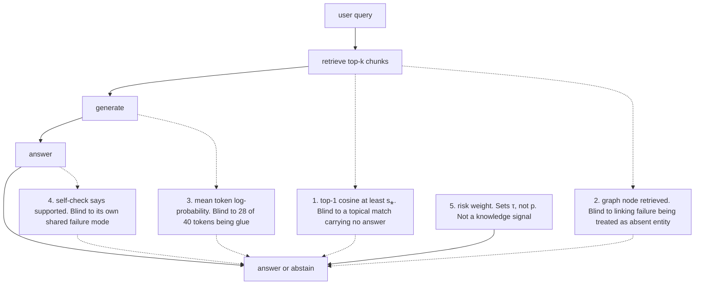
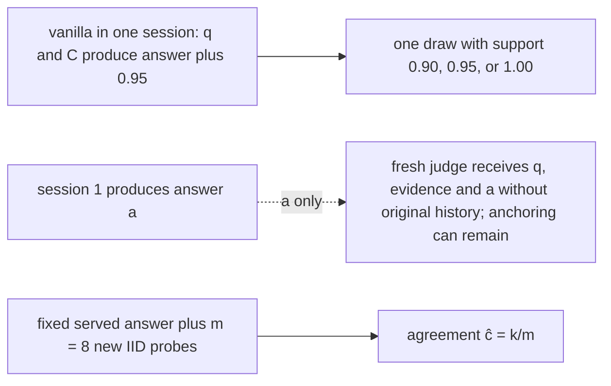

# Chapter 11: Abstention and Calibration
[00-START-HERE](../00-START-HERE.md) · [01-READING-ROUTES](../01-READING-ROUTES.md) · [10\_prompt\_sensitivity](10_prompt_sensitivity.md) · [12\_text\_representation](../part-04-representations/12_text_representation.md)
This chapter explains when a Retrieval-Augmented Generation (RAG) system should refuse, how to build a useful confidence signal, and how to keep that signal honest for short and long answers.
## TL;DR
- Abstention is a product decision. The model estimates correctness, while the product sets a threshold from the costs of a wrong answer and a refusal.
- A checkable citation can lower the harm of a wrong answer. A citation that users cannot inspect earns no such reduction.
- Every cheap abstention signal has a blind spot. Similarity sees topic, token probability sees fluency, and a self-check often repeats the generator’s mistake.
- Repeated self-reflection can raise stated confidence without raising accuracy. It conditions the model on its own earlier answer instead of on new evidence.
- Calibration and failure prediction are different. A score can match average accuracy perfectly while being useless for sorting correct answers above wrong ones.
- The cited black-box comparisons find benefits from sample aggregation over vanilla verbalized confidence, dependent on the signal, query distribution and sampling policy. The extra resolution costs additional generation calls.
- Long answers need a confidence target that names what it summarizes. Expected claim support and the chance that every claim is supported can lead to opposite decisions.
## The story
Imagine a newsroom that answers readers’ policy questions.
The retriever is the newsroom librarian. The librarian finds relevant files, but a relevant file may still omit the answer.
The generator is the writer. The writer turns those files into a clean reply, but fluent prose can still contain a wrong claim.
The support judge is the fact-checker. The fact-checker compares the draft with the files, yet the checker can also make mistakes.
The managing editor owns the decision to publish or refuse. The editor asks what a wrong story costs and what leaving a reader unanswered costs. Those costs set the publication threshold.
A checkable citation acts like a highlighted source packet beside the story. It lets the reader catch a residual mistake, but only when the packet opens to the relevant span.
The editor should not ask the writer to reread the same story eight times and treat eight approvals as independent. The writer sees the same files and the same draft. Each rereading can harden the original choice without adding evidence.
The editor also needs two scorecards. Calibration asks whether stories labeled $`80\%`$ reliable are right about $`80\%`$ of the time. Failure prediction asks whether good stories receive higher scores than bad stories. The publication gate spends the second property.
If the newsroom rents a black-box writer, it may not see internal token scores. It can send the same assignment to several fresh desks and measure agreement. That costs more calls, but it creates a score with more usable levels.
Finally, a six-paragraph story is not one indivisible fact. The editor must decide whether confidence means the expected fraction of supported claims or the chance that every claim is supported. The cost of one bad sentence decides which meaning the newsroom needs.
## Decoder table


| Technical term | Plain-English meaning | Why it matters |
| --- | --- | --- |
| Retrieval-Augmented Generation (RAG) | A system that retrieves evidence and gives it to a generator | Retrieval supplies external evidence, but it does not guarantee a supported answer |
| abstention | Choosing not to answer | It can prevent costly unsupported claims |
| refusal | The user-facing result of abstention | Its rate and message affect utility and diagnosis |
| confidence $`p`$ | An estimate between $`0`$ and $`1`$ that an answer is correct | The gate compares $`p`$ with a product-owned threshold |
| threshold $`\tau`$ | The minimum confidence required to answer | Costs, not model instinct, determine it |
| wrong-answer cost $`c_w`$ | Harm from a wrong answer in units of one correct answer | Higher $`c_w`$ raises the threshold |
| abstention cost $`c_a`$ | Harm from leaving a query unanswered | Higher $`c_a`$ lowers the threshold |
| expected value | Average utility under uncertain outcomes | It turns answering versus refusing into a decision rule |
| cost matrix | The values assigned to correct, wrong, and refused outcomes | Different routes need different thresholds |
| global cutoff | One threshold used for every query type | It ignores differences in consequence |
| per-route threshold | A threshold attached to one intent or risk class | It keeps low-stakes and high-stakes queries separate |
| checkable citation | A source reference that opens to a readable supporting span | It can reduce the effective cost of a wrong answer |
| verification rate $`q`$ | Fraction of users who open a citation and catch an unsupported claim | It controls how much value a citation adds |
| verification cost $`c_v`$ | Cost paid when a user checks a citation | It enters the effective wrong-answer cost |
| support gate | A classifier judging a specified claim/evidence event | Precision depends on prevalence and threshold-specific TPR/FPR; macro-F1 alone does not give a ceiling |
| macro-$`F_1`$ | The average $`F_1`$ score across classes | The cited $`80\%`$ value summarizes support-judge quality |
| precision | Fraction of answered queries that are correct | A selective system tries to raise it |
| recall | Fraction of valid items that a method retains | Refusing correct answers lowers it |
| coverage | Fraction of queries the system answers | Risk-coverage analysis trades coverage against selective quality |
| attribution judgment | Deciding whether a reference supports a claim | It measures the relation a grounded product promises |
| retrieve-or-not decision | Choosing whether to call retrieval before evidence exists | It is different from post-generation abstention |
| reflection token | A generated control signal that can trigger retrieval | It does not itself decide whether to refuse the final answer |
| retrieval similarity | A score for how close a query and chunk are in representation space | It measures topic overlap, not answer containment |
| top-1 cosine score | Similarity of the highest-ranked chunk | Its absolute level can drift across query types |
| dense passage retrieval | Retrieval through learned dense vector scores | Its training objective fixes score gaps, not global score levels |
| softmax objective | A normalized loss that rewards a positive document over alternatives | Adding a query-specific constant leaves it unchanged |
| normal distribution and standard normal CDF $`\Phi`$ | A stated bell-shaped score model and the fraction of its mass below a cutoff | They convert the proxy cutoffs into refusal and pass rates |
| temperature $`T`$ | A scale inside a softmax or sampling distribution | It changes sharpness but does not add evidence |
| knowledge graph | Entities and relations stored as nodes and edges | Node absence can mean missing knowledge or a linking failure |
| entity linking | Mapping a text mention to a graph node | Multiple mentions compound linking errors |
| token log-probability | The log score assigned to generated tokens | It often reflects fluency and formatting more than factual support |
| nat | A log-probability unit based on the natural logarithm | The token example compares shifts in nats per token |
| syntactic glue | Words and punctuation that express structure rather than the claim | Glue tokens can dominate a mean token score |
| self-check | Asking a model to grade its own answer | Shared weights and context correlate checker and generator errors |
| true-positive rate | Pass rate on genuinely correct answers | It forms the numerator of a positive-check likelihood ratio |
| false-positive rate | Pass rate on wrong answers | Correlation can raise it and destroy the checker’s value |
| likelihood ratio | How much a verdict changes prior odds | Independent and correlated checks can have very different ratios |
| risk weighting | Adjusting a decision for domain stakes | It belongs in the threshold, not in knowledge confidence |
| coverage gate | A gate that says the corpus does not cover a query | It should feed an index-gap workflow |
| entailment gate | A gate that checks whether evidence supports the generated claim | It diagnoses a different failure from missing coverage |
| cross-encoder | A scorer that reads a candidate and its context together | It adds a support or reranking pass with a separate latency bill |
| closed-world statement | A claim only about what a fixed corpus contains | It must not be confused with absence in the world |
| model collapse | Loss of low-probability behaviors after training on model samples | It is the long-timescale analogy for self-reflection drift |
| finite-sample error | Loss caused when a rare event never appears in a sample | Once absent, the next generation cannot learn it back |
| sampling resolution $`\frac{1}{N}`$ | The rarity level a sample of size $`N`$ can represent | Events much rarer than $`\frac{1}{N}`$ are likely to disappear |
| absorbing absence | A missing behavior that cannot return from self-generated data | Repeated resampling erases the tail |
| self-reflection | Sequentially asking a model to critique or revise its own answer | It conditions later rounds on earlier model output |
| commitment bonus $`\beta`$ | Added logit support for repeating a prior claim | It can turn a slight preference into near-certainty |
| logit | An unnormalized score before probability conversion | A commitment bonus adds directly to it |
| log-odds | Logarithm of one outcome’s odds against another | It shows how repeated commitment sharpens a choice |
| sigmoid | A map from log-odds to a probability | It converts $`6.6007`$ log-odds to $`0.9986`$ |
| self-consistency | Independent samples followed by a vote | Partial independence can improve accuracy |
| plurality vote | Choosing the answer with the most samples | It can beat sequential revision at equal token spend |
| Expected Calibration Error ($`\mathop{\mathrm{ECE}}\nolimits`$) | Bucketed mismatch between stated confidence and observed accuracy | It measures reliability, not ranking quality |
| Area Under the Receiver Operating Characteristic curve ($`\mathop{\mathrm{AUROC}}\nolimits`$) | Probability that a correct answer outscores a wrong one, with half credit for ties | It measures failure prediction and ordering |
| calibration | Agreement between a score and empirical correctness frequency | Users can interpret a calibrated probability |
| failure prediction | Separating correct from wrong answers by score | An abstention gate needs this property |
| recalibration | Monotone post-processing of existing scores | It can repair reliability but cannot create ordering |
| temperature scaling | Positive-temperature rescaling of logits | Binary scalar ranking is preserved; multiclass maximum-confidence ranking may change |
| Platt scaling | A lower-variance parametric calibration map | It can be preferable with limited labeled data |
| isotonic regression | A flexible non-decreasing calibration map | Merging levels can increase or decrease empirical AUROC by turning pairs into ties |
| Brier score | Mean squared error of probability forecasts | It decomposes into reliability, resolution, and uncertainty |
| Brier skill score | Resolution divided by task uncertainty after reliability is zero | It measures improvement over the constant base-rate forecast |
| reliability $`\mathrm{REL}`$ | Penalty for confidence not matching bucket accuracy | Recalibration can drive it toward zero |
| resolution $`\mathrm{RES}`$ | Variation in accuracy across score buckets | A gate spends this separation, and post-processing cannot create it |
| uncertainty $`\mathrm{UNC}`$ | Base-rate variance fixed by the task | The confidence method cannot change it |
| base accuracy $`a`$ | Overall probability an answer is correct | A constant score equal to $`a`$ is calibrated but uninformative |
| climatology baseline | Always predicting the base rate | It exposes perfect reliability with zero useful separation |
| risk-coverage curve | Selective quality plotted against fraction answered | It shows every threshold operating point |
| black-box model | A model application programming interface (API) that hides weights and token probabilities | Confidence must be elicited from outputs and repeated calls |
| $`p_{99}`$ latency | A response-time boundary that $`99\%`$ of requests meet | Parallel confidence sampling can fit the median while missing the tail budget |
| sequence probability | Probability of one exact answer string | It splits mass across equivalent phrasings |
| perplexity | A length-normalized sequence score | It still scores strings rather than meanings |
| semantic entropy | Entropy after grouping answers by meaning | It repairs surface-form splitting with samples and entailment |
| bidirectional entailment | Checking whether two answers support each other both ways | It groups sampled phrasings into semantic clusters |
| verbalized confidence | A percentage requested in model text | It tends to occupy a few round values |
| agreement score | Fraction $`\frac{k}{m}`$ of samples that agree with the served answer | It estimates the model’s answer distribution |
| binomial model | A model for $`k`$ agreements in $`m`$ draws | It gives the variance and standard error of agreement |
| standard error $`\mathop{\mathrm{SE}}\nolimits`$ | Sampling uncertainty of an estimated agreement fraction | It limits which adjacent score levels are distinguishable |
| self-probing | A fresh-session judge of an answer with its query and evidence | Removes original history, not all anchoring or shared model error |
| multi-step elicitation | Confidence per reasoning step followed by aggregation | It anchors scores to sub-claims |
| top-$`k`$ elicitation | Asking for several candidate answers and confidence for each | It forces probability mass onto alternatives |
| pairwise ranking | Comparing sampled answers in pairs | The cited study found it best for calibration |
| average confidence | Averaging confidence across samples | The cited study found it best for failure prediction |
| $`P(\mathrm{True})`$ | A prompted probability that a proposed answer is true | It is another black-box confidence probe |
| long-form calibration | Confidence for an answer with several atomic claims | One scalar can hide different notions of correctness |
| atomic claim | One independently verifiable statement | Long answers decompose into these units |
| support fraction $`S`$ | Supported claims divided by total claims | It lies on a continuum from $`0`$ to $`1`$ |
| FActScore | Atomic-fact support fraction against a reliable source | It operationalizes long-form factual support |
| proportional utility | Value that scales with the supported fraction | It consumes the mean of $`S`$ |
| all-or-nothing utility | Value that requires every claim to be supported | It consumes the probability that $`S=1`$ |
| cumulative distribution function (CDF) | Probability that $`S`$ is at or below each level | It retains more information than one scalar |
| Continuous Ranked Probability Score ($`\mathop{\mathrm{CRPS}}\nolimits`$) | A proper score for a predicted distribution over $`S`$ | It reduces to the Brier score for binary outcomes |
| indicator function | A term that equals $`1`$ when its condition holds and $`0`$ otherwise | It writes the realized support threshold inside $`\mathop{\mathrm{CRPS}}\nolimits`$ |
| strictly proper score | A score optimized by reporting the true predictive distribution | It discourages strategic probability reports |
| continuous self-evaluation | Repeated fresh-session scoring of one answer | It estimates a distribution over support |
| claim-overlap similarity | Agreement measured over claims rather than exact strings | Long briefs rarely match word for word |
| VeriScore | A factuality measure that handles verifiability, context, and recall | It prevents short hedged answers from winning on precision alone |
| target claim count $`K`$ | Desired number of claims for recall accounting | It exposes omitted content |
| $`F_1`$ at $`K`$ | Harmonic mean of fact precision and recall against $`K`$ | It penalizes saying too little |


## Core mechanics
### Mathematical conventions
Use natural logarithms and nats. Correctness, answerability, support and agreement are different events; declare the event being calibrated. Costs $`c_w,c_a\ge0`$ are in units of one correct answer; answer above the threshold, abstain below it, and choose an explicit tie policy. Report expected counts as fractional before rounding. Macro-$`F_1`$ does not determine a confusion matrix or a precision ceiling across thresholds. Normal score models below give the standard deviation explicitly. Calibration-fit statistics are in-sample illustrations unless tested on separate data. For the binomial agreement formulas, fix a served answer first and collect $`m`$ new IID probes conditional on that answer and query; these are $`m`$ calls in addition to the original generation. Across-query accuracy is not automatically the per-query answer sampling probability.
### 11.1 Should a RAG system ever refuse?
#### The decision belongs to the cost matrix
- **What:** Let $`p`$ be answer correctness, $`c_w`$ the cost of a wrong answer, and $`c_a`$ the cost of abstaining. Normalize a correct answer to value $`1`$.
- **Why:** The same $`p`$ can be acceptable for a photocopier question and unacceptable for a drug interaction question because the consequences differ.
- **Failure without it:** One global cutoff becomes permissive on high-stakes traffic and conservative on low-stakes traffic.
- **Cost or complexity:** The product owner must state $`c_w`$ and $`c_a`$ per route. The model supplies only $`p`$.
Answering has expected value $`p-(1-p)c_w`$. Abstaining has value $`-c_a`$. Answer when:

```math
p - (1-p)c_w \gt  -c_a
\Longleftrightarrow
p(1+c_w) \gt  c_w-c_a
\Longleftrightarrow
p \gt  \tau = \frac{c_w-c_a}{1+c_w}
```

At $`c_w = 2`$ and $`c_a = 0.5`$, $`\tau = \frac{1.5}{3} = 0.500`$. At $`c_w=200`$ with the same $`c_a`$, $`\tau=199.5/201\approx0.992537`$.
If $`c_a \gt  c_w`$, then $`\tau \lt 0`$. The cost-optimal policy never refuses because abstention costs more than a wrong answer.
Abstention happens after retrieval and generation. A retrieve-or-not reflection token acts before evidence exists. A system can retrieve often and still refuse often.
#### Citations change cost, not confidence
- **What:** For this illustrative cost model, let $`q`$ be the probability, conditional on a wrong answer, that verification catches it before the modeled harm. Let $`c_v`$ be the replacement cost on that caught-wrong branch. Correct-answer verification costs and residual harm are omitted; adding them changes the decision utility. The effective wrong-answer cost is:

```math
c_w' = (1-q)c_w + qc_v
```

- **Why:** A readable cited span lets the user detect residual support failures.
- **Failure without it:** Citation presence alone does not carry correctness information. The cited FActScore result found citations on over $`30\%`$ of supported sentences and over $`30\%`$ of unsupported sentences.
- **Cost or complexity:** The product must measure citation open rate and span-level correctness. An access-controlled or unreadable source does not reduce $`c_w`$.
At $`c_w = 20`$, $`q = 0.6`$, and $`c_v = 0.2`$, the effective cost is $`8.12`$. The threshold moves from $`\frac{19.5}{21}\approx0.928571`$ to $`\frac{7.62}{9.12}\approx0.835526`$.
#### A support gate has an operating curve, not one universal ceiling
- **What:** A support gate has threshold-dependent true-positive and false-positive rates $`t`$ and $`f`$ for a specified correctness event.
- **Why:** At prevalence $`a`$, precision at that operating point is $`ta/[ta+f(1-a)]`$ when the denominator is positive.
- **Failure without it:** A reported $`80\%`$ macro-$`F_1`$ neither implies $`t=0.8,f=0.2`$ nor rules out a higher-precision, lower-coverage threshold.
- **Cost or complexity:** Treat $`t=0.8,f=0.2`$ as an independent toy assumption, not an optimistic bound extracted from AttributionBench. Measure the ROC or risk-coverage curve and validate that the support event matches the product's correctness target.
For the separate toy operating point $`a=0.81`$, $`t=0.8`$ and $`f=0.2`$, pass precision is:

```math
\mathop{\mathrm{Prec}}\nolimits_{\mathrm{pass}}=\frac{0.8(0.81)}{0.8(0.81)+0.2(0.19)}=\frac{0.648}{0.686}\approx0.944606.
```

That particular binary pass group does not meet $`\tau\approx0.992537`$. Equating its precision to the cost threshold gives $`c_w=(p+c_a)/(1-p)\approx26.0789`$ for bare answers, or an original wrong-answer cost of about $`64.8974`$ under the stated citation-cost transformation. These are intersections for this fixed operating point, not universal stakes limits or proof that no other threshold can work. Measure precision and coverage at alternative thresholds, improve evidence or escalate when no validated point meets the route requirement.
A standing disclaimer on $`100\%`$ of answers is a constant rather than a correctness signal. Being constant, the disclaimer carries no discrimination information; whether it changes harm is a separate empirical and legal question. A refusal policy is informative only to the extent that its decisions actually correlate with correctness.
#### Worked traffic economics
- **What:** The example has $`5{,}000`$ daily queries in four measured support bands.


| Queries | Grounded accuracy | Correct | Wrong |
| --- | --- | --- | --- |
| $`2{,}300`$ | $`0.96`$ | $`2{,}208`$ | $`92`$ |
| $`1{,}400`$ | $`0.88`$ | $`1{,}232`$ | $`168`$ |
| $`850`$ | $`0.62`$ | $`527`$ | $`323`$ |
| $`450`$ | $`0.20`$ | $`90`$ | $`360`$ |
| $`5{,}000`$ | $`4{,}057/5{,}000=0.8114`$ overall | $`4{,}057`$ | $`943`$ |


- **Why:** It shows that thresholding and citations are separate economic levers.
- **Failure without it:** Never refusing produces $`4{,}057-943\times20=-14{,}803`$ units per day.
- **Cost or complexity:** At $`c_w = 20`$ and $`c_a = 0.5`$, bare thresholding answers $`2{,}300`$ and refuses $`2{,}700`$, a $`54\%`$ refusal rate. Value is $`2{,}208-92\times20-2{,}700\times0.5=-982`$.
With cited cost $`8.12`$ and $`\tau\approx0.835526`$, the system answers $`3{,}700`$, gets $`3{,}440`$ correct and 260 wrong, and refuses $`1{,}300`$, a $`26\%`$ refusal rate. Value is $`3{,}440-260\times8.12-1{,}300\times0.5=678.8`$.
Citations without a threshold still lose. Their value is $`4{,}057-943\times8.12=-3{,}600.16`$.
The band mix gives $`81.14\%`$ overall accuracy. The book compares this with stated reliability-weighted RAG results of $`81.2\%`$ for standard RAG and $`91.3\%`$ for the weighted variant.
Applying the toy $`t=0.8,f=0.2`$ rates to the actual traffic counts gives expected correct passes $`0.8(4{,}057)=3{,}245.6`$ and wrong passes $`0.2(943)=188.6`$, totaling $`3{,}434.2`$ answers at approximately $`94.508\%`$ precision. Expected correct refusals are $`811.4`$. Fractional expected counts need not sum like independently rounded integer observations; this is not a measured support-gate ceiling.
The opening audit found the answer verbatim in the top retrieved chunk for 31 of 50 sampled refusals. That suggests avoidable refusals worth auditing, but a verbatim passage alone does not prove the answer was current, entailed, within authorization, and above the cost threshold. Separate gate errors from policy-driven refusals.
### 11.2 Five abstention mechanisms and how each fails
#### Mechanism 1: retrieval similarity
- **What:** Refuse when the top-1 chunk score falls below $`s^{*}`$.
- **Why:** It is cheap and already available from retrieval.
- **Failure without a better signal:** Dense Passage Retrieval (DPR) training fixes score gaps within a query but not absolute score levels. It also scores topic overlap, not answer containment.
- **Cost or complexity:** It is nearly free as a pre-filter. It is not a calibrated answer-confidence score.
The training loss is:

```math
L = -\log \frac{\exp(s(q,d^+)/T)}{\sum_j \exp(s(q,d_j)/T)}
```

Adding the same constant $`c`$ to all scores for one query multiplies numerator and denominator by $`\exp(c/T)`$. The loss does not change, so a global score level is unconstrained.
A 2024 parental-leave question can retrieve a 2019 policy page at high similarity. The chunk is topical but can carry the wrong number.
#### Mechanism 2: knowledge-graph node absence
- **What:** Refuse when no graph node matches the query entity.
- **Why:** A missing entity appears to provide a clean ignorance signal.
- **Failure without diagnosis:** The event conflates true absence, a different surface form, and a missing relation in the schema.
- **Cost or complexity:** Entity-linking errors compound across mentions. If three linking events are independent, each succeeds with probability $`0.90`$, and the policy requires all three, the all-linked rate is $`0.90^3=0.729`$ and linking-caused refusal is $`27.1\%`$. Dependence and partial-link tolerance change that rate.
#### Mechanism 3: token log-probability
- **What:** Refuse when mean generated-token log-probability is too low.
- **Why:** It is available from some model APIs and seems to measure certainty.
- **Failure without semantic isolation:** A 40-token answer has 12 claim tokens and 28 glue tokens. One formatting surprise can move the mean almost as much as collapse across every claim token.
- **Cost or complexity:** It is cheap when token probabilities are exposed. It is unavailable from many closed APIs and is sensitive to format.
The two mean changes are:

```math
\frac{12\ln(0.9/0.6)}{40} = 0.1216
\qquad \text{versus} \qquad
\frac{\ln(0.97/0.02)}{40} = 0.0970
```

The glue-token change is roughly four-fifths of the full content collapse. The cited FormatSpread result reports swings up to 76 accuracy points on LLaMA-2-13B from formatting.
#### Mechanism 4: self-check
- **What:** Ask the generator whether its own answer is supported.
- **Why:** It requires no new model or labeled classifier.
- **Failure without independence:** The checker reads the same misleading passage with the same weights, so its errors correlate with the generator’s errors.
- **Cost or complexity:** A check needs another inference call, including its prompt and generated verdict. It doubles decode work only in the special case of equal output lengths and comparable serving behavior; it is not just one token-level forward pass.
With true-positive rate $`0.9`$ and false-positive rate $`0.2`$, a pass verdict has likelihood ratio $`\frac{0.9}{0.2} = 4.5`$. If the checker repeats the generator’s mistake on three-quarters of wrong cases, false-positive rate becomes $`0.75`$ and the ratio becomes $`\frac{0.9}{0.75} = 1.2`$.
#### Mechanism 5: risk weighting
- **What:** Adjust the decision by domain stakes.
- **Why:** Identical confidence should lead to different actions for different consequences.
- **Failure when placed inside **$`p`$**:** Preference tuning can freeze a surface-topic prior. A refusal then mixes missing evidence with high consequence.
- **Cost or complexity:** Risk belongs in editable per-route $`\tau`$. It is not a knowledge signal and should not require generator retraining.
#### Two diagnosable gates beat one blended scalar
- **What:** Use a coverage gate at retrieval and an entailment gate on the generated claim and evidence.
- **Why:** They have different blind spots and produce different repairs.
- **Failure without separation:** A single blend hides whether the index lacked the document, the linker failed, or a prompt format shifted.
- **Cost or complexity:** The entailment judge adds another cross-encoder pass. The coverage gate is cheap and should feed the index-gap queue.
A coverage refusal means this corpus does not cover the query. It does not mean the fact is absent from the world.
Use token log-probability only for short extractive answers where a few tokens carry the semantics. Use at most one same-model self-check, and require a useful second checker to change weights or evidence and prove its value on known generator errors.
#### Worked proxy comparison
- **What:** The example has $`1{,}000`$ queries. Of these, 820 have a supporting passage and 180 do not. The generator is correct on $`90\%`$ of the answerable set, yielding 738 correct and 262 wrong answers, or $`73.8\%`$ precision.
- **Why:** It compares cheap proxies against a same-prevalence toy support-judge operating point.
- **Failure without the comparison:** Refusal rate alone can be optimized by refusing everything.
- **Cost or complexity:** The example states overlapping score distributions as constants. Answerable scores follow $`\mathcal N(0.81,0.05^2)`$ and unanswerable scores follow $`\mathcal N(0.73,0.07^2)`$, where the second argument is variance. The unbounded normal distribution approximates bounded similarity scores. Assume the generator is correct on $`90\%`$ of answerable queries independently of score within that group, and never correct on the unanswerable group.
At $`s^\star=0.75`$, answerable refusal probability is $`\Phi(-1.2)\approx0.115070`$, and unanswerable pass probability is $`1-\Phi(2/7)\approx0.387548`$. Expected total passes are $`795.4016`$, with $`653.0786`$ correct, giving $`82.1068\%`$ precision and $`204.5984`$ refusals. These are expectations under the stated conditional-independence model, not observed integer counts.
For a log-probability cutoff at the 10th percentile, the cutoff is $`\mu-1.2816\sigma`$ with $`\sigma = 0.06`$ nats per token. A format shift of $`0.0970`$ nats is $`1.617\sigma`$. Refusal becomes $`\Phi(0.336) = 63.1\%`$ even though the model, corpus, and queries are unchanged.
For a self-check, prior odds are $`\frac{738}{262} = 2.817`$. An independent ratio of $`4.5`$ yields posterior odds $`12.68`$ and $`92.7\%`$ precision. The correlated ratio of $`1.2`$ yields odds $`3.38`$ and $`77.2\%`$ precision. It refuses $`0.1\times738+0.25\times262=139`$ queries to buy $`3.4`$ points, while cosine refuses 204 to buy $`8.2`$ points.
For a prevalence-matched $`t=0.8,f=0.2`$ toy gate at $`a=0.738`$, precision is $`0.918482`$. The similarity point captures approximately $`46.03\%`$ of the precision difference from $`0.738`$ to that particular point. This is not a universal fraction of attainable headroom, and comparison against the $`a=0.81`$ precision would mix prevalences.
### 11.3 Self-reflection compounds: the model-collapse connection
#### Finite-sample collapse
- **What:** Train a model, sample $`N`$ outputs from it, train the next generation on those samples, and repeat.
- **Why:** The process exposes what self-generated data cannot preserve.
- **Failure without outside data:** A behavior with probability $`q`$ appears zero times with probability $`(1-q)^N`$, approximately $`\exp(-qN)`$. In a pure empirical-only resampling model with no smoothing or outside information, a zero-frequency state is absorbing; general models need not have this property.
- **Cost or complexity:** First-stage presence probability is $`1-(1-q)^N`$; $`qN\gg1`$ makes presence likely in the rare-event approximation, not certain. Frequency increments of $`1/N`$ are not a hard extinction threshold.
For $`q = 10^{-4}`$ and $`N = 5{,}000`$:

```math
\Pr(K_1=0)=(1-q)^N=(1-10^{-4})^{5{,}000}\approx0.606515\approx e^{-0.5}.
```

If, additionally, each surviving generation were reset to the same rare-event probability $`q`$, a constant-hazard toy calculation would give:

```math
\Pr(\text{survive three stages})=\left[1-(1-q)^N\right]^3\approx0.060924\quad\text{under constant conditional absence hazard}.
```

This roughly $`6.09\%`$ value is not the survival law of actual recursive empirical retraining: after survival the frequency is random, and later absence probabilities depend on it. In a pure empirical-resampling model, $`K_{t+1}\mid K_t\sim\mathop{\mathrm{Bin}}\nolimits(N,K_t/N)`$ and $`0`$ is absorbing. Generalization, smoothing, priors and external data can make absence non-absorbing. The first-generation absence probability illustrates rarity; it does not establish a hard deletion of all behaviors below $`1/N`$.
#### Self-reflection as context-window resampling
- **What:** Round $`t+1`$ samples from the question plus prior answers, not from the question alone.

```math
p(\cdot \mid q,a_1,\ldots,a_t)
\quad \text{rather than} \quad
p(\cdot \mid q)
```

- A prior answer may bias a later continuation; a constant $`\beta`$ log-odds increment is a toy assumption, not an inevitable law. Compare fixed alternatives with and without the prior turn to estimate a log-odds change; one answer’s log probability alone is not a log-odds difference. Each revision adds full inference work and latency.
Take the constant-increment toy $`\beta=0.8`$ nats per round and initial $`p_{\mathrm{wrong}}=0.55`$, $`p_{\mathrm{right}}=0.45`$. Initial log odds are $`\ln(0.55/0.45)\approx0.200671`$. After eight rounds:

```math
\ell_8=\ln\frac{0.55}{0.45}+8(0.8)\approx6.60067070.
```


```math
p_{\mathrm{wrong}}^{(8)}=\frac1{1+e^{-\ell_8}}\approx0.998642390.
```

The equivalent temperature is $`T = \frac{0.2007}{6.6007} = 0.030`$. Eight self-affirmations sharpen this one decision like a temperature drop from $`1.0`$ to $`0.03`$, with no new evidence.
#### Stated odds and real odds diverge
- **What:** A naive aggregator treats every self-check pass as independent.
- **Why:** Independent evidence would justify multiplying odds by $`4.5`$ per pass.
- **Failure without dependence correction:** Eight passes report a multiplier of $`4.5^8 = 168{,}151`$. For the worked scenario, assume only the first pass has conditional likelihood ratio $`1.2`$, and later passes add ratio $`1`$ after conditioning on prior verdicts. These are explicit dependence assumptions, not consequences of using the same model.
- **Cost or complexity:** More rounds buy serial cost and misleading confidence. They do not buy independent votes.
#### Parallel samples versus sequential revisions
- **What:** Self-consistency samples blind reasoning chains in parallel and votes. Reflection conditions every new draw on previous draws.
- **Why:** Partial independence lets errors cancel. Sequential commitment increases correlation.
- **Failure without an external signal:** The cited intrinsic self-correction result reports that rounds without external feedback degrade reasoning accuracy, with greater degradation as rounds increase.
- **Cost or complexity:** At equal token spend, parallel sampling needs batch capacity. A useful revision loop instead consumes a fresh retrieval, executed test, compiler error, or different model family.
#### Worked reflection economics
- **What:** Start from $`1{,}000`$ queries, $`73.8\%`$ accuracy, and prior odds $`2.817`$. Each generation or check emits 250 output tokens at 40 tokens per second. Output price is stated as $`\$3.00`$ per million tokens.
- **Why:** It shows that reported confidence can become wrong by orders of magnitude while accuracy stays fixed.
- **Failure without independence accounting:** A self-reflection dashboard can celebrate $`99.9998\%`$ confidence at only $`77.2\%`$ measured precision.
- **Cost or complexity:** One self-check yields $`664.2`$ correct passes and $`196.5`$ wrong passes, or $`860.7`$ answered at $`77.2\%`$ precision. Two passes total 500 tokens, $`12.5`$ seconds of serial decode, and $`\$1.50`$ per day.
The stated dependence scenario leaves conditional odds $`(738/262)(1.2)\approx3.38015267`$, giving $`77.169746\%`$ precision. Naively multiplying eight independent ratios gives $`(738/262)(4.5)^8\approx473{,}647.4251`$ odds and approximately $`99.99978887\%`$ confidence. The odds inflation factor is $`4.5^8/1.2\approx140{,}126.0449`$ in this toy, not eight independent pieces of evidence.
Nine equal-length serial passes emit $`2{,}250`$ output tokens and take $`56.25\,\mathrm s`$ of decode at $`40`$ tokens per second. At $`1{,}000`$ queries per day and $`\$3.00`$ per million output tokens, output cost is $`\$6.75`$ daily. Above two passes at $`\$1.50`$ daily, the $`365`$-day increment is $`\$1{,}916.25`$ and serial decode latency is $`4.5`$ times higher. Zero accuracy gain is a scenario assumption; inputs and other overhead are excluded.
For a separate idealized plurality example, suppose each of eight IID draws outputs the one correct answer with probability $`0.738`$, and each of four wrong values with probability $`0.262/4=0.0655`$. Break a tie uniformly among tied leaders. Then:

```math
C \sim \mathop{\mathrm{Bin}}\nolimits(8,0.738)
```


```math
\begin{aligned}
\mathbf N&\sim\mathop{\mathrm{Multinomial}}\nolimits\!\left(8;0.738,0.0655,0.0655,0.0655,0.0655\right),\\
\Pr(\text{correct plurality})&=\sum_{\sum_i n_i=8}\Pr(\mathbf N=\mathbf n)
\frac{\mathbf1[n_0=\max_i n_i]}{\sum_i\mathbf1[n_i=\max_j n_j]}
\approx0.987701.
\end{aligned}
```

The multinomial scenario gives $`98.7701\%`$ plurality accuracy, about $`24.9701`$ points over one draw. The event $`C\le2`$ has probability about $`0.005455`$, but its complement is not a sufficient condition for a correct plurality: three correct votes can lose to five identical wrong votes, and four can tie four. A strict correct majority alone guarantees success with probability approximately $`86.8914\%`$. Eight $`250`$-token outputs total $`2{,}000`$ output tokens and $`\$6.00`$ per $`1{,}000`$ queries at the stated price, excluding inputs. The ideal $`6.25\,\mathrm s`$ parallel decode time assumes full batch capacity and no per-sequence slowdown; it is not a measured latency. Real query-specific answer probabilities and wrong-answer concentration must be measured. The reported $`17.9`$-point forty-sample study gain is a different experiment, not a validation or fixed fraction of this toy result.
When a checker judges evidence rather than a draft, clear prior answers and verdicts from its context. Log confidence by round and alert when it rises while labeled accuracy stays flat.
Do not fine-tune a successor on unverified outputs from its predecessor. The stated safeguards are external verification, rare-intent oversampling, and a fresh human-labeled tail set.
### 11.4 Calibration versus failure prediction
#### Two independent score properties
- **What:** Calibration asks whether stated confidence matches empirical accuracy. Failure prediction asks whether correct answers outrank wrong ones.
- **Why:** User-facing probabilities need calibration, while an abstention gate needs ordering.
- **Failure without separation:** A temperature sweep can cut Expected Calibration Error ($`\mathop{\mathrm{ECE}}\nolimits`$) from $`0.21`$ to $`0.01`$ while leaving the refused set and selective precision unchanged.
- **Cost or complexity:** Compute both $`\mathop{\mathrm{ECE}}\nolimits`$ and Area Under the Receiver Operating Characteristic curve ($`\mathop{\mathrm{AUROC}}\nolimits`$), or publish the full risk-coverage curve.
For score buckets $`B_1`$ through $`B_M`$:

```math
\mathop{\mathrm{ECE}}\nolimits
= \sum_{m=1}^{M}\frac{|B_m|}{n}
\left|\mathop{\mathrm{acc}}\nolimits(B_m)-\mathop{\mathrm{conf}}\nolimits(B_m)\right|
```

For one correct and one wrong draw:

```math
\mathop{\mathrm{AUROC}}\nolimits
= \Pr(s_{\mathrm{correct}}\gt s_{\mathrm{wrong}})
+ \frac{1}{2}\Pr(s_{\mathrm{correct}}=s_{\mathrm{wrong}})
```

Emit the constant score $`s = a`$, where $`a`$ is base accuracy. When $`a`$ is the observed accuracy on this same dataset, empirical $`\mathop{\mathrm{ECE}}\nolimits=0`$ in all nonempty bins and $`\mathop{\mathrm{AUROC}}\nolimits=0.5`$ if both classes occur. Population calibration requires $`a`$ to equal the true base rate; a fitted constant need not remain calibrated after distribution shift. The score is perfectly calibrated and useless for abstention.
#### Why recalibration cannot create separation
- **What:** A strictly increasing map of one fixed scalar score preserves every ordering and tie, hence AUROC and rank-based risk-coverage points with a fixed tie policy.
- **Why:** Binary temperature scaling with positive temperature, or a positive-slope Platt map, has this property. Refit numeric thresholds if the score scale changes.
- **Failure without the caveat:** Multiclass temperature scaling can reorder maximum-probability confidence across examples; not every method called temperature scaling is a common monotone map of that scalar.
- **Cost or complexity:** Isotonic regression is only non-decreasing. It can merge reversed pairs or correctly ordered pairs into ties, so empirical AUROC can increase or decrease, not only decrease. It creates no new sample information, and held-out validation remains necessary.
The cited black-box elicitation study found different winners. Pairwise-ranking aggregation gave the best calibration. Average confidence over samples gave the best failure prediction. It also reported systematic overconfidence under vanilla verbalized prompting and better failure prediction with more samples.
#### Brier decomposition
- **What:** Murphy’s Brier score ($`\mathop{\mathrm{BS}}\nolimits`$) decomposition separates probability error into reliability, resolution, and task uncertainty.
- **Why:** It names which budget post-processing can fix.
- **Failure without it:** Reliability improvements can be mistaken for a better gating signal.
- **Cost or complexity:** Fit calibration on held-out labeled data. Resolution must come from a better raw signal.

```math
\mathop{\mathrm{BS}}\nolimits
=
\underbrace{\sum_m \frac{|B_m|}{n}
\left(\mathop{\mathrm{conf}}\nolimits(B_m)-\mathop{\mathrm{acc}}\nolimits(B_m)\right)^2}_{\mathrm{REL}}
-
\underbrace{\sum_m \frac{|B_m|}{n}
\left(\mathop{\mathrm{acc}}\nolimits(B_m)-a\right)^2}_{\mathrm{RES}}
+
\underbrace{a(1-a)}_{\mathrm{UNC}}
```

The displayed finite-sample Brier decomposition is exact when each group has a constant issued forecast, as in the discrete-score example. Replacing varying individual forecasts by coarse-bin means changes the score and may require within-bin terms. Mapping each fixed group to its empirical accuracy makes its in-sample reliability zero. A one-to-one relabeling retains those groups and their resolution; merging groups can reduce resolution. Deterministic post-processing does not create information, but arbitrary numerical binning can change reported resolution. Evaluate calibration on separate data.
#### Worked calibration comparison
- **What:** Use the same $`1{,}000`$ queries with base accuracy $`a=0.738`$ and $`\mathrm{UNC}=0.738(0.262)=0.193356`$.
- **Why:** The example holds answers fixed and changes only the confidence signal.
- **Failure without the comparison:** $`\mathop{\mathrm{ECE}}\nolimits`$ alone chooses the wrong gate.
- **Cost or complexity:** The verbalized signal uses three levels. The agreement signal requires eight samples.
Verbalized confidence has 300 queries at $`0.90`$ with 210 correct, 400 at $`0.95`$ with 300 correct, and 300 at $`1.00`$ with 228 correct. Bucket accuracies are $`0.700`$, $`0.750`$, and $`0.760`$.

```math
\mathop{\mathrm{ECE}}\nolimits
= 0.3(0.200)+0.4(0.200)+0.3(0.240)
= 0.212
```

Among $`738\times262=193{,}356`$ correct–wrong pairs, verbalized confidence has $`70{,}320`$ wins and $`65{,}316`$ ties: AUROC $`(70{,}320+65{,}316/2)/193{,}356\approx0.532582387`$.
Eight-probe agreement is illustrated with bucket sizes $`350{,}200{,}180{,}150{,}120`$, scores $`1,7/8,6/8,5/8,3/8`$, and correct counts $`329{,}168{,}126,75,40`$. The last score is explicitly $`3/8`$, not an unspecified value at most $`4/8`$; this makes the reported errors reproducible. Then $`\mathop{\mathrm{ECE}}\nolimits=0.06075`$, $`\mathrm{REL}\approx0.00450708`$, $`\mathrm{RES}\approx0.04476933`$, and $`\mathop{\mathrm{AUROC}}\nolimits=153{,}888/193{,}356\approx0.795879`$. These are stipulated bucket data, not performance implied by eight IID samples.
Isotonic fitting maps the three verbalized levels to $`0.700,0.750,0.760`$ with no merges. On these same fit data, ECE is zero and AUROC remains approximately $`0.532582`$. This is an in-sample illustration, not proof of zero held-out calibration error. In general isotonic merges can change AUROC.
At $`\tau=19.5/21\approx0.928571`$, the raw verbalized scores would naively admit $`700`$ of $`1{,}000`$ answers, since $`0.95`$ and $`1.00`$ exceed the cutoff. That is not a justified cost decision because those scores are miscalibrated. The fitted verbalized values admit none. The agreement top group has observed accuracy $`329/350=0.94`$ and contains $`350`$ answers; to apply a probability threshold to agreement, calibrate the agreement-to-correctness map and include uncertainty, rather than equating sample consensus with truth.
If calibration makes $`\mathrm{REL}=0`$ on these same groups, Brier skill against the empirical constant base rate is $`\mathrm{RES}/\mathrm{UNC}`$. At $`\mathrm{UNC}=0.193356`$, verbalized groups give $`0.328927\%`$ and agreement groups $`23.153837\%`$. These are groupwise-calibrated skill values, not raw agreement skill or held-out guarantees.
#### Deployment rules and claim limits
- **What:** Select the raw signal on $`\mathop{\mathrm{AUROC}}\nolimits`$ or risk-coverage. Fit calibration afterward.
- **Why:** The product chooses an operating point from a cost ratio in probability units.
- **Failure without maintenance:** A map fit to one model version and query mix goes stale.
- **Cost or complexity:** Refit after model-version changes and query-mix shifts. The book suggests isotonic regression with enough labels, but warns that under roughly $`1{,}000`$ labeled examples it may fit noise. Platt or temperature scaling is then lower variance.
Global $`\mathop{\mathrm{ECE}}\nolimits`$ at $`M = 1`$ reduces to the absolute gap between mean confidence and accuracy. Opposite segment errors can cancel. Report $`\mathop{\mathrm{ECE}}\nolimits`$ by query type, source, and language.
Coverage at a fixed $`\tau`$ is a label-free drift signal. The book suggests triggering a refit when coverage moves more than a few points without a release.
### 11.5 Eliciting confidence from a black box
#### Sequence probability scores strings, not meanings
- **What:** A white-box model can expose $`p(a\mid q,C)`$ or a length-normalized perplexity score.
- **Why:** It looks like a direct confidence signal.
- **Failure without semantic grouping:** Fluency is not truth, and probability mass splits across equivalent phrasings.
- **Cost or complexity:** Many closed models expose no token probabilities. Semantic entropy already needs repeated samples and bidirectional entailment clustering.
If five correct phrasings each have probability $`0.12`$ and one wrong canonical phrasing has $`0.20`$, the top string is wrong. The correct meaning still holds total probability $`5\times0.12=0.60`$.
#### Verbalized confidence has little resolution
- **What:** Ask the model to state a percentage in its reply.
- **Why:** It costs only a few output tokens and works through a closed API.
- **Failure without sampling:** The percentage is another generated token. In the example, all $`1{,}000`$ scores are $`0.90`$, $`0.95`$, or $`1.00`$. Without tie randomization, its nonzero threshold coverages are $`30\%,70\%,100\%`$, with zero coverage also available. The best individual bucket accuracy is $`0.760`$; finer deterministic score ordering cannot be recovered by relabeling those levels.
- **Cost or complexity:** Recalibration can move the three values but cannot invent more levels.
The cited study reports that vanilla verbalized confidence is systematically overconfident. Other cited work limits the criticism. Verbalized probabilities from Reinforcement Learning from Human Feedback (RLHF) models can be better calibrated than conditional token probabilities, and a model can be fine-tuned to verbalize calibrated probabilities. Those results address reliability, not resolution.
#### Agreement from $`m`$ independent samples
- **What:** Fix the served answer before collecting $`m`$ new IID responses conditional on the query, model, sampling policy and served answer. With semantic agreement probability $`c`$, let $`K\sim\mathop{\mathrm{Bin}}\nolimits(m,c)`$ and $`\widehat c=K/m`$.
- **Why:** This estimates agreement with that fixed answer, not its probability of being true. A modal answer chosen from the same samples has selection bias and is a different statistic.
- **Failure without uncertainty accounting:** Adjacent observed levels are not independent certainty intervals. Fresh sessions remove shared conversation history, not shared model bias.
- **Cost or complexity:** There are $`m+1`$ possible scores and $`m`$ probe calls in addition to the original answer generation. Including the served answer among the $`m`$ probes changes the binomial model and its variance.
For $`k`$ distributed binomially:

```math
\mathop{\mathrm{Var}}\nolimits(\widehat{c})=\frac{c(1-c)}{m}
\qquad
\mathop{\mathrm{SE}}\nolimits(\widehat{c})=\sqrt{\frac{c(1-c)}{m}}
```

Adjacent levels are $`\frac{1}{m}`$ apart. Requiring one level gap to exceed one standard error gives:

```math
\frac{c(1-c)}{m} \lt  \frac{1}{m^2}
\Longleftrightarrow
m \lt  \frac{1}{c(1-c)}
```

For $`m=8`$, comparing nominal spacing with one population standard error gives $`c(1-c)\lt 1/8`$, equivalently $`c\lt (1-\sqrt{1/2})/2\approx0.146447`$ or $`c\gt (1+\sqrt{1/2})/2\approx0.853553`$. This is a heuristic scale comparison in terms of unknown $`c`$, not a confidence guarantee that adjacent observed scores are distinguishable. In particular, observing eight agreements in eight probes gives a one-sided exact $`95\%`$ lower bound of only $`0.05^{1/8}\approx0.687656`$ on agreement probability, not $`0.929`$ on correctness.
For a fixed interior $`c`$, spacing shrinks as $`1/m`$ while SE shrinks as $`1/\sqrt m`$, so sufficiently fine score levels become closer than one SE; at $`c=1/2`$ this occurs for $`m\gt 4`$, with equality at $`m=4`$. Near endpoints the condition differs. More probes still improve estimation at a fixed meaningful precision. Use interval estimates and held-out correctness calibration rather than treating nominal granularity as statistical resolution.
#### Conditioning strategy
- **What:** Vanilla scoring stays in the original session. Self-probing uses a fresh session. Multi-step scoring attaches confidence to sub-claims. Top-$`k`$ elicitation forces alternatives. Sampling aggregates consistency, average confidence, or pairwise rankings.
- **Why:** A fresh scorer removes the original conversation history; the candidate answer can still anchor the new judge, so no numerical commitment bonus is guaranteed to be zero.
- **Failure without fresh context:** The $`\beta=0.8`$ commitment and $`1.2`$ pass-ratio examples are scenario inputs. Neither follows automatically from the session choice, and a fresh session need not achieve a $`4.5`$ ratio.
- **Cost or complexity:** The cited comparison finds all non-vanilla strategies reduce overconfidence. More samples improve failure prediction. Pairwise ranking wins calibration, while average confidence wins failure prediction. $`P(\mathrm{True})`$ is a fixed-question version of the same fresh-session probe.
#### Worked elicitation economics
- **What:** The system serves $`1{,}000`$ queries per day. Each call has five chunks of 450 tokens plus 150 question and instruction tokens, or $`2{,}400`$ input tokens, and 150 output tokens. Prices are $`\$3`$ per million input tokens and $`\$15`$ per million output tokens.
- **Why:** It prices confidence as an explicit multiple of generation.
- **Failure without pricing:** A team can add sampling without knowing what decision value it must recover.
- **Cost or complexity:** One generation call costs:

```math
2400 \times 3 \times 10^{-6}
+ 150 \times 15 \times 10^{-6}
= 0.0072 + 0.00225
= \$0.00945
```

Vanilla verbalized confidence adds about 10 output tokens, or $`\$0.00015`$. Total cost is $`\$0.00960`$ per query and $`\$9.60`$ per day. It yields three levels.
Self-probing adds a fresh call with $`2{,}550`$ input tokens and 10 output tokens:

```math
2550 \times 3 \times 10^{-6}
+ 10 \times 15 \times 10^{-6}
= \$0.00780
```

Self-probing costs $`\$0.01725`$ per query and $`\$17.25`$ per $`1{,}000`$ queries: $`0.01725/0.00945\approx1.82540`$ times base generation, or $`1.796875`$ times verbalized-confidence cost. It adds a serial round trip and still emits three nominal confidence levels in this example.
Eight new agreement probes plus the original answer require nine $`\$0.00945`$ generation calls: $`\$0.08505`$ per query or $`\$85.05`$ per $`1{,}000`$ queries. Conditional on an already fixed answer, probe latency adds a parallel fan-out round plus its tail; sufficient batch capacity and no slowdown are assumptions. If eight total calls including the served answer are reused instead, the earlier binomial model and score definition must be changed.
This nine-call agreement design costs $`\$75.45`$ more per day than $`\$9.60`$ verbalized confidence. In the stipulated calibrated top-bucket scenario it admits $`350`$ answers at $`94.0\%`$ observed precision where calibrated verbalized scores admit none. These group estimates need held-out uncertainty accounting before a risk guarantee.

```math
350\left[0.94-0.06\times20-(-0.5)\right]
=350\times0.24
=84\ \text{units per day}
```

Under the stipulated $`84`$ utility-unit gain, break-even is $`\$75.45/84\approx\$0.898214`$ per unit, equivalent to about $`53.89`$ seconds at $`\$60`$ per hour. This monetization assumes utility units represent reader time and omits other costs.
Numerically, $`\tau\approx0.928571`$ lies between $`7/8`$ and $`1`$, so a naive raw-agreement cutoff admits the top observed score. Its $`35\%`$ coverage and $`94\%`$ correctness are stipulated bucket facts, not a consequence of the score lying outside a one-SE band. Calibrate the raw score to correctness and validate the selected group.
At temperature $`0`$, all $`m`$ draws are identical and $`\widehat{c}=1`$ for every query. That constant-score failure has $`\mathop{\mathrm{AUROC}}\nolimits = 0.5`$. The book recommends nonzero sampling temperature and suggests raising it if more than one-third of queries have $`\widehat{c}=1`$.
If latency forces $`m`$ from $`8`$ to $`4`$, Four new probes give five nominal levels, but plugging observed endpoints into an SE formula does not establish resolution. At the same fixed population $`c`$, reducing $`m`$ from eight to four increases SE by $`\sqrt2`$. The decision check is precision at fixed $`35\%`$ coverage. The source proposes rejecting $`m = 4`$ if it costs more than one precision point.
At $`c_w=200`$ and $`c_a=0.5`$, the required probability is approximately $`0.992537`$; the $`0.94`$ group would not clear it. A $`32`$-probe budget is worthwhile only if its validated selected-group correctness, coverage and net utility justify its cost. Higher stakes alone do not make an inaccurate admitted answer valuable, and sample count does not certify correctness.
### 11.6 Long-form calibration: $`80\%`$ of what?
#### A scalar must name its functional
- **What:** Decompose a long answer into $`n`$ atomic claims. If $`k`$ are supported, $`S = \frac{k}{n}`$ is the support fraction.
- **Why:** $`S`$ lies in $`[0,1]`$, so binary correctness calibration no longer defines what $`0.80`$ means.
- **Failure without a named functional:** A score meant as $`\mathbb{E}[S]`$ can be compared with a threshold derived for $`\Pr(S=1)`$. The number looks valid and the decision silently uses the wrong event.
- **Cost or complexity:** FActScore extracts atomic facts, verifies them against a reliable source, and reports the supported fraction. Claim extraction and verification add model work.
Two candidate summaries are:

```math
c = \Pr(S=1)
\qquad \text{or} \qquad
c = \mathbb{E}[S]
```

The first means every claim is supported with the stated probability. The second means that fraction of claims is supported on average.
#### The cost model selects the functional
- **What:** Under proportional harm, a partial answer earns $`S-c_w(1-S)`$. Under all-or-nothing harm, it earns $`1`$ only when $`S = 1`$ and $`-c_w`$ otherwise.
- **Why:** Each utility reads exactly one summary of the distribution.
- **Failure without the right summary:** A compliance memo can look safe under average claim support while one bad claim still creates the full incident cost.
- **Cost or complexity:** Product owners must classify each output route as proportional, all-or-nothing, or another explicitly modeled utility.

```math
\mathbb{E}[U_{\mathrm{prop}}] = \mathbb{E}[S](1+c_w)-c_w
```


```math
\mathbb{E}[U_{\mathrm{all}}] = \Pr(S=1)(1+c_w)-c_w
```

Both produce the same numeric threshold:

```math
\tau=\frac{c_w-c_a}{1+c_w}=\frac{19.5}{21}=\frac{13}{14}\approx0.928571429.
```

The identical algebra is the trap. The statistic under the threshold differs.
#### Length amplifies the difference
- **What:** Under the stated independence model, each of $`n`$ claims is supported with probability $`p`$.
- **Why:** It exposes how answer length affects full-support probability.
- **Failure without length adjustment:** $`\mathbb{E}[S]`$ remains $`p`$ for every $`n`$, while $`\Pr(S=1)`$ decays as $`p^n`$.
- **Cost or complexity:** An all-or-nothing gate requires $`p\ge\tau^{1/n}`$. Using $`\tau=13/14`$, $`n=12`$ requires $`p\ge0.993843366`$ and $`n=30`$ requires $`p\ge0.997532783`$.
Claims sharing evidence can be dependent. Pairwise positive correlation alone does not guarantee $`\Pr(\text{all supported})\ge p^n`$. Under equal marginal support $`p`$ without stronger assumptions, the Fréchet bounds are $`\max(0,np-(n-1))\le\Pr(S=1)\le p`$. Independence gives $`p^n`$; suitable positive-association assumptions can imply a product lower bound, but must be justified. This is a scenario calculation, not a production forecast.
#### Predict the full distribution
- **What:** Emit a predicted cumulative distribution $`\widehat{F}`$ over $`S`$ and score it with the Continuous Ranked Probability Score ($`\mathop{\mathrm{CRPS}}\nolimits`$).
- **Why:** One distribution serves consumers that need the mean, a tail probability, or the mass at full support.
- **Failure with one scalar:** Choosing $`\Pr(S=1)`$ discards the mean. Choosing $`\mathbb{E}[S]`$ discards the full-support atom.
- **Cost or complexity:** The cited black-box routes score the same answer in $`m`$ fresh sessions or sample $`m`$ alternative briefs and measure claim-level corroboration.

```math
\mathop{\mathrm{CRPS}}\nolimits(\widehat{F},s)
=\int_0^1\left(\widehat{F}(t)-\mathbf{1}[s\le t]\right)^2\,\mathrm{d}t
```

For a Bernoulli forecast and a binary realized outcome $`s\in\{0,1\}`$, CRPS equals the Brier score. With fractional observed support $`s`$, that identity does not hold in general. It is strictly proper and carries a reliability, resolution, and uncertainty decomposition. Resolution still cannot be created by post-processing.
Exact string matching fails for long briefs because samples rarely match word for word. Use similarity over atomic claims or named entities.
#### Claim extraction and recall
- **What:** VeriScore excludes unverifiable claims, resolves references beyond one sentence, and adds recall against a target claim count $`K`$.
- **Why:** Atomic-fact precision alone rewards a short, hedged answer.
- **Failure without recall:** A two-claim brief can score $`S = 1.000`$ while omitting ten expected claims.
- **Cost or complexity:** Context-aware claim extraction and a target $`K`$ are required. The source example uses $`K = 12`$.
#### Worked long-form economics
- **What:** The agreement gate admits 350 briefs per day. Each has $`n = 12`$ verifiable claims, or $`4{,}200`$ claims total. Per-claim support is $`p = 0.95`$, leaving 210 unsupported claims per day.
- **Why:** It shows the same $`0.95`$ score can produce positive proportional value and strongly negative all-or-nothing value.
- **Failure without functional alignment:** Mean support clears $`\tau`$ while nearly half the briefs contain at least one unsupported claim.
- **Cost or complexity:** Gate on $`\mathbb{E}[S] = 0.950`$ under proportional costs. Net value relative to abstention is:

```math
350\left[0.95\times21-20-(-0.5)\right]
=350\times0.45
=157.5\ \text{units per day}
```

Under all-or-nothing costs, the gate should read $`0.95^{12}\approx0.540360`$. About 189 briefs are fully supported and 161 carry at least one unsupported claim. The correct policy under the stated costs is to refuse all 350. Shipping them yields:

```math
350\left[21(0.95^{12})-20+0.5\right]\approx-2{,}853.35\ \mathrm{utility\ units/day}.
```

Use the unrounded $`\tau=19.5/21`$: at $`n=12`$, required marginal support under independence is $`p\ge(19.5/21)^{1/12}\approx0.993843366`$. Among $`4{,}200`$ claims this is approximately $`25.8579`$ expected unsupported claims, versus $`210`$ at $`p=0.95`$, an approximately $`8.121`$-fold reduction. This marginal requirement depends on the independence model, not merely the mean support.
A supported two-claim hedge has precision $`1.000`$ but recall $`\frac{2}{12} = 0.167`$. Its score is:

```math
F_{1,@K}=\frac{2\cdot1\cdot(2/12)}{1+2/12}=\frac27\approx0.285714.
```

As a check, $`0.94^{12} = 0.476`$ and $`0.94^{40} = 0.084`$. The source interprets the latter as a mostly correct 40-claim biography receiving binary failure about $`92\%`$ of the time.
The recommended outputs are $`\mathbb{E}[S]`$ and $`\Pr(S\ge s_0)`$ for an explicit $`s_0`$. A single consumer may use one field, but its name should identify the functional, such as `expected_support` or `p_fully_supported`.
At $`p = 0.95`$ and $`n = 12`$, a mean-support gate refuses nothing while $`46\%`$, or 161 briefs per day, carry at least one unsupported claim.
Under independence, shortening from $`12`$ to $`4`$ claims changes the equal-marginal requirement from $`p\ge0.9938434`$ to $`p\ge0.9816436`$. Claim-level selection can trade recall for support, but no noisy claim gate guarantees that emitted claims are all supported. Keep the recall denominator and selection errors visible.
## Diagrams
### Figure 11.1
```plain text
Threshold rises with wrong-answer cost; citations change the assumed cost.
At a = 0.81, TPR = 0.8 and FPR = 0.2, one toy pass group has precision 0.944606.
Its cost intersections are about 26.0789 bare and 64.8974 cited.
This is one operating point, NOT a macro-F1-derived precision ceiling.
Other thresholds require their own measured precision and coverage.
```
**Figure **$`11.1`$**:** The utility threshold is $`(c_w-c_a)/(1+c_w)`$. The $`0.944606`$ horizontal reference and cost intersections describe the separately stipulated $`t=0.8,f=0.2,a=0.81`$ pass group. An $`80\%`$ macro-$`F_1`$ result does not establish this confusion matrix or a maximum precision over thresholds. Citation savings require the stated conditional detection and avoided-harm assumptions.
### Figure 11.2

**Figure **$`11.2`$**:** Each abstention mechanism taps the pipeline at a different point, and its blind spot is fixed by what that point cannot see. Mechanism 5 taps nothing, because risk sets the threshold rather than estimating knowledge.
### Figure 11.3
```plain text
(a) corpus resampled from the model's own output
generation 0        generation 1        generation 3
    #                   #                   #
   ###                 ###                  #
  #####      ->       #####      ->        #
 #######             #######             #####
Below 1/N, absence is likely, not certain. Absorbing absence is a pure empirical-resampling assumption.

(b) answer reread from the model's own context
odds 10⁶ |                              stated: ×4.5 each round
     10⁴ |                    o--o--o--o
     10² |          o--o--o--o
     10⁰ | o================================ scenario conditional update: x1.2 once
             0  1  2  3  4  5  6  7  8 reflection rounds k
```
**Figure **$`11.3`$**:** Finite sampling can omit rare modes; pure empirical resampling then makes zero absorbing. This is not a hard universal sampling cutoff or an identity with self-reflection. The reflection panel assumes one informative conditional check followed by redundant checks, while a naive aggregator incorrectly multiplies all likelihood ratios. Real conditional ratios need measurement.
### Figure 11.4


| Panel | Signal | Reliability view | Separation view |
| --- | --- | --- | --- |
| (a) and (b) | verbalized | $`\mathop{\mathrm{ECE}}\nolimits`$ $`0.212`$, then points slide to the diagonal | $`\mathop{\mathrm{AUROC}}\nolimits`$ $`0.533`$, with correct and wrong mass heavily overlapping |
| (a) and (b) | 8-sample agreement | $`\mathop{\mathrm{ECE}}\nolimits`$ $`0.061`$ | $`\mathop{\mathrm{AUROC}}\nolimits`$ $`0.796`$, with visibly better separation |


The reliability panel moves scores sideways under isotonic recalibration. The separation panel keeps each answer’s order and overlap unchanged. Grey denotes correct answers. White denotes wrong answers. Each distribution is normalized to its own total.
**Figure **$`11.4`$**:** Strictly increasing scalar relabeling preserves order and AUROC. The illustrated isotonic fit does not merge levels and therefore has the same property on these data; general isotonic fits can merge pairs and change empirical AUROC in either direction. A deterministic map adds no new information, and zero in-sample calibration error is not a held-out guarantee.
### Table 11.1
**Table **$`11.1`$**:** Same stipulated $`1{,}000`$ answers, with in-sample recalibration of the verbalized score. Constant forecast levels make the finite-sample Brier decomposition exact. Agreement uses $`3/8`$ for its last bucket; raw coverage is shown without pretending the raw scores are already calibrated.


| Metric | verbalized | + isotonic | 8-sample agreement |
| --- | --- | --- | --- |
| $`\mathop{\mathrm{ECE}}\nolimits`$ | $`0.212`$ | $`0`$ on fit data | $`0.06075`$ |
| $`\mathop{\mathrm{AUROC}}\nolimits`$ | $`0.532582`$ | $`0.532582`$ in this no-merge example | $`0.795879`$ |
| reliability $`\mathrm{REL}`$ | $`0.04528`$ | $`0`$ on fit data | $`0.004507083`$ |
| resolution $`\mathrm{RES}`$ | $`0.000636`$ | $`0.000636`$ with unchanged groups | $`0.044769333`$ |
| Brier score | $`0.238`$ | $`0.19272`$ on fit data | $`0.15309375`$ |
| coverage at $`\tau=13/14`$ | $`70\%`$ raw, not calibrated | $`0\%`$ after this fit | $`35\%`$ raw; calibrate and validate correctness |


### Figure 11.5



| Score support | Expressible levels | Resolvability at $`m = 8`$ |
| --- | --- | --- |
| verbalized | $`0.90`$, $`0.95`$, $`1.00`$ | A raw cutoff at $`0.929`$ admits the $`0.95`$ and $`1.00`$ levels; calibration changes their meaning |
| 8-sample agreement | $`0,1/8,\ldots,1`$ from eight new probes | Nominal levels, not a claim that endpoint observations have negligible uncertainty |


**Figure **$`11.5`$**:** Three verbalized score levels permit some cutoffs, including $`0.929`$, but have limited ordering resolution. Eight new probes give nine nominal agreement levels. Comparing spacing with one SE is only a heuristic at a specified population $`c`$; it does not prove that observed endpoints certify high correctness. Eight out of eight agreements have a one-sided $`95\%`$ lower agreement bound of about $`0.687656`$.
### Figure 11.6


| Predictive distribution over $`S`$ | $`\mathbb{E}[S]`$ | $`\Pr(S=1)`$ | $`\mathbb{E}[U]`$ at $`c_w = 20`$, proportional | $`\mathbb{E}[U]`$ at $`c_w = 20`$, all-or-none |
| --- | --- | --- | --- | --- |
| (a) right or not right | $`0.80`$ | $`0.80`$ | $`-3.2`$ | $`-3.2`$ |
| (b) every brief $`80\%`$ supported | $`0.80`$ | $`0.00`$ | $`-3.2`$ | $`-20.0`$ |
| (c) mostly good, rarely perfect | $`0.80`$ | $`0.10`$ | $`-3.2`$ | $`-17.9`$ |


**Figure **$`11.6`$**:** Three predictive distributions over the support fraction $`S`$, all summarized by the same scalar $`0.80`$. The mean is identical by construction. The mass at $`S = 1`$ runs from $`0.80`$ down to zero, and at $`c_w = 20`$ that is a $`16.8`$-unit spread in expected value the scalar cannot express.
## Whiteboard pack
### Numbered drawing order
1. Draw a left-to-right pipeline: query, retrieve, generate, support judge, answer or abstain.
2. Above the final gate, write $`p`$ from the model and $`\tau`$ from costs.
3. Write $`\tau = \frac{c_w-c_a}{1+c_w}`$ below the gate.
4. Add a cited-span branch and label it lower effective $`c_w`$.
5. Draw separate coverage and entailment gates with separate refusal messages.
6. Draw two score axes. Label one calibration and the other failure prediction.
7. Add $`m`$ fresh black-box samples feeding an agreement score.
8. Finish with a long answer split into $`n`$ claims and label $`\mathbb{E}[S]`$ versus $`\Pr(S=1)`$.
### 90-100 word script
Start with a query flowing through retrieval, generation, and a support gate. The model supplies a correctness estimate, but the product sets the refusal threshold from the costs of a wrong answer and an abstention. Add a cited-span branch because a checkable citation can lower harm. Then split confidence quality into calibration and failure prediction. Calibration aligns scores with observed frequencies. Failure prediction orders correct answers above wrong ones, which is what the gate needs. For a black-box model, use fresh independent samples. For long answers, label confidence as expected claim support or the probability that every claim is supported.
## Interview traps
### 1. Is a well-calibrated score enough for abstention?
No. A constant score equal to base accuracy has $`\mathop{\mathrm{ECE}}\nolimits = 0`$ and $`\mathop{\mathrm{AUROC}}\nolimits = 0.5`$, so no threshold separates correct from wrong answers. Select the signal on failure prediction or its risk-coverage curve, then calibrate it.
### 2. Why can temperature scaling improve $`\mathop{\mathrm{ECE}}\nolimits`$ without improving selective precision?
A strictly increasing map of one scalar preserves the answered ordering and the set at fixed coverage, apart from unchanged ties. Positive-temperature scaling of a binary logit is such a map. Multiclass maximum-probability confidence need not preserve cross-example ordering under temperature scaling. Recheck the actual scalar and tie policy before claiming invariant selective precision.
### 3. When should you not use repeated self-reflection?
Do not loop when every round uses the same weights, context, and prior draft. The rounds repeat correlated evidence and can amplify commitment. Use a loop only when each round consumes an external signal such as a fresh retrieval, test result, compiler error, or different model family.
### 4. What does $`80\%`$ confidence mean for a six-sentence answer?
It is undefined until the score names a functional of support fraction $`S`$. It may mean $`\mathbb{E}[S] = 0.80`$ or $`\Pr(S=1) = 0.80`$, and the cost of one unsupported claim determines which quantity the gate needs.
### 5. When would you not pay for eight black-box samples?
Do not use $`m = 8`$ when generation cost or the $`p_{99}`$ tail cannot support the fan-out. Try $`m = 4`$ and compare precision at the same $`35\%`$ coverage. If it loses more than one precision point in the source’s decision rule, renegotiate latency or use a different support signal.
## Key numbers


| Topic | Exact numbers and limits |
| --- | --- |
| Cost thresholds | At $`c_a=0.5`$: $`c_w=2`$ gives $`\tau=0.5`$; $`c_w=20`$ gives $`13/14\approx0.928571429`$; $`c_w=200`$ gives $`199.5/201\approx0.992537313`$ |
| Citation effect | Conditional caught-wrong probability $`q=0.6`$ and branch cost $`c_v=0.2`$ transform $`c_w=20`$ to $`8.12`$ and $`\tau\approx0.835526316`$. Avoided harm on that branch is assumed; citation incidence is a different event |
| Gate ceiling | No ceiling follows from macro-$`F_1`$. Independent toy inputs $`t=0.8,f=0.2,a=0.81`$ give precision $`0.944606`$ and fixed-point cost intersections $`26.0789`$ bare, $`64.8974`$ cited |
| Daily 5,000-query example | $`4{,}057`$ correct and $`943`$ wrong give $`81.14\%`$ accuracy. Bands contain $`2{,}300`$, $`1{,}400`$, $`850`$, $`450`$ queries at $`0.96`$, $`0.88`$, $`0.62`$, $`0.20`$. The $`31/50`$ refusal audit is diagnostic, not proof of gate error |
| Daily value | Never refuse $`-14{,}803`$; bare threshold $`-982`$ at $`54\%`$ refusal; cited threshold $`678.8`$ at $`26\%`$ refusal; citations alone $`-3{,}600.16`$ utility units/day |
| Attribution gate cross-check | Expected correct passes $`3{,}245.6`$, wrong passes $`188.6`$, total $`3{,}434.2`$, precision about $`94.508\%`$; expected correct refusals $`811.4`$. Not a measured ceiling |
| Retrieval and graph proxies | Under independent required links, $`0.90^3=0.729`$. Token-shift magnitudes about $`0.1216`$ and $`0.0970`$ nats; neither is a direct correctness probability |
| Proxy traffic | $`738`$ correct of $`1{,}000`$ before gating. Normal-score similarity point: $`795.40`$ expected answers, $`82.107\%`$ precision; approximately $`204.60`$ refusals |
| Checker ratios | Scenario likelihood ratios $`4.5`$ and $`1.2`$; prior odds $`738/262\approx2.81679389`$, posterior odds $`12.67557252`$ versus $`3.38015267`$. Conditional dependence needs measurement |
| Collapse | $`(1-10^{-4})^{5{,}000}\approx0.606515`$ first-stage absence. Three-stage $`0.060924`$ requires an extra constant-hazard assumption, not actual recursive frequency fitting |
| Commitment | Constant-$`\beta=0.8`$ toy: initial log odds $`0.20067070`$, eight-round log odds $`6.60067070`$ and wrong probability $`0.998642390`$. A scalar-temperature analogy does not establish calibration |
| Reflection cost | Nine $`250`$-token passes: $`2{,}250`$ tokens, $`56.25\,\mathrm s`$, $`\$6.75`$/day. Above one check: $`\$1{,}916.25`$/year and $`4.5`$ times serial decode. Naive odds $`473{,}647.4251`$ versus scenario odds $`3.38015267`$ |
| Parallel vote limit | IID multinomial with four equiprobable wrong values and random tie breaking: $`98.7701\%`$ correct plurality. Eight votes cost $`2{,}000`$ output tokens; ideal parallelism is not a latency guarantee |
| Calibration | Base $`a=0.738`$, $`\mathrm{UNC}=0.193356`$. Verbal ECE $`0.212`$, AUROC $`0.532582387`$; agreement ECE $`0.06075`$, AUROC $`0.795879104`$. No-merge isotonic fit has zero fit-data ECE, not guaranteed test calibration |
| Brier decomposition table | Verbalized REL $`0.04528`$, RES $`0.000636`$, BS $`0.238`$; fitted map REL $`0`$, BS $`0.19272`$. Agreement last score $`3/8`$ gives REL about $`0.00450708`$, RES $`0.04476933`$, BS $`0.15309375`$. Raw coverages $`70\%,0\%,35\%`$ respectively |
| Agreement resolution | Eight new probes yield nine nominal levels; $`c\lt 0.146447`$ or $`c\gt 0.853553`$ only compares spacing with one population SE. Eight agreements give one-sided $`95\%`$ lower agreement bound $`0.687656`$, not a correctness guarantee |
| Elicitation cost | Base call $`\$0.00945`$; verbalized $`\$9.60`$/day; self-probing $`\$17.25`$/day. Original answer plus eight new probes costs $`\$85.05`$/day, increment $`\$75.45`$ over verbalized |
| Decision value | Stipulated top group: $`350`$ answers at $`94\%`$ correctness yields $`84`$ utility units/day. Incremental break-even about $`\$0.898214`$/unit or $`53.89`$ seconds at $`\$60`$/hour |
| Long-form threshold | Use $`\tau=19.5/21`$. Under equal independent support, $`n=12`$ requires $`0.9938434`$, $`n=30`$ requires $`0.9975328`$, and $`n=4`$ requires $`0.9816436`$ |
| Long-form traffic | $`350`$ briefs, $`12`$ claims, $`4{,}200`$ total claims; at $`p=0.95`$ expected unsupported claims $`210`$. Proportional incremental utility $`157.5`$; independent full-support probability $`0.540360`$ and all-or-nothing incremental utility $`-2{,}853.35`$ |
| Long-form claim limits | At the independent-support threshold: $`25.8579`$ expected unsupported claims, not a production guarantee. Two supported claims against $`K=12`$ give $`F_1=2/7\approx0.285714`$; pairwise positive correlation alone does not make $`p^n`$ a lower bound |


[00-START-HERE](../00-START-HERE.md) · [01-READING-ROUTES](../01-READING-ROUTES.md) · [10\_prompt\_sensitivity](10_prompt_sensitivity.md) · [12\_text\_representation](../part-04-representations/12_text_representation.md)
