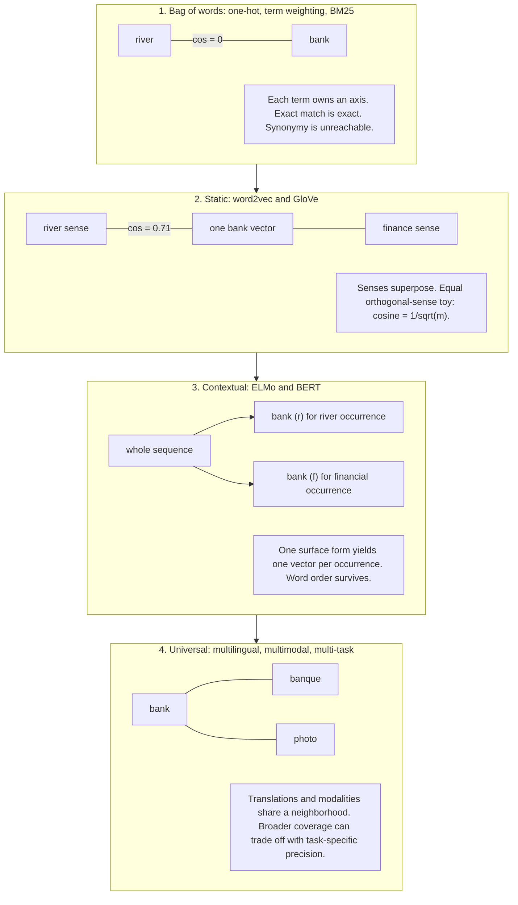
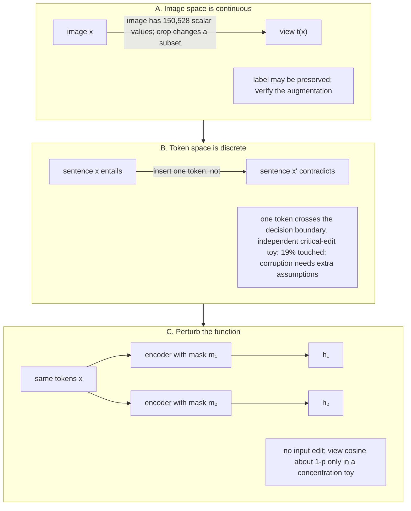
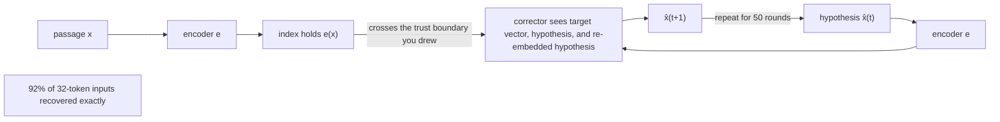

# Chapter 12: Text Representation
[00-START-HERE](../00-START-HERE.md) · [01-READING-ROUTES](../01-READING-ROUTES.md) · [11\_abstention\_and\_calibration](../part-03-prompting/11_abstention_and_calibration.md) · [13\_chunking\_and\_granularity](13_chunking_and_granularity.md)
This chapter explains how text representations trade exact matching, semantic reach, operational stability, training cost, and privacy in a Retrieval-Augmented Generation (RAG) system.
## TL;DR
- A lexical vector gives every term its own fixed axis. It catches rare codes exactly, but it cannot recognize synonyms unless another mechanism helps.
- A static dense vector brings related words together. It also averages every sense of a word into one point and loses word order when a chunk is mean-pooled.
- A contextual vector chooses a meaning from the whole sequence. A universal vector extends the shared space across languages, modalities, or tasks, but each extension can reduce precision elsewhere.
- Sparse and dense describe support, not memory cost. A 30,522-dimensional sparse chunk stores 160 nonzero values, while a 768-dimensional dense chunk stores all 768 values.
- An embedding space is tied to the corpus and encoder version that created it. Never mix vectors from independently trained encoders without a validated alignment.
- Text augmentation can change meaning with one token. Two dropout passes preserve the input while creating distinct training views, which makes dropout the stronger free positive in the reported experiments.
- A sentence embedding is not a privacy-safe hash. The reported inversion method recovered $`92\%`$ of 32-token inputs exactly, and quantization reduced memory without becoming redaction.
## The story
Imagine one secure technical library that must answer questions about millions of support manuals.
The librarian starts with a card catalog. Every printed term owns one drawer. A rare error code points to exactly the manuals that contain it. The drawers cannot infer that car and automobile are related, because those cards live in different places.
The librarian next builds a semantic floor map. Words used near the same topics sit near each other. This map finds synonyms, but one pin must represent every meaning of bank. The pin lands between the river meaning and the financial meaning.
The librarian then reads each sentence before placing its pin. Bank beside river gets one pin, while bank beside finance gets another. Word order also survives because placement depends on the full sequence.
The librarian later connects several buildings. French labels, English manuals, and photographs can share one neighborhood. That universal map opens new routes, but the librarian has limited map space. Adding languages and modalities can blur distinctions that one building handled more precisely.
The library keeps both the card catalog and the map. The catalog catches an error code that appears in three manuals. The map catches a paraphrase. Removing either system chooses a class of questions that may fail.
The collection changes over time. The word agent once lived near broker and attorney. New manuals use agent for autonomous software. The map reflects the corpus that trained it, so the librarian measures drift rather than assuming that word meanings stay fixed.
The librarian also stamps every map with its encoder version. Two cartographers may draw the same relative neighborhoods after rotating the whole page. A distance measured across their unaligned pages describes the rotation, not meaning.
The card catalog looks enormous because it has a drawer for every term. It is cheap because each manual touches only a few drawers. The dense map looks small because it has hundreds of coordinates. It is expensive because every manual stores every coordinate.
The librarian cannot name dense coordinate 412. A cartographer can rotate all coordinates while preserving every distance. The card catalog remains readable because drawer 412 has a term label fixed before training.
The training team now wants two views of every sentence. Cropping a photograph can preserve its subject. Deleting or replacing one word can reverse a sentence. The librarian therefore keeps the words unchanged and perturbs the mapmaker with two dropout masks.
Finally, the security officer asks whether a stolen map leaks the manuals. The vector holds far more bits than a short passage, and an attacker can guess text, re-embed the guess, and correct it toward the stolen vector. The library must guard the vector index like the source collection.
Compression makes the index smaller. It does not erase the encoded content. The librarian redacts before mapping, protects the embedding service, deletes vectors with source records, and never calls quantization a privacy control.
The complete lesson is one library policy. Choose each representation by the failure it prevents, keep incompatible maps apart, train sentence vectors with meaning-preserving positives, and treat every stored vector as governed content.
## Decoder table


| Technical term | Plain-English meaning | Why it matters |
| --- | --- | --- |
| Text representation | A numeric form of words, passages, or sentences | Retrieval can compare numeric objects at scale |
| Vocabulary $`V`$ | The set of terms that receive lexical coordinates | It fixes the axes of a classical sparse vector |
| Bag of words | A representation that counts terms and ignores order | It gives exact lexical evidence but cannot preserve sequence |
| One-hot vector | A vector with one active coordinate for one term | It makes different terms orthogonal by construction |
| Term frequency and inverse document frequency | A weighting that rewards terms in a document and discounts common terms | It lets rare terms dominate lexical scores |
| Best Matching $`25`$ (BM25) | A lexical ranking function with inverse document frequency and saturated term frequency | It remains strong for rare tokens and out-of-domain retrieval |
| Inverse document frequency ($`\mathop{\mathrm{idf}}\nolimits`$) | A weight that rises as a term appears in fewer documents | It gives rare identifiers strong ranking power |
| Diagonal weighting | Scaling each fixed term axis without mixing axes | It cannot create synonym similarity |
| Orthogonal terms | Terms whose vectors have zero inner product | Exact separation helps literal match and blocks synonymy |
| Static embedding | One learned dense vector for each surface word form | It captures semantic neighbors but mixes word senses |
| Continuous Bag of Words (CBOW) | A model that predicts a center word from its surrounding window | It learns a static distributional space |
| Skip-gram | A model that predicts surrounding words from a center word | Its learned geometry reflects word-context counts |
| Global Vectors (GloVe) | A static embedding method based on global co-occurrence counts | It reaches similar geometry through matrix factorization |
| Distributional hypothesis | The idea that contextual use provides evidence about meaning | It makes embeddings statistics of a corpus and moment |
| Polysemy | One surface word having several senses | A static vector averages those senses |
| Sense superposition | A frequency-weighted mixture of a word’s sense vectors | It limits similarity to the intended sense |
| Contextual embedding | A vector that depends on the whole token sequence | It separates senses and restores word order |
| Embeddings from Language Models (ELMo) | Contextual vectors read from bidirectional recurrent layers | It represents one occurrence rather than one word type |
| Long Short-Term Memory (LSTM) | A recurrent sequence layer | Two bidirectional LSTM layers form the cited ELMo stack |
| Bidirectional Encoder Representations from Transformers (BERT) | A bidirectional transformer encoder trained with masked tokens | It creates contextual token representations |
| Masked language modeling | Training that predicts hidden tokens from surrounding text | It creates contextual features but does not directly train sentence similarity |
| Universal embedding | One space intended to serve multiple languages, modalities, or tasks | It enables broader retrieval and introduces capacity trade-offs |
| Multilingual space | A shared vector space for several languages | A query in one language can retrieve a chunk in another |
| Multimodal space | A shared vector space for text and another modality such as images | A text query can retrieve a photograph |
| Multi-task space | One embedding space evaluated across several task types | It tests whether one model transfers across uses |
| Subword tokenization | Splitting an unseen string into familiar token fragments | Rare codes can lose their identity in a pooled dense vector |
| Inverted index | Posting lists from terms to matching documents | It creates an exact lexical gate and compact sparse storage |
| Posting | One stored occurrence or document reference for a term | Posting count drives classical index size |
| Mean pooling | Averaging final token vectors | Static-vector pooling loses order; contextual vectors can already encode order and interactions |
| Bi-encoder | Separate encoding of query and passage before fast vector comparison | It makes large retrieval collections practical |
| Hybrid retrieval | Combining lexical and dense retrieval legs | It covers literal tokens and paraphrases together |
| Rank fusion | Combining ordered result lists rather than raw scores | It merges legs whose scores are not directly comparable |
| Hierarchical Navigable Small World (HNSW) graph | A neighbor graph for approximate dense-vector search | It adds memory beyond the vectors |
| Approximate nearest neighbor search | Fast search that trades exact scanning for an indexed candidate path | Encoder dimension changes require a new recall and latency sweep |
| Pointwise Mutual Information ($`\mathop{\mathrm{PMI}}\nolimits`$) | A log ratio measuring how strongly a word and context occur together | Count changes directly alter distributional geometry |
| Meaning drift | A change in a word’s context distribution over time | A frozen encoder can become mismatched to a live corpus |
| Law of conformity | The reported pattern that frequent words change more slowly | Rare terms can drift faster |
| Law of innovation | The reported pattern that polysemous words change faster | Ambiguous terms deserve closer drift monitoring |
| Orthogonal transform | A rotation or reflection that preserves inner products | Independently trained spaces can disagree in coordinates without disagreeing in geometry |
| Orthogonal Procrustes alignment | Finding the best orthogonal map between two vector spaces | Drift comparisons need a common frame |
| Singular value decomposition (SVD) | A matrix factorization used to solve the stated alignment problem | It supplies the closed-form alignment map |
| Stale content | A source document that is itself outdated | It requires recrawling rather than re-embedding alone |
| Stale index | Correct content that never reached the vector index | It requires an incremental index write |
| Stale representation | A learned representation mismatched to the target workload | Adapt or replace it and re-embed consistently; unchanged re-embedding is not a repair |
| Sparse vector | A high-dimensional vector with few nonzero coordinates | Storage follows nonzeros rather than ambient dimension |
| Dense vector | A lower-dimensional vector whose coordinates are all stored | Every chunk pays for every coordinate |
| Ambient dimension | The size of the mathematical space containing a vector | It is different from the amount of stored support |
| Support | The coordinates with nonzero values | It determines sparse per-document storage |
| Nonzero count ($`\mathop{\mathrm{nnz}}\nolimits`$) | The number of active coordinates in a vector | It is the right first estimate for sparse index size |
| Fixed basis | Coordinates assigned meanings before model training | It makes lexical coordinates readable across index builds |
| Learned basis | Coordinates chosen by training and defined only up to rotation | An individual dense dimension has no stable label |
| Exact-match gate | A literal term either contributes a lexical posting or contributes nothing | It creates a large, auditable distinction |
| Dense margin | The small score advantage caused by one token inside a pooled vector | It can disappear within normal candidate-score spread |
| Anisotropy | Dense vectors concentrating in similar directions | It compresses useful cosine differences |
| Welch bound | A lower bound on maximum absolute coherence of unit vectors | A necessary constraint, not proof that a vocabulary has an almost-orthogonal embedding |
| Heaps’ law | A relation predicting vocabulary growth with corpus size | A huge vocabulary need not make sparse storage huge |
| Learned sparse model | A model that predicts weights on vocabulary coordinates | It keeps a readable basis while expanding beyond literal terms |
| Sparse Lexical and Expansion Model (SPLADE) | The cited learned sparse method that can activate absent vocabulary terms | Its active coordinate means query usefulness, not literal presence |
| FLOPS regularizer | A training penalty used to control learned sparse activation cost | It limits expanded nonzero counts |
| Sentence embedding | One vector for a whole token sequence | It enables fast pairwise comparison and retrieval |
| Classification token | The first BERT token sometimes used as a sentence vector | Raw use performs poorly when sentence similarity was not trained |
| Cross-encoder | A model that jointly reads both texts for each pair | It is accurate but expensive for all-pairs comparison |
| Information Noise Contrastive Estimation (InfoNCE) | A batch loss that pulls a positive close and pushes other items away | Positive-pair quality controls what the sentence space learns |
| Anchor | The first item in a contrastive pair | Its designated positive defines the desired invariance |
| Positive | A second item trained to be close to the anchor | A corrupted positive teaches the wrong equivalence |
| Negative | Another batch item trained to stay farther away | In-batch negatives provide comparison pressure |
| Temperature $`\tau`$ | A scale on contrastive logits | At $`\tau = 0.05`$, a cosine gap of $`0.1`$ becomes a logit gap of $`2`$ |
| Text augmentation | Editing a sentence to create another training view | A one-token edit can reverse meaning |
| Corruption rate | The probability that an augmented pair loses semantic equivalence | A critical-edit probability equals it only under extra semantic assumptions |
| Dropout | Randomly masking hidden units during training | Two masks create different views without changing the tokens |
| Simple Contrastive Learning of Sentence Embeddings (SimCSE) | The cited contrastive sentence-embedding method | Its reported dropout results test the proposed mechanism |
| Semantic Textual Similarity Benchmark (STS-B) | The cited sentence-similarity evaluation | It supplies the reported Spearman scores |
| Spearman correlation | A rank-correlation score | It measures agreement between embedding similarity and benchmark judgments |
| Alignment | Pulling designated positive representations together | An identical-view self-cosine has no positive alignment gradient; negative comparisons still update shared weights |
| Uniformity | Spreading representations through the space | It can improve even while positive alignment dies |
| Natural Language Inference (NLI) | Labeled entailment and contradiction data | Entailments supply stronger positives and contradictions supply hard negatives |
| Eval mode | Inference mode with dropout disabled | Every indexed text must use the same deterministic function |
| Embedding inversion | Recovering source text from its vector | It makes the vector index a copy-risk surface |
| Iterative correction | Guessing text, re-embedding it, and correcting toward a target vector | The encoder grades each attack hypothesis |
| Encoder oracle | Access to the same embedding function used by the index | It turns inversion into a measurable search loop |
| Cryptographic hash | A digest designed to destroy recoverable structure | It is the wrong analogy for similarity-preserving embeddings |
| Product quantization | Encoding subvectors with short codebook identifiers | It reduces memory but does not guarantee privacy |
| Binary quantization | One stored bit per embedding dimension in the example | Its size alone establishes neither privacy nor text recoverability |
| Redaction | Removing sensitive text before encoding | It prevents the removed content from entering the vector |
| Personally Identifiable Information (PII) | Data that can identify a person | It must be removed before embedding when policy requires it |
| Tombstone | A marker that hides a deleted index item before compaction | It is an immediate retrieval control, not final physical removal |
| Service Level Agreement (SLA) | A committed deadline for completing an operation | Vector compaction needs a stated deletion deadline |
| Large Language Model (LLM) projector | A learned map from retrieval vectors into the generator’s input space | It can replace many retrieved tokens with one vector |
| Modality mismatch | A gap between retrieval-vector geometry and generation-input geometry | The projector must learn to bridge it |
| Attention sink | Attention mass concentrating on an early position | It helps explain why one projected vector can carry document information |
| Multi-hop question | A question that combines a hierarchy of facts | One projected vector has limited structure for this case |
| $`V`$, $`d`$, $`W`$, $`e_i`$, $`\delta_{ij}`$, $`m`$, $`v_j`$, $`v_w`$, $`n`$, $`v_i`$, and $`f`$ | Vocabulary and embedding sizes, lexical weighting, basis vectors, the equality indicator, sense count and vectors, sequence length, contextual token vector, and encoder | These symbols define the four representation eras and the clean polysemy bound |
| $`D`$, $`\mathop{\mathrm{number}}\nolimits(w,c)`$, $`P(w,c)`$, $`u_w`$, $`v_c`$, $`b_w`$, $`b_c`$, $`k`$, $`r`$, and $`\Delta\mathop{\mathrm{PMI}}\nolimits`$ | $`n_{wc},n_w,n_c,T_{\mathrm{pair}}`$ are compatible word-context-pair counts; $`u_w,v_c,b_w,b_c,k`$ are factorization parameters | PMI drift includes total-pair renormalization; $`r=m/n_w`$ is term-use growth, not corpus growth |
| $`Q`$, $`W_t`$, $`W_{t+1}`$, $`I`$, $`USV^{\mathsf{T}}`$, and $`\lVert\cdot\rVert_F`$ | Orthogonal alignment map, embedding matrices at two times, identity matrix, singular value decomposition factors, and Frobenius norm | These symbols state why model spaces need alignment before drift comparison |
| $`x`$, $`z`$, $`\mathop{\mathrm{nnz}}\nolimits`$, $`\rho`$, $`S`$, $`N`$, $`d`$, $`M`$, $`m`$, $`k`$, and $`\beta`$ | Sparse and dense vectors, support size, mean token correlation, token-vector sum, corpus and vector sizes, graph degree, Welch vector count, and Heaps-law constants | These symbols price sparse support, dense storage, exact-match margin, and directional capacity |
| $`x_i`$, $`x_i^{+}`$, $`h_i`$, $`h_i^{+}`$, $`\tau`$, $`\mathop{\mathrm{loss}}\nolimits_i`$, $`c`$, $`p`$, $`m_1`$, $`m_2`$, $`u_i`$, $`v_i`$, $`e(x)`$, $`\widehat{x}(t)`$, $`t`$, and product-quantization $`m`$ | Contrastive texts and vectors, temperature and loss, critical-token count, dropout rate and masks, masked views, encoder output, iterative text guess, correction round, and subvector count | These symbols define the contrastive, dropout, inversion, and quantization mechanisms |


## Core mechanics
### Mathematical conventions
Use natural logarithms and nats except for explicit $`\log_2`$ information calculations in bits. Storage is decimal: $`1\,\mathrm{GB}=10^9\,\mathrm B`$. Distinguish vector payload, base-layer graph allocation and a complete index. Compute proxies use $`2NT`$ forward work and $`6NT`$ training work at $`P=3.4\times10^{14}\,\mathrm{FLOP\,s^{-1}}`$, not measured time; attention, padding beyond the stated budget, memory bandwidth, communication, serial generation, index I/O and rollout can add cost. Corpus counts, token counts and word-context-pair counts have different denominators. Mean-pooling coefficients, changes in cosine and lexical score shares are not interchangeable measures of influence. Container bits are a storage budget, not measured mutual information, an inversion guarantee, or a privacy threshold. Empirical benchmark and attack results below remain reported inputs under their study settings.
### 12.1 Four eras: bag of words to static to contextual to universal {color="brown_bg"}
#### Era one: fixed lexical axes {color="gray_bg"}


> 🧩 **What it is:**


Fix a vocabulary $`\mathcal V`$ with size $`V=\lvert\mathcal V\rvert`$. A chunk becomes a vector in $`\mathbb R^V`$ whose coordinate $`t`$ depends on the count of term $`t`$. A vocabulary near $`10^5`$ is the chapter’s scenario scale. TF–IDF and BM25 retain the same lexical basis, but use different term-frequency, query and document-length weights; BM25 need not be a symmetric dot product of identically transformed vectors. With diagonal $`W=\mathop{\mathrm{diag}}\nolimits(\mathop{\mathrm{idf}}\nolimits_1,\ldots,\mathop{\mathrm{idf}}\nolimits_V)`$, a weighted bilinear score has:

```math
\langle e_i, W e_j\rangle = \mathop{\mathrm{idf}}\nolimits_i\cdot\delta_{ij}
```

For the ordinary dot product of two vectors each multiplied by $`W`$, the diagonal weights are squared: $`\langle We_i,We_j\rangle=\mathop{\mathrm{idf}}\nolimits_i^2\delta_{ij}`$. Neither convention creates off-diagonal synonym similarity.


> 🎯 **Why it exists:**


A rare term keeps its own axis. A code found in three chunks out of five million can dominate a result without supervision.


> ⚠️ **What breaks without it:**


A dense-only system can miss an exact code, version, product identifier, or rare name. No rescaling of fixed orthogonal axes can create synonym similarity either.


> ⚙️ **Cost and complexity:**


The worked corpus has $`5\times10^6`$ chunks and about $`150`$ distinct terms per chunk, giving $`7.5\times10^8`$ postings. At an assumed $`5\,\mathrm{B/posting}`$, the posting payload is $`3.75\,\mathrm{GB}`$, excluding the term dictionary, positions, skip data, metadata and allocator overhead.
#### Era two: static dense word vectors {color="gray_bg"}


> 🧩 **What it is:**


Project vocabulary axes into about 300 learned dimensions. Similar contexts place words near one another. CBOW predicts the center word from its surrounding window. Skip-gram predicts the surrounding window from the center word (Mikolov et al., 2013). GloVe factorizes a global co-occurrence matrix (Pennington et al., 2014). For $`m`$ equally frequent, mutually orthogonal unit senses $`v_{j}`$, Arora et al. (2018) give the cited clean-case superposition:

```math
v_w = \frac{1}{\sqrt{m}}\sum_{j=1}^{m}v_j
```


```math
\cos(v_w,v_j) = \frac{1}{\sqrt{m}}
```


> 🎯 **Why it exists:**


Off-diagonal similarity becomes nonzero. Synonymy becomes reachable.


> ⚠️ **What breaks without it:**


Lexical axes treat car and automobile as unrelated terms. **What this era breaks:** One surface form gets one vector. In the stipulated equal-weight orthogonal-sense model, similarity is exactly $`1/\sqrt2\approx0.707107`$ for two senses and $`1/\sqrt3\approx0.577350`$ for three. These are not universal upper bounds for unequal, correlated or context-dependent senses. The chapter notes that merely topical neighbors can exceed $`0.6`$.


> ⚙️ **Cost and complexity:**


Mean-pooling 300-dimensional static vectors for $`5\times 10^{6}`$ chunks costs $`6.0`$ GB in 32-bit floating point. Mean pooling also makes word order invisible.
#### Era three: contextual vectors {color="gray_bg"}


> 🧩 **What it is:**


Token $`i`$ becomes a function of the full sequence.

```math
v_i = f(w_1,\ldots,w_n)_i
```

ELMo stacks two bidirectional LSTM layers and learns a mixture of them (Peters et al., 2018). BERT uses a bidirectional transformer trained by masked language modeling (Devlin et al., 2019).


> 🎯 **Why it exists:**


The sequence selects the sense. It removes static sense averaging and restores word order.


> ⚠️ **What breaks without it:**


The sentences does the driver block the update and does the update block the driver receive the same mean-pooled static vector. **What this era still breaks:** Rare identifiers can fragment under subword tokenization. Mean pooling assigns each final token vector coefficient $`1/n`$. This is not a bound on one input token’s causal influence: contextualization can change many positions, and normalization changes the final cosine.


> ⚙️ **Cost and complexity:**


A 768-dimensional contextual index for $`5\times 10^{6}`$ chunks costs $`15.36`$ GB in 32-bit floating point.
#### Era four: universal spaces {color="gray_bg"}


> 🧩 **What it is:**


One space attempts to serve several languages, modalities, or tasks. Across languages, a French query can retrieve an English chunk. The chapter ties the same shared-space property to translation without an explicit translation objective. Across modalities, text and images can share a neighborhood. Across tasks, Muennighoff et al.’s benchmark evaluates one model on 8 task types, 58 datasets, and 112 languages.


> 🎯 **Why it exists:**


One index can support cross-language and cross-modal retrieval.


> ⚠️ **What breaks without it:**


Separate monolingual or unimodal spaces cannot directly answer a cross-space query. **What this era can break:** The chapter cites the curse of multilinguality. At fixed capacity, adding languages can reduce per-language quality past a point.


> ⚙️ **Cost and complexity:**


A $`1{,}024`$-dimensional fp32 vector payload for $`5\times10^6`$ chunks is $`20.48\,\mathrm{GB}`$. If $`M_0=32`$ means exactly $`32`$ allocated base-layer neighbor slots of $`4\,\mathrm B`$ per node, links add $`128\,\mathrm{B/vector}`$ or $`0.64\,\mathrm{GB}`$, a $`3.125\%`$ ratio to vector payload. This differs from the common HNSW parameter convention $`M=32`$, which allows $`2M=64`$ base-layer slots and budgets $`1.28\,\mathrm{GB}`$. Neither is a complete index-memory estimate.
#### The rare-token worked example {color="gray_bg"}
The corpus has $`5\times10^6`$ chunks of $`250`$ tokens, four languages and $`10{,}000`$ daily queries. Consider `ERR_0x8007005F failed to write registry key`. Assume the code is one lexical term, $`to`$ is removed as a stopword, and the four remaining ordinary terms have the stated frequencies. The code occurs in three chunks. With the specified positive BM25 IDF convention:

```math
\mathop{\mathrm{idf}}\nolimits_{\mathrm{code}}=\ln\!\left(\frac{5\times10^6-3+0.5}{3+0.5}+1\right)\approx14.17218570.
```

If each retained ordinary term occurs in $`10^6`$ chunks, its IDF is $`\ln[(5{,}000{,}001)/(1{,}000{,}000.5)]\approx1.60943761`$. Assuming equal query and term-saturation factors, the code’s score share is:

```math
\frac{\mathop{\mathrm{idf}}\nolimits_{\mathrm{code}}}{\mathop{\mathrm{idf}}\nolimits_{\mathrm{code}}+4\mathop{\mathrm{idf}}\nolimits_{\mathrm{ordinary}}}\approx0.687638506\approx68.764\%.
```

Mean pooling gives each final token vector coefficient $`1/250=0.4\%`$. That coefficient and the $`68.764\%`$ lexical score share measure different things; their ratio is not a $`170`$-fold influence comparison. Token fragmentation, contextualization, pooling and normalization determine the dense effect. A $`1{,}024`$-dimensional fp32 vector uses $`4{,}096\,\mathrm B`$. If this $`250`$-token English chunk uses about $`4\,\mathrm{B/token}`$, its source payload is about $`1{,}000\,\mathrm B`$, giving a $`4.096{:}1`$ vector/text-payload ratio. This language-dependent approximation excludes both systems’ overhead.


> 🎯 **Why the comparison matters:**


The benchmark cited by Thakur et al. found BM25 a robust out-of-domain baseline. Dense retrievers trained on one distribution often failed to beat it off that distribution. **Claim limit:** This does not say BM25 always wins. It says one global recall score can hide a literal-token regression and that each representation chooses a failure class.
#### Decisions from section 12.1 {color="gray_bg"}
Default to hybrid retrieval with a sparse leg and a contextual or universal dense leg. Remove the sparse leg only after query logs show no identifiers, codes, versions, tokenizer-external proper nouns, or other literal-token demand. Split evaluation into literal-token and paraphrase slices. Do not trust one global recall-at-$`k`$ score. Do not mean-pool static word vectors over text longer than a phrase. The result is both order-blind and sense-averaged. Use static vectors for lexical-neighbor query expansion when that is the desired behavior. Adopt a multilingual model only after measuring dominant-language regression and real cross-language demand. Treat re-embedding as an operations migration. The cited corpus contains $`1.25\times 10^{9}`$ tokens. At $`2N`$ floating-point operations per token for a 110 million-parameter encoder, the work is $`2.75\times 10^{17}`$ floating-point operations. At the assumed $`3.4\times10^{14}\,\mathrm{FLOP\,s^{-1}}`$, this is $`808.82\,\mathrm{s}`$, or $`13.4804`$ minutes of idealized parameter work, not a measured migration time. The dual-index window, evaluation rerun, and rollback plan set the schedule. A changed dimension also requires new approximate-nearest-neighbor parameters and a fresh recall-versus-latency sweep.
### 12.2 Distributional semantics and meaning drift {color="brown_bg"}
#### Meaning as a corpus statistic {color="gray_bg"}


> 🧩 **What it is:**


The distributional hypothesis estimates representations from observed contexts. The chapter traces it to Harris (1954), Firth (1957) and Wittgenstein (1953). Let $`n_{wc}`$ count observed word-context pairs, $`n_w=\sum_c n_{wc}`$, $`n_c=\sum_w n_{wc}`$, and $`T_{\mathrm{pair}}=\sum_{w,c}n_{wc}`$. These are consistent pair-event counts, not a mix of corpus tokens, documents and bytes. For positive relevant counts, PMI is:

```math
\mathop{\mathrm{PMI}}\nolimits(w,c)=\ln\frac{P(w,c)}{P(w)P(c)}.
```


```math
\mathop{\mathrm{PMI}}\nolimits(w,c)=\ln\frac{n_{wc}T_{\mathrm{pair}}}{n_wn_c}.
```

At the unconstrained positive-count optimum of skip-gram negative sampling, with $`k>0`$ negatives per positive and context sampling distribution $`q(c)>0`$, the score is $`\ln[P(c\mid w)/(kq(c))]`$. The familiar shifted-PMI form below requires $`q(c)=P(c)`$; smoothed unigram negative sampling introduces an additional context-dependent term (Levy and Goldberg, 2014). Finite-rank fitting and regularization need not attain each pairwise optimum.

```math
u_w^{\mathsf T}v_c=\mathop{\mathrm{PMI}}\nolimits(w,c)-\ln k\qquad\text{at the ideal optimum when }q(c)=P(c).
```

GloVe uses the following weighted least-squares target for positive co-occurrence counts, not an identity that every pair satisfies at a finite-dimensional fitted optimum:

```math
u_w^{\mathsf T}v_c+b_w+b_c\approx\ln n_{wc}.
```


> 🎯 **Why it exists:**


It turns observed use into computable geometry.


> ⚠️ **What breaks without it:**


A representation cannot learn semantic neighborhoods from unlabeled corpora. **Its limit:** The vector describes one corpus at one moment. It does not store an eternal meaning.
#### Count drift {color="gray_bg"}
Append $`m`$ word-context pair events for $`w`$, all in contexts other than the old $`c`$, and leave $`n_{wc}`$ and $`n_c`$ unchanged. Let $`r=m/n_w`$, using the original $`n_w>0`$. The old conditional-context association falls by $`-\ln(1+r)`$. PMI also includes the changed total pair count:

```math
\begin{aligned}
\Delta\ln P(c\mid w)&=-\ln(1+r),\\
\Delta\mathop{\mathrm{PMI}}\nolimits(w,c)&=\ln\left(1+\frac{m}{T_{\mathrm{pair}}}\right)-\ln(1+r).
\end{aligned}
```

At $`r=0.5`$, the conditional change is $`-\ln1.5\approx-0.405465`$ nats and the conditional association is multiplied by $`2/3`$. PMI has approximately the same change only when $`m/T_{\mathrm{pair}}`$ is negligible; otherwise use the additional normalization term.


> 🎯 **Why it matters:**


The conditional context distribution shifts toward the appended contexts. Neither the PMI update nor this mixture statement proves a literal geometric rotation or a proportional movement of fitted contextual vectors. The slow clock is language change over decades. Hamilton et al. recover the cited shifts of gay and broadcast from decade slices. They report a law of conformity, with semantic-change rate scaling as a negative power of frequency. They also report a law of innovation, with rate scaling as a positive power of polysemy. **Operational implication:** Rare and ambiguous terms can drift fastest. Those terms can also decide lexical rankings because of high inverse document frequency. The fast clock is a company’s live corpus, which can adopt a new sense in months.
#### Why cross-model cosine fails {color="gray_bg"}


> 🧩 **What it is:**


An orthogonal transform preserves inner products: for column vectors and $`Q^{\mathsf T}Q=I`$, $`(Qu)^{\mathsf T}(Qv)=u^{\mathsf T}v`$. This is a symmetry of an inner-product objective, not necessarily its only non-identifiability: two separate unconstrained factor matrices can also transform by an invertible map and its inverse transpose. A shared orthogonal change preserves cosine and distance as well.


> 🎯 **Why alignment exists:**


Two independent models can place the same relative triangle at different absolute coordinates.


> ⚠️ **What breaks without it:**


Without known compatibility, a cross-version cosine mixes coordinate mismatch with semantic differences and cannot isolate drift. For equal-dimensional row-vector anchor matrices, the orthogonal alignment problem is: The stated Procrustes problem is:

```math
\min_{Q}\;\lVert W_tQ-W_{t+1}\rVert_F
```


```math
\text{subject to}\quad Q^{\mathsf{T}}Q=I
```

If $`W_t^{\mathsf{T}}W_{t+1}`$ has SVD $`USV^{\mathsf{T}}`$, the stated closed-form map is $`Q = UV^{\mathsf{T}}`$. The chapter attributes this closed form to Schoenemann (1966).


> ⚙️ **Cost and complexity:**


Alignment needs matched stable anchors, equal dimensions for this orthogonal map, and held-out validation. Arbitrary encoder changes may not be well approximated by one orthogonal map. The operational alternative is a complete re-embedding with the selected encoder.
#### Three different stale states {color="gray_bg"}
Stale content requires correcting or recrawling the source. A stale index requires indexing a current document. A stale representation may require adapting or replacing the encoder and then consistently re-embedding, or adding validated lexical and alias handling. Re-encoding unchanged text with an unchanged deterministic encoder produces the same vector and cannot by itself repair a semantic mismatch. Incremental content writes and representation adaptation address different failures.
#### The engineering-wiki worked example {color="gray_bg"}
The wiki has $`2\times10^6`$ chunks of $`250`$ tokens, encoded into $`768`$ dimensions by a $`110`$-million-parameter model. The corpus grows $`4\%`$ monthly. The term `agent` appears in $`12{,}000`$ original chunks; $`6{,}000`$ new chunks use the software sense after nine months. In a separate one-use-per-chunk conditional-frequency toy, $`r=6{,}000/12{,}000=0.5`$ gives the $`-0.405465`$-nat old-context change. These document counts alone do not establish a pair-count PMI change. A frozen contextual encoder may or may not already represent the new sense; measure relevant-query ranking, not just consistency. Mixing old v1 vectors with v2 queries is a separate compatibility risk. For independently oriented isotropic unit vectors in $`d=768`$, the cross-cosine reference is mean zero with SD:

```math
\mathop{\mathrm{sd}}\nolimits(u^{\mathsf T}v)=\frac1{\sqrt{768}}\approx0.03608439.
```

A threshold $`0.6`$ is $`0.6\sqrt{768}\approx16.6277`$ SDs above that reference mean. Real encoder-version pairs need not have random orientations or isotropic vectors; this comparison is not a measured tail probability or proof that the old index becomes unreachable. The next growth equation requires the term’s own use count to grow $`4\%`$ monthly, with all added uses in disjoint new contexts. Corpus-wide growth alone does not imply it.

```math
1+r(t)=1.04^t\qquad\text{only under the stated term-count growth model}.
```

The association-halving threshold arrives at:

```math
t_{1/2}=\frac{\ln2}{\ln1.04}\approx17.672988\ \mathrm{months}.
```

A term whose own occurrence count doubles each quarter solely through disjoint new contexts halves this old-context conditional association in a quarter. This is not an encoder-quality deadline or a universal PMI clock. Re-embedding $`2\times10^6`$ chunks of $`250`$ tokens processes $`5\times10^8`$ tokens; the forward proxy is $`1.1\times10^{17}\,\mathrm{FLOP}`$, $`323.5294\,\mathrm{s}`$ or $`5.3922`$ minutes. It becomes a repair only with corrected text or a changed/adapted representation. Validation and rollout set the actual schedule.
#### Decisions from section 12.2 {color="gray_bg"}
Make the model version part of the index identity. Use one collection per encoder and revision pair. Refuse partial migrations unless an alignment map has passed held-out paraphrase validation. Trigger representation review from measured retrieval degradation rather than a calendar alone; re-embedding unchanged text with unchanged weights does not repair it. The chapter’s default monitor reports terms whose document frequency more than doubled since build time. It intersects that list with query logs and considers encoder adaptation, replacement or lexical support when such a term appears in more than $`1\%`$ of queries; a representation change then requires consistent re-embedding. Separate a new token from a new sense. A sparse index handles a new surface token as soon as it is written. It does not separate two senses of an old term. Freeze $`200\text{–}300`$ query and known-relevant-chunk probe pairs at index build time. Report the known chunk’s rank monthly. Refresh the probe set when it stops matching live traffic. Mark that refresh as a discontinuity. Use continued contrastive training when permanent domain senses have tens of thousands of in-domain pairs. When examples number only in the hundreds, the chapter recommends a cheaper and more auditable alias or sparse expansion layer.
### 12.3 Sparse versus dense {color="brown_bg"}
#### Dimension is not storage {color="gray_bg"}


> 🧩 **What it is:**


A sparse vector $`x\in\mathbb R^V`$ has $`\mathop{\mathrm{nnz}}\nolimits(x)`$ nonzero entries. A typical dense vector $`z\in\mathbb R^d`$ stores all $`d`$ coordinates, whether or not some happen to be zero. For $`250`$ tokens at type-token ratio $`0.64`$, the scenario uses $`160`$ distinct terms; at $`V=30{,}522`$, density is $`160/30{,}522\approx0.5242\%`$. A $`768`$-coordinate dense payload stores $`768/160=4.8`$ times the scalar values, but sparse values also require identifiers and indexing overhead. Exact zeros depend on architecture and quantization, not the definition of dense storage.


> 🎯 **Why the distinction exists:**


Dimension measures ambient space. Support measures stored coordinates.


> ⚠️ **What breaks without it:**


Capacity planning can invert the true memory ratio by reasoning from dimension names alone.
#### Fixed basis and readable coordinates {color="gray_bg"}


> 🧩 **What it is:**


Sparse coordinate $`j`$ means term $`j`$ because the vocabulary fixes the basis before training.


> 🎯 **Why it exists:**


A rare term owns one axis. A new term gets an axis when indexed.


> ⚠️ **What breaks without it:**


An individual dense coordinate cannot carry a stable label. The dense objective depends on inner products. Any orthogonal rotation rewrites coordinates while preserving retrieval. **Claim limit:** A probe can find a predictive direction. The symmetry rules out a stable claim about one coordinate, not every analysis of a direction. Interpretability comes from the fixed basis, not sparsity alone. Learned sparse models preserve a vocabulary basis but change the coordinate claim. SPLADE can activate a term absent from the document. The weight then means the term is a useful query for that document, not that the document contains it.
#### Exact match as gate versus margin {color="gray_bg"}
Take unit token vectors $`v_{1}`$ through $`v_{n}`$ with mean pairwise inner product $`\rho`$. Let $`S`$ be their sum.

```math
\lVert S\rVert = \sqrt{n+n(n-1)\rho}
```

For $`q=v_t`$, the matching token supplies a numerator term $`q^{\mathsf T}v_t=1`$. Dividing that term by $`\lVert S\rVert`$ gives its own-term coefficient, not automatically the change in cosine relative to a nonmatching chunk. Under a stronger comparison toy in which every distinct token pair has inner product $`\rho`$ and replacing $`v_t`$ by a nonmatching unit token preserves the sum norm, the actual matched-versus-replaced score difference is:

```math
\Delta\cos=\frac{1-\rho}{\sqrt{n+n(n-1)\rho}}\qquad\text{under the matched-replacement toy}.
```

For $`n=250,\rho=0`$, this toy difference is $`1/\sqrt{250}\approx0.06324555`$. At $`\rho=0.5`$, $`\lVert S\rVert=\sqrt{31{,}375}\approx177.129896`$; the own-term coefficient is approximately $`0.00564557`$, but the matched-replacement difference is approximately $`0.002822787`$. Real contextual vectors need not satisfy this equicorrelation or fixed-norm comparison.


> 🎯 **Why it matters:**


A measured exact-match advantage must be judged against the candidate-score spread; neither $`0.00564557`$ nor $`0.00282279`$ is a universal production margin. The chapter cites Ethayarajh (2019) for last-layer GPT-2 word cosine near $`1.0`$ and increasing anisotropy with depth in BERT and ELMo. On the sparse side, a document without the term scores exactly $`0`$ for that term. The distinction is a gate rather than a small margin.
#### Why more dense dimensions do not fix the objective {color="gray_bg"}
Raising $`d`$ from $`768`$ to $`4{,}096`$ for $`10^7`$ fp32 vectors increases payload from $`30.72\,\mathrm{GB}`$ to $`163.84\,\mathrm{GB}`$, a ratio of $`16/3\approx5.3333`$. To state what the Welch bound does and does not show, let $`m>d`$ unit vectors have maximum absolute coherence $`\mu`$:

```math
\mu=\max_{i\ne j}\lvert v_i^{\mathsf T}v_j\rvert\ \ge\ \sqrt{\frac{m-d}{d(m-1)}}.
```

For $`m = 30{,}522`$ and $`d = 768`$, it is:

```math
\sqrt{\frac{30{,}522-768}{768\times30{,}521}}\approx0.035628102.
```

This is close to the random-unit-vector chance level $`\frac{1}{\sqrt{768}} = 0.036`$.


> 🎯 **Why it exists:**


This is a necessary lower bound, not a construction or an upper bound proving that all vocabulary vectors can attain coherence near $`0.0356281`$. Its proximity to $`1/\sqrt{768}`$, the SD of a random pair, does not control the maximum over all pairs. Higher dimension can help some literal and semantic retrieval failures; dimension alone does not reserve an exact term-match gate. Use measured retrieval slices to decide whether a lexical leg or a stronger dense encoder is the better repair.
#### Ten-million-chunk memory example {color="gray_bg"}
Take $`N = 10^{7}`$ chunks, 250 tokens each, 160 distinct terms per chunk, and $`d = 768`$. The inverted index has $`10^{7}\times 160 = 1.6\times 10^{9}`$ postings. Naive 4-byte document identifiers plus 4-byte term frequencies cost $`12.8`$ GB. Sorted identifiers permit gap coding. The chapter states the approximate information cost:

```math
\log_2\!\binom{N}{n} \approx n\cdot\left(\log_2\!\frac{N}{n}+\log_2(e)\right)\;\text{bits}
```

At posting-list length $`n=10^5`$, the leading sparse-subset approximation gives $`8.086551`$ bits, or $`1.010819\,\mathrm{B/posting}`$. The corresponding leading values are about $`0.5956\,\mathrm{B}`$ at $`n=10^6`$ and $`2.6718\,\mathrm{B}`$ at $`n=10`$. This is an idealized coding scale for a uniformly distributed subset, not a promise about a real gap codec. It also omits finite-density corrections. A corpus-wide average needs the posting-list frequency distribution and codec.
If one independently assumes $`1\,\mathrm{B}`$ per document identifier on average and $`0.25\,\mathrm{B}`$ per frequency, $`1.6\times10^9`$ postings have a $`2.00\,\mathrm{GB}`$ payload budget. The dictionary, positions, skips and other overhead are extra. Raw dense payload is $`30.72\,\mathrm{GB}`$; HNSW with $`M=32`$ and $`64`$ four-byte base-layer slots adds $`2.56\,\mathrm{GB}`$, totaling a scoped $`33.28\,\mathrm{GB}`$. This is $`16.64`$ times the conditional sparse payload, not a complete-index benchmark.
Heaps’ scenario $`V(T)=30T^{0.5}`$ at $`T=2.5\times10^9`$ predicts $`1.5\times10^6`$ types, or about $`1{,}953.125`$ times $`768`$. It does not by itself establish a $`2\,\mathrm{GB}`$ dictionary-plus-postings budget. The exact-match toy above gives about $`0.00282279`$ for $`n=250,\rho=0.5`$; measure actual paired chunks instead of treating it as a universal margin. fp16 halves vector payload to $`15.36\,\mathrm{GB}`$, but rounding can alter geometry and recall. For $`21{,}015{,}324`$ DPR passages at $`768`$ fp32 coordinates, payload is $`64.559075\,\mathrm{GB}`$, consistent with a rounded $`65\,\mathrm{GB}`$ release description. A classical-index estimate near $`2\,\mathrm{GB}`$ needs its own terms, postings and codec assumptions.
#### Decisions from section 12.3 {color="gray_bg"}
Estimate sparse storage from posting counts, the frequency histogram, identifier and weight codecs, dictionary and required auxiliary data; one byte per identifier is a workload assumption, not a universal constant. Estimate dense storage as $`N\times d\times\text{bytes}`$ plus $`N\times2M\times4`$ for the stated HNSW layer-zero graph. Adjust the sparse estimate upward for learned expansion. SPLADE’s FLOPS regularizer controls that cost. Keep a fixed-basis leg for queries whose answer is a string. Examples include stock-keeping units, error codes, ticket identifiers, versions, and names. Fuse by rank rather than raw score. A lexical leg directly enforces literal term matches; increasing $`d`$ may improve measured quality but does not itself guarantee this gate. If paraphrase misses dominate, a stronger or multi-vector encoder can be the right spend. Measure the exact-match margin. Embed 100 paired passages with and without identifiers. Compare paired score differences with the interquartile range of top-100 live-query scores. Under the matched-replacement toy, $`n=25,\rho=0.5`$ gives $`(1-0.5)/\sqrt{325}\approx0.02773501`$, approximately $`9.8254`$ times the $`250`$-token toy value, not a guaranteed chunking gain. Use sparse term weights as a debugging surface. Do not claim that they explain why a passage answers a question.
### 12.4 Sentence embeddings and text augmentation {color="brown_bg"}
#### A sentence vector needs a sentence objective {color="gray_bg"}


> 🧩 **What it is:**


A sentence encoder maps token sequence $`x = (w_1,\ldots,w_n)`$ to $`h\in\mathbb{R}^{d}`$.


> 🎯 **Why it exists:**


Pairwise cross-encoding does not scale to retrieval collections. For $`10^{4}`$ sentences, all unordered pairs total $`49{,}995{,}000`$ forward passes. Reimers and Gurevych report roughly 65 hours for that comparison. Pre-encoding each sentence and using dot products takes about 5 seconds. Three cited pooling choices are the first BERT classification token, the first token generated by a decoder, and the mean of encoder token vectors. Raw BERT classification-token vectors score $`29.19`$ average Spearman on the cited semantic-textual-similarity benchmarks. Mean-pooled BERT scores $`54.81`$. Both trail averaged GloVe vectors in that report.


> ⚠️ **What breaks without the right objective:**


Masked language modeling never asks a pooled sentence vector to place paraphrases together. Pooling alone cannot add that property.
#### Contrastive training and positive sensitivity {color="gray_bg"}
For anchor $`x_{i}`$, positive $`x_{i}^{+}`$, batch size $`N`$, and temperature $`\tau`$, the stated loss is:

```math
\mathop{\mathrm{loss}}\nolimits_i = -\log\!\left(\frac{\exp\!\left(\cos(h_i,h_i^{+})/\tau\right)}{\sum_{j=1}^{N}\exp\!\left(\cos(h_i,h_j^{+})/\tau\right)}\right)
```

The chapter sets $`\tau = 0.05`$. A cosine gap of $`0.1`$ becomes a logit gap of 2.


> 🎯 **Why it exists:**


The loss directly asks the sentence space to recognize designated equivalents.


> ⚠️ **What breaks without valid positives:**


A corrupted positive teaches the encoder to merge different meanings.
#### Why vision augmentation does not transfer {color="gray_bg"}
A $`224\times224\times3`$ image has $`150{,}528`$ scalar values; particular vision augmentations may preserve a label but are not guaranteed to do so. Text sequences lie in a discrete token space. Inserting $`not`$ into a six-token claim changes one of seven resulting positions and can reverse its meaning; this is an edit-fraction convention, not a semantic distance. Suppose $`c`$ critical positions are each independently edited with probability $`\rho`$. The probability of touching at least one is:

```math
\Pr(\text{at least one critical position edited})=1-(1-\rho)^c.
```

For $`c=2`$, the probabilities are $`19\%,36\%,51\%`$ at $`\rho=0.1,0.2,0.3`$. They equal semantic corruption only under the extra assumption that every critical edit invalidates equivalence and no other edit does. Contiguous cropping does not follow the independent-position model. One uniformly selected deletion in a $`20`$-token sentence with two critical positions touches one with probability $`2/20=10\%`$, not $`19\%`$.


> 🎯 **Why the formula matters:**


The contrastive loss cannot identify mislabeled pairs. It pulls a claim toward its negation exactly as instructed. **Claim limit:** The chapter does not claim every generated paraphrase is bad. It requires measuring semantic corruption rather than assuming label preservation.
#### Dropout moves the function, not the input {color="gray_bg"}
Feed the same tokens through the same encoder with independent dropout masks $`m_{1}`$ and $`m_{2}`$.

```math
h_1 = f_{m_1}(x),\qquad h_2 = f_{m_2}(x)
```

For a fixed nonzero hidden vector $`h`$, independently Bernoulli-masked coordinates in both views, and $`0\le p<1`$, consider this output-mask toy with inverted scaling:

```math
u_i = \frac{m_{1i}h_i}{1-p},\qquad v_i = \frac{m_{2i}h_i}{1-p}
```

The stated expectations are:

```math
\mathbb{E}[\langle u,v\rangle] = \lVert h\rVert^2
```


```math
\mathbb{E}[\lVert u\rVert^2] = \frac{\lVert h\rVert^2}{1-p}
```

Ratios of these expectations do not equal the expectation of a cosine. If masked norms concentrate, effective dimension is large and the views are nonzero, the toy gives the approximation:

```math
\cos(u,v) \approx 1-p
```

Under those assumptions, the cosine is approximately $`0.90`$ at $`p=0.1`$ and $`0.50`$ at $`p=0.5`$. A shared mask gives cosine $`1`$ only for a nonzero resulting vector. This output-mask toy is not an exact analysis of a transformer with dropout at many internal layers.


> 🎯 **Why it exists:**


The input strings are identical, so there is no input-edit semantic corruption. Independent masks can produce useful distinct views, but they do not guarantee representation quality or a particular similarity.


> ⚠️ **What breaks without independent masks:**


A fixed shared mask produces the same positive vector. For identical nonzero views, self-cosine is constantly $`1`$, so this positive-similarity term has zero derivative. Negative comparisons can still update the shared encoder; it is not only negative examples that receive parameter gradients.
#### Reported augmentation findings {color="gray_bg"}
Unsupervised SimCSE with $`p = 0.1`$ scores $`82.5`$ Spearman on STS-B development (Gao et al., 2021). The $`p = 0.5`$ result is $`71.0`$. The $`p = 0`$ result is $`71.1`$. Reusing a fixed mask falls to $`43.6`$. The interpretation stated in the chapter is that alignment dies while uniformity improves with the fixed mask, using the decomposition of Wang and Isola (2020). Every tested discrete augmentation loses to dropout in the cited table. Cropping $`10\%`$ of tokens scores $`77.8`$. Deleting one word scores $`75.9`$. Synonym replacement scores $`77.4`$. Masked-language-model token replacement at $`15\%`$ scores $`62.2`$. Supervised SimCSE uses NLI entailments as positives and contradictions as hard negatives. Its cited averaged Spearman score is $`81.6`$ versus $`76.3`$ for unsupervised SimCSE. The difference is $`5.3`$ points. **Claim limit:** Dropout is the best free positive in the reported comparison. It is not better than genuine labeled positives.
This section compares ways to create two versions of a sentence for training a sentence-embedding model. The goal is to make the model place equivalent sentences near each other without accidentally changing what they mean.
- **Dropout** randomly switches off parts of the model while it reads the *same unchanged sentence*. Here, $`p`$ is the dropout rate. With $`p=0.1`$, the two model readings differ a little but keep the original words—and therefore their meaning—intact.
- The reported **Spearman scores** measure how well the model’s similarity rankings match human judgments; higher is better. Dropout at $`p=0.1`$ scores $`82.5`$, while stronger dropout at $`p=0.5`$ scores $`71.0`$. With $`p=0`$, there is no randomness, and the score is $`71.1`$.
- A **fixed mask** means reusing the same switched-off parts each time. Then both readings are identical, so the model gets no useful signal to pull two different views of the sentence together. Its score falls to $`43.6`$. The text’s “alignment dies” explanation means the model stops learning to bring the intended matching views together; “uniformity improves” refers to a separate tendency for embeddings to spread out.
- The tested text edits—cropping, deleting a word, replacing words with synonyms, or substituting masked-language-model predictions—score below dropout in this comparison. Unlike dropout, an edit can change the sentence’s meaning, making it a risky example of a supposed “same meaning” pair.
- **Supervised SimCSE** uses human-labeled natural-language-inference examples: entailments as matching pairs and contradictions as hard non-matches. Its reported average is $`81.6`$, compared with $`76.3`$ for unsupervised SimCSE—a **5.3-point** difference.
**Takeaway:** In these results, dropout is the strongest of the tested free ways to create training pairs, because it varies the model’s reading without changing the sentence. But labeled examples do better in the reported comparison, so dropout is not a substitute for genuine labeled positives.
#### Two-million-ticket worked example {color="gray_bg"}
The setup has $`2\times10^6`$ tickets and a $`110`$-million-parameter encoder. One epoch over $`10^6`$ training sentences at batch size $`64`$ has $`15{,}625`$ steps. In a separate $`20`$-token, two-critical-position toy with independent $`\rho=0.1`$ edits and every critical edit invalidating the pair, expected corruption is $`19\%`$: $`12.16`$ pairs per $`64`$-pair batch and $`190{,}000`$ per epoch. These are conditional expectations, not audited counts.
The cited crop scores $`77.8,71.4,63.6`$ for $`10\%,20\%,30\%`$ cropping are $`4.7,11.1,18.9`$ Spearman points below the $`82.5`$ dropout result. Independent-edit probabilities $`19\%,36\%,51\%`$ cannot be assigned to these crops without modeling crop placement and semantics. A regression across those incompatible quantities does not establish a $`0.44`$-point causal exchange rate. The single-word deletion score $`75.9`$ is $`6.6`$ points below dropout; its one-deletion event is also different from independent $`10\%`$ token edits. The averaged $`81.6`$ versus $`76.3`$ comparison is a separate evaluation aggregation, not directly comparable to the $`82.5`$ development score.
Each step processes $`128`$ views padded to $`32`$ tokens, totaling $`4{,}096`$ tokens. At $`6N=6.6\times10^8\,\mathrm{FLOP/token}`$, the proxy is $`2.70336\times10^{12}\,\mathrm{FLOP/step}`$ and $`4.224\times10^{16}\,\mathrm{FLOP/epoch}`$, giving $`124.235294\,\mathrm{s}`$ at the assumed throughput. Encoding all tickets at $`64`$ processed tokens each uses $`2.816\times10^{16}\,\mathrm{FLOP}`$, or $`82.823529\,\mathrm{s}`$. These optimistic parameter-work estimates omit other training, batching and indexing overhead; they do not establish the actual bottleneck.
#### Decisions from section 12.4 {color="gray_bg"}
The cited results support dropout as a strong default when labeled positives are unavailable, not a theorem that every other unlabeled augmentation must lose. Prefer real positives from duplicate-ticket links, accepted-answer pairs, or NLI entailment when available. Tune $`p`$ as a view-similarity target. The chapter recommends sweeping $`0.05`$ to $`0.15`$, recentered if the base encoder used another dropout rate. Audit 100 generated pairs. Stratify negation, numerals, and entity names. The $`19\%`$ critical-edit probability is a toy under independent edits, not an empirical prior for every augmentation. Audit actual semantic equivalence. The chapter says back-translation through a high-resource language corrupts far less than token edits, but it still requires measurement. For sensitive text, an external paraphraser also creates a data-residency decision and inherits its teacher’s limits. Match serving-time pooling to checkpoint training. A silent classification-token versus mean-pooling mismatch can exceed any approximate-search tuning gain. Switch the encoder to eval mode for indexing and queries. Training-mode dropout makes repeated encodings inconsistent. Any changed deterministic embedding function—through checkpoint, tokenizer, pooling or preprocessing—requires compatible versioning and migration. Merely changing the configured training dropout rate $`p`$ while inference dropout remains disabled does not change the function or require re-indexing.
### 12.5 What a sentence embedding actually contains {color="brown_bg"}
#### Capacity before intuition {color="gray_bg"}


> 🧩 **What it is:**


A $`d = 768`$ vector in 32-bit floating point stores:

```math
768\cdot32 = 24{,}576\;\text{bits} = 3{,}072\;\text{bytes}
```

The rough English estimate uses $`32\times4=128`$ characters and about $`1`$ bit of entropy per character, giving $`128`$ estimated content bits versus $`24{,}576`$ stored vector bits, a ratio of $`192`$. This is not a per-passage entropy measurement: identifiers, languages, source distributions and side information change the budget, while floating-point coordinates can be redundant and need not carry independent information.


> 🎯 **Why it matters:**


This rough capacity comparison does not rule out recovery of a short passage, but it does not prove injectivity, preserved content or practical inversion. Privacy risk comes from an attack model and measured leakage, not from container size alone.
#### Iterative inversion {color="gray_bg"}
The naive decoder emits text once from $`e(x)`$. It cannot grade whether its guess maps near the target. The cited correction method emits hypothesis $`\widehat{x}(t)`$, re-embeds it, and conditions the next correction on the target vector, current text, and current vector.

```math
\widehat{x}(t+1) = \mathop{\mathrm{corrector}}\nolimits\!\left(e(x),\widehat{x}(t),e(\widehat{x}(t))\right)
```

The same public encoder supplies the objective distance between $`e(\widehat{x})`$ and $`e(x)`$.


> 🎯 **Why it exists:**


Re-embedding turns one-shot generation into search with a self-grading oracle. **Reported finding:** Morris et al. recover $`92\%`$ of 32-token inputs exactly from the embedding alone. Figure $`12.5`$ states 50 correction rounds for that illustrated result.


> ⚠️ **What breaks without access to the encoder:**


The attack loses its cheap grading oracle. The chapter therefore treats authenticated, logged, rate-limited embedding access as a security control when weights are not already public.
#### Why embedding-as-hash fails {color="gray_bg"}
A cryptographic hash is designed for properties such as preimage resistance rather than semantic similarity. Low-entropy inputs may still be guessed by enumeration. An embedding intentionally preserves useful similarity, so it has different leakage goals and is not a privacy-safe hash.


> 🎯 **Why the distinction matters:**


An embedding can leak recoverable text or attributes, but “the sentence in another basis” is not generally a literal mathematical description: a nonlinear, many-to-one encoder need not be an invertible basis transform. The reported $`92\%`$ exact-recovery result supports risk under that study’s encoder, input distribution, passage length and attack access, not a universal recovery rate. Longer passages can reduce exact recovery while still leaking sensitive fragments.
#### Productive use of the stored content {color="gray_bg"}
xRAG freezes the vector store and the LLM. It trains a projector from a retrieval embedding into the LLM input space (Cheng et al., 2024). A retrieved document can then enter context as one vector instead of 200 tokens. The stated obstacle is modality mismatch. Retrieval space serves similarity. LLM input space serves generation. The projector uses paraphrase captioning and instruction tuning, drawing on vision-language alignment objectives. The cited report finds an average improvement above $`10\%`$ across six knowledge-intensive tasks and a $`3.53`$ times reduction in overall floating-point operations. The chapter links this behavior to attention patterns. The first two layers attend locally. From roughly layer two upward, attention mass concentrates on the first position, matching the attention-sink behavior named by Xiao et al. (2023). The reported weak case is multi-hop questions. The reported multi-hop weakness does not follow solely from the vector’s container bit count; the retrieval and projector objectives and training determine what hierarchical information is usable. **Claim limit:** The chapter recommends embedding-as-context only when prefill dominates and the task is single-hop.
#### Quantization and the content line {color="gray_bg"}
For $`10^7`$ vectors of $`768`$ fp32 dimensions, raw payload is $`30.72\,\mathrm{GB}`$. With $`m=48`$ eight-bit PQ subcodes, each vector uses $`48\,\mathrm B=384`$ code bits and all codes use $`0.48\,\mathrm{GB}`$, a $`64`$-fold payload reduction. Binary codes use $`768`$ bits or $`96\,\mathrm B`$ per vector, totaling $`0.96\,\mathrm{GB}`$, a $`32`$-fold reduction. These budgets exclude codebooks, identifiers, graph or inverted-list data and other overhead. At $`m=16`$, PQ uses $`128`$ bits or $`16\,\mathrm B`$, with $`48`$ original dimensions per subvector; total code payload is $`0.16\,\mathrm{GB}`$, a $`192`$-fold reduction. Whether any code size preserves useful recall must be measured, not declared impossible from this bit comparison.


> 🎯 **Why the comparison matters:**


Neither crossing nor staying above a rough $`128`$-bit “content line” establishes privacy. A shorter code can still reveal a sensitive attribute or allow dictionary recovery; a larger code need not preserve all text. Quantization is a recall–memory choice unless a separate threat model and privacy analysis establish a guarantee. Do not treat compression as redaction.
#### Attack cost {color="gray_bg"}
For $`50`$ correction rounds, beam width $`8`$ and $`32`$ generated tokens per hypothesis, the toy counts $`400`$ hypotheses. Re-embedding with a $`110`$-million-parameter encoder uses $`7.04\times10^9\,\mathrm{FLOP}`$ per hypothesis; the $`220`$-million-parameter generation proxy adds $`1.408\times10^{10}\,\mathrm{FLOP}`$. Total is $`2.112\times10^{10}`$ per hypothesis and $`8.448\times10^{12}\,\mathrm{FLOP}`$ per passage. Dividing by the assumed throughput yields $`24.847059\,\mathrm{ms}`$ of idealized parameter work. For $`10^7`$ passages the same proxy is $`248{,}470.59\,\mathrm{s}`$, or $`69.019608`$ GPU-hours.
This is not a benchmarked attack latency: serial correction rounds, autoregressive decoding, encoder-decoder conditioning, beam management, attention, bandwidth and utilization can add substantial time. The rough $`512`$-token estimate is $`2{,}048`$ content bits under the same language assumptions, below the container size but not evidence of recoverability. Exact recovery and sensitive partial leakage must be measured separately.
#### Decisions from section 12.5 {color="gray_bg"}
Classify the vector store at the same level as the source text. Apply the same access controls, retention clock, region restrictions, and deletion path. Never call quantization a privacy control. Select code size and bit depth from the recall-memory curve. Redact PII before embedding. Store any mapping inside the governed system. If redaction destroys required retrieval signal, exclude the corpus instead of assuming the vector forgets it. Authenticate, rate-limit, and log the embedding endpoint when the encoder is private. If the encoder weights are public, rate limiting does not remove a local attacker’s oracle. Delete the vector, its compressed code, its replicas, and its tombstone target when honoring erasure. Pair immediate tombstoning with a compaction SLA. A soft-deleted vector left in an HNSW graph remains a recoverable copy. Use embedding-as-context only when measured prefill cost dominates, and the question path is single-hop.
## Diagrams
### Figure 12.1

Figure $`12.1`$: Following the word bank through the four spaces: era one holds it orthogonal to everything else, era two averages its senses into one point, era three splits it back apart per occurrence ($`r`$ for the river sense, $`f`$ for the financial one), and era four pulls its translations and its pictures into the same neighborhood. Each representation changes invariances and failure modes; no numeric trade-off is universal.
### Figure 12.2
```plain text
A. Drift, measured inside one aligned frame

{broker, attorney}       2015 agent ---- 2021 agent ---- 2024 agent       {planner, tool use}
                              one common coordinate frame

B. Two independently trained spaces

model v1                                  model v2
+----------------------+                  +----------------------+
| agent   broker       |   orthogonal 𝑄   |    broker     agent   |
|   planner            | --------------> | planner              |
+----------------------+                  +----------------------+
same relative triangle                    rotated coordinates
```
Figure $`12.2`$: Drift is only measurable after alignment: inside one frame the vector for agent visibly changes neighborhoods (A), while two independently trained models place the same three words in the same relative configuration at different coordinates (B), so a cosine taken across model versions reports the rotation rather than any change in meaning.
### Figure 12.3


| Property | A. Sparse, fixed basis | B. Dense, learned basis |
| --- | --- | --- |
| Coordinates | $`V = 30{,}522`$ axes | $`d = 768`$ axes |
| Stored support | $`160`$ nonzeros, about $`0.5242\%`$ | $`768`$ stored coordinates; zeros are architecture-dependent |
| Meaning of one coordinate | Coordinate $`j`$ is term $`j`$ | Any orthogonal $`Q`$ can rewrite it |
| Rare string | Owns an axis and posting list | No axis is reserved for it |
| Missing term | Scores exactly $`0`$ | Loses only a small cosine margin |
| Retrain | Coordinate labels survive | Scores survive rotation while coordinate labels do not |


```plain text
e4471b -> [41] [903] [5122] ...
sea    -> [12] [41]  [778]  ...

dense vector [all 768 values] -- orthogonal 𝑄 --> [all coordinates rewritten]
                                      every retrieval score stays identical
```
Figure $`12.3`$: Fixed lexical coordinates make literal term contributions inspectable; absent terms contribute zero to their own lexical score. Dense storage keeps $`d`$ coordinate values, not necessarily $`d`$ nonzeros. A common orthogonal rotation preserves inner products and cosine while changing coordinate labels. This symmetry does not forbid all interpretation of learned directions or prove that every dense model has identical identifiability constraints.
### Figure 12.4

Figure $`12.4`$: The asymmetry that kills the transfer. A vision augmentation moves a long way through a continuous input space without leaving the meaning-preserving region. A text edit takes the shortest move the lattice allows and can still land on the far side of the decision boundary. Perturbing the encoder leaves the input string unchanged; some text transformations also preserve meaning. Neither a continuous input space nor unchanged input guarantees useful training representations.
### Figure 12.5

```plain text
Illustrative per-vector code budgets, not a privacy threshold
fp32, 768 dimensions: 24,576 bits
PQ, 48 eight-bit subcodes: 384 bits
Binary, 768 dimensions: 768 bits
PQ, 16 eight-bit subcodes: 128 bits

A rough 32-token English-content estimate is 128 bits.
Container bits are not measured retained information.
No line here certifies redaction, inversion or safe disclosure.
```
Figure $`12.5`$: Iterative re-embedding provides a search objective when the matching encoder is available. The cited $`92\%`$ result concerns a particular $`32`$-token inversion setting with $`50`$ correction rounds, not every vector. Code payload decreases with quantization, but comparing it with a rough language-entropy estimate neither proves recoverability nor certifies privacy. Protect the index under the source data’s threat model.
## Whiteboard pack
### What to draw
1. Draw a left box labeled fixed lexical basis. Put one rare code on its own axis.
2. Draw a right box labeled learned dense basis. Put paraphrases close together.
3. Under the boxes, write gate under sparse and small margin under dense.
4. Add a version stamp to the dense box. Draw a rotated copy and write align or re-embed.
5. Draw one unchanged sentence feeding two dropout-mask encoders and joining as a positive pair.
6. Draw a vector store inside the same security boundary as the source text.
7. Close with two arrows into rank fusion, one from lexical retrieval and one from dense retrieval.
### Spoken script
Text representation is a choice of failure mode. Sparse retrieval gives each term a fixed axis, so rare codes match exactly, while a dense encoder learns semantic neighborhoods and catches paraphrases. Context helps choose the right sense, but pooling can still dilute one deciding token. Dense coordinates also rotate across model versions, so never mix indexes without alignment or a rebuild. During training, token edits can change meaning, while two dropout masks keep the text intact. Treat vectors like source data, because iterative re-embedding can recover short passages. In practice, I ship hybrid retrieval and version every representation.
## Interview traps
### Sparse vectors have more dimensions. Why can they use less memory than dense vectors?
An ambient dimension is not a byte count. The worked sparse scenario has $`160`$ nonzeros per chunk and an assumed $`2.00\,\mathrm{GB}`$ posting payload; dense vectors plus allocated base-layer links use $`33.28\,\mathrm{GB}`$. This is a conditional $`16.64{:}1`$ payload comparison, not a measured all-in index ratio.
### When would you choose dense-only retrieval?
Only when measured traffic is prose over prose and the logs show no codes, identifiers, versions, rare names, or other literal-token class. I would still stratify evaluation because one global recall score can hide the exact-match regression.
### Can you label each dense embedding dimension for an auditor?
No stable per-coordinate label exists because an orthogonal rotation changes every coordinate while preserving every score. A probe can identify a useful direction, but term-level auditability requires a fixed vocabulary basis or another explicit attribution surface.
### Why not make positive sentence pairs by deleting words or swapping synonyms?
Editing one critical token can reverse a claim, but not every token edit does. Two independently edited critical positions at $`\rho=0.1`$ give a $`19\%`$ chance of touching at least one; semantic corruption equals that only under extra assumptions. One uniform deletion from twenty positions with two critical positions has probability $`10\%`$. Dropout keeps the input string unchanged, but its representation quality must still be tested.
### What are the limits of a sentence embedding?
The objective and pooling determine what it preserves. It can dilute rare strings, become incompatible across encoder versions, leak recoverable source content, and lose fact hierarchy when one projected vector must answer a multi-hop question. The source supports each limit in a stated setting, not as a universal failure rate.
## Key numbers


| Topic | Number | Meaning |
| --- | --- | --- |
| Typical technical vocabulary | $`10^{5}`$ terms | Scale used for era-one discussion |
| Static embedding | About $`300`$ dimensions | Era-two projection size |
| Two equal orthogonal senses | $`1/\sqrt2\approx0.707107`$ cosine | Exact clean-case toy value, not a universal upper bound |
| Three equal orthogonal senses | $`1/\sqrt3\approx0.577350`$ cosine | Equal orthogonal-sense toy only |
| Universal benchmark | $`8`$ task types, $`58`$ datasets, $`112`$ languages | Breadth of the cited one-model evaluation |
| First worked corpus | $`5\times10^{6}`$ chunks, $`250`$ tokens each | Support-document scale |
| First worked traffic | $`10{,}000`$ queries per day | Query volume |
| Sparse postings | $`7.5\times10^8`$ at assumed $`5\,\mathrm{B/posting}`$ | $`3.75\,\mathrm{GB}`$ payload, not all-in index size |
| Rare code frequency | $`3`$ chunks | Basis for inverse document frequency $`14.17`$ |
| Ordinary-word frequency | About $`10^{6}`$ chunks | Basis for inverse document frequency $`1.61`$ |
| Rare-code lexical share | $`68.763851\%`$ | Four retained ordinary terms, equal saturation factors and unrounded IDFs |
| Static index | $`300`$ dimensions, $`6.0`$ GB | Mean-pooled $`32`$-bit vectors |
| Contextual index | $`768`$ dimensions, $`15.36`$ GB | $`32`$-bit vectors |
| Rare-token pool share | $`1/250=0.4\%`$ coefficient | Coefficient of a final token vector, not causal influence of one input token |
| Sparse versus dense influence | No common influence ratio follows | A lexical score share and a pooling coefficient have different meanings |
| Universal index | $`1024`$ dimensions, $`20.48`$ GB | $`32`$-bit vectors |
| HNSW overhead | $`M_0=32`$ actual slots: $`0.64\,\mathrm{GB}`$ links | $`3.125\%`$ of vector payload; common $`M=32`$ base layer instead budgets $`64`$ slots |
| $`1024`$-dimensional vector | $`4{,}096`$ bytes | About four times the cited chunk text size |
| First re-embed | $`1.25\times10^{9}`$ tokens | $`2.75\times10^{17}`$ floating-point operations |
| First re-embed time | $`808.8235\,\mathrm{s}`$ or $`13.4804`$ minutes | Ideal parameter-work proxy at $`3.4\times10^{14}\,\mathrm{FLOP/s}`$ |
| Drift perturbation | $`r=0.5`$ gives $`\Delta\ln P(c\mid w)=-\ln1.5\approx-0.405465`$ | PMI additionally changes by $`\ln(1+m/T_{\mathrm{pair}})`$ |
| Wiki corpus | $`2\times10^{6}`$ chunks, $`250`$ tokens | Drift example scale |
| Wiki encoder | $`768`$ dimensions, $`110`$ million parameters | Drift example model |
| Corpus growth | $`4\%`$ monthly corpus growth does not set term drift | $`17.673`$ months requires the term’s own $`4\%`$ disjoint-new-context growth |
| Old agent uses | $`12{,}000`$ chunks | Baseline count |
| New agent uses | $`6{,}000`$ chunks | Gives $`r = 0.5`$ after nine months |
| Cross-space chance | Mean $`0`$, SD $`1/\sqrt{768}\approx0.03608439`$ | Independent isotropic unit-vector reference, not a real cross-version distribution |
| Working relevance threshold | $`0.6\sqrt{768}\approx16.6277`$ reference SDs | Not a tail-probability or reachability guarantee for actual encoder versions |
| Hot-term cadence | One quarter in a term-use doubling toy | Conditional old-context association halves if all added uses are disjoint; not an encoder-quality deadline |
| Wiki re-embed | $`5\times10^{8}`$ tokens | $`1.1\times10^{17}`$ operations |
| Wiki re-embed time | $`323.5294\,\mathrm{s}`$ or $`5.3922`$ minutes | Unchanged deterministic encoding cannot itself repair representation drift |
| Drift trigger | More than doubled and over $`1\%`$ of queries | Chapter’s default monitoring rule |
| Golden probes | $`200\text{–}300`$ pairs | Monthly rank check |
| Sparse example | $`V=30{,}522`$, $`160`$ nonzeros | $`0.5242\%`$ density; $`4.8`$ times fewer scalar values than $`768`$, before identifiers |
| Exact-match margin, unrelated tokens | $`0.06324555`$ | Matched-replacement toy at $`n=250,\rho=0`$ |
| Exact-match margin, coherent passage | $`0.002822787`$ | $`(1-\rho)/\lVert S\rVert`$ in the matched-replacement toy, not $`1/\lVert S\rVert`$ |
| Coherent-passage sum norm | $`177.129896`$ | $`\sqrt{31{,}375}`$ for the stipulated unit-vector mean correlation |
| Welch floor | $`0.035628102`$ | Lower bound on maximum absolute coherence; not a constructive upper bound |
| Large sparse corpus | $`10^{7}`$ chunks | $`1.6\times10^{9}`$ postings |
| Naive postings | $`12.8`$ GB | $`8`$ bytes per posting |
| Compressed posting estimate | Leading $`0.5956`$ to $`2.6718\,\mathrm{B/identifier}`$ | Idealized sparse-subset scale; actual codec and corpus-wide distribution matter |
| Sparse index estimate | $`2.00\,\mathrm{GB}`$ conditional posting payload | Assumed $`1.6\,\mathrm{GB}`$ identifiers plus $`0.4\,\mathrm{GB}`$ frequencies; other overhead excluded |
| Dense vectors | $`30.72\,\mathrm{GB}`$ | $`10^7\times768\times4`$ bytes of raw payload |
| Dense HNSW graph | $`2.56\,\mathrm{GB}`$ | $`M=32`$, $`64`$ four-byte base-layer slots per node; other graph overhead omitted |
| Dense total | $`33.28\,\mathrm{GB}`$ | Vectors plus base-layer slots, $`16.64`$ times the conditional sparse posting payload |
| Heaps prediction | $`30\sqrt{2.5\times10^9}=1.5\times10^6`$ types | A vocabulary-size model does not establish a complete $`2\,\mathrm{GB}`$ sparse budget |
| Raised dimension | $`4{,}096`$ and $`163.84\,\mathrm{GB}`$ | $`16/3\approx5.3333`$ times the $`768`$-dimensional raw payload |
| $`16`$-bit dense vectors | $`15.36\,\mathrm{GB}`$ | Half the fp32 payload; rounding can change geometry and recall |
| Dense Passage Retrieval release | $`21{,}015{,}324`$ passages | $`64.559075\,\mathrm{GB}`$ fp32 vector payload, consistent with rounded $`65\,\mathrm{GB}`$ |
| Short-chunk margin | $`0.02773501`$ | Matched-replacement toy at $`n=25,\rho=0.5`$, not a production gain guarantee |
| All-pairs sentence comparison | $`49{,}995{,}000`$ passes | $`10^{4}`$ sentences |
| Cross-encoder versus vectors | About $`65`$ hours versus $`5`$ seconds | Cited comparison time |
| Raw BERT pooling scores | $`29.19`$ classification token, $`54.81`$ mean | Average Spearman results |
| Contrastive temperature | $`\tau = 0.05`$ | A $`0.1`$ cosine gap becomes $`2`$ logits |
| Image input | $`224\times224\times3=150{,}528`$ scalars | Continuous-space example |
| Text corruption | $`19\%,36\%,51\%`$ critical-position edit probabilities | Equal semantic corruption only under the extra assumptions; not a crop model |
| Dropout view similarity | Approximately $`1-p`$ in an output-mask concentration toy | Not an exact expected cosine for arbitrary network dropout |
| STS-B dropout curve | $`82.5`$, $`71.0`$, $`71.1`$, $`43.6`$ | $`p = 0.1`$, $`p = 0.5`$, $`p = 0`$, and fixed mask |
| Discrete augmentations | $`77.8`$, $`75.9`$, $`77.4`$, $`62.2`$ | Crop, one-word delete, synonym, $`15\%`$ masked replacement |
| Supervised versus unsupervised | $`81.6`$ versus $`76.3`$ | $`5.3`$ averaged Spearman points |
| Ticket training | $`10^{6}`$ samples, batch $`64`$, $`15{,}625`$ steps | One epoch |
| Mislabeled ticket positives | $`12.16`$ expected per $`64`$-pair batch; $`190{,}000`$ per epoch | Only under the independent-edit and all-critical-edits-invalid toy |
| Crop score curve | $`77.8`$, $`71.4`$, $`63.6`$ | $`10\%`$, $`20\%`$, $`30\%`$ crop rates |
| Loss exchange rate | Not causally established by the cited comparisons | Crop rates, independent critical edits and one-word deletion are different treatments |
| Ticket training compute | $`4.224\times10^{16}\,\mathrm{FLOP}`$; $`124.235294\,\mathrm{s}`$ | Ideal parameter work for one epoch of $`128`$ padded views per step |
| Ticket indexing compute | $`2.816\times10^{16}\,\mathrm{FLOP}`$; $`82.823529\,\mathrm{s}`$ | Two million tickets at $`64`$ processed tokens each; other overhead omitted |
| Recommended dropout sweep | $`0.05\text{–}0.15`$ | Recenter on base pretraining rate if needed |
| Augmentation audit | $`100`$ pairs | Stratified semantic check |
| Float32 embedding | $`24{,}576`$ bits or $`3{,}072`$ bytes | $`d = 768`$ |
| Short-passage content | About $`128`$ estimated English-content bits | Language- and source-dependent heuristic, not measured information per passage |
| Container-to-content ratio | $`192{:}1`$ under the rough estimate | Storage-bit ratio, not proof of retained information or invertibility |
| Exact inversion | $`92\%`$ | $`32`$-token inputs in the cited report |
| Inversion loop | $`50`$ rounds, beam width $`8`$ | $`400`$ hypotheses per passage |
| Product quantization | $`m = 48`$, $`48`$ bytes, $`384`$ bits | $`0.48`$ GB and $`64`$ times smaller |
| Binary quantization | $`96`$ bytes, $`768`$ bits | $`0.96`$ GB and $`32`$ times smaller |
| Content-line product code | $`m\le16`$ gives at most $`128`$ PQ code bits in the example | $`16\,\mathrm B`$ at $`m=16`$, $`192`$-fold payload reduction; neither privacy nor useful-recall verdict follows |
| Attack models | $`110`$ million and $`220`$ million parameters | Encoder and corrector |
| Attack per hypothesis | $`2.112\times10^{10}\,\mathrm{FLOP}`$ | Re-embedding plus a simplified generated-token proxy |
| Attack per passage | $`8.448\times10^{12}\,\mathrm{FLOP}`$ | $`24.847059\,\mathrm{ms}`$ parameter-work proxy, not benchmarked attack latency |
| Attack full index | $`248{,}470.59\,\mathrm{s}`$, about $`69.019608`$ GPU-hours | Same optimistic proxy over $`10^7`$ passages |
| Longer passage | $`512`$ tokens, about $`2{,}048`$ bits | Partial recovery remains the stated risk |
| xRAG context | One vector instead of $`200`$ tokens | Projected retrieval embedding |
| xRAG report | Above $`10\%`$ on $`6`$ tasks, $`3.53`$ times fewer operations | Reported average gain and compute reduction |


[00-START-HERE](../00-START-HERE.md) · [01-READING-ROUTES](../01-READING-ROUTES.md) · [11\_abstention\_and\_calibration](../part-03-prompting/11_abstention_and_calibration.md) · [13\_chunking\_and\_granularity](13_chunking_and_granularity.md)
