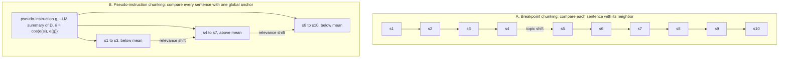
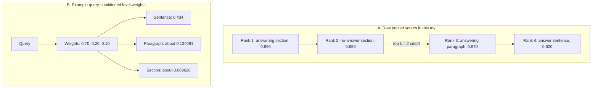
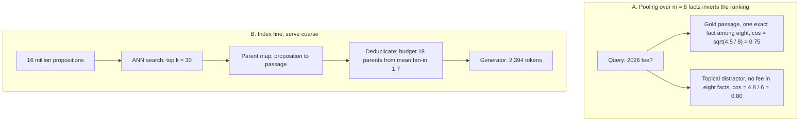

# Chapter 13: Chunking and Granularity
[00-START-HERE](../00-START-HERE.md) · [01-READING-ROUTES](../01-READING-ROUTES.md) · [12\_text\_representation](12_text_representation.md) · [14\_beyond\_plain\_text\_tables\_layout\_documents](14_beyond_plain_text_tables_layout_documents.md)
This chapter explains how to choose retrieval units, route across granularities, preserve enough context, and measure whether a chunker actually improved retrieval.
## TL;DR
- Chunking is an index-time decision. A single-chunk retrieval path may lose a split fact; neighboring-chunk retrieval or parent expansion can repair it if the underlying text remains available.
- Start from the smallest unit that must survive intact. Set overlap from that unit’s length, not from a fixed percentage.
- Use boundaries already present in the document before paying a model to infer them. Meaning-based and model-generated splitting can cost $`3.5\times`$ and about $`45\times`$ as much as fixed splitting.
- Query type determines useful granularity. Do not assume raw sentence, paragraph and section scores are calibrated for one ranking; validate or calibrate them before fusion.
- Fine retrieval helps when pooling hides one exact fact. Index a self-contained proposition, then return its parent passage so the generator still sees qualifiers.
- Evaluate retrieved extent with token recall, precision, and intersection over union ($`\mathop{\mathrm{IoU}}\nolimits`$). Recall alone rewards oversized chunks.
- Semantic chunking needs a measured benefit over structural cuts and overlap. In the Gaussian examples, rounded percentile-like thresholds give approximately $`100\%`$ versus $`31\%`$ boundary recall; this is a model comparison, not a universal transfer bound.
## The story
Imagine a library that receives long policy binders. A cutting clerk prepares searchable cards before patrons arrive. If a fact is split across cards, a desk that retrieves only one card may miss it; a desk that also fetches the neighbor or parent can reconstruct it. Otherwise a new cutting policy requires reindexing affected content.
The cheapest clerk counts tokens and cuts on schedule. If a clause crosses the cut, its halves land on different cards. Overlap photocopies the edge of one card onto the next. In the discrete window model, an overlap of $`o`$ tokens protects every span of at most $`o+1`$ tokens, provided the span fits within a chunk.
A more careful clerk follows paragraph breaks. A better clerk reads the binder’s headings, table rows, and clause numbers. Those author-provided marks usually reveal the intended units for almost no extra work. A meaning-aware clerk listens for topic changes. A model-driven clerk reads the whole binder and proposes cuts. Those last two clerks cost more, and they can rediscover boundaries the author already supplied.
Some binders contain useful policy text wrapped in repetitive legal boilerplate. A local clerk compares each sentence with its neighbor and cuts when the subject changes. A pseudo-instruction clerk first writes a one-card summary of the binder. The clerk then compares every sentence with that summary and separates runs when usefulness changes. The summary is a proxy for future patron questions.
The library also keeps cards at sentence, paragraph, and section sizes. A dosage question wants the sentence card. A broad recommendation question wants the section card. Raw catalog scores from these shelves are not comparable because long, coherent cards can inherit a high background score. The library therefore uses a router, meaning a clerk who reads the question and weights each shelf before ranking.
The finest cards hold propositions, meaning one self-contained fact each. A sentence such as “the fee rises to $`\$780`$ that year” is too dependent on its neighbors. The proposition card rewrites it with the subject, date, and value. The search desk matches that precise card, then follows its parent pointer back to the original passage.
The parent passage matters because the answer clerk is a large language model (LLM), and the LLM needs conditions and qualifiers. The proposition is the match unit. The passage is the serve unit. If the library serves only the proposition, a true fragment can still support a wrong answer.
The head librarian audits each cutting policy against highlighted gold excerpts. Token recall asks how much highlighted text came back. Token precision asks how much returned text was highlighted. $`\mathop{\mathrm{IoU}}\nolimits`$ charges for both missing text and padding. Returning the correct whole binder gives perfect extent recall but nearly useless precision; the retriever must still find that binder.
Finally, the head librarian tests the meaning-aware clerk on two shelves. One shelf joins unrelated articles. Topic changes are obvious, so the clerk finds almost every seam. The other shelf contains single coherent policies. Adjacent sections share vocabulary and style, so real seams look like ordinary sentence gaps. The same detector now cuts mostly in the wrong places.
The library’s rule is practical. Use declared structure first. Buy overlap when it protects a measured answer span. Add fine cards only when pooling truly dilutes exact facts. Add a router only when queries genuinely need different scales. Make every expensive clerk win on real binders before funding a full recataloging.
## Decoder table


| Technical term | Plain-English meaning | Why it matters |
| --- | --- | --- |
| Retrieval-Augmented Generation (RAG) | A system that retrieves source text before a model answers | Chunk boundaries decide what evidence the system can retrieve |
| Chunk | One indexed piece of a source document | It is the unit that retrieval ranks and returns |
| Chunker | The procedure that chooses indexed units | Missing candidates can require neighbor recovery, parent expansion or reindexing; failure is not necessarily irreversible |
| Granularity | The scale of a retrieval unit, such as sentence, paragraph, or section | Different questions need different scales |
| Token | The text unit counted by encoders and generators | Chunk size, overlap, cost, and context are priced in tokens |
| Atomic unit | The shortest span that contains everything needed to answer one question | It sets the protection that chunking must provide |
| Fixed-length splitting | Cutting after every fixed number of tokens | It is cheap but ignores content and structure |
| Stride | The distance between consecutive chunk starts | With chunk length $`L`$ and overlap $`o`$, stride is $`L-o`$ |
| Overlap | Text repeated in adjacent windows | In this integer-token model, $`o`$ overlap protects fitting spans through $`o+1`$ tokens |
| Severance rate | The probability that a required span crosses a boundary | It quantifies damage from blind cuts |
| Separator splitting | Cutting at an ordered list of paragraph, line, space, and character boundaries | It preserves known separator-delimited units that fit under the cap |
| Document-specific splitting | Cutting at author-provided structure such as headings, rows, or functions | It often gives faithful units with no model calls |
| Semantic chunking | Inferring boundaries from changes in embedding meaning | It adds compute and only works when boundary gaps are distinguishable |
| Breakpoint chunking | Cutting where adjacent sentence windows become dissimilar | It detects local subject changes |
| Agentic chunking | Asking an LLM to propose boundaries and often titles or summaries | It can judge unstructured text but requires a generation pass |
| Optical character recognition (OCR) | Conversion of scanned pages into text | OCR text may lack reliable document structure |
| Automatic speech recognition (ASR) | Conversion of speech into text | ASR transcripts may need inferred boundaries |
| HyperText Markup Language (HTML) | Structured markup used by web documents | Its tags provide free boundary evidence |
| Embedding | A vector representation used for similarity search | Semantic chunking and retrieval both depend on it |
| Cosine similarity | The angle-based similarity between two vectors | The chapter uses it to score sentences, chunks, and anchors |
| Bi-encoder | An encoder that maps queries and text into separately comparable vectors | Its cosine band and throughput affect chunking choices |
| Anisotropy | The tendency of embedding cosines to occupy a narrow model-specific band | It makes one absolute threshold hard to transfer |
| Pseudo-instruction chunking (PIC) | Splitting sentences by relevance to a generated document summary | It targets usefulness rather than only topic continuity |
| Pseudo-instruction | A generated summary used as a stand-in for future queries | It anchors sentence relevance before real queries exist |
| Anchor | The vector against which every sentence is scored | Its quality determines the useful and boilerplate split |
| Document centroid | The normalized sum of all sentence vectors | It is free but points toward whatever content is most numerous |
| Per-document mean threshold | A cutoff equal to the mean sentence score within one document | It self-normalizes across documents and encoders |
| Score-spread guard | A rule that avoids splitting when maximum and minimum sentence scores are too close | It reduces noise-driven cuts but does not guarantee that a single-topic page stays whole |
| Content hash | A fingerprint of document content | It lets a system reuse summaries for unchanged documents |
| Cold start | A newly ingested document with no query history | It still needs a proxy such as a summary |
| Mixture of Granularity (MoG) | A retriever using query-conditioned granularity weights | It can help calibrate competition across levels; the displayed weights are an illustrative scoring rule |
| Router | A small network that assigns a weight to each granularity for a query | It selects fine or coarse evidence at query time |
| Soft target | A training target distributed across granularity levels | It supervises a router without differentiating through top-$`k`$ selection |
| Mixture of Granularity Graph (MoGG) | A graph extension that treats hop range as granularity | It allows coarse evidence to gather across documents |
| Mean pooling | Averaging or summing unit vectors and normalizing the result | It can dilute an exact fact or create a length-dependent floor |
| Background similarity $`b`$ | Similarity between a query and non-answering sentences on the same topic | It sets the long-chunk score floor |
| Internal coherence $`\rho`$ | Mean pairwise similarity among sentences or propositions in one unit | It controls dilution and length effects |
| Crossover condition | The limiting toy inequality $`b>a\sqrt\rho`$ for $`\rho>0`$ | Finite-length crossover has an $`n`$-dependent threshold; geometric feasibility also matters |
| Small-to-big retrieval | Retrieving a fine unit and expanding it to its parent | It avoids cross-level score mixing and restores context |
| Reciprocal rank fusion (RRF) | Combining ranked lists using rank instead of raw score | It is scale-free when router labels are unavailable |
| Sparse retrieval | Retrieval based on explicit term matches | Its length bias differs from dense mean pooling |
| Term frequency-inverse document frequency (tf-idf) | A sparse weighting scheme for terms and documents | Its cosine score can over-penalize long documents |
| Best Matching 25 (BM25) | A sparse ranking function with tunable length normalization | Its chunk-length intuition does not transfer directly to dense pooling |
| Pivoted length normalization | A correction that adds length back into sparse scoring | It addresses the sparse system’s opposite length pathology |
| Proposition | One rewritten, self-contained, decidable fact | It removes pooling dilution while preserving meaning without neighbors |
| Decontextualization | Rewriting a fragment to restore its missing subject, date, or reference | It makes fine retrieval units searchable on their own |
| Parent map | A mapping from a proposition back to its source passage | It restores source context after fine-grained matching |
| Fan-in | The number of retrieved propositions that collapse onto one parent | It converts proposition top-$`k`$ into returned parent count |
| Multi-hop question | A question that needs evidence from multiple facts or units | Fine units may require several hits instead of one passage |
| Recursive Abstractive Processing for Tree-Organized Retrieval (RAPTOR) | A tree of recursive summaries for broad retrieval | It supplies coarse units and complements propositions |
| Approximate nearest neighbor (ANN) search | Fast vector search that may not inspect every vector exactly | Index size and graph settings affect retrieval cost and recall |
| Hierarchical Navigable Small World (HNSW) | A graph index for ANN search | More vectors add neighbor-list memory and may require retuning |
| Product quantization | Compact codes that replace full vectors | It can shrink a proposition index sharply |
| Floating-point 32-bit (fp32) | Four-byte storage for each vector dimension | It drives the chapter’s index-memory arithmetic |
| Int8 | One-byte integer storage per dimension | It is one cited option for reducing a sentence index |
| Token-offset annotation | A gold answer stored as source token positions | It survives changes to the chunker |
| Recall | The share of gold answer tokens retrieved | It catches missing evidence but rewards large chunks |
| Precision | The share of retrieved tokens that belong to the gold excerpt | It exposes padding and irrelevant extent |
| Intersection over union ($`\mathop{\mathrm{IoU}}\nolimits`$) | Gold and retrieved overlap divided by their union | It charges for both missed evidence and extra text |
| $`F_1`$ | The harmonic combination of precision and recall | IoU is a per-query monotone transform, not a transform of macro-averaged $`F_1`$ |
| $`P_k`$ | A segmentation error rate based on whether window endpoints share a segment | It grades boundaries without running retrieval |
| WindowDiff | A segmentation error rate that compares boundary counts within a window | It reduces $`P_k`$’s asymmetry around nearby boundaries |
| Fixed retrieved-token budget | Comparing systems that return the same amount of text | It removes the advantage of simply making chunks larger |
| Change-point detector | A method that marks shifts in a sequence | A semantic chunker is this detector over sentence embeddings |
| Within-topic gap | Distance between adjacent sentences inside one topic | Its distribution forms the detector’s negative class |
| Boundary gap | Distance between adjacent sentences across a real topic change | Its separation from within-topic gaps sets the ceiling |
| Separability $`\Delta`$ | The mean boundary-gap difference divided by shared spread | It predicts whether semantic boundaries are detectable |
| Percentile threshold | A cutoff chosen by rank within observed distances | With distinct values it selects approximately a fixed fraction; ties and strict comparisons can change the count |
| False positive rate (FPR) | The share of within-topic gaps incorrectly cut | It reveals spurious boundaries |
| Distribution tail | The rare longest chunks produced by variable-length splitting | It can exceed the encoder limit and create invisible corpus holes |
| Prefill | Processing retrieved context before the model generates | Coarse chunks can dominate query latency and cost |
| Floating-point operations (FLOPs) | Arithmetic operations used to estimate compute | The worked examples compare ingestion and generation cost with them |
| Normalized discounted cumulative gain (nDCG) | A ranking metric that rewards relevant results near the top | A gain can still be invalid if the evaluation corpus manufactures boundaries |
| $`\mathop{\mathrm{recall}}\nolimits@k`$ | The fraction of defined gold items found among the top $`k`$ results | With one gold item it reduces to a hit indicator; aggregate grain and chunker-dependent gold definitions must be stated |
| Rank inversion | A distractor scoring above the true answer | Pooling and cross-level scale differences can cause it |
| Self-containment check | A filter for unresolved pronouns, demonstratives, or missing entities | It blocks malformed propositions from entering the index |
| Corpus | The full collection of source documents | Its formats and query needs determine the right chunker |
| Index | The stored searchable representation of chunks | Boundary changes require rebuilding its vectors |
| Retriever | The component that selects evidence for a query | It can only select units the chunker created |
| Reranker | A second-stage model that reorders retrieved candidates | It cannot recover a fact absent from every candidate |
| Generator | The model that writes the final answer from retrieved context | It often needs broader context than matching does |
| Query | The user’s search or question | Its answer scale determines useful granularity |
| Top-$`k`$ | The first $`k`$ ranked retrieval results | Fine units may need a larger $`k`$ to cover several facts |
| Rerank depth | The number of initial results a second-stage model inspects | A target below that cutoff cannot be rescued |
| Context budget | The maximum retrieved text the generator can accept or afford | Parent expansion and coarse routing consume it quickly |
| Backfill | Reprocessing an existing corpus after a chunker or prompt change | Expensive agentic policies can repeat this cost |
| Re-ingestion | Rebuilding indexed content from its sources | Semantic chunking adds a detection pass to it |
| Ground-truth boundary | A human or structural label for a real topic change | It lets a boundary detector be evaluated directly |
| Held-out set | Labeled data reserved for calibration rather than fitting | It sets spread guards and thresholds without using test queries |
| Gaussian gap model | A bell-shaped model for within-topic and boundary distances | It converts separability into recall and false positives |
| Spread $`\sigma`$ | The shared standard deviation of the two gap populations | It scales their mean difference into $`\Delta`$ |
| Query-conditioned weight | A granularity weight computed from the current query | It avoids one corpus-wide size choice |
| Candidate set | Chunks returned before final ranking or generation | Candidate count can bind reranker cost |
| Relevance shift | A transition between below-anchor and above-anchor sentence runs | PIC uses it as a chunk boundary |
| $`T`$, $`L`$, $`o`$, $`s`$, $`D`$, $`s_i`$, $`B`$, and $`q`$ | Corpus token count, chunk length, overlap, required span, document sentence sequence, one sentence, boundary set, and query | These symbols define fixed splitting and the query-dependent ideal boundary |
| $`e`$, $`g`$, $`r_i`$, $`r_{\mathrm{mean}}`$, $`z_i`$, $`S`$, $`\alpha`$, $`\beta`$, $`u`$, $`v`$, $`\epsilon`$, $`\delta`$, and $`\sigma`$ | Encoder, pseudo-instruction, sentence score, mean cutoff, binary label, vector sum, class strengths and directions, residual directions, and score noise | These symbols state the pseudo-instruction method and its worked geometry |
| $`n`$, $`a`$, $`b`$, $`\rho`$, $`s(n)`$, $`w_g(q)`$, $`s_g(c)`$, $`N`$, $`d`$, $`M`$, and $`k`$ | Unit length, answer and background similarities, coherence, pooled score, router weight and candidate score, corpus size, dimension, graph degree, and result count | These symbols expose cross-granularity score bias and price routing |
| $`P`$, $`m`$, $`p_j`$, $`\gamma`$, $`q`$, and fan-in | Passage, proposition count and vectors, distractor similarity, query, and proposition hits per parent | These quantities define pooling dilution and fine-match to coarse-serve expansion |
| $`E_q`$, $`T_q`$, $`a`$, $`e`$, $`t`$, $`R`$, $`P`$, $`\mathop{\mathrm{IoU}}\nolimits`$, $`F_1`$, $`c`$, $`o`$, $`u`$, $`k`$, and $`\ell`$ | Gold and retrieved token sets, overlap and set sizes, recall, precision, overlap metrics, chunk settings, split fraction, window width, and reference segment length | These symbols measure retrieval extent and segmentation error |
| $`d_i`$, $`t`$, $`\mu_w`$, $`\mu_b`$, $`\sigma`$, $`\Delta`$, $`\Phi`$, $`C`$, $`L`$, and $`S`$ | Adjacent gap, threshold, within-topic and boundary means, spread, separability, Gaussian cumulative function, chunk length, answer length, and stride | These symbols turn semantic chunking into a measurable detection problem |


## Core mechanics
### Mathematical conventions
Token counts and span lengths are integers. For fixed overlapping windows use $`1\le L`$, $`0\le o<L`$, retain the final partial chunk, and stop as soon as the document is covered. Counts and billed unpadded tokens are computed per document, not by pooling unrelated documents into one stream. Long-document overlap multipliers are approximations; finite vector counts and padded compute can differ. A split span can still be recovered by retrieving neighboring chunks or expanding to a parent: failure of a single chunk is not a proof that all RAG systems must fail. Vector-pooling and Gaussian examples are explicitly idealized, not laws of learned encoders. Natural logarithms use nats; storage is decimal. HNSW budgets include vector payload and base-layer neighbor slots only. FLOP estimates use stated sustained throughput and omit attention-length effects, bandwidth, padding unless specified, scheduling, graph work, and I/O. Extent metrics use unique source positions keyed by document, not repeated prompt tokens. Keep full precision until reporting; $`\approx`$ denotes rounding or a model approximation.
### 13.1 Five levels of splitting
#### The index-time retrieval contract
- **What:** Splitting chooses searchable units before retrieval runs; the text itself need not be compressed or discarded.
- **Why:** A single-unit match should contain the needed evidence, or the serving path must explicitly recover adjacent or parent context.
- **Failure without it:** A $`900`$-token clause cut at $`512`$ can separate obligation from liability cap. A reranker cannot invent a missing candidate, but retrieving both halves can repair the split.
- **Cost and complexity:** Boundary changes invalidate affected chunk IDs and vectors. Version the chunker and its parent mapping; an entire index rebuild is not always necessary.
For a nonempty document with $`T`$ tokens, chunk length $`L`$ and overlap $`o`$, let stride $`S=L-o`$. Chunk starts are $`0,S,2S,\ldots`$ until a chunk first covers the document end.
The resulting count is

```math
n(T;L,o)=1+\left\lceil\frac{\max(0,T-L)}{L-o}\right\rceil
=\max\!\left(1,\left\lceil\frac{T-o}{L-o}\right\rceil\right),\qquad T>0.
```

Set $`n=0`$ for an empty document.
With an unpadded final chunk and no extra windows after coverage, the exact embedded-token count is $`T+(n-1)o`$ for $`T>0`$. The long-document approximation is $`T\,L/(L-o)`$; padding every call to $`L`$ instead processes $`nL`$ slots.
If span starts are uniform modulo the stride, ignoring document-edge effects, the probability that no one window contains an $`s`$-token span is $`\min(1,\max(0,(s-o-1)/(L-o)))`$ for $`1\le s\le L`$; it is $`1`$ for $`s>L`$. At $`o=0`$ this becomes $`(s-1)/L`$ for a fitting span.
At $`s=40`$, $`L=512`$, and $`o=0`$, modeled severance is $`39/512=0.076171875\approx7.62\%`$.
Any span with $`s\le\min(L,o+1)`$ is contained in at least one window under this discrete coverage convention. Thus $`o\ge39`$ is sufficient for every $`40`$-token span; $`o\ge40`$ is a conservative alternative.
The long-document multiplier $`L/(L-o)`$ approximates token and vector inflation. Exact token count is $`T+(n-1)o`$, exact vector count is $`n`$, and graph allocation follows that integer count. These need not share exactly one multiplier on short documents.
At $`L=512`$, $`o=64`$, the asymptotic multiplier is $`512/448\approx1.142857`$, or about $`14.286\%`$ extra. For the finite contract example below, actual token inflation is $`4{,}512/4{,}000=1.128`$.
#### The five splitting levels


| Level | What it does | Why it exists | Failure without the right fit | Stated cost |
| --- | --- | --- | --- | --- |
| 1. Fixed length | Cuts at a fixed token stride | It gives a simple fallback | It can cross semantic units | Long-document token proxy $`1.142857T`$ at $`L=512,o=64`$; use exact per-document counts |
| 2. Separators | Tries paragraph, line, space, then character boundaries | It preserves known units when they fit | An oversized unit still needs splitting | One scan plus the token cost of the actual resulting chunks, not necessarily level one’s count |
| 3. Document-specific | Uses headings, HTML tags, functions, rows, slides, or numbered clauses | It takes boundaries the author already declared | Ignoring structure can turn one table into two corrupted fragments | $`T`$ embedded tokens plus one parser per format and zero model calls |
| 4. Semantic | Embeds sentence windows and detects large adjacent distances | It infers structure-free boundaries | Quantile thresholds can force cuts on noise | Approximately $`4T`$ tokens in the specified three-sentence-window implementation; about $`3.55`$ times fixed here |
| 5. Agentic | Asks an LLM to propose boundaries or summaries | It handles units requiring judgment | It may rediscover declared structure | In this price scenario, $`T`$ input tokens plus final embeddings cost about $`45.21`$ times fixed; output charges are excluded |


With one neighboring sentence on each side, interior sentences appear in three detection windows. Edge sentences appear fewer times. Thus detection is approximately $`3T`$ for long documents, and final disjoint chunk embeddings add $`T`$; exact cost depends on edges, padding and the implementation.
A strict cut above the empirical $`95`$th percentile selects approximately the largest $`5\%`$ of distances when values are distinct. Ties, small samples and the quantile convention affect the count; identical distances need not produce any strict-above-threshold cut. A fixed top-fraction rule can nevertheless manufacture boundaries on noise.
Level five earns its cost mainly when markup is absent. The source names OCR scans, ASR transcripts, and raw plain text.
Doubling $`L`$ halves the no-overlap severance probability for a fixed fitting span under uniform phase. It also roughly doubles retrieved text per full chunk and the linear prefill proxy. An individual final token vector has coefficient $`1/L`$ in a mean, but that is not its end-to-end influence in a contextual encoder. Cross-length score bias depends on the geometry discussed below.
#### Worked corpus
The corpus has $`100{,}000`$ documents at $`4{,}000`$ tokens each. Total $`T`$ is $`4\times10^{8}`$ tokens.
Embedding costs $`\$0.02`$ per million tokens. The generation model costs $`\$1.00`$ per million input tokens.


| Configuration | Boundary result | Index result | Cost result |
| --- | --- | --- | --- |
| Fixed, $`L=512`$, $`o=64`$ | Spans through $`65`$ tokens fit; a $`900`$-token clause cannot fit in one window | $`9`$ chunks per document and $`900{,}000`$ vectors | $`4.512\times10^8`$ unpadded embedded tokens and $`\$9.024`$ |
| Recursive separators | Preserves fitting separator-delimited units; oversized ones still split | Actual chunk count depends on separator locations | Same pricing, but recompute counts and overlap rather than assuming the fixed-window bill |
| Numbered clauses | All $`12`$ clauses survive if clauses are kept atomic, even those longer than $`512`$ | $`1.2`$ million vectors, mean $`4{,}000/12\approx333.33`$ tokens; $`33.33\%`$ more vectors | $`3.6864\,\mathrm{GB}`$ fp32 payload versus $`2.7648\,\mathrm{GB}`$; no overlap gives $`\$8.00`$ |
| Semantic | Boundaries depend on encoder and detection settings | Encoder changes may require both recutting and re-encoding | Approximate $`1.6\times10^9`$ tokens and $`\$32.00`$, or $`3.5461`$ times the exact fixed-window bill |
| Agentic | A model proposes boundaries | Prompt changes may require a new backfill | $`\$400`$ input processing plus $`\$8`$ embeddings gives $`\$408`$, or $`45.2128`$ times fixed; output charges omitted |


At $`5\%`$ weekly turnover, proportional recomputation costs $`0.05(\$408)=\$20.40`$ weekly under the same input-plus-embedding model, excluding generation output charges.
Dense Passage Retrieval (DPR) used $`21{,}015{,}324`$ disjoint 100-word English Wikipedia passages. At about $`1.33`$ tokens per word, $`L`$ is about 133. A 40-token span has modeled severance $`\frac{39}{133}=29\%`$. A 5-token short answer has modeled severance $`\frac{4}{133}=3.0\%`$. The crude splitter fit that task because the required unit was short.
#### Practical decisions
- Default to level three when markup exists. In the worked corpus it is structurally faithful and costs $`\$8.00`$ instead of $`\$9.024`$ in the exact finite-window comparison.
- Set $`o`$ from measured required-span length. Protecting every $`40`$-token span requires $`o\ge39`$ under this discrete model.
- Increase $`o`$ only after sampled failures show longer spans. The source proposes 100 sampled failures.
- Index subchunks and return the parent when a structural unit exceeds the encoder’s useful length.
- Cap parent expansion when top-$`k`$ parents overrun the context budget.
- Buy level five for high-traffic documents first. The example applies it to $`5\%`$ of documents for $`\$20.40`$ instead of a $`\$408`$ full pass.
- For fixed $`N`$, $`d`$ and index settings, chunk token length does not directly change the arithmetic of one vector comparison. Changing the chunker can still change vector count, geometry, recall and ANN work, as well as generator prefill and its tail.
### 13.2 Chunking by intent: pseudo-instructions
#### The conditioning problem
- **What:** A document is an ordered sentence sequence $`D=(s_1,\ldots,s_n)`$. A chunker chooses boundary positions $`B`$ from 1 through $`n-1`$.
- **Why:** The ideal $`B`$ would keep every sentence needed by query $`q`$ in one run and exclude everything else.
- **Failure without it:** The ideal boundary depends on $`q`$, but the index must commit boundaries before $`q`$ exists.
- **Cost and complexity:** Every practical chunker must choose a proxy for the unknown query.
Fixed splitting uses length and a fixed phase, but no semantic query-intent estimate.
Breakpoint chunking compares each sentence $`s_i`$ with neighbor $`s_{i+1}`$. It cuts on local subject change.
Pseudo-instruction chunking generates a document summary $`g`$ and compares every sentence with that global anchor.
For each sentence,

```math
r_i = \cos\!\bigl(e(s_i), e(g)\bigr).
```

The threshold is the document mean

```math
r_{\mathrm{mean}} = \frac{\sum_{j=1}^{n} r_j}{n}.
```

The binary label is $`z_i=1`$ when $`r_i\ge r_{\mathrm{mean}}`$ and 0 otherwise.
The boundary set is every i where $`z_i`$ differs from $`z_{i+1}`$.
This labels runs of above-mean and below-mean similarity to a summary proxy, not verified usefulness for an unknown future query.
#### Why the summary anchor matters
- **What:** The generated summary estimates what future queries are likely to seek.
- **Why:** It is salience-weighted rather than frequency-weighted.
- **Failure without it:** A local breakpoint can fuse adjacent boilerplate because the boilerplate is internally similar. A centroid can point at boilerplate when boilerplate is most of the document.
- **Cost and complexity:** The summary requires an LLM pass. Real attributed query logs are better when available.
Let $`S`$ be the sum of unit sentence vectors. When $`S\ne0`$, define the normalized centroid $`S/\lVert S\rVert`$.
The sum over sentences of $`\cos\!\bigl(e(s_i),\mathop{\mathrm{centroid}}\nolimits\bigr)`$ equals $`\lVert S\rVert`$.
The mean centroid score is $`\frac{\lVert S\rVert}{n}`$. It measures document homogeneity, not document intent.
The reported ablations replace the true summary with another document’s summary, a random document sentence, or the average embedding. All three degrade retrieval. The claim limit is that the published evaluation is general-domain. A specialist query distribution may emphasize an attribute no summarizer includes.
The mean threshold always creates at least one cut when scores are not identical. Since $`\min_i r_i < r_{\mathrm{mean}}\le \max_i r_i`$, a single-topic page can split on noise.
Guard with $`\max_i r_i-\min_i r_i`$. Emit one chunk when the spread is below a threshold calibrated on a held-out set.
#### Worked policy example
The corpus has $`200{,}000`$ policy documents. Each has 40 sentences at 22 tokens each, or 880 tokens.
Twelve sentences contain policy. Twenty-eight contain preamble, revision history, and footer material.
The toy geometry takes $`u,v,w,\{\epsilon_i\},\{\delta_j\}`$ to be mutually orthonormal directions. Each policy sentence has vector $`0.8u+0.6\epsilon_i`$; each boilerplate sentence has $`0.8v+0.6\delta_j`$. The query is $`q=u`$. A unit summary direction $`g=0.9u+0.2v+\sqrt{0.15}\,w`$ gives policy similarity $`0.72`$ and boilerplate similarity $`0.16`$. Assume all $`12`$ policy sentences form one contiguous run. For the mixed-chunk comparison, take a $`20`$-sentence, $`440`$-token unit under a $`512`$-token cap; it is not an exact blind $`512`$-token window.
For the general version, write each policy vector as $`\alpha u+\sqrt{1-\alpha^2}\epsilon_i`$ and each boilerplate vector as $`\beta v+\sqrt{1-\beta^2}\delta_j`$, with $`0\le\alpha,\beta\le1`$. Here $`\alpha=\beta=0.8`$. A normalized sum of $`a`$ policy and $`b`$ boilerplate vectors, for $`a+b>0`$, has

```math
\cos(q,c) = \frac{a\alpha}{\sqrt{a^2\alpha^2 + a(1-\alpha^2) + b^2\beta^2 + b(1-\beta^2)}}.
```


| Configuration | Composition and score | Ranking or error |
| --- | --- | --- |
| Mixed $`440`$-token chunk | $`6`$ policy and $`14`$ boilerplate sentences give $`4.8/\sqrt{155.68}\approx0.384702`$ | Against a local Gaussian distractor approximation $`\mathcal N(0.20,0.06^2)`$, $`z\approx3.07837`$ and the expected number above it among $`400{,}000`$ distractors is $`416.27`$; expected rank is $`417.27`$ |
| PIC | One contiguous $`12`$-policy-sentence run scores $`9.6/\sqrt{96.48}\approx0.977356`$ | $`z\approx12.95593`$; modeled Gaussian tail is negligible, not proof of observed rank $`1`$ |
| Summary anchor | Class separation $`0.56`$ and noiseless mean $`0.328`$ | With fixed noiseless cutoff and additive $`\sigma=0.08`$ Gaussian score noise, boilerplate flips with probability $`1.7864\%`$, or $`0.500`$ expected flips |
| Centroid anchor | Policy score $`0.325979`$, boilerplate $`0.741157`$, mean $`0.616604`$ | Under the same fixed-cutoff noise toy, boilerplate flips with probability $`5.9745\%`$, or $`1.673`$ expected flips; an isolated interior flip adds two cuts |


The mixed target’s modeled expected rank is about $`417`$, beyond a rerank depth of $`100`$. This is not a measured rank. Gaussian cosine tails are local approximations rather than valid unbounded cosine distributions, and recomputing a threshold from noisy scores changes the flip calculation.
#### Cost and operating rules
The full corpus contains $`1.76\times10^{8}`$ tokens.
A $`110`$-million-parameter encoder’s sentence pass uses $`2NT=3.872\times10^{16}\,\mathrm{FLOP}`$, or $`113.882\,\mathrm s`$ at $`3.4\times10^{14}\,\mathrm{FLOP/s}`$. This one-pass baseline excludes summary-vector encoding and final chunk re-encoding.
An $`8`$-billion-parameter summarizer uses $`2.816\times10^{18}`$ prefill FLOPs and $`2.56\times10^{17}`$ decode FLOPs for $`80`$ output tokens per document. Total work is $`3.072\times10^{18}\,\mathrm{FLOP}`$, or $`2.50980`$ GPU-hours: $`79.3388`$ times the one sentence-embedding pass. Summary-anchor embeddings add $`3.52\times10^{15}`$ FLOPs if all $`80`$ generated tokens are encoded; final chunk embeddings add another pass over their actual token count. These are compute proxies, not latency measurements.
Prefill is $`2.816/3.072=11/12\approx91.667\%`$ of this summarization work.
- Cache the pseudo-instruction on a content hash.
- At $`2\%`$ turnover, summarization uses about $`0.02\times79.3388\approx1.587`$ times a full-corpus sentence-embedding pass. Relative to a changed-documents-only sentence pass it remains about $`79.34`$ times; name the baseline.
- Use real queries with document attribution where they exist. Use summaries for cold start.
- Avoid PIC for short single-topic documents with no intent structure.
- Cap each intent run after the relevance cut. Split an overlong run at the nearest paragraph break.
- Score the chunker with $`\mathop{\mathrm{IoU}}\nolimits`$ against answer spans. $`\mathop{\mathrm{recall}}\nolimits@k`$ alone is confounded by encoder and ANN settings.
### 13.3 Mixture of Granularity: routing over chunk sizes
#### Why one tuned size fails
- **What:** The source sweeps 128, 256, 512, and 1,024-token chunks with $`20\%`$ overlap on 400 questions.
- **Why:** Factoid queries need fine evidence. Thematic queries need broad evidence.
- **Failure without it:** The aggregate winner at 512 serves neither query population optimally.
- **Cost and complexity:** Multi-level indexes add vectors, searches, a router, and a context-budget decision.
Index nested sentence, paragraph, and section units. Let $`a`$ be query similarity to the one answering sentence. Let $`b`$ be similarity to each non-answering neighbor. Let $`\rho`$ be mean pairwise sentence similarity. For an $`n`$-sentence chunk:

```math
s(n) = \frac{a+(n-1)b}{\sqrt{n\bigl(1+(n-1)\rho\bigr)}}.
```

For $`\rho>0`$ and a feasible family of unit-vector geometries, $`s(n)\to b/\sqrt\rho`$ as $`n\to\infty`$. Feasibility constrains the parameters; in the limit $`b^2\le\rho`$. The expression is not a law for arbitrary contextual embeddings or for $`\rho=0`$.
For $`n>1`$, a coarse chunk beats the answer sentence when $`b>a[\sqrt{n(1+(n-1)\rho)}-1]/(n-1)`$. The simpler $`b>a\sqrt\rho`$ compares the limiting score with $`a`$, not every finite chunk.
With $`a=0.62`$, $`b=0.50`$, and $`\rho=0.5`$:


| Unit | $`n`$ | Score |
| --- | --- | --- |
| Correct sentence | $`1`$ | $`0.620`$ |
| Paragraph containing it | $`4`$ | $`0.670`$ |
| Section containing it | $`16`$ | $`0.696`$ |
| Different 16-sentence section with no answer | $`16`$ | $`0.686`$ |
| Long-chunk ceiling | Limit | $`0.707`$ |


A global top-2 list returns the correct section and the wrong section. It drops the exact answer sentence.
For a thematic query with $`a=b=0.45`$, sentence, paragraph, and section scores are $`0.450`$, $`0.569`$, and $`0.617`$. The same coarse bias now makes the correct choice, which helps the bug survive review.
#### Router and fallback choices
- **What:** MoG feeds the query embedding to a small network that emits one weight $`w_g(q)`$ per granularity.
- **Why:** It rescales each level before candidates compete.
- **Failure without it:** Raw similarities encode length and relevance together.
- **Cost and complexity:** The router needs downstream answer-quality supervision and creates a query-conditioned failure surface.
Each candidate receives weighted score

```math
w_g(q)\times s_g(c).
```

Top-$`k`$ selection is not differentiable. The source therefore describes a soft training target over levels, not a gradient through retrieval.
Under the displayed multiplicative score rule, factoid weights $`(0.70,0.20,0.10)`$ give approximately $`(0.434,0.134081,0.069628)`$ for the three answering units. This toy restores the desired order; multiplication alone is not a general calibration method, particularly for negative scores.
For a thematic query, weights $`(0.10,0.20,0.70)`$ make the section score $`0.70\times0.617=0.432`$.
MoGG removes the requirement that levels be nested. It links chunks above a similarity threshold and uses graph hop range as granularity.
Small-to-big is a useful first baseline: retrieve fine units and return their parents. It avoids cross-level raw-score comparisons. It can still miss thematic queries when no fine unit carries the broad selection signal; this is a workload risk, not an inevitable failure.
When labels are missing, retrieve separately per level and use RRF. It fuses ranks rather than raw scales.
Sparse scoring has the opposite length pathology. In tf-idf cosine, only query terms enter the numerator while the document norm grows. Long documents are over-penalized. Pivoted length normalization and BM25 address that sparse problem. Dense pooling has nonzero background contributions in both numerator and denominator, so its ratio flattens.
#### Worked clinical-reference example
The corpus has $`20{,}000`$ documents at $`4{,}000`$ tokens each, or $`8\times10^{7}`$ tokens. Dimension $`d`$ is 768 in fp32. Sentences average 25 tokens, paragraphs 100, and sections 400.


| Configuration | Vector and graph cost | Query result |
| --- | --- | --- |
| Paragraph only | $`800{,}000`$ vectors: $`2.4576\,\mathrm{GB}`$ payload plus $`0.2048\,\mathrm{GB}`$ base-layer graph slots | One ANN search |
| Three levels pooled raw | $`3.2`$ million sentence, $`800{,}000`$ paragraph and $`200{,}000`$ section vectors: $`4.2`$ million total, $`5.25`$ times paragraph count; $`12.9024\,\mathrm{GB}`$ payload plus $`1.0752\,\mathrm{GB}`$ base-layer slots at $`2M=64`$ four-byte neighbors | In the toy ranking, the wrong section at about $`0.686`$ beats the answer sentence at $`0.620`$ |
| Three levels with router | For an explicit $`768\to768\to3`$ dense network: $`768^2+768(3)=592{,}128`$ MACs, approximately $`1.184256\times10^6`$ FLOPs before bias and activation work | Level choice is learned; no measured router latency follows from the operation count |


Take two extra searches at $`2\,\mathrm{ms}`$ each as a workload assumption, giving $`4\,\mathrm{ms}`$ if run serially. Parallelization, routing and candidate merging change wall time.
Five $`400`$-token sections give $`2{,}000`$ prompt tokens. At $`N=7\times10^9`$ and assumed sustained throughput $`1.5\times10^{14}\,\mathrm{FLOP/s}`$, the $`2NT`$ proxy is $`2.8\times10^{13}`$ FLOPs or approximately $`186.667\,\mathrm{ms}`$.
Five $`25`$-token sentences give $`125`$ tokens and approximately $`11.667\,\mathrm{ms}`$ under the same proxy.
The prefill-proxy difference is $`175\,\mathrm{ms}`$. Dividing by the assumed $`4\,\mathrm{ms}`$ extra search work gives $`43.75`$, not a $`44`$-fold end-to-end speedup. If the route actually replaces sections with sentences, net idealized savings are $`171\,\mathrm{ms}`$ before router and merge overhead.
DPR’s $`21{,}015{,}324`$ vectors at $`d=768`$ and four bytes each use $`64.6`$ GB, matching the reported approximately $`65\,\mathrm{GB}`$ flat index.
Section vectors add $`0.6144\,\mathrm{GB}`$ payload and $`0.0512\,\mathrm{GB}`$ base-layer links; sentence vectors add $`9.8304\,\mathrm{GB}`$ payload and $`0.8192\,\mathrm{GB}`$ links. These budgets omit upper graph layers, text, IDs and runtime overhead.
#### Practical routing decisions
- Default to sentence and section levels. They total $`3.4`$ million vectors in the example, versus $`4.2`$ million with paragraphs added.
- Add another level only when query logs reveal a distinct answer-length mode.
- Ship small-to-big first. Consider a router when more than roughly one quarter of queries are thematic.
- Estimate $`\rho`$ from 200 same-document sentence pairs and $`b`$ from 200 query to non-answer sentence pairs.
- Treat the crossover as a check on the toy geometry, not an automatic router decision. Validate finite-level scores and task quality on the actual workload.
- Fail open to the middle granularity when router weights are near-uniform.
- Cap coarse contribution to the context budget because unusual queries can force expensive section prefills.
- Budget granularity against per-query prefill before one-time index memory. The example adds $`11.3152\,\mathrm{GB}`$ of payload-plus-base-layer capacity over the paragraph baseline and assumes $`4\,\mathrm{ms}`$ extra search work; level choice moves the prefill proxy by $`175\,\mathrm{ms}`$.
### 13.4 Propositions and fine-grained retrieval
#### Pooling dilution
- **What:** A passage contains $`m`$ atomic propositions with mean pairwise similarity $`\rho`$.
- **Why:** One exact fact can contribute only a fraction of a pooled passage vector.
- **Failure without it:** A broadly topical passage with no answer can outrank the passage that contains the exact answer.
- **Cost and complexity:** Proposition retrieval removes dilution by creating more vectors and requiring model-written, self-contained units.
Assume $`m`$ unit proposition vectors, that the query equals one of them, and that its mean similarity to the other $`m-1`$ vectors equals the overall mean pairwise similarity $`\rho`$. The pooled gold-passage cosine is:

```math
\sqrt{\frac{1+(m-1)\rho}{m}}.
```

At $`m=8`$ and $`\rho=0.5`$, the score is $`\sqrt{\frac{4.5}{8}}=0.75`$.
For a distractor with eight propositions, each at query similarity $`\gamma=0.6`$ and the same $`\rho`$, the score is $`\frac{4.8}{6}=0.80`$.
The distractor wins whenever

```math
\gamma > \frac{1+(m-1)\rho}{m}.
```

That threshold is the square of the gold passage score. It is $`0.5625`$ in this example.
At proposition granularity, the exact fact scores $`1.00`$ and the distractor scores $`0.60`$.
#### Why propositions are not sentence splits
- **What:** A proposition rewrites a fact so it survives without neighboring text.
- **Why:** A sentence like “the base filing fee rises to $`\$780`$ that year” lacks the visa class and year.
- **Failure without it:** Short sentence chunks can be precise but unsearchable because pronouns and references have no anchor.
- **Cost and complexity:** Rewriting requires a generation pass. Store offsets to the parent because the indexed proposition is model output, not original corpus text.
The self-contained rewrite in the source is “The base H-1B filing fee for fiscal year 2026 is $`\$780`$.”
Chen et al. (2024) compare passage, sentence, and proposition indexing across five open-domain question-answering datasets and six dense retrievers. Proposition indexing beats both alternatives, with the largest margin at small $`k`$. Sentence retrieval sits between passages and propositions. The claim is comparative, not a guarantee for every corpus.
Fine granularity breaks in two directions.
1. Coverage falls when a question needs several facts. One passage may bundle them, while several propositions must all reach top $`k`$.
2. Sufficiency falls when a proposition loses conditions such as effective dates or employer-size qualifiers.
Entity-relation triples go below the practical floor when they discard conditions. Stop at the smallest unit that is decidable on its own.
#### Index fine and serve coarse
- **What:** Search propositions, map hits to parent passages, deduplicate, then send parents to the generator.
- **Why:** Matching wants precision. Generation wants context.
- **Failure without it:** Serving only propositions strips qualifiers. Searching only passages restores pooling dilution.
- **Cost and complexity:** The design needs a parent map, source offsets, more index memory, and a measured fan-in.
RAPTOR attacks the broad-query side by building a tree of recursive summaries. It composes with proposition retrieval rather than replacing it.
#### Worked policy corpus
The corpus has 2 million passages of 100 words. Dimension $`d`$ is 768 in fp32.
A passage averages five 20-word sentences and about eight propositions. Rewriting expands total words to about $`1.4\times`$ the original.


| Configuration | Ranking | Memory and context |
| --- | --- | --- |
| Passage index | Gold $`0.75`$ and distractor $`0.80`$ in the toy | $`6.144\,\mathrm{GB}`$ payload plus $`0.512\,\mathrm{GB}`$ base-layer graph slots, totaling $`6.656\,\mathrm{GB}`$ |
| Proposition index | Gold $`1.00`$ and distractor $`0.60`$ in the toy | $`16`$ million vectors: $`49.152\,\mathrm{GB}`$ payload plus $`4.096\,\mathrm{GB}`$ base-layer slots, totaling $`53.248\,\mathrm{GB}`$; $`8`$ times the passage count |
| Index fine, serve coarse | Retrieve $`k=30`$ propositions, map and deduplicate | A planning mean of $`1.7`$ hits per parent gives about $`30/1.7\approx17.65`$ parents; budget $`18`$ parents, or $`2{,}394`$ tokens at $`133`$ each. Actual parent counts must be measured |


Using the $`187`$ output tokens per eight-proposition passage budget below gives $`187/8=23.375`$ tokens per proposition on average. Thirty such propositions average about $`701.25`$ tokens, not exactly $`690`$, and may omit neighboring qualifiers.
The $`2{,}394`$-token parent-text plan fits within $`4{,}000`$ tokens only if the remaining instructions, query, formatting and any reserved output fit in the remaining $`1{,}606`$-token budget.
Decomposition uses 333 input tokens per passage. That contains 200 instruction and exemplar tokens plus 133 passage tokens. It produces 187 output tokens.
Across 2 million passages, that is 666 million input tokens and 374 million output tokens.
At $`\$0.15`$ per million input tokens and $`\$0.60`$ per million output tokens, the bill is $`\$99.90+\$224.40=\$324.30`$ once under these assumed prices.
The added payload-plus-base-layer capacity is $`53.248-6.656=46.592\,\mathrm{GB}`$. This is recurring provisioned capacity, not a monthly dollar bill without a specified memory rental price.
At $`96\,\mathrm{B}`$ per product-quantized code, the proposition payload becomes $`1.536\,\mathrm{GB}`$. Retaining the same base-layer neighbor budget leaves $`1.536+4.096=5.632\,\mathrm{GB}`$ before codebooks, upper layers, metadata, text and any full-precision rerank vectors; it is not a $`1.5\,\mathrm{GB}`$ all-in index.
#### When fine granularity pays
The gain is

```math
1-\sqrt{\frac{1+(m-1)\rho}{m}}.
```

At $`m=8`$, $`\rho=0.2`$, the idealized cosine-score headroom is $`0.45227744`$, about $`45.23`$ cosine points on a $`0`$–$`100`$ scale. It is not an accuracy gain.
At $`m=8`$, $`\rho=0.9`$, the same cosine headroom is $`0.04475134`$, about $`4.48`$ cosine points, not a measured relative quality gain.
- Favor propositions for mixed reference material such as policies, frequently asked questions, catalogs, and long wiki pages.
- Skip them for tightly coherent prose with little pooling headroom.
- For 800-token parents, fan-in $`1.7`$ and $`k=30`$ produce $`18\times800=14{,}400`$ tokens. Serve a sentence window instead.
- Set $`k`$ as target parent count times measured fan-in. In the example, $`18\times1.7`$ is about 30.
- If fan-in is near $`1.0`$, the hits scatter across documents. Treat that as a multi-hop signal rather than merely increasing $`k`$.
- Reject propositions with unresolved pronouns, bare demonstratives, or missing named entities.
- The source cites contextual retrieval reporting a top-20 failure-rate reduction from $`5.7\%`$ to $`3.7\%`$ using a generated context prefix. It proposes that cheaper option for heavily anaphoric corpora.
### 13.5 Evaluating a chunker: $`\mathop{\mathrm{IoU}}\nolimits`$ and segmentation metrics
#### Measure token extent, not chunk identity
- **What:** Annotate each gold answer as raw source token offsets before running any chunker.
- **Why:** The same annotation remains valid across chunking policies.
- **Failure without it:** Chunk IDs become stale after every boundary change. End-to-end answer accuracy cannot attribute a change to the chunker.
- **Cost and complexity:** Human annotators must mark the actual answer excerpt. The example uses 200 queries.
For query $`q`$, let $`E_q`$ be gold source positions and $`T_q`$ the union of retrieved source positions, keyed by document and token offset. Require nonempty gold for the recall formulas. If no text is retrieved, define recall and IoU as $`0`$ and declare a precision convention rather than dividing by zero. Duplicate prompt copies count once in $`T_q`$ but still cost prompt tokens.
Recall

```math
R_q = \frac{\lvert E_q\cap T_q\rvert}{\lvert E_q\rvert}.
```

Precision

```math
P_q = \frac{\lvert E_q\cap T_q\rvert}{\lvert T_q\rvert}.
```


```math
\mathop{\mathrm{IoU}}\nolimits_q = \frac{\lvert E_q\cap T_q\rvert}{\lvert E_q\cup T_q\rvert}.
```

For nonempty gold and retrieved sets with positive intersection, let $`a=\lvert E\cap T\rvert`$, $`e=\lvert E\rvert`$, $`t=\lvert T\rvert`$. The reciprocal identity below needs $`a>0`$; the direct $`F_1`$ identity also extends to zero overlap when $`e+t>0`$.

```math
\frac{1}{\mathop{\mathrm{IoU}}\nolimits} = \frac{1}{R}+\frac{1}{P}-1.
```


```math
\mathop{\mathrm{IoU}}\nolimits = \frac{F_1}{2-F_1}.
```

Per query, IoU is a monotone transform of $`F_1`$ and adds no ranking information. Averaging this nonlinear transform across queries can change system rankings, so macro-mean IoU is not the transform of macro-mean $`F_1`$.
$`F_1=0.80`$ gives $`\mathop{\mathrm{IoU}}\nolimits=2/3\approx0.667`$; $`F_1=0.50`$ gives $`\mathop{\mathrm{IoU}}\nolimits=1/3\approx0.333`$.
Returning the whole gold-containing document gives token recall $`1`$ conditional on retrieving that document. For $`3{,}000`$ source tokens and a $`60`$-token gold excerpt, precision and IoU are $`60/3{,}000=0.02`$. A one-chunk-per-document index does not by itself guarantee the right document is retrieved.
Embedding similarity cannot replace extent accounting. A 60-token answer plus 500 tokens of on-topic padding can remain strongly similar to the gold excerpt.
#### The three extent errors
For gold tokens 81 through 120 in a 200-token document:


| Error | Retrieved text | Precision | Recall | $`\mathop{\mathrm{IoU}}\nolimits`$ |
| --- | --- | --- | --- | --- |
| Too small | Top-1 is tokens 81 through 100 | $`1.00`$ | $`0.50`$ | $`0.50`$ |
| Too big | Whole 200-token document | $`0.20`$ | $`1.00`$ | $`0.20`$ |
| Misaligned | Top-1 is tokens 61 through 110 | $`0.60`$ | $`0.75`$ | $`0.50`$ |


$`\mathop{\mathrm{IoU}}\nolimits`$ cannot distinguish the direction of error by itself. Too-small and misaligned both score $`0.50`$. Report precision and recall beside it.
#### Boundary-only metrics
- **What:** $`P_k`$ checks whether endpoints at separation $`k`$ agree on same-segment membership in reference and predicted segmentations.
- **Why:** It evaluates boundaries independently of retrieval and an encoder.
- **Failure without it:** Retrieval IoU also reflects candidate selection, not only segmentation.
- **Cost and complexity:** $`P_k`$ can treat missing and extra nearby boundaries differently; WindowDiff instead checks boundary counts. Both depend on window conventions and reference segment lengths.
WindowDiff compares the number of boundaries inside the window rather than a same-segment bit.
For uniform reference segments of length $`\ell`$, the conventional window is $`k=\frac{\ell}{2}`$.
For long uniform reference segments of even length $`\ell`$, $`k=\ell/2`$ gives an approximately $`0.5`$ no-boundary baseline for both metrics. The all-boundary baseline is approximately $`0.5`$ for $`P_k`$, but approximately $`1`$ for WindowDiff when $`k>1`$ and every predicted window has more boundaries than the reference. Finite endpoints and rounding affect the values; compute both baselines on the actual reference.
The chapter traces element-level precision, recall, and overlap to Extensible Markup Language (XML) retrieval, where systems had to return the correct section, paragraph, or span from a nested document.
#### Worked chunk-size comparison
The illustrative evaluation has $`200`$ queries with exactly $`60`$ gold tokens each, not merely a mean of $`60`$. Starts are uniform modulo the chunk length. Assume an oracle returns the one chunk with greatest gold overlap; these are idealized top-one extent metrics, not measured retriever performance.
For chunk length $`c`$ and overlap $`o`$, stride is $`c-o`$.
Split probability is

```math
p_{\mathrm{split}}=\min\!\left(1,\max\!\left(0,\frac{s-1-o}{c-o}\right)\right),\qquad 1\le s\le c.
```

For no overlap, a continuously uniform split fraction gives conditional best-piece recall $`3/4`$. With an integer $`60`$-token span, the $`59`$ possible interior cuts give $`\sum_{j=1}^{59}\max(j,60-j)/(59\times60)\approx0.745763`$ instead. Use integer phases for the table below.
For a uniform split fraction $`u`$, the expectation is

```math
\int_0^1 \max(u,1-u)\,du = \frac{3}{4}.
```


| Configuration | Split and recall | Precision and $`\mathop{\mathrm{IoU}}\nolimits`$ | Prompt cost at $`k=5`$ |
| --- | --- | --- | --- |
| $`c=200`$, $`o=0`$ | Split $`59/200=0.295`$; expected overlap $`55.5`$ tokens and recall $`0.925`$ | Expected precision $`0.2775`$; mean per-query IoU $`0.273382`$. Pooled-count IoU $`0.271394`$ | Separately, $`5`$ full chunks cost $`1{,}000`$ prompt tokens |
| $`c=1{,}000`$, $`o=0`$ | Split $`59/1{,}000=0.059`$; expected overlap $`59.1`$ tokens and recall $`0.985`$ | Expected precision $`0.0591`$; mean per-query IoU $`0.059065`$. Pooled-count IoU $`0.059047`$ | Separately, $`5`$ full chunks cost $`5{,}000`$ prompt tokens |


The large chunk wins oracle top-one recall by $`6`$ percentage points. The ratio of mean per-query IoUs is approximately $`4.6285`$. Neither $`\mathbb E[\mathrm{IoU}]`$ nor a five-chunk retrieval metric can be inferred by applying IoU to a rounded mean overlap; the prompt column is a separate $`k=5`$ cost plan.
At $`10{,}000`$ queries per day and $`\$3`$ per million input tokens, the prompt costs are $`\$30`$ and $`\$150`$ per day. The difference is $`\$120`$ per day or $`\$43{,}800`$ per year.
At $`c=200,o=60`$, every fitting $`60`$-token span is intact because $`o\ge59`$. The long-document overlap multiplier is $`200/140\approx1.428571`$, about $`42.857\%`$ extra unpadded tokens; finite vector and graph inflation still depend on document lengths.
A 1,000-token chunk with 200-token overlap also protects the 60-token excerpt.
A 200-token chunk with 40-token overlap has split probability $`\frac{59-40}{160}=0.11875\approx0.119`$.
#### Evaluation decisions
- If source edits make offsets stale, anchor each annotation to a quoted string and relocate it at evaluation time.
- Compare chunkers at a fixed retrieved-token budget, not fixed $`k`$.
- If the unique-source-position budget is exactly $`\lvert T\rvert=B`$, precision is $`R\lvert E\rvert/B`$. A fixed billed prompt-token budget need not fix this denominator when chunks overlap or duplicate; retrieval and encoder effects still influence coverage.
- If the reranker is the binding limit, fix candidate count instead.
- Set overlap from the 95th-percentile annotated excerpt length.
- If $`1.43\times`$ index inflation is too high, accept a measured split rate and explicitly retrieve the adjacent chunk or parent. Merely raising $`k`$ to $`2`$ does not guarantee that neighbor is returned.
- Use WindowDiff when reference boundaries cluster.
- A reported $`\mathop{\mathrm{recall}}\nolimits@5`$ rise from $`0.71`$ to $`0.79`$ is not enough when mean chunk length also rises from 220 to 610 tokens. That is $`2.8\times`$ more text and $`3{,}050`$ prompt tokens at $`k=5`$ for a 60-token answer.
### 13.6 Does semantic chunking actually pay?
#### Semantic chunking as detection
- **What:** Embed sentences $`e_1`$ through $`e_n`$ and compute adjacent distance $`d_i=1-\cos(e_i,e_{i+1})`$.
- **Why:** A large $`d_i`$ may indicate a topic boundary.
- **Failure without it:** A claimed boundary can look almost identical to an ordinary within-topic transition in one coherent document.
- **Cost and complexity:** The detector needs a full sentence-embedding pass before the final index pass.
As a local approximation, model within-topic cosine gaps as $`\mathcal N(\mu_w,\sigma^2)`$ and true-boundary gaps as $`\mathcal N(\mu_b,\sigma^2)`$. Cosine distance actually lies in $`[0,2]`$; the Gaussian approximation ignores its tails outside that interval.
The equal-variance assumption is part of the example. Different variances, prevalence or score calibration change the detector’s precision–recall curve.
Separability

```math
\Delta = \frac{\mu_b-\mu_w}{\sigma}.
```

The source fixes $`\sigma=0.08`$ for its worked model.
For stitched text, $`(0.90-0.25)/0.08=8.125`$.
Inside one 40-page insurance policy, $`\mu_b=0.35`$ and $`\mu_w=0.25`$. $`\Delta=1.25`$.
The ratio of the two standardized mean separations is $`8.125/1.25=6.5`$. This compares model inputs, not an independently measured transfer penalty.
#### Same threshold, two corpora
Take a 200-sentence article with 8 real boundaries among 199 gaps. Boundaries are $`4.0\%`$ of gaps.
A strict empirical $`95`$th-percentile threshold yields roughly $`10`$ cuts among $`199`$ distinct gaps, with details set by quantile and tie conventions. Population-mixture thresholds below approximate this top-$`5\%`$ rule; a finite document need not realize the expected count.
For threshold $`t`$, boundary recall is

```math
\Phi\!\left(\frac{\mu_b-t}{\sigma}\right).
```

FPR is

```math
\Phi\!\left(\frac{\mu_w-t}{\sigma}\right).
```


| Corpus | Threshold | Boundary result | Final quality |
| --- | --- | --- | --- |
| One real document | $`t=0.39`$ | Recall $`0.308538`$ and FPR $`0.040059`$; expected true cuts $`2.4683`$ plus false cuts $`7.6513`$ = $`10.1196`$ | Precision $`24.3913\%`$; these are model expectations |
| Stitched benchmark | $`t=0.435`$ | Recall $`1.000000`$ and FPR $`0.010375`$; expected true cuts $`8.0000`$ plus false cuts $`1.9816`$ = $`9.9816`$ | Precision $`80.1472\%`$; these are model expectations |


Qu, Tu, and Bao (2024) report no consistent performance gains justifying semantic chunking’s cost in their evaluated tasks and corpora. The Gaussian example illustrates one possible mechanism; it does not establish that the paper’s negative result holds exactly below a particular $`\Delta`$. Heterogeneous logs or bundles may create clearer boundaries, but validate the benefit on real documents.
#### Overlap as the cheaper repair
For answer span length $`L = 80`$, chunk length $`C = 512`$, and stride $`S = C-o`$, intact probability is

```math
p_{\mathrm{intact}}=\min\!\left(1,\frac{C-L+1}{C-o}\right),\quad 1\le L\le C;\qquad p_{\mathrm{intact}}=0\ \text{for }L>C.
```

At $`o=0`$, intact probability is $`\frac{433}{512}=84.6\%`$. Split rate is $`15.4\%`$.
At $`o=50`$, intact probability is $`\frac{433}{462}=93.7\%`$. Split rate is $`6.3\%`$.
At $`o=50`$, split probability falls from $`79/512\approx15.4297\%`$ to $`29/462\approx6.2771\%`$, a reduction of about $`9.1526`$ percentage points. Long-document token inflation is $`C/S=512/462\approx1.108225`$, or $`10.8225\%`$ extra; the multiplier itself is not $`10.8\%`$.
Semantic output has a length distribution. A coherent run of 90 sentences at about 25 tokens each becomes roughly $`2{,}250`$ tokens. A 512-token encoder indexes less than one quarter and silently drops more than three quarters unless the run is capped.
#### Worked ingestion comparison
The corpus has $`1.2`$ million articles at $`3{,}000`$ tokens each. $`T`$ is $`3.6\times10^{9}`$ tokens. At 25 tokens per sentence, it contains $`1.44\times10^{8}`$ sentences.
The encoder has 110 million parameters and costs $`2N=2.2\times10^{8}`$ FLOPs per token. Sustained throughput is $`3.4\times10^{14}\,\mathrm{FLOP}/\mathrm{s}`$. Compute costs $`\$2.50`$ per graphics processing unit (GPU) hour.


| Configuration | Compute | Time and money | Boundary quality |
| --- | --- | --- | --- |
| Fixed 512 with overlap 50 | Each $`3{,}000`$-token article gives $`7`$ chunks and $`3{,}300`$ embedded tokens: corpus $`3.96\times10^9`$ tokens, $`8.712\times10^{17}`$ FLOPs | $`2{,}562.35\,\mathrm s`$ = $`42.706`$ minutes; $`\$1.7794`$ | Uniform-phase split rate about $`6.2771\%`$ for an $`80`$-token span |
| Breakpoint semantic | $`4.608\times10^9`$ padded detection slots plus $`3.6\times10^9`$ final-index tokens; this single-sentence implementation differs from the three-sentence windows in Section $`13.1`$ | $`49.694+38.824=88.518`$ minutes; $`\$3.6882`$, or $`107.273\%`$ more compute than exact fixed splitting | At $`t=0.39`$, modeled recall $`30.8538\%`$ and precision $`24.3913\%`$ |
| Agentic or summary-based | $`3{,}000`$ input plus $`150`$ output tokens per article on $`8`$B: $`6.048\times10^{19}`$ generation FLOPs, plus final chunk embeddings | Generation $`49.412`$ GPU-hours and $`\$123.53`$; with disjoint final embeddings, $`50.059`$ hours and $`\$125.15`$ | Boundary quality is not assigned by the cost model |


Sentence batches pad from a 25-token mean to 32 token slots. That creates the $`4.61\times10^{9}`$ detection slots.
All-pairs dot products for $`120`$ normalized $`768`$-dimensional sentence vectors require $`\binom{120}{2}=7{,}140`$ pairs and about $`1.536\times10^3`$ FLOPs per pair. Corpus work is $`1.3160448\times10^{13}`$ FLOPs, a $`0.0387072\,\mathrm s`$ arithmetic proxy. This excludes clustering, storage, kernel launches and orchestration; it is not measured total clustering time.
Including final embeddings on both sides, the agentic proxy is about $`33.9314`$ times semantic ingestion compute. Generation alone costs about $`\$123.53`$; total with final embeddings is about $`\$125.15`$. Bandwidth-bound serial decoding can make actual time substantially larger.
A random detector placing 10 cuts among 199 gaps with 8 true boundaries has expected precision $`\frac{8}{199}=4\%`$. The modeled $`24\%`$ is six times better than chance and still puts three cuts in four inside a topic.
#### Shipping rule
- Measure boundary distributions and precision–recall on real held-out documents before building; the source suggests $`30`$ documents and $`200`$ labeled adjacent pairs as a starting audit, not a universal sufficient sample.
- Treat $`\Delta<2`$ as a cautionary heuristic, not a theorem that recall cannot exceed one third. With $`\mu_w=0.25`$, $`\mu_b=0.402`$, $`\sigma=0.08`$, the same population top-$`5\%`$ rule has $`\Delta=1.9`$ and approximately $`51.15\%`$ recall at $`41.13\%`$ precision. Prevalence and threshold matter.
- Prefer headings, HTML sections, PDF outlines, speaker turns and ticket IDs when they match the task’s units.
- On low-separability corpora, benchmark overlap and explicit neighbor recovery against the semantic detector.
- Choose overlap from required span lengths and measured costs; chunk length above $`2{,}000`$ alone does not imply overlap must grow proportionally.
- Cap variable chunks at the encoder’s usable length and alert on the tail. For an $`8{,}000`$-token encoder, generator budget and prefill can bind first.
- Do not accept gains established only by concatenating unrelated passages. Validate on naturally occurring documents.
## Diagrams
### Figure 13.1


| Splitting policy | How boundaries are chosen | Observed placement in the source document | Index-time cost |
| --- | --- | --- | --- |
| 1. Fixed length | Every $`L`$ tokens | Four cuts pass through units | $`1.14T`$ tokens |
| 2. Separators | Recursive ordered list | Known separators are preserved, but one cut still crosses code | $`1.14T`$ tokens plus one string scan |
| 3. Document-specific | Headers, cells, and definitions | Cuts align with the declared units | $`T`$ tokens plus a parser |
| 4. Semantic | Sentence embeddings | Most cuts align, one crosses a unit, and one true boundary is missed | About $`4T`$ tokens |
| 5. Agentic | An LLM proposes cuts | Cuts align with the declared units | $`T`$ generation tokens, about $`45\times`$ level one |


Solid boundary means a cut on a real unit boundary. A crossed boundary cuts through a unit. A missed marker means the policy failed to place a boundary.
**Figure **$`13.1`$**:** The five policies have different signals and failure modes. In the finite contract price scenario, semantic ingestion is approximately $`3.5461`$ times and agentic input-plus-embedding cost $`45.2128`$ times the fixed bill. These are setup-specific costs, not guaranteed boundary-quality rankings; output generation charges are omitted.
### Figure 13.2


```math
r_i = \cos\!\bigl(e(s_i),e(g)\bigr)
```

**Figure **$`13.2`$**:** Breakpoint chunking compares neighbors; PIC compares each sentence with a generated global summary. The latter estimates intent through a proxy rather than knowing future queries. A poor anchor can still split or merge the wrong evidence.
### Figure 13.3


```math
\begin{aligned}
\text{Sentence: }&0.70(0.620)=0.434,\\
\text{Paragraph: }&0.20(0.670402864)\approx0.134081,\\
\text{Section: }&0.10(0.696284256)\approx0.069628.
\end{aligned}
```

For a thematic query, the router emits weights $`(0.10,0.20,0.70)`$. The section wins at $`0.70\times0.617=0.432`$. Raw scores from different levels never compete directly.
**Figure **$`13.3`$**:** In the stated positive-coherence pooling toy, the wrong section scores about $`0.686`$ above the answer sentence’s $`0.620`$. A feasible long-chunk family approaches $`b/\sqrt\rho`$ when $`\rho>0`$. The displayed router weights restore this example’s ordering, not a universal guarantee.
### Figure 13.4


```math
\begin{aligned}
m&=8,\quad k=30,\quad \overline{\text{fan-in}}=1.7,\\
\text{Gold cosine}&=\sqrt{4.5/8}=0.75,\\
\text{Distractor cosine}&=4.8/6=0.80,\\
\text{Planning parents}&=\lceil30/1.7\rceil=18.
\end{aligned}
```

The proposition is the self-contained match unit. The full passage is the serve unit that restores dates, conditions, and qualifiers.
**Figure **$`13.4`$**:** Under this toy geometry, passage pooling lowers the exact-match score from $`1`$ to $`0.75`$, letting a $`0.80`$ distractor win. Proposition indexing restores the toy ranking; parent expansion restores surrounding source text. Actual fan-in and context size must be measured, not inferred exactly from a mean.
### Figure 13.5
```plain text
Gold excerpt E: tokens 81-120 of a 200-token document
                         |========|

A. Too small: top-1 is tokens 81-100
                         |====    |  P = 1.00  R = 0.50  IoU = 0.50

B. Too big: top-1 is tokens 1-200
 |==================================================|  P = 0.20  R = 1.00  IoU = 0.20

C. Misaligned: top-1 is tokens 61-110
                    |==========|     P = 0.60  R = 0.75  IoU = 0.50
                         :        :
                    dashed guides mark the gold extent
```

```math
\begin{array}{lccc}&P&R&\mathop{\mathrm{IoU}}\nolimits\\\text{A. Too small}&1.00&0.50&0.50\\\text{B. Too big}&0.20&1.00&0.20\\\text{C. Misaligned}&0.60&0.75&0.50\end{array}
```

**Figure **$`13.5`$**: The three ways a chunker gets the extent wrong, scored against one gold excerpt (dashed guides).**
Cases A and C reach the same $`\mathop{\mathrm{IoU}}\nolimits`$ of $`0.50`$ from opposite directions. One starves the answer. The other pads and clips it. Report $`\mathop{\mathrm{IoU}}\nolimits`$ beside precision and recall.
### Figure 13.6
```plain text
A. Stitched benchmark corpus                    Delta = 8.125
within-topic gaps          true-boundary gaps
       /\                            /\
______/  \__________|______________/  \______ distance di
0                 t = 0.435                     1.0
95th-percentile cut: recall 100%, precision 80%

B. One real document                         Delta = 1.25
within-topic gaps       true-boundary gaps
       /\                  /\
______/  \_______|________/  \______________ distance di
0              t = 0.39                       1.0
Identical rule: recall 31%, precision 24%
```

```math
\begin{array}{lcccc}
\text{Corpus}&\Delta&t&\mathbb E[\text{recall}]&\text{modeled precision}\\
\text{Stitched}&8.125&0.435&\approx100\%&\approx80.147\%\\
\text{One real document}&1.25&0.39&\approx30.854\%&\approx24.391\%
\end{array}
```

These thresholds are rounded approximations to a population top-$`5\%`$ rule. Exact mixture quantiles are approximately $`0.435485`$ for stitched and $`0.390708`$ for real text, giving expected $`9.95`$ cuts. At the displayed rounded thresholds, expected true/false cuts are approximately $`8.000/1.982`$ and $`2.468/7.651`$, respectively; finite documents fluctuate.
**Figure **$`13.6`$**:** The Gaussian examples show how standardized separation, prevalence and threshold jointly control precision and recall. They are not measured curves and do not establish a universal $`\Delta`$ cutoff or a claim that semantic chunking can never work within a coherent document.
## Whiteboard pack
### What to draw
1. Draw one long document bar and mark the atomic answer span inside it.
2. Add fixed chunk boundaries that cut through that span.
3. Add overlapping chunks and label the discrete guarantee $`s\le\min(L,o+1)`$.
4. Add a structural boundary at a heading and label it “free signal.”
5. Draw sentence, paragraph, and section shelves beside the document.
6. Put a query above a router, then draw one weight arrow to each shelf.
7. Draw one proposition hit and an arrow back to its parent passage.
8. Draw a gold token span and a retrieved span. Label recall, precision, and $`\mathop{\mathrm{IoU}}\nolimits`$.
9. Finish with two gap distributions. Show high $`\Delta`$ for stitched text and low $`\Delta`$ for one real document.
### Spoken script
Chunking is the index-time choice of what retrieval can ever see. I start with the smallest answer unit that must survive, use document structure when it exists, and set overlap from measured span length. Different questions need different scales, so I do not mix raw sentence, paragraph, and section scores. I route by query or fuse per-level ranks. When passage pooling hides one exact fact, I index a self-contained proposition and return its parent. I evaluate token recall, precision, and $`\mathop{\mathrm{IoU}}\nolimits`$. Semantic chunking ships only when real boundary gaps are separable enough to beat overlap and structural cuts.
## Interview traps
### 1. Why not always use 512 tokens with 10% overlap?
The required answer unit, not convention, determines the size. At $`L=512`$, $`10\%`$ overlap is about 51 tokens, so it protects roughly one sentence and does nothing for a 900-token clause.
### 2. When does semantic chunking not pay?
It may not pay when boundary gaps resemble within-topic gaps. At the example’s rounded threshold, modeled recall is about $`30.85\%`$ and precision $`24.39\%`$. The corrected finite-document ingestion comparison is about $`107.27\%`$ more compute, not a universal performance or cost rule.
### 3. When does fine granularity not pay?
It may not pay when passages are coherent, several facts must be jointly retrieved, or parent expansion overruns the budget. At $`m=8,\rho=0.9`$, toy cosine headroom is only about $`0.04475`$; the example’s proposition payload-plus-base-layer budget is $`53.248\,\mathrm{GB}`$ before other overhead.
### 4. Why is one global top-$`k`$ across chunk sizes wrong?
Raw cross-length scores can be biased. In the stated feasible unit-vector model with $`\rho>0`$, the limiting pooled cosine is $`b/\sqrt\rho`$; the worked no-answer section scores about $`0.686`$ above the answer sentence’s $`0.620`$. This is an example to validate, not a theorem that a pooled index always fails.
### 5. Did $`\mathop{\mathrm{recall}}\nolimits@5`$ improve because the new chunker is better?
Not necessarily. Recall can be purchased by returning more text, so compare at a fixed token budget and report precision plus $`\mathop{\mathrm{IoU}}\nolimits`$. A rise from $`0.71`$ to $`0.79`$ with mean chunk length rising from 220 to 610 tokens is confounded by $`2.8\times`$ more retrieved text.
## Key numbers


| Topic | Value or model estimate | Meaning or limit |
| --- | --- | --- |
| Opening failure | 3 months, about 12 lines of splitter code, 900-token clause, cut at 512 | An old index-time choice can sever a fact permanently |
| Splitting ladder | 5 levels, about $`45\times`$ cost range, only levels 4 and 5 read meaning | More expensive is not automatically better |
| Chunk count | $`n=1+\lceil\max(0,T-L)/(L-o)\rceil`$ for $`T>0`$; $`n=0`$ for $`T=0`$ | Retain the final partial chunk and stop at first coverage |
| Embedded tokens | $`T+(n-1)o`$ exactly for nonempty unpadded documents; $`TL/(L-o)`$ asymptotically | Finite token, vector and graph inflation need not match |
| Blind severance | $`p_{\mathrm{split}}=\min(1,\max(0,(s-o-1)/(L-o)))`$ for $`1\le s\le L`$ | Uniform stride phase; an oversized span never fits one chunk |
| Severance example | $`s=40`$, $`L=512`$, $`\frac{39}{512}=7.6\%`$ | Fixed boundaries cut the 40-token unit at this rate |
| Overlap guarantee | $`s\le\min(L,o+1)`$ | Discrete token windows protect an extra endpoint token |
| Overlap example | $`L=512,o=64`$: asymptotic $`1.142857`$ multiplier, $`14.286\%`$ extra | Protects spans through $`65`$ tokens; finite contract token multiplier is $`1.128`$ |
| Common overlap rule | $`10\%`$ of 512 gives $`o=51`$ | It protects about one sentence, not a 900-token clause |
| Semantic splitter | Buffer one: approximately $`3T`$ detection plus $`T`$ final embeddings | Edge effects, padding, quantile ties and finite counts matter; cuts are not guaranteed when scores tie |
| Contract corpus | $`100{,}000\text{ documents}\times4{,}000\text{ tokens}=4\times10^{8}\text{ tokens}`$ | Basis of the five-level cost comparison |
| Price assumptions | $`\$0.02`$ per million embedding tokens, $`\$1.00`$ per million generation input tokens | Worked-example prices only |
| Fixed contract index | $`9`$ chunks/document, $`900{,}000`$ vectors, $`4.512\times10^8`$ unpadded tokens, $`\$9.024`$ | Exact finite-document count at $`L=512,o=64`$ |
| Structural contract index | 12 clauses per document, $`1.2`$ million vectors, mean 333 tokens, $`33\%`$ more vectors | It uses $`\$8.00`$ of embedding and severs no clause |
| Structural memory | $`3.69`$ GB versus $`2.76`$ GB at 768 fp32 dimensions | Better boundaries use more vectors but no overlap |
| Semantic contract index | Approximately $`1.6\times10^9`$ tokens, $`\$32.00`$, $`3.5461`$ times fixed | Three-sentence detection windows plus final disjoint embeddings |
| Agentic contract index | $`\$400+\$8=\$408`$, approximately $`45.2128`$ times fixed | Input processing and embeddings only; generation output charges excluded |
| Selective agentic refresh | $`5\%\times\$408=\$20.40`$ weekly | Proportional turnover under the same incomplete price model |
| DPR split | $`21{,}015{,}324`$ passages, 100 words, about $`1.33`$ tokens per word, $`L`$ about 133 | A 40-token span severs $`29\%`$, while a 5-token answer severs $`3.0\%`$ |
| Overlap calibration | Source suggests $`100`$ sampled failures; $`o\ge39`$ protects every $`40`$-token span | Sample size is a starting audit, not a universal confidence guarantee |
| PIC incident | $`200{,}000`$ documents, 12 retrieved chunks, Monday ingest and Wednesday query | The future question was unavailable at index time |
| Centroid warning | $`70\%`$ boilerplate | Frequency can pull the free anchor toward irrelevant text |
| PIC corpus | $`200{,}000\times40\times22=1.76\times10^{8}`$ tokens | Each 880-token document has 12 policy and 28 boilerplate sentences |
| PIC geometry | $`\alpha=\beta=0.8`$ | Assumption in the worked vector model |
| Fixed PIC target | $`a=6,b=14`$, squared norm $`155.68`$, cosine $`0.384702`$, $`z\approx3.07837`$ | A $`440`$-token mixed unit under a $`512`$ cap, not an exact blind window |
| Fixed PIC rank | Gaussian-model tail $`0.001040674`$, expected $`416.27`$ outranking distractors and rank $`417.27`$ | Model expectation, not observed rank or a guarantee |
| Isolated policy run | $`a=12,b=0`$, squared norm $`96.48`$, cosine $`0.977356`$, $`z\approx12.9559`$ | Requires a contiguous policy run; Gaussian tail is negligible in the toy |
| Summary anchor | $`g`$ components $`0.9`$, $`0.2`$, $`0.387`$. Class scores $`0.72`$ and $`0.16`$. Mean $`0.328`$ | Class separation is $`0.560`$ |
| Centroid anchor | Norm $`\sqrt{608.32}\approx24.664144`$, mean $`0.616604`$ | Policy score $`0.325979`$, boilerplate $`0.741157`$ |
| PIC noise | Fixed-cutoff $`\sigma=0.08`$ toy gives $`1.7864\%`$ versus $`5.9745\%`$ boilerplate flips | About $`0.500`$ versus $`1.673`$ expected flips; recomputed noisy thresholds differ |
| PIC compute | 110 million encoder parameters, $`3.87\times10^{16}`$ FLOPs, 114 seconds | Uses sustained $`3.4\times10^{14}\,\mathrm{FLOP}/\mathrm{s}`$ |
| Summary compute | $`3.072\times10^{18}`$ FLOPs, $`2.50980`$ GPU-hours, $`79.3388`$ times one sentence pass | Prefill $`91.667\%`$; anchor and final chunk embeddings are extra |
| Cached nightly PIC | $`2\%`$ turnover gives about $`1.587`$ times a full-corpus sentence pass in summarization work | It remains about $`79.34`$ times a changed-only sentence pass |
| Granularity sweep | 128, 256, 512, $`1{,}024`$ tokens, $`20\%`$ overlap, 400 questions | Aggregate 512 hid two query populations |
| Dense length model | $`a=0.62`$, $`b=0.50`$, $`\rho=0.5`$, ceiling $`0.707`$ | Scores are $`0.620`$, $`0.670`$, and $`0.696`$ across levels |
| Rank inversion | Wrong section $`\approx0.686`$ beats paragraph $`\approx0.670`$ and answer sentence $`0.620`$ | With the gold section first, the paragraph is rank $`3`$ and sentence rank $`4`$ in this four-candidate toy |
| Thematic query | $`a=b=0.45`$ gives $`0.450`$, $`0.569`$, $`0.617`$ | Raw pooling appears correct on broad questions |
| Router weights | Factoid $`(0.70,0.20,0.10)`$, thematic $`(0.10,0.20,0.70)`$ | Weighted factoid scores are $`0.434`$, $`0.134`$, $`0.070`$. Thematic section is $`0.432`$ |
| Multi-level corpus | $`20{,}000\times4{,}000=8\times10^{7}`$ tokens, $`d=768`$ | Sentence, paragraph, section lengths are 25, 100, 400 |
| Multi-level vectors | $`3.2\text{ million},\,800{,}000,\,200{,}000=4.2\text{ million}`$, or $`5.25\times`$ paragraph only | Vector memory is $`12.9`$ GB versus $`2.46`$ GB |
| HNSW overhead | $`M=32`$, 64 layer-zero neighbor IDs, 4 bytes each, $`1.1`$ GB | Applies to $`4.2`$ million vectors |
| Router compute | Explicit $`768\to768\to3`$: $`592{,}128`$ MACs, about $`1.184256\times10^6`$ FLOPs | MAC and FLOP counts differ; no measured latency follows |
| Retrieval and prefill | Assumed $`4\,\mathrm{ms}`$ extra serial search work; section/sentence prefill proxies $`186.667/11.667\,\mathrm{ms}`$ | $`175\,\mathrm{ms}`$ difference; $`43.75`$ is avoided-prefill/extra-search work, not system speedup |
| Generator assumption | 7 billion parameters, $`2.8\times10^{13}`$ FLOPs, A100 sustained $`1.5\times10^{14}`$ bfloat16 $`\mathrm{FLOP}/\mathrm{s}`$ | Sustained rate is about half the stated $`312\,\mathrm{TFLOP}/\mathrm{s}`$ peak |
| Multi-level memory choice | $`11.3152\,\mathrm{GB}`$ extra payload-plus-base-layer capacity over paragraphs | Sentence payload $`9.8304\,\mathrm{GB}`$, section payload $`0.6144\,\mathrm{GB}`$; other overhead excluded |
| Router sampling | Source suggests $`200`$ sentence pairs and $`200`$ query–background pairs | $`b>a\sqrt\rho`$ is a limiting toy crossover, not a finite-level or workload guarantee |
| Staff routing case | $`60\%\times9`$ factoid recall points = $`5.4`$ traffic-weighted recall points under unchanged other strata | Not automatically $`5.4`$ end-to-end answer-accuracy points; serving and retrieval gains differ |
| Proposition dilution | $`m=8`$, $`\rho=0.5`$, gold $`0.75`$, distractor $`0.80`$, threshold $`0.5625`$ | Proposition comparison restores $`1.00`$ versus $`0.60`$ |
| Proposition evidence | 5 open-domain datasets and 6 dense retrievers | Reported comparison favors propositions, especially at small $`k`$ |
| Proposition corpus | 2 million passages, 100 words, 5 sentences, 1 to 2 propositions each, $`m`$ about 8 | Rewrites expand words about $`1.4\times`$ |
| Proposition memory | Passage $`6.656\,\mathrm{GB}`$ versus proposition $`53.248\,\mathrm{GB}`$, $`8`$ times | Payload plus base-layer slots only; extra capacity $`46.592\,\mathrm{GB}`$ |
| Fine-to-parent serve | $`k=30`$, mean fan-in $`1.7`$: plan $`18`$ parents, $`2{,}394`$ source tokens | Actual parent count is random; raw proposition plan averages $`701.25`$ tokens using $`187/8`$ each |
| Proposition generation | $`666`$ million input and $`374`$ million output tokens give $`\$99.90+\$224.40=\$324.30`$ | Uses assumed per-million prices $`\$0.15`$ and $`\$0.60`$ |
| Quantization | $`96\,\mathrm B`$ codes give $`1.536\,\mathrm{GB}`$ payload plus unchanged $`4.096\,\mathrm{GB}`$ base-layer graph | $`5.632\,\mathrm{GB}`$ before codebooks, upper layers and other storage |
| Fine-grain headroom | $`m=8`$: $`\rho=0.2`$ gives $`0.45227744`$; $`\rho=0.9`$ gives $`0.04475134`$ | Absolute toy cosine gaps, not measured accuracy percentages |
| Long parents | $`800\text{ tokens}\times18=14{,}400\text{ tokens}`$ | Use windows instead of whole parents |
| Contextual prefix | Top-20 failure rate $`5.7\%`$ to $`3.7\%`$ | Reported alternative for heavily anaphoric text |
| Extent example | Gold tokens 81-120 in 200 tokens | Too small and misaligned both have $`\mathop{\mathrm{IoU}}\nolimits`$ $`0.50`$. Whole document has $`\mathop{\mathrm{IoU}}\nolimits`$ $`0.20`$ |
| $`\mathop{\mathrm{IoU}}\nolimits`$ transform | $`F_1=0.80\Rightarrow\mathrm{IoU}=2/3`$; $`F_1=0.50\Rightarrow\mathrm{IoU}=1/3`$ | Ordering is preserved per query, not necessarily after averaging over queries |
| Degenerate chunker | $`\frac{60}{3{,}000}=0.02`$ precision and $`\mathop{\mathrm{IoU}}\nolimits`$, recall $`1.0`$ | Recall alone calls one chunk per document perfect |
| Evaluation corpus | Exact $`60`$-token spans; $`c=200`$ gives split $`0.295`$, oracle recall $`0.925`$, precision $`0.2775`$, mean IoU $`0.273382`$ | Uniform discrete phase; top-one oracle, not top-five retrieval |
| Large-chunk comparison | $`c=1{,}000`$ gives split $`0.059`$, recall $`0.985`$, precision $`0.0591`$, mean IoU $`0.059065`$ | Six recall points versus about $`4.63`$ times lower mean IoU in the oracle toy |
| Prompt budget | $`k=5`$ gives $`1{,}000`$ versus $`5{,}000`$ tokens | At $`10{,}000`$ daily queries and $`\$3`$ per million, cost is $`\$30`$ versus $`\$150`$ daily, or $`\$43{,}800`$ yearly difference |
| Overlap alternatives | $`c=200`$, $`o=60`$ gives zero split and $`1.43\times`$ storage. $`o=40`$ gives $`11.9\%`$ split | Protect a 60-token excerpt with $`o\ge59`$ |
| Semantic opening | $`1.2`$ million articles, 512-token chunks, 50 overlap, $`\mathop{\mathrm{recall}}\nolimits@10=0.71`$, proposed 2 sprints | A public double-digit lift does not guarantee transfer |
| Separability | $`\Delta_{\mathrm{stitched}}=8.125`$, $`\Delta_{\mathrm{real}}=1.25`$, ratio $`6.5`$ | Equal-variance Gaussian approximation, not a universal transfer law |
| Percentile detector | $`8/199\approx4.0201\%`$ boundaries; rounded $`t=0.39/0.435`$ give expected $`10.1196/9.9816`$ cuts | Real recall/precision $`30.8538/24.3913\%`$; stitched approximately $`100/80.1472\%`$ |
| Overlap repair | $`512`$-token chunks and $`80`$-token spans: split $`15.4297\%`$ at $`o=0`$, $`6.2771\%`$ at $`o=50`$ | $`9.1526`$ points less split for asymptotic $`10.8225\%`$ extra tokens |
| Semantic tail | 90 sentences about $`2{,}250`$ tokens versus a 512-token encoder | More than three quarters can disappear |
| Fixed ingestion | $`7`$ chunks/article, $`3.96\times10^9`$ tokens, $`8.712\times10^{17}`$ FLOPs, $`2{,}562.35\,\mathrm s`$, $`\$1.7794`$ | Exact per-document windows, no padding of the final chunk |
| Semantic ingestion | $`4.608\times10^9`$ detection slots plus $`3.6\times10^9`$ final tokens | $`88.5176`$ minutes and $`\$3.6882`$, $`107.273\%`$ extra compute |
| Clustering add-on | $`7{,}140`$ dot products/document; $`1.3160448\times10^{13}`$ corpus FLOPs | $`0.0387072\,\mathrm s`$ arithmetic proxy, excluding actual clustering and orchestration |
| Agentic ingestion | $`3{,}000+150`$ tokens/article: $`6.048\times10^{19}`$ generation FLOPs | With final embeddings: $`50.0588`$ GPU-hours, $`\$125.15`$, $`33.9314`$ times semantic compute |
| Semantic calibration | $`30`$ documents and $`200`$ adjacent-pair labels are starting-audit heuristics | $`\Delta<2`$ does not imply recall below one third; prevalence and cutoff jointly determine performance |
| Length caps | Roughly $`2{,}000`$ tokens changes overlap economics. An 8,000-token encoder shifts the cap to generator context | Monitor the tail, not only the mean |


[00-START-HERE](../00-START-HERE.md) · [01-READING-ROUTES](../01-READING-ROUTES.md) · [12\_text\_representation](12_text_representation.md) · [14\_beyond\_plain\_text\_tables\_layout\_documents](14_beyond_plain_text_tables_layout_documents.md)
