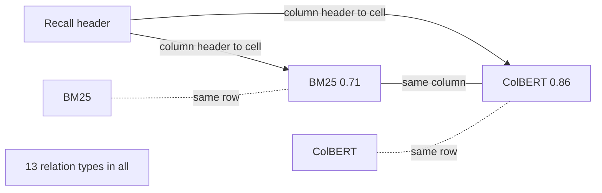
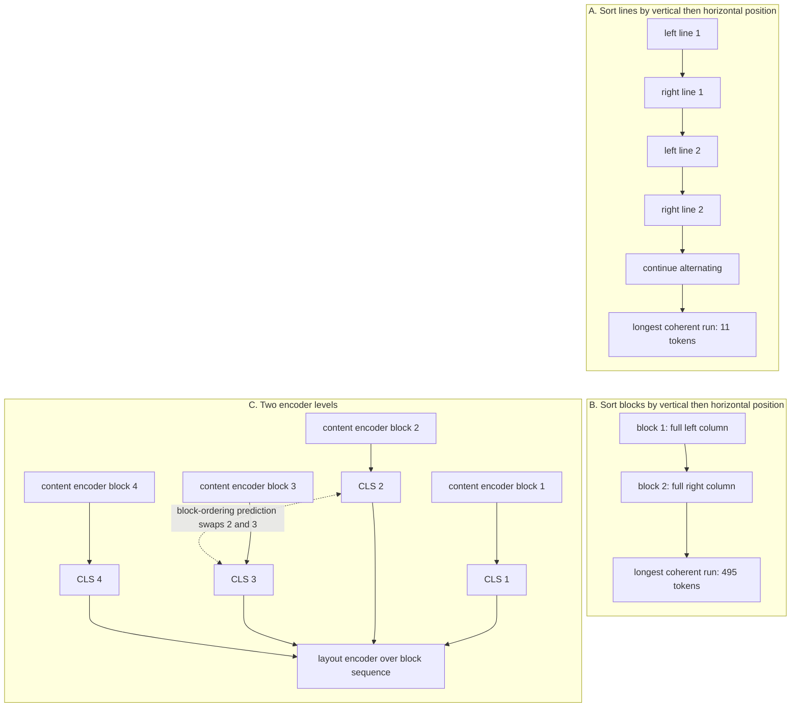
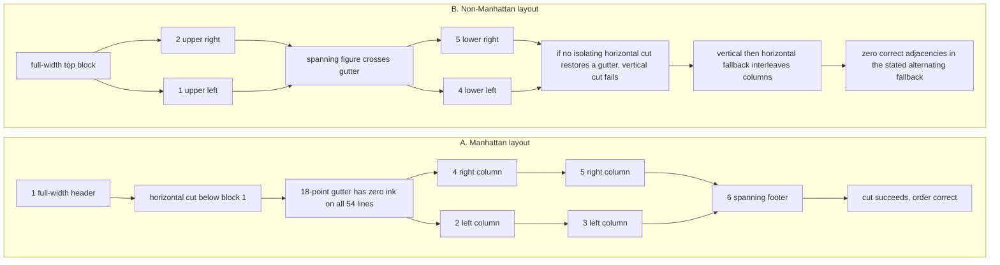

# Chapter 14: Beyond Plain Text - Tables, Layout, Documents
[00-START-HERE](../00-START-HERE.md) · [01-READING-ROUTES](../01-READING-ROUTES.md) · [13\_chunking\_and\_granularity](13_chunking_and_granularity.md) · [15\_approximate\_nearest\_neighbor\_search](../part-05-indexing/15_approximate_nearest_neighbor_search.md)
This chapter explains why table cells and document blocks lose meaning when they are flattened, how table and layout encoders restore structure, and which costs, invariance limits, metrics, and layout priors matter in a Retrieval-Augmented Generation (RAG) interview.
## TL;DR
- A table stores meaning in the triple of row key, column header, and cell value. A fixed text cut can separate those parts while leaving a chunk that looks healthy.
- Detect tables before splitting. Keep a fitting table atomic. For an oversized table, split only between rows and repeat the header in every fragment.
- TAPAS repairs row-major flattening with additive column, row, and rank lookups. Its absolute row and column fields also make equivalent renderings look different.
- TableFormer removes global, row, and column position IDs. It keeps within-cell order and adds 13 structural relation biases to attention.
- Accuracy alone can hide order sensitivity. Variation percentage (VP) counts paired answer flips and stays visible when correct-to-wrong and wrong-to-correct flips cancel.
- Clean extraction is not correct reading order. Sorting blocks instead of lines raises the coherent span in the worked two-column page from 11 tokens to 495.
- Layout rules are corpus assumptions. Reading direction, full-height gutters, relative type size, emphasis rarity, and the rendered table’s key column must be tested on each domain.
## The story
Imagine a warehouse that receives crates of financial reports, manuals, forms, and tables. The search system is the shipping desk. It must find the right package and send enough contents to an answer station.
A prose paragraph arrives as one labeled crate. Its words carry most of its meaning. A table arrives differently. The header is the crate manifest, the first column is the pallet label, and each numeric cell is one loose item. If a clerk cuts the shipment after a fixed number of tokens, the manifest can stay upstairs while most pallets move downstairs.
The downstairs pallets still look orderly. Every row has aligned numbers and a region code. Yet the number $`38.2`$ no longer says whether it is revenue, gross margin, operating expense, or net income. The shipping desk matches the query words to the upstairs manifest and sends the labeled crate without the requested row.
The first repair is operational. The receiving clerk marks each table before the cutting line. Small tables stay whole. Tall tables split only between rows, and every pallet receives a copied manifest. This costs more labels and more packages, but every number remains self-describing.
The warehouse then installs a table scanner. TAPAS reads each item with token, sequence position, segment, column, row, and numeric rank fields. The scanner understands the grid, but it also stamps absolute aisle and shelf numbers onto the items. Moving an unchanged pallet to another aisle changes its representation.
TableFormer changes the stamps. It removes global aisle and shelf numbers. It records relations such as same row, same column, and header-to-cell. A harmless pallet swap leaves those relations unchanged. The warehouse now measures paired answer flips, because aggregate accuracy can stay flat while many individual shipments change.
Documents create a second kind of warehouse error. A two-column page is two vertical racks. A line-level clerk alternates one shelf from the left rack and one from the right. Every word remains legible, yet each outgoing box mixes unrelated specifications. A block-level clerk empties one rack before moving to the next.
For long documents, the warehouse uses two floors of supervision. A lower encoder reads inside each block. A higher encoder reads block summaries, block types, order, adjacency, and image slots. The hierarchy makes block structure representable and reduces the attention pairs in the worked example by $`39.6`$ times.
The final lesson is that warehouse geometry is not universal. English reports, Arabic contracts, vertical Japanese manuals, journals, slide decks, and spanning figures require different routing rules. A good system writes those priors down, tests them on held-out domains, and keeps relational invariance in the encoder while keeping rendering conventions in the parser.
## Decoder table


| Technical term | Plain-English meaning | Why it matters |
| --- | --- | --- |
| Retrieval-Augmented Generation (RAG) | A system that retrieves source material before a model answers | Ingestion decides whether the needed structure survives long enough to be retrieved |
| Semi-structured data | Prose and tables interleaved in one source | Meaning can live in position even when the extracted text looks normal |
| Structured data | Rows or triples governed by an explicit schema | Exact predicates, joins, and aggregation are available without similarity ranking |
| Unstructured data | Prose, transcripts, or tickets whose meaning lives mainly in tokens | Standard chunkers and embedding models are designed around this case |
| Large Language Model (LLM)-generated data | Synthetic questions, summaries, or propositions written for retrieval | It provides query-like wording but moves provenance responsibility to the system owner |
| Asia-Pacific (APAC), Americas (AMER), and Europe, Middle East, and Africa (EMEA) | The three region labels printed in the worked table | They identify rows but do not identify the meaning of each numeric cell |
| Third quarter 2025 (Q3-25) | The period label used in the worked table | It is query vocabulary that can remain with the header while a value is cut away |
| Gross margin ($`\mathrm{GM}\%`$), operating expense (Opex), and net income (NI) | Abbreviated metric headers in the worked table | They give the numeric cells their column meaning |
| Table region | A two-dimensional page area identified as a table before linearization | It must be protected before a generic text splitter runs |
| Row key | The cell that identifies a row, usually in the first rendered column | A value needs its row key and column header to be interpretable |
| Column header | The label that names an attribute | Numeric cell text is weak retrieval material without this label |
| Row-major serialization | Printing the header, then every row from left to right | It places same-column cells far apart in the token sequence |
| Orphan row | A row separated from the header that gives its values meaning | Orphan rows can be fluent, retrievable, and semantically unusable |
| Atomic table | A table kept as one retrieval unit | It avoids header severance when the table fits the budget |
| Header repetition | Copying column labels into every row group or row serialization | It makes each table fragment self-describing |
| Retrieval surrogate | A short row-level or table-level description used for search | It decouples what the system embeds from the larger payload it injects |
| Table payload | The original table region returned after a surrogate matches | It preserves full context for comparison questions at a prefill cost |
| Lookup question | A query that names one row and one column | A header-repeated row can answer it |
| Aggregation question | A query comparing or combining rows, such as a maximum, total or count | One isolated ordinary row cannot generally establish a global aggregate; use enough evidence or an executor |
| Structured Query Language (SQL) | A language for exact operations over structured tables | It is the route for compound selection and aggregation when a schema is worth maintaining |
| Best Matching 25 (BM25) | A sparse term-matching ranker | It can rank the header chunk first because the query vocabulary occurs there |
| Dense Passage Retrieval (DPR) | A method label printed in the TAPAS illustration | It is one cell value in the exact source figure, not a new architecture introduced by this chapter |
| WordPiece | The subword token unit used in the stated table-encoder examples | Cell length in WordPiece tokens determines the row budget |
| Bidirectional Encoder Representations from Transformers (BERT) | The base encoder architecture used by TAPAS | Its learned position table has $`512`$ rows in the stated base configuration |
| TAPAS | A table model that keeps the BERT transformer unchanged and adds table fields at input | It restores grid coordinates and numeric order with little parameter cost |
| Token identifier (ID) | The lookup key for a token’s lexical identity | It stays unchanged under a row permutation |
| Position ID | The token’s absolute place in the flattened sequence | It changes when the printed row or column order changes |
| Segment ID | The field separating query tokens from table tokens | TAPAS uses segment $`0`$ for the query and the other segment for the table |
| Column ID | The absolute printed column assigned to a table token | It restores coordinates but introduces column-order sensitivity |
| Row ID | The absolute printed row assigned to a table token | It changes every token vector in swapped rows |
| Rank ID | Value-derived rank within a numeric or date column | Stable under row permutations only if parsing and tie handling do not depend on printed order |
| Additive input embedding | A sum of learned lookup vectors before the first transformer layer | TAPAS changes representation rather than transformer capacity |
| Silent truncation | Dropping tokens beyond the encoder window without making the remaining sequence invalid | A maximum can be computed over $`19`$ visible rows when the source had $`20`$ |
| Verbalization | Rewriting cells as prose such as header is value | It avoids a custom encoder but repeats structure as costly content |
| Weak supervision | Training from final answers instead of explicit logical forms | TAPAS learns cell selection and one aggregation operator from answer-level signals |
| Cell-selection head | The output that chooses a set of cells | It does not express an arbitrary multi-step query plan |
| Sequential Question Answering (SQA), TabFact, and $`F_1`$ | A table question-answering benchmark, a table fact-verification benchmark, and the metric-column label in one source example | SQA provides the $`55.1`$ to $`67.2`$ comparison, while SQA and TabFact receive permutation tests |
| Relational invariance | The requirement that equivalent row or non-key column permutations preserve the answer | It separates data meaning from rendering order |
| Permutation orbit | All row and column orders that denote the same relation | Its factorial size makes finite augmentation a weak guarantee |
| TableFormer | A table encoder using relation-aware attention | Architectural equivariance needs compatible retained inputs and masks; an invariant readout preserves answers |
| Within-cell position | Token order that resets at each cell boundary | It preserves real word order such as Palo Alto |
| Structural relation | A pair type such as same cell, same row, same column, or header-to-cell | It survives harmless row and column permutations |
| Attention bias | A learned scalar added to an attention logit for a relation type | It encodes structure with very few parameters |
| Variation percentage (VP) | The share of paired queries whose answer flips after a label-preserving perturbation | It exposes instability that aggregate accuracy cancels |
| Marginal accuracy | Accuracy measured separately on original and perturbed sets | Equal totals do not imply the same questions were answered correctly |
| Conditional invariance | A symmetry guarantee conditional on the full retained representation and computation | Same-cell inclusion is necessary but not the only condition; truncation can break it |
| Optical character recognition (OCR) | Conversion of a scanned page into text | High character confidence does not validate reading order |
| Raster order | Sorting page lines by vertical position and then horizontal position | It interleaves two columns with overlapping line heights |
| Reading order | The sequence in which document blocks should be consumed | Correct tokens in the wrong order produce useless chunks |
| Layout block | A typed page region such as header, paragraph, list, table, figure, or image | Block identity gives a representation level for document structure |
| Bounding box | The coordinates surrounding a page block | It supports ordering, citation, and layout features |
| Block adjacency | The relation between neighboring blocks independent of their token lengths | A flat sequence makes this relation drift with block size |
| Layout-Aware Multimodal Pre-training (LAMPreT) | A two-level document encoder with text and image blocks | It models semantics inside blocks and relations among blocks |
| Convolutional neural network (CNN) encoder | The image encoder feeding image blocks into the upper sequence | It gives non-text blocks a slot beside text blocks |
| Masked language modeling | Predicting hidden tokens from their context | Alone, it can ignore the upper layout level and solve each block locally |
| Image-text matching | Detecting an image swapped from another document | It is one of the two low-level LAMPreT objectives |
| Block-ordering prediction | Detecting whether two block summaries were swapped | It directly punishes layout blindness |
| Image fitting | Selecting the correct candidate for a masked image block | It tests cross-modal block association |
| Block filling | Selecting the correct candidate for a masked text block | It tests document-level text block association |
| Mean reciprocal rank (MRR) | A rank metric that rewards an earlier correct result | The stated LAMPreT evaluation uses it for block-level tasks |
| $`\mathop{\mathrm{recall}}\nolimits@5`$ and $`\mathop{\mathrm{recall}}\nolimits@10`$ | Whether the correct item appears among the first $`5`$ or $`10`$ results | The source uses $`\mathop{\mathrm{recall}}\nolimits@5`$ for block evaluation and $`\mathop{\mathrm{recall}}\nolimits@10`$ for layout transfer |
| LayoutLM | A flat encoder that adds normalized two-dimensional box coordinates | It fits single-page geometry but does not create a block sequence |
| Two-level hierarchy | Content attention inside blocks plus attention across summaries | Compare attention pairs, not a guaranteed whole-model speedup; all block lengths must fit the lower stage |
| Layout prior | An assumed map from geometry or typography to meaning | Every linearizer supplies one in code or learned weights |
| Manhattan layout | Axis-aligned blocks separated by coherent whitespace | Recursive X-Y cut works when its full-height valleys exist |
| Recursive X-Y cut | Alternating projection cuts at the widest zero-ink valley | It discovers columns before ordering their blocks |
| Full-height gutter | A vertical whitespace band with zero ink across all lines in a region | It separates columns when ordinary word spaces disappear under projection |
| Non-Manhattan layout | A page with spanning elements or geometry that breaks full-height valleys | X-Y cut can fail and force a bad fallback order |
| Page-relative type ratio | A block’s size divided by the character-weighted modal size on the page | It transfers across journals, slides, and contracts better than an absolute point threshold |
| Emphasis rarity gate | Treating bold as meaningful only while bold text is rare | Bold cannot mark a useful minority when most of the page is bold |
| Leftmost-key prior | The convention that the first rendered column identifies each row | It belongs in linearization and chunk metadata, not relational index embeddings |
| Script-aware sort | Choosing block order from writing direction | Left-to-right, right-to-left, and vertical scripts require different order functions |
| Held-out domain | A document category absent from parser training or rule tuning | It reveals learned or coded layout priors that do not transfer |
| Table symbols $`T`$, $`R`$, $`C`$, $`h_c`$, and $`t_{r,c}`$ | The table, row count, column count, column-$`c`$ header, and cell at row $`r`$ and column $`c`$ | They define the row-key, header, and value triple, while $`R!\,C!`$ counts equivalent row and column permutations |
| Overloaded symbols $`L`$, $`o`$, $`w`$, $`n`$, and $`\Delta(r)`$ | $`L`$ is chunk size, cell length, or layer count where locally defined. The others are overlap, tokens per cell, row or sequence count, and header distance | They expose fit, orphaning, and compute only when their local definitions stay explicit |
| TAPAS symbols $`Q`$, $`W`$, $`d`$, $`i`$, $`r`$, $`c`$, $`k`$, and $`R_{\max}`$ | Query length, window, vector width, sequence position, row ID, column ID, rank ID, and maximum fitting rows | They price fit and separate content-derived fields from printed-order fields. In retrieval cost, $`k`$ instead counts returned chunks |
| $`E_{\mathrm{tok}}`$, $`E_{\mathrm{pos}}`$, $`E_{\mathrm{seg}}`$, $`E_{\mathrm{col}}`$, $`E_{\mathrm{row}}`$, and $`E_{\mathrm{rank}}`$ | Learned token, position, segment, column, row, and rank lookup tables | Their sum is the complete stated TAPAS input intervention |
| $`W_Q`$, $`W_K`$, $`d_h`$, $`\alpha_{ij}`$, $`\phi(i,j)`$, $`b_{\phi(i,j)}`$, and $`\pi`$ | Query and key projections, head width, an attention logit, a structural pair type, its learned bias, and a row permutation | They show how TableFormer moves table structure from token vectors into permutation-stable attention |
| $`p`$ and $`q`$ | Correct-to-wrong and wrong-to-correct fractions | Accuracy change is $`q-p`$, correctness flips $`p+q`$; answer VP also counts other changed outputs |
| $`B`$, $`n`$, and $`T`$ in the hierarchy | Block count, average tokens per block, and total tokens | They compare flat attention $`T^2`$ with hierarchical attention $`Bn^2 + B^2`$ |
| $`L_j`$ and $`\lambda_j`$ | A component loss and its weight | Reduction conventions and gradient scales matter; equal ranges are not sufficient for balanced optimization |
| $`x`$, $`y`$, $`x_0`$, $`y_0`$, $`x_1`$, and $`y_1`$ | Block sort coordinates and bounding-box corners | They encode page geometry but do not by themselves define reading order |
| $`s`$, $`s_0`$, and $`p`$ in typography | A block’s type size, the page’s character-weighted modal size, and the bold-token fraction | They make heading and emphasis rules relative to the page |


## Core mechanics
### Mathematical conventions
Storage uses decimal bytes; fp32 has $`4\,\mathrm B`$ per coordinate. Count chunks per page or document when boundaries must be preserved. Constant cell lengths, two special tokens, uniform block lengths and equal-cost hardware seconds are scenario assumptions, not properties of all tokenizers or systems. The symbol $`L`$ is locally a chunk cap, cell token length or layer count; definitions do not transfer between examples. Attention-pair counts and $`4n^2dL`$ describe the quadratic attention term, not full-transformer time. Parameter-work proxies $`2NT`$ and stated sustained FLOP rates omit memory, scheduling, parsing, masks, lookup traffic and I/O. For permutation tests, separate correctness-label flips from any answer-value change. Exact equivariance requires the same retained cells, permutation-compatible inputs and masks, deterministic inference and an equivariant head or invariant readout. Report rounded results with $`\approx`$, not exact equality; empirical study results remain reported inputs rather than causal deductions from these counts.
### 14.1 Semi-structured data and why splitting a table corrupts it
#### A cell needs three coordinates
- **What:** A value is interpreted with its row key, column header, and cell value.
- **Why:** Only the cell value is adjacent to itself in row-major text.
- **Failure without it:** A retrieved value can be assigned the wrong column label.
- **Cost and complexity:** Preserving the triple requires table detection, row-aware splitting, and repeated labels.
Let a table have $`C`$ columns, $`R`$ data rows, headers $`h_1,\ldots,h_C`$, and value $`t_{r,c}`$ in one-based data row $`r`$ and column $`c`$. Under the simplifying convention that each serialized cell occupies exactly $`w`$ tokens, the row-key/header/value unit is $`(t_{r,1},h_c,t_{r,c})`$. Comparing corresponding cell starts in a header-first row-major stream gives distance:

```math
\Delta(r) = wrC
```

The distance grows linearly with $`r`$. It is unbounded as the table becomes taller.
#### Fixed splitting creates orphan rows
- **What:** Split a header-first stream with chunk cap $`L`$ and overlap $`o`$.
- **Why:** The header is printed once. In the stated $`L=512,o=64`$ case, only the first window contains it.
- **Failure without it:** Later row fragments can lose their metric labels despite retaining row keys and period values.
- **Cost and complexity:** Local overlap is not a substitute for explicit header propagation; whether any later window retains a particular header cell depends on the actual stride and alignment.
The rows sharing the first chunk with the header number:

```math
n_{\mathrm{complete}}=\min\!\left(R,\max\!\left(0,\left\lfloor\frac{L}{wC}\right\rfloor-1\right)\right).
```

The fully labeled-row fraction in the first window is $`n_{\mathrm{complete}}/R`$ for $`R\gt 0`$. At $`L=512,o=64,C=6,w=5`$, a row costs $`30`$ tokens: the header and $`16`$ full rows occupy $`510`$ tokens. Thus $`16/120\approx13.333\%`$ of rows are complete and self-described in that window; $`104`$ rows are not. The header ends at token $`30`$, the second window starts at token $`449`$, and $`64`$ overlap tokens are about $`2.133`$ row-equivalents, not a repeated header. A few cells of row $`17`$ can still appear beside labels; “orphan” here means a row not wholly available with the header.
#### Retrieval fails before generation
- **What:** The metric phrase, such as gross margin, is a column label; row key and period may occur in later rows.
- **Why:** Separating the metric label from those values weakens or corrupts the searchable evidence.
- **Failure without it:** BM25 may retrieve a label-only chunk or a bare row; it does not necessarily share only the row key, since period values can also match.
- **Cost and complexity:** A larger embedding model cannot certify the meaning of labels that were discarded. Recovering the header from parent metadata is a possible repair.
The opening prose assigns $`38.2\%`$ to APAC, while Figure $`14.1`$ assigns APAC $`41.7`$ and EMEA $`38.2`$. Preserve this as a reported source inconsistency rather than silently inventing a reconciliation. A whole-table vector can locate a table but does not itself select a row. A $`512`$-position encoder needs an explicit inclusion policy; silent truncation is an implementation failure to reject, not an inevitable model behavior. A longer encoder shifts rather than eliminates context and precision costs. Similar-looking rows need not produce a reliable semantic-breakpoint dip.
#### Parse before splitting
- **What:** Detect table regions while the document is still two-dimensional.
- **Why:** A downstream token stream no longer carries the region boundary.
- **Failure without it:** The table can be cut before the system knows it is a table.
- **Cost and complexity:** Header repetition raises tokens and vector count.
Keep a fitting table atomic. For an oversized table, split between complete rows and repeat the header in each fragment. Header-to-value distance then depends on the local row number and is bounded by the fragment length, not generally by $`O(wC)`$ when many rows share a header. Repeating labels inside each row gives an $`O(wC)`$ local row span. Here, groups of at most $`16`$ rows plus a $`30`$-token header would need $`8`$ fragments and $`3{,}840`$ embedded tokens; the row-by-row alternative below uses a different serialization.
#### Worked table configurations
The table has $`R = 120`$, $`C = 6`$, and $`w = 5`$. One row costs 30 tokens. The header plus data costs $`30 \times 121 = 3{,}630`$ tokens.


| Configuration | What happens | Cost and limit |
| --- | --- | --- |
| Recursive character split | $`L=512,o=64`$, stride $`448`$ gives $`8`$ minimally covering windows | $`3{,}630+7(64)=4{,}078`$ unpadded embedded tokens; only $`16`$ of $`120`$ rows are fully present with the header |
| Header repeated per row | Assume labels add $`2`$ tokens per cell: $`42`$ per row, $`12`$ whole rows per $`512`$-token chunk, $`10`$ chunks without overlap | $`5{,}040`$ tokens: $`38.8430\%`$ more than the unique original serialization, but $`23.5900\%`$ more than its overlapped embedding bill; vectors increase $`25\%`$. No row is cut or unlabeled |
| $`80`$-token table surrogate plus payload | One vector indexes a summary and the $`3{,}630`$-token payload remains attached | A plan returning $`5`$ tables injects $`18{,}150`$ tokens; another returning $`10`$ labeled rows injects $`420`$. Ratio $`43.2143`$ compares these text budgets, not equivalent workloads or measured latency |


The larger payload can support cross-row comparisons that one isolated row cannot establish. At a rough $`4`$ characters per token, $`3{,}630`$ tokens imply $`14{,}520`$ characters. The source’s separate approximately $`13{,}100`$-character estimate differs by about $`9.78\%`$ relative to $`14{,}520`$; this is a rough consistency check, not a verified tokenization conversion. The table has $`3{,}630/512\approx7.09`$ times the stated window. Table-native encoders still need an ingestion and cell-inclusion policy.
#### Operating decisions
- Detect tables before the text splitter. Measure pipe, tab, and decimal-alignment density on a sample before assuming the corpus has almost no tables.
- Repeat headers in oversized row groups. Price the actual serialization: the example’s per-row labels add about $`38.84\%`$ versus unique text, while per-group repetition has a different cost.
- Index row surrogates for lookup traffic.
- Index table surrogates for comparison traffic and return the table payload.
- Route highest, total, year-over-year, and count questions to SQL when recurring shapes justify a maintained schema.
- Leave heterogeneous one-off layouts in retrieval when schema induction costs more than it returns.
- Stratify retrieval evaluation by whether the gold answer lives in a table.
### 14.2 Table encoding: TAPAS and its positional assumptions
#### The one-dimensional input problem
- **What:** A table has rows and columns, while a transformer receives one token sequence.
- **Why:** Row-major flattening creates misleading token distances.
- **Failure without it:** Same-row but unrelated cells look near. Same-column cells look far.
- **Cost and complexity:** A structural encoder adds input lookups and a parser that supplies their IDs.
For token $`w_i`$ at position $`i`$ and segment $`s_i`$, BERT uses:

```math
h_i^{(0)} = E_{tok}(w_i) + E_{pos}(i) + E_{seg}(s_i)
```

Each lookup returns $`d=768`$ coordinates in the stated base configuration. The learned position table has $`512`$ entries; extensions require a specified method. In this local formula let $`L`$ mean tokens per cell, let $`r=0,\ldots,R-1`$ and $`c=0,\ldots,C-1`$ index data cells, and use zero-based sequence positions. A serializer with $`Q`$ query tokens, two prefix special tokens and one $`CL`$-token header row starts the cell at:

```math
i(r,c)=Q+2+CL+(rC+c)L,\qquad r\in\{0,\ldots,R-1\},\ c\in\{0,\ldots,C-1\}.
```

For one-based data indices, replace $`rC+c`$ with $`(r-1)C+(c-1)`$. Adjacent cell starts are $`L`$ tokens apart, while consecutive same-column row starts are $`CL`$ apart. At $`C=8,L=3`$, these distances are $`3`$ and $`24`$ tokens. They are sequence distances, not attention-hop counts.
#### TAPAS adds table fields at the input
- **What:** A simplified TAPAS-style input sums column, row and numeric-rank lookups with the base fields.
- **Why:** The added fields expose grid membership and numeric order.
- **Failure without it:** Flattened sequence distance alone is a poor representation of attribute identity.
- **Cost and complexity:** Three additional $`256\times768`$ tables would add $`589{,}824`$ parameters in this budget exercise. This is not a claim to enumerate every field of every released TAPAS checkpoint.

```math
h_i^{(0)} = E_{tok}(w_i) + E_{pos}(i) + E_{seg}(s_i) + E_{col}(c_i) + E_{row}(r_i) + E_{rank}(k_i)
```

In this simplified schema, query tokens use segment $`0`$ and zeros in the table fields. Headers use row ID $`0`$, data row IDs are one-based, and numeric/date ranks are content-derived after parsing. Ties must be handled independently of printed order to preserve rank stability. A comparison such as $`0.42`$ versus $`0.31`$ can be connected by full attention in one layer; being separated by many sequence positions does not require that many attention hops.
#### Positional assumptions
- **What:** Token, segment, and rank fields are content-derived or content-stable. Position, column, and row fields depend on rendering.
- **Why:** A relation can remain unchanged when rows or non-key columns move.
- **Failure without it:** Equivalent tables can produce different first-layer vectors and answers.
- **Cost and complexity:** Canonicalization can reduce parser churn but does not make the encoder invariant.
A label-preserving row permutation leaves lexical identity, segment and correctly parsed value-rank attached to the same cell, while changing absolute position and row IDs. Column permutations change column IDs. This permits order sensitivity; it does not force every logit or every prediction to change. Key roles and order-bearing queries must be specified separately from arbitrary printed position.
#### Window and verbalization arithmetic
Take $`R=20,C=8,L=3,Q=12,W=512`$. With exactly two budgeted special tokens, structural length is $`12+2+24+480=518`$. The complete-row budget is

```math
R_{\max}=\max\!\left(0,\left\lfloor\frac{W-Q-2-CL}{CL}\right\rfloor\right)
=\left\lfloor\frac{474}{24}\right\rfloor=19.
```

Add any extra special tokens required by the actual tokenizer before computing this bound. The opening anecdote about $`8`$ segments with $`6`$ visible is separate; it does not follow from this $`20`$-row example. For verbalization, explicitly budget a repeated $`3`$-token row-key prefix plus $`8`$ cells of $`3`$ header, $`1`$ “is,” $`3`$ value and $`1`$ comma token: $`3+8(8)=67`$ tokens per row. Then $`20`$ rows use $`1{,}340`$ table tokens and $`1{,}354`$ total; only $`\lfloor498/67\rfloor=7`$ complete rows fit. Table-text inflation is $`1{,}340/504\approx2.65873`$. If both full sequences could be run, the quadratic attention-term ratio would be $`(1{,}354/518)^2\approx6.83247`$, not a measured whole-model latency ratio; neither full sequence fits this unmodified window.
#### Parameter and result accounting
Three $`256 \times 768`$ tables add:

```math
3 \times 256 \times 768 = 589{,}824 \approx 0.59\text{ million}
```

The three-table increment is one $`768\times768`$ matrix and approximately $`0.5362\%`$ of $`110`$ million parameters. The reported SQA comparison $`55.1\to67.2`$ is a $`12.1`$-percentage-point gain, but the parameter count alone does not causally isolate structure from training and pipeline changes. For $`20`$ distinct rows and $`7`$ movable non-key columns, $`20!\,7!=12{,}261{,}826{,}121{,}210{,}265{,}600{,}000\approx1.22618\times10^{22}`$ serializations exist. Identical rows or columns can reduce the distinct orbit; finite augmentation does not by itself enforce invariance.
#### TAPAS claim limits
TAPAS is not a general query engine: the stated head chooses cells and at most one aggregation operator from none, count, sum or average. It does not expose an arbitrary SQL execution plan, even if a model sometimes answers a compound question correctly. Prefer an exact executor for reliable compound numerical reasoning. Numeric ranks also depend on implementation and parsing. The source describes a parser where an invalid entry can disable a column’s rank feature; do not generalize that behavior to every TAPAS parser. Test missing values such as `n/a` and formatted values such as `1,204` under the actual locale, and monitor parse rates.
#### Operating decisions
- Compute the row budget before selecting the encoder.
- Reject rather than silently truncate.
- Shard by row group only with the header replicated.
- Route cross-shard comparisons and aggregates elsewhere.
- Prefer verbalization for few small tables when maintaining a serializer is cheaper than maintaining a model. The source calls it the right choice on a 5-row table and for open-ended reasoning with a long-context instruction-tuned model.
- Prefer structural encoding above roughly 10 rows in the stated cost comparison.
- Freeze canonical column order and parser version beside the index.
- Run row permutation tests on label-preserving tables.
- Do not permute chronological ledgers, ranked leaderboards, or other order-bearing tables.
### 14.3 Row and column order bias and TableFormer’s fix
#### Put exact symmetries in the architecture
- **What:** For order-free data, a relation is a set of tuples over named attributes.
- **Why:** Up to $`R!C!`$ row/column renderings can denote it when rows and attributes are distinct and all permutations preserve the query label.
- **Failure without it:** A model can learn incidental order rather than the requested relation.
- **Cost and complexity:** Architecture can impose exact equivariance; augmentation samples an orbit but offers no exhaustive guarantee. Order-bearing tables and fixed key roles restrict the allowed permutation group.
A $`10`$-row, $`5`$-column table with distinct rows and columns has $`10!5!=435{,}456{,}000`$ renderings. Five distinct row permutations cover $`5/10!\approx1.37786596e-06`$ of the row orbit. Repeated samples cover less, and this coverage fraction is not a generalization probability. Training on five times as many examples gives roughly five times the example-processing work only under the same per-example and epoch assumptions.
#### Why TAPAS changes after a swap
- **What:** Row and column embeddings enter token representations.
- **Why:** Attention logits depend on those representations.
- **Failure without it:** A row swap can perturb logits involving moved cells; a nonzero change is not mathematically inevitable for every pair.
- **Cost and complexity:** Subsequent layers may amplify or suppress the perturbation. No exact invariance follows merely from using the same BERT weights.

```math
\alpha_{ij} = \frac{(W_Q e_i)^T(W_K e_j)}{\sqrt{d_h}}
```

Changing a row ID changes the selected lookup vector when those entries differ. Its projections can alter logits, but cancellations or learned invariance can leave some unchanged. The architecture supplies no general rule requiring all such changes to vanish.
#### TableFormer moves structure into attention
- **What:** TableFormer deletes global position, row, and column IDs.
- **Why:** Absolute IDs encode rendering order as meaning.
- **Failure without it:** A harmless permutation rewrites token vectors.
- **Cost and complexity:** It adds one learned relation scalar to each attention logit.
Position resets inside each cell. Word order within a cell remains real. The structural pair function maps each token pair to 1 of 13 relations. The source names same cell, same row, same column, cell-to-header, header-to-cell, mirrored question-table relations, and a residual class.

```math
\alpha_{ij} = \frac{(W_Q e_i)^T(W_K e_j)}{\sqrt{d_h}} + b_{\phi(i,j)}
```

For a label-preserving cell-token permutation represented by matrix $`P`$ (query tokens fixed), require the pair relation and every attention mask to permute consistently. Relation invariance is:

```math
\begin{aligned}
\phi(\pi(i),\pi(j))&=\phi(i,j),\\
A(PE)&=P\,A(E)\,P^{\mathsf T},\\
F(PE)&=P\,F(E).
\end{aligned}
```

These equations describe attention and token-output equivariance when all retained inputs, within-cell positions and masks obey the permutation, dropout is disabled or coupled appropriately, and no other order-dependent features enter. An invariant aggregation/readout then preserves the answer; cell-selection outputs must be mapped back to original cells. Keeping within-cell order means Palo Alto is not permuted into Alto Palo.
#### Parameter and compute cost
The row/column lookup subset has $`2(256)(768)=393{,}216`$ parameters. Relation biases use $`13(12)=156`$ scalars if shared across layers or $`13(12)(12)=1{,}872`$ otherwise; the latter is $`0.476074\%`$ of that removed subset. This comparison excludes other input embeddings, including whatever within-cell positions replace global positions.
At $`n=512,H=12,L=12`$, adding one bias per head and token pair requires $`n^2HL=37{,}748{,}736`$ additions. The quadratic attention arithmetic proxy is $`4n^2dL=9{,}663{,}676{,}416`$ FLOPs, so the additions are $`0.390625\%`$ of that term. They are about $`0.033513\%`$ of the parameter-work proxy $`2NT=1.1264\times10^{11}`$ FLOPs; that proxy is not a complete BERT forward-pass measurement. Relation lookup, materialization, masking, softmax and memory traffic also cost time. The stated T5 scale check is $`32(12)=384`$ learned bucket scalars.
#### Variation percentage sees canceled flips
- **What:** Let $`p`$ be correct-to-wrong and $`q`$ wrong-to-correct fractions on paired examples; let $`z`$ be changed predictions among examples wrong both times.
- **Why:** Accuracy change is $`q-p`$. Correctness-label flip rate is $`p+q`$. With a unique correct answer, answer-value VP is $`p+q+z`$.
- **Failure without it:** Opposite correctness flips cancel, and wrong-to-different-wrong changes are invisible to correctness alone. Multiple acceptable correct outputs require another change category or a canonicalization policy.
- **Cost and complexity:** Compute VP from actual paired outputs under label-preserving perturbations, not just their aggregate correctness counts.
The source reports permutation evaluations on SQA and TabFact and TableFormer VP below $`1\%`$ in its settings. As a separate bound, if original and perturbed accuracies are both $`0.6`$, correctness down/up fractions can satisfy $`p=q\le0.4`$, so correctness-label flips can reach $`0.8`$ with zero accuracy delta. Under a unique-gold-answer convention, at least $`0.2`$ are correct both times, so answer-value VP is also at most $`0.8`$; without that convention, answer-value changes need separate accounting.
#### Worked regression
For $`1{,}000`$ questions, original $`600`$ correct and paired counts $`140`$ down, $`138`$ up imply $`598`$ correct after permutation, a $`0.2`$-percentage-point drop. They prove $`278/1{,}000=27.8\%`$ correctness-label flips and $`722`$ stable correctness labels. Answer-value VP is at least $`27.8\%`$ and equals it only if there are no additional wrong-to-different-wrong or acceptable-answer changes; the counts alone do not prove $`722`$ unchanged answers. A strictly sub-$`1\%`$ VP on exactly $`1{,}000`$ examples permits at most $`9`$ changed outputs, not a guaranteed transfer of the study’s rate.
#### Invariance claim limit
Exact architectural equivariance assumes the same cells survive and the full input, masks and output handling satisfy the symmetry. Truncation can change cell inclusion after permutation and break that guarantee. It is one possible source of residual empirical VP, not the unique explanation proved by a sub-$`1\%`$ number; parsing, nondeterminism, masks or head details can also matter. Meaningful order, multirow headers and within-cell token order must remain intact. Oversized tables still need ingestion and sharding policies.
#### Operating decisions
- Canonicalize row and column order in the parser before changing the encoder. Sorting rows by the key and pinning columns removes parser churn for the cost of a comparator.
- Keep order when order is data, including chronology and ranking.
- Report VP beside accuracy on structured-input evaluations. One label-preserving perturbation per example doubles evaluated inputs without new gold labels, but requires additional inference and validation that the label truly remains valid.
- Permute within order-free groups for partially ordered tables.
- Use architecture for exact symmetries and augmentation for formatting, whitespace, and casing changes.
- Repeat the header in every row block. A 60-row table that truncates becomes order-sensitive again.
- Route aggregates that cross row blocks to SQL.
- Read a table paper for its perturbation result as well as its headline accuracy.
### 14.4 Document layout: blocks, reading order, and hierarchical pre-training
#### Extraction and order are separate
- **What:** OCR or a parser can return every character correctly and still linearize the page wrongly. The opening parser reports $`0.99`$ confidence across the page.
- **Why:** Two-column lines share vertical bands.
- **Failure without it:** Sorting each line by vertical then horizontal position alternates unrelated columns.
- **Cost and complexity:** Sorting blocks changes one key but requires trustworthy block boundaries.
The worked page has 2 columns, 45 lines per column, and 11 tokens per line. It contains $`2 \times 45 \times 11 = 990`$ tokens. Line sorting produces one coherent line at a time, or 11 tokens. Block sorting produces one 45-line column, or 495 coherent tokens. That is a $`45\times`$ improvement without model training.
#### What the parser must preserve
- **What:** Each block carries a bounding box, type, content, text properties, and image status.
- **Why:** Header, paragraph, list, table, figure, and image roles are different.
- **Failure without it:** The same words cannot reveal whether they govern later content.
- **Cost and complexity:** Block IDs, types, page numbers, boxes, and text properties add metadata and parser work.
Correct order is necessary but not sufficient. A flat token stream cannot express block membership and block type directly. The source contrasts `Discontinued models` as a header governing 300 tokens with the same words as a table cell governing nothing. It also measures block adjacency in tokens. Blocks 3 and 4 remain neighbors whether block 3 contains 12 or 800 tokens. The flat distance changes with block length anyway.
For scans, the source uses Optical Character Recognition (OCR). For born-digital Portable Document Format (PDF) and HyperText Markup Language (HTML), it uses a structure parser. Each block can carry font size, bold, italic, and underline properties, plus image status.
#### LAMPreT uses two encoder levels
- **What:** A lower transformer reads within blocks. A higher transformer reads block summaries.
- **Why:** Block order, type, adjacency, and image position need their own sequence.
- **Failure without it:** Long documents overrun the flat window and non-text blocks lack explicit slots.
- **Cost and complexity:** The system needs block parsing, two encoders, image encoding, and five objectives.
Each lower-level block receives its specified text, type, modality and formatting features; a CLS summary represents the block. The upper sequence receives block summaries in layout order, including encoded image blocks. This can represent document relations absent from a flat text-only baseline. For the following pair-count toy, assume exactly $`B=40`$ text blocks of $`n=60`$ tokens, with equal widths and comparable attention accounting. Then $`T=Bn=2{,}400`$.

```math
T^2 = 5.76 \times 10^6
```

The hierarchy uses:

```math
Bn^2 + B^2 = 40 \times 60^2 + 40^2 = 145{,}600 = 1.456 \times 10^5
```

The pair counts are $`5.76\times10^6`$ versus $`144{,}000+1{,}600=145{,}600`$, a ratio of $`39.56044`$. This is not a $`39.56`$-fold whole-transformer speedup or an equivalence of the two functions: projections, feed-forward layers, extra summaries, image encoding and different depths remain. For fixed $`T`$ and equal block lengths, the continuous pair-count optimum solves $`-T^2/B^2+2B=0`$, giving $`B_\star=(T^2/2)^{1/3}\approx142.2757`$. Real blocks are semantic units, not an arbitrary compute knob. In this equal-length toy, lower length $`60`$ and upper length $`40`$ fit $`512`$ positions, while $`2{,}400/512=4.6875`$ does not. A mean length alone would not bound the longest block; variable lengths use $`\sum_b n_b^2+B^2`$ before padding.
#### Five pre-training objectives
- **What:** Two objectives operate within content and three operate on the block sequence.
- **Why:** Layout is learned only when a layout-blind model is punished.
- **Failure without it:** Masked language modeling can solve one block at a time and ignore the upper encoder.
- **Cost and complexity:** Five component losses require normalization, hypotheses, weights, and ablations.
The stated five objectives are masked language modeling, image-text matching, block-order prediction, image fitting and text-block filling. They encourage within-block and document-level learning, but a within-block-only model is not automatically at chance: it may exploit lexical, type or candidate-distribution shortcuts. Chance rates depend on class balance and candidate construction. Ablate access to cross-block context to test what the objectives actually teach. The weighted total is:

```math
\mathcal{L} = \sum_j \lambda_j \mathcal{L}_j
```

Weights are tunable. Their numerical values are not comparable without the loss definitions, reduction convention and gradient scales. As a hypothetical magnitude example, $`0.1`$ times a loss as large as $`10`$ can outweigh $`1.0`$ times one as large as $`0.5`$; actual cross-entropy losses are not generally bounded by those ranges. Normalize per-token/per-block reductions or measure gradients, then sweep and ablate; equal loss ranges alone do not guarantee balanced training.
#### LayoutLM trade-off and claim limit
- **What:** LayoutLM adds normalized box coordinates $`(x_0, y_0, x_1, y_1)`$ to a flat token input.
- **Why:** Absolute page geometry is useful for fitting single-page forms and receipts.
- **Failure without it:** Coordinates do not create an explicit block order or image slot.
- **Cost and complexity:** Flat two-dimensional positions are simpler for fitting pages. Hierarchy is more complex but supports blocks and images across longer documents.
For a fitting single-page form, flat box-aware representations can be a strong baseline. The simplified text-plus-box comparison here does not describe every LayoutLM variant; multimodal variants can include image features. A hierarchy explicitly exposes block order and non-text slots but is not mathematically guaranteed to outperform all flat models on long documents. The reported LAMPreT evidence concerns comparable text-block tasks and stronger image association under its evaluation, not universal superiority or better text infilling.
#### Datasheet cost example
The corpus has $`40{,}000`$ pages of $`990`$ tokens, $`3.96\times10^7`$ total. Preserving page boundaries with unpadded $`512`$-token windows gives $`40{,}000\lceil990/512\rceil=80{,}000`$ chunks and $`245.76\,\mathrm{MB}`$ of $`768`$-dimensional fp32 payload. Pooling unrelated pages into one stream would instead give $`77{,}344`$ chunks; that is a different segmentation policy.
For a separately stated serving budget of five full $`512`$-token chunks, take $`50\%`$ distractor text under raster extraction as an assumption: $`1{,}280`$ of $`2{,}560`$ tokens. At $`N=7\times10^9`$ and $`1.5\times10^{14}\,\mathrm{FLOP/s}`$, their incremental prefill proxy is $`119.4667\,\mathrm{ms}`$. On the ideal two-column page, choosing the chunk corresponding to the relevant column after block ordering can leave at most $`17`$ foreign tokens in a full $`512`$-token chunk: $`85`$ over five chunks, or $`3.3203\%`$. Their proxy is $`7.9333\,\mathrm{ms}`$, a difference of $`111.5333\,\mathrm{ms/query}`$. This is conditional on relevant-column selection and the stated geometry, not a bound for arbitrary layouts or total latency.
Parsing at $`0.4`$ CPU-core-seconds per page costs $`16{,}000`$ core-seconds, $`4.4444`$ core-hours, or $`1{,}000`$ elapsed seconds on $`16`$ perfectly parallel workers. CPU seconds and GPU seconds are different priced resources. With rates $`r_{\mathrm{CPU}}`$ per core-second and $`r_{\mathrm{GPU}}`$ per GPU-second, an idealized financial break-even is

```math
Q_{\mathrm{break}}=
\frac{16{,}000\,r_{\mathrm{CPU}}}
{(0.111533333\ldots)\,r_{\mathrm{GPU}}}
\approx143{,}455\,\frac{r_{\mathrm{CPU}}}{r_{\mathrm{GPU}}}.
```

The approximately $`143{,}455`$ queries or $`3.985`$ hours of traffic at $`10`$ QPS apply only to an equal-price-per-second illustration. No actual monetary payback follows without prices, utilization and incremental parser cost. Benchmark the parser and serving path.
#### Operating decisions
- Sort blocks, not lines or tokens.
- Preserve the parser’s internal order inside each block.
- Prepend the governing header chain to a chunk before buying a layout-aware model.
- Use the hierarchy when text must bind to images or multi-page block relations.
- Persist block ID, block type, page number, and bounding box beside each chunk. This costs a few dozen bytes per chunk beside $`245.76\,\mathrm{MB}`$ of vector payload in this page-preserving example; retaining reusable metadata can avoid repeating the parser work.
- Inspect objective reductions, magnitudes and gradient scales before selecting weights; normalization is one aid, not a guarantee. A source hypothesis can weight masked language modeling low for image-dominated pages and high for text-dense filings.
- Evaluate layout with answer flips after block perturbation, not accuracy delta alone. When no stable order exists, such as on loose forms or slide decks, perturb block type labels instead.
- Use flat box positions for fitting single-page documents.
- Use hierarchy above 512 tokens or when cross-modal block association matters.
### 14.5 Layout priors you should be able to name
#### A sort key is a bundle of assumptions
- **What:** Sorting blocks by $`(y, x)`$ means downward first and rightward within a band. The opening transfer case moves $`\mathop{\mathrm{recall}}\nolimits@10`$ from $`0.83`$ on Securities and Exchange Commission filings to $`0.31`$ on Osaka maintenance manuals while OCR, bounding boxes, and embedding weights remain unchanged.
- **Why:** It matches one common left-to-right Manhattan layout.
- **Failure without it:** It interleaves columns or reverses scripts whose reading direction differs.
- **Cost and complexity:** The system must classify columns, script, and region structure before sorting.
The naive sort asserts four priors.
1. Reading moves downward.
2. Reading moves rightward within a band.
3. Blocks are rectangular.
4. One global order exists.
With five blocks in each of two columns, the correct order has nine adjacent pairs. The alternating sort preserves zero of nine.
#### Recursive X-Y cut
- **What:** Project ink onto one axis, cut at the widest zero valley, then recurse with the axis swapped.
- **Why:** A full-height gutter remains empty when ordinary word spaces fill under projection.
- **Failure without it:** A spanning element erases the valley and the fallback can interleave columns.
- **Cost and complexity:** One projection per region plus thresholds tied to body size.
A US Letter page is $`612\times792`$ points. One-inch ($`72`$-point) margins give $`468\times648`$ points of text area. An $`18`$-point gutter gives $`(468-18)/2=225`$ points per column; $`12`$-point leading permits $`648/12=54`$ line slots under this simple layout. A $`10`$-point body em is smaller than the gutter, while approximate $`2.5`$-point word spaces occur at varying horizontal positions. A full-height blank gutter is one useful cut signal. A spanning figure can erase that valley in the current region, but recursive horizontal cuts may isolate it and restore gutters above or below. Failure is conditional on the available whitespace and fallback, not inevitable for every spanning figure.
#### Reading order depends on script and genre
Sort keys are local conventions, not complete page-reading algorithms. After region and column detection, a left-to-right horizontal band may use $`(y,x)`$; a right-to-left band may use $`(y,-x)`$, with $`y`$ increasing downward. Column-major text needs column order before within-column $`y`$, not a global line-level $`(y,x)`$ sort. Traditional vertical Japanese or Chinese may use right-to-left columns with top-to-bottom flow, schematically $`(-x,y)`$. Mixed scripts, newspapers and irregular blocks require a region-specific partial order or learned reading-order policy.
#### Typography must be relative
- **What:** Size and weight mean something only against the rest of the page.
- **Why:** Journals, slides, and contracts use different absolute point sizes.
- **Failure without it:** A 14-point threshold misses contract headings and labels every token in a 24-point slide body.
- **Cost and complexity:** A character-weighted size histogram and emphasis-rate calculation are required per page.
Let $`s_0`$ be the character-weighted modal type size. A candidate heading rule can be

```math
H_i=\mathbf1\!\left[\frac{s_i}{s_0}\ge1.10\ \ \text{or}\ \ (\mathop{\mathrm{bold}}\nolimits_i\ \text{and}\ p_{\mathrm{bold}}\lt 0.15)\right].
```

The bold rule is an alternative to the size rule, not an extra condition every heading must pass. The reported detector transfer from $`95\%`$ to $`40\%`$ is an anecdote, not proved by the threshold arithmetic alone. Separately, if exactly $`12`$ of $`500`$ tokens are true heading tokens, selecting all $`15`$ bold tokens at $`p_{\mathrm{bold}}=0.03`$ has precision at most $`12/15=0.8`$. Selecting $`300`$ at $`p_{\mathrm{bold}}=0.6`$ has precision at most $`12/300=0.04`$. These are token-level ceilings; rarity alone does not guarantee relevance or correctness.
#### Worked mixed corpus
The corpus has $`20{,}000`$ documents. Journals are $`60\%`$. They use 10-point body, 12-point subheads, 14-point section heads, and 18-point titles. Slides are $`25\%`$. They use 24-point body and 32-point headings. Contracts are $`15\%`$. They use 11-point body and 11-point bold headings.


| Rule | Journals | Slides | Contracts | Weighted result |
| --- | --- | --- | --- | --- |
| Absolute $`s \ge 14`$ points | Under the constructed template, detects $`5`$ of $`17`$ heading blocks: $`5/17\approx0.294118`$ recall | Detects all blocks, including one title among seven: recall $`1`$, block precision $`1/7\approx0.142857`$ | Recall $`0`$ for $`11`$-point headings | Document-mixture macro recall $`0.6(5/17)+0.25\approx0.426471`$, not pooled heading-level recall |
| Relative size $`\ge1.10`$ OR bold with $`p_{\mathrm{bold}}\lt 0.15`$ | All assumed heading size ratios $`1.2,1.4,1.8`$ pass | $`32/24=4/3`$ passes; body ratio $`1`$ fails | Same-size bold headings pass the alternative rarity branch if the assumed $`12`$ bold tokens among $`450`$ are exactly the heading tokens | Recall $`1`$ only under this constructed template and correct mode/bold assumptions |


Assume additionally $`12`$ pages per document and $`2{,}400`$ character records per page. The histogram scan processes $`20{,}000(12)(2{,}400)=5.76\times10^8`$ records; at an assumed $`10^7`$ increments per second, the arithmetic timing proxy is $`57.6\,\mathrm s`$, excluding extraction and other work. The source’s modular type-scale examples are $`9/8=1.125`$, $`6/5=1.2`$, $`5/4=1.25`$ and $`4/3\approx1.3333`$. A $`1.10`$ rule deliberately excludes $`16/15\approx1.0667`$, but small size differences can still mark real headings when other features support them. Modal size need not be body size on every page. A larger threshold such as $`1.20`$ is a domain heuristic under OCR uncertainty, not a guaranteed robust cutoff.
#### Rendering priors and encoder invariance coexist
- **What:** The rendered leftmost column often acts as the key, while the underlying relation remains column-order invariant.
- **Why:** Rendering and relation are different objects.
- **Failure without it:** Putting the leftmost-key rule into the encoder confuses typography with data semantics.
- **Cost and complexity:** The parser keeps the key in each chunk. The encoder keeps role relations without absolute index embeddings.
TableFormer drops row and column indices but keeps header-to-cell and same-column roles. The linearizer keeps the key cell and required header rows in every fragment. Arabic or other right-to-left rendering can invert the rendered-key convention without requiring an encoder change.
#### Learned priors also have domains
LayoutLM was pre-trained on scanned English business documents from the Illinois Institute of Technology Complex Document Information Processing (IIT-CDIP) corpus. PubLayNet was built by matching Portable Document Format (PDF) text against PubMed Central Extensible Markup Language (XML). It covers scientific articles. DocLayNet was created because single-domain layout corpora do not transfer. Its authors annotated 11 layout classes across 6 document categories. A coded prior can fail loudly on a held-out domain. A learned prior can fail silently when the training domain is hidden from system tests.
#### Operating decisions
- Use page-relative size ratios instead of absolute point thresholds.
- Detect columns before applying a block sort.
- Audit a parser-provided reading-order field on 50 held-out pages. The source says most commercial parsers already emit one.
- Record script at ingest and select the order function from it.
- Carry the key cell and every required header row into table fragments.
- Preserve both header rows when the header spans two rows.
- Treat multi-column spanning cells as genuinely ambiguous unless structure is retained.
- Gate emphasis rules on the page’s own emphasis rate. In single-weight documents, fall back to numbering patterns such as 1. or Article 3.
- Re-test every prior on a document category absent from development.
- Use the optometrist test as a diagnostic. Features visible when words are unreadable are layout signals that plain text extraction discards.
## Diagrams
### Table 14.1


| Type | Example | Retrieval gets free | What it costs |
| --- | --- | --- | --- |
| Structured | SQL rows, knowledge graph triples | Exact predicates, joins, aggregation. Similarity ranking is not needed for an exact keyed predicate, though other queries can still require ranking | The schema is yours to design and migrate forever |
| Semi-structured | Filings, wikis, manuals with prose interleaved with tables | Coverage without imposing one global relational schema | Cell meaning is positional, so splitting corrupts it and cell text is weak similarity-search material |
| Unstructured | Prose, transcripts, tickets | Everything a chunker assumes, including sentences, redundancy, and distributional signal | Exact predicates require additional extraction or structure rather than appearing automatically in raw prose |
| LLM-generated | Synthetic question and answer pairs, summaries, propositions | A retrieval surface written in the query’s own vocabulary | Provenance becomes yours to defend, and the errors are fluent |


**Table **$`14.1`$**:** These categories suggest different ingestion and query strategies; they are not an exclusive partition of failure modes. Prose also carries meaning in word order, structured rows depend on schema, and synthetic text can lose qualifiers. Semi-structured tables make the dependence on row/header roles especially explicit.
### Figure 14.1
#### A. Row-major serialization, cut every $`L`$ tokens


| Seg | Qtr | Rev | $`\mathrm{GM}\%`$ | Opex | NI |
| --- | --- | --- | --- | --- | --- |
| header | header | header | header | header | header |
| … | … | … | … | … | … |
| cut | cut | cut | cut | cut | cut |
| EMEA | Q3-25 | $`412.0`$ | $`38.2`$ | $`190.1`$ | $`71.4`$ |


The first chunk contains the header and $`16`$ complete rows, about $`13.333\%`$ of the $`120`$ data rows. Query terms such as period values may also occur in later rows.
The remaining $`104`$ rows are not wholly present with that original header. In this constant-cell toy, header-to-cell start distance is $`\Delta(r)=wrC`$; the later stream can retain row keys and period values while losing metric labels.
#### B. Row-wise serialization, header repeated


| Self-describing row | Position relative to cut |
| --- | --- |
| Seg:APAC Qtr:Q3-25 $`\mathrm{GM}\%`$:$`41.7`$ … | above |
| Seg:EMEA Qtr:Q3-25 $`\mathrm{GM}\%`$:$`38.2`$ … | above |
| cut | cut |
| Seg:AMER Qtr:Q3-25 $`\mathrm{GM}\%`$:$`35.9`$ … | below |


With labels inside each complete row, header-to-value distance is local to that row, of order $`wC`$. The safety also requires cuts only between rows. This serialization has $`38.84298\%`$ more unique tokens; its embedding bill is $`23.5900\%`$ above the overlapping baseline, not $`39\%`$ above it.
**Figure **$`14.1`$**:** A header-first serialization leaves only $`16`$ complete data rows with the header in the first window under the stated geometry. Repeating labels per row and cutting between rows makes the modeled fragments self-describing. Label repetition alone does not prevent a blind cut inside a row.
### Figure 14.2
#### A. Rendered table


| Method | Year | MRR |
| --- | --- | --- |
| BM25 | $`1994`$ | $`0.31`$ |
| DPR | $`2020`$ | $`0.42`$ |


This figure treats every cell as exactly one token and shows local positions only. Adjacent cell-start distance is $`L=1`$ and consecutive same-column distance is $`CL=3`$; real strings such as BM25 may tokenize into more than one WordPiece.
#### B. Row-major input fields


| Field | Method | Year | MRR | BM25 | $`1994`$ | $`0.31`$ | DPR | $`2020`$ | $`0.42`$ |
| --- | --- | --- | --- | --- | --- | --- | --- | --- | --- |
| position ID | $`1`$ | $`2`$ | $`3`$ | $`4`$ | $`5`$ | $`6`$ | $`7`$ | $`8`$ | $`9`$ |
| column ID | $`1`$ | $`2`$ | $`3`$ | $`1`$ | $`2`$ | $`3`$ | $`1`$ | $`2`$ | $`3`$ |
| row ID | $`0`$ | $`0`$ | $`0`$ | $`1`$ | $`1`$ | $`1`$ | $`2`$ | $`2`$ | $`2`$ |
| rank ID | $`0`$ | $`0`$ | $`0`$ | $`0`$ | $`1`$ | $`1`$ | $`0`$ | $`2`$ | $`2`$ |


Position, column, and row IDs come from printed order. Rank IDs come from sorted values.
**Figure **$`14.2`$**:** The simplified one-token-per-cell illustration separates lexical content and numeric rank from printed position, row and column IDs. The local position IDs omit the query offset. Adding grid fields makes the structure explicit but also permits order sensitivity; it does not guarantee that a row permutation changes the answer.
### Figure 14.3
#### A. TAPAS before and after a row swap


| $`r`$ | $`c = 1`$ | $`c = 2`$ | $`c = 3`$ |
| --- | --- | --- | --- |
| $`0`$ | Method | Recall | Latency |
| $`1`$ | BM25 | $`0.71`$ | $`12`$ |
| $`2`$ | ColBERT | $`0.86`$ | $`44`$ |


| $`r`$ after swap | $`c = 1`$ | $`c = 2`$ | $`c = 3`$ |
| --- | --- | --- | --- |
| $`0`$ | Method | Recall | Latency |
| $`1`$ | ColBERT | $`0.86`$ | $`44`$ |
| $`2`$ | BM25 | $`0.71`$ | $`12`$ |


The moved row changes row and absolute-position lookup IDs. Its token representation can change if those embeddings differ; this does not imply every projected attention logit or final answer must change.
#### B. TableFormer relations

The relation edges survive the swap. Attention is permuted with the table.
**Figure **$`14.3`$**:** Absolute row IDs permit a moved cell’s representation to change. Relation-aware attention can instead be permutation-equivariant under compatible inputs, masks, retained cells and output handling. The attention matrix permutes; an invariant answer requires the stated readout conditions.
### Figure 14.4

Token embedding equals WordPiece plus block index, block type, modality, and text features.
**Figure **$`14.4`$**: Reading order is decided at the block level, not the token level: sorting lines rather than blocks cuts the longest coherent span on a two-column page from 495 tokens to 11, while a two-level encoder gives block order, block type, and block adjacency a representation level at which they can be predicted.**
### Figure 14.5

**Figure **$`14.5`$**:** A full-height gutter is a strong cut signal within a region. A spanning element may erase it, but an earlier horizontal split can sometimes isolate that element. Only when suitable region cuts fail and the implementation falls back to alternating column blocks does the illustrated zero-adjacency error follow.
## Whiteboard pack
### What to draw
1. Draw a table with one header row and many data rows.
2. Draw a fixed cut below the header. Circle one orphan value.
3. Connect that value to its row key and column header. Label the path $`\Delta(r) = wrC`$.
4. Redraw the rows with labels repeated. Use row-atomic cuts and mark orphan rate $`0`$ in this toy. Label $`38.843\%`$ unique-token inflation versus $`23.590\%`$ extra embedding tokens relative to the overlapping baseline.
5. Draw TAPAS as six input fields. Circle position, row, and column as order-dependent.
6. Draw a row swap. Replace absolute IDs with TableFormer’s same-row, same-column, and header-to-cell edges.
7. Write accuracy change $`q-p`$, correctness-flip rate $`p+q`$, and answer-value VP $`p+q+z`$ under a unique-correct-answer convention.
8. Draw two page columns. Show line sorting as an alternating stripe and block sorting as two solid spans.
9. Stack a content encoder below a layout encoder. Add the five pre-training objectives.
10. Finish with a full-height gutter, a spanning figure, and script-dependent sort keys.
### Spoken script
Tables and pages are not plain token streams. I detect table and block structure before splitting. For a tall table, I split only between rows and repeat the header, so every value keeps its row key and column label. TAPAS adds row, column, and rank fields, but absolute indices create order bias. TableFormer moves structure into relation-aware attention, which survives harmless permutations. For documents, I sort blocks, not lines, and use hierarchy when block relations or images matter. I test reading-order, truncation, and permutation failures explicitly, because clean extracted text can still be structurally wrong.
## Interview traps
### 1. Why does a good text pipeline fail on table numbers?
The likely failure is table splitting, because query words stay in the header while the answer row lands elsewhere. Inspect one retrieved chunk, then detect tables before splitting, cut only between rows, and repeat the header if labels and values are separated. For a 200-page filing with 60 tables, index prose normally, keep fitting tables atomic, use row-atomic fallback for large tables, and restore headers on continuation pages.
### 2. Does adding row and column embeddings solve table structure?
Grid embeddings restore coordinates but permit printed-order bias. For a $`40`$-row, $`12`$-column table with $`L=3`$ tokens per cell, $`Q=12`$ and two specials, the complete-row budget is $`\lfloor(512-14-36)/36\rfloor=12`$, not $`12.8`$ rows. Repeat headers for sharding and route reliable cross-shard aggregates to an executor.
### 3. A row permutation moves accuracy from 60.0% to 59.8%. Is the model robust?
No. The $`140`$ down and $`138`$ up flips prove $`27.8\%`$ correctness instability despite only a $`0.2`$-point accuracy drop. Full answer-value VP may be higher. With unique correct outputs and $`60\%`$ accuracy both times, up to $`80\%`$ may change. Temperature zero does not enforce invariance to changed inputs. Five row augmentations cover only about $`1.378\times10^{-6}`$ of a distinct $`10`$-row orbit and add processing cost; neither that tiny fraction nor deterministic decoding proves robustness.
### 4. Should I choose LayoutLM or a two-level layout encoder?
Use flat box coordinates for a fitting single-page form where absolute geometry is the signal, and use hierarchy above 512 tokens or when block adjacency and image slots matter. The stated LAMPreT result is comparable text block filling and better image association, not better text infilling. In the 40,000-page-per-day, 10 QPS, 300-millisecond scenario, combine page-image retrieval with block extraction and rank fusion because the image leg bypasses reading order but gives up lexical exact match on part numbers and error codes plus span citation.
### 5. Why not hard-code geometry and typography?
Global line sorting by $`(y,x)`$ can interleave columns, and an absolute $`14`$-point heading rule can fail across type scales. The alternating five-block-per-column toy preserves zero of nine directed adjacencies. Detect regions, columns and scripts first, then validate relative-size and rarity-gated bold rules on held-out domains. Those rules are heuristics, not a proof of perfect transfer.
## Key numbers


| Topic | Value or model estimate | Meaning or limit |
| --- | --- | --- |
| Table geometry and retention | $`\Delta(r)=wrC`$; $`n=\min(R,\max(0,\lfloor L/(wC)\rfloor-1))`$ | Complete rows with the header in the first aligned window; $`R\gt 0`$ for fractions |
| Opening split | $`L = 512`$, $`o = 64`$, $`C = 6`$, $`w = 5`$, $`\mathrm{row} = 30`$ tokens | $`16`$ of $`120`$ rows retain labels, $`13.3\%`$ retained, $`104`$ orphaned, $`86.7\%`$ orphan rate |
| Overlap and original size | $`3{,}630`$ unique tokens; $`8`$ windows, $`4{,}078`$ unpadded embedded tokens at stride $`448`$ | $`64`$ overlap tokens do not carry the header from tokens $`1`$–$`30`$ to the second start at $`449`$ |
| Header repetition | $`42`$ tokens per labeled row, $`12`$ whole rows/chunk, $`10`$ chunks, $`5{,}040`$ tokens | $`38.843\%`$ serialization inflation but $`23.590\%`$ extra versus overlapped embedding; $`25\%`$ more vectors |
| Surrogate and payload | $`5(3{,}630)=18{,}150`$ table tokens versus $`10(42)=420`$ row tokens, ratio $`43.2143`$ | Different text-return budgets, not equal-workload latency; character checks are rough approximations |
| BERT and flattening | Zero-based data cell starts $`i=Q+2+CL+(rC+c)L`$ | Adjacent cells differ by $`L`$, same-column rows by $`CL`$; table fields and tokenizer details remain implementation-specific |
| TAPAS window | $`R=20,C=8,L=3,Q=12`$ gives $`518`$ tokens and $`19`$ complete fitting rows | At $`C=12,L=3`$ with the same query budget, only $`12`$ full rows fit; the opening $`8`$-versus-$`6`$ anecdote is separate |
| Verbalization | Explicit prefix-plus-cell template: $`67`$ tokens/row, $`1{,}340`$ table tokens, $`1{,}354`$ total; $`7`$ rows fit | Table-token ratio $`2.65873`$; hypothetical full-sequence attention-term ratio $`6.83247`$, not a whole-model timing result |
| TAPAS scale and result | Three hypothetical $`256\times768`$ tables: $`589{,}824`$ parameters, $`0.5362\%`$ of $`110`$M | Reported SQA gain $`12.1`$ points is not a controlled causal consequence of this count; $`20!7!\approx1.22618\times10^{22}`$ distinct-order upper scenario |
| Numeric parse gate | Test literal missing/locale-formatted values under the actual parser | One invalid value disabling an entire rank field is implementation-specific, not a theorem about all TAPAS systems |
| Permutation orbit | $`10!5!=435{,}456{,}000`$ for distinct rows/columns; $`5/10!\approx1.377866\times10^{-6}`$ | Orbit coverage is not generalization probability; duplicates reduce distinct permutations |
| TableFormer parameters | $`393{,}216`$ row/column lookup parameters versus $`156`$ shared or $`1{,}872`$ per-layer bias scalars | The latter is $`0.476074\%`$ of that subset, not a complete net model-parameter accounting |
| TableFormer compute | $`37{,}748{,}736`$ bias additions; quadratic attention proxy $`9{,}663{,}676{,}416`$ FLOPs | $`0.390625\%`$ of attention arithmetic; $`0.033513\%`$ of $`2NT`$, with lookup, memory and runtime overhead omitted |
| VP limit and report | Equal $`60\%`$ accuracies permit $`80\%`$ correctness-label flips; unique-gold answer VP has the same upper bound | Reported sub-$`1\%`$ TableFormer VP is study-scoped; truncation is one possible residual cause |
| Worked regression | $`600\to598`$ correct, $`140`$ down and $`138`$ up flips among $`1{,}000`$ | $`27.8\%`$ correctness flips; answer VP is at least that. $`722`$ correctness labels stay stable, not necessarily $`722`$ answers |
| Reading order | $`2 \times 45 \times 11 = 990`$ tokens, coherent span $`11`$ versus $`495`$ | Block sorting improves coherent span $`45\times`$ |
| Hierarchy | $`B=40,n=60`$: $`5.76\times10^6`$ flat pairs versus $`145{,}600`$ hierarchical, ratio $`39.56044`$ | Equal-length pair-count optimum $`B_\star\approx142.2757`$; not a whole-transformer speedup |
| Objectives and loss | $`5`$ stated objectives; hypothetical weighted magnitudes $`0.1(10)=1`$ versus $`1(0.5)=0.5`$ | Inspect reductions and gradients; actual cross-entropy need not lie in those bounded ranges |
| Datasheet corpus | $`40{,}000`$ pages, $`990`$ tokens/page, $`80{,}000`$ page-preserving chunks, $`245.76\,\mathrm{MB}`$ fp32 payload | Pooling the pages into one stream instead gives $`77{,}344`$ chunks; those policies are not interchangeable |
| Block-sort economics | Conditional serving toy: distractors $`1{,}280\to85`$, prefill proxy $`119.4667\to7.9333\,\mathrm{ms}`$ | $`16{,}000`$ CPU-core-seconds parse work; financial break-even $`\approx143{,}455(r_{\mathrm{CPU}}/r_{\mathrm{GPU}})`$ queries, not a hardware-seconds identity |
| Page-image trade-off | $`40{,}000`$ pages per day, $`10`$ QPS, $`300`$-millisecond budget | Image retrieval bypasses reading order but gives up lexical exact match and span citation unless a block leg remains |
| Layout assumptions | $`4`$ priors, $`0`$ of $`9`$ adjacencies preserved with five blocks per column | The priors are down, right, rectangles, and one global order |
| X-Y geometry | $`612\times792`$ points, text $`468\times648`$, $`18`$-point gutter, $`225`$-point columns, $`54`$ line slots | A spanning element can remove a regional gutter, but horizontal recursion may isolate it; failure is conditional |
| Typography and emphasis | $`12`$ true heading tokens among $`500`$: bold-selection precision at most $`0.8`$ for $`15`$ selected or $`0.04`$ for $`300`$ | Token-level ceilings, not a claim that rarity alone makes bold a correct heading signal |
| Mixed corpus result | Document shares $`0.60,0.25,0.15`$: absolute-rule mixture macro recall $`0.426471`$ | Relative-size OR rare-bold rule attains $`1`$ only under the constructed templates; not pooled recall or a transfer guarantee |
| Mixed corpus detail | Journal heading-block recall $`5/17\approx0.294118`$; slide block precision $`1/7\approx0.142857`$; contract bold-token share $`12/450\approx0.026667`$ | $`12`$ pages/document and $`2{,}400`$ character records/page give $`5.76\times10^8`$ increments, $`57.6\,\mathrm s`$ at the assumed rate |
| Type and transfer checks | Type-scale ratios $`9/8`$, $`6/5`$, $`5/4`$, $`4/3`$; the rule excludes $`16/15`$ | Size and emphasis cutoffs are domain heuristics. DocLayNet’s reported $`11`$ classes and $`6`$ categories motivate held-out-domain testing |


[00-START-HERE](../00-START-HERE.md) · [01-READING-ROUTES](../01-READING-ROUTES.md) · [13\_chunking\_and\_granularity](13_chunking_and_granularity.md) · [15\_approximate\_nearest\_neighbor\_search](../part-05-indexing/15_approximate_nearest_neighbor_search.md)
