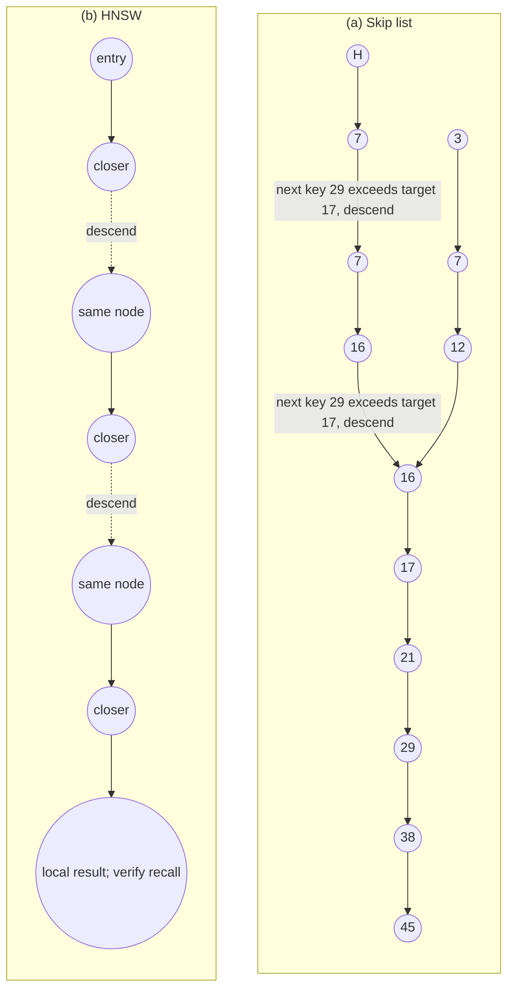
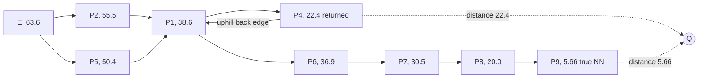
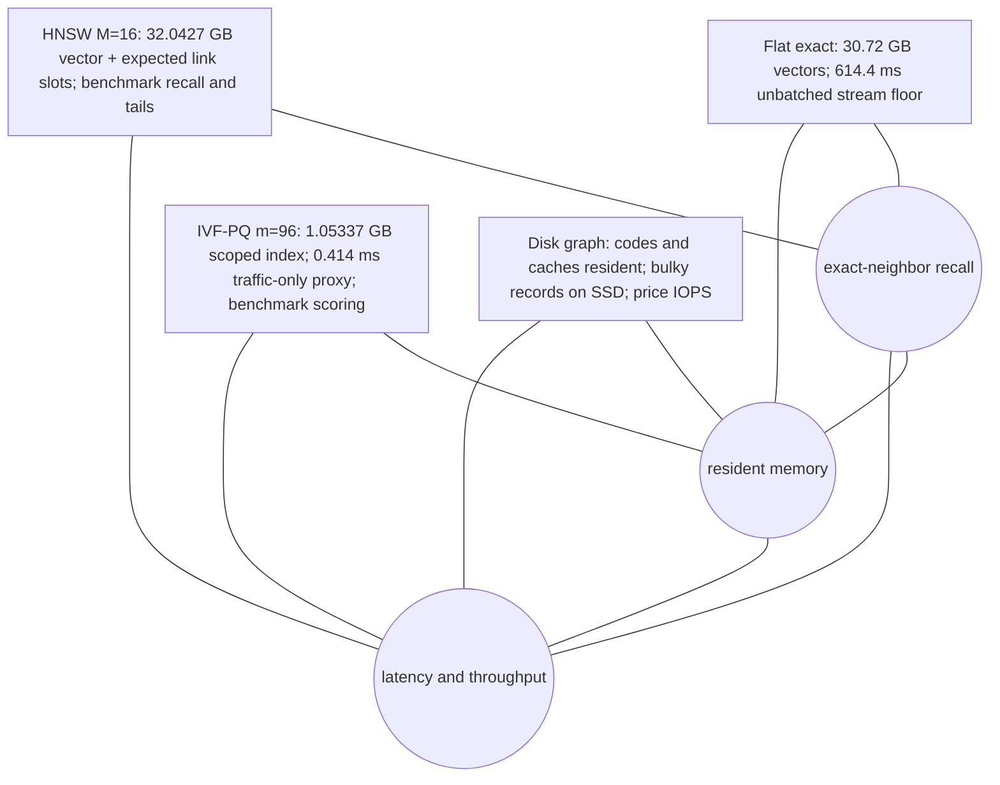

# Chapter 15: Approximate Nearest Neighbor Search
[00-START-HERE](../00-START-HERE.md) · [01-READING-ROUTES](../01-READING-ROUTES.md) · [14\_beyond\_plain\_text\_tables\_layout\_documents](../part-04-representations/14_beyond_plain_text_tables_layout_documents.md) · [16\_compression\_and\_index\_economics](16_compression_and_index_economics.md)
This chapter explains how to choose and defend an Approximate Nearest Neighbor (ANN) index for Retrieval-Augmented Generation (RAG) under recall, latency, memory, build, and update constraints.
## TL;DR
- Exhaustive flat search reads every vector once per unbatched query. High ambient dimension can weaken exact-tree pruning, but it does not make every exact index fail on every dataset.
- HNSW uses sparse upper layers and a dense base graph. HNSW-Flat keeps full vectors; graph links add memory and do not shrink automatically when vectors are quantized.
- IVF routes queries to centroid cells. $`\mathrm{nprobe}`$ trades routing coverage for list work, while a large $`\mathrm{nlist}`$ can move the bottleneck to coarse search.
- Classical LSH trades sublinear candidate work for superlinear posting space, plus projection and hashing work. Its radius guarantees do not translate into one universal recall number.
- Directional edges, a useful entry point and a wider search frontier can reduce graph traps. Neither a beam-width setting nor geometric layer occupancy alone proves a query-work bound.
- PQ compresses vectors; disk-resident graphs move bulky records to SSD. Disk capacity, useful read concurrency, IOPS and tail latency must all be budgeted.
- The recall/latency/memory triangle is a Pareto-design heuristic, not an impossibility theorem. Compare matched workloads, measured recall, throughput, rebuild policy and full memory scope.
## The story
Imagine a fulfillment warehouse with millions of nearly identical boxes. A customer asks for the box most similar to a photo. Exhaustive flat search means a picker opens every box and compares it with the photo. That works in a small warehouse. In a huge warehouse, the picker spends most of the time walking past bytes of inventory, not thinking. A kd-tree is a rulebook that splits the warehouse by one label at each doorway. The rulebook hopes a single label can prove that an entire wing is irrelevant. In a high-dimensional noise example, distances can cluster tightly and a one-label bound can become too weak to exclude many wings. The picker may then visit much more of the warehouse; this is not an inevitable outcome for every dataset or every combined subtree bound. HNSW is a layered network of warehouse walkways. The sparse top floor has long express walkways. Each lower floor adds shorter local walkways. The picker uses greedy progress on upper floors; at the bottom, a best-first search can keep alternative routes open rather than accepting only one improving move. Its query width is a shortlist of promising candidates. A wider shortlist often improves recall at extra cost, but does not by itself fix how many nodes the picker will expand. IVF is a set of learned warehouse zones. Each centroid is the sign at the center of one zone, and each posting list is the inventory assigned to that sign. The picker first finds nearby signs, then searches only their zones. $`\mathrm{nprobe}`$ is the number of zone doors opened. One door is fast, but the best box may sit just across the painted boundary. Too many tiny zones create a new problem because reading every sign can cost more than searching the selected shelves. LSH is a collection of yes-or-no stamps placed on every box. One random stamp only weakly distinguishes a matching box from a common box. Concatenating many stamps makes one strict shelf key. Repeating that key across many independent catalogs restores the chance that a true match appears somewhere. Those catalogs consume memory, and short keys flood the picker with false candidates. A graph index is the warehouse walkway plan itself. Connecting each box only to its closest boxes creates dense cul-de-sacs. Directional edge selection reserves walkways that leave a neighborhood. Vamana uses a pruning slack named $`\alpha`$ to decide which longer walkways survive. Annoy uses several fixed tree maps instead of recoverable walkways. A larger query-time search budget can revisit alternative branches; adding trees is another way to buy recall. DiskANN stores the bulky walkway map and full box records on the SSD. It keeps small PQ labels in Random Access Memory (RAM), so the warehouse can be much larger than memory. Now the cost is storage rounds. Every unnecessary hop becomes a random read. The final choice is a triangle drawn on the warehouse budget sheet. You may demand that the picker almost never misses, returns quickly, and uses little floor space. The triangle records a workload-dependent trade-off, not a proof that all three requirements can never be met. Fix the product constraints, compare feasible operating points, and price the remaining resources before naming an index.
## Decoder table


| Technical term | Plain-English meaning | Why it matters |
| --- | --- | --- |
| Approximate Nearest Neighbor (ANN) search | Search that may omit candidates or approximate their scores | It can miss true top-$`k`$ items; useful recall must be measured against a defined exact baseline |
| Exact top-$`k`$ search | Return the true top $`k`$ under the stated metric, snapshot, filters, precision and tie rule | Exhaustive scoring is one method; valid-bound exact indexes can prune |
| Inner product | Multiply matching coordinates and add the results | Exact inner-product search performs one multiply and one add per coordinate |
| Cosine similarity | Compare vector direction after normalization | The chapter uses it for semantic similarity and random-hyperplane hashing |
| Euclidean distance | Straight-line distance between vectors | kd-trees, Voronoi cells, graph pruning, and LSH guarantees use it |
| Dimension $`d`$ | Number of components in each vector | Vector bytes and distance work grow linearly in $`d`$ |
| Corpus size $`N`$ | Number of indexed vectors | Scan cost grows linearly in $`N`$, while index rules often depend on $`\sqrt{N}`$ or $`\log N`$ |
| Floating-point 32-bit (fp32) | Four-byte storage for each vector component | An fp32 vector of dimension 768 occupies $`3{,}072`$ bytes |
| Memory bandwidth $`B`$ | Bytes per second available to the bottleneck memory path | $`4Nd/B`$ is a flat fp32 streaming floor when every query reads every vector independently |
| Arithmetic intensity | Floating-point work divided by transferred bytes | Flat fp32 dots have about $`0.5\,\mathrm{FLOP/B}`$ for vector traffic; batching can change intensity |
| Memory-bound | Performance limited by data movement | A roofline hypothesis to verify; extra cores, batches and reuse can change the bottleneck |
| Floating-point operation (FLOP) | One arithmetic operation on a floating-point value | Dot products cost approximately $`2Nd`$ FLOPs across $`N`$ vectors |
| Query per second (QPS) | One completed search request per second | It converts per-query bandwidth and storage reads into capacity |
| kd-tree | A coordinate-partitioning tree with region-distance bounds | High ambient dimension can weaken pruning, but the effect is distribution-dependent |
| Pruning radius $`r`$ | Best full-space distance found so far | A one-axis gap above $`r`$ is sufficient for sibling pruning; combined bounding-box tests can also prune |
| Distance concentration | A distribution’s distances cluster near a typical value as dimension grows | It can weaken exact-tree contrast; it does not prove every index must scan every point |
| Coefficient of variation ($`\mathrm{CV}`$) | Standard deviation divided by mean | Unconditional Gaussian pair distances have $`\mathrm{CV}\approx1/\sqrt{2d}`$; fixed-query spread differs |
| Curse of dimensionality | Here, distance concentration in high dimension | The chapter excludes other meanings such as density sample complexity and shell volume |
| Intrinsic dimension | An effective dimensional description of the data | Useful structure can aid ANN, but high recall alone does not prove a particular manifold model |
| Contrast ratio | Ratio such as $`d_{100}`$ divided by $`d_1`$ for real queries | It measures whether the representation leaves a neighbor worth finding |
| Sequential scan | Read vectors in contiguous order | It uses hardware bandwidth better than pointer-heavy exact trees |
| Single Instruction, Multiple Data (SIMD) | One instruction applied across several numeric lanes | Flat arrays exploit it while tree pointer chasing does not |
| Skip list | Sorted linked list with geometrically thinning upper levels | It provides the conceptual derivation for HNSW |
| Total order | An order giving a valid before/after stopping test | It enables ordered-list routing, not literally free links or universal graph-search guarantees |
| Promotion probability $`p`$ | Chance that an item appears one level higher | It controls skip-list occupancy and expected height |
| Hierarchical Navigable Small World (HNSW) | Layered proximity graphs searched from sparse top to dense bottom | It replaces a skip list’s total order with stored geometric links |
| Navigable Small World (NSW) | A single-level proximity graph with local and longer links | Entry choice and data affect the cited empirical or model-specific scaling |
| Proximity graph | Nodes are vectors and edges join selected nearby vectors | It supplies the local moves that replace sorted-list steps |
| Entry point | Node where a graph query starts | A poor entry can add hops or trap a greedy walk |
| Greedy descent | Move to the neighbor closest to the query when it improves distance | It is fast but can stop at a false local minimum |
| Local minimum | Node whose stored neighbors are all farther from the query | Pure greedy search halts there even when a better node exists elsewhere |
| Layer 0 | HNSW base layer containing every vector | Most query work and twice-$`M`$ neighbor capacity live here |
| $`M`$ | HNSW neighbor limit above the base layer | It controls connectivity, memory, layer occupancy, and rebuild cost |
| $`M_0`$ | Base-layer HNSW neighbor limit, conventionally $`2M`$ | It sets the dominant base-layer expansion cost |
| $`\mathrm{ef}_{\mathrm{search}}`$ | Query-time HNSW beam width | Raising it trades latency for recall without rebuilding |
| $`\mathrm{ef}_{\mathrm{construction}}`$ | HNSW build-time search width | Raising it spends build work to improve the recall ceiling |
| Beam search | Keep several promising unvisited graph candidates | It can retain a branch that pure greedy search abandons |
| Select-neighbors heuristic | Favor candidates not occluded by already selected neighbors | It encourages directional diversity without certifying connectivity or exact recall |
| Relative Neighborhood Graph (RNG) rule | A geometric occlusion principle for selecting useful neighbors | HNSW/Vamana use related candidate-pruning heuristics, not necessarily the full mathematical RNG |
| Coarse quantizer | Map a vector to its nearest learned centroid | It is the routing layer of IVF |
| Inverted file (IVF) | Centroid-to-posting-list index over vectors | It scans a small number of learned cells instead of the full corpus |
| $`k`$-means | Iterative algorithm used to fit IVF centroids | It lets the data choose the partition |
| Lloyd’s algorithm | The $`k`$-means procedure named in the chapter | It trains the coarse quantizer on a corpus sample |
| Centroid | Learned representative point for one partition | Queries pay stage-one distance comparisons against centroids |
| Voronoi cell | Region assigned to one nearest centroid | Queries near its boundary can have a true neighbor in the adjacent cell |
| Posting list | Vectors assigned to one centroid | IVF query work depends on the lengths of the probed lists |
| $`\mathrm{nlist}`$ | Number of IVF centroids and cells | More cells shorten lists but raise coarse-search cost |
| $`\mathrm{nprobe}`$ | Number of IVF cells opened per query | It is the reversible recall and latency knob for routing misses |
| Routing loss | Miss because the true neighbor lies in an unprobed cell | Raising PQ fidelity cannot repair it |
| Posting-list imbalance | Some centroid cells hold far more vectors than others | It can create high tail latency at fixed $`\mathrm{nprobe}`$ |
| Centroid staleness | Old centroids no longer fit the current topic distribution | Lists swell and recall falls without an explicit error |
| Locality-Sensitive Hashing (LSH) | A hash family with near/far collision bounds | Random hyperplanes are monotone in angle; the general definition leaves intermediate distances unspecified |
| Avalanche property | Ordinary hash behavior that changes many output bits after a tiny input change | It deliberately destroys the locality retrieval needs |
| Sensitive family | An $`R`$, $`cR`$, $`p_1`$, $`p_2`$ guarantee for near and far pairs | It states collision limits only at the two design radii |
| Random hyperplane hash | Sign of a dot product with a random normal vector | For cosine, collision probability is $`1 - \frac{\theta}{\pi}`$ |
| Collision probability $`p`$ | Chance two vectors receive the same hash outcome | Amplification reshapes it into a useful retrieval probability |
| Amplification | Concatenate $`b`$ bits, then union candidates across $`L`$ tables | The first step improves selectivity and the second restores recall |
| Code length $`b`$ | Independent hash bits in one table key | A longer key reduces spurious candidates sharply |
| Table count $`L`$ | Number of independent LSH tables | More tables raise recall, candidate count, and memory |
| Exponent $`\rho`$ | $`\ln(1/p_1)/\ln(1/p_2)`$ in the classical construction | Candidate/probe scaling suppresses projection, dimension, logarithmic factors and success parameters |
| Candidate list | Union of items returned by probed buckets or graph expansion | Its size drives reranking latency |
| SimHash | Short binary fingerprint from random projections | The chapter keeps it for ingest-time near-duplicate removal |
| Hamming distance | Number of differing bits between binary fingerprints | A distance at most 3 marks near duplicates in the cited 64-bit setup |
| MinHash | Hash designed for set overlap | It replaces SimHash when Jaccard similarity over tokens matters |
| Jaccard similarity | Intersection divided by union for token sets | It fits boilerplate overlap better than embedding cosine |
| Multi-probe LSH | Probe extra nearby buckets in fewer tables | It trades query probes for lower table memory |
| $`k`$-nearest-neighbor graph | Connect each point to its $`k`$ closest points | It can fragment because all edges stay inside a dense cluster |
| Directional edge selection | Preserve edges that leave in distinct directions | It protects reachability with limited degree |
| Cone width | Angular range sharing one directional representative | Narrow cones keep more edges and directions |
| Prefix minimum | Item closer than all earlier items in a random order | One cone keeps about a harmonic number of such edges |
| Harmonic number $`H_m`$ | $`\sum_{i=1}^m1/i=\ln m+\gamma+O(1/m)`$ | It counts expected random prefix minima per cone, not an automatic query-hop theorem |
| Vamana | A graph builder using candidate search and multiplicative pruning | Ideal shrinkage needs complete target coverage; practical degree caps and candidates change the guarantee |
| Pruning slack $`\alpha`$ | Multiplier in $`\alpha d(p^*,q)\le d(p,q)`$ | A larger value makes that fixed deletion test harder; final capped graph topology need not be nested |
| Spread $`\Delta`$ | $`d_0/d_{\min}`$ for the ideal covered-dataset-target proof | With $`\alpha\gt 1`$, the bound is at most $`\lfloor\log_\alpha\Delta\rfloor+1`$ under the stated assumptions |
| DiskANN | Disk-resident graph with compact codes in memory | It moves full vectors and edges from RAM to SSD |
| Out-degree $`R`$ | Maximum stored outgoing edges per DiskANN node | It controls graph memory and whether one node fits one sector |
| Sector | A storage/read-layout unit, here a $`4{,}096`$-byte page | A record spill doubles page reads only under the aligned full-record-read layout assumed in the toy |
| Non-Volatile Memory Express (NVMe) | SSD interface used for random reads | Its read latency and Input/Output Operations Per Second (IOPS) bound DiskANN |
| Annoy | A forest of random-projection trees with an alternative-branch search budget | Both tree count and query-time exploration can affect recall; a single wrong descent need not be final |
| Product Quantization (PQ) | Replace a full vector with compact subvector codes | It changes memory by an order of magnitude but adds distortion |
| Asymmetric distance computation | Compare a query with reconstructed PQ codes | It can reorder candidates within correctly routed cells |
| Distortion loss | Recall lost because compressed-code distance changes ranking | A larger $`m`$ or exact refine stage can address it |
| Exact refine stage | Rescore admitted candidates with full vectors | It can repair their ordering, not recover omitted candidates or certify global exactness |
| $`\mathrm{Recall}@k`$ | Fraction of the true top-$`k`$ returned by the index | Index latency has meaning only at a stated recall operating point |
| Resident bytes | Memory that must remain available to answer queries | It usually decides whether HNSW or IVF-PQ is feasible |
| Tail latency | Slow-end latency such as $`\mathrm{p95}`$ or $`\mathrm{p99}`$ | List imbalance and storage rounds can dominate it |
| Query-time knob | Parameter changed without rebuilding | $`\mathrm{ef}_{\mathrm{search}}`$ and $`\mathrm{nprobe}`$ move along recall-latency curves live |
| Build-time knob | Parameter baked into the index | $`M`$, $`m`$, $`\alpha`$, and training choices require a rebuild to change |
| $`N`$, $`d`$, $`B`$, $`k`$, $`q`$, $`x`$, $`r`$, $`s`$, $`Z`$, $`p`$, $`\ell`$, $`L`$, $`U`$, $`m_L`$, $`M`$, $`M_0`$, $`\mathrm{ef}_{\mathrm{search}}`$, and $`\mathrm{ef}_{\mathrm{construction}}`$ | Corpus and vector sizes, bandwidth, result count, query and corpus vectors, pruning radius and split, standard normal variable, promotion chance and layer, uniform draw and layer multiplier, graph degrees, query beam, and build beam | These symbols size exact scan and derive the HNSW hierarchy, query work, memory, and build work |
| $`c_i`$, $`V_i`$, $`q_c`$, $`\mathrm{nlist}`$, $`\mathrm{nprobe}`$, $`T(\mathrm{nlist})`$, $`R`$, $`cR`$, $`p_1`$, $`p_2`$, $`\theta`$, $`b`$, $`L`$, $`\rho`$, $`\alpha`$, $`\Delta`$, $`H_m`$, $`R`$ out-degree, and PQ $`m`$ | Centroids and cells, coarse assignment, IVF counts and cost, LSH radii, collision probabilities, angle, code length, table count, exponent, graph slack and spread, harmonic number, disk degree, and subvector count | These symbols define IVF routing, hash amplification, graph pruning, storage rounds, and quantization |


## Core mechanics
### Mathematical conventions
Unless marked binary, storage is decimal: $`1\,\mathrm{GB}=10^9\,\mathrm B`$ and $`1\,\mathrm{TB}=10^{12}\,\mathrm B`$; a $`4{,}096`$-byte page is $`4\,\mathrm{KiB}`$. An exact result is relative to the chosen metric, snapshot, filters, tie convention and numerical precision. Flat exhaustive search is one exact algorithm, not the definition of all exact search. For one unbatched full-vector scan, $`Ndb/B`$ is an ideal streaming-time floor, not measured end-to-end latency; batching may share the vector read. Rounded performance estimates are not tail-latency guarantees. HNSW $`\mathrm{ef}`$ controls a retained search width, not a hard count of expansions or distance evaluations. Link budgets below include allocated slots under the stated layer convention, not complete process memory. IVF averages assume balanced or representative probed lists. LSH probabilities use unrounded angular collisions and independent random bits/tables; candidate expectations are not fixed counts. Round required machines, bits and tables upward. Empirical study findings remain reported inputs, not consequences proved by the arithmetic.
### 15.1 Why exact search dies: the curse of dimensionality
- **What flat exact scan does:** Score every eligible vector and return the true top $`k`$ under the specified metric and tie convention. Exact tree algorithms may instead prune with valid bounds.
- **Why it exists:** No learned partition or approximate traversal is needed. The vector store and filters still need correct updates; numerical precision and top-$`k`$ selection remain implementation choices.
- **Work:** A dense fp32 dot-product scan reads $`4Nd`$ vector bytes and uses approximately $`2Nd`$ FLOPs, counting a multiply and add separately. More exactly, summing $`d`$ products takes $`2d-1`$ scalar operations per vector before scoring/selection overhead.
- **Arithmetic intensity:** Approximately $`0.5\,\mathrm{FLOP/B}`$ for vector traffic alone. Under low arithmetic intensity and unbatched streaming, bandwidth is often the bottleneck.
- **Ideal roofline:** With sustained shared bandwidth $`B`$ and arithmetic rate $`F`$, $`t\gtrsim\max(4Nd/B,2Nd/F)`$. Selection, query reads, normalization, filtering and scheduling add work.
- **Throughput scope:** $`\mathrm{QPS}\le B/(4Nd)`$ is a vector-bandwidth ceiling only when each query requires its own full scan; batching and reuse can amortize the vector read.
For $`N=10^7,d=768,B=50\,\mathrm{GB/s}`$, the vector payload is exactly $`30.72\,\mathrm{GB}`$. The ideal unbatched streaming estimate is $`0.6144\,\mathrm s=614.4\,\mathrm{ms}`$, with ceiling $`1.627604\,\mathrm{QPS}`$. Calling this a floor assumes the algorithm really reads all those bytes through that bandwidth bottleneck; exactness alone does not require every exact algorithm to do so.
- **What a kd-tree does:** Partition coordinates, descend to candidate leaves, and use the current best full-space radius to test unexplored regions.
- **Simple sibling test:** At a split $`x_i=s`$, $`\lvert q_i-s\rvert\gt r`$ is sufficient to exclude the opposite half-space. A subtree’s full bounding-box lower bound can combine several coordinate gaps and prune even when this one-axis test fails.
- **Failure mode:** For some high-dimensional distributions, these bounds exclude little, so traversal approaches a scan with extra pointer and bookkeeping costs.
- **Limit:** Expected near-logarithmic behavior requires favorable geometry and balance; it is not a universal exact-query guarantee.
For two independent vectors $`X,Y\sim\mathcal N(0,I_d)`$, let $`D=\lVert X-Y\rVert`$. Then $`D^2/2\sim\chi_d^2`$, so $`\mathbb E[D^2]=2d`$ and $`\mathop{\mathrm{Var}}\nolimits(D^2)=8d`$. The delta method gives $`\mathbb E[D]\approx\sqrt{2d}`$, $`\mathop{\mathrm{sd}}\nolimits(D)\approx1`$ and $`\mathrm{CV}\approx1/\sqrt{2d}`$ for large $`d`$. Exact moments are

```math
\mu_D=2\frac{\Gamma((d+1)/2)}{\Gamma(d/2)},\qquad
\mathop{\mathrm{Var}}\nolimits(D)=2d-\mu_D^2.
```

The exact CVs are approximately $`36.300\%`$, $`8.85595\%`$ and $`2.55197\%`$ at $`d\in\{4,\,64,\,768\}`$; the first-order $`35.355\%`$ value at $`d=4`$ is not exact. At $`d=768`$, the unconditional pairwise mean is $`39.17908`$ with standard deviation $`0.99984`$.
Distances to many points share the same query, so they are not independent unconditionally. Conditional on a fixed query $`q`$, $`\lVert X-q\rVert^2\sim\chi_d^{\prime2}(\lVert q\rVert^2)`$, with mean $`d+\lVert q\rVert^2`$ and variance $`2d+4\lVert q\rVert^2`$. At $`\lVert q\rVert^2=d=768`$, the local delta-method distance spread is $`\sqrt3/2\approx0.86603`$, not $`1`$. For $`N=10^7`$, the conditional distance quantiles with one-tail probability $`1/N`$ are approximately $`34.72881`$ and $`43.72841`$, ratio $`1.259139`$. These are quantile markers, not expected extrema or hard bounds. They replace the inconsistent $`33.5/44.9`$ independent-pair extreme heuristic. The conditional CDF is evaluated through its Poisson mixture of central chi-square CDFs.
A one-coordinate distance to a median split at zero has $`\mathbb E\lvert Z\rvert=\sqrt{2/\pi}\approx0.797885`$ for $`Z\sim\mathcal N(0,1)`$; a difference between two independent point coordinates instead has expected absolute value $`2/\sqrt\pi\approx1.128379`$. Actual tree split gaps depend on the construction.
- **Geometric warning, not a no-pruning proof:** Coordinate-plane gaps of order $`1`$ can be much smaller than nearest-neighbor radii of order $`\sqrt d`$ in this noise model. This motivates weak pruning; it does not show every sibling survives every bounding-box test.
- **Depth:** A roughly balanced binary tree with $`10^7`$ singleton leaves has a depth scale $`\lceil\log_2 10^7\rceil=24`$. Leaf size and imbalance alter it.
- **Coordinates:** One path has at most $`24`$ split tests, potentially repeated on the same coordinate; it need not constrain $`24`$ distinct axes. Thus $`744`$ is a lower bound on untouched axes only in this limited path-count comparison, not a characterization of the entire search.
- **Exponential grid:** A complete binary decision tree that branches once on every one of $`768`$ coordinates has $`2^{768}`$ leaves. Exact search does not require building that grid.
Ball trees, $`R`$-trees and related schemes can suffer similarly, but behavior depends on the dataset, intrinsic structure, metric and bounds. The cited $`1998`$ experiment found sequential scan faster than the tested partitioning indexes above roughly ten dimensions; it is not a modern hardware-independent cutoff. The cited $`1999`$ distance-concentration result needs its distributional conditions; convergence of a farthest/nearest ratio does not apply to every learned corpus or every joint scaling of $`N`$ and $`d`$. Approximation offers query-dependent graph, cell or hash candidates rather than an exact pruning certificate.
- **Geometry:** Random high-dimensional vectors can have weak distance contrast; exact neighbor ranks still exist, and query-dependent algorithms may exploit structure. Concentration alone does not prove all ANN methods useless.
- **Learned representations:** Semantic training may produce navigable clusters or lower effective dimension, but this is a hypothesis to inspect, not guaranteed by the embedding width.
- **Evidence:** Measured $`0.95`$ recall while scoring $`0.1\%`$ of a corpus demonstrates a useful operating point for that graph, dataset and queries. It does not logically refute every independent-noise model or prove a particular manifold dimension.
- **Terminology:** This section uses the curse of dimensionality for distance concentration and weak pruning, not as a derivation of all sample-complexity or shell-volume phenomena.
**Worked CPU scan.** Use $`10^7`$ fp32 vectors of width $`768`$, a $`20\,\mathrm{ms}`$ search allowance within a $`200\,\mathrm{ms}`$ pipeline $`p_{95}`$ target, and $`500`$ QPS. The vector-read floor is $`614.4\,\mathrm{ms}`$; dot-product work is $`15.36\times10^9`$ FLOPs. A hypothetical $`3\,\mathrm{GHz}`$ core at $`32`$ fp32 FLOPs/cycle offers $`96\times10^9\,\mathrm{FLOP/s}`$, or $`160\,\mathrm{ms}`$ compute time. The ratio is $`3.84`$, supporting the bandwidth bottleneck under these assumptions, not an independent timing measurement. The floors are $`30.72`$ and $`8`$ times the search allowance. Aggregate unbatched bandwidth at $`500`$ QPS needs $`\lceil500(0.6144)\rceil=308`$ socket-equivalents, not $`313`$; rounding QPS before inversion caused the discrepancy. Independent parallel queries do not by themselves reduce one query’s latency; query sharding adds its own work.
**Worked GPU batch.** On the stated A100 $`80`$GB example, published $`2{,}039\,\mathrm{GB/s}`$ gives $`15.0662\,\mathrm{ms}`$ for one vector read. Batch $`16`$ uses $`245.76\times10^9`$ FLOPs; at $`19.5\times10^{12}\,\mathrm{FLOP/s}`$ its compute floor is $`12.6031\,\mathrm{ms}`$. An ideal fully shared matrix read therefore has roofline service time at least $`15.0662\,\mathrm{ms}`$ and throughput ceiling about $`1{,}062`$ QPS. This is not measured service or $`p_{95}`$ latency. With regular arrivals at $`500`$ QPS and full batches only, the first query waits $`30\,\mathrm{ms}`$ to fill a batch and mean fill wait is $`15\,\mathrm{ms}`$; dynamic batching must budget that separately. At $`10^9`$ vectors, payload is $`3.072\,\mathrm{TB}`$. Reading it within $`20\,\mathrm{ms}`$ requires $`153.6\,\mathrm{TB/s}`$, at least $`76`$ such peak-bandwidth accelerators before capacity, transfer, selection and interconnect costs—not an implementable latency guarantee.
**Illustrative graph work.** With $`M=32,M_0=64`$, assume $`128`$ base-node expansions and no repeated candidate distances: $`128(64)=8{,}192`$ evaluations, $`0.08192\%`$ of the corpus. The choice $`\mathrm{ef}_{\mathrm{search}}=128`$ does not guarantee this expansion count. Vector reads would be $`25.165824\,\mathrm{MB}`$, $`1{,}220.703`$ times less than flat, with $`0.5033\,\mathrm{ms}`$ streaming time at $`50\,\mathrm{GB/s}`$ before graph reads and scattered-access effects. Base-layer link slots use $`256\,\mathrm{B/vector}`$, $`2.56\,\mathrm{GB}`$ or $`8.333\%`$ of vector bytes; upper layers and other structures are additional. Actual recall, unique evaluations and traversal time must be measured.
**Sanity check and operations.** SIFT1M at $`d=128`$ has $`512\,\mathrm{MB}`$ fp32 payload and a $`10.24\,\mathrm{ms}`$ scan floor, $`97.65625`$ unbatched QPS at the same shared bandwidth. The cited HNSW benchmark’s two-to-three-order throughput gain at recall $`0.9`$ is reported evidence under its own setup, not a consequence of the $`1{,}220`$ work ratio in the different example.
For an otherwise idle unbatched scan, $`\lfloor(50\times10^9)(0.020)/(4\times768)\rfloor=325{,}520`$ vectors is a bandwidth-only $`20\,\mathrm{ms}`$ threshold, not a universal flat/ANN crossover. High QPS, selection and measured tail latency can lower it; batching or different hardware can raise it. Halving $`d`$ or component bytes halves this vector-read term, not every index cost. If exactness is required, use a method that certifies it rather than assuming high measured recall is enough. Brute-force $`1{,}000`$ representative queries and inspect $`d_{100}/d_1`$ under a defined distance with $`d_1\gt 0`$. Values such as $`1.5`$ or near $`1`$ are diagnostics, not universal quality thresholds or impossibility proofs; embeddings and cosine-to-distance conventions matter. Use random vectors only for an explicitly labeled noise stress test. Tenant prefiltering can make flat search feasible, but validate filtered ground truth, per-tenant load, query routing and shared-capacity costs.
### 15.2 From skip lists to HNSW
- What a skip list is: A sorted linked list with progressively sparser upper levels.
- Why it exists: Upper pointers skip long stretches while preserving a local, certain halting test.
- Search rule: Advance while the next key is below the target, then descend when it is not.
- Example: Searching for 17 advances from the head to 7 on level 2, descends before 29, advances 7 to 16 on level 1, descends again, then reaches 17 on level 0.
- Example cost: Three advances and two descents replace scanning nine values.
With independent promotion probability $`0\lt p\lt 1`$, expected occupancy of level $`\ell`$ is $`np^\ell`$. The characteristic highest-level scale is $`L(n)=\log_{1/p}n`$, not a deterministic maximum. For example, $`\Pr(L_{\max}\lt j)=(1-p^j)^n`$. Standard skip-list analyses bound expected search comparisons by expressions of the form $`L(n)/p+1/(1-p)`$ under their counting convention. At $`p=1/2,n=10^7`$, $`L(n)\approx23.2535`$ and this expression is $`48.5070`$, about $`49`$ comparisons or $`2.06\times10^5`$ fewer than a ten-million-step linear lookup. Constants, sentinels and equality tests affect the exact count. A total order makes the local stopping test valid; it does not make storage or updates free.
- Losing alternative: Sort vectors by distance to one pivot.
- Why it fails: Triangle inequality gives only $`\lvert d(x,p) - d(y,p)\rvert \le d(x,y)`$, which is a lower bound.
- Failure: Equal pivot distance says nothing about pairwise distance.
- High-dimensional effect: Distance concentration places most points in a narrow band around the pivot.
HNSW replaces ordered-list links with stored geometric neighbors. Upper levels usually use greedy descent; the base search keeps candidates and a retained best set, so it may explore alternatives after a local greedy optimum. Its upper-layer stopping test certifies only a local result, not the global nearest vector.
Under the stated layer convention,

```math
\ell=\left\lfloor-\frac{\ln U}{\ln M}\right\rfloor,\qquad
\Pr(\ell\ge j)=M^{-j},\qquad U\sim\mathop{\mathrm{Uniform}}\nolimits(0,1),\ M\gt 1.
```

Thus $`\mathbb E[N_j]=nM^{-j}`$. At $`M=16,n=10^7`$, the characteristic top-index scale is $`\log_{16}10^7\approx5.81337`$, with expected occupancies $`625{,}000`$ at layer $`1`$, $`9.53674`$ at layer $`5`$, and $`0.59605`$ at layer $`6`$. The number of occupied layers is random and includes layer $`0`$; $`5.8`$ is not literally a six-layer guarantee. Geometric occupancy alone does not prove logarithmic graph-search work.
- **Nearest-only links:** They can waste degree within one cluster and even form disconnected components, but this is a possible failure, not a theorem for every $`k`$-NN graph.
- **Diversity heuristic:** Process candidate neighbors by distance from a new point $`p`$. One common rule accepts $`e`$ when $`d(p,e)\lt d(e,r)`$ for every already accepted $`r`$, subject to tie and degree policies.
- **Purpose and limit:** This favors additional directions and longer cross-cluster links. It is not a global connectivity or recall certificate, especially with an approximate candidate set and capped degree.
Flat NSW combines links on one level. HNSW’s hierarchy often improves entry and observed scaling; the cited polylogarithmic/logarithmic behaviors should be treated as model- or benchmark-scoped, not distribution-free worst-case bounds. Random promotion allows local insertion without renumbering a rigid every-other-node schedule. Deterministic balanced skip structures can also support local updates; a global rebuild is not inherent to determinism. Physical graph deletion may require inbound-neighbor repair, while logical tombstones can defer it.
**Illustrative query budget.** Let $`M=16,M_0=32`$, and separately assume five upper levels with two expanded nodes each and $`64`$ expanded base nodes. This gives $`5(2)(16)+64(32)=2{,}208`$ neighbor-distance evaluations if none are reused, a $`4{,}528.986`$ work reduction versus $`10^7`$. It is not a bound implied by $`\mathrm{ef}_{\mathrm{search}}=64`$. Reading a fresh $`3{,}072`$-byte vector for each evaluation costs $`6{,}782{,}976`$ bytes; expanded adjacency slots add $`[5(2)(16)+64(32)]4=8{,}832`$ bytes, total $`6.791808\,\mathrm{MB}`$. At an assumed effective scattered-read rate of $`10\,\mathrm{GB/s}`$, this component is $`0.67918\,\mathrm{ms}`$. The older $`7.1\,\mathrm{MB}`$ model charged an entire base neighbor list per evaluated candidate, rather than per expanded node. Neither model establishes observed latency or recall; metadata, caches and access dependencies matter.
**Scoped link memory.** With four-byte IDs, expected allocated link slots contribute

```math
b_{\mathrm{link}}=4\left(2M+M\sum_{j\ge1}M^{-j}\right)
=4\left(2M+\frac{M}{M-1}\right).
```

At $`M=16`$, this is $`132.266667\,\mathrm{B/vector}`$: $`128`$ at the base and $`4.266667`$ above. Ten million fp32 vectors plus these slots use $`32.042667\,\mathrm{GB}`$, $`4.30556\%`$ over vector payload. The documented rule $`4d+8M=3{,}200`$ omits the upper-slot term; its scoped undercount is about $`0.1332\%`$, not a complete allocation audit. Counts, pointers, alignment, external IDs, visited sets, locks and payload remain additional.
With $`64`$-byte PQ codes, the same expected slots give $`196.266667\,\mathrm{B/vector}`$ and $`1.962667\,\mathrm{GB}`$; links occupy $`67.3913\%`$. The base-only shortcut is $`192`$ bytes and $`1.92\,\mathrm{GB}`$, and must be labeled as such. Graph links are not mathematically incompressible; they simply do not shrink automatically with the vector codes.
**Build and tuning.** Assuming $`200`$ expansions of $`32`$ candidates per insertion would give $`6.4\times10^{10}`$ evaluations over $`10^7`$ inserts, $`2.89855\times10^7`$ of the illustrative $`2{,}208`$-evaluation queries. $`\mathrm{ef}_{\mathrm{construction}}=200`$ is not a hard per-insert evaluation limit, and this is not a build-time bound. Start with a measured $`M=16`$ baseline and sweep query $`\mathrm{ef}`$; it changes both recall and work and is reversible. If expansions happened to double from $`64`$ to $`128`$, the base term would double from $`2{,}048`$ to $`4{,}096`$—the parameter alone does not promise that. Increase $`M`$ or build width when the measured runtime curve misses target. Base-slot bytes double from $`128`$ to $`256`$ at $`M=32`$; including expected upper slots, ten million vectors need $`1.278624\,\mathrm{GB}`$ extra links. Choose query width large enough for $`k`$ and the implementation’s constraints. Build width $`200`$ versus query width $`64`$ is an example, not a requirement that build width always exceed every later query width. Monitor tombstone effects and rebuild or repair according to measured behavior; deleted nodes may remain traversable without occupying result slots.
At $`500`$ million vectors, these expected-slot floors are $`1.602133\,\mathrm{TB}`$ for HNSW-Flat and $`98.1333\,\mathrm{GB}`$ for HNSW with $`64`$-byte codes, including $`66.1333\,\mathrm{GB}`$ of links. IVF-PQ with $`64`$ code bytes and an $`8`$-byte ID has $`36\,\mathrm{GB}`$ of entries before fixed terms. If its measured recall/probe curve fails the target, consider more memory, additional machines or disk-resident search; no fixed corpus-size threshold makes one family universally best.
### 15.3 IVF: coarse quantizers, centroids, Voronoi cells
- **IVF:** Fit representative centroids, assign each vector to a cell, then score selected posting lists. Storage format and routing are separate choices.
- **Why:** Candidate scans may be much smaller and more batch-friendly than a full scan.
- **Counterexample scope:** A grid with two bins on each of $`768`$ axes has $`2^{768}`$ cells. This is one impractical grid construction, not a requirement of all data-independent routing.
- **Failure modes:** Poorly matched boundaries or an uneven distribution can overload lists or miss nearby points. Learned partitions can have these problems too.
For Euclidean IVF, fit $`K=\mathrm{nlist}`$ centroids and set $`q_c(x)\in\arg\min_i\lVert x-c_i\rVert`$, with a tie rule. Cell membership satisfies

```math
\lVert x-c_i\rVert^2\le\lVert x-c_j\rVert^2
\quad\Longleftrightarrow\quad
2x^{\mathsf T}(c_j-c_i)\le\lVert c_j\rVert^2-\lVert c_i\rVert^2.
```

For distinct centroids the separating plane is their perpendicular bisector. A Voronoi cell is an intersection of half-spaces: a convex polyhedron, possibly unbounded, and a polytope only if bounded. Tied boundaries need assignment conventions. Inner-product or other routing choices need their own geometry.
The inverted file maps centroid IDs to posting lists, analogous to a text index mapping terms to postings. With flat full-vector centroid comparisons and balanced representative probed lists, a continuous distance-count proxy is

```math
T(K)=K+\frac{wN}{K},\qquad w=\mathrm{nprobe},\qquad
K_\star=\sqrt{wN}.
```

Here $`T'(K)=1-wN/K^2`$ and $`T''(K)=2wN/K^3\gt 0`$. The minimum assumes fixed $`w`$, equal-cost centroid and candidate comparisons, and feasible integer $`1\le w\le K\le N`$. Recall changes with $`K,w`$ and is not optimized by this derivative. At $`w=1`$, $`T(K_\star)=2\sqrt N`$, giving work reduction $`\sqrt N/2\approx1{,}581.139`$ at $`N=10^7`$. PQ scoring, indexed centroids, imbalanced lists and hardware change the model.
- **Boundary miss:** A true neighbor may be in a different cell, especially near a bisector. It is not inevitable for every boundary-near query.
- **Probe behavior:** Querying multiple nearby centroids can recover missed cells, but the true neighbor’s cell need not be among a small chosen set.
- **Geometry limit:** A cell can have at most $`K-1`$ other-cell face neighbors. “Most volume lies near a face” requires a bounded region, distribution and boundary thickness; unbounded Voronoi cells have no uniform finite-volume distribution. For a cube of side $`a`$, a boundary band of thickness $`\varepsilon\lt a/2`$ occupies fraction $`1-(1-2\varepsilon/a)^d`$—an illustrative concentration model, not a theorem about every learned cell.
- **Cost:** Raising $`\mathrm{nprobe}`$ scans more selected lists without retraining; their actual total length, not just their count, determines work.
At $`N=10^7,d=768`$, the flat vector-read floor is $`30.72\,\mathrm{GB}`$ and $`614.4\,\mathrm{ms}`$ at $`50\,\mathrm{GB/s}`$. Under the balanced-list/full-vector proxy:
- $`K=4{,}096,w=1`$: mean list length $`2{,}441.40625`$, total $`6{,}537.40625`$ equivalent distances, $`20.082912\,\mathrm{MB}`$ and $`0.401658\,\mathrm{ms}`$ of vector streaming. Reduction is $`1{,}529.659`$; routing loss remains.
- $`K=4{,}096,w=32`$: list work $`78{,}125`$, total $`82{,}221`$, $`0.82221\%`$ of $`N`$, $`252.582912\,\mathrm{MB}`$ and $`5.051658\,\mathrm{ms}`$. Flat reduction is $`121.6234`$, with $`4.9817\%`$ of distances in the coarse scan.
- $`K=65{,}536,w=32`$: mean list length $`152.587890625`$, list work $`4{,}882.8125`$, total $`70{,}418.8125`$. This is $`14.3542\%`$ below $`82{,}221`$, not a $`16`$-fold total-work win; coarse comparisons are $`93.0660\%`$ of the proxy.
- If a centroid HNSW search is separately budgeted at $`1{,}000`$ comparisons, the last total becomes $`5{,}882.8125`$, a $`13.9765`$ comparison-count reduction versus the $`4{,}096`$-cell, $`32`$-probe case. That centroid approximation can itself miss useful cells; the number is neither guaranteed recall nor measured speedup.
Fractional list sizes are averages, not actual per-query counts. Never multiply rounded $`2{,}441`$ or $`153`$ and present the unrounded total as an exact product. With flat coarse search, $`\sqrt{32\times10^7}\approx17{,}888.544`$ is the continuous cost optimum; nearby integers need comparison. Reported library guidance such as $`65{,}536`$ cells in a given scale band or $`4\sqrt N`$ to $`16\sqrt N`$ in another band is empirical guidance. Indexed centroids can make larger $`K`$ viable, but do not alone prove those choices optimal.
- **Training:** A learned IVF coarse quantizer must be trained before ordinary population. Distribution shift can change list balance and recall; stale centroids do not inevitably reduce every metric.
- **Implementation rules:** The cited $`39`$ points per centroid is a warning threshold, not a mathematical training lower bound or recall guarantee. A default maximum of $`256`$ training points per centroid is a configurable sampling cap, not a target that must exceed the corpus size.
- **Numbers:** At $`65{,}536`$ centroids, these settings correspond to $`2{,}555{,}904`$ and $`16{,}777{,}216`$ training points. For a $`10^7`$-vector corpus, the latter is above the available distinct points; do not invent extra samples to satisfy it.
Use $`K\approx4\sqrt N`$ as a starting heuristic, not a fixed optimum. Measure coarse-stage share before switching to an indexed coarse quantizer; $`16{,}384`$ centroids is a workload-specific suggestion, not a universal cutoff. Tune integer $`1\le\mathrm{nprobe}\le\mathrm{nlist}`$ against exact-neighbor recall. $`\mathrm{nprobe}/\mathrm{nlist}`$ is a balanced-list scan fraction, not recall and not an exact cost fraction for imbalanced lists. Without task labels, exact search on the same frozen, filtered snapshot can still supply ANN ground truth. A starting $`\max(1,\lceil K/128\rceil)`$ and $`1{,}000`$ representative queries is an audit heuristic; sweep the parameter and report uncertainty, not an automatic bisection guarantee under noisy estimates. Service tiers such as probes $`8`$ and $`64`$ should satisfy their own latency/recall targets. Inspect selected-list lengths and load: $`p_{99}/p_{50}=10`$ is not unique evidence of imbalance; queuing, cache misses and other effects can cause it.
IVFFlat adds IDs and centroids but keeps full vectors. At $`K=4{,}096,N=10^7,d=768`$, $`8`$-byte IDs plus fp32 centroids add $`92.582912\,\mathrm{MB}`$, about $`0.30138\%`$ of vector payload. This scope excludes list, allocator and external metadata overhead.
At $`200`$ million vectors, fp32 payload is $`614.4\,\mathrm{GB}`$. Standard HNSW expected slots at $`M=32`$ add approximately $`52.025806\,\mathrm{GB}`$, not the $`76.8\,\mathrm{GB}`$ obtained by assuming $`3M`$ links at every node. With $`65{,}536`$ centroids, IVFFlat IDs and centroids add $`1.801327\,\mathrm{GB}`$. A $`96`$-byte PQ code reduces vector payload to $`19.2\,\mathrm{GB}`$, a $`32`$-fold vector-only reduction; IDs, codebooks, centroids and refine vectors remain additional. Quantization often dominates the memory choice at this scale, but no architecture wins independently of recall, rebuild and serving costs.
### 15.4 LSH and hash-collision retrieval
- **Ordinary hashing:** Expected bucket lookup can be constant time under a load model, but avalanche-style fingerprints do not preserve approximate vector similarity.
- **LSH:** A near/far collision guarantee supports candidate retrieval without fitting a coarse partition. The general definition does not require collision to be globally monotone between the design radii; the hyperplane family below is monotone in angle.
- **Trade-off:** Independent tables can consume superlinear posting space and produce many candidates. Actual competitiveness depends on the metric, data, projection computation and implementation, not only an exponent.
A family is $`(R,cR,p_1,p_2)`$-sensitive for $`R\gt 0,c\gt 1,0\lt p_2\lt p_1\lt 1`$ if pairs at distance at most $`R`$ collide with probability at least $`p_1`$, while pairs at distance at least $`cR`$ collide with probability at most $`p_2`$. The guarantee leaves the intermediate annulus unspecified.
For random-hyperplane cosine hashing, use nonzero normalized vectors and $`r\sim\mathcal N(0,I_d)`$:

```math
h_r(x)=\mathop{\mathrm{sign}}\nolimits(r^{\mathsf T}x),\qquad
p(\theta)=1-\frac{\theta}{\pi}.
```

At cosine $`0.8`$, $`\theta\approx0.643501109`$ and $`p_1\approx0.7951672353`$; at cosine $`0.3`$, $`\theta\approx1.266103673`$ and $`p_2\approx0.5969866840`$. The per-bit margin is approximately $`0.1981805513`$. Keep these unrounded probabilities for all powers and table counts.
- What AND amplification does: Concatenate $`b`$ independent bits into one table key.
- Probability: One-table collision becomes $`p^b`$.
- Why it helps: The smaller $`p_2`$ shrinks faster than $`p_1`$.
- What OR amplification does: Build $`L`$ independent tables and union their candidates.
- Probability: Retrieval becomes $`1 - (1 - p^b)^L`$.
- Why it helps: It restores near-neighbor recall after the strict key lowers all collisions.
- Cost: Every table stores another full set of corpus identifiers.
**Classical asymptotic construction.** For a real-valued algebraic code length $`b_0=\log_{1/p_2}N`$, $`Np_2^{b_0}=1`$. Define $`\rho=\ln(1/p_1)/\ln(1/p_2)`$, so $`p_1^{b_0}=N^{-\rho}`$. At $`L\approx N^\rho`$, success for a qualifying near point approaches $`1-e^{-1}\approx0.632121`$. A real index needs integer $`b,L`$; $`b=\lceil b_0\rceil`$ keeps $`Np_2^b\le1`$, and $`L=\lceil p_1^{-b}\rceil`$ gives at least the corresponding constant-success scale. Target success $`1-\varepsilon`$ instead needs

```math
L\ge\left\lceil\frac{\ln\varepsilon}{\ln(1-p_1^b)}\right\rceil.
```

The usual candidate/probe scaling is $`O(N^\rho)`$ with $`O(N^{1+\rho})`$ posting entries under the model; projection and hashing add work such as $`O(Lbd)`$ for separately computed dense hyperplanes, often suppressed with dimension/log factors or preprocessing assumptions. The construction solves an approximate near-neighbor radius problem, not a universal top-$`k`$ recall guarantee. Its query-work bound uses the model's candidate limits or early acceptance of a qualifying point. Exhaustively unioning and reranking buckets for top-$`k`$ is a different procedure: many points in the intermediate-distance annulus or overloaded buckets can produce linear-size candidate sets even though the far-point collision bound holds. Duplicates, short keys and metric choice also affect actual work.
**Integer classical example.** With $`N=10^7`$ and the unrounded cosine-derived $`p_1,p_2`$, $`\rho\approx0.444311671`$, $`b_0\approx31.2450683`$, hence choose $`b=32`$, not $`31`$. Taking $`L=1{,}533`$ gives qualifying-point success about $`0.6324214`$. If every background point has cosine $`0.3`$, expected far candidates per table are $`0.6774365`$ and the deduplicated expected far union is approximately $`1{,}038.456`$; these are expectations, not guaranteed counts. Projection uses $`49{,}056`$ hyperplane dots or $`37{,}675{,}008`$ MACs at width $`768`$. Far-candidate reranking adds about $`797{,}534`$ MACs, plus any qualifying-point and bookkeeping work. Against $`7.68\times10^9`$ brute-force MACs, this arithmetic-only ratio is about $`199.62`$, not a measured speedup. Posting IDs alone require $`1{,}533(10^7)(8)=122.64\,\mathrm{GB}`$, before buckets, keys and $`30.72\,\mathrm{GB}`$ of vectors if retained for exact reranking. Rounding the old exponent and using $`31`$ bits produced internally inconsistent table, candidate and memory totals.
**Short-key, high-success example.** Set $`b=16`$. At cosine $`0.8`$, $`p_1^{16}\approx0.0255467482`$ and the minimum independent-table count for $`99\%`$ pair retrieval is $`178`$. The exact model gives $`0.990012435`$ near retrieval and $`0.045278093`$ retrieval at cosine $`0.3`$, not the figure’s former $`0.994/0.049`$. At cosine $`0.75`$, retrieval is $`0.935173546`$; the decrease is $`5.4839`$ percentage points from the $`0.8`$ case. Far-candidate expectation is $`452{,}780.930`$ if all $`10^7`$ background points have cosine $`0.3`$. Background cosine $`0.1`$ gives $`72{,}764.328`$, or $`0.727643\%`$, instead. For heterogeneous background items, expected candidates are the sum of their individual retrieval probabilities; far-radius collision bounds yield an upper bound, not equality.
Independent dense projections cost $`2{,}187{,}264`$ MACs here, and the cosine-$`0.3`$ expected rerank costs $`347{,}735{,}754`$ MACs. The combined arithmetic-only ratio versus flat is $`21.9477`$. IDs occupy $`14.24\,\mathrm{GB}`$. Storing an optional redundant two-byte key per posting adds $`3.56\,\mathrm{GB}`$, yielding $`17.8\,\mathrm{GB}`$ for that layout, not mandatory LSH space; bucket-key layouts differ. Full rerank vectors and table metadata remain additional. The $`1.322667\,\mathrm{GB}`$ HNSW $`M=16`$ link-slot floor is about $`13.46`$ times smaller than that optional posting-plus-key budget, but this is neither a whole-index comparison nor a matched-recall benchmark. A beam width is not a measured HNSW candidate count.
**Theory scope.** The cited Euclidean LSH exponents $`1/c^2`$ and data-dependent $`1/(2c^2-1)`$ are asymptotic theoretical results under their respective models and resource assumptions. On unit vectors, $`R^2=2(1-0.8)=0.4`$ and $`(cR)^2=2(1-0.3)=1.4`$, giving $`c^2=3.5`$, exponents $`2/7\approx0.285714`$ and $`1/6\approx0.166667`$. The expression $`(10^7)^{2/7}=100`$ is an exponent illustration, not a finite-instance prediction of $`100`$ candidates or a proof that this hyperplane index is a fixed factor from an attainable optimum. The cited graph-versus-hash frontier is a reported benchmark, not a theorem over all datasets.
**Practice.** Default to measured graph/IVF baselines for vector ANN; LSH remains useful for some updates, similarity joins and deduplication. Choose $`b`$ from a stated far-collision model, then price the required $`L`$ at the desired success radius. Instrument deduplicated candidates and all projection work, not recall alone. The cited web-scale SimHash setting uses $`64`$ bits and Hamming distance at most $`3`$ over more than $`8`$ billion pages; it is not an infallible duplicate definition. Use MinHash when set/Jaccard overlap is the intended similarity. State table count and bucket work for multi-probe variants. Inserts and removals touch up to $`L`$ tables, so they are local to postings but not constant work independent of $`L`$. A hot-slice LSH/cold-graph hybrid is a workload option, not a conclusion from an unmatched $`14`$-times memory comparison.
### 15.5 Graph indexes: RNG, Vamana/DiskANN, Annoy
A proximity-graph index stores vector nodes and selected edges. Queries may use greedy upper-level routing, best-first search or wider beams; not every graph search is a pure greedy walk. Candidate generation, edge selection, entry policy and stopping rules jointly determine quality and cost.
- **Nearest-only rule:** It can trap degree within one cluster, leave disconnected components or create a local greedy optimum; it does not necessarily do so on every corpus.
- **Directional selection:** Reserve some degree for distinct directions and possible cluster crossings, rather than minimizing every edge’s length.
- **Limit:** Degree diversity is a useful construction principle, not by itself a certificate of global reachability or exact search.
**Cone record-minimum toy.** Distinguish the randomized cone construction here from the relative-neighborhood-inspired pruning used below. Suppose a fixed collection of $`C`$ cones covers directions around a node. Within one cone, randomly permute $`m`$ distinct candidate distances and retain every new prefix minimum. Position $`i`$ is a record with probability $`1/i`$, hence $`\mathbb E[\#\mathrm{records}]=H_m=\sum_{i=1}^m1/i=\ln m+\gamma+O(1/m)`$. At fixed cone count, expected edge storage is $`O(CN\log N)`$; $`C`$ can grow steeply with dimension and narrower cone width. The retained set need not contain only the final nearest point. Enumerating every point pair already requires $`O(N^2)`$ distance comparisons and approximately $`O(N^2d)`$ coordinate work, before cone tests. Record-count arithmetic alone does not establish logarithmic query hops; any such cited theorem needs its geometric and construction assumptions.
**Vamana pruning.** At node $`p`$, process a candidate set by choosing the nearest surviving $`p^*`$, adding it to neighbors, and deleting candidates $`q`$ satisfying

```math
\alpha\,d(p^*,q)\le d(p,q),\qquad \alpha\ge1.
```

At $`\alpha=1`$, this is a relative-neighborhood-inspired occlusion test closely related to the HNSW diversity heuristic. The algorithms are not identical, and testing only retained candidates need not reproduce the full mathematical relative neighborhood graph. Increasing $`\alpha`$ makes this deletion test harder for a fixed retained point; the final capped greedy construction is not necessarily nested as a whole, because earlier choices can change. More candidates can survive and use the degree budget, often including useful longer edges.
**Conditional shrinkage proof.** Assume the target $`q`$ is itself a dataset point, every other point was available to each node’s pruning step, and no candidate was left uncovered by a degree-cap stop. Then either $`p\to q`$ is retained or $`q`$ was removed by some retained $`p^*`$ satisfying $`d(p^*,q)\le d(p,q)/\alpha`$. For $`\alpha\gt 1`$, a greedy choice at least as good as that witness yields $`d_h\le d_0\alpha^{-h}`$. If $`d_{\min}\gt 0`$ is the minimum interpoint separation and $`\Delta=d_0/d_{\min}\ge1`$, the target must be reached by

```math
h_{\max}\le\left\lfloor\log_\alpha\Delta\right\rfloor+1,
```

since one further strictly sub-$`d_{\min}`$ distance can only be zero. At $`\Delta=10^4`$, the logarithmic scales are $`50.5170`$ for $`\alpha=1.2`$ and $`22.7155`$ for $`\alpha=1.5`$, giving conservative integer bounds $`51`$ and $`23`$ in this ideal covered-point setting. At $`\alpha=1`$, this multiplicative-shrinkage argument provides no logarithmic bound. It does not prove an arbitrary external query, approximate candidate construction, capped degree or real DiskANN walk obeys those hop counts. On disk, actual dependent I/O rounds—not this ideal formula alone—control latency.
- **Annoy:** A forest of random-projection trees, often built from approximate two-means/split procedures. A perpendicular-bisector split between two representatives is a simplified model, not every implementation detail.
- **Query:** Search can keep a priority queue of alternative branches and inspect more leaves within one tree. It is false that a wrong descent can only be repaired by searching another tree.
- **Knobs:** Tree count adds build work and storage; query-time $`\mathrm{search\_k}`$ or an equivalent visited-node budget can also buy recall without rebuilding.
- **Use case:** A static read-only memory-mapped forest may be operationally useful. Loading lazily does not imply a cold first query has zero page-fault or storage cost.
In the illustrated graph, greedy search takes $`E\,(63.6)\to P_5\,(50.4)\to P_1\,(38.6)\to P_4\,(22.4)`$, with numbers denoting distance to $`Q`$. $`P_4`$’s back edge to $`P_1`$ is uphill, so strict greedy progress stops. The true nearest point $`P_9`$ has distance $`5.66`$ and is reached through $`P_6\,(36.9)\to P_7\,(30.5)\to P_8\,(20.0)\to P_9`$. At the branch, $`P_4`$ beats $`P_6`$ by $`14.5`$. A best-first retained set of width $`2`$, with the shown edges and standard visited-node handling, keeps the alternate branch and expands $`P_6,P_7,P_8,P_9`$ after $`P_4`$. This demonstrates one recovery, not a proof that width $`2`$ always escapes a trap.
- **Guarantee limits:** Approximate candidates, a degree cap that leaves targets uncovered, external queries, ties and update policies can each invalidate the ideal shrinkage proof.
- **Mitigation:** Best-first candidates, wider exploration and better entry policies can help empirically, but none automatically restores the missing theorem.
- **Entry examples:** A sample tree, medoid, multiple entries or a hierarchy may reduce entry cost; choose by the measured workload rather than assuming one is always best.
**Resident graph floor.** At $`N=100`$ million, $`d=768`$ and fp32, vectors use $`307.2\,\mathrm{GB}`$. Exactly $`64`$ four-byte outgoing slots per node add $`25.6\,\mathrm{GB}`$, total $`332.8\,\mathrm{GB}`$ before degree counters, headers, locks, payload and headroom. Dividing by $`64\,\mathrm{GB}`$ gives $`5.2`$, so at least $`6`$ such memory allocations would be needed under ideal sharding; this is not a complete machine or latency plan.
**Forest illustration.** Suppose a simplified binary forest has exactly $`\lceil10^8/64\rceil`$ leaves per tree and a full $`768`$-float normal per internal node. It has $`1{,}562{,}499`$ internal nodes, approximately $`4.8\,\mathrm{GB}`$ of normals per tree or $`240\,\mathrm{GB}`$ for $`50`$ trees. Those normals alone are $`0.78125`$ times the vector payload; normals plus one shared vector payload are about $`1.78125`$ times it. The old claim that the $`240\,\mathrm{GB}`$ forest alone was $`1.8`$ times $`307.2\,\mathrm{GB}`$ conflated the two. Actual Annoy leaf capacity, node layout, representative construction and mapping overhead differ; measure its file and resident working set.
**Disk record illustration.** $`96`$-byte PQ codes use $`9.6\,\mathrm{GB}`$ RAM at $`100`$ million points, $`15\%`$ of a decimal $`64\,\mathrm{GB}`$ machine before cache and other structures. Assume full vectors, four-byte neighbor IDs and a four-byte degree count are stored in separately aligned $`4\,\mathrm{KiB}`$ node records. Then

```math
4d+4R+4\le4{,}096\quad\Longrightarrow\quad R\le255
\quad(d=768).
```

At $`R=64`$ a record is $`3{,}332`$ bytes, leaving $`764`$ bytes. At $`R=255`$ it exactly fills a page; at $`R=256`$ it is $`4{,}100`$ bytes, spilling by $`4`$ bytes. The $`255\to256`$ change is $`0.392157\%`$ in degree. Under this fixed aligned/full-record-read layout it changes one page read to two, not necessarily every real implementation’s physical I/O. Padding one node to one page consumes $`409.6\,\mathrm{GB}`$ on disk at this scale, not the unpadded $`333.2\,\mathrm{GB}`$ including degree counters. Int8 full-vector storage frees $`2{,}304`$ bytes and gives the same arithmetic ceiling $`R\le831`$; that is a layout ceiling, not a recommended graph degree.
**Read rounds and load.** Assume $`120`$ uncached one-page reads and at most $`4`$ useful simultaneous reads per query. At least $`\lceil120/4\rceil=30`$ rounds are needed; exactly $`30`$ assumes dependencies never reduce useful concurrency. At $`100\,\mathrm{\mu s}`$ per round this component is $`3.0\,\mathrm{ms}`$ before queueing, CPU, cache misses and tail effects. A beam setting alone does not establish the read count or that concurrency. At $`5{,}000`$ QPS, demand is $`600{,}000`$ random IOPS and $`2.4576\,\mathrm{GB/s}`$ of $`4\,\mathrm{KiB}`$ read traffic. With $`100\,\mathrm{\mu s}`$ mean read service time, Little’s law requires about $`60`$ reads in flight across the workload. Saving ten such sequential rounds saves $`1\,\mathrm{ms}`$, one quarter only if a separate $`4\,\mathrm{ms}`$ I/O budget is assumed.
The cited billion-point DiskANN result reports one $`64\,\mathrm{GB}`$ machine, over $`5{,}000`$ QPS, above $`95\%`$ recall@1 and mean latency below $`3\,\mathrm{ms}`$ under that study’s SIFT-scale setup. The $`100`$-million, $`768`$-dimensional read toy above does not independently reproduce or validate it. In particular, one billion $`96`$-byte resident codes alone would need $`96\,\mathrm{GB}`$, so that code width cannot simply be transplanted to the reported $`64\,\mathrm{GB}`$ case.
**Practice.** Sweep $`\alpha`$, degree and I/O beam on the actual data. Values such as $`\alpha=1.2`$ or $`1.5`$ are starting configurations, not hop guarantees; $`\alpha=1`$ is not mathematically restricted to RAM. Check the actual packed record layout and useful read concurrency before increasing degree. Wider I/O search can help latency or recall but can also raise total reads and saturation. Compare a missed query with exact search under matching filters and snapshot; then distinguish reachability, candidate stopping, distance distortion and representation issues. Cache frequently visited entry neighborhoods in RAM—Vamana is not inherently a layered graph. FreshDiskANN is the named update-oriented variant; tombstones, repair and rebuild cadence remain implementation choices. A single-box design fails its throughput target if peak IOPS, bandwidth or tail latency saturates, regardless of adequate average recall.
### 15.6 Choosing an index: the recall/latency/memory triangle
Let $`N,d,b,k`$ denote vector count, dimension, bytes per coordinate and result count. The relevant axes are exact-neighbor recall, end-to-end latency/throughput and resident memory, with build/update cost as additional constraints. The triangle is a workload-dependent Pareto picture, not a theorem that no design can meet three numerical requirements.
Flat fp32 at $`N=10^7,d=768`$ stores $`30.72\,\mathrm{GB}`$ and has unbatched vector-stream floor $`614.4\,\mathrm{ms}`$ at $`50\,\mathrm{GB/s}`$. It can meet all requirements for a smaller corpus or with sufficient batching/hardware. HNSW-Flat at $`M=16`$ uses $`32.042667\,\mathrm{GB}`$ of vectors plus expected link slots under the chapter’s convention; useful measured recall and latency require tuning, and full precision at a visited node does not make the traversal exact. The illustrative sub-millisecond work estimates do not prove a sub-millisecond serving curve or $`p_{99}`$.
IVF-PQ with $`m=96`$ one-byte subcodes and an $`8`$-byte ID has $`104\,\mathrm{B}`$ entries, or $`1.04\,\mathrm{GB}`$ at ten million. With $`4{,}096`$ centroids, add $`12.582912\,\mathrm{MB}`$ of centroids and $`786{,}432`$ bytes of codebook, total $`1.053369344\,\mathrm{GB}`$ before list metadata, precomputed tables, working sets and refine vectors. This is about $`30.42`$ times smaller than the scoped HNSW-Flat estimate, not an all-in process-memory ratio.
At $`32`$ of $`4{,}096`$ lists, the balanced-list scan fraction is $`0.78125\%`$. Routing loss concerns excluded cells; distortion concerns scoring order within candidates. Diagnose with exact distances in the same probed candidates, as well as full-list and exact-flat controls. Raising $`\mathrm{nprobe}`$ can recover routes; more accurate codes or full-vector rescoring can reduce within-candidate errors. Exact refinement cannot recover an item never admitted to the refine pool and does not certify global exactness. DiskANN exchanges RAM for disk records, caching and I/O. At $`500`$ million points, the scoped HNSW-Flat floor is $`1.602133\,\mathrm{TB}`$; $`104`$-byte IVF-PQ entries alone are $`52\,\mathrm{GB}`$. Fixed and operational terms must be added before choosing a fleet.
- Claim limit: HNSW and IVF-PQ are recall-latency curves, not fixed points.
- Runtime dials: $`\mathrm{ef}_{\mathrm{search}}`$ and $`\mathrm{nprobe}`$ trade latency for recall without rebuilds.
- Comparison rule: Match latency, throughput, or memory before comparing recall.
**Contract.** Take ten million $`768`$-dimensional vectors, exact-neighbor recall@10 at least $`0.95`$, $`p_{99}\lt 50\,\mathrm{ms}`$, and decimal $`64\,\mathrm{GB}`$ RAM. These are targets to benchmark, not outcomes established by a byte formula.
- **Flat:** $`30.72\,\mathrm{GB}`$ fits before other memory, but the unbatched streaming floor $`614.4\,\mathrm{ms}`$ is $`12.288`$ times the latency target. At $`100`$ QPS it demands $`61.44`$ ideal socket-bandwidth equivalents, hence at least $`62`$ such allocations, not $`61`$. Replication alone does not fix one-query latency; sharding/batching changes the design.
- **HNSW:** At $`M=16`$, vector-plus-expected-slot memory is $`32.042667\,\mathrm{GB}`$. If the base search happened to evaluate $`2{,}048`$ fresh vectors, vector traffic is $`6.291456\,\mathrm{MB}`$, a $`4{,}882.8125`$ flat reduction. Dividing by $`50\,\mathrm{GB/s}`$ gives $`125.829\,\mathrm{\mu s}`$. Adding a hypothetical nonoverlapped $`100\,\mathrm{ns}`$ penalty per vector gives $`330.629\,\mathrm{\mu s}`$; this deliberately simplified model omits upper layers, full cache-line behavior, dependencies, graph work, scoring and queueing. It is not an upper bound, measured $`p_{99}`$ or proof of $`150`$-fold latency headroom. $`\mathrm{ef}=64`$ does not cap evaluations at $`2{,}048`$.
- **IVF-PQ:** Scoped index memory is $`1.053369344\,\mathrm{GB}`$. Coarse vector traffic is $`12.582912\,\mathrm{MB}`$, $`251.658\,\mathrm{\mu s}`$ at the assumed bandwidth. Balanced lists contain $`78{,}125`$ entries of $`104`$ bytes, $`8.125\,\mathrm{MB}`$ and $`162.5\,\mathrm{\mu s}`$. The sum is a $`414.158\,\mathrm{\mu s}`$ traffic proxy, with $`60.7638\%`$ in coarse bytes. It omits distance-table builds, PQ lookup/add work, top-$`k`$, cache and other costs. Indexed centroids are an option if coarse work is measured to dominate; they introduce another approximation.
- **Build:** The assumed $`6.4\times10^{10}`$ HNSW evaluations equal $`3.125\times10^7`$ of the base-only query-work units. Multiplying by the artificial $`0.330629\,\mathrm{ms}`$ service model yields $`2.87004`$ hours of equivalent work, not a core-hour lower bound or build-time prediction. Construction has different access patterns and overhead. IVF training and assignment can also be expensive; an orders-of-magnitude rebuild win requires matched measurement, not family names.
The cited SIFT1B case uses $`d=128`$: its raw payload is $`512\,\mathrm{GB}`$ versus $`64\,\mathrm{GB}`$ RAM, an $`8`$-fold mismatch. Even allocating every byte to one billion points allows only $`64\,\mathrm{B/point}`$; caches and bookkeeping reduce the code allowance. It is a different setting from the $`768`$-dimensional examples.
**Capacity and rebuilds.** Using only the expected vector-plus-link slot floor,

```math
N_{\max}=\left\lfloor\frac{\mathrm{RAM}}{db+4(2M+M/(M-1))}\right\rfloor.
```

At $`64\,\mathrm{GB},d=768,b=4,M=16`$, this is $`19{,}973{,}368`$ vectors before overhead, or $`9{,}986{,}684`$ if two full index copies must coexist. Ten million require $`64.085333\,\mathrm{GB}`$ for two copies even before other allocations: the stated $`64\,\mathrm{GB}`$ box does not have exact $`2\times`$ rebuild headroom. A $`64\,\mathrm{GiB}`$ box has $`68.719477\,\mathrm{GB}`$, a different budget. Plan a separate builder/hot swap, fewer resident vectors or more RAM. Small corpora are operationally simple only when their actual latency and QPS meet the target; one million vectors still have a $`61.44\,\mathrm{ms}`$ scan floor under these assumptions.
For a $`500`$-million-point floor of $`1.602133\,\mathrm{TB}`$, $`\lceil1{,}602.133/64\rceil=26`$ decimal-$`64\,\mathrm{GB}`$ allocations are needed before replicas/headroom, not $`25`$. The $`52\,\mathrm{GB}`$ IVF-PQ entry array may fit one such node at steady state, but centroids, codes, metadata, refine working sets and rebuild copies must fit too. If global exactness is nonnegotiable, approximate candidates plus exact refinement are insufficient; use exhaustive or certified exact search. If a measured recall SLO is acceptable, evaluate overfetch, exact refinement and disk saturation at peak QPS. Freeze snapshots and filters for exact ground truth over a representative query sample, such as $`10{,}000`$ queries; report variation and drift. Halving $`d`$ halves full-vector and centroid payload, not fixed-width PQ codes, graph IDs, metadata or every index byte.
## Diagrams
### Figure 15.1
> Panel A shows unconditional Gaussian pair-distance distributions divided by their means. Their exact CVs at $`d\in\{4,\,64,\,768\}`$ are approximately $`36.300\%,8.85595\%,2.55197\%`$. This is a population distribution, not a fixed-query extrema plot. Panel B marks at most $`24`$ split tests along a balanced-depth toy path; axes can repeat, and full subtree bounds can combine gaps. A coordinate-to-median-plane gap of order $`0.8`$ is compared only heuristically with a large full-space neighbor radius, not used to prove zero pruning.


| Panel A dimension | $`\mathrm{CV}`$ | Shape after normalization by mean |
| --- | --- | --- |
| $`d = 4`$ | $`36.300\%`$ exact; $`35.355\%`$ delta-method approximation | Broad Gaussian-pair distance distribution |
| $`d = 64`$ | $`8.85595\%`$ | Narrower unconditional pair-distance distribution |
| $`d = 768`$ | $`2.55197\%`$ | Concentrated unconditional distribution; not deterministic bounds on $`10^7`$ fixed-query distances |


**Figure **$`15.1`$**:** Under the stated Gaussian pair model, relative distance spread decreases approximately as $`1/\sqrt{2d}`$. This can weaken exact-tree pruning but does not prove that every high-dimensional tree visits every leaf. A path’s split-count budget is distinct from a full bounding-box search, and common-query extrema require conditional rather than independent-pair calculations.
### Figure 15.2

Expected occupancies in the displayed three-level sketches are $`n/4,n/2,n`$ for promotion $`p=1/2`$, and $`n/M^2,n/M,n`$ for the stated HNSW layer law. **Figure **$`15.2`$**:** Ordered skip-list descent uses a valid order test; geometric graph descent uses only a local improvement test before wider base search. Geometric thinning gives a logarithmic characteristic highest-level scale, not a deterministic height bound or a theorem of logarithmic HNSW query work. Base-layer alternatives are omitted from this schematic.
### Figure 15.3
> Panel A shows two Voronoi cells split by a slanted perpendicular bisector. Query $`q`$ falls in cell $`V_1`$ near the boundary. Candidate $`x'`$ in $`V_1`$ is $`9.22`$ away. True nearest $`x^*`$ lies just across the line in $`V_2`$ and is $`5.39`$ away. Centroids $`c_1`$ and $`c_2`$ sit deeper inside their cells. Panel B stacks stage-one centroid work and stage-two posting-list work for three configurations.


| Configuration | Stage 1 | Stage 2 | Total distances |
| --- | --- | --- | --- |
| IVF4,096 with flat coarse quantizer | $`4{,}096`$ | $`78{,}125`$ | $`82{,}221`$ |
| IVF65,536 with flat coarse quantizer | $`65{,}536`$ | $`4{,}882.8125`$ in the balanced-list proxy | $`70{,}418.8125`$ |
| IVF65,536 with HNSW coarse quantizer | $`1{,}000`$ assumed evaluations | $`4{,}882.8125`$ balanced-list proxy | $`5{,}882.8125`$ |


**Figure **$`15.3`$**:** A true neighbor can lie across a cell boundary, motivating multiple probes. Larger partitions can make a flat centroid scan dominate. The table compares a balanced-list distance-count model, not measured latency or matched recall; an approximate centroid index introduces its own routing risk.
### Figure 15.4
> Panel A is one illustrative outcome of three random hyperplanes: agreement is probabilistic, not determined solely by the drawn near/far labels. Panel B uses $`S(p)=1-(1-p^{16})^L`$. Its $`50\%`$ retrieval crossing is $`p=2^{-1/16}\approx0.957603`$ at $`L=1`$ and $`p=(1-2^{-1/178})^{1/16}\approx0.706883`$ at $`L=178`$. Finite curves are smooth, not literal step functions.


| Item | Per-bit $`p`$ | Retrieved with $`b = 16`$ and $`L = 178`$ |
| --- | --- | --- |
| Neighbor $`p_1`$ at cosine $`0.8`$ | $`0.7951672353`$ | $`0.990012435`$ |
| Non-neighbor $`p_2`$ at cosine $`0.3`$ | $`0.5969866840`$ | $`0.045278093`$ |


**Figure **$`15.4`$**:** Independent AND/OR amplification changes a per-bit margin of approximately $`0.198181`$ into radius-dependent retrieval probabilities. The $`178`$-table construction costs postings, projections, buckets and reranking; its $`99.0012\%`$ near-pair retrieval is not a universal top-$`k`$ recall rate.
### Figure 15.5
> Panel A is a schematic nearest-representative-per-cone comparison: the source illustration draws five retained directions at $`36^\circ`$ and three at $`120^\circ`$. Without candidate coordinates those counts are illustrated inputs, not derivable from angle alone. This nearest-per-cone sketch is distinct from retaining all random prefix minima in the earlier expected-degree toy. Wider cones can merge distinct departure directions. Panel B below specifies the edges for the greedy-versus-best-first example.

**Figure **$`15.5`$**:** Cone coverage, edge candidates and degree policy matter jointly; the illustrated edge counts are not a dimension-independent guarantee. In the shown graph, greedy descent stops at $`P_4`$ with distance $`22.4`$ instead of $`P_9`$ at $`5.66`$. A retained best set of width $`2`$ preserves $`P_6`$, then expands $`P_6,P_7,P_8,P_9`$ after $`P_4`$. The $`14.5`$ branch-distance gap and four further expansions are properties of this explicit toy, not a general beam-width theorem.
### Figure 15.6



| Representation at $`d = 768`$ | Resident bytes per vector |
| --- | --- |
| HNSW, $`M = 16`$ | $`3{,}072+132.266667\approx3{,}204.266667\,\mathrm B`$ for vector plus expected allocated link slots |
| fp32, no index | $`3{,}072\,\mathrm{B}`$ |
| int8 scalar | $`768\,\mathrm{B}`$ |
| IVF-PQ, $`m = 96`$ | $`104\,\mathrm B`$ per entry; fixed centroids, codebook and other terms are additional |
| Binary, 1 bit per dimension | $`96\,\mathrm{B}`$ |


**Figure **$`15.6`$**:** These families occupy workload-dependent operating curves, not immutable corners of an impossibility triangle. The byte table is scoped per-vector storage, not total resident process memory. Vector quantization can dominate payload savings, while graph links, IDs, fixed terms, caches, replicas and rebuilds remain. Exact refinement does not turn arbitrary approximate routing into certified exact search.
## Whiteboard pack
### What to draw
1. State the snapshot, filters, metric, tie rule, recall target, QPS, tail-latency target and resident-memory budget.
2. Draw flat exact search. Label $`4Nd`$ fp32 vector bytes, approximately $`2Nd`$ FLOPs and unbatched streaming floor $`4Nd/B`$; mark $`30.72\,\mathrm{GB}`$ at $`10^7\times768`$.
3. Draw sparse HNSW upper levels and wider base search. Mark the level law $`\Pr(\ell\ge j)=M^{-j}`$, expected link slots, and query $`\mathrm{ef}`$ as a width—not a work cap.
4. Draw IVF cells with a possible cross-boundary neighbor. Write the balanced-list/full-vector proxy $`K+wN/K`$, and circle its assumptions.
5. Draw $`b`$ independent hash bits and $`L`$ independent tables. Write $`1-(1-p^b)^L`$, posting space $`O(N^{1+\rho})`$, and the projection work omitted by the candidate exponent.
6. Draw a graph trap and the explicit alternate branch. Add the conditional Vamana shrinkage assumption and a $`4\,\mathrm{KiB}`$ disk-record budget.
7. Finish with a Pareto triangle, measured operating points, integer capacity requirements and rebuild headroom—not a claim that three product requirements can never all be met.
### Spoken script
ANN accepts possible exact-neighbor recall loss by pruning candidates or approximating scores. High dimension can weaken exact-tree bounds, but not every dataset or exact method fails. HNSW trades graph storage and exploration work for a useful measured recall-latency curve. IVF trades coarse routing and probed-list work; PQ adds distortion. LSH provides radius-based collision guarantees with posting and projection costs. Disk graphs exchange RAM for dependent reads and saturation risk. I state the workload and full resource scope, validate against matching exact ground truth, and benchmark throughput and tails rather than promoting a byte calculation into an SLO guarantee.
## Interview traps
### 1. Why not use a kd-tree or exact scan?
A median coordinate-plane gap of order $`0.8`$ can be small beside full-space radii of order $`\sqrt d`$ in the Gaussian toy, but combined region bounds and actual data determine pruning. The bandwidth-only flat threshold is $`325{,}520`$ fp32 $`768`$-dimensional vectors at $`20\,\mathrm{ms}`$ and $`50\,\mathrm{GB/s}`$; it excludes selection, load and overhead. Use exact search when it meets the measured workload or when approximate misses are unacceptable. Full-vector rescoring of an incomplete candidate set does not supply exactness.
### 2. When do you choose HNSW, IVF-PQ, LSH, or another graph index?
Use measured HNSW curves when full vectors and graph fit with serving and rebuild headroom. Consider IVF-PQ when memory, batch execution or a measured rebuild advantage dominates; distinguish routing and distortion. Consider disk graphs when records spill to SSD and IOPS plus tails fit. LSH can suit some update, join or deduplication workloads that justify its tables. Annoy can suit a static memory-mapped forest, with both tree count and query exploration budget measured; mapping does not make cold access free.
### 3. Recall is low. Which knob moves first?
For HNSW, first sweep query $`\mathrm{ef}`$ against exact-neighbor recall and measured work; do not treat it as a count bound. For IVF-PQ, compare exact scoring within the same selected lists, compressed scoring with all lists on a sample, and exact flat search. Probe all centroids explicitly or use an exact coarse control—an approximate coarse search can otherwise remain a confounder. More probes address routing; more accurate scoring or a larger refine pool addresses admitted-candidate ordering. Exact refine cannot recover an excluded true neighbor.
### 4. What does the recall-latency-memory triangle actually forbid?
The triangle is not an impossibility theorem. A small corpus or an efficient batch can meet memory, recall and latency simultaneously. Its discipline is to compare full operating curves under the same snapshot, filters, workload, recall definition, hardware and resource scope, including tails, updates and rebuilds. No single byte estimate proves a universal family ranking.
### 5. When would you not use ANN at all?
Use exact search when it meets the workload or when certified absence of ANN misses is required. If real-query neighbor distances have little contrast, investigate metric and representation quality, but a near-$`1`$ distance ratio alone does not prove ANN impossible or semantically useless. Do not confuse exact-neighbor retrieval recall with downstream factual correctness or legal completeness.
## Key numbers


| Topic | Numbers and commitment | Assumptions and limits |
| --- | --- | --- |
| Prototype growth | $`50{,}000\times768\times4=153.6\,\mathrm{MB}`$; $`20`$ million are $`400`$ times larger | The opening $`3\,\mathrm{ms}\to1.2\,\mathrm s`$ is a proportional example, not a universal measured latency law |
| Exact scan identity | $`4Nd`$ fp32 vector bytes and approximately $`2Nd`$ FLOPs, $`0.5\,\mathrm{FLOP/B}`$ unbatched | $`t\gtrsim\max(4Nd/B,2Nd/F)`$; $`B/(4Nd)`$ is a non-amortized bandwidth QPS ceiling |
| Ten-million flat index | $`30.72\,\mathrm{GB}`$, $`614.4\,\mathrm{ms}`$ streaming floor at $`50\,\mathrm{GB/s}`$, ceiling $`1.627604`$ QPS | Not a latency prediction for every exact algorithm or batched implementation |
| Distance concentration | Exact unconditional Gaussian-pair CV: $`36.300\%,8.85595\%,2.55197\%`$ at $`d\in\{4,\,64,\,768\}`$ | Pair mean at $`768`$ is $`39.17908`$, SD $`0.99984`$; $`1/\sqrt{2d}`$ is asymptotic |
| Distance extremes | Fixed $`\lVert q\rVert^2=d=768`$: distance local SD $`\sqrt3/2`$; $`1/N`$ tail markers $`34.72881`$ and $`43.72841`$, ratio $`1.259139`$ | Conditional model; not expected extrema or hard bounds |
| kd-tree degeneration | Balanced depth scale $`24`$ at $`10^7`$ singleton leaves; at most $`24`$ distinct tested axes on a path | Repeated axes and full bounding boxes matter; a $`2^{768}`$ full grid is not required for exact search |
| Reported dimension crossover | The cited $`1998`$ experiment found scan faster than tested partitioning schemes above roughly ten dimensions | Dataset/hardware-scoped evidence, not a universal cutoff |
| CPU sizing example | $`15.36\times10^9`$ FLOPs, $`160\,\mathrm{ms}`$ compute floor versus $`614.4\,\mathrm{ms}`$ vector floor, ratio $`3.84`$ | $`500`$ unbatched QPS requires $`\lceil307.2\rceil=308`$ ideal socket-bandwidth allocations; per-query latency needs its own plan |
| A100 exact example | Published $`2{,}039\,\mathrm{GB/s}`$ gives $`15.0662\,\mathrm{ms}`$ vector-read floor; batch $`16`$ compute floor $`12.6031\,\mathrm{ms}`$ | Ideal throughput ceiling about $`1{,}062`$ QPS; regular $`500`$-QPS batch-fill wait averages $`15\,\mathrm{ms}`$ |
| Billion-vector flat scale | $`3.072\,\mathrm{TB}`$ fp32; $`20\,\mathrm{ms}`$ implies $`153.6\,\mathrm{TB/s}`$ | At least $`76`$ stated peak-bandwidth A100 equivalents before capacity and overhead |
| HNSW $`M = 32`$ example | Assumed $`128`$ expansions of $`64`$ neighbors: $`8{,}192`$ evaluations, $`25.165824\,\mathrm{MB}`$ vectors | $`\mathrm{ef}=128`$ does not enforce that count; base links $`2.56\,\mathrm{GB}`$ exclude upper layers |
| SIFT1M check | $`512\,\mathrm{MB}`$ vectors, $`10.24\,\mathrm{ms}`$ stream floor, $`97.65625`$ unbatched QPS at stated bandwidth | Cited HNSW throughput at $`0.9`$ recall is a separate benchmark, not proved by the work ratio |
| Flat-search threshold | $`325{,}520`$ vectors from the bandwidth-only $`20\,\mathrm{ms}`$ budget | Halving $`d`$ or coordinate bytes halves this vector-read term, not all costs |
| Contrast test | $`1{,}000`$ representative exact-query distances; define metric and $`d_1\gt 0`$ | $`d_{100}/d_1`$ thresholds such as $`1.5`$ are diagnostics, not performance or semantic guarantees |
| Skip-list scale | $`p=1/2,n=10^7`$: characteristic level $`23.2535`$; cited expected-cost expression $`48.507`$ | Random height and comparison convention matter |
| HNSW layers | Characteristic top-index scale $`5.81337`$ at $`M=16`$ | Expected layer $`1/5/6`$ occupancies $`625{,}000/9.53674/0.59605`$; actual occupied-layer count is random |
| HNSW query example | Assumed $`160`$ upper plus $`2{,}048`$ base distance evaluations, $`2{,}208`$ total | $`6.791808\,\mathrm{MB}`$ of vectors and expanded link slots, $`0.67918\,\mathrm{ms}`$ at assumed effective $`10\,\mathrm{GB/s}`$; not an $`\mathrm{ef}`$ bound |
| HNSW memory | $`132.266667\,\mathrm{B}`$ expected links at $`M=16`$; vectors plus slots $`32.042667\,\mathrm{GB}`$ | Base-only $`4d+8M=3{,}200`$ omits $`4.266667`$ upper-link bytes and all other overhead |
| HNSW build | $`200`$ assumed expansions of $`32`$ candidates per insertion yield $`6.4\times10^{10}`$ evaluations | $`2.89855\times10^7`$ illustrative full-query work units, not a build bound implied by $`\mathrm{ef}_{\mathrm{construction}}`$ |
| Compressed HNSW | $`64+132.266667=196.266667\,\mathrm{B/vector}`$; $`1.962667\,\mathrm{GB}`$ at ten million, $`67.3913\%`$ links | $`1.92\,\mathrm{GB}`$ is the separately labeled base-only shortcut |
| HNSW tuning | Query width affects work and recall, not a fixed expansion count | $`M=16\to32`$ adds $`1.278624\,\mathrm{GB}`$ expected link slots at ten million; build parameters need measurement |
| HNSW versus IVF at $`500\,\text{million}`$ | HNSW-Flat $`1.602133\,\mathrm{TB}`$; HNSW with $`64`$-byte codes $`98.1333\,\mathrm{GB}`$ including $`66.1333\,\mathrm{GB}`$ links | IVF-PQ $`72`$-byte entries $`36\,\mathrm{GB}`$ before fixed/operational terms |
| IVF cost law | Balanced/full-vector proxy $`T(K)=K+wN/K`$; fixed-$`w`$ continuous minimum $`K_\star=\sqrt{wN}`$ | At $`w=1`$, work $`2\sqrt N`$ and ratio $`1{,}581.139`$ for $`N=10^7`$, not a recall-constrained optimum |
| IVF4,096 and one probe | Mean list $`2{,}441.40625`$; proxy total $`6{,}537.40625`$, $`20.082912\,\mathrm{MB}`$, $`0.401658\,\mathrm{ms}`$ | Fractional averages, not a fixed query count |
| IVF4,096 and 32 probes | $`78{,}125`$ list distances, total $`82{,}221`$, $`252.582912\,\mathrm{MB}`$, $`5.051658\,\mathrm{ms}`$ vector traffic | $`4.9817\%`$ coarse work; no measured recall or latency follows |
| IVF65,536 and 32 probes | Flat total $`70{,}418.8125`$ versus hybrid $`5{,}882.8125`$ assuming $`1{,}000`$ coarse distances | $`13.9765`$ comparison-count reduction versus $`82{,}221`$; approximate coarse routing may change recall |
| IVF rules | Flat proxy optimum $`17{,}888.544`$ for $`w=32,N=10^7`$ | $`65{,}536`$, $`4\sqrt N`$–$`16\sqrt N`$ and the $`16{,}384`$ coarse-switch suggestion are empirical starting points, not universal optima |
| IVF training | $`39(65{,}536)=2{,}555{,}904`$ warning threshold; $`256(65{,}536)=16{,}777{,}216`$ sampling cap | Configurable implementation defaults, not theoretical minima or required distinct sample counts |
| IVF operations | Probe heuristic $`\max(1,\lceil K/128\rceil)`$; $`1{,}000`$ representative queries; example tiers $`8/64`$ probes | List-length/load histograms and uncertainty matter; $`p_{99}/p_{50}=10`$ is not a unique imbalance diagnosis |
| Two-hundred-million scale | fp32 $`614.4\,\mathrm{GB}`$; expected $`M=32`$ HNSW links $`52.025806\,\mathrm{GB}`$, not $`77\,\mathrm{GB}`$ | At $`65{,}536`$ centroids IVFFlat IDs+centroids $`1.801327\,\mathrm{GB}`$; PQ96 vector payload $`19.2\,\mathrm{GB}`$ |
| LSH single bit | Cosines $`0.8/0.3`$ give collisions $`0.7951672353/0.5969866840`$ | Margin $`0.1981805513`$; compute powers from unrounded probabilities |
| LSH classical law | $`b_0=\log_{1/p_2}N`$, $`\rho=\ln(1/p_1)/\ln(1/p_2)`$; integer $`b=\lceil b_0\rceil`$, $`L=\lceil p_1^{-b}\rceil`$ | Constant near-point success; candidate/probe exponent omits projection and dimension work |
| Figure $`15.4`$ amplification | $`b=16,L=178`$: near retrieval $`0.990012435`$, far $`0.045278093`$ | $`50\%`$ crossings $`p\approx0.957603`$ at one table and $`0.706883`$ at $`178`$ |
| Radius sensitivity | Cosine $`0.75`$ gives collision $`0.769946544`$ and retrieval $`0.935173546`$ | $`5.4839`$ percentage points below cosine-$`0.8`$ retrieval, not a fixed recall law |
| Classical hyperplane setup | $`\rho\approx0.444311671,b_0\approx31.2451`$; choose $`b=32,L=1{,}533`$ | Success $`0.6324214`$, expected far union $`1{,}038.456`$, $`49{,}056`$ dots and $`122.64\,\mathrm{GB}`$ IDs; arithmetic ratio $`199.62`$ |
| Affordable LSH setup | $`b=16,L=178`$: expected far union $`452{,}780.930`$ at cosine $`0.3`$; $`72{,}764.328`$ at $`0.1`$ | IDs $`14.24\,\mathrm{GB}`$ plus optional keys $`3.56\,\mathrm{GB}`$; vectors extra; arithmetic ratio $`21.9477`$ |
| LSH versus HNSW | $`17.8\,\mathrm{GB}`$ optional posting/key layout versus $`1.322667\,\mathrm{GB}`$ HNSW expected link slots, ratio $`13.46`$ | Not whole-index or matched-recall memory; actual candidate work must be measured |
| Euclidean LSH check | $`R^2=0.4,(cR)^2=1.4,c^2=3.5`$ | Asymptotic exponents $`2/7`$ and $`1/6`$; $`N^{2/7}=100`$ is not a finite candidate prediction or attainable-optimum benchmark |
| Deduplication setting | Reported SimHash configuration: $`64`$ bits, Hamming distance at most $`3`$, more than $`8`$ billion pages | Similarity- and study-specific, not proof that every flagged pair is a duplicate |
| Randomized neighborhood graph | Random prefix records per cone have expectation $`H_m=\ln m+\gamma+O(1/m)`$ | Fixed-$`C`$ expected edges $`O(CN\log N)`$; all-pairs comparisons $`O(N^2)`$; logarithmic hops need additional assumptions |
| Vamana hop bound | Ideal complete-coverage dataset-target case: $`h\le\lfloor\log_\alpha\Delta\rfloor+1`$ | At $`\Delta=10^4`$, bounds $`51/23`$ for $`\alpha=1.2/1.5`$; no such practical hop guarantee from $`\alpha`$ alone |
| Figure $`15.5`$ walk | $`E(63.6)\to P_5(50.4)\to P_1(38.6)\to P_4(22.4)`$; true NN $`P_9(5.66)`$ | Alternate $`P_6(36.9)\to P_7(30.5)\to P_8(20)\to P_9`$ survives width $`2`$ in this explicit toy |
| Hundred-million storage | $`307.2\,\mathrm{GB}`$ vectors plus $`25.6\,\mathrm{GB}`$ degree-$`64`$ slots = $`332.8\,\mathrm{GB}`$ | At least $`6`$ ideal decimal-$`64\,\mathrm{GB}`$ allocations before counters, overhead, replicas and headroom |
| Annoy example | Simplified $`50`$-tree, $`64`$-point-leaf illustration: about $`240\,\mathrm{GB}`$ normals | Normals are $`0.78125`$ times vectors; normals plus one vector copy are $`1.78125`$ times, not forest alone |
| DiskANN resident codes | $`100`$ million $`96`$-byte codes = $`9.6\,\mathrm{GB}`$, $`15\%`$ of decimal $`64\,\mathrm{GB}`$ | At one billion, the same codes alone are $`96\,\mathrm{GB}`$ and cannot fit the cited $`64\,\mathrm{GB}`$ case |
| Disk sector bound | $`4d+4R+4\le4{,}096`$ gives $`R\le255`$ at fp32 $`d=768`$ | $`R=64`$ uses $`3{,}332`$ bytes; $`R=256`$ uses $`4{,}100`$; int8 ceiling $`831`$; aligned layout and full-read assumptions matter |
| Disk latency and throughput | $`120`$ uncached reads at concurrency at most $`4`$ need at least $`30`$ rounds | $`100\,\mathrm{\mu s}`$ rounds imply $`3`$ ms component; $`5{,}000`$ QPS demands $`600{,}000`$ IOPS and $`2.4576\,\mathrm{GB/s}`$, not a measured tail bound |
| Published DiskANN point | Reported billion-point SIFT setup: one $`64\,\mathrm{GB}`$ machine, over $`5{,}000`$ QPS, over $`95\%`$ recall@1, mean under $`3`$ ms | Different from the $`100`$-million/$`768`$-dimension read toy; no cross-validation claimed |
| Triangle bytes per vector | HNSW-Flat $`M=16`$: $`3{,}204.266667\,\mathrm B`$ expected-slot floor; flat $`3{,}072`$; SQ8 $`768`$; PQ96+ID $`104`$; binary $`96`$ | Storage scopes and score accuracy differ; not complete process memory |
| Final contract | $`10^7`$ vectors, $`d=768`$, recall@10 $`\ge0.95`$, $`p_{99}\lt 50\,\mathrm{ms}`$, decimal $`64\,\mathrm{GB}`$ | Benchmark targets under matching snapshot, filters, load and hardware |
| Final flat result | $`30.72\,\mathrm{GB}`$, unbatched stream floor $`614.4\,\mathrm{ms}`$, $`12.288`$ times latency target | $`100`$ QPS needs at least $`62`$ ideal bandwidth allocations, not $`61`$ |
| Final HNSW result | $`32.042667\,\mathrm{GB}`$ scoped steady-state floor; assumed $`2{,}048`$ distances read $`6.291456\,\mathrm{MB}`$ | Artificial additive read model $`0.330629\,\mathrm{ms}`$ is neither an $`\mathrm{ef}`$ bound nor measured $`p_{99}`$ |
| Final IVF-PQ result | $`1.053369344\,\mathrm{GB}`$ scoped index; coarse traffic $`251.658\,\mathrm{\mu s}`$ plus entries $`162.5\,\mathrm{\mu s}`$ | Total $`414.158\,\mathrm{\mu s}`$ excludes ADC builds, scoring and selection; coarse traffic share $`60.7638\%`$ |
| Final build result | Assumed $`6.4\times10^{10}`$ distances = $`3.125\times10^7`$ base-query work units | Multiplying by the artificial query model gives $`2.87004`$ equivalent hours, not a build-time/core-hour floor |
| SIFT1B resident bound | $`10^9\times128\times4=512\,\mathrm{GB}`$; decimal $`64\,\mathrm{GB}`$ permits at most $`64\,\mathrm{B/point}`$ before overhead | Different dimension and code requirements from the $`768`$-dimensional examples |
| Capacity rules | Scoped expected-slot capacity $`19{,}973{,}368`$ vectors on decimal $`64\,\mathrm{GB}`$, or $`9{,}986{,}684`$ for two copies | Ten million copies twice need $`64.085333\,\mathrm{GB}`$ before overhead; $`64\,\mathrm{GiB}`$ is a different budget |
| Five-hundred-million final branch | HNSW-Flat floor $`1.602133\,\mathrm{TB}`$ needs at least $`26`$ decimal-$`64\,\mathrm{GB}`$ allocations; PQ96+ID entries $`52\,\mathrm{GB}`$ | Add all fixed, rebuild and refine costs. Exact rescoring of approximate candidates does not certify global exactness |


[00-START-HERE](../00-START-HERE.md) · [01-READING-ROUTES](../01-READING-ROUTES.md) · [14\_beyond\_plain\_text\_tables\_layout\_documents](../part-04-representations/14_beyond_plain_text_tables_layout_documents.md) · [16\_compression\_and\_index\_economics](16_compression_and_index_economics.md)
