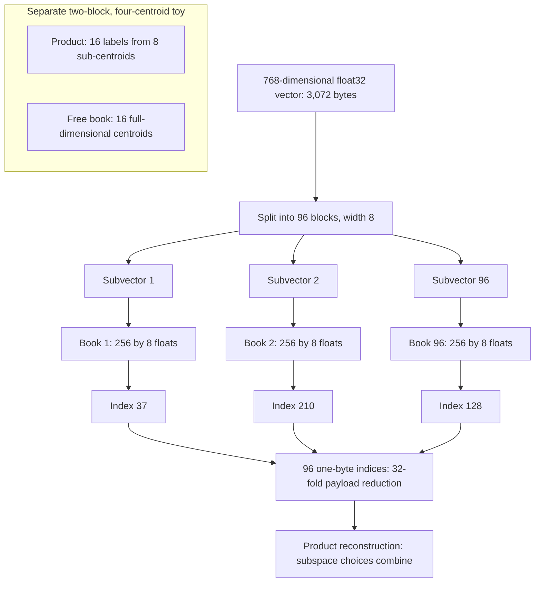
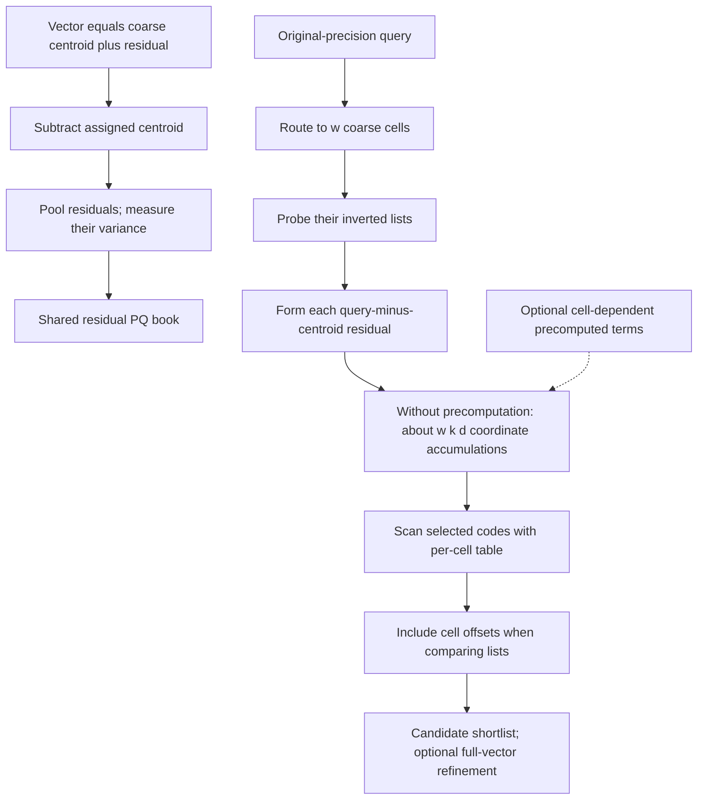
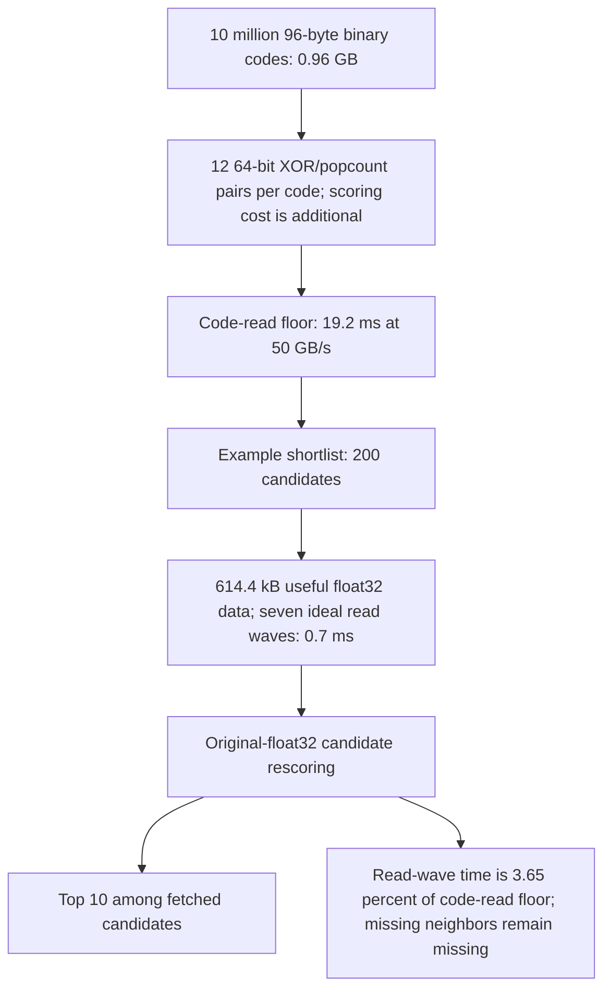
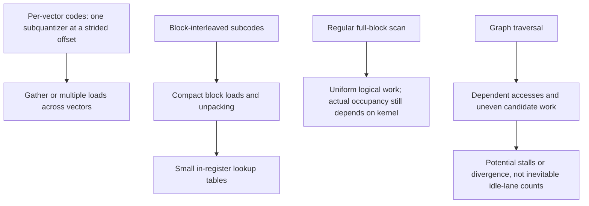

# Chapter 16: Compression and Index Economics
[00-START-HERE](../00-START-HERE.md) · [01-READING-ROUTES](../01-READING-ROUTES.md) · [15\_approximate\_nearest\_neighbor\_search](15_approximate_nearest_neighbor_search.md) · [17\_operating\_a\_vector\_store](17_operating_a_vector_store.md)
Purpose: Build a defensible retrieval index budget from code length, scoring error, scan shape, and fleet multipliers without confusing a smaller stored vector with a smaller system.
## TL;DR
- Quantization changes the stored description of a same-dimensional vector. Dimensionality reduction changes the representation; neither preserves retrieval quality automatically.
- For power-of-two $`k`$, PQ stores $`m\log_2 k`$ bits per vector, addresses $`k^m`$ composite codes and stores $`kd`$ centroid floats. Codebook capacity is not a recall guarantee.
- Residual IVF-PQ uses the coarse cell address as part of the reconstruction. Its bit-gain estimate is conditional on a high-rate source model, not an accuracy floor. Naive residual ADC builds a table per probed cell; precomputation trades storage for query work.
- Under an unclipped, independent uniform-rounding model, SQ8 has inner-product noise about $`4.53\times10^{-4}`$ in the worked unit-vector example. A $`768`$-bit independent-hyperplane code has local cosine-estimator noise about $`0.02745`$ at cosine $`0.8`$. These are model-based deviations, not universal ranking-error rates.
- Fast scans combine block layouts, small lookup tables and hardware-specific kernels. Quantizing the lookup table introduces another approximation; scalar and SIMD instruction counts do not determine a speedup by themselves.
- Count identifiers, graph slots, fixed tables, refine storage, rebuild overlap, replicas, payload and metadata separately. Float16 refinement is not exact rescoring of an original float32 corpus.
- A fleet budget must identify where each physical copy resides. Smaller codes do not automatically shrink every RAM, SSD or payload term.
## The story
Think of the index as a warehouse that must ship an answer under a strict space and time budget.
The original warehouse stores every item as a full $`768`$-number crate. Each crate takes $`3{,}072`$ bytes in float32. Ten million crates consume $`30.72\,\mathrm{GB}`$ before identifiers, graph links, replicas, or source text.
Product quantization stops storing whole crates. It divides each crate into $`m`$ compartments and gives each compartment a catalog number. With $`m = 96`$ and $`k = 256`$, each compartment needs one byte. A $`3{,}072`$-byte crate becomes a $`96`$-byte catalog slip while still describing all $`768`$ dimensions.
The catalog has enormous reach because every eye, nose, and mouth choice can combine with every other choice. The warehouse can address $`k^m`$ composite items while storing only $`k\times m`$ sub-centroids. Since each sub-centroid has width $`\frac{d}{m}`$, the stored catalog is only $`k\times d`$ floats. The price is a rigid grid. The catalog cannot place every boundary freely.
The IVF level acts like a regional depot. It routes an item to a coarse centroid. Residual encoding catalogs the difference from that address; when the fitted centroids represent the deployed distribution, this can pool a lower-variance source near the origin. That accuracy opportunity is not free or guaranteed: a naive query builds a cell-dependent table for each probed depot, while precomputed terms reduce that work at an explicit memory cost.
Scalar quantization rounds shelf measurements to a finer or coarser ruler. The small SQ8 noise calculated here assumes values remain inside the calibrated range and the rounding errors behave as modeled. Binary hashing instead records which side of sampled hyperplanes contains an item. Hamming counts then estimate an angle under the stated random-hyperplane model. Full-vector rescoring can improve the order of the shortlist, but cannot recover a crate that the shortlist missed.
The shelving pattern affects how efficiently workers fetch codes. A per-vector layout puts one subquantizer's codes $`m`$ bytes apart for eight-bit PQ. A block-interleaved layout groups that subquantizer across, for example, $`32`$ vectors. This supports compact loads and uniform lane work; alignment, unpacking, table precision, tail blocks and the actual kernel still matter.
The final invoice includes identifiers, graph slots, centroids, codebooks, optional precomputed tables, rebuild overlap, replicas, refine vectors, source chunks and filtering structures. Compression primarily shrinks the code payload. Index economics carries every remaining term to the right physical copy and storage tier; a separate builder or shared payload store is not free.
## Decoder table

| Symbol or term | Meaning | Role in the chapter |
| --- | --- | --- |
| Retrieval-Augmented Generation (RAG) | Retrieval supplies external context to a generator | The book context for the index design problem |
| $`x`$ | Stored database vector | The object being encoded |
| $`y`$ or $`q`$ | Query vector | Original query precision under ADC, not a claim of exact real arithmetic |
| $`d`$ | Embedding dimension | $`768`$ in the main examples |
| $`N`$ | Number of indexed vectors or chunks | $`10^{7}`$, $`10^{8}`$, or $`10^{9}`$ in worked examples |
| Quantization | Fewer bits describing the same-dimensional vector | Reduces storage without changing $`d`$ |
| Dimensionality reduction | Fewer vector coordinates | Changes the representation |
| Codebook | A finite set of centroids | Maps a vector or subvector to a stored index |
| $`C`$ and $`q(x)`$ | Flat codebook and nearest-centroid reconstruction $`q_C(x)`$ | A fixed-width index needs $`\lceil\log_2 k\rceil`$ bits |
| Distortion | Mean squared reconstruction error | A fitting objective; low distortion does not itself guarantee top-$`k`$ recall |
| Lloyd’s algorithm | The $`k`$-means fitting procedure | A local codebook-training heuristic |
| $`b`$ | Scalar or flat-code bit width | $`2^b`$ distinct levels for a full alphabet |
| Product quantization (PQ) | Separate quantization of coordinate blocks | Product reconstruction need not imply statistically independent blocks |
| $`m`$ | Number of subquantizers | Also equals bytes per vector when $`k = 256`$ |
| $`u_j`$ and $`C_j`$ | Subvector and its codebook | Each subvector has dimension $`\frac{d}{m}`$ |
| $`k`$ | Centroids per subquantizer | Usually $`256`$ or $`16`$ here |
| $`c(x)`$ | Tuple of sub-indices | Stored length $`m\lceil\log_2 k\rceil`$ bits for separately packed fixed-width subcodes |
| $`k^m`$ | Number of composite PQ codes | Exponential address space |
| $`k m`$ | Number of stored sub-centroids | Linear stored count |
| $`k d`$ | Total stored centroid floats | Independent of $`m`$ |
| Bits per dimension | $`m\lceil\log_2 k\rceil/d`$ | Equals $`m\log_2 k/d`$ at power-of-two $`k`$ |
| Principal component analysis (PCA) | Dimensionality-reduction comparison | Changes the vector instead of its storage code |
| Optimized product quantization (OPQ) | Orthogonal transform before PQ | Can improve block quantization; equal variance and better recall are not guaranteed |
| $`R`$ as a matrix | OPQ rotation | Applied to $`x`$ before quantization |
| Asymmetric distance computation (ADC) | Quantized database reconstruction, original query | Exact error identity includes a cross term; positive additive bias needs assumptions |
| Symmetric distance computation (SDC) | Both query and database are coded | Error includes cross terms and covariance; can reuse symmetric code distances |
| $`T`$ | Query-to-sub-centroid table | Has $`m\times k`$ entries |
| Inverted file (IVF) | Coarse partition into inverted lists | Routes a query to selected cells |
| Inverted file with ADC (IVFADC) | IVF plus residual PQ and ADC | Same structure the source calls `IndexIVFPQ` in its named library |
| $`q_c(x)`$ and $`c_i`$ | Coarse quantizer and centroid | Define the assigned cell |
| $`K_c`$ or $`\mathrm{nlist}`$ | Number of coarse cells | Controls routing, list lengths, fixed memory and cell-address capacity |
| $`r(x)`$ | Residual $`x - q_c(x)`$ | Value encoded by residual PQ |
| $`\rho \sigma^{2}`$ | Within-cell total mean squared residual under the centroid condition | $`\rho`$ need not transfer unchanged to shifted data |
| $`d^{*}`$ | Intrinsic dimension in a high-rate source model | Cancels in the bit-gain approximation only under the stated assumptions |
| $`R_b`$ and $`D`$ | Code bits per vector and high-rate distortion | Use $`R_b`$ for rate, distinct from rotation $`R`$ and replica count $`R_{\mathrm{rep}}`$ |
| $`\xi`$ and $`e`$ | Mean squared error energy and reconstruction error | Error energy alone does not determine ADC/SDC distance bias |
| $`w`$ or $`\mathrm{nprobe}`$ | Probed IVF cells | Multiplies table builds and scans |
| $`K_c^{*}`$ | Table-build/scan count-proxy crossover | $`K_{c,\mathrm{count}}^*=Nm/(kd)`$; nominal FLOP model instead gives $`Nm/(2kd)`$ |
| Precomputed table | Optional stored cell-dependent residual terms | Saves full-dimensional per-cell work, not all query table operations |
| Scalar quantization (SQ) | Per-dimension integer encoding | Reconstructs component values |
| SQ8 and SQ4 | Eight-bit and four-bit scalar codes | Use $`768\ \mathrm{B}`$ and $`384\ \mathrm{B}`$ at $`d = 768`$ |
| $`\alpha_j, \beta_j`$ | Calibrated lower and upper endpoints, $`\beta_j>\alpha_j`$ | Saturation is needed; clipped errors can exceed half a bin |
| $`\Delta_j`$ and $`\sigma_e`$ | Bin step and modeled rounding deviation | $`\Delta_j^2/12`$ requires a uniform-bin approximation |
| Binary quantization | Sign-bit code | Raw signs, independent hyperplanes and learned rotations have different guarantees |
| $`\theta`$, $`H`$, and $`\hat{\theta}`$ | Pair angle, Hamming count and angle estimate | Binomial variance uses $`n_b`$ independent isotropic hyperplanes |
| Exclusive-or (XOR) and population count (POPCNT) | Bit difference and bit count | Implement binary distance |
| SimHash | Sign code tied to the random-hyperplane lemma | Source connection from angles to binary codes |
| Iterative Quantization (ITQ) | Learned rotation before sign coding | Its covariance and recall are not certified by the independent-hyperplane binomial model |
| Matryoshka Representation Learning | Leading coordinates are trained to be self-sufficient | Source example combining truncation and binarization |
| FAISS | Similarity-search library name not expanded on the permitted source pages | Provides IVF, PQ, fast-scan, and table options |
| Single instruction, multiple data (SIMD) | Parallel lanes with one instruction | Rewards uniform PQ scans |
| Graphics processing unit (GPU) warp | A lockstep thread group; $`32`$ threads in the NVIDIA-style example | Not a guarantee that every kernel fills all lanes |
| `vpshufb` | Byte-shuffle lookup instruction | A $`16`$-entry table per $`128`$-bit lane; precision and packing matter |
| WarpSelect | Register-resident top-$`k`$ selection | Avoids global-memory sorting |
| CAGRA | GPU graph method named by the source | Uses fixed out-degree for warp-shaped work |
| Hierarchical navigable small world (HNSW) | Multi-layer graph index | Adds links and ragged traversal |
| $`M`$, $`M_0`$, $`\ell`$, $`m_L`$, $`U`$ | HNSW degree and level variables | Derive expected link bytes |
| $`b_{\mathrm{vec}}`$, $`b_{\mathrm{id}}`$, $`b_{\mathrm{link}}`$ | Code/vector, identifier and allocated graph-slot bytes | Graph formula is an expectation under a stated layer allocator |
| $`M_{\mathrm{index}}`$ | One index copy, written $`M_I`$ below | Includes the structures actually present, not every index family at once |
| $`h`$ | Local rebuild-overlap fraction for counted index structures | $`h=1`$ means old and new copies coexist; separate-builder peaks remain additional |
| $`R_{\mathrm{rep}}`$ | Serving index-copy count, written $`R_{\mathrm{rep}}`$ | Refine and payload copies must be counted by their own topology |
| $`M_{\mathrm{payload}}`$ and $`M_{\mathrm{fleet}}`$ | Physical payload footprint and peak deployment capacity | Separate RAM/SSD tiers and include replication, builders and refine stores |
| Refine set | Higher-precision vectors for candidate rescoring | Float16 is not exact relative to original float32; reranking cannot restore missing candidates |
| Central processing unit (CPU) | General-purpose processor | Source default for graph indexes |
| Solid-state drive (SSD) | Storage for exact vectors | Trades RAM for access latency |
| Non-volatile memory express (NVMe) | SSD access path in the read example | Seven ideal waves at the stipulated concurrency are not a measured tail bound |
| Resident set size (RSS) | Measured process memory | Used to validate the formula |
| $`p_{99}`$ and out of memory (OOM) | Tail latency and capacity failure | Operational decision and failure measures |

## Core mechanics
### Mathematical conventions
Storage is decimal unless explicitly binary: $`1\,\mathrm{kB}=10^3\,\mathrm B`$, $`1\,\mathrm{GB}=10^9\,\mathrm B`$, $`1\,\mathrm{KiB}=2^{10}\,\mathrm B`$ and $`1\,\mathrm{GiB}=2^{30}\,\mathrm B`$. Keep intermediate precision and round required integer resources upward. Equal-width PQ assumes $`m\mid d`$ and fixed-length subcodes; a separately stored sub-index needs $`\lceil\log_2 k\rceil`$ bits, which equals $`\log_2 k`$ for the powers of two used here. A multiply-accumulate (MAC) is conventionally two FLOPs; neither is interchangeable with a table lookup or SIMD instruction. Operation-count crossovers are illustrative, not measured latency. Memory-over-bandwidth figures are streaming floors, not $`p_{99}`$ guarantees. Quantization-noise formulas require their stated bias, clipping and covariance assumptions. Binary binomial formulas below use independent random hyperplanes, not arbitrary coordinate signs. Rescoring is exact only over the fetched candidates, relative to the stored precision and metric; it cannot restore candidates omitted by routing or compressed search. Reported experimental results remain source inputs, not results established by this chapter's arithmetic.
### 16.1 Product quantization and the $`\frac{k^m}{km}`$ argument
#### What
A flat quantizer chooses a nearest centroid from a finite codebook, with a tie rule:

$$
q_C(x)\in\mathop{\mathrm{arg\,min}}_{c\in C}\lVert x-c\rVert_2^2,\qquad C=\{c_1,\ldots,c_k\}\subset\mathbb R^d.
$$

A fixed-length index costs $`\lceil\log_2 k\rceil`$ bits. Codebook fitting minimizes average squared reconstruction error, for example on a training sample:

$$
\min_{C:\lvert C\rvert=k}\ \frac1{n_{\mathrm{train}}}\sum_{i=1}^{n_{\mathrm{train}}}\lVert x_i-q_C(x_i)\rVert_2^2.
$$

Lloyd’s $`k`$-means algorithm is a local heuristic. The source cites exact Euclidean sum-of-squares clustering as NP-hard even for $`k = 2`$ in general dimension.
A flat $`b`$-bit code needs $`2^b`$ centroids. At $`b = 32`$ and $`d = 768`$:

$$
2^{32}(768)(4\,\mathrm B)=13{,}194{,}139{,}533{,}312\,\mathrm B\approx13.1941\,\mathrm{TB}.
$$

Against the modeled ten-million-vector corpus of $`30.72\,\mathrm{GB}`$, that flat codebook alone is about $`429.50`$ times larger. A library warning heuristic of $`39`$ training points per centroid would request:

$$
39(2^{32})=167{,}503{,}724{,}544\ \text{training vectors}\approx1.67504\times10^{11}.
$$

PQ splits $`x`$ into $`m`$ equal contiguous subvectors when $`m\mid d`$, and fits $`k`$ sub-centroids per block. Its separately stored fixed-width subcodes have length:

$$
c(x)=(i_1,\ldots,i_m),\qquad b_{\mathrm{code}}=m\lceil\log_2 k\rceil\ \text{bits}.
$$

Its representable code count, stored sub-centroid count, and stored coordinates are:

$$
k^m,\qquad km,\qquad km\frac{d}{m} = kd.
$$

At $`d = 768`$, $`m = 96`$, and $`k = 256`$:

$$
\frac{d}{m}=8,\qquad \text{code}=96\ \text{B},\qquad \frac{3{,}072}{96}=32.
$$

$$
256^{96}=2^{768}\approx1.55252\times10^{231}.
$$

$$
\begin{aligned}
 km&=256(96)=24{,}576\quad\text{sub-centroids},\\
 kd&=256(768)=196{,}608\quad\text{centroid coordinates},\\
 M_C&=196{,}608(4\,\mathrm B)=786{,}432\,\mathrm B=768\,\mathrm{KiB}.
 \end{aligned}
$$

#### Why
The $`m`$ factor cancels from codebook memory. Code reach grows exponentially with $`m`$ while the stored codebook remains $`k d`$ floats. The vector remains $`768`$-dimensional.
OPQ learns an orthogonal transform $`R`$, with $`R^{\mathsf T}R=I`$, before quantizing $`Rx`$. The rotation preserves Euclidean distances before quantization and can improve how variance and dependence fit the product blocks. It does not guarantee equal block variances or optimal recall. A dense transform stores $`768^2\times4=2{,}359{,}296\,\mathrm B`$ and costs about $`768^2=589{,}824`$ MACs per query; training and preprocessing costs should be measured. Already whitened inputs do not prove OPQ is useless.
#### Failure without it
For the same $`32`$-bit code, PQ can use $`m=4,k=256`$. Its codebook uses $`768\,\mathrm{KiB}`$, while the flat $`2^{32}`$-centroid alternative uses approximately $`13.1941\,\mathrm{TB}`$. The $`39`$-per-centroid heuristic is $`9{,}984`$ training vectors per subspace, generally reusing the same training vectors across subspaces; it is not a theorem or $`m`$ disjoint training sets. The analogous flat heuristic is about $`1.67504\times10^{11}`$ vectors.
The flat-to-product codebook-memory ratio at the same $`k^m`$ representable labels is:

$$
\frac{k^m d}{kd}=k^{m-1}=256^3=16{,}777{,}216\approx1.67772\times10^7.
$$

PQ restricts reconstruction cells to products of subspace cells, so their boundaries cannot be placed independently in full space. The very large code count does not prove that all labels are useful or equally likely. Measure recall and reconstruction distortion against the embedding distribution, especially at low rates such as below $`0.5`$ bits per dimension; that value is a source heuristic, not a mathematical failure threshold.
#### Cost and complexity
ADC builds:

$$
T[j,\ell]=\lVert y_j-c_\ell^{(j)}\rVert_2^2.
$$

There are $`mk`$ entries and $`kd`$ coordinate accumulations. Direct squared-distance evaluation uses a subtraction, square and accumulation per coordinate; a norm-plus-dot-product implementation has a nominal $`kd`$ MACs, about $`2kd`$ FLOPs, plus norm/combination terms. Each candidate needs $`m`$ table lookups and approximately $`m`$ additions. These are different work types.
For $`d=768,m=96,k=256`$, the table has $`24{,}576`$ entries, $`98{,}304\,\mathrm B=96\,\mathrm{KiB}`$ at float32. The nominal dot-product portion is $`196{,}608`$ MACs, or $`393{,}216`$ FLOPs. If one ignores table loads, norm terms, selection and bandwidth, a proxy comparing $`2kd+nm`$ with $`2dn`$ gives:

$$
n>\frac{2kd}{2d-m}=\frac{393{,}216}{1{,}440}\approx273.0667\quad\Longrightarrow\quad n\ge274.
$$

SDC also quantizes the query. It saves no database-code bytes, but can exploit a query code and precomputed symmetric code distances in some workflows. Neither ADC nor SDC has a universal additive positive-bias formula for deterministic centroid quantization; the error algebra and assumptions are given below.
#### Worked numbers and decisions
- HNSW-Flat with $`10^7`$ float32 vectors and $`M=32`$ has $`30.72\,\mathrm{GB}`$ of vectors plus approximately $`2.601290\,\mathrm{GB}`$ of allocated link slots under the layer convention below, or $`33.321290\,\mathrm{GB}`$ before other overhead. Base slots alone are $`2.56\,\mathrm{GB}`$; this is $`64`$ four-byte slots per vector, not $`32`$ eight-byte links.
- PQ96 codes use $`960\,\mathrm{MB}`$ and the shared codebook $`786{,}432\,\mathrm B=768\,\mathrm{KiB}`$. The code-payload reduction is exactly $`32`$ times and the rate is one bit per dimension.
- A query's float32 PQ96 table is $`96\,\mathrm{KiB}`$. Its nominal dot work is $`0.196608`$ million MACs, or $`0.393216\,\mathrm{MFLOP}`$, before other terms.
- Scanning $`10{,}000`$ codes reads $`960{,}000\,\mathrm B=960\,\mathrm{kB}`$ of codes. That may fit a particular last-level cache, but does not prove a cache hit, or include the lookup table, IDs and selection state.
- PQ32 codes use $`320\,\mathrm{MB}`$, $`96`$ times less code payload than float32, with $`2^{256}`$ labels and $`1/3`$ bit per dimension. This is not a $`96`$-fold reduction of the entire index.
- At the same $`96`$ bytes, a PCA projection stores $`24`$ float32 principal coordinates, dropping $`744`$ principal directions. PQ96 reconstructs all $`768`$ coordinates approximately. Neither wins independently of the data spectrum and retrieval task.
- An IVF-PQ96 entry adds an eight-byte ID: $`104`$ bytes and $`1.04\,\mathrm{GB}`$ of entries, $`8.3333\%`$ above the code array. Add centroids, codebook, list metadata and optional precomputation separately.
- At $`d=128,m=8,k=256`$, codes have $`64`$ bits and the codebook is $`128\,\mathrm{KiB}`$. A flat $`2^{64}`$-centroid float32 book would use $`9.44473\times10^{21}\,\mathrm B\approx9.44473`$ decimal zettabytes.
- The commonly used $`k=256`$ makes $`m`$ bytes per code; $`m=d/8`$ gives one bit per dimension when integral. The listed $`d=768`$ choices $`96`$, $`64`$, $`48`$, $`32`$, $`24`$ and $`16`$ divide $`d`$, but are not all its divisors.
- A $`k=16`$ fast-scan kernel trades smaller subcode alphabets and table quantization against quality; measure it at matched code bytes and recall. OPQ has separate rotation cost.
- Retrain or recalibrate after material encoder or corpus shift. Treat $`39k=9{,}984`$ samples per subspace as a warning heuristic, not a proven sufficiency guarantee.
- Full float32 vectors can rescore a shortlist exactly in the original metric, but only within that shortlist. Keeping them on NVMe still requires $`30.72\,\mathrm{GB}`$ of storage plus access, metadata and replication budgets.
These budgets distinguish code payload, fixed structures, score error and the physical copies needed for a serving system. A smaller vector description is not automatically a smaller end-to-end deployment.
- **HNSW-Flat:** The scoped $`M=32`$ estimate is $`30.72\,\mathrm{GB}`$ of vectors plus $`2.601290\,\mathrm{GB}`$ of expected allocated slots, including upper levels. It excludes allocator, label-map and runtime overhead.
- **PQ96:** The $`96`$-byte code array is $`960\,\mathrm{MB}`$; the shared book is $`768\,\mathrm{KiB}`$. Rate and payload ratios do not establish recall.
- **Query table:** $`96\times256`$ float32 entries use $`96\,\mathrm{KiB}`$. A norm-plus-dot build has a nominal $`196{,}608`$ MACs, conventionally $`393{,}216`$ FLOPs, plus remaining terms. The $`10{,}000`$-code stream is $`960\,\mathrm{kB}`$.
- **PQ32:** Codes use $`320\,\mathrm{MB}`$, $`2^{256}`$ labels and $`1/3`$ bit per dimension. Full-index savings are smaller when fixed and per-item non-code terms are counted.
- **PCA comparison:** $`24`$ retained principal coordinates cost $`96`$ bytes; $`744`$ principal directions are discarded. PQ96 describes all coordinates approximately, not losslessly.
- **IVF entries:** The ID changes $`96`$ to $`104`$ bytes, or $`1.04\,\mathrm{GB}`$ before fixed terms; the increase over codes is $`8.3333\%`$.
Use hardware measurements rather than byte counts alone to choose $`k`$ and $`m`$. A smaller $`k=16`$ lookup table enables particular shuffle kernels, but table quantization and changed subspaces may alter recall. OPQ adds a transform, and a codebook-trained index must be reevaluated after material distribution shift. The $`39`$-points-per-centroid heuristic is neither a training lower-bound theorem nor a quality guarantee. Reranking can improve candidate order, but keeping and fetching the original vectors remains a separate storage and latency decision.
### 16.2 Residual quantization and IVFADC
#### What
IVF assigns each vector to the nearest of $`K_c`$ centroids. Residual encoding stores:

$$
r(x)=x-q_c(x).
$$

Let $`X`$ denote a random vector and $`\mu=\mathbb E[X]`$. At a population centroid condition, or for the empirical training distribution at a nonempty-cell Lloyd fixed point:

$$
c_i=\mathbb E[X\mid q_c(X)=c_i],\qquad \mu=\mathbb E[X].
$$

Then $`\mathbb E[X-q_c(X)\mid q_c(X)]=0`$, so the cross term vanishes. With $`\sigma^2`$ denoting finite positive total mean squared deviation, not per-coordinate variance:

$$
\underbrace{\mathbb E\lVert X-\mu\rVert^2}_{\sigma^2}=\mathbb E\lVert q_c(X)-\mu\rVert^2+\underbrace{\mathbb E\lVert X-q_c(X)\rVert^2}_{\rho\sigma^2},\qquad 0\le\rho\le1.
$$

Training centroids need not satisfy that identity for a shifted serving population. For a high-rate model with intrinsic dimension $`d^*>0`$, comparable source shapes and the stated common prefactors, use the schematic approximations:

$$
\rho\approx K_c^{-2/d^*},\qquad D_{\mathrm{raw}}(R_b)\approx A\sigma^2 2^{-2R_b/d^*},\qquad D_{\mathrm{res}}(R_b)\approx A\rho\sigma^2 2^{-2R_b/d^*}.
$$

Equating raw distortion at $`R_b+\Delta R_b`$ to residual distortion at $`R_b`$ within this model gives:

$$
\Delta R_b=-\frac{d^*}{2}\log_2\rho\ \approx\ \log_2 K_c\quad\text{bits per vector}.
$$

For quantizer errors $`e_x=\widehat x-x`$ and $`e_y=\widehat y-y`$, the exact ADC and SDC identities are:

$$
\lVert y-\widehat x\rVert^2=\lVert y-x\rVert^2+\lVert e_x\rVert^2-2(y-x)^{\mathsf T}e_x.
$$

$$
\lVert\widehat y-\widehat x\rVert^2=\lVert y-x\rVert^2+\lVert e_y-e_x\rVert^2+2(y-x)^{\mathsf T}(e_y-e_x).
$$

#### Why
The coarse level can remove between-cell variation before PQ encodes residuals. The list address has at most $`\log_2 K_c`$ bits of information; actual entropy may be smaller for imbalanced assignments. It is implicit in list membership rather than stored in every PQ code, but centroids, IDs and list structures still cost memory.
The estimate $`\Delta R_b\approx\log_2 K_c`$ is not a high-rate lower bound. Different source shapes, cell quality, rates and product-block correlations can change the gain in either direction. Likewise, the often-quoted ADC mean distance $`\lVert y-x\rVert^2+\xi`$ requires conditionally zero-mean error with $`\mathbb E\lVert e_x\rVert^2=\xi`$; SDC adds $`2\xi`$ only with suitable zero means, equal error energy and zero cross covariance. Deterministic centroid errors do not generally satisfy these assumptions. For example, $`X\in\{-1,1\}`$ equally likely, $`\widehat X=0`$ and $`y=0`$ give exact distance $`1`$ but ADC distance $`0`$, not $`2`$.
#### Failure without it
Without residuals, a shared raw-vector codebook covers the full distribution rather than each centered cell's residual distribution. Residuals can improve that allocation, but do not automatically reduce every query error or improve every rank.
When measured $`\rho`$ is near $`1`$, centering may offer little distortion benefit while still costing work. The suggested warning $`\rho>0.8`$ is a workload heuristic, not a theorem. OPQ and centering can interact; measure their joint effect rather than adding their gains.
#### Cost and complexity
Without precomputation, residual scoring forms $`y-c_i`$ for each probed cell and builds a cell-dependent table. For balanced or representative probed lists, the following counts use one coordinate accumulation for table work and one addition for scan work; they are not calibrated equal-time operations:

$$
W_{\mathrm{build,count}}\approx wkd,\qquad W_{\mathrm{scan,add}}\approx w\frac{N}{K_c}m.
$$

The count-proxy crossover cancels $`w`$. Using the nominal two-FLOP MAC model instead changes the crossover; ignored loads, norms, table combinations and selection can move it further:

$$
K_{c,\mathrm{count}}^*=\frac{Nm}{kd},\qquad K_{c,\mathrm{FLOP}}^*\approx\frac{Nm}{2kd}.
$$

Use $`N = 10^{7}`$, $`d = 768`$, $`K_c = 4{,}096`$, $`m = 64`$, $`k = 256`$, and $`w = 32`$:
- Codes are $`64`$ bytes and IDs eight bytes: $`72`$-byte entries use $`720\,\mathrm{MB}`$.
- Centroids use $`12{,}582{,}912\,\mathrm B`$ and the book $`786{,}432\,\mathrm B`$. The scoped total is $`733{,}369{,}344\,\mathrm B=733.369344\,\mathrm{MB}`$, about $`41.8883`$ times smaller than float32 vectors alone, before other structures.
- Mean list length is $`2{,}441.40625`$, so $`32`$ representative lists contain $`78{,}125`$ codes; the scan proxy is $`5{,}000{,}000`$ additions.
- A raw-PQ table has $`196{,}608`$ coordinate accumulations or nominal MACs. This is $`3.93216\%`$ of the scan's addition count, but nominal MAC FLOPs are $`7.86432\%`$; neither ratio is a latency share.
- Naive residual tables use $`6{,}291{,}456`$ coordinate accumulations, $`1.2582912`$ times the scan count. The nominal dot-work FLOP ratio is $`2.5165824`$ before remaining terms.
- The coarse address at $`K_c=4{,}096`$ contributes at most $`12`$ label bits. Under the high-rate equal-prefactor model this corresponds to a $`12/512=2.34375\%`$ code-bit gain, not a guaranteed accuracy gain or floor.

$$
K_{c,\mathrm{count}}^*=\frac{10^7(64)}{256(768)}\approx3{,}255.2083,\qquad K_{c,\mathrm{FLOP}}^*\approx1{,}627.6042.
$$

The source's $`4\sqrt N`$ to $`16\sqrt N`$ coarse-list starting heuristic gives:

$$
4\sqrt{10^7}\approx12{,}649.11,\qquad16\sqrt{10^7}\approx50{,}596.44.
$$

These endpoints are approximately $`3.886`$ and $`15.543`$ times the count-proxy crossover, or twice those ratios against the nominal FLOP crossover. The range is a tuning heuristic; it neither guarantees balanced lists nor matched recall.
An optional float32 table of cell-dependent residual terms costs:

$$
K_cmk\times4\ \text{bytes}.
$$

The exact expansion, including the cell-dependent offset needed when comparing candidates across lists, is:

$$
\lVert(y-c_i)-\hat r\rVert^2=\lVert y-c_i\rVert^2+\lVert\hat r\rVert^2+2\langle c_i,\hat r\rangle-2\langle y,\hat r\rangle.
$$

For PQ64, this optional table uses $`268{,}435{,}456\,\mathrm B=268.435456\,\mathrm{MB}=256\,\mathrm{MiB}`$ at $`K_c=4{,}096`$, or $`36.6030\%`$ of the scoped $`733.369344\,\mathrm{MB}`$ index before adding it. The combined total becomes $`1.0018048\,\mathrm{GB}`$. At $`K_c=65{,}536`$ the table is $`4.294967296\,\mathrm{GB}=4\,\mathrm{GiB}`$. Precomputed terms remove repeated full-dimensional work, not every query operation: a shared query-dot table still costs nominal $`kd`$ MACs, cell-table combinations cost $`O(wmk)`$, and list scans, coarse search and selection remain.
#### Worked numbers and decisions
- Compare raw PQ, residual PQ and precomputed residual PQ at matched code bytes, recall, load and memory. Disable or alter residual encoding when the measured benefit does not justify its real query and storage cost; $`\rho>0.8`$ or a half-scan build share are heuristics to test, not universal thresholds.
- ADC keeps the original query; SDC may be useful for already coded queries. Additive positive-distance bias is not a general guarantee for either method.
- At $`K_c=65{,}536,w=32`$, mean scan work is $`312{,}500`$ additions while naive residual build work stays $`6{,}291{,}456`$ nominal MACs: a count ratio $`20.1326592`$, or nominal dot-work FLOP ratio $`40.2653184`$.
- The balanced scanned corpus fraction is $`0.78125\%`$ at $`4{,}096`$ cells and $`0.048828125\%`$ at $`65{,}536`$. Restoring that fraction takes $`w=512`$, not a promise of restored recall.
- At $`w=512`$, scan work returns to $`5{,}000{,}000`$ additions but table work rises to $`100{,}663{,}296`$ nominal MACs. The same large build-to-scan ratio remains. Benchmark precomputation, another coarse routing strategy or raw PQ rather than assuming one remedy always wins.
- Rerank a measured shortlist when original vectors are available. Exact float32 candidate scoring is not global exact search; increasing code bits and increasing candidate coverage address different failure modes.
### 16.3 Scalar and binary quantization
#### What
Float32 payload is $`4d`$ bytes, or $`3{,}072`$ bytes at $`d=768`$. For $`b\ge1`$ bits and a calibrated range $`\beta_j>\alpha_j`$, a clipped nearest-level scalar quantizer is:

$$
c_j=\mathop{\mathrm{clip}}\nolimits_{[0,2^b-1]}\!\left(\left\lfloor\frac{x_j-\alpha_j}{\beta_j-\alpha_j}(2^b-1)+\frac12\right\rfloor\right).
$$

$$
\hat{x}_j=\alpha_j+\frac{c_j}{2^b-1}(\beta_j-\alpha_j),\qquad
\Delta_j=\frac{\beta_j-\alpha_j}{2^b-1}.
$$

For $`x_j\in[\alpha_j,\beta_j]`$, nearest rounding gives $`\lvert e_j\rvert\le\Delta_j/2`$, where $`e_j=\widehat x_j-x_j`$. Clipped outliers need not obey that bound. A zero-mean uniform-bin approximation gives:

$$
\mathbb{E}[e_j^2]=\frac{\Delta_j^2}{12}.
$$

A unit vector has average squared coordinate $`1/d`$. If the unit-vector distribution is also zero-mean and isotropic, each coordinate has the following RMS/standard-deviation scale; it is not the value of every coordinate:

$$
\sqrt{\mathbb E[X_j^2]}=\frac1{\sqrt{768}}\approx0.0360844.
$$

With $`[\alpha,\beta]=[-0.2,0.2]`$ and $`b = 8`$:

$$
\Delta=\frac{0.4}{255}\approx1.56862745\times10^{-3},\qquad\sigma_e=\frac{\Delta}{\sqrt{12}}\approx4.52823741\times10^{-4}.
$$

For a fixed exact unit query, the score below is the dot product with the reconstructed vector, without renormalizing that reconstruction. With error mean $`\mu_e`$ and covariance $`\Sigma_e`$:

$$
\langle q,\widehat x\rangle-\langle q,x\rangle=q^{\mathsf T}e,\qquad\mathbb E[q^{\mathsf T}e]=q^{\mathsf T}\mu_e,\qquad\mathop{\mathrm{Var}}\nolimits(q^{\mathsf T}e)=q^{\mathsf T}\Sigma_e q.
$$

Only under $`\mu_e=0`$, $`\Sigma_e=\sigma_e^2I`$ and $`\lVert q\rVert=1`$ does score deviation equal $`\sigma_e`$. Per-dimension ranges, correlated errors, clipping and renormalization change that result. For binary hashing, let $`n_b`$ independent isotropic random hyperplanes encode a nonzero vector by $`\mathop{\mathrm{sign}}\nolimits(a_\ell^{\mathsf T}x)`$. For a fixed pair at angle $`\theta`$:

$$
p=\frac\theta\pi,\qquad H\sim\mathop{\mathrm{Binomial}}\nolimits(n_b,p),\qquad\widehat\theta=\frac{\pi H}{n_b},\qquad\widehat c=\cos\widehat\theta.
$$

The source connects the single-random-hyperplane collision result to SimHash through Goemans and Williamson (1995) and Charikar (2002). Raw coordinate signs have no such guarantee for arbitrary fixed embeddings. A random orthogonal rotation has dependent hyperplane directions, so it does not by itself establish the binomial variance; learned ITQ also requires empirical error calibration.
#### Why
SQ8 reduces precision while retaining approximate component values. Binary Hamming counts estimate angular similarity under an appropriate hashing model instead of using one-bit reconstructed components. XOR and population count make Hamming scoring cheap, but query hashing, memory traffic, selection and candidate recall still cost work. A cosine estimate from Hamming is nonlinear and is generally biased even when the angle estimate is unbiased.
#### Failure without it
For finite, normal-range values rounded to nearest, float16 has $`11`$ significand bits and the usual relative error bound:

$$
\lvert\mathop{\mathrm{fl}}\nolimits_{16}(x)-x\rvert\le u\lvert x\rvert,\qquad u=2^{-11}=4.8828125\times10^{-4}.
$$

Subnormals, overflow and the actual rounding implementation need separate treatment. At component RMS $`1/\sqrt{768}`$, the normal-range absolute bound scale is about $`1.762\times10^{-5}`$. A further uniform-relative-rounding approximation gives RMS near $`1.0173\times10^{-5}`$, about $`44.5`$ times below the SQ8 component-noise model while using twice the bytes. This does not prove a score-error rate or universal ranking gap.
Extrapolating the uniform-bin scalar model to one bit gives $`\Delta=0.4`$ and $`\sigma_e\approx0.11547`$, but the high-rate approximation is especially questionable when unit-vector coordinates cluster near zero. Treat it as a surrogate, not a measured cosine deviation. Independent random-hyperplane hashing changes the estimator; an arbitrary coordinate-sign code or learned/orthogonal rotation must have its own bias, variance and recall measured. No theorem requires every binary deployment to rerank, but cosine-quality requirements may make it necessary.
#### Cost and complexity
At cosine $`0.80`$:

$$
\theta=\arccos(0.8)\approx0.643501109\,\mathrm{rad},\qquad p=\theta/\pi\approx0.204832765.
$$

$$
\mathbb E[H]=768p\approx157.311563,\qquad\mathop{\mathrm{sd}}\nolimits(H)=\sqrt{768p(1-p)}\approx11.184319.
$$

$$
\mathop{\mathrm{sd}}\nolimits(\widehat\theta)=\pi\sqrt{\frac{p(1-p)}{768}}\approx0.0457507\,\mathrm{rad}.
$$

The delta-method cosine deviation is $`\sin\theta\,\mathop{\mathrm{sd}}\nolimits(\widehat\theta)\approx0.0274504`$ at cosine $`0.8`$ and $`n_b=768`$. It is not an exact standard deviation or a universal error bound. Binary code payload is eight times smaller than SQ8 and its local modeled deviation is about $`60.62`$ times larger. Comparing it with the extrapolated one-bit scalar deviation gives a ratio near $`4.21`$, but does not validate that scalar noise model.
For $`10^7`$ vectors and a sustained code-stream bandwidth of $`50\,\mathrm{GB/s}`$, the following are payload-only read floors, not measured end-to-end scans:

| Configuration | Memory | Scan | Score behavior |
| --- | --- | --- | --- |
| float32 | $`30.72\,\mathrm{GB}`$ | $`614.4\,\mathrm{ms}`$ | Original precision; exact candidate score only under the defined metric and arithmetic |
| SQ8 | $`7.68\,\mathrm{GB}`$ | $`153.6\,\mathrm{ms}`$ | Modeled raw-dot deviation $`\approx4.52824\times10^{-4}`$; no clipping assumed |
| Binary | $`0.96\,\mathrm{GB}`$ | $`19.2\,\mathrm{ms}`$ | Independent-hyperplane local cosine deviation $`\approx0.02745`$ at cosine $`0.8`$ |

Two float32 calibration endpoints per coordinate use $`2(768)(4)=6{,}144\,\mathrm B`$. For two item scores, independent SQ8 errors in the stated isotropic model give a difference deviation:

$$
\sigma_{\mathrm{diff}}=\sqrt2\,\sigma_e\approx6.40389\times10^{-4},\qquad\frac{0.05}{\sigma_{\mathrm{diff}}}\approx78.08.
$$

The $`78`$-deviation number is a scale comparison, not a justified Gaussian tail estimate. There is a stronger statement for this particular unclipped equal-step raw-dot model: $`\lvert q^{\mathsf T}(e_1-e_2)\rvert\le\Delta\lVert q\rVert_1\le\Delta\sqrt{768}\approx0.04347<0.05`$, so a $`0.05`$ gap cannot flip under those bounds. Clipping, non-unit queries, other scoring rules or changed ranges invalidate that conclusion.
For binary scores, an independent, equal-local-variance Gaussian surrogate at cosine $`0.8`$ gives the illustrative calculation below. The real scores share hash planes and a query, so their errors need not be independent:

$$
\sigma_{\mathrm{diff,ind}}\approx\sqrt2(0.0274504)\approx0.038821,\qquad\Pr(\text{flip})\approx\Phi\!\left(-\frac{0.05}{\sigma_{\mathrm{diff,ind}}}\right)\approx9.9\%.
$$

For shared independent planes, even the covariance depends on a third angle. Write $`p_a=\theta(q,x_a)/\pi`$, $`p_b=\theta(q,x_b)/\pi`$ and $`p_{ab}=\theta(x_a,x_b)/\pi`$. One-bit disagreement covariance is $`(p_a+p_b-p_{ab})/2-p_ap_b`$, and $`\mathop{\mathrm{Cov}}\nolimits(\widehat\theta_a,\widehat\theta_b)`$ is $`\pi^2/n_b`$ times that quantity. Thus a score gap alone does not determine a binary flip rate. For a separate reranking budget, fetching $`200`$ original float32 vectors needs:

$$
200(768)(4\,\mathrm B)=614{,}400\,\mathrm B=614.4\,\mathrm{kB}.
$$

Assume every candidate needs one independent read, all requests are ready, maximum concurrency is $`32`$ and every service time is exactly $`100\,\mathrm{\mu s}`$. Full waves then need:

$$
\left\lceil\frac{200}{32}\right\rceil(100\,\mathrm{\mu s})=700\,\mathrm{\mu s}=0.7\,\mathrm{ms}.
$$

That is $`3.64583\%`$ of the binary $`19.2\,\mathrm{ms}`$ read floor, not a measured fraction of end-to-end latency. A fluid throughput calculation gives $`0.625\,\mathrm{ms}`$, but cannot complete a partial final wave in the equal-service-time model. If each vector is read as one aligned $`4\,\mathrm{KiB}`$ record, device traffic is $`819.2\,\mathrm{kB}`$ rather than $`614.4\,\mathrm{kB}`$. Queueing, page crossings, cache hits, selection and rescoring compute change actual latency.
#### Worked numbers and decisions
- PQ96 and $`768`$-bit binary codes both have $`96`$ bytes and $`2^{768}`$ labels; their reconstruction geometry and estimators differ. Equal code count does not imply equal quality.
- Per-dimension clipping at the $`0.1\%`$ and $`99.9\%`$ quantiles is a calibration heuristic. It permits outliers beyond the half-step rounding bound. If every coordinate has exactly $`0.2\%`$ marginal clipping probability, expected clipped coordinates at $`d=768`$ are $`1.536`$; under further coordinate independence, about $`78.51\%`$ of vectors have at least one clipped coordinate. Production drift can change both rates.
- Distinguish raw coordinate signs, independent random projections, orthogonal rotations and learned ITQ. Only the stated independent-hyperplane construction directly gives the binomial formula; rotations and learned codes need measured covariance and recall.
- The source names library scalar options such as `QT_8bit` and `QT_8bit_uniform`. Doubling an otherwise fixed range doubles the step and quadruples uniform-bin MSE; it may also change clipping error, so total MSE need not quadruple.
- Oversampling by $`3`$ to $`5`$ times and rescoring are starting heuristics. Measure candidate recall as well as final ranking; rescoring cannot recover excluded items. A sub-$`5\,\mathrm{ms}`$ budget is not by itself a reason to accept unmeasured error.
- Independent dense $`768`$-plane query hashing costs $`768^2=589{,}824`$ MACs before the binary scan; no learned codebook does not mean free encoding or rebuilding. Structured and learned transforms have different costs.
- Truncating a suitably trained Matryoshka representation to $`256`$ dimensions and storing $`256`$ sign bits uses $`32`$ bytes, $`96`$ times less payload than original $`768`$-dimensional float32. Ablate truncation and binarization separately, with an explicit sign-code model and measured recall.
### 16.4 FAISS, parallelism, and why block structure matters
#### What
PQ ADC computes:

$$
\hat{d}(q,x)^2
=\sum_{j=1}^{m}\left\lVert q^{(j)}-c_{\mathop{\text{code}}_j(x)}^{(j)}\right\rVert_2^2
=\sum_{j=1}^{m}T[j,\mathop{\text{code}}_j(x)].
$$

Building the table touches $`kd`$ coordinates; a norm-plus-dot implementation has nominal $`kd`$ MACs plus other terms. Scanning one code uses $`m`$ lookups and $`m-1`$ additions, or $`m`$ additions with a zero-initialized accumulator. Loads, arithmetic and vector instructions are distinct costs.
An illustrative coordinate-accumulation versus lookup-and-add count proxy, not an instruction- or time-equivalent comparison, gives at $`d=768,k=256,m=16`$:

$$
\frac{kd}{m}=\frac{196{,}608}{16}=12{,}288\quad\text{candidate-count proxy}.
$$

A conventional eight-bit PQ row stores a vector's $`m`$ subcodes together. Across $`32`$ vectors, one fixed subquantizer is then sampled at stride $`m`$ bytes. Implementations can still vectorize or cache such gathers; the layout does not uniquely fix instruction count.
A fast-scan kernel stores subcodes in blocks, for example $`32`$ vectors with subquantizer-major order. Four-bit subcodes are packed and unpacked for register lookup. A `vpshufb`-style byte shuffle addresses $`16`$ entries within each $`128`$-bit lane; wider vector units replicate or arrange tables by lane. Quantizing table entries to bytes is an additional approximation, and accumulation width, offsets and saturation handling must be specified. Choosing $`k=16`$ alone does not make a float32 table byte-sized.
At the same $`128`$-bit budget:

| Layout | Parameters | Table |
| --- | --- | --- |
| PQ8 per vector | $`m=16,k=256`$; $`128`$ code bits | Float32: $`16(256)(4)=16{,}384\,\mathrm B=16\,\mathrm{KiB}`$ |
| PQ4 fast scan | $`m=32,k=16`$; $`128`$ code bits | Float32: $`2{,}048\,\mathrm B`$; byte-quantized LUT: $`512\,\mathrm B`$, plus scale/offset state |

#### Why
Within a full block, PQ scoring has regular logical work and can avoid graph-like pointer traversal. A $`32`$-vector block can suit a $`32`$-thread NVIDIA-style warp, but CPU fast-scan layouts and GPU warp kernels are not the same implementation. Tail blocks, stalls, coarse routing and top-$`k`$ selection can still leave lanes idle. Uniform code work is an opportunity for utilization, not a guarantee of $`100\%`$ occupancy.
Register-resident top-$`k`$ selection can avoid materializing every score and sorting it in global memory. A comparison baseline should say whether it materializes all scores, uses a heap, or uses another streaming selection method.
#### Failure without it
The source's opening example compares $`307.2\,\mathrm{GB}`$ of float32 payload with $`1.6\,\mathrm{GB}`$ of $`128`$-bit PQ codes, a $`192`$-fold code-payload reduction, while reporting only about a twofold scan improvement. Codebook lookups, arithmetic and selection can replace bandwidth as the bottleneck. A $`16\,\mathrm{KiB}`$ float32 query table is half of a stipulated $`32\,\mathrm{KiB}`$ L1 cache, not proof of a particular miss rate or a universal speedup.
The worked selected-code stream is about $`390.6\,\mathrm{kB}`$ per query. A single unbatched query may underfill an accelerator, but that depends on kernel, coarse work, concurrency and hardware; bytes alone do not prove underutilization.
HNSW traversal has dependent accesses and uneven candidate work, which can make naive lane mappings inefficient. The source's FAISS GPU-HNSW statement applies to its reported implementation/version, not a theorem that graph search cannot run on GPUs. Specialized graph kernels such as the source's CAGRA example use regularized layouts and degree budgets to improve parallelism; fixed out-degree alone does not prove full utilization.
#### Cost and complexity
The source reports a four-bit block scan about $`4`$ to $`6`$ times faster than its conventional baseline, and reports WarpSelect at $`8.5`$ times a prior implementation plus a billion-vector $`k`$-NN graph built in under $`12`$ hours on four Maxwell Titan X GPUs. Preserve the respective study, workload and baseline scopes; these are not predictions for the arithmetic example below or current hardware.
Use $`N = 10^{8}`$, $`d = 768`$, $`\mathrm{nlist} = 262{,}144`$, and $`\mathrm{nprobe} = 64`$:

$$
\overline n_{\mathrm{list}}=\frac{10^8}{262{,}144}=381.4697265625,\qquad\overline n_{\mathrm{cand}}=64\,\overline n_{\mathrm{list}}=24{,}414.0625.
$$

PQ8 with $`m = 16`$ and $`k = 256`$:
- PQ8 with $`m=16`$ stores $`16`$-byte codes: $`1.6\,\mathrm{GB}`$ versus $`307.2\,\mathrm{GB}`$ of float32 payload, a $`192`$-fold code-payload reduction.
- Use $`n_c=24{,}414`$ only as a rounded planning count. Its code stream is $`390{,}624\,\mathrm B=390.624\,\mathrm{kB}`$.
- A nominal scalar accounting of $`16`$ subcode extractions, $`16`$ table loads and $`15`$ additions is $`47`$ operations per code, or $`1{,}147{,}458`$ across the planned candidates. This is not a count of CPU micro-operations or cycles.
- The nominal $`196{,}608`$-coordinate table build corresponds to $`12{,}288`$ candidates under the earlier heterogeneous count proxy, $`50.331648\%`$ of the mean candidate count. The percentage is not a measured runtime share.
- The full index also has $`0.8\,\mathrm{GB}`$ of eight-byte IDs, $`0.805306368\,\mathrm{GB}`$ of coarse centroids and a $`0.000786432\,\mathrm{GB}`$ book: a scoped $`3.2060928\,\mathrm{GB}`$ before other terms. Coarse routing over $`262{,}144`$ centroids must be budgeted, not hidden in the selected-code scan.
PQ4 with $`m = 32`$ and $`k = 16`$:
- PQ4 with $`m=32,k=16`$ retains the same $`128`$ bits and $`1.6\,\mathrm{GB}`$ code payload; changed subspaces and LUT precision can change recall.
- If the $`24{,}414`$ planned candidates form one packed run, $`\lceil24{,}414/32\rceil=763`$ blocks contain $`24{,}416`$ slots. Real IVF lists generally round blocks separately, so the sum of list block counts can be larger.
- Under a particular kernel's assumed seven vector instructions per subquantizer per block—one load, two nibble unpacks, two shuffles and two accumulation operations—the illustration is:

$$
763(32)(7)=170{,}912\quad\text{vector instructions in the assumed packed-run kernel}.
$$

The numerical ratio $`1{,}147{,}458/170{,}912\approx6.71374`$ compares scalar logical operations with vector instructions, not equivalent work or a predicted speedup. Extra packing, table conversion, accumulation overflow handling, routing and selection are omitted. For the smaller codebooks, the table-work count proxy becomes:

$$
kd=16(768)=12{,}288\quad\text{coordinate accumulations},\qquad\frac{kd}{m}=\frac{12{,}288}{32}=384\quad\text{candidate-count proxy}.
$$

The proxy ratio is $`384/24{,}414.0625=1.572864\%`$, not a measured table-build share. Comparing it with the $`50.331648\%`$ PQ8 proxy does not account for the different scan kernels.
If all planned candidate scores are materialized as float32, their output size is:

$$
24{,}414(4\,\mathrm B)=97{,}656\,\mathrm B=97.656\,\mathrm{kB}.
$$

One write plus one reread is $`195.312\,\mathrm{kB}`$, exactly $`50\%`$ of the $`390.624\,\mathrm{kB}`$ code stream. This is traffic accounting, not a $`50\%`$ latency penalty; streaming selection may avoid those transfers and caches can change the path.
The reported $`4`$-to-$`6`$-fold kernel speedup cannot be inferred from, or disproved by, the $`6.71374`$ unlike-instruction-count ratio. Establishing why a measured gap occurs requires matched baselines, hardware counters and end-to-end timing; unchanged traffic and selection are plausible contributors, not conclusions proved by this ratio.
For residual IVFADC at these PQ8 settings, a precomputed table costs:

$$
262{,}144(16)(256)(4\,\mathrm B)=4{,}294{,}967{,}296\,\mathrm B=4.294967296\,\mathrm{GB}.
$$

This optional table is $`2.68435456`$ times the $`1.6\,\mathrm{GB}`$ code array, before the separate IDs, centroids, codebook and overhead. The PQ4 $`m=32,k=16`$ version would have a different table budget, $`536.870912\,\mathrm{MB}`$; kernel and library support must also be checked.
#### Worked numbers and decisions
- Compare a supported fast-scan implementation with classic IVF-PQ at the same total code bytes and measured recall; do not assume the smaller LUT is accuracy-free or always faster.
- The $`12{,}288`$-candidate PQ8 and $`384`$-candidate PQ4 figures are count proxies, not universal latency break-evens. Include coarse routing and any per-cell residual work.
- Select CPU, GPU, graph or scan kernels from measured workload shape. Batch queries when useful, but include batch-fill delay for interactive requests.
- A tuned CPU can beat an underfilled accelerator, while a specialized GPU graph can beat naive CPU/GPU defaults. Neither is a universal rule.
- Budget residual precomputation explicitly and use measured query savings to decide whether it is worthwhile. The suggested $`2^{16}`$-centroid caution is configuration-dependent, not a hard library or mathematical limit.
### 16.5 Index memory arithmetic, end to end
#### What
At $`d = 768`$:

| Stored form | $`b_{\mathrm{vec}}`$ |
| --- | --- |
| float32 | $`3{,}072\ \mathrm{B}`$ |
| float16 | $`1{,}536\ \mathrm{B}`$ |
| SQ8 | $`768\ \mathrm{B}`$ |
| PQ with $`m`$ eight-bit subquantizers | $`m\ \mathrm{B}`$ |

IVF entries in these examples add an eight-byte ID. The HNSW example assumes implicit positional labels and four-byte neighbor IDs; stable external keys, deletion state and label maps can add bytes. Turn terms off when the corresponding structure is absent rather than adding IVF and graph terms indiscriminately.
HNSW levels follow:

$$
\ell=\left\lfloor-\frac{\ln U}{\ln M}\right\rfloor,\qquad U\sim\mathop{\mathrm{Uniform}}\nolimits(0,1),\quad M>1.
$$

For an integer layer $`j\ge0`$, $`\Pr(\ell\ge j)=M^{-j}`$. Under the stated allocation convention, base layer zero reserves $`2M`$ four-byte neighbor slots and each occupied upper layer reserves $`M`$. Actual populated degree is not the same as reserved capacity, and implementations may allocate differently.
The expected allocated slot bytes per node, excluding counts, pointers, alignment and other overhead, are:

$$
\mathbb E[b_{\mathrm{link}}]=4\!\left(2M+M\sum_{j=1}^{\infty}M^{-j}\right)\,\mathrm B=4\!\left(2M+\frac{M}{M-1}\right)\,\mathrm B.
$$

At $`M = 32`$:

$$
\mathbb E[b_{\mathrm{link}}]=4\!\left(64+\frac{32}{31}\right)\,\mathrm B\approx260.129032\,\mathrm B.
$$

The base-only rule $`2M\times4`$ gives $`256`$ bytes at $`M=32`$. Including expected upper slots is $`1.612903\%`$ higher than that base allocation; the two figures have different scopes. This expected-slot budget is neither an exact realized graph size nor complete process memory.
Coarse IVF centroids use $`K_cd\times4`$ bytes and a float32 PQ book $`kd\times4`$ bytes. Include each only when present. Add optional precomputed tables and actual maps/overhead separately; a full-precision refine store is not part of a code-only budget.

$$
\begin{aligned}\mathbb E[M_I]&=N\!\left(b_{\mathrm{vec}}+b_{\mathrm{id}}+\mathbb E[b_{\mathrm{link}}]\right)\\&\quad+\mathbf1_{\mathrm{IVF}}K_cd(4\,\mathrm B)+\mathbf1_{\mathrm{PQ}}kd(4\,\mathrm B)\\&\quad+M_{\mathrm{precomp}}+M_{\mathrm{maps}}+M_{\mathrm{other}}.\end{aligned}
$$

$$
M_{\mathrm{fleet,peak}}=R_{\mathrm{rep}}(1+h)M_I+M_{\mathrm{refine,peak}}+M_{\mathrm{builder,peak}}+M_{\mathrm{payload,total}}.
$$

#### Why
The simplified fleet formula assumes $`R_{\mathrm{rep}}`$ equal serving index copies and local rebuild overlap $`hM_I`$ per replica. A same-node old-plus-new rebuild has $`h=1`$ for those index structures; not every in-place/incremental algorithm needs two full copies. A separate builder can move rebuild memory off serving nodes, but its peak and swap overlap must still be counted. A value such as $`h=0.2`$ is measured slack for one deployment, not a universal safe allowance. Refine and payload terms above already include their own physical replication and peak overlap, so do not multiply them again or silently omit replicas. Keep RAM and SSD budgets separate by tier.
At $`400`$ tokens and roughly four characters per token, $`1{,}600`$ characters correspond to $`1{,}600\,\mathrm B`$ only under a one-byte-per-character average. UTF-8 is variable-width. The worked payload assumption is therefore $`1.6\,\mathrm{kB}`$ of text per chunk, $`16\,\mathrm{GB}`$ for $`10^7`$ chunks, plus $`200\,\mathrm B`$ per chunk or $`2\,\mathrm{GB}`$ of logical metadata. This $`18\,\mathrm{GB}`$ is a single logical payload copy, not automatically its replicated physical footprint or resident filter-index memory.
#### Failure without it
The naive $`N\times d\times4`$ estimate omits IDs, links, fixed tables, rebuild overlap, replicas, maps, allocator overhead, tombstones and payload. In the $`M=32`$ example, links are about $`7.8067\%`$ of the vector-plus-slot budget. Omitting their $`2.601290\,\mathrm{GB}`$ from each of six old/new replica copies hides about $`15.607742\,\mathrm{GB}`$; percentages must be applied to the correct base.
A refine store changes both the byte ratio and the precision claim. The scoped IVF-PQ96 index is $`1.09111808\,\mathrm{GB}`$. Adding float16 vectors uses $`16.45111808\,\mathrm{GB}`$, only about $`2.02547`$ times smaller than the $`33.321290\,\mathrm{GB}`$ HNSW vector-plus-slot baseline. Float16 refinement is not exact relative to original float32 values. Keeping original float32 vectors instead gives $`31.81111808\,\mathrm{GB}`$, only about $`1.04747`$ times smaller. Either may live on SSD, but then account for its storage, reads and physical copies. Candidate rescoring is not a guarantee of global top-$`k`$ recall.
These are scoped budgets, not complete RSS. Validate per-item and fixed terms with representative builds and measured RSS; a $`1\%`$ sample cannot be blindly scaled because fixed structures, levels, fragmentation and working sets scale differently. Exact conversions are $`64\,\mathrm{GiB}=68.719476736\,\mathrm{GB}`$ and $`30\,\mathrm{GiB}=32.21225472\,\mathrm{GB}`$. A binary unit is $`7.3741824\%`$ larger in bytes than the same numeric decimal GB value; the reverse percentage has a different denominator.
#### Cost and complexity
Use $`N = 10^{7}`$, $`d = 768`$, $`\mathrm{nlist} = 16{,}384`$, $`k = 256`$, and decimal GB:

| Configuration | Per-vector bytes | Fixed terms | One index |
| --- | --- | --- | --- |
| HNSW-Flat float32, $`M = 32`$ | $`3{,}072+260.129032\approx3{,}332.129032`$ | None in this slot-only model | $`\approx33.321290\,\mathrm{GB}`$ |
| IVF-Flat | $`3{,}072+8=3{,}080`$ | $`50.331648\,\mathrm{MB}`$ centroids | $`30.850331648\,\mathrm{GB}`$ |
| IVF-PQ96 | $`96+8=104`$ | $`50.331648\,\mathrm{MB}`$ centroids; $`0.786432\,\mathrm{MB}`$ book | $`1.09111808\,\mathrm{GB}`$ |
| IVF-PQ96 plus float16 refine | $`104+1{,}536=1{,}640`$ | Same IVF/PQ fixed terms | $`16.45111808\,\mathrm{GB}`$; higher-precision candidate refinement, not original-float32 exactness |

- HNSW allocated links alone are approximately $`2.601290\,\mathrm{GB}`$. Its complete implementation may use more.
- The scoped IVF-Flat estimate is about $`7.4156\%`$ smaller than HNSW-Flat; the comparison changes with graph allocation, maps and implementation overhead.
- IVF-PQ96 is approximately $`30.5387`$ times smaller before refinement under these scoped terms, not necessarily at matched recall.
- With $`h=1,R_{\mathrm{rep}}=3`$ and no separate builder/refine term, six index copies require about $`199.927742\,\mathrm{GB}`$ for HNSW or $`6.54670848\,\mathrm{GB}`$ for IVF-PQ96.
- If one logical $`18\,\mathrm{GB}`$ payload copy is genuinely shared and its physical overhead is ignored, totals are about $`217.927742\,\mathrm{GB}`$ and $`24.54670848\,\mathrm{GB}`$ across the counted tiers. A real payload service's replication and RAM/SSD placement need their own budget.
- The index-copy term saves approximately $`193.381033\,\mathrm{GB}`$; no saving in that term reduces the stipulated payload bytes.
At $`N=10^9`$, $`104`$-byte IVF-PQ96 entries alone are $`104\,\mathrm{GB}`$. A decimal $`64\,\mathrm{GB}`$ resident budget allows at most $`64\,\mathrm B`$ per point before any fixed terms or headroom. This rules out those entries in one such RAM budget; it does not mathematically require a $`32`$-byte code. For example, $`32`$-byte codes plus eight-byte IDs use $`40\,\mathrm{GB}`$, leaving room to budget other resident terms, while vectors and graph may remain on SSD. The source's $`64\,\mathrm{GB}`$ DiskANN result has its own dimension, code and storage configuration and does not validate every billion-point layout.
At $`N=10^5,K_c=4{,}096`$, centroids use $`12.582912\,\mathrm{MB}`$ while $`104`$-byte entries use $`10.4\,\mathrm{MB}`$. Adding the $`0.786432\,\mathrm{MB}`$ PQ book gives $`23.769344\,\mathrm{MB}`$ before other terms. Fixed structures can exceed the entry array, so extrapolating a large-corpus per-vector ratio is unsafe.
Halving $`m`$ from $`96`$ to $`48`$ at eight bits per subcode saves $`0.48\,\mathrm{GB}`$ of codes at $`10^7`$ points. It does not halve the eight-byte IDs, coarse centroids, the $`kd`$ PQ book or a $`15.36\,\mathrm{GB}`$ float16 refine store; recall and scan behavior also change.
For $`200`$ million vectors, retain $`d=768,M=32`$ and $`K_c=16{,}384`$ in the relevant configurations. The following includes expected graph slots, the IVF coarse book where used and $`6{,}144`$ scalar calibration bytes; it still excludes other overhead:

| Design | Bytes per vector | Total | Reduction |
| --- | --- | --- | --- |
| HNSW-Flat float32 | $`\approx3{,}332.129032`$ | $`\approx666.425806\,\mathrm{GB}`$ | Baseline |
| HNSW plus SQ8 | $`\approx1{,}028.129032`$, plus shared calibration | $`\approx205.625813\,\mathrm{GB}`$ | $`\approx3.24096`$ times smaller |
| IVF plus SQ8 | $`776`$, plus centroids and calibration | $`155.250337792\,\mathrm{GB}`$ | $`\approx4.29259`$ times smaller |

At constant $`10\%`$ monthly compound vector growth, ignoring fixed-term changes and assuming the same capacity is otherwise available, the yearly multiplier and approximate capacity time bought by the last ratio are:

$$
1.1^{12}\approx3.138428,\qquad t=\frac{\ln(4.29259)}{\ln(1.1)}\approx15.29\ \text{months}.
$$

#### Worked numbers and decisions
- Quote per-vector bytes, fixed structures, code precision and metric, then multiply by $`N`$ before rounding.
- Budget simultaneous old/new structures where the actual rebuild procedure needs them; do not call a separate builder free. State payload, refine and index replication separately.
- Keep source payload outside the replicated index tier when its fetch meets the workload, but still count its physical storage and any resident filter structures.
- Choose the refine precision, location and fetch budget before optimizing $`m`$. Float16 is not original-float32 exactness, and exact candidate ranking is not exact candidate coverage.
- Report peak fleet bytes by RAM/SSD tier and measured RSS, not just a code array or one nominal copy. In the worked six-index-copy model, a per-copy saving near $`32.230172\,\mathrm{GB}`$ becomes $`193.381033\,\mathrm{GB}`$ before payload.
- Compounding growth can consume a compression gain in roughly $`15.29`$ months in this scenario. That is a capacity illustration, not a guarantee about quality, serving throughput or when every system must shard.
## Diagrams
### Figure 16.1

| View at $`m = 2, k = 4`$ | Cells | Stored pieces | Boundary freedom |
| --- | --- | --- | --- |
| Product codebook | $`16`$ | $`8`$ sub-centroids | Shared grid boundaries |
| Free codebook | $`16`$ | $`16`$ full centroids | Freely placed cells |

> Figure $`16.1`$: A product reconstruction combines $`m`$ subspace choices, yielding $`k^m`$ possible labels from $`km`$ sub-centroids with $`kd`$ stored coordinates. These counts are capacities, not evidence that every label is used or equally probable. Product-cell boundaries are constrained by the shared subspace partitions. The separate $`m=2,k=4`$ toy compares $`16`$ product labels with $`16`$ freely placed full-dimensional centroids; it is not the main PQ96 configuration.
### Figure 16.2

> Figure $`16.2`$: Residual reconstruction writes $`x=c_i+r(x)`$ and encodes $`r(x)`$ with a shared PQ book. Lower residual variance follows under the stated centroid/distribution conditions, not automatically after drift. Naive ADC tables depend on $`y-c_i`$ for each of $`w`$ cells; optional precomputed terms reduce full-dimensional rebuild work but add $`4K_cmk`$ bytes and still require query terms and table combination. The schematic high-rate gain $`\Delta R_b\approx\log_2 K_c`$ is not a guaranteed floor.
### Figure 16.3

| Code | Bits per dimension | Footprint | Cosine noise |
| --- | --- | --- | --- |
| SQ8 | $`8`$ | $`768\,\mathrm B`$ | $`\approx4.52824\times10^{-4}`$ under the unclipped, isotropic uniform-error raw-dot model |
| SQ4 | $`4`$ | $`384\,\mathrm B`$ | $`\approx7.69800\times10^{-3}`$ under the same surrogate; calibration and clipping matter |
| Naive scalar | $`1`$ | $`96\,\mathrm B`$ | $`0.11547`$ from a questionable one-bit uniform-bin extrapolation, not a measured cosine deviation |
| Binary Hamming | $`1`$ at $`n_b=d=768`$ | $`96\,\mathrm B`$ | Delta-method deviation $`\approx0.0274504`$ at cosine $`0.8`$ with independent random planes |

> Figure $`16.3`$: The listed deviations compare different estimators under explicit error models, not a universal compression-versus-noise curve. The binary value uses independent random hyperplanes at cosine $`0.8`$; raw signs or learned/orthogonal rotations need separate calibration. The $`9.9\%`$ flip illustration additionally assumes independent local score errors, which shared hashes need not satisfy. Exact candidate rescoring improves order but cannot repair candidate omissions, and is not mandatory if measured final quality already meets the application contract.
### Figure 16.4

| Memory order | First group | Second group |
| --- | --- | --- |
| Per vector | $`v_0\colon j_0,j_1,j_2,j_3`$ | $`v_1\colon j_0,j_1,j_2,j_3`$ |
| Block interleaved | $`j_0\colon v_0,v_1,v_2,v_3`$ | $`j_1\colon v_0,v_1,v_2,v_3`$ |

> Figure $`16.4`$: Block-interleaved subcodes can replace strided gathers with compact loads, unpacking and register lookups. The $`32`$-vector block is a kernel/layout choice, not a guarantee that one instruction scores a block or every lane remains busy. Four-bit fast scans also quantize tables and manage accumulation range. CPU shuffle lanes, GPU warps, tail blocks and graph kernels must be compared in their actual hardware setting.
### Figure 16.5

| Budget row | HNSW-Flat, float32, $`M = 32`$ | IVF-PQ, $`m = 96`$ |
| --- | --- | --- |
| Stored vector, $`d = 768`$ | $`3{,}072\ \mathrm{B}`$ | $`96\ \mathrm{B}`$ |
| Add identifier | Implicit, $`0`$ | $`+8 = 104\ \mathrm{B}`$ |
| Add graph links | $`+260.129032\approx3{,}332.129032\,\mathrm B`$ expected slots | None |
| Multiply by $`N = 10^{7}`$ | $`\approx33.321290\,\mathrm{GB}`$ | $`1.04\,\mathrm{GB}`$ |
| Add centroids and codebook | $`\approx33.321290\,\mathrm{GB}`$ | $`1.09111808\,\mathrm{GB}`$ at $`K_c=16{,}384,k=256`$ |
| Multiply by $`1 + h`$, $`h = 1`$ | $`\approx66.642581\,\mathrm{GB}`$ | $`2.18223616\,\mathrm{GB}`$ |
| Multiply by $`R_{\mathrm{rep}}=3`$ | $`\approx199.927742\,\mathrm{GB}`$ | $`6.54670848\,\mathrm{GB}`$ |
| Shared payload | $`18\,\mathrm{GB}`$ single logical copy in this illustration | Same stipulated shared copy; physical replicas, RAM/SSD placement and other terms additional |

> Figure $`16.5`$: The expected-slot/code-only comparison yields approximately $`30.5387`$ times smaller one-index bytes before refinement and implementation overhead. At $`R_{\mathrm{rep}}=3,h=1`$, the scoped index-copy terms are $`199.927742\,\mathrm{GB}`$ versus $`6.54670848\,\mathrm{GB}`$, a $`193.381033\,\mathrm{GB}`$ difference. The stipulated $`18\,\mathrm{GB}`$ logical shared payload exceeds the six compressed-index copies but still needs its own physical capacity plan. A separate builder, resident refine set, payload replication or resident filtering structures would add further terms.
## Whiteboard pack
### What to draw
1. Write $`N=10^7,d=768`$ and $`3{,}072`$ bytes per float32 vector.
2. Split into $`m=96`$ blocks of width eight, each with $`k=256`$ centroids; store a $`96`$-byte code.
3. Show $`k^m`$ composite labels, $`km`$ sub-centroids and $`kd=196{,}608`$ stored centroid floats. Label them capacity and storage counts, not a recall proof.
4. Draw $`x=c_i+r(x)`$ and query tables for $`y-c_i`$. Add optional precomputed terms, memory and cross-list offsets.
5. Write the exact ADC error with its cross term, and qualify the conditional noise models for SQ8 and binary hashing.
6. Branch to $`768`$-byte SQ8 and $`96`$-byte binary payloads. Label calibration/clipping assumptions and shortlist recall; refinement cannot recover omitted neighbors.
7. Draw a $`32`$-vector block, packed subcodes and table lookup. Distinguish byte-quantized LUT size from float32 LUT size.
8. Separate scalar work counts, vector instructions and measured latency.
9. Finish with IDs, expected graph slots, fixed tables, refine precision, rebuild overlap, replicas, builders and physical payload by storage tier.
### Spoken script
Start with the deployment constraint: ten million $`768`$-dimensional float32 vectors use $`30.72\,\mathrm{GB}`$ before other structures. PQ96 uses one byte for each of $`96`$ eight-dimensional blocks, with a shared $`768\,\mathrm{KiB}`$ codebook. Residual IVF-PQ can exploit a coarse cell address but pays cell-dependent table work or optional precompute memory. SQ8 and binary have different modeled error sources; neither has a universal accuracy guarantee, and clipping or shared-hash covariance can invalidate a simple noise calculation. Block layouts enable efficient kernels, not automatic speedup. Finally, count every index, refine, rebuild, builder and payload copy in its actual RAM or SSD tier. Rescoring is exact only for covered candidates and the authoritative stored precision.
## Interview traps
### 1. Why not reduce to $`24`$ dimensions?
PCA with $`24`$ retained float32 principal coordinates uses the same $`96`$ bytes as PQ96 while dropping $`744`$ principal directions. PQ96 reconstructs all $`768`$ coordinates approximately, but that alone does not make it better. Compare PCA, PQ and any combinations at matched total bytes and measured task recall under the fixed encoder. Refine candidates when useful, while measuring coverage separately.
### 2. What does ADC mean, and why can residuals hurt $`p_{99}`$?
ADC keeps the original query and quantizes the database reconstruction. Its exact squared-distance error contains both reconstruction energy and a cross term; the common $`+\xi`$ bias requires zero-mean/uncorrelated assumptions and is not general for learned centroids. SDC also has query/database error covariance. In residual IVF-PQ the table depends on $`y-c_i`$, so naive build work rises from nominal $`kd`$ to $`wkd`$ coordinate accumulations; precomputation trades memory for query work. A high-rate estimate near $`\log_2 K_c`$ bits is conditional, not an accuracy floor or a $`p_{99}`$ guarantee.
### 3. Choose product, residual, scalar, or binary quantization.
SQ8 is a practical calibration baseline with a fourfold code-payload reduction, not guaranteed low-risk accuracy. PQ trades a learned product reconstruction against code bytes; residual PQ adds a coarse address and table work. Binary hashing can offer cheap Hamming scans, but its angular-noise model depends on the projection construction and score covariance. Choose from measured candidate recall, final quality, update cost, hardware and total storage. Original-vector rescoring can repair shortlist order, not omitted candidates; float16 refinement is not original-float32 exactness.
### 4. Why did $`192\times`$ compression give only $`2\times`$ latency?
A $`192`$-fold code-payload reduction need not reduce end-to-end latency by the same factor: table work, coarse routing, selection, arithmetic and random accesses remain. The example's PQ8 table is $`16\,\mathrm{KiB}`$ float32; a PQ4 fast-scan LUT is $`512`$ bytes only after byte quantization, with its own precision and accumulation issues. The $`6.71374`$ scalar-to-vector count ratio is not a speedup prediction. The source's reported four-to-sixfold kernel result must be kept tied to its own baseline and measurement.
### 5. Did a $`30.5\times`$ smaller index solve fleet memory?
No. Adding float16 refinement changes $`1.09111808\,\mathrm{GB}`$ to $`16.45111808\,\mathrm{GB}`$, about a $`2.02547`$-fold reduction against the scoped HNSW baseline, and is not exact relative to original float32. Retaining float32 instead gives $`31.81111808\,\mathrm{GB}`$ and only about a $`1.04747`$-fold byte reduction. Rebuild and replica multipliers apply to the structures actually copied; shared payload and a separate builder have their own physical footprints. Report peak fleet capacity by RAM/SSD tier and verify representative RSS, working sets and fetch latency.
## Key numbers

| Group | Numbers to retain |
| --- | --- |
| PQ | $`3{,}072\to96\,\mathrm B`$, $`32`$-fold code reduction, $`2^{768}`$ labels, $`768\,\mathrm{KiB}`$ book; illustrative ADC break-even $`n\ge274`$ |
| Flat comparison | $`13.1941\,\mathrm{TB}`$ codebook; $`167{,}503{,}724{,}544`$ heuristic training vectors; matched-book ratio $`16{,}777{,}216`$ |
| Residual | $`733.369344\,\mathrm{MB}`$ scoped index, $`41.8883`$-fold reduction; conditional $`12`$-bit gain; $`6{,}291{,}456`$ nominal build MACs; count crossover $`3{,}255.2083`$ |
| Residual table | $`268.435456\,\mathrm{MB}`$ at $`4{,}096`$ cells; $`4.294967296\,\mathrm{GB}`$ at $`65{,}536`$ for PQ64; combined small index $`1.0018048\,\mathrm{GB}`$ |
| Scalar | SQ8 $`768\,\mathrm B`$, modeled raw-dot deviation $`4.52824\times10^{-4}`$, read floor $`153.6\,\mathrm{ms}`$, calibration $`6{,}144\,\mathrm B`$ |
| Binary | $`96\,\mathrm B`$; independent-hyperplane local cosine deviation $`0.0274504`$ at cosine $`0.8`$; $`19.2\,\mathrm{ms}`$ code-read floor; $`9.9\%`$ independent-local-score flip surrogate, not a universal rate |
| Binary rescore | $`200`$ vectors, $`614.4\,\mathrm{kB}`$ useful data; seven ideal waves at concurrency $`32`$, $`0.7\,\mathrm{ms}`$, $`3.64583\%`$ of read floor; aligned records may read $`819.2\,\mathrm{kB}`$ |
| Fast scan | $`16\,\mathrm{KiB}`$ PQ8 float32 LUT; PQ4 $`2\,\mathrm{KiB}`$ float32 or $`512\,\mathrm B`$ byte LUT; $`32`$-code block; unlike-count ratio $`6.71374`$ is not speedup; source reports $`4`$ to $`6`$ times |
| HNSW | $`\mathbb E[b_{\mathrm{link}}]\approx260.129032\,\mathrm B`$ at $`M=32`$; vector-plus-slot budget $`33.321290\,\mathrm{GB}`$ at $`10^7`$ points, not full RSS |
| IVF | $`30.850331648\,\mathrm{GB}`$ flat; $`1.09111808\,\mathrm{GB}`$ PQ96; $`16.45111808\,\mathrm{GB}`$ with float16 candidate refine, not original-float32 exactness |
| Fleet | Six index copies: $`199.927742\,\mathrm{GB}`$ HNSW versus $`6.54670848\,\mathrm{GB}`$ IVF-PQ96; $`18\,\mathrm{GB}`$ logical shared payload and other physical terms separate |
| Growth | $`1.1^{12}\approx3.138428`$; scoped $`4.29259`$-fold capacity gain corresponds to about $`15.29`$ months at constant $`10\%`$ monthly growth |
| PQ rate defaults | One bit per dimension at $`m=96,k=256`$; $`1/3`$ at $`m=32`$; these are code rates, not quality guarantees |
| PQ divisors at $`d = 768`$ | $`96`$, $`64`$, $`48`$, $`32`$, $`24`$, $`16`$ are listed valid choices, not all divisors |
| PQ training heuristic | $`39k=9{,}984`$ sample vectors per subspace at $`k=256`$, reusing samples; a warning heuristic, not a mathematical floor |
| PQ query table | $`24{,}576`$ float32 entries, $`96\,\mathrm{KiB}`$; nominal $`196{,}608`$ MACs or $`0.393216\,\mathrm{MFLOP}`$, plus remaining terms |
| PQ $`10{,}000`$-code scan | $`960{,}000\,\mathrm B=960\,\mathrm{kB}`$ of codes, excluding tables, IDs and selection state |
| PQ32 | $`320\,\mathrm{MB}`$ codes at $`10^7`$ points; $`96`$-fold payload reduction; $`2^{256}`$ labels |
| Classic $`d = 128`$ case | $`64`$-bit codes and $`128\,\mathrm{KiB}`$ book at $`m=8,k=256`$ |
| Classic flat comparison | $`2^{64}(128)(4)\,\mathrm B\approx9.44473\times10^{21}\,\mathrm B`$, or $`9.44473`$ decimal zettabytes |
| IVF4096,PQ64 entries | $`72\,\mathrm B`$ per code-plus-ID entry and $`720\,\mathrm{MB}`$ at $`10^7`$ points |
| IVF4096,PQ64 fixed terms | $`12.582912\,\mathrm{MB}`$ centroids and $`0.786432\,\mathrm{MB}`$ book, before list/runtime overhead |
| Raw PQ table share | $`196{,}608/5{,}000{,}000=3.93216\%`$ unlike-count ratio; nominal MAC FLOPs give $`7.86432\%`$; neither is measured latency |
| Residual build-to-scan ratio | $`1.2582912`$ MAC/addition count ratio; nominal dot-work FLOP ratio $`2.5165824`$ |
| Residual high-rate increase | $`12/512=2.34375\%`$ bit-gain estimate under equal-prefactor high-rate assumptions, not a floor |
| FAISS list range at $`N = 10^{7}`$ | Heuristic $`4\sqrt N`$ to $`16\sqrt N\approx12{,}649.11`$ to $`50{,}596.44`$; tune integer list count and recall |
| Residual warning threshold | $`\rho>0.8`$ is a source workflow heuristic; measure total distortion and query cost |
| Large-list fixed probe | $`312{,}500`$ scan additions; build/scan count ratio $`20.1326592`$, nominal FLOP ratio $`40.2653184`$ |
| Large-list restored probe | $`w=512`$ restores balanced scanned fraction, not guaranteed recall; naive build $`100{,}663{,}296`$ nominal MACs |
| Isotropic component scale | $`1/\sqrt{768}\approx0.0360844`$ for isotropic unit-vector RMS, not every coordinate value |
| SQ8 calibrated step | $`\Delta=0.4/255\approx1.56862745\times10^{-3}`$; half-step error bound excludes clipped outliers |
| SQ8 pairwise difference noise | $`\sqrt2\sigma_e\approx6.40389\times10^{-4}`$ under independence; $`0.05`$ gap is $`78.08`$ such deviations; unclipped raw-dot worst-case pair bound $`0.04347`$ |
| float16 relative bound | $`u=2^{-11}=4.8828125\times10^{-4}`$ under nearest rounding in the finite normal range; subnormals/overflow separate |
| Naive one-bit scalar | $`0.11547`$ from a uniform-bin extrapolation, not an established cosine-score deviation |
| Binary Hamming mean | $`\mathbb E[H]\approx157.311563`$ at cosine $`0.8`$, $`n_b=768`$ independent planes |
| Binary Hamming deviation | $`\mathop{\mathrm{sd}}\nolimits(H)\approx11.184319`$ under the binomial model |
| Binary angle deviation | $`\mathop{\mathrm{sd}}\nolimits(\widehat\theta)\approx0.0457507\,\mathrm{rad}`$; cosine delta approximation $`0.0274504`$ |
| Binary pairwise deviation | $`0.0388208`$ only under equal local variance and independent score errors; shared planes introduce covariance |
| Binary compression comparison | Eightfold smaller code payload than SQ8; about $`60.62`$ times the local modeled deviation at cosine $`0.8`$ |
| Fast-scan candidate set | Mean list $`381.4697265625`$, mean candidates $`24{,}414.0625`$ at $`64`$ representative cells; planning count $`24{,}414`$, not an exact per-query total |
| Fast-scan code traffic | $`390{,}624\,\mathrm B=390.624\,\mathrm{kB}`$ for $`24{,}414`$ planned $`16`$-byte codes, before list-tail padding |
| PQ8 operation count | $`47`$ nominal scalar logical operations per code; $`1{,}147{,}458`$ total, not CPU micro-operations or cycles |
| PQ4 operation count | $`170{,}912`$ assumed vector instructions for $`763`$ packed-run blocks; actual list padding and kernel may differ |
| PQ4 table-build equivalent | $`384`$ candidates under a heterogeneous count proxy, $`1.572864\%`$ of mean count, not a latency share |
| Selection traffic | $`97.656\,\mathrm{kB}`$ scores; $`195.312\,\mathrm{kB}`$ write plus reread, $`50\%`$ of code bytes if materialized, not necessarily transferred or a latency penalty |
| GPU report | Source reports $`8.5`$-fold prior-baseline speedup and a billion-vector graph in under $`12`$ hours on four Maxwell Titan X GPUs; not a prediction for this workload |
| Large fast-scan precompute | PQ8 cell table $`4.294967296\,\mathrm{GB}`$, $`2.68435456`$ times the $`1.6\,\mathrm{GB}`$ code array; PQ4 setting instead $`536.870912\,\mathrm{MB}`$ |
| Index fixed terms | At $`K_c=16{,}384,d=768,k=256`$: $`50.331648\,\mathrm{MB}`$ coarse centroids and $`0.786432\,\mathrm{MB}`$ PQ book |
| Unit warning | $`64\,\mathrm{GiB}=68.719476736\,\mathrm{GB}`$; $`30\,\mathrm{GiB}=32.21225472\,\mathrm{GB}`$; compare percentages using an explicit denominator |
| Refine knob comparison | $`m:96\to48`$ saves $`0.48\,\mathrm{GB}`$ of codes at $`10^7`$ points; float16 refine alone is $`15.36\,\mathrm{GB}`$, original float32 $`30.72\,\mathrm{GB}`$ |
| Billion-point resident constraint | $`64\,\mathrm{GB}/10^9=64\,\mathrm B`$ before fixed terms; $`32`$-byte codes plus eight-byte IDs are $`40\,\mathrm{GB}`$, one option rather than a required code length |

[00-START-HERE](../00-START-HERE.md) · [01-READING-ROUTES](../01-READING-ROUTES.md) · [15\_approximate\_nearest\_neighbor\_search](15_approximate_nearest_neighbor_search.md) · [17\_operating\_a\_vector\_store](17_operating_a_vector_store.md)
