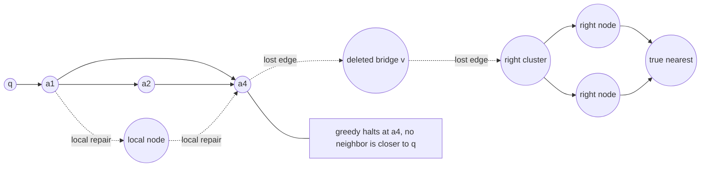
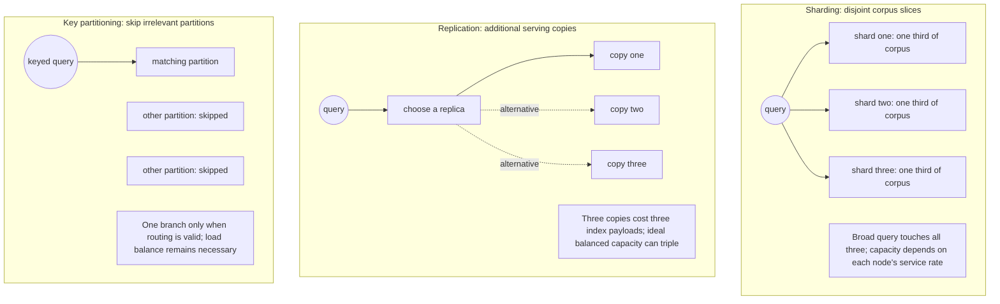
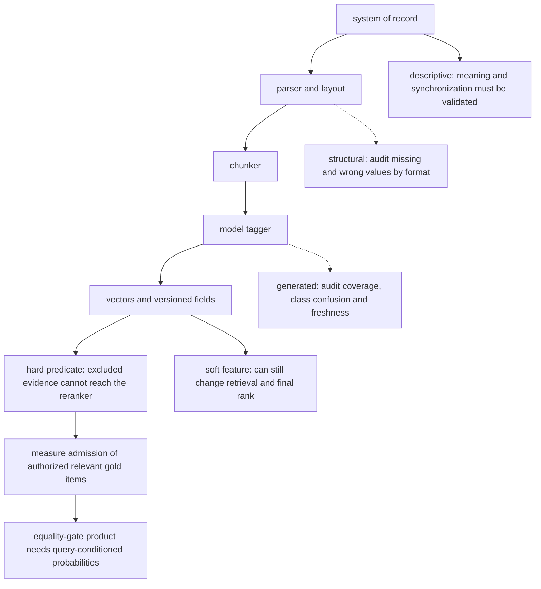
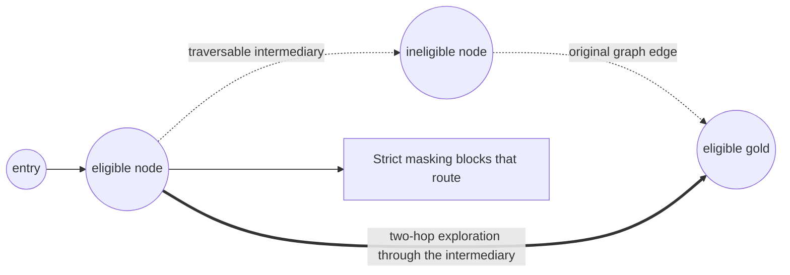
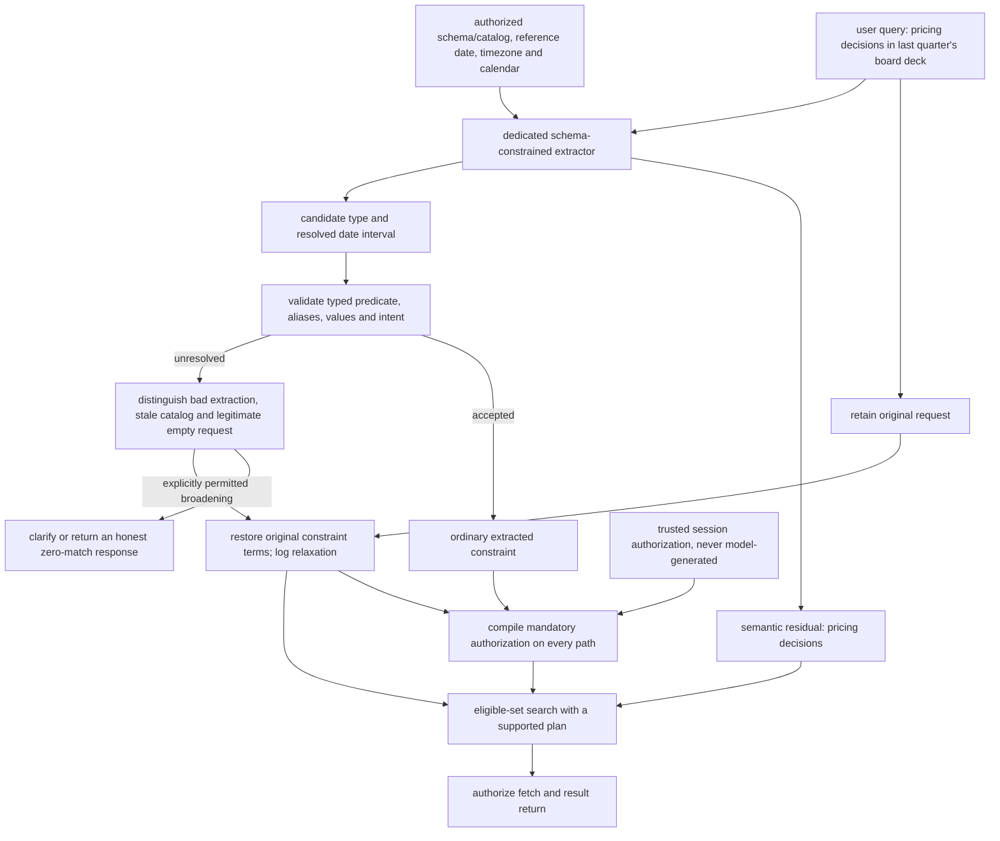

# Chapter 17: Operating a Vector Store
[00-START-HERE](../00-START-HERE.md) · [01-READING-ROUTES](../01-READING-ROUTES.md) · [16\_compression\_and\_index\_economics](16_compression_and_index_economics.md) · [18\_classical\_ir\_you\_are\_expected\_to\_know](../part-06-retrieval-ranking/18_classical_ir_you_are_expected_to_know.md)
This chapter prepares you to operate the retrieval layer of a Retrieval-Augmented Generation (RAG) system under deletion, growth, metadata, filtering, and natural-language constraints.
## TL;DR
- HNSW supports online insertion. Deletion must preserve result exclusion and a usable search structure; tombstones plus a later rebuild are a common design, not the only possible implementation.
- Optimize rebuild cadence against comparable work costs, measured latency, and the applicable completion obligation. Include build, validation, propagation and concurrent-update catch-up time; inspect deleted nodes encountered during search, not only the already-clean result list.
- Sharding addresses per-node capacity, replication supplies additional serving copies, and key partitioning can reduce fan-out. Throughput and availability gains depend on load balance, routing and failure policy.
- Choose the database around durability, filtering, topology, writes, tenancy and operations. ANN is a small term in the worked latency scenario, not in every production workload.
- Hard filtering can exclude relevant evidence irrecoverably within that retrieval path. A product of metadata coverage and accuracy is a bound only under the stated query-conditioned equality-gate assumptions, not from global metadata averages alone.
- Choose filtering from matching-set size, actual ranked-candidate survival, concurrency and measured costs. The exact-scan and post-filter thresholds below belong to explicit models, not universal selectivity regimes.
- Validate model-extracted constraints without silently changing the user's intent. A fallback must restore relevant query terms, retain authorization, and be evaluated independently. Trusted tenant and ACL enforcement remains outside model control.
## The story
Imagine a vast public library whose books are arranged by a walking map rather than by shelf number.
The walking map is the vector index. Nearby books discuss similar ideas, and the librarian follows links from one shelf to the next to reach a useful answer. Adding a new book is manageable. The librarian walks the existing map, finds nearby shelves, and draws new links. Removing a book is harder because that book may be the bridge between two wings.
The library can put a red sticker on a withdrawn book. That tombstone prevents the book from being handed to a reader while its search representation may still guide the librarian's route. The sticker does not erase the book or its copies. The library can build a clean map beside the old one, but must budget temporary capacity, validate it, and replay intervening changes before switching.
When the collection outgrows one building, the director separates three decisions. Sharding distributes books; a broad question may still visit every building. Replication creates extra serving copies, with additional storage and synchronization. Partitioning uses a key such as tenant or region to skip buildings, provided the key is correct and the resulting traffic is balanced.
Choosing the library building is not a race for the fastest hallway. The director must ask whether records survive a crash, whether catalog rules run before retrieval, whether the building is in the right region, and who answers the alarm at night. The hallway walk can be less than one millisecond, while a remote building or a reranking desk consumes tens or hundreds of milliseconds.
The catalog has three kinds of labels. The registrar supplies system-of-record fields such as owner and permission. The document processor recovers structural fields such as heading and page. A model generates labels such as document type or summary. None is automatically complete or correct. A soft label can push the right book out of the final result list; a hard rule can exclude it before ranking even begins.
Filtering is the gate at the reading room. A tiny admitted set can make a complete exact scan attractive. A broad predicate may leave enough results after global retrieval, but only if enough highly ranked items actually pass. Between those cases, filter-aware traversal can help avoid paths broken by masking. A preference such as recency should not silently become a validity rule; permissions remain mandatory.
A reader may ask for last quarter's board deck without filling out a catalog form. An intake clerk can split the request into topic words and a proposed date-and-type predicate using the real schema, authorized value catalog, reference date, timezone and calendar convention. An absent value may mean a bad alias, a stale catalog, or a legitimate empty answer—not necessarily an extraction error. The clerk clarifies or makes an explicit, logged broadening fallback when appropriate. The library enforces permission independently on every path.
## Decoder table


| Technical term | Plain-English meaning | Why it matters |
| --- | --- | --- |
| Vector | A numeric representation of a chunk | The index searches these numbers rather than raw prose |
| Embedding | The process or model that maps content into a vector | Similar content should land near similar content |
| Vector store | A system that keeps vectors, metadata, and a search index | It surrounds ANN search with persistence, filtering, updates, and operations |
| Approximate nearest-neighbor (ANN) search | A fast search that may miss the exact nearest item | It trades some recall for lower latency and less work |
| Exact scan | Exhaustive scoring of all admitted vectors under a specified metric and precision | It can recover exact neighbors inside that set, not a semantically excluded answer; overhead still needs benchmarking |
| $`\mathop{\mathrm{Recall}}\nolimits@k`$ | $`\lvert G_q\cap A_k(q)\rvert/\lvert G_q\rvert`$ for a nonempty gold set | Query hit rate is instead $`\mathop{\mathrm{Hit}}\nolimits@k=\mathbf1[G_q\cap A_k(q)\ne\varnothing]`$; they coincide for one gold item |
| Precision | The useful share among returned or admitted items | A bad proxy can admit stale or irrelevant material |
| Ground truth | An exact or labeled answer set used for evaluation | It reveals misses that approximate search and filters can hide |
| $`N`$ | Fixed live-vector count in the replacement model; the indexed population is stated separately | Resident nodes grow to $`N(1+ct)`$ only under the no-recycling, constant-live-population assumptions |
| $`d`$ | Embedding dimension | It sets vector bytes and exact-scan work |
| Hierarchical Navigable Small World (HNSW) | A layered proximity graph used for ANN search | Its graph structure explains insertion, deletion, filtering, and sharding behavior |
| Inverted file product quantization (IVF-PQ) | A partitioned and compressed vector index | Its deletion and drift behavior differs from HNSW |
| Product quantization (PQ) codebook | Learned prototypes used to compress vector blocks | Distribution drift can make old codebooks stale |
| Coarse quantizer | The IVF model that assigns vectors to coarse cells | Cell imbalance and drift raise the probes needed for recall |
| $`\mathrm{nprobe}`$ | The number of IVF cells searched per query | Drift can force this value upward |
| $`M`$ | HNSW’s configured neighbor count on upper layers | It controls graph memory and connectivity |
| $`M_0`$ | Allocated base-layer neighbor-slot limit, set to $`2M`$ here | Outgoing slot limits do not cap incoming degree or search distance evaluations |
| $`\mathrm{efConstruction}`$ | Retained candidate-width parameter used during graph construction | It is not an expansion count, work identity or distance-evaluation cap |
| $`\mathrm{efSearch}`$ | Retained candidate-width parameter used during graph search | Its relationship to recall, visited nodes and latency is implementation- and workload-dependent |
| $`\mathrm{ef}_0`$ | Clean candidate-pool width in the illustrative aging model | The width-compensation model preserves an expected live count, not certified recall |
| Select-neighbors heuristic | A graph-link selection rule favoring diverse directions | It can retain useful bridges, but is not a guarantee of reachability after arbitrary local updates |
| Out-edge | A link recorded on the node where the link starts | HNSW stores these directly |
| In-neighbor | A node with an outgoing reference to another node | A reverse map can find these efficiently; scanning outgoing edges is an alternative and indegree is not capped by $`M_0`$ |
| Reverse-edge index | An added map of incoming references | The toy extra $`32`$ four-byte identifiers add $`128\,\mathrm{B/vector}`$; a complete map also needs actual degrees and overhead |
| Bridge edge | A link that connects otherwise distant graph regions | Deleting its endpoint can make a whole region unreachable |
| Tombstone | A marker excluding an identifier from results while navigation state may remain | Logical serving exclusion is not physical removal of vectors, payloads or copies |
| Deleted-identifier bitmap | One bit per identifier marking logical deletion | It makes result suppression cheap in bytes |
| Beam | A retained candidate set in graph search | Live-result heaps and traversed nodes differ; deleted-node behavior depends on the implementation |
| Effective beam | Expected live count in the stipulated pre-exclusion candidate pool | $`\mathrm{ef}(1-\phi_q)`$ assumes representative deletion within that pool |
| Churn rate $`c`$ | The fraction of the live corpus replaced per day | It controls index growth and rebuild frequency |
| Tombstone fraction $`\phi`$ | Deleted share of resident nodes; $`\phi_q`$ measures local search exposure | Global fraction need not describe a query's visited neighborhood |
| Query rate $`\lambda`$ | Queries served per day | Higher traffic makes stale-index query work more expensive |
| Clean query cost $`Q_0`$ | Stipulated clean work proxy, $`64\times32=2{,}048`$ distance evaluations | It is not the work automatically implied by $`\mathrm{efSearch}=64`$ |
| Rebuild cost $`B`$ | Fixed rebuild work in the cycle model, expressed in the same currency as query work | Real builds need cost conversion, scratch space, drift and lead-time accounting |
| Cost-optimal period $`T^{*}`$ | The rebuild interval that minimizes build plus query work | It is only one of three cadence limits |
| $`T`$ | Days since rebuild or the selected rebuild period | It drives tombstone accumulation and beam inflation |
| $`g(T)`$ | Daily rebuild plus stale-query cost | Its minimum gives the economic rebuild period |
| $`g'(T)`$ | Derivative of the daily cost with respect to rebuild period | Setting it to zero yields the economic optimum $`T^{*}`$ |
| $`T_{\mathrm{SLO}}`$ and $`T_{\mathrm{legal}}`$ | Measured latency and applicable completion ceilings in an idealized model | A trigger must leave build/validation/propagation time; a calendar month is not a fixed $`30`$ days |
| Service-level objective (SLO) | A latency or reliability target the service promises | Beam growth can force a rebuild before the cost optimum |
| Erasure deadline | The applicable completion obligation for the data and systems in scope | The source's legal response window is not a universal, exception-free physical-erasure deadline |
| Blue-green rebuild | Build and validate a new generation, synchronize changes, then switch | Two expected-slot copies need approximately $`64.085333\,\mathrm{GB}`$ here before scratch and payloads, not zero query impact |
| Slot recycling | Reusing a tombstoned graph slot for a new vector | It controls growth but can inherit links chosen for a different point |
| Streaming merge | Folding updates into new immutable index segments over time | It avoids a single monolithic rebuild but adds update machinery |
| Shard | One disjoint slice of the corpus | It reduces memory per node but requires scatter-gather for broad queries |
| $`S_{\mathrm{sh}}`$ and $`S_{\mathrm{surv}}`$ | Shard count $`S_{\mathrm{sh}}`$ versus post-filter survivor count $`S_{\mathrm{surv}}`$ | Separate subscripts prevent machine counts from being mistaken for result counts |
| $`R_{\mathrm{rep}}`$ and $`R`$ | Replica count $`R_{\mathrm{rep}}`$ versus retrieval score $`R`$ | Replication factor and recall have different units and meanings |
| $`P_{\mathrm{part}}`$, $`P(x)`$ and $`N_{\mathrm{ext}}`$ | Partition count $`P_{\mathrm{part}}`$, predicate $`P(x)`$ and extractor parameter count $`N_{\mathrm{ext}}`$ | Use context-specific notation rather than one overloaded letter |
| $`f_k`$ and $`f`$ | Keyed-query fraction $`f_k`$ versus extracted Boolean predicate $`f`$ | One prices routing; the other selects a corpus subset |
| Partition key | The attribute used to route a query | Partitioning only wins when the query reliably carries it |
| Scatter-gather | Send a broad query to shards and merge local candidates | Exact local top-$`k`$ sets can recover exact global top-$`k`$ under the stated metric, tie and snapshot conditions |
| Fan-out | Number of branches touched by one request | A request waits for the maximum branch latency plus network/merge work; correlation matters |
| Top-$`k`$ | The $`k`$ highest-scoring results requested | Shards each return local candidates that must be merged globally |
| Tail latency | Delay in the slowest portion of the request distribution | Fan-out turns rare slow machines into common slow queries |
| $`p_{95}`$ and $`p_{99}`$ | The 95th and 99th percentile latencies | They expose delay that a mean hides |
| Hash sharding | Assign identifiers to shards with a suitable hash | Expected identifier balance is not a guarantee of balanced bytes, hot-key traffic or compute |
| Attribute partitioning | Placing items together by tenant, region, type, or date | It routes keyed queries without broadcast |
| Skew | Uneven data or query load across partitions | A large tenant can make pure attribute partitioning fail |
| Hybrid partitioning | Routing small tenants directly while sub-sharding large tenants | It preserves routing gains while containing whales |
| Tenant | One customer or isolation domain in a shared system | Tenant size and permissions shape routing and filtering |
| Pareto frontier | Configurations not dominated on the chosen objectives | Architectural class labels and qualitative ratings do not establish a measured frontier |
| $`n`$ | Refractive index of silica in the network example | It converts light speed into a physical round-trip floor |
| $`c_0`$ | Vacuum light speed $`c_0`$ in the propagation example | The subscript distinguishes it from daily churn $`c`$ and metadata coverage |
| $`t_{\mathrm{RTT}}`$ | Round-trip propagation or measured round-trip delay, as specified | A $`75\,\mathrm{ms}`$ hop consumes part of a $`200\,\mathrm{ms}`$ target; it does not exceed that target alone |
| Durability | The ability to preserve data across crashes | It often adds write logging and synchronization cost |
| Write-ahead log | A durable record written before applying an update | It supports recovery but fights minimum in-memory latency |
| fsync | An operating-system call that forces buffered writes to durable storage | It improves durability and adds write latency |
| Single instruction, multiple data (SIMD) | Hardware execution of one operation across many values | Different implementations gain constant-factor speed from layout and vectorization |
| Structured Query Language (SQL) extension | Vector search added to a relational database | It gains joins and familiar operations but shares resources with transactions |
| Online transaction processing (OLTP) | The application’s regular transactional database workload | A large vector index can compete with its buffer pool |
| B-tree | An ordered database index for scalar fields | A query planner can combine it with vector search for metadata predicates |
| Virtual private cloud (VPC) | An isolated cloud network boundary | Same-VPC placement can make the store hop small |
| Graphics processing unit (GPU) | A throughput-oriented accelerator | Large batches help throughput but can fight per-query tail latency |
| Field-programmable gate array (FPGA) | Reconfigurable search acceleration hardware | It is one database-selection axis named by the source |
| Reranker | A model that rescores retrieved candidates | It often costs far more latency than ANN search |
| Cross-encoder | A reranker that jointly reads a query and passage | It improves ranking at substantial compute cost |
| Floating-point operation (FLOP) | One arithmetic operation used to price model compute | It makes reranker and prefill costs comparable |
| $`32`$-bit floating point (fp32) | Four-byte storage for each vector coordinate | It sets vector memory and scan bandwidth |
| Brain floating point 16 (bf16) | A two-byte model-weight format | It sets the extractor’s weight-read floor |
| Byte units | Decimal $`\mathrm{kB}`$, $`\mathrm{MB}`$, $`\mathrm{GB}`$ and $`\mathrm{TB}`$; binary $`\mathrm{KiB}`$ when explicit | Vendor labels such as KB need version-specific interpretation |
| Time units | Millisecond ($`\mathrm{ms}`$) and microsecond ($`\mu\mathrm{s}`$) | They make network, model, and search latency directly comparable |
| Random-access memory (RAM) | Main memory used for the resident index | Index size divided by usable RAM sets minimum shard count |
| High Bandwidth Memory (HBM) | Accelerator memory with very high transfer bandwidth | Autoregressive decoding repeatedly reads model weights from it |
| Matryoshka representation learning | An embedding design that retains usefulness after dimension truncation | It can reduce vector memory without training a separate full pipeline |
| Metadata | Fields stored beside a vector | Predicates can remove candidates before similarity scoring |
| Descriptive metadata | Fields supplied by a system of record | Their defined semantics can be authoritative while synchronization, freshness or coverage still fails |
| Structural metadata | Fields recovered by a parser or layout model | Both missing and erroneous values need auditing by format and query cohort |
| Generated metadata | Fields synthesized by a model at ingestion | Coverage need not be $`1`$; hard-label errors and soft-ranking changes can both reduce retrieval recall |
| System of record | The authoritative source for a field | Hard security and ownership predicates need this provenance |
| Multipurpose Internet Mail Extensions (MIME) type | A standard content-type label | It is an example of descriptive metadata |
| Access-control list (ACL) | The authoritative list of who may access an item | It must never be generated by the query model |
| Coverage $`c`$ | Global fraction with a populated field; $`c_g`$ is the corresponding query-gold probability | A global average alone is not a query-level recall bound |
| Accuracy $`a`$ | Correct fraction among populated values; $`a_g`$ conditions on present query-gold fields | Class confusion, relevance weighting and gate semantics determine the recall effect |
| Hard predicate | A Boolean rule that excludes nonmatching chunks | Anything excluded cannot be recovered downstream |
| Soft signal | A feature used for embedding or ranking rather than direct exclusion | It avoids a particular hard gate but can still push a gold item out of the top-$`k`$ |
| Null-tolerant predicate | Also admit items whose field is missing | It removes one missing-value exclusion under stated assumptions, not every retrieval failure |
| Cardinality | The count of distinct values or matching rows for a field | It guides planners, value catalogs, and selectivity estimates |
| Prompt hash | A compact identifier for an exact generation prompt | It supports targeted metadata backfills after prompt changes |
| Optical character recognition (OCR) | Text recovery from scanned page images | OCR without layout can lose headings and structural fields |
| Selectivity $`s`$ | Corpus fraction admitted by a predicate | Its pass rate among ranked ANN candidates may differ and may be correlated across candidates |
| Pre-filtering | Resolving the predicate before vector scoring | It can enforce access and make tiny candidate sets cheap |
| Inverted index | A map from metadata values or terms to matching identifiers | It resolves a predicate before vector scoring |
| Post-filtering | Retrieve globally, then discard predicate failures | It may produce short lists unless ranked survival and over-fetch are sufficient |
| Binomial distribution | $`S_{\mathrm{surv}}\sim\mathop{\mathrm{Binomial}}\nolimits(K,s)`$ for IID candidate passes of known probability $`s`$ | Exact tail calculations apply to this model, not automatically to ANN rankings |
| $`\mathbb E[S_{\mathrm{surv}}]`$, $`\mathop{\mathrm{Var}}\nolimits(S_{\mathrm{surv}})`$ and $`\Pr(S_{\mathrm{surv}}\ge k)`$ | $`Ks`$, $`Ks(1-s)`$ and the exact binomial survivor tail for $`S_{\mathrm{surv}}`$ | Uniform sampling without replacement instead gives a hypergeometric model |
| Normal approximation | A rough bell-curve approximation to a count tail | The source's $`\mu-2.33\sqrt{\mu}\ge10`$ is not an exact $`99\%`$ reliability bound |
| Over-fetch $`K`$ | Number of global candidates before filtering | For small $`s`$, the Poisson approximation is $`K\approx18.783117/s`$ for top-$`10`$ at probability $`0.99`$; use the exact model tail for integer requirements |
| Filter-aware ANN | A traversal or structure designed to improve search under predicates | It needs tested recall and latency for the actual predicate combinations |
| Induced subgraph | The graph left after masking all nonmatching nodes | It can be disconnected even when the original graph was navigable |
| Multi-hop expansion | Explore paths through otherwise masked intermediate nodes | It may improve filtered reachability at extra work; arbitrary-predicate connectivity is not automatic |
| Label-aware edge | A graph link added to preserve paths within a filter category | It moves filtered-connectivity work into index construction |
| Over-filtering | Applying a valid hard rule that is wrong for the user’s intent | Metrics over the already-filtered set cannot detect it |
| $`\mu=Ks`$ | Expected survivor count $`\mu=Ks`$ under the IID model | The Poisson and rough normal approximations use this mean; neither automatically describes ANN rankings |
| Self-querying | Model-based conversion of one utterance into semantic text and a predicate | It lets natural language express filters without a form |
| $`q`$ and $`q_s`$ | The original user request and its semantic residual | Retain the original terms so a permitted predicate fallback can restore the intended retrieval query |
| $`q_k`$ | A query that carries a partition key | It can route to one partition instead of broadcasting |
| $`C`$ and $`C_f`$ | Full corpus and the subset admitted by predicate $`f`$ | Retrieval searches $`C_f`$ after extraction and validation |
| Semantic channel | The residual words sent to the embedding model | It carries topical meaning |
| Predicate channel | The Boolean constraints extracted from the utterance | It carries order, membership, and conjunction |
| Field schema | The allowed metadata names and types | It constrains what the extractor may emit |
| Value catalog | Allowed or observed values with tenant scope, aliases and a version | An absent value can mean an error, a stale catalog or a legitimate zero-match request |
| Finite-state grammar | Restricts output token transitions to a structured language | A completed valid output can be syntactically correct while semantically wrong; failures still require handling |
| Text-to-SQL semantic parsing | Converting natural language into a structured database query | It frames self-querying as a smaller known-hard extraction task |
| Constrained decoding | Decode within a specified grammar or schema | Syntax constraints do not certify intent, authorization or referential correctness |
| Referential validity | Whether a predicate names values that actually exist | Syntax alone does not provide it |
| Detectable extraction error $`e_d`$ | Probability of an actual extraction error caught by validation | The fallback has its own conditional recall; dropping a predicate alone need not recover the baseline |
| Undetectable extraction error $`e_u`$ | Probability of an error that passes implemented validation | Real but wrong values require labeled intent tests; monitoring alone is not a recall guarantee |
| $`p`$ | Probability of correct extraction on the target workload | The $`p>R_0/R_f`$ break-even holds only in the zero-recall-wrong-branch toy model |
| $`R_f`$ and $`R_0`$ | Correct-branch retrieval score and ordinary authorized baseline in the toy example | Baseline performance on the validation-triggering subset may differ from its global average |
| $`\mathbb{E}[R]`$ | Outcome-weighted expected retrieval score | Use actual conditional branch scores; $`pR_f+e_dR_0`$ needs restored-query and zero-undetected-recall assumptions |
| $`f_{\mathrm{session}}`$ and $`f_{\mathrm{extracted}}`$ | System authorization and model-extracted predicates | Their conjunction lets the model narrow access but never widen it |
| Fail open | An explicitly permitted broadening fallback for non-security constraints | Preserve intent or clarify, restore original terms, log the relaxation and keep authorization unchanged |
| Fail closed | Return nothing and raise when authorization cannot be enforced | Permission failure must not widen access |
| Session filter | Trusted tenant and ACL predicate, compiled independently of model output | Enforce its conjunction on every path; a string append is not an access-control proof |
| Reference date | System-supplied date with timezone and calendar convention | Resolve relative intervals explicitly and version cache keys at period boundaries |
| Query planner | Logic that chooses an execution path from data statistics and predicates | It switches among exact scan, filtered ANN, and post-filtering |


## Core mechanics
### Mathematical conventions
Storage is decimal unless a binary unit is named: $`1\,\mathrm{kB}=10^3\,\mathrm B`$, $`1\,\mathrm{MB}=10^6\,\mathrm B`$, $`1\,\mathrm{GB}=10^9\,\mathrm B`$, $`1\,\mathrm{TB}=10^{12}\,\mathrm B`$, and $`1\,\mathrm{KiB}=2^{10}\,\mathrm B`$. A configuration label written as KB needs its implementation-specific unit checked. Retain full precision until reporting; round required integer resources upward, but round a capacity limit downward.
In the lifecycle model, $`N`$ is the fixed live population, $`c`$ is its replacement fraction per day, $`T`$ is in days, and $`\lambda`$ is queries per day. Resident population can exceed $`N`$. $`\mathrm{efConstruction}`$ and $`\mathrm{efSearch}`$ control retained candidate widths; neither equals a guaranteed expansion count or a distance-evaluation cap. Products of beam width and degree below are explicitly stipulated work proxies, not HNSW complexity identities. Build and query work must be converted to a common cost currency before comparing them economically.
For HNSW memory, use the chapter-16 allocation model: four-byte neighbor identifiers, $`2M`$ base-layer slots, $`M`$ upper-layer slots, and $`\Pr(\ell\ge j)=M^{-j}`$ for $`j\ge1`$. Expected allocated link bytes are $`\mathbb E[b_{\mathrm{link}}]=4(2M+M/(M-1))\,\mathrm B`$. At $`M=16`$ this is approximately $`132.266667\,\mathrm{B/vector}`$. These are expected slot budgets, not populated degree counts or complete resident-memory measurements; identifiers, level records, allocators, payloads, caches and build scratch space are additional.
$`S_{\mathrm{sh}}`$ counts shards, $`R_{\mathrm{rep}}`$ counts replicas per shard, $`P_{\mathrm{part}}`$ counts key partitions, and $`S_{\mathrm{surv}}`$ counts post-filter survivors. $`R`$ denotes a retrieval score, not a replication factor. For gold set $`G_q`$ and returned set $`A_k(q)`$, $`\mathop{\mathrm{Recall}}\nolimits@k(q)=|G_q\cap A_k(q)|/|G_q|`$ when $`|G_q|>0`$, whereas $`\mathop{\mathrm{Hit}}\nolimits@k(q)=\mathbf1[G_q\cap A_k(q)\ne\varnothing]`$. They coincide for one gold item. Metadata bounds and extraction examples state which population and metric they use.
A multiply-accumulate (MAC) counts as two nominal FLOPs here. Bandwidth and FLOP calculations omit filtering, gathers, heaps, memory hierarchy, network, contention and queueing unless stated. Component estimates do not add up to an end-to-end $`p_{99}`$ guarantee. Empirical source results remain reported inputs, not results proved by the arithmetic.
### 17.1 Static index, dynamic corpus: tombstones and re-indexing
#### Static assumptions and online insertion
- What changes: skip-list occupancy and HNSW height have distributional models, with characteristic height on the order of $`\log_M N`$ under the usual level law. They do not require an immutable corpus. HNSW supports insertion; IVF cells and PQ codebooks instead need their training distribution and drift monitored as the corpus changes.
- Online insertion: search using $`\mathrm{efConstruction}`$, select diverse neighbors, and update links. The parameter controls a candidate width, not a fixed number of visited nodes.
- Deletion latency: in the source's example, a request at 10:00 followed only by a midnight rebuild leaves $`14\,\mathrm h`$ without immediate serving exclusion. A read-time deletion check can close that serving gap without claiming physical erasure.
- Worked proxy: take $`N=10^7`$, $`d=768`$ fp32, $`M=16`$, $`M_0=32`$ and $`\mathrm{efConstruction}=200`$. Stipulate $`200`$ expansion-equivalents at $`32`$ tested neighbors each, so one insert is budgeted as $`6{,}400`$ distance evaluations. This is a planning proxy, not a bound implied by $`\mathrm{efConstruction}`$.
- With $`c=0.02\,\mathrm{day^{-1}}`$, replacing $`2\times10^5`$ live vectors daily gives $`1.28\times10^9`$ insert-proxy evaluations per day. Charging the same proxy to all $`N`$ insertions gives rebuild work $`B=6.4\times10^{10}`$ evaluations, so daily insert work is $`2\%`$ of that proxy rebuild. Upper layers, edge pruning, writes and scheduling are omitted.
#### Structural deletion: costs and connectivity risks
- Structural deletion removes a node and updates the references needed for a usable remaining graph. Logical exclusion, physical byte removal, and preservation of search quality are separate requirements.
- HNSW normally records outgoing adjacency. A reverse-edge index can locate incoming references quickly; without it they can be found by scanning outgoing edges, at potentially $`O(|E|)`$ work. Reverse storage is an efficiency choice, not a logical prerequisite for deletion.
- A toy budget of $`32`$ incoming base-layer identifiers at $`4\,\mathrm B`$ each adds $`128\,\mathrm{B/vector}`$, or $`1.28\,\mathrm{GB}`$ at $`N=10^7`$. Adding this to the expected forward-slot budget gives approximately $`260.266667\,\mathrm{B/vector}`$ rather than $`132.266667\,\mathrm{B/vector}`$. Incoming degree is not capped by the outgoing-slot limit; complete reverse maps need actual edge counts, upper layers and map overhead.
- For a repair scenario with $`32`$ affected in-neighbors and one $`6{,}400`$-evaluation proxy search per repair, work is $`32\times6{,}400=204{,}800`$ evaluations per deletion.
- At $`2\times10^5`$ deletions per day, that scenario costs $`4.096\times10^{10}`$ evaluations, exactly $`64\%`$ of the stipulated rebuild work. It is not a universal complexity law for supported deletion algorithms.
- Connectivity risk: diverse links can bridge regions. A local repair that misses the necessary replacement can disconnect useful routes or reduce ANN recall without an exception. This motivates verification of the chosen update algorithm; it does not prove that every in-place deletion must fail.
#### Tombstones and beam inflation
- A dense deleted-identifier bitmap suppresses marked identifiers while a tombstoned vector and its graph links may remain for navigation. Every serving path, replica and relevant cache must enforce the deletion state.
- At $`10^7`$ identifiers, the bitmap payload is $`10^7/8=1.25\times10^6\,\mathrm B=1.25\,\mathrm{MB}`$, approximately $`0.003901\%`$ of the $`32.042667\,\mathrm{GB}`$ scoped clean index. Bitmap size grows with retained identifiers unless slots are recycled.
- Candidate model: if a pre-exclusion candidate pool of width $`\mathrm{ef}`$ samples deleted nodes representatively with share $`\phi_q`$, its expected live count is $`\mathrm{ef}(1-\phi_q)`$. Search implementations that retain only live results can still traverse deleted nodes; their behavior is not described by simply subtracting dead slots from the final heap.
- Under that candidate-pool model, a planning width is $`\lceil\mathrm{ef}_0/(1-\phi_q)\rceil`$. Preserving an expectation does not guarantee recall, and $`\mathrm{efSearch}`$ is not a work cap.
- Churn model: hold the live population $`N`$ fixed, replace $`Nc`$ vectors per day, append replacements, retain deleted nodes, and do not recycle slots. Then after $`t`$ days,

```math
\begin{aligned}
N_{\mathrm{resident}}(t)&=N(1+ct),\\
\phi(t)&=\frac{ct}{1+ct},&
\frac{1}{1-\phi(t)}&=1+ct.
\end{aligned}
```

- With representative deletion, the continuous width proxy is $`\mathrm{ef}_0(1+ct)`$. Stipulate clean work $`Q_0=64\times32=2{,}048`$ distance evaluations and the linear aging proxy $`Q(t)=Q_0(1+ct)`$. This is a work scenario, not a measured latency or recall law.
#### Rebuild economics and hard ceilings
- Model: rebuild work $`B`$ is constant, cleanup is instantaneous at cycle boundaries, $`\lambda`$ and $`c`$ are constant, and build/query evaluations have the same cost. Constant clean-query and daily-insertion costs do not change the minimizing period under these assumptions.
- Integrating the excess query work over a cycle gives

```math
\begin{aligned}
W_{\mathrm{cycle}}(T)
&=B+\lambda\int_0^T Q_0ct\,dt
=B+\frac{\lambda Q_0cT^2}{2},\\
g(T)&=\frac{B}{T}+\frac{\lambda Q_0cT}{2},\\
g'(T)&=-\frac{B}{T^2}+\frac{\lambda Q_0c}{2},\\
T^*&=\sqrt{\frac{2B}{\lambda Q_0c}}.
\end{aligned}
```

- For $`B,\lambda,Q_0,c>0`$, $`g''(T)=2B/T^3>0`$, so this is the unique continuous optimum. If $`c=0`$ or $`\lambda=0`$, this stale-query term supplies no finite economic optimum. Different per-evaluation costs require conversion to a common currency first.
- At $`10\,\mathrm{QPS}`$, $`\lambda=864{,}000\,\mathrm{day^{-1}}`$ and $`T^*=\sqrt{3{,}616.898148\ldots}\,\mathrm{days}\approx60.140653\,\mathrm{days}`$. At that optimum $`cT^*\approx1.202813`$ and $`\phi\approx54.6035\%`$.
- At $`1{,}000\,\mathrm{QPS}`$, $`\lambda=86{,}400{,}000\,\mathrm{day^{-1}}`$ and $`T^*\approx6.014065\,\mathrm{days}`$. A hundredfold traffic increase shortens this modeled optimum tenfold.
- Continuous work cap: $`Q(T)/Q_0\le1.2`$ gives $`T\le10\,\mathrm{days}`$ and $`\phi\le1/6\approx16.6667\%`$. The boundary work is $`2{,}457.6`$, not a certified integer operation count or latency percentile.
- Integer-width version: if the rule instead requires $`\mathrm{ef}/64\le1.2`$, then $`\mathrm{ef}\le\lfloor76.8\rfloor=76`$. With $`\mathrm{ef}=\lceil64(1+cT)\rceil`$, the cap becomes $`T\le9.375\,\mathrm{days}`$ and $`\phi\le3/19\approx15.7895\%`$. Rounding to $`77`$ would allow $`20.3125\%`$ width inflation.
- Deployment: an instantaneous-cleanup model can take the minimum of economic, measured-SLO and applicable completion ceilings. Real triggers must leave time for building, validation, propagation and replay of changes since the snapshot. The work cap is not itself a measured $`p_{95}`$ or $`p_{99}`$ ceiling.
- Legal scope: the source cites GDPR Article 17 and Article 12(3). One calendar month is a response-window provision, not a fixed $`30`$-day, exception-free physical-erasure clock. The example's $`30`$ days are a stipulated policy window; determine the applicable obligation separately.
- Illustrative binding choices: before other constraints and build lead time, low traffic is limited to $`10`$ days by the continuous work model, or $`9.375`$ days by the strict integer-width version. High traffic is limited to approximately $`6.014065`$ days by modeled cost. Tombstones alone do not erase vectors, text, replicas or backups.
#### Operational checks and exceptions
- Rebuild read proxy: $`6.4\times10^{10}`$ evaluations charged one $`3{,}072\,\mathrm B`$ vector read each imply $`196.608\times10^{12}\,\mathrm B=196.608\,\mathrm{TB}`$. At a sustained $`50\,\mathrm{GB/s}`$ this traffic takes $`3{,}932.16\,\mathrm s\approx1.092267\,\mathrm h`$, or approximately $`0.7585\%`$ of a six-day cycle. Cache reuse can reduce these DRAM reads; random accesses, graph work, writes and contention add costs. This is not a universal build floor or a measured rebuild duration.
- Feasibility: an hourly rebuild schedule cannot complete this particular read proxy serially within one hour. Parallel construction, another index/update design or lower build work may help, but changing $`\mathrm{efConstruction}`$ requires quality validation.
- Correlated deletion: global $`\phi=5\%`$ can coexist with a visited neighborhood at $`90\%`$ deletion. Measure deleted nodes encountered, traversal work, live-candidate yield and recall by query cohort; the final returned list should already contain no tombstones.
- Event triggers can supplement a calendar when churn is bursty. Use measured recall/latency and local deletion exposure, not an assumed global fraction alone.
- Tombstone-and-rebuild is one common HNSW pattern. Slot recycling and streaming-merge designs have different correctness, quality and capacity trade-offs. The source cites FreshDiskANN-style maintenance from Singh et al. (2021); the existence of a supported update path does not make arbitrary link inheritance safe.
- IVF-PQ deletion is implementation-dependent: finding an identifier may scan a posting list, while a maintained direct map and swap-delete can support constant-time entry removal. Batch compaction can cost more. Watch coarse-cell imbalance and codebook drift; a few-times-mean cell rule is a heuristic to validate.
- Blue-green capacity: the expected-slot budget is approximately $`32.042667\,\mathrm{GB}`$ for the live index and $`64.085333\,\mathrm{GB}`$ for two copies, before scratch space and payloads. Two copies do not fit in $`64`$ decimal GB. A separate builder, additional shards or rolling segments need explicit extra capacity.
- Cutover: replay inserts and deletions since the build snapshot, enforce tombstones on both generations, validate quality and authorization, then switch with a supported atomic mechanism. A pointer swap does not eliminate cache warmup or contention.
- Search dial: $`\lceil\mathrm{ef}_0(1+ct)\rceil`$ is a candidate-width heuristic under the stated churn model. Benchmark the actual search implementation and rebuild before the measured SLO or completion deadline is violated.
- Tight-deadline scenario: scaling the same read proxy from $`10`$ million to $`500`$ million vectors gives $`54.613333\,\mathrm h`$, not $`50\,\mathrm h`$ from rounding the smaller run to one hour. A stipulated $`24`$-hour physical-removal obligation needs a different supported workflow if this rebuild cannot meet it.
- Removing payload bytes and failing closed on lookup can prevent their return, but deleting a vector while leaving a graph node is not automatically navigation-safe: search may need that representation for distances. Reconnect, bypass, replace or rebuild using an algorithm that preserves the required invariant, and handle replicas, caches, logs and backups under the applicable policy.
- Source software examples: Lucene merge thresholds and hnswlib/FAISS deletion APIs are version- and configuration-specific. Numerical proximity between a reported $`20\%`$ merge default and the toy $`16.6667\%`$ tombstone cap does not validate the model or an SLO. Verify current behavior before deploying.
### 17.2 Sharding, replication, partitioning
#### Three distinct scaling axes
- Sharding distributes $`N`$ vectors over $`S_{\mathrm{sh}}`$ disjoint shards. Balanced data gives approximately $`N/S_{\mathrm{sh}}`$ vectors per shard; broad queries scatter to all of them.
- This addresses per-node memory and can parallelize work. If each shard's service capacity stays fixed and every query visits every shard, adding shards does not multiply user QPS. Smaller graphs, cache behavior and parallel execution can change the service point, so flat throughput is an assumption, not a scaling theorem.
- The characteristic-depth ratio at $`N=10^8`$ and $`S_{\mathrm{sh}}=8`$ is $`\log_2(10^8/8)/\log_2(10^8)\approx0.887114`$. That is approximately an $`11.2886\%`$ height reduction, not an $`11.2886\%`$ guarantee for query time.
- For independent, identically distributed branch latencies with CDF $`F`$, $`\Pr(L_{\max}\le t)=F(t)^{S_{\mathrm{sh}}}`$. If each branch exceeds a chosen threshold with probability $`0.01`$, the fan-out event probability is $`1-0.99^{S_{\mathrm{sh}}}`$, approximately $`63.3968\%`$ at $`S_{\mathrm{sh}}=100`$. Correlated branch delays change this result; a union bound remains available without independence.
- Replication creates $`R_{\mathrm{rep}}`$ serving copies per shard. Balanced routing to unchanged replicas can multiply capacity by $`R_{\mathrm{rep}}`$ and multiplies index storage by that factor. Synchronization, failure domains and service policy determine actual availability.
- Replication does not fix an oversized shard or make an individual search intrinsically faster. Hedging can reduce some tails while consuming extra capacity.
- Key partitioning routes a query to the matching corpus partition and can avoid $`P_{\mathrm{part}}-1`$ branches. Its benefit depends on correct keys, data balance and query balance. Missing keys may require broadcast; an incorrect routing key can exclude relevant authorized data.
#### Hashing, attributes, and hybrids
- A suitable hash gives expected identifier-count balance under its randomness assumptions. It is not skew-free: unequal item weights, hot keys, popular documents and uneven query distributions can still overload nodes.
- Hashing identifiers generally discards tenant locality. If each tenant spans all three shards, even a workload with $`90\%`$ tenant-keyed queries still needs fan-out $`3`$ unless another routing or filtering structure prunes shards.
- Attribute partitioning can reduce partitions touched, but can worsen data or traffic imbalance. Neither scheme universally minimizes load variance or query cost.
- In the source's staff scenario, one tenant owns $`40\%`$ of data and generates $`60\%`$ of queries. A hybrid can route small tenants directly and sub-shard the large tenant with separately provisioned serving copies.
- Budget the two routing paths, migrations, write synchronization and rebalancing when a small tenant becomes large. Measure weighted work and tail latency, not only vector counts.
#### Worked capacity example
- Corpus: $`N=10^8`$, $`d=768`$ fp32, HNSW $`M=16`$ and $`128\,\mathrm{GB}`$ usable RAM per node.
- Vector payload is $`N(768)(4\,\mathrm B)=307.2\,\mathrm{GB}`$. Base-layer slots add $`12.8\,\mathrm{GB}`$; expected upper-layer slots add approximately $`0.426667\,\mathrm{GB}`$.
- The scoped expected index budget is approximately $`320.426667\,\mathrm{GB}`$. Steady-state capacity alone gives $`\lceil320.426667/128\rceil=3`$ shards, before non-index overhead and skew.
- Balanced thirds contain $`33{,}333{,}333`$ or $`33{,}333{,}334`$ vectors, approximately $`106.808889\,\mathrm{GB}`$ per shard. If each node must hold old and new copies together, the corresponding capacity-only lower bound is $`\lceil2(320.426667)/128\rceil=6`$ shards. A separate temporary builder is an alternative with its own capacity bill.
- Service scenario: $`16`$ continuously occupied query slots at an $`8\,\mathrm{ms}`$ mean service time imply $`16/0.008=2{,}000`$ shard-QPS by the service-point model. This is not a measured tail-safe capacity guarantee.
- With $`S_{\mathrm{sh}}=3`$ and $`R_{\mathrm{rep}}=1`$, $`6{,}000`$ aggregate shard-QPS divided by fan-out $`3`$ gives $`2{,}000`$ user QPS if work is balanced. Independent identical branches need CDF probability at least $`0.99^{1/3}\approx0.996655493`$ at their allocated deadline for a $`99\%`$ maximum-branch success rate; allow network and merge time separately.
- With $`S_{\mathrm{sh}}=3`$ and $`R_{\mathrm{rep}}=3`$, nine machines can supply $`6{,}000`$ user QPS under the same assumptions, at approximately $`961.28\,\mathrm{GB}`$ of index copies. Fan-out remains $`3`$.
- Three balanced key partitions, one copy each and fan-out $`1`$, can supply $`6{,}000`$ keyed user QPS using approximately $`320.426667\,\mathrm{GB}`$. Routing skew, cross-partition requests and other overhead can reduce this.
- Let $`f_k`$ be the fraction routed to one partition and let all other requests touch all $`P_{\mathrm{part}}`$ partitions. Then $`\mathbb E[F_{\mathrm{fanout}}]=f_k+(1-f_k)P_{\mathrm{part}}`$. Under balanced per-node work, the aggregate capacity proxy is $`P_{\mathrm{part}}q_{\mathrm{node}}/\mathbb E[F_{\mathrm{fanout}}]`$.
- For $`P_{\mathrm{part}}=3`$ and $`q_{\mathrm{node}}=2{,}000\,\mathrm{QPS}`$, $`f_k=0.9`$ gives fan-out $`1.2`$ and $`5{,}000`$ user QPS; $`f_k=0.5`$ gives fan-out $`2`$ and $`3{,}000`$ QPS. Without balance, the bottleneck bound is $`\lambda_u\le\min_j q_j/\Pr(\text{query touches node }j)`$ for positive touch probabilities, rather than the aggregate ratio alone.
#### Operating rules
- Treat $`\lceil\text{index bytes}/\text{usable node RAM}\rceil`$ as a capacity-only lower bound, not a universal optimal shard count. Add payloads, scratch space, cache, skew, failure and rebuild headroom. Smaller shards can also help recovery, parallelism or hotspots.
- For eight independent identical branches, the CDF probability needed at the branch deadline is $`0.99^{1/8}\approx0.998744497`$, or approximately the $`99.87445`$th percentile. Merely adding component $`p_{99}`$ values or using a rounded-down branch percentile does not establish whole-query $`p_{99}`$.
- Consolidation, key routing or carefully budgeted hedged requests may help tail latency. Each changes capacity and must be tested under load.
- Choose replica count from the failure model, read/write quorum policy, zones, durability and recovery requirements. $`R_{\mathrm{rep}}=2`$ leaves one copy after one failure; $`R_{\mathrm{rep}}=3`$ can leave two while one is rebuilding. Neither number alone proves service availability or write safety.
- Shipping a common built segment simplifies replica agreement. Independently maintained replicas can also be correct with suitable ordered logs, consensus or reconciliation; deletion state must reach every serving path.
- Measure keyed share and per-partition traffic before partitioning. A $`50\%`$ keyed share is a workload heuristic, not a mathematical break-even point.
- Apply mandatory filters correctly within each shard and before an identifier is exposed. Merge candidates with compatible score semantics; differently calibrated compressed scores may require common rescoring.
- Sharding need not lose exact top-$`k`$: with a common metric and tie policy, consistent snapshot, all branches complete and each shard returning its exact local top-$`k`$, their union contains the exact global top-$`k`$. ANN misses, inappropriate local truncation, filters or timeouts can break that guarantee. A smaller graph alone does not prove higher ANN recall.
### 17.3 Choosing a vector database: no winner on all axes
#### Separate index choice from database choice
- Index choice selects an algorithm and representation for a measured recall, work, latency and memory point.
- Database choice adds durability, filters, updates, deletion, tenancy, network placement and operational ownership.
- Some public benchmarks isolate static index behavior; others include more of the system. Inspect the actual benchmark rather than assuming all measure only the index.
- Matching $`M`$ and $`\mathrm{efSearch}`$ is not enough to match recall or work. Build order, randomization, pruning rules, precision, normalization, filters, stopping rules, data distribution and load all matter.
- SIMD, layout and runtime can change performance substantially. A reported $`2`$–$`3`$-fold implementation difference is not a universal upper bound, and algorithm labels alone do not establish dominance.
#### Attribute the entire latency budget
- Target: $`200\,\mathrm{ms}`$ end-to-end retrieval $`p_{99}`$ before generation prefill. The following components are stipulated serial point estimates, not jointly measured percentiles.
- Take embedding $`20\,\mathrm{ms}`$, ANN $`0.42\,\mathrm{ms}`$ at $`10^7`$ vectors, and a top-$`20`$ cross-encoder using $`110`$ million parameters and $`512`$ processed tokens per passage.
- The forward-pass proxy is $`2(1.1\times10^8)(512)(20)=2.2528\times10^{12}\,\mathrm{FLOP}`$. At a stipulated sustained $`20\times10^{12}\,\mathrm{FLOP/s}`$ it gives $`112.64\,\mathrm{ms}`$. Attention effects, actual batching, hardware utilization and serving overhead require measurement.
- With vacuum light speed $`c_0=299{,}792{,}458\,\mathrm{m/s}`$ and refractive index $`n=1.47`$, propagation speed is approximately $`2.039404\times10^8\,\mathrm{m/s}`$. A $`5{,}500\,\mathrm{km}`$ one-way path gives a round-trip propagation time of approximately $`53.9373\,\mathrm{ms}`$; multiplying distance by $`1.4`$ gives approximately $`75.5122\,\mathrm{ms}`$. Actual route, equipment and queueing determine measured RTT.
- Use a separately stipulated $`1\,\mathrm{ms}`$ same-region hop or $`75\,\mathrm{ms}`$ cross-region hop. The unrounded serial proxies are $`20+1+0.42+112.64=134.06\,\mathrm{ms}`$ and $`20+75+0.42+112.64=208.06\,\mathrm{ms}`$. The second proxy exceeds the target, but neither sum establishes a measured $`p_{99}`$.
- ANN is approximately $`0.3133\%`$ of the same-region proxy. Doubling its speed saves $`0.21\,\mathrm{ms}`$, or $`0.105\%`$ of the $`200\,\mathrm{ms}`$ target. Moving from the $`1`$ to the $`75\,\mathrm{ms}`$ hop adds $`74\,\mathrm{ms}`$, or $`37\%`$ of that target; a $`75\,\mathrm{ms}`$ hop alone does not exceed $`200\,\mathrm{ms}`$.
- Tail-budget discipline: choose component bounds $`b_i`$ with $`\Pr(L_i>b_i)\le\epsilon_i`$ and $`\sum_i\epsilon_i\le0.01`$. Then $`\Pr(\sum_iL_i>\sum_i b_i)\le0.01`$ by a union bound, without an independence assumption. Include queueing, retries, network and merge work. Summing several component $`p_{99}`$ values does not supply this guarantee.
#### Trade-offs and Pareto comparisons
- Durability can add logging and synchronization; group commit and storage design change the latency trade-off.
- Horizontal scaling adds distributed routing and coordination. It does not inherently prevent exact global top-$`k`$; the local-exact merge conditions above are sufficient.
- GPU batching can trade throughput against waiting time. Low-latency behavior depends on the implementation and offered load.
- Managed services shift operational ownership, while placement, network and parameter visibility remain product-specific.
- Libraries, embedded stores, SQL extensions, search engines, distributed stores and fully managed services are useful architectural categories, not performance certificates.
- A Pareto-nondominated configuration is one for which no compared configuration is at least as good on every chosen objective and strictly better on one. Class labels and qualitative ratings do not by themselves establish a Pareto frontier.
- A static, unfiltered benchmark is insufficient evidence for dynamic filtered tenancy. Equally, an existing relational database is not automatically the wrong choice: measure memory headroom, transaction interference and the actual query planner.
#### Worked product example
- Workload: $`20`$ million chunks, $`d=768`$, $`5{,}000`$ tenants, $`50\,\mathrm{QPS}`$, a $`200\,\mathrm{ms}`$ retrieval $`p_{99}`$ target and $`2\%`$ daily replacement.
- In-process scenario: removing the network term gives a serial proxy of $`133.06\,\mathrm{ms}`$. Expected HNSW vector-plus-slot bytes at $`M=16`$ are approximately $`3{,}204.266667\,\mathrm{B/vector}`$, or $`64.085333\,\mathrm{GB}`$ total, before payloads and overhead.
- Equal-sized tenants would average $`4{,}000`$ chunks, a corpus share $`s=0.0002=0.02\%`$. This average does not describe a skewed tenant distribution or the pass probability among highly ranked candidates.
- Under an IID candidate-pass model, global top-$`100`$ gives $`\mathbb E[S_{\mathrm{surv}}]=0.02`$ and $`\Pr(S_{\mathrm{surv}}\ge1)=1-(1-0.0002)^{100}\approx1.98033\%`$. The modeled empty rate is approximately $`98.01967\%`$; semantic correlation can change it.
- A different-region service has a $`208.06\,\mathrm{ms}`$ serial proxy with the stipulated $`75\,\mathrm{ms}`$ hop. Index tuning cannot change physical distance, but the actual service must be benchmarked before declaring an SLO miss.
- A same-VPC SQL extension with a stipulated $`0.5\,\mathrm{ms}`$ hop gives $`20+0.5+0.42+112.64=133.56\,\mathrm{ms}`$ using the same ANN estimate. A B-tree-assisted selective path has its own search cost and need not retain the global ANN term. Co-resident payloads and operational familiarity do not remove index memory or OLTP interference.
- Truncating a suitable Matryoshka embedding to $`d=384`$ halves vector bytes, not graph bytes. The scoped expected budget becomes approximately $`1{,}668.266667\,\mathrm{B/vector}`$ and $`33.365333\,\mathrm{GB}`$. Only embeddings trained for this behavior should be treated as candidates for such truncation, and quality still needs evaluation.
- Daily insert proxy: $`400{,}000(6{,}400)=2.56\times10^9`$ evaluations. Daily clean-query proxy: $`50(86{,}400)(2{,}048)=8.84736\times10^9`$ evaluations.
- Their ratio is approximately $`28.9352\%`$. This compares stipulated distance-work units, not measured CPU utilization, write latency or the fraction of total operating cost. Deletes, pruning, persistence and rebuild work are additional.
#### Selection rules
- Keep an existing system when it meets measured workload and operational constraints, not merely because it is familiar.
- With $`d=768`$ fp32 and the expected $`M=16`$ slot budget, $`64`$ decimal GB holds at most $`19{,}973{,}368`$ vectors by this capacity arithmetic alone; same-node old-plus-new copies halve that to $`9{,}986{,}684`$. Actual safe limits are lower after payloads, random level variation, scratch space and headroom. The rough $`20`$-million-vector boundary does not mean $`20`$ million fits.
- Co-locate services when appropriate; data-residency obligations and failure-domain design may constrain placement.
- Check distance function, precision, dimension limits, filter semantics and update/delete behavior before comparing speed.
- Benchmark the actual corpus, tenant skew, filters, concurrency and background writes/rebuilds. A $`10{,}000`$-query exact-ground-truth comparison is a useful sample, not a universal recall or tail-latency certification. Use the authorized relevant universe and define ties and precision.
- Prefer managed operations when the team cannot safely own a stateful service; assess portability and migration paths separately. Choose a configuration against constraints before treating vendor rankings as answers.
### 17.4 Metadata: descriptive, structural, generated
#### Provenance determines failure
- Source vignette: a 2025 migration re-stamped $`40\%`$ of the corpus. A predicate on $`\mathtt{ingested\_at}`$ after the migration could admit a 2019 template as recently ingested. The source's eleven-month description belongs to that vignette, not to today's date. Ingestion date is not authorship or effective date.
- Descriptive fields come from a system of record: owner, path, MIME type, ACL and ingest timestamp. They are authoritative for their defined meaning when synchronization and validation are correct—not automatically complete, current or error-free.
- A correct ingest timestamp can be the wrong recency proxy. Marginal LLM-generation cost may be zero, but ingestion, storage, synchronization and auditing still cost work.
- Structural fields such as headings, pages, parent identifiers and reading order come from parsers or layout models. Both missing and wrong values occur; OCR without layout can leave a systematically undercovered slice.
- Generated fields such as type, entities, summary and context prefix come from a model. A wrong hard label can exclude relevant material and admit irrelevant material. Models can also abstain, fail or produce missing values; coverage is not automatically $`100\%`$.
- One call per chunk is the worked cost model, not a required implementation. Batching, shared document context and caching change costs; model, prompt and chunking changes require versioning and possible backfills.
#### Recall bounds require query-conditioned coverage
- For a query $`q`$, let $`G_q`$ be its relevant authorized gold set and $`A_q`$ the set admitted by the metadata predicate. Any result set drawn only from $`A_q`$ satisfies

```math
\mathop{\mathrm{Recall}}\nolimits@k(q)
\le \frac{|G_q\cap A_q|}{|G_q|},
\qquad |G_q|>0.
```

- This is a set-recall bound. For multi-gold queries, $`\mathop{\mathrm{Hit}}\nolimits@k`$ can still equal $`1`$ when only one of several relevant chunks survives. Do not substitute query hit rate for the fraction of gold chunks admitted.
- Special equality model: assume one gold item per answerable query, a truly applicable single-value equality constraint, missing values rejected, and incorrect values unable to match that equality. Define $`c_g=\Pr(\text{field present}\mid\text{query's gold item})`$ and $`a_g=\Pr(\text{field correct}\mid\text{present, query's gold item})`$. Then $`\Pr(\text{gold admitted})=c_ga_g`$ and $`\mathbb E[\mathop{\mathrm{Hit}}\nolimits@k]\le c_ga_g`$.
- Global chunk coverage $`c`$ and accuracy $`a`$ need not equal $`c_g`$ and $`a_g`$. Relevance, class, tenant, format and query weighting can be correlated with errors. A corpus with $`55\%`$ field coverage can have all queried gold items inside that covered slice or all outside it.
- Two equality gates with query-conditioned admission probabilities $`r_1`$ and $`r_2`$ multiply only under independence on the relevant population. Generally their joint admission lies between $`\max(0,r_1+r_2-1)`$ and $`\min(r_1,r_2)`$. These are admission bounds, not a lower bound on retrieval recall.
- Range predicates, null-tolerant rules and multi-valued fields need their own gate analysis; a wrong value can sometimes still pass.
- A reranker cannot recover an item already excluded from its candidate universe. A soft label avoids that particular hard exclusion but can still push a relevant item out of the final top-$`k`$ or change ANN retrieval.
- A globally $`92\%`$-accurate classifier therefore does not impose exactly an $`8\%`$ loss on every filtered query. Measure query-conditioned confusion, coverage and end-to-end retrieval. Keep authorization tied to its trusted source regardless of its relevance effect.
#### Worked metadata example
- Corpus: $`180{,}000`$ documents and $`2\times10^6`$ chunks at $`400`$ tokens each give $`8\times10^8`$ tokens.
- Worked assumptions: $`55\%`$ of chunks, not merely documents, have correctly parsed headings; the other $`45\%`$ have null headings. Take $`20`$ heading values uniformly distributed among populated chunks. Gold-item coverage matches these proportions. Without these assumptions, the following counts and gates need not hold.
- A generated document-type audit of $`300`$ IID chunks with $`276`$ correct gives $`\hat a=0.92`$ and plug-in standard error $`\sqrt{0.92(0.08)/300}\approx0.0156631`$. The nominal Wald half-width is approximately $`3.0700`$ percentage points at $`95\%`$; the Wilson interval with $`z=1.96`$ is approximately $`[88.3726\%,94.5654\%]`$. Correlated chunks from the same documents require an appropriate clustered design.
- Strict heading equality admits $`0.55/20=2.75\%`$, or $`55{,}000`$ chunks. In the single-gold representative-coverage model its admission probability is $`0.55`$, an upper bound on hit rate rather than a measured recall.
- Admitting the chosen heading or a null admits $`0.55/20+0.45=47.75\%`$, or $`955{,}000`$ chunks. It removes the missing-heading exclusion in this idealized model, raising the admission probability to $`1`$, not guaranteeing retrieval recall $`1`$. The search space is $`955{,}000/55{,}000\approx17.3636`$ times larger.
- If correct heading coverage rises to $`0.95`$, the strict filter admits $`0.95/20=4.75\%`$, or $`95{,}000`$ chunks, with gold admission $`0.95`$ under the same assumptions.
- If a hard document-type gate has gold admission $`0.92`$ and is independent of the original $`0.55`$ heading gate, joint admission is $`0.506`$ and $`49.4\%`$ of gold items are excluded. Without that independence, the joint admission is bounded by $`[0.47,0.55]`$; a global classifier accuracy alone supplies neither result.
- Tagging $`2\times10^6`$ chunks at $`500`$ input and $`30`$ output tokens gives $`10^9`$ input and $`6\times10^7`$ output tokens. At $`\$1`$ and $`\$5`$ per million respectively, the bill is $`\$1{,}000+\$300=\$1{,}300`$.
- Embedding $`8\times10^8`$ source tokens at $`\$0.02`$ per million costs $`\$16`$; the stipulated tagging bill is $`81.25`$ times as large.
- The cited contextual-retrieval writeup reports $`\$1.02`$ per million document tokens, or $`\$816`$ at this scale. The numerical ratio is $`1{,}300/816\approx1.59314`$. Different prompts, rates, models, token denominators and caching prevent that ratio alone from proving why the bills differ.
- The same writeup reports a $`49\%`$ relative reduction in top-$`20`$ retrieval failure for its contextual embedding plus contextual BM25 setup. This is a scoped reported result, not a $`49`$-percentage-point recall gain or a guarantee for this corpus.
#### Operating rules
- Store ingestion, authorship and effective dates separately when the application needs them. Correct source semantics matter as much as population accuracy.
- Audit field coverage, class confusion, freshness and query-conditioned gold admission by tenant, format and query cohort before using a hard filter.
- Here a $`300`$-item IID audit has a nominal Wald half-width near $`3.07`$ points. Increasing to $`1{,}000`$ is not a compliance certificate. Even zero observed errors in $`1{,}000`$ IID trials leaves a one-sided $`95\%`$ binomial error-rate upper bound of $`1-0.05^{1/1000}\approx0.2991\%`$.
- Compare parser/layout improvements with model generation on the actual formats; do not assume either eliminates all errors.
- Source tenant and ACL fields from the permission system and verify synchronization. A hypothetical $`8\%`$ error over $`2\times10^6`$ chunks is $`160{,}000`$ mislabeled chunks; classifier accuracy is not an authorization design.
- Version generated metadata by model, prompt hash, schema and chunking policy. Make backfills and query behavior explicit while versions coexist.
### 17.5 Pre-filtering, post-filtering, and the over-filtering risk
#### Selectivity and placement
- Corpus selectivity is $`s=|\{x\in C:P(x)=1\}|/N`$. Its cardinality guides planners, but it need not equal the pass probability among the highest-scoring ANN candidates.
- Correctness first: enforce tenant, user and classification constraints on every path before exposing nonmatching identifiers or payloads. Internal graph navigation and safe result eligibility are different mechanisms.
- Recency and popularity are often preferences, but explicit date bounds and validity rules can be mandatory user constraints. Do not silently soften them or confuse them with access control.
#### Post-filtering arithmetic
- Post-filtering retrieves $`K`$ global candidates and removes predicate failures. Its success depends on the predicate's relationship to semantic rank, not only on corpus selectivity.
- IID model: if each of those candidates passes independently with known probability $`s`$, then $`S_{\mathrm{surv}}\sim\mathop{\mathrm{Binomial}}\nolimits(K,s)`$, $`\mathbb E[S_{\mathrm{surv}}]=Ks`$ and $`\mathop{\mathrm{Var}}\nolimits(S_{\mathrm{surv}})=Ks(1-s)`$. Actual ANN rankings need not satisfy either assumption.
- Exact model requirement for at least $`k`$ survivors with probability $`0.99`$ is

```math
1-\sum_{j=0}^{k-1}\binom Kj s^j(1-s)^{K-j}\ge0.99.
```

- This is a probability conditional on known model parameters, not a confidence interval for an unknown pass rate. Enough surviving candidates also does not by itself prove semantic recall.
- For small $`s`$, a Poisson approximation with mean $`\mu=Ks`$ gives $`\Pr(\mathop{\mathrm{Poisson}}\nolimits(\mu)\ge10)=0.99`$ at approximately $`\mu=18.783117`$. Thus $`K\approx18.783117/s`$ is a small-$`s`$ approximation, not a certified integer bound.
- The source's normal shortcut $`\mu-2.33\sqrt{\mu}\ge10`$ has boundary $`\mu\approx20.566662`$. It is a rough, uncorrected tail approximation at a small expected count, not the exact $`99\%`$ condition.
- Exact binomial evaluation gives minimum $`K=18{,}779`$ at $`s=0.001`$, and $`K=1{,}874`$ at $`s=0.01`$, for $`k=10`$ and target $`0.99`$. Each immediately smaller integer fails that model target.
- With a stipulated output-candidate budget $`K_{\max}=512`$, define $`s_\star`$ by $`\Pr(\mathop{\mathrm{Binomial}}\nolimits(512,s_\star)\ge10)=0.99`$. Then $`s_\star\approx0.036336078`$, or approximately $`3.633608\%`$. The old $`4\%`$ boundary was a normal-approximation heuristic, not a phase transition.
- Candidate count and search effort are distinct. HNSW APIs commonly require or arrange $`\mathrm{efSearch}\ge K`$, but the width is not a distance-evaluation bound. Larger candidate budgets can rescue the survivor probability at additional cost; they are not mathematically impossible below $`4\%`$.
- Alternative model: uniform sampling without replacement from a fixed corpus with exactly $`sN`$ matching items gives $`S_{\mathrm{surv}}\sim\mathop{\mathrm{Hypergeometric}}\nolimits(N,sN,K)`$ and variance $`Ks(1-s)(N-K)/(N-1)`$. This is not the binomial model or a guarantee about semantic ANN candidates.
#### Exact pre-filtering arithmetic
- Resolve the predicate using a suitable index or bitmap, then score all admitted vectors. Exhaustive scoring can recover the exact nearest neighbors within that admitted set under a specified metric, precision and tie policy; it does not guarantee semantic relevance or recover a wrongly excluded gold item.
- With fp32 payload, a one-pass read proxy is $`4dsN`$ bytes. A $`5\,\mathrm{ms}`$ allocation at sustained $`20\,\mathrm{GB/s}`$ moves $`10^8\,\mathrm B`$.
- For $`d=768`$, $`4d=3{,}072\,\mathrm{B/vector}`$, so the payload-only capacity bound is $`\lfloor10^8/3{,}072\rfloor=32{,}552`$ vectors for one query.
- With ten simultaneous queries receiving equal bandwidth shares, the corresponding bound is $`\lfloor10^8/(10\cdot3{,}072)\rfloor=3{,}255`$ vectors per query.
- At $`N=10^7`$, this means $`s\le3.255\times10^{-4}`$ for the stated payload-read bound. Rounding that upward to $`3.3\times10^{-4}`$ would admit counts that exceed it.
- These are necessary read-budget checks under the stated streaming/fair-share model, not sufficient latency guarantees. Predicate evaluation, scattered gathers, scoring, top-$`k`$ selection and contention also need time.
#### The filter-aware middle
- Under the stated payload and IID survivor models, $`3.255\times10^{-4}<s<s_\star\approx0.036336078`$ is a useful planning gap between two particular budget checks. It is not a universal optimality interval for filtered ANN.
- Naively refusing to traverse every nonmatching HNSW node restricts the search to an induced subgraph. That subgraph can be disconnected even when the original graph had useful routes.
- Filter-aware designs may use category-aware links, traversal through ineligible nodes, or multi-hop expansion to improve reachability while checking result eligibility separately.
- The source cites Filtered-DiskANN from Gollapudi et al. (2023), ACORN from Patel et al. (2024), and Qdrant payload-aware links as different construction/traversal patterns. Their precise algorithms and guarantees have conditions; do not infer navigability for every arbitrary predicate.
- Known-label edge construction shifts work to ingestion and maintenance. Multi-hop expansion adds query work and remains implementation- and predicate-dependent. Benchmark recall, candidate yield and tail latency for actual filter combinations.
#### Over-filtering and worked example
- Over-filtering applies a syntactically valid predicate to the wrong relevant universe: for example, $`\mathrm{year}\ge2024`$ may exclude a still-valid 2021 policy.
- Exact-neighbor recall evaluated only inside the admitted set cannot detect that semantic exclusion. Compare against labeled authorized relevant evidence, as well as exact search within the filtered set. Never drop ACL or tenant requirements to construct an evaluation baseline.
- Tenant scenario: $`N=10^7`$ and $`5{,}000`$ equal-sized tenants give $`2{,}000`$ chunks each. Assume the year clause passes $`60\%`$ within this tenant, leaving $`1{,}200`$ chunks and $`s=0.00012`$; a global year prevalence alone would not establish that conditional count.
- IID post-filter model with $`K=100`$: mean survivors are $`0.012`$ and $`\Pr(S_{\mathrm{surv}}\ge1)=1-(1-0.00012)^{100}\approx1.1929\%`$. The corresponding empty rate is approximately $`98.8071\%`$.
- For top-$`10`$ and probability at least $`0.99`$, exact binomial evaluation requires minimum $`K=156{,}522`$, or $`1.56522\%`$ of the corpus and approximately $`305.707`$ times the $`512`$-candidate budget. Under the different uniform-without-replacement model with exactly $`1{,}200`$ matches, the minimum is $`155{,}884`$. Neither count is a guarantee for ranked ANN output.
- Exact dot-product work for $`1{,}200`$ vectors is $`921{,}600`$ MACs, or $`1{,}843{,}200`$ nominal FLOPs, and $`3{,}686{,}400\,\mathrm B=3.6864\,\mathrm{MB}`$ of vector reads.
- At $`10\,\mathrm{GFLOP/s}`$ and an isolated $`20\,\mathrm{GB/s}`$ share, compute and payload reads each take $`0.18432\,\mathrm{ms}`$ in their separate proxies; adding them without overlap gives $`0.36864\,\mathrm{ms}`$ before omitted overhead. At a ten-way equal bandwidth share, the read term alone becomes $`1.8432\,\mathrm{ms}`$. Do not mix isolated and concurrent bandwidth assumptions.
- An HNSW scenario with $`128`$ expansion-equivalents and $`32`$ neighbor tests each has a $`4{,}096`$-distance work proxy. The parameter $`\mathrm{efSearch}=128`$ does not impose that upper bound. The exact scan's smaller stipulated work motivates a benchmark, not a universal latency comparison.
- At $`s=0.01`$, exact reads of $`100{,}000`$ vectors are $`307.2\,\mathrm{MB}`$ and take $`15.36\,\mathrm{ms}`$ at isolated $`20\,\mathrm{GB/s}`$. The IID post-filter requirement is $`K=1{,}874`$, approximately $`3.66016`$ times $`512`$.
- A configuration label of $`10{,}000`$ KB must have its version-specific unit checked. If it means $`10{,}000\,\mathrm{KiB}=10{,}240{,}000\,\mathrm B`$, it budgets $`3{,}333`$ vectors, approximately $`2.3963\%`$ above $`3{,}255`$. If it means $`10{,}000\,\mathrm{kB}`$, it budgets $`3{,}255`$. Numerical proximity to a planner default does not validate the latency model.
- For the cited $`100`$-million-vector IVF-PQ configuration, $`64`$ mean lists out of $`262{,}144`$ with $`16`$ code bytes per item give $`390{,}625\,\mathrm B=390.625\,\mathrm{kB}`$ of mean code traffic. The $`307.2\,\mathrm{MB}`$ full-vector read is $`786.432`$ times as large. These are differently scoped traffic estimates, not matched-quality latency or compression guarantees.
- A $`400{,}000`$-vector tenant has $`1.2288\,\mathrm{GB}`$ of fp32 payload and a $`61.44\,\mathrm{ms}`$ isolated read proxy at $`20\,\mathrm{GB/s}`$. This exceeds the $`5\,\mathrm{ms}`$ scan allocation, not necessarily the entire $`200\,\mathrm{ms}`$ retrieval target.
- Tenant-aware routing can retain authorization while using ANN inside the eligible subset. Five thousand tenants do not require five thousand physical graphs: shared filtered indexes, logical partitions and hybrid routing are alternatives with their own costs.
- The source's FunnelRAG comparison uses approximately $`4{,}000`$-token clusters, document-scale dense retrieval and approximately $`100`$-token passage ranking. Its reported roughly $`40\%`$ speed improvement is workload-specific; without a defined time-versus-rate metric it should not be restated as a $`40\%`$ latency reduction.
### 17.6 Self-querying: LLM-extracted filter constraints
#### Split semantic text from predicates
- Self-querying proposes a semantic residual $`q_s`$ and Boolean predicate $`f`$ from the original request $`q`$.
- A similarity score can encode associations with dates or categories, but does not itself enforce exact order, membership or conjunction. Cosine similarity is not a chronological comparator.
- The eligible search set is $`C_f=\{x\in C:f(x)=1\}`$. A correct constraint can focus retrieval; an incorrect one can remove the answer.
- Keep the original request. If extraction strips date or type words out of $`q_s`$, subsequently dropping only the predicate does not restore the original-query retrieval baseline.
- Dates written into embedded text can help topical retrieval, but are not substitutes for an enforced ordered condition when the user explicitly requires one.
#### Extractor inputs and validation
- Use a separately prompted, evaluated extractor when model-based predicate generation is appropriate. A small instruction-tuned model is a candidate, not an automatic accuracy guarantee.
- Inputs include an allowlisted field schema with types, authorized values or aliases where useful, the original request, and a system-supplied reference date for relative time.
- Specify timezone, fiscal-versus-calendar periods and inclusive/exclusive endpoints. A query mentioning last quarter cannot be resolved safely from the model's remembered date.
- A correct grammar and decoder can restrict a completed output to valid syntax. Truncation, transport failure and schema mismatch still require validation and a defined error path.
- Syntax is not intent: $`\mathtt{doc\_type}=\mathtt{board\_presentation}`$ may parse while the catalog uses $`\mathtt{board\_deck}`$. Conversely, an absent catalog value can represent a legitimate zero-match request or stale catalog, not necessarily a wrong extraction.
- Validate fields, operators, types, bounds, catalog/alias evidence and intent on labeled examples. Do not silently replace a hard user constraint just to avoid an empty result.
- The source references LangChain's self-query pattern, text-to-SQL semantic parsing, Spider from Yu et al. (2018), and grammar-guided generation from Willard and Louf (2023). These identify implementation/research patterns rather than proving correctness of this deployment.
#### Recall arithmetic and fallback
- Partition extraction outcomes into correct, wrong-and-detectable, and wrong-but-undetected, with probabilities $`p`$, $`e_d`$ and $`e_u`$, so $`p+e_d+e_u=1`$. These must be estimated on the intended workload.
- For a fixed retrieval metric such as single-gold $`\mathop{\mathrm{Hit}}\nolimits@k`$, the general law is

```math
\mathbb E[R]
=p\,\mathbb E[R\mid\text{correct}]
+e_d\,\mathbb E[R\mid\text{detectable error}]
+e_u\,\mathbb E[R\mid\text{undetected error}].
```

- In a deliberately pessimistic toy model, correct extraction gives $`R_f`$ and every executed wrong predicate gives zero. Blind execution then has $`\mathbb E[R]=pR_f`$. Wrong predicates need not give zero in reality.
- If the ordinary authorized baseline is $`R_0`$ and $`R_f>R_0>0`$, this toy model beats that baseline only when $`p>R_0/R_f`$. For $`R_f=0.95`$ and $`R_0=0.62`$, the boundary is $`p>0.652631579\ldots`$, approximately $`65.2632\%`$, not a universal extraction requirement.
- A validated fallback gives $`\mathbb E[R]=pR_f+e_d r_d+e_u r_u`$, where $`r_d`$ and $`r_u`$ are the conditional recalls of the actual fallback and undetected-error paths. The overall baseline $`R_0`$ need not equal $`r_d`$ on the harder subset that triggers validation.
- Only if fallback restores the original-query authorized search with conditional score $`r_d=R_0`$, and undetected errors still have $`r_u=0`$, does this simplify to $`pR_f+e_dR_0`$.
- Validation can route detectable failures to a safer path; it does not improve extraction intelligence or guarantee baseline recovery. Real but wrong values and legitimate empty constraints require labeled intent tests and appropriate clarification.
#### Authorization composition
- Compile authorization from trusted session state, independently of model text. With typed predicate trees, enforce $`f_{\mathrm{final}}=f_{\mathrm{session}}\land f_{\mathrm{extracted}}`$ and forbid model writes to security fields.
- The session predicate carries tenant and ACL constraints. Do not ask the extractor to generate it or trust a model-produced substitute. Scope schemas, value catalogs and caches to prevent cross-tenant disclosure.
- A trusted AST compiler and execution layer must enforce the conjunction on normal, fallback, cache, fetch, rescore and result-return paths. Appending a string is not a proof against parsing or Boolean-precedence bugs.
- Ordinary unresolved constraints are not all preferences. Clarify explicit requirements, recognize legitimate zero matches, or use an explicit logged broadening fallback when product policy permits. Restore dropped constraint terms to the semantic query and retain all authorization.
- If authorization cannot be established or enforced, fail closed, return no unauthorized data and raise an operational error.
- Retrieved instructions must not modify trusted authorization. Keeping it outside the model is necessary but does not by itself certify the implementation or eliminate every side channel.
#### Worked self-querying example
- Corpus scenario: $`2\times10^6`$ chunks, $`d=768`$, five years, with document type, department, year and quarter. The source gives $`12`$ types and $`8`$ departments; these counts do not establish statistical independence or uniform frequencies.
- Assume board decks are $`0.4\%`$, giving $`8{,}000`$ chunks, and are uniformly distributed over $`20`$ quarters. One quarter then has $`400`$ chunks and $`s=2\times10^{-4}`$. Actual catalog counts should replace that uniformity assumption.
- Reading all $`400`$ fp32 vectors requires $`400(768)(4)=1{,}228{,}800\,\mathrm B=1.2288\,\mathrm{MB}`$. At an isolated sustained $`50\,\mathrm{GB/s}`$, the payload-read proxy is $`24.576\,\mu\mathrm s`$, not complete exact-search latency.
- Treat the $`200`$ labeled queries as answerable and equally weighted in the toy calculation. Fractions $`p=0.86`$, $`e_d=0.10`$ and $`e_u=0.04`$ correspond to $`172`$, $`20`$ and $`8`$ cases. These are finite-sample estimates, not known population probabilities.
- With the toy branch scores above, blind expected recall is $`0.86(0.95)=0.817`$. Restored-query fallback with conditional score $`0.62`$ gives $`0.817+0.10(0.62)=0.879`$, a gain of $`0.062`$, or $`6.2`$ percentage points. This is a modeled score, not an independently measured evaluation result.
- The remaining gap to $`0.95`$ is $`0.071=0.04(0.95)+0.10(0.95-0.62)=0.038+0.033`$. Different branch recalls or correlated query difficulty change this decomposition.
- A $`10^9`$-parameter extractor in bf16 has $`2\times10^9\,\mathrm B=2\,\mathrm{GB}`$ of weight payload, excluding cache, activations and runtime.
- Conditional unbatched read model: each sequential decode pass streams the entire weight payload from HBM at $`3.35\,\mathrm{TB/s}`$, with no effective weight sharing or reuse. Its read time is $`(2\times10^9)/(3.35\times10^{12})\,\mathrm s\approx0.597015\,\mathrm{ms/pass}`$.
- A $`350`$-token prefill has nominal work $`2(10^9)(350)=7\times10^{11}\,\mathrm{FLOP}`$ and a compute proxy of approximately $`2.058824\,\mathrm{ms}`$ at $`3.4\times10^{14}\,\mathrm{FLOP/s}`$.
- Token accounting: if the first generated token comes from prefill, $`40`$ output tokens require $`39`$ subsequent decode passes. The read proxy is approximately $`23.283582\,\mathrm{ms}`$ and the serial prefill-plus-read proxy is approximately $`25.342406\,\mathrm{ms}`$. A conservative convention charging $`40`$ separate decode passes instead gives approximately $`25.939421\,\mathrm{ms}`$.
- These are conditional hardware models, not universal floors or measured extraction latency. Batch sharing, effective bandwidth, caching, KV attention, compute, network, queues and grammar handling change the result. The earlier $`0.33\,\mathrm{ms}`$ graph-walk figure is itself a proxy, so dividing by it does not establish a real $`70`$-, $`79`$- or $`100`$-fold system speed difference.
- Likewise, dividing the $`0.33\,\mathrm{ms}`$ graph proxy by the $`24.576\,\mu\mathrm s`$ payload-read proxy gives approximately $`13.4277`$, not a measured exact-versus-ANN speedup. Search preparation, filtering and selection are omitted from the latter.
- Include actual values when their size and sensitivity permit. The source's roughly $`50`$-value threshold is a prompt-budget heuristic. For larger vocabularies, retrieve candidate values or use approved aliases with validation and clarification; blindly snapping to the nearest embedded value can turn a detectable bad alias into a plausible wrong constraint.
- Cache with schema, model/prompt and catalog versions, original-query semantics, tenant/authorization scope, reference date, timezone and calendar convention as needed. Relative-time entries must resolve the correct interval at period boundaries.
- Monitor zero matches, short results, per-field cardinality and extraction/fallback outcomes. A successful empty call can mean a legitimate empty answer, over-filtering, stale metadata or an extraction error; the response policy must distinguish them.
## Diagrams
### Figure 17.1

Panel (b), continuous work proxy between instantaneous cleanups:

```math
\begin{aligned}
Q(t)&=Q_0(1+ct),\qquad 0\le t\le T,\\
Q_0&=2{,}048,\qquad c=0.02\,\mathrm{day^{-1}},\\
T=10\,\mathrm{days}
&\Longrightarrow Q(T)=2{,}457.6,\quad \phi(T)=\frac16,\\
\mathrm{ef}(t)&=\left\lceil64(1+ct)\right\rceil,\\
\mathrm{ef}(t)/64\le1.2
&\Longrightarrow t\le9.375\,\mathrm{days}.
\end{aligned}
```

Figure $`17.1`$: (a) The schematic illustrates a possible failure of local bridge repair, not a proof that every supported deletion method fails. If removing $`v`$ leaves no route to the right cluster, search from the left cannot find that region. (b) The linear work scenario resets at each instantaneous cleanup; actual work need not follow that curve. The continuous $`20\%`$ cap gives $`10`$ days, whereas a strict integer-width cap gives $`9.375`$ days. The economic optimum $`\sqrt{2B/(\lambda Q_0c)}`$ must be combined with measured latency, completion obligations and real build lead time. Tombstoning excludes results but does not erase retained navigation data.
### Figure 17.2

Figure $`17.2`$: Sharding reduces per-node storage but broad queries still fan out. Replication adds serving copies and synchronization/storage cost. Key routing can skip partitions. The example's threefold throughput ratios assume unchanged per-node service rates, balanced work and no additional bottleneck; they are not universal scaling or availability guarantees.
### Figure 17.3
Panel (a):


| Placement | Embed | Network | ANN search | Rerank | Serial proxy total | End-to-end target |
| --- | --- | --- | --- | --- | --- | --- |
| Same region | $`20\,\mathrm{ms}`$ | $`1\,\mathrm{ms}`$ | $`0.42\,\mathrm{ms}`$ | $`112.64\,\mathrm{ms}`$ | $`134.06\,\mathrm{ms}`$ | $`200\,\mathrm{ms}`$ $`p_{99}`$ |
| Cross-region | $`20\,\mathrm{ms}`$ | $`75\,\mathrm{ms}`$ | $`0.42\,\mathrm{ms}`$ | $`112.64\,\mathrm{ms}`$ | $`208.06\,\mathrm{ms}`$ | $`200\,\mathrm{ms}`$ $`p_{99}`$ |


Panel (b):


| Architectural class | recall/QPS | filtered search | txns & joins | horizontal scale | low ops burden | cost & portability |
| --- | --- | --- | --- | --- | --- | --- |
| Library | Implementation-dependent | Often application-managed | Application-managed | Application-managed | Team owns integration | Local control; integration cost |
| Embedded | Implementation-dependent | Product-dependent | Product-dependent | Often externally coordinated | Integrated, but still operated | Deployment-dependent |
| SQL extension | Index/planner-dependent | Relational predicates available | Relational integration | Database-architecture-dependent | Existing skills may help | License/deployment-dependent |
| Search engine | Index/workload-dependent | Search-filter integration | Product-dependent | Distribution often built in | Stateful service to operate | Product/deployment-dependent |
| Distributed store | Index/routing-dependent | Product-dependent | Product-dependent | Distribution is a core concern | Stateful service to operate | Product/deployment-dependent |
| Fully managed | Service/configuration-dependent | Service-dependent | Service-dependent | Service-dependent | Provider owns much infrastructure | Pricing, egress and portability vary |


Figure $`17.3`$: (a) Using unrounded work proxies, ANN contributes $`0.42\,\mathrm{ms}`$ to the $`134.06\,\mathrm{ms}`$ same-region serial sum. Replacing a $`1\,\mathrm{ms}`$ hop with $`75\,\mathrm{ms}`$ adds $`74\,\mathrm{ms}`$ and gives a $`208.06\,\mathrm{ms}`$ proxy. The hop alone does not exceed $`200\,\mathrm{ms}`$, and component sums are not measured end-to-end $`p_{99}`$. (b) The matrix lists evaluation questions and common integration tendencies, not verified vendor ratings or proof of a Pareto frontier. Benchmark a specific configuration, workload and objective set.
### Table 17.1
Table $`17.1`$: Metadata provenance helps identify likely failure modes and maintenance costs, but does not automatically certify coverage, accuracy or safe hard-filter use. Audit semantics, freshness, authorization and query-conditioned gold admission.


| Property | Descriptive | Structural | Generated |
| --- | --- | --- | --- |
| Origin | system of record | parser / layout model | model run at index time |
| Fields | owner, path, acl, ingested_at | section_heading, page, parent_id | doc_type, entities, summary, context prefix |
| Marginal cost | No LLM-generation charge; synchronization/audits still cost work | Parse/layout and validation work | Model generation, possible caching/batching and backfills |
| Coverage $`c`$ | Measure missing/stale source fields | Measure by format and cohort | Measure abstentions, failures and missing values |
| Accuracy $`a`$ | Validate semantics and synchronization | Validate values, not only presence | Measure class confusion and query-conditioned errors |
| Fails toward | Wrong proxy, stale permissions or other data errors | Missing and wrong structure | Missing or wrong labels and ranking changes |
| Safe as | Trusted authorization only when enforced; other gates need valid semantics | Hard gate only with justified intent and measured exclusion | Often a soft signal; hard constraints require validated semantics and uncertainty handling |


### Figure 17.4

Figure $`17.4`$: Provenance identifies how to audit a field; it does not make system-of-record or generated fields automatically complete. In the single-gold equality model, hit rate is bounded by gold admission $`c_ga_g`$. The worked $`0.55`$ and $`0.92`$ gates yield $`0.506`$ joint admission only if independent on that gold population; otherwise the joint admission lies in $`[0.47,0.55]`$. Soft metadata avoids direct Boolean exclusion but can still reduce top-$`k`$ recall.
### Figure 17.5
Panel (a):


| Selectivity $`s`$ | Matching count $`sN`$ when $`N = 10^{7}`$ | Strategy |
| --- | --- | --- |
| $`s\le3.255\times10^{-4}`$ | Up to $`3{,}255`$ | Exact scan passes only the stated ten-way payload-read budget check; measure remaining costs |
| $`3.255\times10^{-4}<s<s_\star`$ | Above $`3{,}255`$ and below approximately $`363{,}361`$ | Compare filter-aware ANN or another supported plan; the two budget models leave a planning gap |
| $`s\ge s_\star`$, $`s_\star\approx0.036336078`$ | At least $`363{,}361`$ for integer matching counts | Post-filtering can meet the IID survivor target with $`K=512`$; ranked survival and recall still need validation |


Panel (b):

Figure $`17.5`$: (a) These are model-specific budget checks, not a universal fastest-strategy partition. The lower count uses a $`5\,\mathrm{ms}`$ payload-read allocation shared equally by ten queries at $`20\,\mathrm{GB/s}`$. The upper boundary solves the exact IID binomial condition $`\Pr(S_{\mathrm{surv}}\ge10)\ge0.99`$ for $`K=512`$; it says nothing automatic about ranked-candidate pass rates or semantic recall. (b) The original path from the eligible node through one ineligible intermediary to the gold item has two edges. Strict masking loses it; a supported two-hop traversal may explore it while still excluding the intermediary from results. This schematic does not prove connectivity for arbitrary predicates.
### Figure 17.6

Figure $`17.6`$: Syntax and catalog validation do not establish user intent. An absent value is not automatically an error to erase; it may be a valid empty request. A permitted fallback restores the original query terms and measures its own conditional recall, rather than assuming recovery of global $`R_0`$. Trusted authorization is compiled and enforced outside model control on normal, fallback and result-return paths. An unenforceable permission condition fails closed.
## Whiteboard pack
### What to draw
1. Draw a graph with a bridge and show a possible local-repair failure, not a theorem that every deletion fails.
2. Distinguish immediate result exclusion, physical removal and search navigability.
3. Draw the replacement model $`N_{\mathrm{resident}}=N(1+ct)`$ and $`\phi=ct/(1+ct)`$.
4. Label the work proxy $`Q(t)=Q_0(1+ct)`$ and the continuous optimum $`T^*=\sqrt{2B/(\lambda Q_0c)}`$.
5. Show that build lead time, measured SLOs and completion obligations can require an earlier trigger.
6. Separate shard count $`S_{\mathrm{sh}}`$, replica count $`R_{\mathrm{rep}}`$ and routed partitions $`P_{\mathrm{part}}`$.
7. Write balanced-work and independent-tail assumptions beside any throughput or maximum-branch formula.
8. Draw serial proxy bars: embedding $`20\,\mathrm{ms}`$, network $`1`$ or $`75\,\mathrm{ms}`$, ANN $`0.42\,\mathrm{ms}`$, rerank $`112.64\,\mathrm{ms}`$. Do not label the sums as measured $`p_{99}`$.
9. Define gold admission before writing the single-gold equality bound $`\mathbb E[\mathop{\mathrm{Hit}}\nolimits@k]\le c_ga_g`$.
10. Mark the payload-only count $`3{,}255`$ and the IID post-filter root $`s_\star\approx0.036336078`$ as model-specific checks, not universal strategy boundaries.
11. Draw a two-edge route through one ineligible node; distinguish traversal eligibility from result eligibility.
12. Split the user request into semantic text and a proposed predicate, while retaining the original request.
13. Give the extractor an authorized schema/catalog and an explicit temporal reference.
14. Branch to clarification, a legitimate empty response or a permitted restored-query fallback.
15. Compile and enforce tenant/ACL conditions independently on every execution and return path.
### Spoken script
Start with lifecycle guarantees: serving exclusion, byte removal and search quality are separate. Tombstones can preserve navigation while a clean generation is built, but every copy and read path must honor deletion state. Optimize comparable work costs, then leave time for the measured SLO and applicable completion obligation. Separate capacity sharding, serving replication and key routing, and state balance and tail assumptions. Choose the database around real operations and joint latency, not an index-only ranking. Audit metadata against relevant authorized gold items; global coverage and accuracy are not automatic query-recall bounds. Compare filtering plans using measured selectivity and ranked survival. Validate model constraints without silently changing intent, restore query terms on any permitted fallback, and keep authorization outside model control.
## Interview traps
### 1. Why not delete an HNSW node and repair its neighbors in place?
An outgoing adjacency list does not directly enumerate incoming references. A reverse map can make that lookup efficient; scanning all outgoing edges is another, potentially expensive, method. The chapter's $`32`$-neighbor, $`6{,}400`$-evaluation repair scenario costs $`204{,}800`$ evaluations per deletion and $`64\%`$ of its stipulated rebuild work per day. Those are scenario costs, not a universal deletion lower bound. A poor bridge repair can lose routes, so use a supported update method and verify search quality, serving exclusion and physical-removal obligations separately.
### 2. Do sharding, replication, and partitioning all scale queries the same way?
No. Sharding distributes storage but broad queries may still touch every shard. Replication adds serving copies and storage, with capacity and availability depending on routing and failure policy. Key partitioning can reduce fan-out when the key is correct and work is balanced. Smaller graphs can change node capacity, so flat QPS under sharding and linear QPS under replication are assumptions to test, not universal laws.
### 3. Which vector database is fastest?
Measure the relevant workload. The worked serial proxies give ANN $`0.42\,\mathrm{ms}`$, reranking $`112.64\,\mathrm{ms}`$ and a same-region total of $`134.06\,\mathrm{ms}`$. Replacing the $`1\,\mathrm{ms}`$ hop with $`75\,\mathrm{ms}`$ adds $`74\,\mathrm{ms}`$; these sums do not prove end-to-end $`p_{99}`$. Compare durability, filters, locality, precision, update/delete behavior, tenancy and operating burden, then benchmark specific implementations at matched quality and load.
### 4. When should filtering happen before, during, or after ANN search?
The chapter's $`3{,}255`$-vector exact-scan count is a payload-only budget check at ten-way equal bandwidth sharing, not proof that exact search always wins. Its upper post-filter root $`s_\star\approx0.036336078`$ solves the IID $`K=512`$, top-$`10`$, probability-$`0.99`$ survivor model; ranked candidates may have a different pass rate. Benchmark supported filtered ANN between or outside those checks. Strictly masking traversal can disconnect paths, and permission enforcement remains mandatory before exposing results regardless of the chosen plan.
### 5. Should a self-querying extractor fail open or fail closed?
Authorization fails closed whenever it cannot be enforced. An ordinary unresolved constraint needs a different decision: a missing catalog value may be a legitimate empty request, and an explicit date or type requirement must not be silently discarded. Clarify, report zero matches honestly, or use a permitted logged broadening fallback that restores the original query terms and retains trusted authorization. Its conditional recall must be measured; it is not automatically the global baseline $`R_0`$.
## Key numbers


| Area | Number or formula | Meaning |
| --- | --- | --- |
| HNSW corpus | $`N=10^7`$, $`d=768`$ fp32 | Fixed live population in the no-recycling replacement scenario |
| HNSW graph | $`M=16`$, $`M_0=32`$ | Allocated outgoing slots; incoming degree and visited work are not capped by these values |
| HNSW beams | $`\mathrm{efConstruction}=200`$, $`\mathrm{efSearch}_{\mathrm{clean}}=64`$ | Candidate widths, not guaranteed expansion counts |
| Resident index | Approximately $`32.042667\,\mathrm{GB}`$ | Vectors plus expected forward-link slots; overhead and payloads excluded |
| One insert | $`200\times32=6{,}400`$ proxy evaluations | Stipulates expansion-equivalents; not an identity for $`\mathrm{efConstruction}`$ |
| Delete timing example | 10:00 request, $`14\,\mathrm h`$ to midnight | Source timing vignette; read-time exclusion and physical erasure are different guarantees |
| Daily churn | $`c=0.02\,\mathrm{day^{-1}}`$, $`Nc=200{,}000`$ replacements per day | Holds live $`N`$ constant while deleted resident nodes accumulate |
| Daily insert work | $`1.28\times10^9`$ proxy evaluations per day | Exactly $`2\%`$ of the stipulated rebuild work |
| Full build | $`B=6.4\times10^{10}`$ proxy evaluations | Assumes the same insertion proxy for every vector |
| Reverse edges | $`128\,\mathrm{B/vector}`$, $`1.28\,\mathrm{GB}`$ at $`N=10^7`$ | Toy $`32`$ incoming base-layer identifiers; complete reverse storage needs actual degrees and overhead |
| Graph bytes | Approximately $`132.266667`$ to $`260.266667\,\mathrm{B/vector}`$ | Expected forward slots plus the toy reverse-base budget |
| One deletion-repair scenario | $`32(6{,}400)=204{,}800`$ proxy evaluations | A repair scenario, not a universal deletion lower bound |
| Daily delete repair | $`4.096\times10^{10}`$ proxy evaluations | Exactly $`64\%`$ of the stipulated full build |
| Tombstone bitmap | $`10^7/8=1.25\,\mathrm{MB}`$, approximately $`0.003901\%`$ | Fraction of the scoped clean index; logical exclusion does not remove its bytes |
| Tombstone relation | $`\phi(t)=ct/(1+ct)`$ | Fixed live population, appended replacements, deleted nodes retained, no slot recycling |
| Beam inflation | $`\mathrm{ef}=\lceil\mathrm{ef}_0/(1-\phi_q)\rceil`$ | Preserves expected live pool width only under representative deletion; not recall or work guarantees |
| Clean layer-$`0`$ work | $`Q_0=64\times32=2{,}048`$ | Explicit work proxy, not an $`\mathrm{efSearch}`$ bound |
| Continuous work cap | Continuous cap $`Q=2{,}457.6`$, $`\phi=1/6`$ | A $`20\%`$ work-growth boundary, not a measured latency ceiling |
| Daily rebuild objective | $`g(T)=B/T+\lambda Q_0cT/2`$ | Comparable work currency, constant rates and instantaneous cleanup |
| Cost optimum | $`T^*=\sqrt{2B/(\lambda Q_0c)}`$ | Unique continuous minimum for positive $`B,\lambda,Q_0,c`$ |
| Low traffic | $`10\,\mathrm{QPS}`$, $`\lambda=864{,}000\,\mathrm{day^{-1}}`$, $`T^*\approx60.140653\,\mathrm{days}`$ | Before SLO, work, capacity and completion limits |
| Low-traffic square root | $`T^*=\sqrt{3{,}616.898148\ldots}\,\mathrm{days}`$ | Approximately $`60.140653\,\mathrm{days}`$, not an equality from a rounded radicand |
| Low-traffic rot | $`cT^*\approx1.202813`$, $`\phi(T^*)\approx54.6035\%`$ | At the unrounded low-traffic continuous optimum |
| High traffic | $`1{,}000\,\mathrm{QPS}`$, $`\lambda=86{,}400{,}000\,\mathrm{day^{-1}}`$ | $`T^*\approx6.014065\,\mathrm{days}`$ under the same model |
| High-traffic square root | $`T^*=\sqrt{36.168981\ldots}\,\mathrm{days}`$ | Hundredfold traffic shortens the continuous optimum tenfold |
| Work-growth limits | Continuous $`T\le10\,\mathrm{days}`$; strict integer width $`T\le9.375\,\mathrm{days}`$ | The second uses $`\mathrm{ef}\le76`$; neither is a measured SLO without validation |
| Completion-policy example | $`30\,\mathrm{days}`$ stipulated policy | Not equivalent to one calendar month or a universal physical-erasure deadline; include completion lead time |
| Rebuild I/O | $`196.608\,\mathrm{TB}`$ charged at $`50\,\mathrm{GB/s}`$ | One full vector read per proxy evaluation; cache reuse and other work change real traffic |
| Rebuild time | $`3{,}932.16\,\mathrm s\approx1.092267\,\mathrm h`$ | Read proxy; approximately $`0.7585\%`$ of a six-day cycle, not a measured build |
| Local deletion skew | Global $`\phi=5\%`$, local $`\phi_q=90\%`$ is possible | Inspect visited/pre-exclusion nodes; final results must already exclude deleted identifiers |
| Lucene comparison | Reported $`20\%`$ merge threshold versus toy $`16.6667\%`$ cap | Version/configuration-dependent; numerical similarity does not validate a latency model |
| Tight legal case | $`500`$ million vectors, $`54.613333\,\mathrm h`$ read proxy, $`24\,\mathrm h`$ stipulated completion window | Needs another supported workflow if the rebuild cannot complete in time |
| Blue-green memory | Approximately $`32.042667\,\mathrm{GB}`$ live and $`64.085333\,\mathrm{GB}`$ for two copies | Excludes scratch/payloads; two copies do not fit in $`64`$ decimal GB |
| HNSW traversal sharding | $`\log_2(10^8/8)/\log_2(10^8)\approx0.887114`$ | Characteristic-height ratio, not a query-time scaling theorem |
| Tail fan-out | $`1-0.99^{S_{\mathrm{sh}}}`$ | Requires independent branches each slow with probability $`0.01`$ |
| Hundred-way tail | Approximately $`63.3968\%`$ at $`S_{\mathrm{sh}}=100`$ | Correlated branch delays require a different joint analysis |
| Three-way $`p_{99}`$ | $`0.99^{1/3}\approx0.996655493`$ | Required branch CDF at its allocated deadline under independent identical branches; merge/network budget additional |
| Eight-way $`p_{99}`$ | $`0.99^{1/8}\approx0.998744497`$ | Approximately the $`99.87445`$th branch percentile, not rounded-down $`99.87`$ as a guarantee |
| Sharding corpus | $`N=10^8`$, $`d=768`$ fp32 | Capacity example with $`M=16`$ |
| Raw vector memory | $`307.2\,\mathrm{GB}`$ | $`10^8(768)(4\,\mathrm B)`$ |
| Link memory | $`12.8\,\mathrm{GB}`$ base slots plus approximately $`0.426667\,\mathrm{GB}`$ upper slots | Expected allocation model, not all-in graph metadata |
| Resident total | Approximately $`320.426667\,\mathrm{GB}`$ | Vectors plus expected neighbor slots, excluding additional resident costs |
| Node tier | $`128\,\mathrm{GB}`$ usable: steady lower bound $`3`$ shards; same-node two-copy lower bound $`6`$ | Both are capacity-only bounds before overhead and skew |
| Per shard | $`33{,}333{,}333`$ or $`33{,}333{,}334`$ vectors; approximately $`106.808889\,\mathrm{GB}`$ | Three balanced shards; expected-slot memory |
| Per-machine service | $`16/0.008=2{,}000`$ shard-QPS | Service-point proxy with $`16`$ occupied slots and $`8\,\mathrm{ms}`$ mean; not a tail-safe measured capacity |
| Opening tail drift | Source vignette: $`p_{99}`$ rises from $`30`$ to $`80\,\mathrm{ms}`$ | A diagnostic symptom, not a consequence proved by the depth ratio |
| Shard only | $`3`$ machines, $`2{,}000`$ user-QPS proxy | $`6{,}000`$ aggregate shard-QPS divided by fan-out $`3`$, assuming balance |
| Shard and replicate | $`9`$ machines, $`6{,}000`$ user-QPS proxy, approximately $`961.28\,\mathrm{GB}`$ | $`S_{\mathrm{sh}}=3`$, $`R_{\mathrm{rep}}=3`$ under unchanged balanced node capacity |
| Tenant partition | $`3`$ machines, $`6{,}000`$ keyed-QPS proxy, approximately $`320.426667\,\mathrm{GB}`$ | Fan-out $`1`$ with balanced valid routing; not a skew-proof guarantee |
| Keyed share $`0.9`$ | $`\mathbb E[F_{\mathrm{fanout}}]=1.2`$, $`5{,}000`$ user-QPS proxy | Assumes balanced per-node work and full broadcast on unkeyed queries |
| Hash locality loss | $`90\%`$ keyed requests may still need fan-out $`3`$ | When tenant vectors are spread across all three identifier-hashed shards |
| Keyed share $`0.5`$ | $`\mathbb E[F_{\mathrm{fanout}}]=2`$, $`3{,}000`$ user-QPS proxy | No universal partitioning break-even at this keyed share |
| Default replicas | $`R_{\mathrm{rep}}=2`$ leaves one copy after one failure; $`R_{\mathrm{rep}}=3`$ leaves two during one rebuild | Availability depends on quorums, zones, routing and recovery, not copy count alone |
| Retrieval budget | $`200\,\mathrm{ms}`$ end-to-end $`p_{99}`$ target | Serial point estimates below do not certify this percentile |
| Embedding | $`20\,\mathrm{ms}`$ stipulated component | Actual latency distribution and queueing must be measured |
| ANN | $`0.42\,\mathrm{ms}`$ at $`10^7`$ vectors | Approximately $`0.3133\%`$ of the $`134.06\,\mathrm{ms}`$ same-region serial proxy |
| Rerank workload | $`1.1\times10^8`$ parameters, $`512`$ processed tokens per passage, $`20`$ passages | Forward compute proxy; real attention and batching costs additional |
| Rerank compute | $`2.2528\times10^{12}\,\mathrm{FLOP}`$ at $`20\,\mathrm{TFLOP/s}`$ | $`112.64\,\mathrm{ms}`$ idealized compute proxy |
| Fiber physics | $`n=1.47`$, $`c_0/n\approx2.039404\times10^8\,\mathrm{m/s}`$ | Uses $`c_0=299{,}792{,}458\,\mathrm{m/s}`$ |
| Virginia to Ireland | $`5{,}500\,\mathrm{km}`$ one way: $`53.9373\,\mathrm{ms}`$ propagation RTT; $`75.5122\,\mathrm{ms}`$ at $`1.4`$ path stretch | Actual measured RTT includes route/equipment effects; example separately stipulates $`75\,\mathrm{ms}`$ |
| Measured region band | Source reports approximately $`70`$–$`80\,\mathrm{ms}`$ | Scoped reported input, not a new measurement or proof of a fixed stretch factor |
| Same-region path | $`134.06\,\mathrm{ms}`$ serial proxy | Below the numerical $`200\,\mathrm{ms}`$ target; no end-to-end $`p_{99}`$ guarantee |
| Cross-region path | $`208.06\,\mathrm{ms}`$ serial proxy | Exceeds that numerical target in the scenario, not proof of a measured percentile |
| Twice-faster ANN | $`0.21\,\mathrm{ms}`$ saved, $`0.105\%`$ of the target | Cross-region versus same-region hop difference is $`74\,\mathrm{ms}`$, or $`37\%`$ |
| Latency diagnosis probe | $`240-150=90\,\mathrm{ms}`$ overrun; removing $`2\,\mathrm{ms}`$ recovers approximately $`2.2222\%`$ of that gap | A stipulated serial-budget illustration, not subtraction of component percentiles |
| Business product workload | $`20`$ million chunks, $`5{,}000`$ tenants, $`50\,\mathrm{QPS}`$ | Worked store-selection scenario |
| HNSW bytes | Approximately $`3{,}204.266667\,\mathrm{B/vector}`$ and $`64.085333\,\mathrm{GB}`$ | Expected $`M=16`$ forward slots plus $`d=768`$ fp32 payload; overhead excluded |
| Tenant share | $`4{,}000`$ chunks, $`s=0.0002=0.02\%`$ | Equal-size or average tenant; does not imply ranked-candidate pass rate |
| Global top-$`100`$ | Mean survivors $`0.02`$; probability of any approximately $`1.98033\%`$ | Approximately $`98.01967\%`$ empty under IID candidate passes |
| Same-VPC hop | $`0.5\,\mathrm{ms}`$, giving $`133.56\,\mathrm{ms}`$ with the other fixed serial proxies | A selective SQL plan has its own search cost; not an end-to-end percentile |
| Truncated vectors | $`d=384`$: approximately $`1{,}668.266667\,\mathrm{B/vector}`$, $`33.365333\,\mathrm{GB}`$ | Vector bytes halve, links do not; suitable training and quality validation required |
| Daily store writes | $`400{,}000`$ inserts, $`2.56\times10^9`$ proxy evaluations | Stipulated $`2\%`$ daily replacement and insertion work |
| Daily store queries | $`8.84736\times10^9`$ proxy evaluations | $`50(86{,}400)(2{,}048)`$ |
| Maintenance tax | Write/query work ratio approximately $`28.9352\%`$ | Not measured CPU utilization or total operating-cost share |
| Ground-truth sample | $`10{,}000`$ queries suggested by the source | Sample and cohort design determine uncertainty; not a universal certification |
| Metadata corpus | $`180{,}000`$ documents, $`2\times10^6`$ chunks, $`8\times10^8`$ tokens | Assumes $`400`$ tokens per chunk |
| Migration proxy failure | $`40\%`$ re-stamped in the source's 2025 vignette | A recently ingested 2019 template need not be recently authored; eleven-month wording is historical to that vignette |
| Format coverage | $`55\%`$ populated headings, $`45\%`$ null | Worked chunk-level coverage with correct populated fields; document percentages alone are insufficient |
| Heading values | $`20`$, assumed uniform among populated chunks | A modeling assumption to replace with actual counts |
| Generated audit | $`276/300=0.92`$ | IID chunk accuracy estimate, not necessarily query-gold gate accuracy |
| Audit uncertainty | $`\mathrm{SE}\approx0.0156631`$; Wilson $`95\%`$ interval approximately $`[88.3726\%,94.5654\%]`$ | Wald half-width approximately $`3.0700`$ points; clustering changes uncertainty |
| Strict heading filter | $`2.75\%`$, $`55{,}000`$ chunks; gold admission $`0.55`$ | Applies to the representative single-gold, correct-populated-heading model |
| Null-tolerant filter | $`47.75\%`$, $`955{,}000`$ chunks; approximately $`17.3636`$ times larger | Missing-heading admission becomes $`1`$ in the model, not retrieval recall $`1`$ |
| Repaired coverage | $`c_g=0.95`$, $`4.75\%`$, $`95{,}000`$ chunks | Correct parsed headings and representative gold assumption; gold admission $`0.95`$ |
| Two hard fields | $`0.55(0.92)=0.506`$ only under gold-gate independence | Otherwise joint admission lies in $`[0.47,0.55]`$; global accuracy does not establish either gate |
| Tag input | $`10^9`$ input tokens | $`500(2\times10^6)`$ |
| Tag output | $`6\times10^7`$ output tokens | $`30(2\times10^6)`$ |
| Tag price | $`\$1{,}000+\$300=\$1{,}300`$ | Stipulated $`\$1`$ per million input and $`\$5`$ per million output tokens |
| Embedding price | $`\$16`$ | $`800`$ million source tokens at $`\$0.02`$ per million |
| Tag multiple | $`1{,}300/16=81.25`$ | Ratio of the stipulated tagging and embedding bills |
| Context cost | Reported $`\$1.02`$ per million document tokens, $`\$816`$ at this scale | Tag/context ratio approximately $`1.59314`$ does not by itself identify a caching effect |
| Soft retrieval gain | Reported $`49\%`$ relative reduction in top-$`20`$ failure | Scoped contextual embedding plus contextual BM25 result, not a $`49`$-point recall gain |
| Security mislabels | $`0.08(2\times10^6)=160{,}000`$ | Hypothetical error count; generated classifiers are not an authorization source |
| Post-filter reliability | Evaluate $`\Pr(\mathop{\mathrm{Binomial}}\nolimits(K,s)\ge10)\ge0.99`$ | IID known-pass model; small-$`s`$ Poisson approximation $`K\approx18.783117/s`$, not an integer guarantee |
| Post-filter boundary | $`s_\star\approx0.036336078`$ for $`K_{\max}=512`$ | Exact binomial root; corpus selectivity need not equal ranked survival |
| Candidate-budget example | $`s=0.001`$ gives minimum $`K=18{,}779`$ | Exceeds this candidate budget, not mathematical impossibility or an $`\mathrm{efSearch}`$ work bound |
| Exact-scan budget | $`5\,\mathrm{ms}`$ at isolated $`20\,\mathrm{GB/s}`$ gives $`10^8\,\mathrm B`$ | Payload-only allocation, before predicate/scoring/selection overhead |
| Exact-scan capacity | $`32{,}552`$ vectors isolated, $`3{,}255`$ with ten-way equal bandwidth | Floors of payload budgets divided by $`3{,}072\,\mathrm{B/vector}`$ |
| Pre-filter boundary | $`s\le3.255\times10^{-4}`$ at $`N=10^7`$ | Ten-way payload-budget condition, not a sufficient latency or optimality guarantee |
| Average tenant filter | $`1{,}200`$ chunks, $`s=0.00012`$ | Equal-sized tenants and a $`60\%`$ within-tenant year pass rate assumed |
| Post-filter $`K = 100`$ | Mean $`0.012`$; probability of any approximately $`1.1929\%`$ | Empty probability approximately $`98.8071\%`$ under IID candidate passes |
| Reliable tenant $`K`$ | $`156{,}522`$ minimum in the IID binomial model | $`1.56522\%`$ of corpus, approximately $`305.707`$ times $`512`$; without-replacement minimum $`155{,}884`$ under its different model |
| Tenant exact scan | $`921{,}600`$ MACs, $`1{,}843{,}200`$ FLOPs, $`3.6864\,\mathrm{MB}`$ | Isolated serial compute/read proxy $`0.36864\,\mathrm{ms}`$; ten-way read term $`1.8432\,\mathrm{ms}`$ before overhead |
| HNSW comparison | $`128(32)=4{,}096`$ proxy distances | Assumed expansion-equivalents; not an upper bound from $`\mathrm{efSearch}=128`$ |
| Middle-band example | $`s=0.01`$, $`100{,}000`$ vectors, $`307.2\,\mathrm{MB}`$, $`15.36\,\mathrm{ms}`$ | Isolated payload-read proxy exceeds the $`5\,\mathrm{ms}`$ scan allocation |
| Middle post-filter | Minimum $`K=1{,}874`$ in the IID model | Approximately $`3.66016`$ times the $`512`$-candidate budget |
| Planner default | $`10{,}000\,\mathrm{KiB}`$ gives $`3{,}333`$ vectors; $`10{,}000\,\mathrm{kB}`$ gives $`3{,}255`$ | Check implementation/version units; binary count is approximately $`2.3963\%`$ above the derived payload limit |
| PQ comparison | $`390{,}625\,\mathrm B`$ mean code traffic; payload ratio $`786.432`$ | Differently scoped IVF-PQ and fp32 reads, not a matched-quality speedup |
| Large tenant | $`400{,}000`$ vectors, $`1.2288\,\mathrm{GB}`$, $`61.44\,\mathrm{ms}`$ | Isolated read proxy exceeds the scan slice, not automatically a $`200\,\mathrm{ms}`$ retrieval target |
| Tenant partition cost | $`5{,}000`$ tenants need not mean $`5{,}000`$ physical indexes | Shared filtering, logical partitions and hybrid routing have different build/serving costs |
| FunnelRAG | Reported approximately $`4{,}000`$-token clusters, $`100`$-token passages and roughly $`40\%`$ speed improvement | Workload-specific; do not equate an unspecified rate improvement with a $`40\%`$ time reduction |
| Self-query corpus | $`2\times10^6`$ chunks, five years, four fields | Worked extraction scenario |
| Value counts | $`12`$ types and $`8`$ departments | Cardinalities do not establish uniformity or independence |
| Board-deck share | $`0.4\%`$ gives $`8{,}000`$ chunks | Stipulated fraction |
| Quarter subset | $`8{,}000/20=400`$ chunks, $`s=2\times10^{-4}`$ | Assumes board decks uniform over $`20`$ quarters |
| Quarter scan | $`1.2288\,\mathrm{MB}`$ at isolated $`50\,\mathrm{GB/s}`$ gives $`24.576\,\mu\mathrm s`$ | Payload-read proxy, not total exact-search time |
| Blind break-even | $`p>R_0/R_f=0.62/0.95\approx0.652631579`$ | Correct branch fixed at $`R_f`$, all wrong executed branches zero; not a general theorem about extraction |
| Labeled outcomes | $`200`$ queries: $`172`$ correct, $`20`$ detected errors, $`8`$ undetected errors | Finite-sample estimates $`0.86`$, $`0.10`$, $`0.04`$ |
| Blind expected recall | $`0.86(0.95)=0.817`$ | Modeled branch-weighted score, not a measured evaluation result |
| Validated expected recall | $`0.817+0.10(0.62)=0.879`$ | Needs restored-query fallback with conditional recall $`0.62`$ and zero undetected-branch recall |
| Validator gain | $`0.062`$, or $`6.2`$ percentage points | Toy fallback gain, not an automatic catalog-lookup benefit |
| Remaining gap | $`0.95-0.879=0.071=0.038+0.033`$ | Undetected-error plus detected-fallback gaps under the stipulated conditional scores |
| Extractor weights | $`10^9`$ bf16 parameters, $`2\,\mathrm{GB}`$ | Weight payload only; cache, activations and runtime omitted |
| HBM rate | $`3.35\,\mathrm{TB/s}`$ gives approximately $`0.597015\,\mathrm{ms/pass}`$ | Assumes every unbatched sequential decode pass streams the entire weight payload |
| Decode | $`40`$ output tokens: $`39`$ subsequent passes, approximately $`23.283582\,\mathrm{ms}`$ read proxy | First token produced by prefill; charging $`40`$ decode passes instead gives $`23.880597\,\mathrm{ms}`$ |
| Prefill | $`350`$ tokens, $`7\times10^{11}\,\mathrm{FLOP}`$, approximately $`2.058824\,\mathrm{ms}`$ | Compute proxy at $`3.4\times10^{14}\,\mathrm{FLOP/s}`$ |
| Extractor total | Approximately $`25.342406\,\mathrm{ms}`$; $`25.939421\,\mathrm{ms}`$ if charging $`40`$ decode passes | Conditional serial hardware proxies, not universal floors or measured $`70`$-, $`79`$  • or $`100`$-fold system differences |
| Scan comparison | $`24.576\,\mu\mathrm s`$ read proxy versus $`0.33\,\mathrm{ms}`$ graph proxy, ratio approximately $`13.4277`$ | Unlike cost scopes; does not prove an end-to-end exact-scan speedup |
| Value-catalog prompt limit | Roughly $`50`$ values in the source's heuristic | Prompt-budget guidance, not a universal limit; validate aliases/candidates rather than blindly snapping to the nearest value |


[00-START-HERE](../00-START-HERE.md) · [01-READING-ROUTES](../01-READING-ROUTES.md) · [16\_compression\_and\_index\_economics](16_compression_and_index_economics.md) · [18\_classical\_ir\_you\_are\_expected\_to\_know](../part-06-retrieval-ranking/18_classical_ir_you_are_expected_to_know.md)
