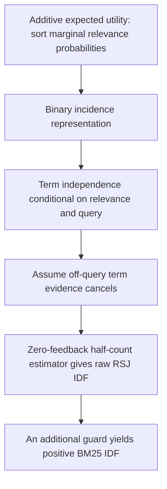
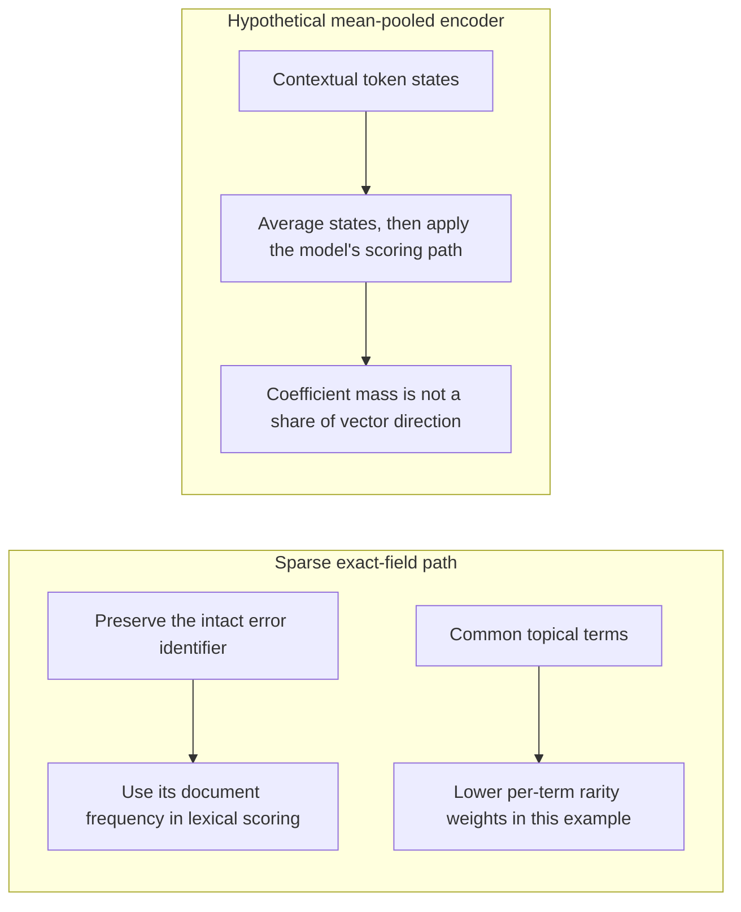

# Chapter 18: Classical Information Retrieval (IR) You Are Expected to Know
[00-START-HERE](../00-START-HERE.md) · [01-READING-ROUTES](../01-READING-ROUTES.md) · [17\_operating\_a\_vector\_store](../part-05-indexing/17_operating_a_vector_store.md) · [19\_learning\_to\_rank](19_learning_to_rank.md)
This chapter prepares you to explain how classical lexical ranking supports a Retrieval-Augmented Generation (RAG) system, where its assumptions fail, and why sparse retrieval still protects rare queries.
## TL;DR
- Boolean queries enforce exact logical membership, but do not themselves rank the matching set. AND can starve a query; OR can flood it. Expected selectivity depends on term correlations.
- TF-IDF coordinates reward repetition; unnormalized linear and log-TF weights have no ceiling. Cosine is bounded and invariant to pure positive vector rescaling, but can penalize useful breadth under the specified section model.
- BM25 bounds each positive term contribution and gives document length a tunable role through $`k_1`$ and $`b`$. Its shape is a tractable model, not a guarantee of answer relevance.
- Zero-feedback RSJ yields the classic, possibly negative IDF. Guarded BM25 adds a different transformation that keeps term contributions positive; do not conflate their derivations.
- BIM assumes binary term incidence and conditional term independence. BM25 adds TF saturation and length normalization without explicitly modeling phrases or joint context utility.
- Exact sparse fields can preserve rare identifiers. Mean pooling assigns token coefficients, not a fixed percentage of vector direction or learned importance; dense and learned-sparse performance must be measured.
- Keep authorization and other mandatory validity rules strict. Evaluate sparse, dense and hybrid retrieval by query type, freshness, length, cost and failure severity.
## The story
Imagine one librarian serving a large policy archive.
A visitor asks whether the retention policy permits deleting customer records after eighteen months. In this illustration the librarian requires every clause in `retention AND deletion AND customer AND gdpr`, and no folder passes. The worked count model below explains why an empty result can be likely, not why it is certain for every real archive.
She switches to OR, accepting a folder that contains any of the words. Under the stated frequency model the expected matching set is about $`1.642`$ million folders. Boolean membership provides no relevance order; a particular engine may add one. The strict gate starved her and the loose gate flooded her.
The librarian gives each folder a graded score. An extended Boolean rule uses exponent $`p\ge1`$ to trade strong partial coverage against weaker coverage of every term. At $`p=1`$, soft AND and soft OR are the same mean. As $`p\to\infty`$, they approach min and max; these recover hard Boolean membership only for binary weights.
Next she tries TF-IDF: a term receives within-document frequency and corpus-rarity weights. An unnormalized linear-TF coordinate pays the same increment for every occurrence. Cosine normalization changes the final marginal score, so the coordinate-level repetition problem must not be described as an unbounded cosine score.
Cosine divides by vector lengths. Pure positive rescaling cancels exactly for fixed linear-TF vectors. Under a more restrictive model—ten mutually orthogonal, equal-norm sections, only one contributing to the query—the whole guideline scores $`1/\sqrt{10}\approx31.6228\%`$ of that section alone. Real sections need not satisfy those assumptions.
The librarian adopts BM25. At average length the first occurrence has TF factor $`1`$, and the limiting factor is $`k_1+1`$. With length and statistics held fixed, all later occurrences share a limiting additional budget $`k_1`$; no finite count attains that limit.
BM25 also has a length dial $`b`$. At $`b=0`$ the TF factor ignores relative length. At $`b=1`$ the effective saturation constant is multiplied by relative length, which is not the same as dividing the final score directly by length. Intermediate settings let the librarian tune the verbosity-versus-breadth trade-off.
Her audit notebook starts with the Probability Ranking Principle: under additive expected gain and the stated costs, rank by marginal relevance probability. Independent document labels are not required. A two-by-two table then estimates a term log odds ratio. With zero feedback it yields raw RSJ IDF; the positive guarded BM25 form is a further modeling choice.
The notebook treats incidence as binary and assumes terms independent conditional on relevance and query. Its unexpanded BIM score cannot credit a non-query term. BM25 adds repeated-term and length evidence, but not explicit phrase interactions. Query expansion, phrase fields, learned sparse models, late interaction and cross-encoders offer different ways to add that missing evidence.
Finally a visitor asks about `ERR_OSSL_EVP_UNSUPPORTED`. If compatible exact-field analyzers retain that string intact, sparse retrieval can give it its own coordinate and a guarded IDF of approximately $`11.982930`$ in the worked collection. A hypothetical mean-pooled encoder gives ten identifier positions out of $`180`$ positions total coefficient mass $`10/180\approx5.5556\%`$. That is not a percentage of vector direction, importance or retrieval probability, and it is not a statement about every DPR encoder.
The librarian keeps both catalogs when evaluation justifies the operational cost. Sparse matching often helps exact terms; dense representations often help paraphrases. Neither advantage is universal. Freshness also depends on ingestion, analyzers, refresh and replication. Mandatory policy gates remain independent of both scores.
## Decoder table


| Technical term | Plain-English meaning | Why it matters |
| --- | --- | --- |
| Information Retrieval (IR) | Finding and ordering documents for a query | It supplies the candidate evidence used by RAG |
| Retrieval-Augmented Generation (RAG) | A system that retrieves evidence before generating an answer | Its answer quality depends on what retrieval places in context |
| Boolean retrieval | Exact satisfaction of a logical membership rule | It returns a matching set; an engine can add a separate relevance ranking |
| AND | A rule requiring every joined clause | Count shrinkage depends on joint term occurrence, not just marginal document frequencies |
| OR | A rule accepting any joined clause | It broadens membership; this alone does not establish relevant evidence or a relevance order |
| NOT | A logical exclusion relative to a candidate universe | Mandatory policy exclusions must not be turned into soft preferences |
| Vocabulary $`\mathcal V`$ and size $`V`$ | Term set $`\mathcal V`$, with $`V=\lvert\mathcal V\rvert`$ coordinates | The set and its cardinality are different mathematical objects |
| Corpus size $`N`$ | The number of indexed documents or chunks | It scales expected Boolean result counts and every rarity estimate |
| Query $`q`$ and document $`d`$ | Request/vector $`q`$ and candidate/vector $`d`$ | Context distinguishes the textual objects from their vector representations |
| Query term $`t`$, index $`i`$ and size $`n`$ | $`t`$ is a term, $`i`$ an index, $`n=\lvert Q(q)\rvert`$ the distinct query-term count | The displayed equal-weight sums do not silently include boosts or repeated query terms |
| Term set $`T(d)`$ | The terms contained in document $`d`$ | A Boolean query retrieves $`d`$ only when this set satisfies the query |
| Inverted index | A map from each term to the documents containing it | It makes lexical matching efficient |
| Posting list $`P_t`$ | The sorted document identifiers owned by indexed term $`t`$ | AND intersects lists, OR unions them, and NOT subtracts them |
| Document frequency $`n_i`$ or $`n_t`$ | The number of documents containing a term | It predicts Boolean selectivity and drives rarity weighting |
| Feast or famine | Too few hard-conjunction matches or too many disjunction matches | It is a possible query/analyzer/data failure mode, not an inevitable property of every Boolean query |
| Fallback ladder | Sequentially broadening optional query clauses | One fixed ladder need not enumerate all subsets; scoring, caching and explicit rung priority can combine results |
| Extended Boolean model | A soft version of Boolean retrieval that uses bounded term weights | It turns a set into a ranking without discarding query structure |
| Normalized term weight $`w_i`$ | A term score bounded from zero to one | It lets logical operators become graded scores |
| Soft scores $`S_{\mathrm{OR},p}`$ and $`S_{\mathrm{AND},p}`$ | Graded operators $`S_{\mathrm{OR},p}(d)`$ and $`S_{\mathrm{AND},p}(d)`$ | Finite-exponent scores are not permission checks |
| Sum $`\sum`$ and product $`\prod`$ | Aggregation with $`\sum`$ or $`\prod`$ | A product describes conjunction selectivity only under its explicit occurrence assumptions |
| $`p`$-norm | A family of distance functions controlled by exponent $`p`$ | It sets how strongly a missing query term is punished |
| Ideal corner | The point where every query-term weight equals one | Soft AND scores distance from this all-present point |
| Coordination-level match | A score based on the average amount of query coverage | At $`p=1`$, extended AND and OR both reduce to it |
| Fuzzy-set endpoint | The min and max behavior reached as $`p`$ becomes very large | On binary weights it recovers strict Boolean retrieval |
| Minimum-should-match | A threshold on how many optional clauses must match | It offers a coarse middle ground between AND and OR |
| Coordination factor | The fraction of query clauses a document matches | Classic Lucene used it as a discrete soft-coverage multiplier |
| Vector space model | Coordinates and a similarity score for query and document vectors | A score induces an order with possible ties; deterministic tie-breaking can complete it |
| Cosine similarity | The dot product divided by both vector lengths | It ranks by angle rather than raw magnitude |
| Cosine score $`\mathop{\mathrm{sim}}\nolimits(q,d)`$ | $`q^{\mathsf T}d/(\lVert q\rVert_2\lVert d\rVert_2)`$ for nonzero vectors | Nonnegative lexical vectors give a score in $`[0,1]`$, not an unbounded score |
| Dot product $`q^{\mathsf T}d`$ | Sum $`q^{\mathsf T}d=\sum_t q_td_t`$ | Both query and document weighting must be specified; IDF on both sides gives squared IDF in the product |
| Euclidean norm $`\lVert x\rVert_2`$ | The square root of the sum of squared coordinates | Cosine divides by this length for both vectors |
| Term Frequency (TF) $`f_{t,d}`$ or $`f_{t,d}`$ | The count of term $`t`$ inside one document | Linear TF lets repetition keep buying score |
| Inverse Document Frequency (IDF) | A weight that grows as a term appears in fewer documents | It makes rare query terms more discriminating |
| TF-IDF coordinate | Term frequency multiplied by inverse document frequency | It combines within-document evidence with corpus rarity |
| Linear term frequency | A reward proportional to every occurrence count | The eleventh occurrence is worth exactly as much as the first |
| Sublinear term frequency | $`g(0)=0`$ and $`g(f)=1+\ln f`$ for $`f\ge1`$ | It damps unnormalized growth but has no finite limit; normalized cosine remains bounded |
| Cosine normalization | Division by nonzero query and document Euclidean norms | It cancels pure positive vector rescaling; breadth effects depend on section geometry |
| Scope | Length from additional topics or material | The square-root penalty below needs orthogonal equal-norm sections and only one query-contributing section |
| Verbosity | Length caused by saying the same thing with more words | A useful scorer should discount it |
| Section variables $`c_i`$, $`m`$ and $`\alpha`$ | Sections $`c_i`$, count $`m`$, and positive vector scale $`\alpha`$ | Pure scaling and adding orthogonal sections are different operations |
| Pivoted length normalization | A tunable length correction around a pivot | It is related to the length-normalization problem; do not assume identical derivations or formulas |
| Best Match 25 (BM25) | The twenty-fifth Best Match weighting function from the Okapi experiments | It combines rarity, TF saturation, and tunable length normalization |
| Saturation | A reward that rises but approaches a fixed ceiling | It prevents unlimited score purchases through repetition |
| $`k_1`$ | BM25 parameter $`k_1>0`$ | At average length it is the limiting extra TF budget after the first occurrence |
| $`b`$ | BM25 length parameter $`b\in[0,1]`$ | It interpolates the effective saturation constant, not a direct final-score division |
| Average document length $`\overline L`$ | Mean indexed-token length $`\overline L>0`$ | Collection, analyzer, snapshot and deletion-statistics conventions must be consistent |
| Relative length $`\ell_d`$ | $`\ell_d=L_d/\overline L`$ | The average-length reference is $`\ell_d=1`$ |
| Document length $`L_d`$ | Indexed-token count $`L_d>0`$ | It is not automatically a word count or a model-token count |
| Effective saturation constant $`K_d`$ | $`K_d=k_1(1-b+b\ell_d)`$ | It couples frequency with relative length |
| Two-Poisson eliteness model | A latent high/low occurrence-rate model | It motivates approximations; a simple two-Poisson log likelihood ratio is not itself saturating |
| Dynamic pruning | Skipping postings that cannot beat the current score threshold | A bounded per-term score supplies a safe upper bound |
| Weak AND (WAND) | Dynamic pruning using valid term or block upper bounds | Safe bounds must match boosts, field parameters, norm encoding and the implementation |
| Probability Ranking Principle (PRP) | Sort marginal relevance probabilities for the specified utility | Additive expected-gain optimality does not require independent document relevance labels |
| Relevance variable $`R`$ | A binary indicator of whether a document is relevant | It is the target of the probabilistic derivation |
| Probability $`\Pr(A\mid B)`$ and odds $`O(R\mid d,q)`$ | Conditional probability $`\Pr(A\mid B)`$ and relevance odds $`O(R\mid d,q)`$ | Odds preserve probability ranking on the interior; handle endpoints and ties |
| Prior odds | A query-level relevance prior under the displayed model | Only a prior constant across candidates cancels; document-specific priors cannot be discarded |
| Likelihood ratio | Document probability under relevance divided by document probability under non-relevance | It remains after the prior cancels |
| Binary incidence vector $`x`$ and coordinate $`x_t`$ | Zero-or-one indicators for all terms and for term $`t`$ | They make whole-document probabilities estimable but discard counts |
| Conditional independence | The assumption that terms occur independently once relevance is known | It enables factorization but loses phrases and co-occurrence |
| $`p_t`$ | Chance that a relevant document contains term $`t`$ | It forms the numerator odds of the term weight |
| $`u_t`$ | Chance that a non-relevant document contains term $`t`$ | It forms the denominator odds of the term weight |
| Relevant counts $`S`$ and $`s_t`$ | $`S`$ positive examples and $`s_t`$ positive term incidences | A fully labeled partition differs from treating the unjudged corpus as a non-relevant proxy |
| Off-query cancellation | The assumption $`p_t=u_t`$ for $`t\notin Q(q)`$ | This unexpanded BIM then scores matched query terms; expanded or learned sparse models need not share the restriction |
| Retrieval Status Value (RSV) | The sum of per-term probabilistic weights | It orders documents under the binary independence model |
| Robertson-Spärck Jones weight $`w_t`$ | Term log odds ratio $`w_t`$ | Its zero-feedback half-count limit is raw RSJ IDF, not the separately guarded positive formula |
| Two-by-two cells $`a`$, $`b_{\mathrm{cell}}`$, $`c`$, $`d_{\mathrm{cell}}`$ | $`a`$, $`b_{\mathrm{cell}}`$, $`c`$, $`d_{\mathrm{cell}}`$ count relevance and term presence | Cell subscripts avoid confusing these local labels with BM25 length parameter $`b`$ or document $`d`$ |
| Continuity correction | Add $`0.5`$ to each contingency cell | It produces finite ratios but does not remove sampling bias or estimation variance |
| Relevance feedback | Updating term weights from judged relevant documents | Small samples can move weights too violently |
| Pseudo-relevance feedback | Treating the current top results as if they were relevant | It can feed the ranker’s own errors back into its weights |
| Maximum spanning tree dependence model | A tree over $`V`$ term variables has $`V-1`$ edges | Estimating all candidate pair statistics may cost $`O(V^2)`$; that is not the tree edge count |
| Late interaction | Comparing query and document token representations after separate encoding | It models term interactions that BM25 assumes away |
| Cross-encoder | A scorer that attends jointly to query and document tokens | It can represent phrases and co-occurrence in a later stage |
| Graded relevance | A gain scale, such as labels zero through four | It changes the utility/probability target; graded TF and graded labels are separate extensions |
| Maximum Marginal Relevance (MMR) | Reranking that trades relevance against redundancy | It addresses joint utility when several chunks share one context window |
| Sparse retrieval | Explicit term or learned vocabulary-space scoring | Whole exact coordinates require compatible analyzers; high IDF does not guarantee relevance or global rank one |
| Dense bi-encoder | Separately encode a request and candidate into retrieval vectors | Pooling, contextualization, training and scoring determine exact-match and paraphrase behavior |
| Dense Passage Retrieval (DPR) | A dense bi-encoder family cited by the source | Do not equate all DPR encoders with the hypothetical mean-pooling rule used below |
| Byte-pair tokenizer | A subword tokenizer that may split an identifier | Splitting alone does not quantify semantic loss; exact sparse analyzers can split identifiers too |
| Mean pooling | $`\overline h=L^{-1}\sum_i h_i`$ | Identifier token share is coefficient mass, not a fixed fraction of vector direction or importance |
| Contrastive training | Learned separation of positive and negative pairs | Training can target or oversample rare examples; its sampling policy is not forced by corpus frequency |
| Long tail | Rare terms, entities and query types | Singleton share must be measured or modeled; a Zipf-like curve alone does not prove a one-half share |
| Zipf’s law | The stated pattern that term frequency falls roughly with reciprocal rank | It explains why many distinct vocabulary types are rare |
| Exact identifier field | A field and analyzer contract preserving a compatible complete identifier | It can retain an exact coordinate; refresh and serving visibility still determine freshness |
| SPLADE | Learned sparse lexical and expansion scoring | Domain behavior depends on tokenizer, training, adaptation and sparse serving support |
| Masked Language Model (MLM) | A token-prediction component used by some learned sparse models | General-text pretraining is a possible mismatch, not proof of an irreducible tail-performance gap |
| Pooling symbols $`m`$, $`L`$ and $`d_{\mathrm{emb}}`$ | $`m`$ identifier positions, $`L`$ total positions and $`d_{\mathrm{emb}}`$ vector dimensions | $`m/L`$ is coefficient mass in the explicit mean-pooling example |
| ANN search breadth $`\mathrm{efSearch}`$ | Graph-search breadth, often exposed as $`\mathrm{efSearch}`$ | Work also depends on geometry, filtering and target recall; it is not a fixed function of lexical rarity |
| Reciprocal Rank Fusion (RRF) | Combine rank positions rather than raw score magnitudes | It avoids one scale-mixing problem but still needs candidate-budget and parameter evaluation |
| Normalized Discounted Cumulative Gain at 10 (nDCG@10) | A top-ten ranking metric | It can expose ordering harm that deep recall misses |
| Microsoft Machine Reading Comprehension (MS MARCO) | The cited passage collection and dense-training domain | Its narrow passage lengths do not transfer a $`b`$ choice to wide-length wiki pages |
| Benchmarking Information Retrieval (BEIR) | The cited eighteen-dataset zero-shot benchmark | It motivates checking lexical robustness, not a universal or independently reproduced BM25 win |
| Stock Keeping Unit (SKU) | An exact product identifier | It is a query type where sparse retrieval often protects recall |
| Portable Document Format (PDF) | A document format that can create long and uneven chunks | It appears in the chapter’s length-bias interview examples |
| Application Programming Interface (API) | A software interface and version | Version identifiers such as `3.12` and `3.9` are strings, not decimal magnitude comparisons |
| Graphics Processing Unit (GPU) | Hardware commonly used for encoder or reranker work | Exact lexical scoring need not train a new encoder; this does not make indexing and serving free |


## Core mechanics
### Mathematical conventions
Let $`\mathcal V`$ be the indexed vocabulary, $`V=\lvert\mathcal V\rvert`$, $`N`$ the document count, $`T(d)`$ the terms in document $`d`$, and $`Q(q)`$ the set of distinct query terms, with $`n=\lvert Q(q)\rvert\ge1`$. Query $`q`$ and document $`d`$ also denote their vectors when a vector formula is used. Write $`d_{\mathrm{emb}}`$ for dense-vector dimension so that it is not confused with a document. Document frequency is $`n_t=\mathop{\mathrm{df}}\nolimits(t)`$ and within-document count is $`f_{t,d}\ge0`$. Counts, word lengths and model-token lengths are not interchangeable; BM25 lengths must use one consistent indexed-token convention.
All logarithms are natural. Distinguish three weights: classical TF-IDF $`I_{\mathrm{TF}}(t)=\ln(N/n_t)`$ for $`1\le n_t\le N`$; zero-feedback raw RSJ $`w_t^{(0)}=\ln((N-n_t+0.5)/(n_t+0.5))`$; and guarded BM25 $`I_{\mathrm B}(t)=\ln(1+(N-n_t+0.5)/(n_t+0.5))`$. The last two are not equal. Log odds ratios are dimensionless, conventionally reported in nats, not probabilities.
The clinical TF-IDF example uses the same IDF-weighted query throughout: $`q_t=I_{\mathrm{TF}}(t)\mathbf1[t\in Q(q)]`$ and $`d_t=g(f_{t,d})I_{\mathrm{TF}}(t)`$. Linear TF uses $`g(f)=f`$; sublinear TF uses $`g(0)=0`$ and $`g(f)=1+\ln f`$ for $`f\ge1`$. Thus its unnormalized dot product is $`\sum_{t\in Q(q)}g(f_{t,d})I_{\mathrm{TF}}(t)^2`$. The release-note example separately names a single-IDF linear lexical baseline with unit query indicators; it is not this symmetric TF-IDF dot product. Cosine requires nonzero vectors; define a zero-vector fallback rather than divide by zero.
For BM25, use positive document length $`L_d`$, positive mean $`\overline L`$, relative length $`\ell_d=L_d/\overline L`$, $`k_1>0`$ and $`b\in[0,1]`$. Each distinct query term occurs once in the score sum; extra query-frequency factors, field-specific parameters and boosts are outside the displayed baseline. A TF saturation curve holds relative length and collection statistics fixed. Literally appending text can also change length and collection statistics.
Expected Boolean counts require an explicit term-occurrence model. An empty-result probability additionally needs a model across documents. Probability-ranking optimality below concerns additive expected utility; it does not require independent relevance labels across documents. BIM instead assumes term independence conditional on relevance and query. Distinguish these assumptions.
Storage uses $`1\,\mathrm{GB}=10^9\,\mathrm B`$ and fp32 payload $`4\,\mathrm{B/dimension}`$. Posting and vector payload estimates exclude the stated index and runtime overhead. Keep full precision in calculations, round only reported values, and use $`\approx`$ for approximations. Software/version claims, source vignettes and benchmark results remain reported inputs, not outcomes proved by the arithmetic.
### 18.1 Boolean and extended Boolean models
#### Boolean retrieval defines a set
- Model: $`T(d)\subseteq\mathcal V`$ is the document term set. Document $`d`$ matches when that set satisfies the logical query $`q`$.
- Role: metadata filters, `must` and `must_not` can impose mandatory rules. Extracted filters also require validation; a logical operator does not make its input correct.
- Limitation: Boolean membership returns a set, not an intrinsic relevance score. An engine may rank that set separately.
- Cost: merging two sorted lists gives a basic AND or OR algorithm in $`O(\lvert P_1\rvert+\lvert P_2\rvert)`$ time. NOT is relative to a candidate universe and needs a difference operation. Skips, bitmaps, compression and dynamic pruning change actual work.
#### Conjunction shrinks geometrically
For a representative document, assume the $`n`$ query-term presence events are independent with probabilities $`n_i/N`$. Linearity of expectation then gives the count formula below. It does not require document-to-document independence, but corpus marginals alone do not justify the within-document product.

```math
\mathbb E[\lvert A_{\wedge}\rvert]
=N\prod_{i=1}^{n}\frac{n_i}{N}
=\frac{\prod_{i=1}^{n}n_i}{N^{n-1}}.
```

- Interpretation: under this model each additional conjunct multiplies the expected count by $`n_i/N`$. Correlated terms require joint or conditional occurrence probabilities instead.
- Limitation: fewer matches do not establish higher precision or correct user intent. OR expands membership but supplies no relevance ranking by itself.
- Failure mode: product-like shrinkage can create feast or famine. The count formula is a planning model, not a claim that a particular result count is fractional or deterministically zero.
#### A fallback ladder does not create one ranking
- A fixed ladder can execute the full conjunction, then remove a selected optional term at each rung. A four-term ladder can have four query executions; it does not have to enumerate every subset.
- There are $`2^n`$ possible term subsets, but that is the unrestricted search space, not the cost of one fixed ladder. Caching, reusable iterators and skips may reduce repeated work.
- Different rungs do not automatically share a relevance score. Explicit rung priority or a common scorer can combine them; calling the sets inherently incomparable is too strong.
- Dropping a term guesses which part of intent is dispensable. Never relax authorization or another mandatory validity condition merely to obtain results.
#### Extended Boolean retrieval softens the operator
For $`n\ge1`$, equal query weights, normalized document-term weights $`w_i(d)\in[0,1]`$ and $`1\le p<\infty`$, define the following graded operators. They are scores, not authorization checks.

```math
S_{\mathrm{OR},p}(d)=\left(\frac1n\sum_{i=1}^{n}w_i(d)^p\right)^{1/p}.
```


```math
S_{\mathrm{AND},p}(d)=1-\left(\frac1n\sum_{i=1}^{n}(1-w_i(d))^p\right)^{1/p}.
```

- Soft AND measures normalized distance from the all-present corner; soft OR measures normalized distance from the origin. Both lie in $`[0,1]`$.
- Exponent $`p`$ controls the trade-off between coverage and strong partial matches. Finite-$`p`$ soft AND can be positive when a term is missing, so it is not a strict conjunction.
- The source attributes better results at intermediate values, notably $`p=2`$, to Salton, Fox and Wu (1983). That is a reported experiment on their collections, not a universal optimal exponent.
#### The endpoints explain the model
At $`p=1`$, the two equal-weight operators are exactly the same arithmetic mean:

```math
S_{\mathrm{AND},1}(d)=1-\frac1n\sum_{i=1}^{n}(1-w_i(d))=\frac1n\sum_{i=1}^{n}w_i(d)=S_{\mathrm{OR},1}(d).
```

At $`p=1`$, these operators no longer distinguish AND from OR. This is valid as a named soft coordination score, but not as a promise of hard AND. As $`p\to\infty`$, $`S_{\mathrm{AND},p}\to\min_i w_i`$ and $`S_{\mathrm{OR},p}\to\max_i w_i`$. On binary weights, those endpoints recover Boolean membership; on graded weights they are fuzzy min/max scores.
#### The compliance query makes the cliff concrete
- Inputs: $`N=10^7`$ chunks and frequencies $`1.5\times10^6`$, $`1.2\times10^5`$, $`4\times10^4`$ and $`8\times10^3`$ for customer, deletion, retention and gdpr. Their marginal shares are $`0.15`$, $`0.012`$, $`0.004`$ and $`0.0008`$.
- Independent-term model: expected conjunction counts are $`1{,}500{,}000\to18{,}000\to72\to0.0576`$. Adding gdpr multiplies the previous expectation by $`0.0008=1/1{,}250`$. Do not round $`0.0576`$ into a guaranteed zero.
- If document match indicators are also IID, $`\lvert A_{\wedge}\rvert\sim\mathop{\mathrm{Binomial}}\nolimits(10^7,5.76\times10^{-9})`$ and $`\Pr(\lvert A_{\wedge}\rvert=0)=(1-5.76\times10^{-9})^{10^7}\approx0.944027483`$. Thus an empty result is approximately $`94.4027\%`$ likely in that additional model. From the expectation alone, Markov's inequality gives $`\Pr(\lvert A_{\wedge}\rvert\ge1)\le0.0576`$ without document independence.
- Under the same within-document term-independence model, expected OR membership is $`N[1-(0.85)(0.988)(0.996)(0.9992)]=1{,}642{,}283.5264\approx1.642284\times10^6`$. An actual count is integral. Real term correlations can change both estimates.
#### The worked soft score exposes the exchange rate
Let document A have $`(0.9,0.8,0.6,0)`$ and B have $`(0.5,0.5,0.5,0.5)`$. At $`p=2`$:

```math
S_{\mathrm{AND},2}(A)=1-\sqrt{\frac{0.01+0.04+0.16+1}{4}}=1-\sqrt{0.3025}=0.45.
```


```math
S_{\mathrm{AND},2}(B)=0.5.
```

A scores $`0.575`$ at $`p=1`$, $`0.45`$ at $`p=2`$, and tends to $`0`$ as $`p\to\infty`$. B scores $`0.5`$ for every $`p\ge1`$, since all its term weights and complements are equal. This is a change in ranking preference, not a change in the documents.
#### Soft scoring costs more postings work
- A straightforward graded scorer evaluates the union of matching documents rather than just the hard intersection. That can cost more postings work, but one graded score avoids an implicit unscored fallback ladder.
- Full-list accounting here is $`1{,}500{,}000+120{,}000+40{,}000+8{,}000=1{,}668{,}000`$ postings, not $`1{,}668{,}000`$ distinct candidates.
- Stipulating $`1\,\mathrm{ns/posting}`$ gives $`1.668\,\mathrm{ms}`$ of serial posting work. This excludes decoding, score arithmetic, heaps, memory stalls and overhead; it is not a measured latency or proof of a hundredfold gap against hard AND.
- Selective hard-first evaluation, skips, block bounds and dynamic pruning can avoid full decoding when their invariants hold. The actual ratio requires an implementation and workload measurement.
#### Practical Boolean decisions
- Keep permissions, tenant boundaries, legal holds and other mandatory validity rules strict. A per-query leak probability $`10^{-4}`$ over $`10^6`$ queries implies $`100`$ expected leak events, not a guaranteed daily count or a count of distinct people. Fail closed and validate every serving path; widening a pool cannot repair unauthorized admission.
- Recency or source preference can be soft only when it is genuinely optional. An explicit date, jurisdiction or version requirement may instead be mandatory.
- Three of four optional clauses is $`75\%`$. The source's Solr string `2<-1 5<-2 6<90%` is a conditional staircase, not globally all-but-one: under that syntax, up to two clauses require all; three through five require all but one; six require all but two; above six require the integer percentage rule. Check the current parser and rounding semantics.
- Use exact fields or $`100\%`$ matching when every identifier component is necessary. Preserve the query/document analyzer contract.
- Start a soft-scoring experiment at $`p=2`$ if useful, then validate by query type. Codes may be better served by exact matching than by simply raising $`p`$.
- Bucket zero-result rate by query length and intent: an aggregate $`3\%`$ can coexist with $`40\%`$ for five-term queries. Their coexistence also depends on cohort weights.
- A suggested cap of two machine-extracted optional conjuncts is a workload heuristic, not a correctness theorem. Never discard a necessary security or validity clause to satisfy that cap.
- An offline OR probe can help distinguish an over-restrictive conjunction from analyzer, vocabulary or corpus-coverage problems. OR hits alone do not prove relevant answers or correct intent. Use explicit, evaluated broadening rather than silent term dropping.
- Keep mandatory negation strict. Soft NOT makes an exclusion a preference, not a guarantee.
### 18.2 Vector space model and TF-IDF’s two failures
#### Vector space scoring creates an order
Salton, Wong and Yang (1975) are the source's attribution for the vocabulary-space model. For nonzero query and document vectors, cosine similarity is:

```math
\mathop{\mathrm{sim}}\nolimits(q,d)=\frac{q^{\mathsf T}d}{\lVert q\rVert_2\lVert d\rVert_2}.
```

- A score orders candidates up to ties; it is not automatically a total order. Add a deterministic tie policy if one is required.
- Cosine lies in $`[-1,1]`$ for general real vectors, and in $`[0,1]`$ for the nonnegative TF-IDF vectors here. Zero vectors need an explicit fallback.
- Using angle as a relevance proxy is a modeling choice, not a probability guarantee. Sparse dot-product work depends on postings, intersections and the scoring implementation.
#### Raw counts need rarity and length corrections
The classical weight used here is $`I_t=I_{\mathrm{TF}}(t)=\ln(N/n_t)`$ for $`1\le n_t\le N`$. A document coordinate is $`g(f_{t,d})I_t`$ and the clinical query coordinate is $`I_t`$ for each query term. Hence the query-term dot product uses $`I_t^2`$. A unit-weight query would give a different, single-IDF score; mixing the two conventions changes the arithmetic. Corpus rarity and vector normalization address different effects, but neither certifies relevance.
#### Failure one is linear repetition
Holding IDF fixed, the derivative of a linear-TF document coordinate is constant. Under this chapter's IDF-weighted clinical query, the corresponding unnormalized dot-product derivative has another IDF factor:

```math
\frac{\partial(f_{t,d}I_t)}{\partial f_{t,d}}=I_t,
\qquad
\frac{\partial(q^{\mathsf T}d)}{\partial f_{t,d}}=I_t^2
\quad(t\in Q(q)).
```

For integer counts these derivatives correspond to constant coordinate or dot-product increments. They do not describe the derivative of normalized cosine, whose denominator also changes. Repetition can distort a lexical relevance proxy, but the existence and severity of a rank reversal depend on the other coordinates and the chosen normalization.
#### Failure two confuses scope with verbosity
For fixed linear-TF weights and $`\alpha>0`$, $`\mathop{\mathrm{sim}}\nolimits(q,\alpha d)=\mathop{\mathrm{sim}}\nolimits(q,d)`$. This is invariance to rescaling the whole vector, not to repeating only one query term, and raw-text duplication under log TF is not generally a pure rescaling. To isolate breadth, let $`d=\sum_{i=1}^m c_i`$ with mutually orthogonal, equal nonzero norms and $`q^{\mathsf T}c_i=0`$ for $`i>1`$. Then:

```math
\lVert d\rVert_2=\sqrt{\sum_{i=1}^m\lVert c_i\rVert_2^2}=\sqrt m\,\lVert c_1\rVert_2.
```


```math
\mathop{\mathrm{sim}}\nolimits(q,d)=\frac{\mathop{\mathrm{sim}}\nolimits(q,c_1)}{\sqrt m}.
```

For $`m=10`$, the factor is $`1/\sqrt{10}\approx0.316227766`$, a relative decrease of approximately $`68.3772\%`$. Overlapping, unequal-norm or additionally query-relevant sections change it. Ordinary cosine has no explicit tunable breadth parameter, but it is still bounded; neither this example nor vector-rescaling invariance proves that arbitrary keyword stuffing is free.
#### Log damping helps but never caps repetition
Sublinear TF is $`g(0)=0`$ and $`g(f)=1+\ln f`$ for $`f\ge1`$. It reduces the unnormalized clinical A-to-B dot-product ratio from approximately $`4.105133`$ to $`1.372225`$. With $`1{,}000`$ insulin occurrences the ratio is approximately $`3.113775`$. The log-TF coordinate is unbounded as a mathematical function, but normalized cosine is not. The source's scikit-learn example uses `sublinear_tf=True`; an absent term must not be passed to $`\ln0`$.
#### Default TF-IDF still contains both defects
The source describes `TfidfVectorizer` defaults `sublinear_tf=False` and `norm='l2'`. Verify the installed version and analyzer. Its usual `smooth_idf=True` formula is $`I_t^{\mathrm{smooth}}=\ln((1+N)/(1+n_t))+1`$; `smooth_idf` is a Boolean option, not the formula's value. These defaults change the exact weights from the classical unsmoothed clinical example. Linear coordinate growth and the conditional breadth effect remain distinct from an unbounded normalized score.
#### The clinical example prices stuffing
- Inputs: $`N=10^6`$ and frequencies $`10^4`$, $`10^5`$, $`5\times10^4`$ for insulin, dosage and pediatric. Exact IDFs are $`I_i=\ln100`$, $`I_d=\ln10`$ and $`I_p=\ln20`$, approximately $`4.605170186`$, $`2.302585093`$ and $`2.995732274`$.
- A is a $`1{,}200`$-word page containing insulin $`12`$ times and neither other query term. B is a $`180`$-word table with counts $`(2,2,1)`$. Other terms do not contribute to the query dot product, but will contribute to cosine norms.
- Use the IDF-weighted query defined above. Linear-TF dot products are $`s_A=12I_i^2\approx254.491109`$ and $`s_B=2I_i^2+2I_d^2+I_p^2\approx61.993393`$.
- Thus $`s_A/s_B\approx4.105133`$. These are unnormalized vector scores, not relevance probabilities or cosine scores. A unit-weight query would produce different numbers and must not be silently substituted.
#### Sublinear and cosine configurations still rank badly
- With the same query and log-TF document coordinates, $`s_A=(1+\ln12)I_i^2\approx73.906480`$ and $`s_B=(1+\ln2)(I_i^2+I_d^2)+I_p^2\approx53.858881`$.
- Their ratio is approximately $`1.372225`$. This isolates TF damping before any vector normalization.
- At $`f_{i,A}=1{,}000`$, $`s_A=(1+\ln1{,}000)I_i^2\approx167.704451`$, or approximately $`3.113775`$ times B. This is a mathematical counterexample for the unnormalized score, not an assertion about the final cosine ranking.
#### Cosine promotes the tiny heading
- Keep that same IDF-weighted query and log-TF document representation. The query norm is $`\lVert q\rVert_2=\sqrt{I_i^2+I_d^2+I_p^2}\approx5.956837`$.
- Let heading H contain insulin and dosage once each and no other indexed terms. Its norm is $`\sqrt{I_i^2+I_d^2}\approx5.148737`$, and $`q^{\mathsf T}H=I_i^2+I_d^2\approx26.509491`$. Therefore $`\mathop{\mathrm{sim}}\nolimits(q,H)\approx0.864340778`$.
- Stipulate that B's non-query coordinates contribute exactly $`220`$ to its squared weighted norm. This is a toy norm budget, not a fact inferred from its word count. Then $`\lVert B\rVert_2=\sqrt{(1+\ln2)^2(I_i^2+I_d^2)+I_p^2+220}\approx17.463402`$, and $`\mathop{\mathrm{sim}}\nolimits(q,B)=\frac{53.858881\ldots}{(5.956836\ldots)(17.463402\ldots)}\approx0.517741260`$.
- H's cosine is approximately $`1.669445`$ times B's. If B is the sole query-contributing section among ten orthogonal equal-norm sections, the whole-document score is $`0.517741260\ldots/\sqrt{10}\approx0.163724162`$. The norm budget and section assumptions drive this illustrative ranking; no answer-quality guarantee follows.
#### BM25 supplies a tunable alternative
At $`k_1=1.2`$, $`b=0.75`$, relative length $`\ell=10`$ and $`f=1`$, BM25's TF factor is $`2.2/[1+1.2(0.25+7.5)]\approx0.213592233`$. It is $`1`$ at average length and also $`1`$ at $`b=0`$ for this frequency. The orthogonal-section cosine factor $`0.316227766`$ belongs to a different model; the numbers illustrate tunable versus fixed assumptions, not matched-corpus retrieval quality or a universal ordering of penalties.
#### Practical TF-IDF decisions
- BM25 is a useful sparse baseline, not a theorem that TF-IDF is obsolete. TF-IDF can work well in some pools, especially with a later reranker; that reranker cannot recover candidates excluded by first-stage truncation.
- If using TF-IDF, test sublinear TF, normalization, analyzer and query weighting together. Changing one flag does not guarantee better retrieval.
- Merging fragments below roughly $`50`$ tokens is a source heuristic; short identifiers, headings, glossary entries and FAQs may be exactly the desired evidence.
- Audit the actual length distribution before tuning. A target of $`512`$ tokens does not guarantee uniform chunks; source examples describe $`5`$- to $`10`$-fold spreads and a $`95`$th percentile around five times the mean.
- Maintain document frequencies and document norms consistently with the searchable collection and snapshot, especially after major ingest, deletion or analyzer changes.
- Multi-tenant statistics trade estimation stability, relevance, isolation and possible information leakage. Global statistics are not universally preferable to tenant-conditioned ones; choose and validate a policy that respects access boundaries.
### 18.3 BM25 saturation and length normalization
#### BM25 separates rarity from within-document evidence
The source identifies BM25 with the Okapi Best Match family. The unboosted, distinct-query-term baseline used here is:

```math
\begin{aligned}
I_{\mathrm B}(t)
&=\ln\!\left(1+\frac{N-n_t+0.5}{n_t+0.5}\right)
=\ln\frac{N+1}{n_t+0.5},\\
K_d&=k_1(1-b+b\ell_d),
\qquad \ell_d=\frac{L_d}{\overline L},\\
F(f,\ell_d)&=\frac{f(k_1+1)}{f+K_d},\\
\mathop{\mathrm{BM25}}\nolimits(q,d)
&=\sum_{t\in Q(q)}I_{\mathrm B}(t)F(f_{t,d},\ell_d).
\end{aligned}
```

Rarity and within-document evidence are separate factors. Take $`F(0,\ell)=0`$, $`k_1>0`$, $`b\in[0,1]`$ and $`\ell>0`$. The count $`n_t`$ is a document frequency, not a term occurrence total. Query boosts, repeated-query-term weights, field mixtures and engine-specific norm encodings require their own formulas and bounds.
#### $`k_1`$ gives a limiting repetition budget at average length
At $`\ell=1`$, $`F(f,1)=f(k_1+1)/(f+k_1)`$, so $`F(1,1)=1`$ and $`\lim_{f\to\infty}F(f,1)=k_1+1`$. For finite counts $`f\ge1`$, the range is $`[1,k_1+1)`$, with the upper endpoint excluded. Thus later occurrences share a limiting increment $`k_1`$. At another length the first occurrence is $`(k_1+1)/(1+K_d)`$, so the same first-occurrence budget interpretation does not transfer unchanged. A curve that varies $`f`$ while holding $`\ell`$ fixed is a mathematical comparison; adding words to one real document can also alter $`\ell`$.
#### The default curve spends its budget early
At $`k_1=1.2`$ and $`\ell=1`$, $`F=2.2f/(f+1.2)`$. For $`f\in\{1,\,2,\,5,\,10,\,20\}`$, the factors are approximately $`1`$, $`1.375`$, $`1.774193548`$, $`1.964285714`$ and $`2.075471698`$. The second occurrence adds $`0.375`$; moving from ten to twenty adds approximately $`0.111185984`$. Counts five and ten use $`(F-1)/1.2\approx64.5161\%`$ and $`80.3571\%`$ of the limiting later-occurrence budget. Those percentages are not shares of the whole term score.
#### The two-Poisson argument gives the curve meaning
The source cites Robertson and Walker (1994) for the two-Poisson motivation. Do not equate a saturating probability with a saturating log odds: the log likelihood ratio between two individual Poisson distributions is linear in the count. A simple mixture illustrates how a finite relevance-evidence limit can arise. Suppose, at fixed length,

```math
\begin{aligned}
P(f\mid R=r)
&=a_r\mathop{\mathrm{Pois}}\nolimits(f;\mu_E)
 +(1-a_r)\mathop{\mathrm{Pois}}\nolimits(f;\mu_N),\\
\mu_E&>\mu_N>0,
\qquad 0<a_0<a_1<1.\\
\lim_{f\to\infty}
\ln\frac{P(f\mid R=1)}{P(f\mid R=0)}
&=\ln\frac{a_1}{a_0}.
\end{aligned}
```

The high-rate component dominates both mixtures at large $`f`$, producing that finite limit under these particular assumptions. BM25 uses a convenient rational TF shape rather than exactly computing this mixture. The derivation does not make BM25 a calibrated posterior, and changing the mixture assumptions can remove the finite limit.
#### Log damping loses because it remains purchasable
With natural logs, $`g(f)=1+\ln f`$ gives approximately $`1`$, $`1.693147`$, $`2.609438`$ and $`4.218876`$ at $`f\in\{1,\,2,\,5,\,25\}`$. At $`f=10{,}000`$, $`g(f)\approx10.210340`$, about $`6.030392`$ times $`g(2)`$. These are unnormalized TF factors. The corresponding BM25 factor at $`\ell=1`$, $`k_1=1.2`$ remains below $`2.2`$. Bounded positive term contributions support safe pruning when the implementation's upper bounds also account for boosts, fields and norm encoding; this is not a statement that normalized TF-IDF cosine is unbounded.
#### $`b`$ interpolates length adjustment
Let $`\ell_d=L_d/\overline L`$. BM25 places the length adjustment inside the TF denominator:

```math
K_d=k_1(1-b+b\ell_d).
```


```math
b=0\quad\Longrightarrow\quad K_d=k_1.
```


```math
b=1\quad\Longrightarrow\quad K_d=k_1\ell_d.
```

For fixed $`f>0`$, compare against average length:

```math
\frac{F(f,\ell)}{F(f,1)}
=\frac{f+k_1}{f+k_1(1-b+b\ell)}.
```

For $`\ell>1`$ this ratio is at least $`1/\ell`$: the penalty is no stronger than direct division by length. For $`0<\ell<1`$ the ratio is at most $`1/\ell`$: the short-document bonus is no larger than direct division. At $`\ell=1`$ both equal $`1`$. Thus softer means less penalty for long documents and less bonus for short ones, not that BM25 lies below a division curve everywhere. The scorer still cannot identify scope versus verbosity from length alone.
#### The twice-average example shows the soft discount
At $`k_1=1.2`$, $`b=0.75`$, $`\ell=2`$ and $`f=1`$, $`K=1.2(0.25+1.5)=2.1`$ and $`F=2.2/3.1\approx0.709677419`$. Relative to its average-length value $`1`$, the discount is approximately $`29.0323\%`$. Direct division gives $`0.5`$, a $`50\%`$ discount. This is a comparison of defined TF factors, not an empirical quality result.
#### The IDF guard avoids negative rarity weights
Raw zero-feedback RSJ $`w_t^{(0)}=\ln((N-n_t+0.5)/(n_t+0.5))`$ is negative for $`n_t>N/2`$. The guarded form instead uses $`I_{\mathrm B}(t)=\ln(1+\exp(w_t^{(0)}))`$, positive for $`0\le n_t\le N`$. It is a further transformation, not the identical zero-judgment limit. Rare positive weights change little, while common terms change substantially. Although this transform is monotone for a single term, applying it before summing multiple matched terms need not preserve document order.
#### The release-note example separates the two constants
- The source's motivating vignette puts a $`3{,}000`$-token runbook at rank $`1`$ and a $`120`$-token release note at rank $`40`$. Those ranks require the other candidates and are not deducible from this two-document calculation.
- Take $`N=10^6`$, $`\overline L=300`$ tokens and frequencies $`(400{,}000,\,250{,}000,\,5{,}000)`$ for kubernetes, pod and eviction. Guarded IDFs are approximately $`(0.916290482,\,1.386293361,\,5.298218372)`$.
- A has length $`120`$, $`\ell_A=0.4`$ and counts $`(1,1,2)`$. B has length $`3{,}000`$, $`\ell_B=10`$ and counts $`(12,30,25)`$.
- Define this example's separate single-IDF linear baseline $`s_{\mathrm{lin}}(d)=\sum_{t\in Q(q)}f_{t,d}I_{\mathrm B}(t)`$, equivalent to unit query indicators against these document coordinates. It is not the clinical symmetric TF-IDF score. It gives $`s_A\approx12.899021`$, $`s_B\approx185.039746`$, a B-to-A ratio approximately $`14.345255`$.
- Direct division by relative length gives $`s_A/0.4\approx32.247551`$ and $`s_B/10\approx18.503975`$, an A-to-B ratio approximately $`1.742736`$. This reversal isolates an intentionally different length rule.
#### BM25 creates a near-tie, not a candidate-pool guarantee
At $`k_1=1.2`$, $`b=0.75`$, $`K_A=0.66`$ and $`K_B=9.3`$. In query-term order kubernetes, pod, eviction,

```math
\begin{aligned}
\mathop{\mathrm{BM25}}\nolimits(q,A)
&\approx1.214361+1.837256+8.763970
\approx11.815587,\\
\mathop{\mathrm{BM25}}\nolimits(q,B)
&\approx1.135684+2.328126+8.495685
\approx11.959496.
\end{aligned}
```

Totals use unrounded contributions. B's relative lead is approximately $`1.217953\%`$ of A's score, not a probability margin. The pair is close compared with the other two scoring rules, but both reach a reranker only if the rest of the ranking and candidate cutoff permit it.
#### Sweeping $`b`$ isolates length sensitivity
With $`k_1=1.2`$ fixed, at $`b=0`$ the scores are approximately $`9.587634`$ and $`15.887339`$ for A and B; at $`b=1`$ they are approximately $`12.822825`$ and $`11.062111`$. The pair ties at $`b\approx0.768972775`$ under these exact inputs. Increasing $`b`$ raises A and lowers B because their relative lengths lie on opposite sides of $`1`$; it does not make that direction correct for every query. A benchmark default is a starting point, not a diagnosis.
#### Score bounds provide sanity checks and pruning
- For $`f>0`$, $`\ell>0`$ and the displayed positive-weight baseline, $`F(f,\ell)<k_1+1`$ and a term contribution is below $`(k_1+1)I_{\mathrm B}(t)`$. With boosts or field combinations, derive a corresponding bound instead of using this one unchanged.
- Eviction's limiting contribution here is $`2.2I_{\mathrm B}(\text{eviction})\approx11.656080`$. A contributes approximately $`8.763970`$, or $`75.187970\%`$ of that limit; B approximately $`8.495685`$, or $`72.886297\%`$.
- These two shares differ in both count and relative length. Their difference is not an isolated causal effect of twenty-three extra occurrences.
- The source describes Lucene versions that omit the common $`(k_1+1)`$ multiplier. If it is the same positive constant for every scored term/field, dividing these totals by $`2.2`$ gives approximately $`5.370722`$ and $`5.436134`$, preserving rank and relative margin. Different field parameters, fusion scales and absolute thresholds need separate treatment. Check the actual engine version and score explanation.
#### Practical BM25 decisions
- Start experiments at $`k_1=1.2`$, $`b=0.75`$ if appropriate, then use held-out queries and per-term explanations. Tune length effects before assuming repetition caused the failure.
- For $`A_\ell=1-b+b\ell`$ and $`D=f+k_1A_\ell`$, the sensitivities are $`\partial F/\partial b=-f(k_1+1)k_1(\ell-1)/D^2`$ and $`\partial F/\partial k_1=f(f-A_\ell)/D^2`$. Thus raising $`b`$ penalizes long documents and rewards short ones at fixed $`f`$, while changing $`k_1`$ is not a uniform score multiplier.
- A range such as $`k_1\in[1.2,2.0]`$ is a search heuristic. Higher counts may indicate depth or stuffing; a development set decides whether more repetition reward helps.
- Length-spread thresholds around threefold or tenfold are workload heuristics, not mathematical inertness boundaries. If all $`\ell=1`$, $`b`$ is exactly inert; otherwise sensitivity also depends on frequency and $`k_1`$.
- Chunk design changes length spread, recall and evidence boundaries. Tune on actual heading, section and table chunks rather than an assumed uniform target.
- Across shards, use compatible searchable-collection statistics and score semantics when a global ranking is intended. Global or distributed frequency collection has latency and multi-tenant isolation trade-offs.
- A one-shard rule below a few million chunks is not universal. The source names `dfs_query_then_fetch` as one version-dependent distributed-statistics option; measure its extra work and round trips.
- Keep $`N`$, $`n_t`$ and $`\overline L`$ consistent with the index's refresh, deletion and snapshot policy. Some engines maintain statistics incrementally; they do not all wait for a complete re-index, and they need not recompute a full corpus on every write.
- Raw BM25 scores are not calibrated across queries or retrievers. Rank fusion is one robust candidate, not a substitute for evaluating hybrid retrieval and score calibration.
### 18.4 Probabilistic models and the binary independence assumption
#### The Probability Ranking Principle starts the derivation
The source cites Robertson (1977) for PRP. Under fixed selection costs and additive expected utility, ranking by marginal relevance probability is optimal for the corresponding objective. For decreasing nonnegative position weights $`v_j`$, $`\mathbb E[U(\pi)]=\sum_j v_j\Pr(R_{\pi_j}=1\mid d_{\pi_j},q)`$ is maximized by sorting those probabilities. Linearity of expectation does not require independent relevance events across documents. Odds are a convenient strictly increasing transform for probabilities in $`(0,1)`$; handle endpoints by limits and ties explicitly.

```math
O(R\mid d,q)=\frac{\Pr(R=1\mid d,q)}{\Pr(R=0\mid d,q)}.
```


```math
O(R\mid d,q)=\frac{\Pr(R=1\mid q)}{\Pr(R=0\mid q)}\frac{\Pr(d\mid R=1,q)}{\Pr(d\mid R=0,q)}.
```

A RAG context often has non-additive value: a second copy of the same fact may add little even if each chunk is relevant. That breaks the additive objective, not necessarily independence of relevance labels. Diversification, MMR or explicit set selection addresses a different utility. Query-level prior odds in this model are constant across documents and can be dropped for within-query ranking; document-specific priors or features cannot simply be canceled.
#### Binary independence makes document likelihood estimable
Represent a document by $`x\in\{0,1\}^{V}`$. Assume its term incidences are independent conditional on $`(R,q)`$, and let $`p_t=\Pr(x_t=1\mid R=1,q)`$ and $`u_t=\Pr(x_t=1\mid R=0,q)`$, with $`0<p_t,u_t<1`$. Then:

```math
\frac{\Pr(x\mid R=1,q)}{\Pr(x\mid R=0,q)}=\prod_{t:x_t=1}\frac{p_t}{u_t}\prod_{t:x_t=0}\frac{1-p_t}{1-u_t}.
```

Binary incidence discards counts; conditional term independence discards dependencies beyond what the relevance class explains. The model uses per-term parameters instead of a general joint distribution, but assumes rather than proves that they suffice for relevance. Phrase or interaction information requires additional features or a different model.
#### Off-query terms collapse into a constant
For the unexpanded query-term BIM, additionally assume $`p_t=u_t`$ for all $`t\notin Q(q)`$. Expanding the remaining likelihood factors gives:

```math
\frac{\Pr(x\mid R=1,q)}{\Pr(x\mid R=0,q)}=\prod_{t\in Q(q)\cap T(d)}\frac{p_t(1-u_t)}{u_t(1-p_t)}\prod_{t\in Q(q)}\frac{1-p_t}{1-u_t}.
```

The last product is document-independent for a fixed query and model, leaving a sum over matched query terms after logarithms. This unexpanded BIM cannot reward a non-query term. That is not a limitation of every sparse method: query expansion, phrase features, relevance models and learned sparse representations can introduce additional coordinates.
#### The RSJ weight is a log odds ratio
Take natural logs and drop only the document-independent factor:

```math
\mathop{\mathrm{RSV}}\nolimits(q,d)=\sum_{t\in Q(q)\cap T(d)}w_t.
```


```math
w_t=\ln\frac{p_t(1-u_t)}{u_t(1-p_t)}.
```

Each weight compares term-presence odds in relevant and non-relevant documents. A zero or unit probability makes some odds undefined or infinite; smoothed finite estimates avoid that numerical failure, not all estimation bias. One two-by-two table per term gives the following estimator.
#### The contingency table yields the full estimator
In a fully specified binary-labeled population of $`N`$ documents, let $`S`$ be relevant, $`n_t`$ contain the term and $`s_t`$ satisfy both. Cells are $`a=s_t`$, $`b_{\mathrm{cell}}=S-s_t`$, $`c=n_t-s_t`$ and $`d_{\mathrm{cell}}=N-S-n_t+s_t`$. Feasibility requires $`\max(0,S+n_t-N)\le s_t\le\min(S,n_t)`$. If only some positives are judged and the remaining corpus is unjudged, treating all other documents as non-relevant is an additional proxy assumption, not a verified relevance partition. The worked example makes that proxy explicit. Adding $`0.5`$ to every cell gives:

```math
w_t=\ln\frac{(s_t+0.5)(N-S-n_t+s_t+0.5)}{(S-s_t+0.5)(n_t-s_t+0.5)}.
```

#### Zero feedback gives raw RSJ IDF, not the guarded form
Algebraically set $`S=s_t=0`$ in this smoothed estimator. The relevant-row pseudocounts are both $`0.5`$ and cancel:

```math
w_t^{(0)}=\ln\frac{N-n_t+0.5}{n_t+0.5}.
```

The half-count choice and the zero-feedback probability model are assumptions, not a theorem of maximal ignorance with no tuning choices. This limit relates a classic IDF to a term-evidence model. Guarded BM25 instead uses $`I_{\mathrm B}(t)=\ln(1+\exp(w_t^{(0)}))`$, so its exact formula requires that further design choice.
#### Small relevance sets can increase variance
Feedback can help learn relevance-specific term evidence, but small positive samples and small cells produce unstable estimates. Pseudo-relevance feedback can amplify selection errors. In the toy example, changing the ferry incidence count by one among $`S=20`$ positive examples moves its weight by approximately $`1.148649`$ nats. Keeping $`S`$ fixed is not equivalent to flipping one binary relevance label; that distinction matters in the arithmetic.
#### BM25 adds count and length evidence without explicit term interactions
BM25's rational TF factor and length normalization extend a binary-incidence baseline; they do not certify that every missing assumption has been repaired. An unexpanded unigram score does not explicitly model phrase order or term co-occurrence. A full pairwise vocabulary model has $`V(V-1)/2=O(V^2)`$ possible pairs, while a spanning tree itself has only $`V-1`$ edges. Building a Chow–Liu-style tree may estimate all pairwise statistics, but it is incorrect to call the tree an $`O(V^2)`$-edge dependency structure. Late interaction and cross-encoders offer other trade-offs.
#### Binary representation is not binary relevance
Two different binaries occur here: the relevance variable $`R\in\{0,1\}`$ and term incidence $`x_t\in\{0,1\}`$. Adding graded TF does not add graded relevance labels. If relevance is graded, for example $`0`$ through $`4`$, one can rank by expected gain under a chosen utility, requiring a correspondingly extended probability or learning objective. Graded labels therefore can change a probabilistic derivation as well as a learning-to-rank target; they do not automatically follow from replacing binary incidence with TF.
#### The Irish Sea example shows feedback inversion
Take $`N=10^6`$ and query irish sea ferry with frequencies $`(8{,}000,\,120{,}000,\,40{,}000)`$. At $`S=0`$, raw RSJ weights are approximately $`(4.820219572,\,1.992426566,\,3.178041851)`$ nats. A containing irish and sea scores $`6.812646138`$; B containing sea and ferry scores $`5.170468417`$. A leads by approximately $`1.642177720`$ nats. These are binary RSVs, not the guarded BM25 TF scores.
#### Twenty judgments reverse the order
For a feedback scenario, use $`S=20`$ with $`(s_{\mathrm{irish}},s_{\mathrm{sea}},s_{\mathrm{ferry}})=(8,14,20)`$, keeping the corpus frequencies fixed and treating the rest of the corpus as the non-relevant proxy. The full estimator gives weights approximately $`(4.435545432,\,2.794882894,\,6.892114037)`$. Ferry's odds ratio is approximately $`984.480446718`$, so write $`w_{\mathrm{ferry}}=\ln(984.480446718\ldots)`$, not an exact equality to the log of a rounded input. A scores $`7.230428325`$ and B $`9.686996930`$, a B lead approximately $`2.456568605`$ nats. This illustrates one feedback inversion, not evidence that this small sample generalizes.
#### One incidence-count change exposes sensitivity
At fixed $`S=20`$, change $`s_{\mathrm{ferry}}`$ from $`20`$ to $`19`$, leaving the other counts fixed. This can represent swapping one positive example for another that differs in ferry incidence, not flipping just one document's relevance label while somehow keeping $`S`$ unchanged. The ferry weight becomes approximately $`5.743465274`$. Its shift is approximately $`1.148648763`$ nats, and B's lead becomes $`5.743465274\ldots-4.435545432\ldots\approx1.307919842`$ nats. The shift is approximately $`40.619973\%`$ of the initial max-to-min query-weight spread $`2.827793005`$ nats. A real label flip must also update $`S`$ and any affected counts.
#### The guarded production form agrees on rare terms
At $`n_t=600{,}000`$ and $`N=10^6`$, raw RSJ gives $`\ln(400{,}000.5/600{,}000.5)\approx-0.405464691`$. The positive guarded transformation changes this behavior. For irish, raw and guarded weights are approximately $`4.820219572`$ and $`4.828252239`$, a difference approximately $`0.008032668`$, or $`0.166645\%`$ of the raw value. Termwise agreement for rare terms does not imply identical multi-term rankings; the transform is applied before summation.
#### Practical probabilistic decisions
- Use a stable no-feedback baseline when evidence is scarce. Distinguish raw $`S=0`$ RSJ from the separately guarded IDF used in most worked BM25 scores here.
- Source suggestions such as at least $`50`$ judgments or the low hundreds per head query are heuristics, not confidence guarantees. Required labels depend on term prevalence, sampling bias, target effect size and regularization. Shrinkage and held-out validation can matter more than a single count threshold.
- A total of $`500`$ judgments over $`50`$ queries averages $`10`$ each; that average does not establish even allocation or stable per-query estimates. Consider whether evaluation or a later learned stage uses scarce labels better.
- Choose a positive guarded formula for the intended baseline, but name the transformation when reproducing published or engine-specific results.
- Add phrase fields, query expansion or interaction models when needed. Tokenizer and analyzer choices determine which entities stay intact.
- Do not interpret within-query RSV or BM25 as a calibrated probability or compare raw magnitudes across unrelated queries without a validated calibration model.
- Evaluate fusion and diversity against the actual context budget. Non-additive redundancy can matter at both $`k=5`$ and $`k=50`$; its importance is not determined by $`k`$ alone.
### 18.5 Why sparse retrieval can protect the long tail
#### Sparse rarity grows as document frequency falls
For fixed $`N`$, the guarded IDF decreases monotonically with document frequency:

```math
I_{\mathrm B}(t)=\ln\!\left(1+\frac{N-n_t+0.5}{n_t+0.5}\right)=\ln\frac{N+1}{n_t+0.5}.
```

At $`N=2\times10^6`$, frequency $`400{,}000`$ gives $`I_{\mathrm B}\approx1.609437162`$ and frequency $`12`$ gives $`I_{\mathrm B}\approx11.982929594`$, a ratio approximately $`7.445416`$. The approximations $`\ln5`$ and $`\ln160{,}000`$ are close but not exact with half-counts. Rarity alone does not guarantee a rare-match document beats every competing multi-term document. At fixed $`N`$, this IDF is bounded: $`I_{\mathrm B}(0)=\ln(2(N+1))`$, and the largest value for a term that actually matches a document is at $`n_t=1`$.
#### Mean-pooling coefficient is not directional ownership
Use a hypothetical mean-pooled bi-encoder, not a claim that DPR universally mean-pools. Let contextual token states be $`h_i\in\mathbb R^{d_{\mathrm{emb}}}`$ and identifier positions be $`J`$, with $`\lvert J\rvert=m`$ out of $`L`$ positions:

```math
\overline h=\frac1L\sum_{i=1}^{L}h_i,
\qquad
\left\lVert\frac1L\sum_{i\in J}h_i\right\rVert_2
\le\frac{mH}{L}
\quad\text{if }\lVert h_i\rVert_2\le H.
```

For $`m=10`$ and $`L=180`$, those positions have total averaging coefficient $`m/L=1/18\approx5.5556\%`$. That is not a bound on their share of direction, cosine score, semantics or causal importance. If all other states are zero, those positions can determine the entire pooled direction; cancellation can also make their net contribution zero. Contextual states outside the identifier can themselves encode it. Tokenization, pooling method, normalization and training all matter. The worked dimension is $`d_{\mathrm{emb}}=768`$. There is no explicit document-frequency multiplier in this simple averaging rule, but an encoder can learn rarity or exact-match features. This formula predicts neither rank $`12`$ nor rank $`340`$.
#### Tail supervision and encoder adaptation are workload-dependent
Rare identifiers can have few labeled query–document pairs, and releases can introduce unseen strings. Ordinary frequency-weighted training may underserve them, but fine-tuning need not sample in natural proportion: targeted oversampling, synthetic pairs, character-aware features and other adaptation can help. A Zipf-like frequency–rank relation alone does not establish that half the vocabulary occurs once; that needs a frequency histogram or an explicit finite-sampling model. A fixed encoder can represent new strings without retraining, while sparse freshness also waits for analysis, index refresh and replica visibility. Neither path is automatically current merely because a write committed.
#### Learned sparse retrieval changes the trade-off
SPLADE-style models score in vocabulary space and can learn lexical expansion. Tokenization, an inherited MLM head, domain adaptation, sparsity regularization and training data affect exact-tail behavior. A general-text initialization is not a proof of an unclosable domain gap or a fixed fraction of recovered performance. This section supplies no concrete matched-quality cost estimate for learned sparse retrieval.
#### Sparse and dense have symmetric strengths
Sparse matching often helps rare exact strings when analyzers preserve them. Dense retrieval often helps paraphrase and vocabulary mismatch. These are testable tendencies, not symmetric win guarantees: OCR noise, tokenization, query expansion, training and correlation between retrieval errors can change them. Evaluate head queries, high-IDF exact-tail queries and fresh entities separately, then measure the hybrid's marginal gain.
#### The error-string worked example fixes the scale
- Inputs: $`2\times10^6`$ chunks averaging $`180`$ model tokens. The source vignette reports three generic dense results and an exact runbook at rank $`340`$; those observations are not derived from the pooling coefficients.
- Suppose an exact field preserves the error string in $`12`$ chunks. Upgrading, node and the version token each appear in approximately $`400{,}000`$ chunks. Query and document analyzers must agree on these terms.
- At average length, $`k_1=1.2`$ and one occurrence, the rare string has TF factor $`1`$ and contributes approximately $`11.982929594`$. A different average-length chunk matching each of the three common terms twice has score $`3(1.609437162\ldots)(1.375)\approx6.638928295`$ from those terms.
- The rare contribution alone is approximately $`1.804949`$ times that comparator's score. This two-candidate inequality does not establish global rank one, an ANN rank, or recall over a whole collection. Its exact lexical weight needs no new supervised pairs; operating cost is not zero.
#### Sparse storage is small beside the stated dense index
Assume $`110`$ distinct indexed terms per chunk and $`4\,\mathrm B`$ per posting payload. Then $`2\times10^6(110)(4\,\mathrm B)=880{,}000{,}000\,\mathrm B=0.88\,\mathrm{GB}`$. The fp32 dense-vector payload is $`2\times10^6(768)(4\,\mathrm B)=6.144\,\mathrm{GB}`$. The payload ratio is $`6.144/0.88\approx6.981818`$, and adding that posting budget to the dense vector budget is a $`0.88/6.144\approx14.322917\%`$ increase. Posting frequencies, positions, dictionaries, norms, compression and runtime structures are omitted; dense ANN links, identifiers, payloads and runtime structures are also omitted. Neither number is a complete comparable index footprint or a measured RAM bill.
#### Rare sparse lookup becomes cheaper
An intact error term with $`n_t=12`$ has twelve document postings, so that single-term lookup can be cheap. A multi-term query may still traverse common lists, verify filters and score many candidates; the rarest list alone is not its full cost. ANN work is governed by its search algorithm, geometry, filtering, target recall and breadth rather than directly by this lexical document frequency. Rarity does not establish a universal sparse/dense latency ratio.
#### The public-collection sanity check preserves the gap
The source's MS MARCO sanity check assumes $`8.8\times10^6`$ passages, approximately $`55`$ words and $`45`$ distinct indexed terms per passage. The same four-byte posting-payload budget gives $`8.8\times10^6(45)(4\,\mathrm B)=1.584\,\mathrm{GB}`$. The fp32 $`768`$-dimension vector payload is $`27.0336\,\mathrm{GB}`$, a ratio $`768/45\approx17.066667`$. This is approximately $`1.232`$ decimal orders of magnitude, versus approximately $`0.844`$ for the internal $`6.981818`$ ratio; neither is an all-in index comparison. Different compression, precision, positions or graph structures change the result.
#### The reported zero-shot result matches the mechanism
The source cites Thakur et al. (2021) and BEIR's eighteen datasets as evidence that BM25 remains a competitive zero-shot, out-of-domain baseline. Do not inflate that into a verified claim that BM25 is the strongest method on every dataset or beats a specified dense system on a majority without the matching benchmark table, models and settings. This pass does not independently reproduce those experiments. The practical implication is to evaluate a lexical baseline alongside domain-trained dense and hybrid systems, not to assume a universal winner.
#### Practical sparse long-tail decisions
- Keep BM25 as an evaluated baseline or hybrid arm when it protects important exact, tail or fresh queries. Remove it only after measuring the marginal quality, latency, cost and operational trade-off; IDF histograms alone do not prove it unnecessary.
- Stratify evaluation by query IDF, frequency, exact identifiers, novelty, OCR quality and criticality. Define the cutoff and metric, for example $`\mathop{\mathrm{Recall}}\nolimits@k`$, rather than comparing unspecified recall values.
- Preserve compatible versions, codes and identifiers in an exact field beside a normalized field. An analyzer can split or discard a string, so a whole-token coordinate is conditional on that analyzer contract.
- Normalize OCR and typo noise where justified without silently changing identifiers. A corrupted rare token may get a high weight; high IDF is not evidence of correctness.
- RRF avoids directly mixing unrelated score scales but still has hyperparameters and a candidate budget. General dense cosine lies in $`[-1,1]`$, nonnegative TF-IDF cosine in $`[0,1]`$; boundedness does not calibrate either against BM25 or across encoders.
- Measure ingestion, refresh, replica and cache visibility for both sparse and dense freshness. Fine-tuning is not a prerequisite for embedding every newly encountered string.
- Learned sparse retrieval needs suitable sparse-vector indexing/scoring support; an existing dense ANN service does not automatically support vocabulary-space vectors efficiently or correctly. Test the actual serving path before replacing a retrieval arm.
## Diagrams
### Figure 18.1

```math
\begin{array}{lr}
\text{Conjunction stage}&\mathbb E[\text{matches}]\\
\text{customer}&1{,}500{,}000\\
\text{plus deletion}&18{,}000\\
\text{plus retention}&72\\
\text{plus gdpr}&0.0576\\
\text{OR of all four}&1{,}642{,}283.5264
\end{array}
```


```math
\begin{aligned}
A&=(1,0.1),&B&=(0.5,0.5),\\
S_{\mathrm{AND},1}(A)&=0.55,&
S_{\mathrm{AND},p}(B)&=0.5,\\
S_{\mathrm{AND},2}(A)&=1-\frac{0.9}{\sqrt2}\approx0.363603897,\\
\lim_{p\to\infty}S_{\mathrm{AND},p}(A)&=0.1,\\
p_{\mathrm{tie}}&=\frac{\ln2}{\ln1.8}\approx1.179249585.
\end{aligned}
```

Figure $`18.1`$: Panel A gives expected counts under independent term presence, not actual fractional counts or a deterministic zero. With the additional IID-document model, the final empty-result probability is approximately $`94.4027\%`$. Panel B compares a different, two-term pair from the four-term prose example. Its score-$`0.5`$ contour satisfies $`(1-w_1)^p+(1-w_2)^p=2^{1-p}`$ for $`w_i\in[0,1]`$. A wins at $`p=1`$, loses at $`p=2`$ and ties at the stated exact exponent. The exponent changes a soft ranking rule, not a mandatory filter.
### Figure 18.2

```math
\begin{aligned}
g_{\mathrm{linear}}(f)&=f,&
g_{\log}(f)&=1+\ln f\quad(f\ge1),\\
F_{\mathrm{BM25}}(f,1)&=\frac{2.2f}{f+1.2}<2.2,\\
\mathop{\mathrm{sim}}\nolimits(q,\alpha d)&=\mathop{\mathrm{sim}}\nolimits(q,d)\quad(\alpha>0),\\
\mathop{\mathrm{sim}}\nolimits\!\left(q,\sum_{i=1}^m c_i\right)
&=\frac{\mathop{\mathrm{sim}}\nolimits(q,c_1)}{\sqrt m}
\quad\text{under the section assumptions},\\
\frac1{\sqrt{10}}&\approx0.316227766.
\end{aligned}
```

Figure $`18.2`$: The first two functions are unnormalized TF weights, not cosine scores. BM25's displayed factor holds average relative length fixed. Positive vector rescaling cancels from cosine. The breadth identity instead requires orthogonal equal-norm sections, only one contributing to the query, and nonzero vectors. Nonnegative TF-IDF cosine always remains in $`[0,1]`$; the square-root identity is not a universal penalty for any document with several topics.
### Figure 18.3

```math
\begin{array}{c|ccccc}
f&1&2&5&10&20\\
F(f,1)&1&1.375&1.774194&1.964286&2.075472
\end{array}
```


```math
\begin{aligned}
F_b(\ell)&=\frac{2.2}{1+1.2(1-b+b\ell)}
\quad(f=1),\\
F_b(1)&=1,&F_0(\ell)&=1,\\
F_{0.75}(2)&\approx0.709677419,&
F_1(2)&\approx0.647058824,\\
\frac1{2}&=0.5,&
F_{0.75}(10)&\approx0.213592233.
\end{aligned}
```

Figure $`18.3`$: At average length the TF factor has finite-count range $`[1,2.2)`$ for $`f\ge1`$, and later occurrences approach an additional budget $`1.2`$. Panel B varies relative length at a fixed count. Relative to direct division, BM25 gives no greater penalty for long documents and no greater bonus for short ones; all curves meet at $`\ell=1`$. It does not replace two unbounded TF-IDF cosine behaviors: cosine was already bounded.
### Figure 18.4
#### Panel A: one two-by-two table per query term


|  | Contains $`t`$ | Lacks $`t`$ |
| --- | --- | --- |
| Relevant, $`S`$ | $`a=s_t`$ | $`b_{\mathrm{cell}}=S-s_t`$ |
| Non-relevant, $`N-S`$ | $`c=n_t-s_t`$ | $`d_{\mathrm{cell}}=N-S-n_t+s_t`$ |


```math
w_t=\ln\frac{(a+0.5)(d_{\mathrm{cell}}+0.5)}{(b_{\mathrm{cell}}+0.5)(c+0.5)}.
```

The estimator is the log ratio of the smoothed diagonal products. Cell labels $`b_{\mathrm{cell}}`$ and $`d_{\mathrm{cell}}`$ are local counts. At $`S=s_t=0`$, the two relevant-row half-counts cancel, yielding $`w_t^{(0)}=\ln((N-n_t+0.5)/(n_t+0.5))`$. That is the raw, potentially negative IDF; the guarded positive form requires a further transformation. A complete relevance partition and an unjudged-as-negative proxy are different data assumptions.
#### Panel B: what each assumption buys and costs



| Assumption | What it buys | What it costs |
| --- | --- | --- |
| Additive ranking objective | Optimal expected-gain order under the specified costs and position weights | A redundant RAG context may have non-additive set value; independent labels are not required for the additive result |
| Binary incidence | Per-term presence model | Counts are discarded; BM25 later adds a TF approximation |
| Conditional term independence | Factorized likelihoods given relevance and query | Unmodeled phrase and co-occurrence dependencies |
| Off-query cancellation | A matched-query-term sum | This unexpanded model cannot reward non-query terms; other sparse methods may |
| Zero-feedback half-count choice | Raw RSJ $`w_t^{(0)}`$ | It is a modeling choice and not yet the positive guarded $`I_{\mathrm B}(t)`$ |


Figure $`18.4`$: Additive-utility ranking, binary incidence, conditional term independence, off-query cancellation and half-count estimation are separate choices. The raw zero-feedback RSJ identity follows from the displayed estimator; a guarded BM25 IDF and its TF/length factor require additional choices. No claim follows that every later retriever repairs the same two assumptions or achieves calibrated probabilities.
### Figure 18.5

Figure $`18.5`$: For $`N=2\times10^6`$, frequencies $`12`$ and $`400{,}000`$ produce guarded IDFs approximately $`11.982930`$ and $`1.609437`$. Fixed-$`N`$ rarity is bounded and depends on the analyzer preserving the term. In the explicit mean-pooling toy, ten positions out of $`180`$ have averaging coefficient mass $`1/18\approx5.5556\%`$, not that percentage of the vector's direction or meaning. This arithmetic neither characterizes all DPR pooling nor proves a sparse global ranking or dense failure.
## Whiteboard pack
### What to draw
1. Draw the four-term query, with mandatory policy constraints separate from optional lexical evidence.
2. Split optional term membership into AND and OR lanes, neither intrinsically ranked.
3. Label model expectations $`1{,}500{,}000\to18{,}000\to72\to0.0576`$ under AND and approximately $`1{,}642{,}284`$ under OR; do not label the last expectation as zero.
4. Add a soft exponent $`p\ge1`$: mean at $`p=1`$, min/max as $`p\to\infty`$, hard Boolean endpoints only for binary weights.
5. Compare unnormalized linear/log-TF growth with BM25's average-length factor approaching $`k_1+1`$. Write separately that cosine is bounded.
6. Show the length dial $`b\in[0,1]`$ and the explicit relative-length definition $`\ell=L_d/\overline L`$.
7. Draw the relevance contingency table. At $`S=0`$ obtain raw RSJ, then add a separate arrow for the positive guard.
8. End with an intact exact-field identifier and a hypothetical pooled encoder. Label $`10/180`$ as coefficient mass, never directional ownership.
### Spoken script
Boolean rules enforce membership, not relevance order. Model expected selectivity without confusing an expectation with a guaranteed result. TF-IDF adds vector ranking: unnormalized coordinates can keep growing, while cosine is bounded and can penalize breadth under particular geometric assumptions. BM25 supplies a saturating TF factor and a tunable length adjustment. A raw term log odds table motivates classic IDF; the positive guarded form is a separate choice. Exact sparse fields can protect important identifiers, while dense and learned sparse methods add other strengths. Measure those effects rather than inferring rank from a pooling coefficient. Keep mandatory policy filters strict and evaluate the actual candidate set and context utility.
## Interview traps
### 1. Why can Boolean retrieval not simply AND more terms until the answer becomes precise?
Under independent within-document term presence, every added conjunct multiplies the expected count by its marginal share; correlations change that product. More specificity does not guarantee a nonempty or more precise set. OR broadens membership but supplies no relevance ranking by itself. Use the expected-count calculation as a diagnostic model, retain mandatory constraints, and evaluate a scorer for optional evidence.
### 2. What exactly does BM25 fix relative to TF-IDF, and when might TF-IDF still be acceptable?
Linear and log TF-IDF coordinates are unbounded before normalization; cosine is bounded and invariant to positive vector rescaling. Its breadth penalty needs the stated geometric assumptions. BM25 instead gives a bounded term factor through $`k_1`$ and tunable relative-length adjustment through $`b`$. TF-IDF can still suit some pools, especially with a reranker, but only candidates admitted by the first stage can be recovered later. Compare complete configurations, not unlabeled scores.
### 3. A long onboarding PDF beats a short exact FAQ under BM25. Which parameter do you change?
Inspect counts, lengths, analyzers and per-term contributions first. At fixed frequency, raising $`b`$ lowers scores for above-average length and raises them for below-average length. Changing $`k_1`$ has frequency- and length-dependent effects, so simply lowering it is not a universally correct repair. Test by relevance, query intent and length cohort; a comprehensive document may legitimately be useful. Chunking and a later interaction model may address the actual failure better than a parameter change.
### 4. What probabilistic assumptions produce BM25’s IDF, and why not use a small feedback set to improve it?
Additive-utility ranking motivates relevance odds; BIM then assumes binary incidence, term independence conditional on relevance and query, and off-query cancellation. A half-count RSJ estimator at $`S=s_t=0`$ gives raw classic IDF, not the separate positive guard. In the twenty-positive example, a one-count ferry-incidence perturbation at fixed $`S`$ moves a weight by approximately $`1.148649`$ nats; a literal relevance-label flip must also update $`S`$. Small or biased feedback can add variance, so use regularization and held-out evaluation rather than a universal sample-count rule.
### 5. Overall recall is high but SKU-query recall is poor. Why keep sparse retrieval?
The source vignette gives $`92\%`$ overall and $`61\%`$ on SKU queries without specifying the retrieval cutoff here. Do not treat these as a fully defined $`\mathop{\mathrm{Recall}}\nolimits@k`$ comparison until the gold labels, cohorts, weights and cutoff are known. Aggregate performance can hide important exact-identifier failures. A compatible sparse exact field can help, but measure its marginal gain, freshness, latency and cost against dense and hybrid alternatives. A high-IDF tail or a pooling coefficient alone does not prove an arm should stay or go.
## Key numbers


| Number or setting | What it means |
| --- | --- |
| Boolean corpus | $`N=10^7`$; frequencies $`(1.5\times10^6,\,1.2\times10^5,\,4\times10^4,\,8\times10^3)`$; independent-term model, not a claim of real term independence |
| Boolean cliff | Expected AND counts $`1{,}500{,}000\to18{,}000\to72\to0.0576`$; last multiplier $`1/1{,}250`$. Expected OR count $`1{,}642{,}283.5264`$. Additional IID-document empty probability approximately $`94.4027\%`$ |
| Extended Boolean endpoints | $`p\ge1`$; at $`p=1`$ both are the mean; as $`p\to\infty`$, soft AND is min and soft OR max. Hard Boolean membership follows only on binary weights |
| Four-term soft example | A $`=(0.9,0.8,0.6,0)`$ has soft-AND scores $`0.575`$, $`0.45`$ and limiting $`0`$ at $`p=1`$, $`p=2`$, $`p\to\infty`$. B $`=(0.5,0.5,0.5,0.5)`$ stays $`0.5`$ |
| Figure $`18.1`$ pair | A $`=(1,0.1)`$ and B $`=(0.5,0.5)`$ tie at $`p=\ln2/\ln1.8\approx1.179249585`$; A scores $`0.55`$ at $`p=1`$ and approximately $`0.363603897`$ at $`p=2`$ |
| Boolean serving cost | $`1{,}668{,}000`$ full-list postings; stipulated $`1\,\mathrm{ns/posting}`$ gives $`1.668\,\mathrm{ms}`$ of serial work, excluding overhead. No established hundredfold hard-AND ratio |
| Boolean controls | Three of four is $`75\%`$; `2<-1 5<-2 6<90%` is a conditional staircase. Aggregate $`3\%`$ can hide cohort $`40\%`$ depending on weights. Two optional extracted clauses is a heuristic, not a security cap. Rate $`10^{-4}`$ over $`10^6`$ queries gives $`100`$ expected leak events, not guaranteed distinct leaks |
| Clinical TF-IDF corpus | $`N=10^6`$, frequencies $`(10^4,\,10^5,\,5\times10^4)`$; exact IDFs $`(\ln100,\,\ln10,\,\ln20)`$. A and B have $`1{,}200`$ and $`180`$ words. Query coordinates are IDF-weighted throughout |
| Stuffing scores | Linear dot products A $`\approx254.491109`$, B $`\approx61.993393`$, ratio $`\approx4.105133`$. Log-TF dot products $`\approx73.906480`$ and $`\approx53.858881`$, ratio $`\approx1.372225`$. At $`1{,}000`$ copies A $`\approx167.704451`$, ratio $`\approx3.113775`$. Not cosine scores |
| Cosine heading example | Query norm $`\approx5.956837`$, heading norm $`\approx5.148737`$; heading cosine $`\approx0.864340778`$, table $`\approx0.517741260`$, ratio $`\approx1.669445`$. Other table coordinates are stipulated to add exactly $`220`$ to squared norm |
| Scope and fragment controls | Under orthogonal equal-norm sections, $`1/\sqrt{10}\approx0.316227766`$; decrease $`\approx68.3772\%`$, nested score $`\approx0.163724162`$. A roughly $`50`$-token fragment rule and $`512`$-token target are heuristics, not guarantees |
| BM25 defaults and curve | $`k_1=1.2`$, $`b=0.75`$; average-length limiting factor $`2.2`$. At $`f\in\{1,\,2,\,5,\,10,\,20\}`$ factors are approximately $`1`$, $`1.375`$, $`1.774194`$, $`1.964286`$, $`2.075472`$; finite factors are below the limit |
| Saturation budget | Second occurrence adds $`0.375`$; ten to twenty adds $`\approx0.111185984`$. Five and ten counts use $`\approx64.5161\%`$ and $`80.3571\%`$ of the limiting later-occurrence budget at fixed average length |
| Log alternative | $`1+\ln f`$ for positive counts; at $`f\in\{1,\,2,\,5,\,25\}`$ approximately $`1`$, $`1.693147`$, $`2.609438`$, $`4.218876`$. At $`f=10{,}000`$, $`10.210340`$, approximately $`6.030392`$ times its two-occurrence value. Cosine remains bounded |
| Twice-average length | At $`f=1`$, $`k_1=1.2`$, $`b=0.75`$, $`\ell=2`$: factor $`0.709677419\ldots`$, a $`29.0323\%`$ discount. Direct division gives $`0.5`$, a $`50\%`$ discount |
| Release-note corpus | $`N=10^6`$, $`\overline L=300`$ indexed tokens; frequencies $`(400{,}000,\,250{,}000,\,5{,}000)`$; guarded IDFs approximately $`(0.916290482,\,1.386293361,\,5.298218372)`$ |
| Release note and runbook | Lengths $`(120,\,3{,}000)`$ and counts $`(1,1,2)`$ versus $`(12,30,25)`$. Single-IDF linear baseline $`12.899021\ldots`$ versus $`185.039746\ldots`$, ratio $`\approx14.345255`$. Directly divided values $`32.247551\ldots`$ versus $`18.503975\ldots`$, A/B $`\approx1.742736`$ |
| BM25 near-tie | $`K_A=0.66`$, $`K_B=9.3`$; totals $`11.815587\ldots`$ and $`11.959496\ldots`$; B lead $`\approx1.217953\%`$ of A. Near-tie does not guarantee either candidate enters a cutoff-limited pool |
| Length sweep | At $`b=0`$, A $`\approx9.587634`$, B $`\approx15.887339`$; at $`b=1`$, A $`\approx12.822825`$, B $`\approx11.062111`$. Exact-input crossover $`b\approx0.768972775`$ |
| BM25 bound check | Eviction limit $`(k_1+1)I_{\mathrm B}\approx11.656080`$; A/B shares approximately $`75.187970\%`$/$`72.886297\%`$. Counts and lengths both differ. Omitting one common $`2.2`$ multiplier gives totals $`5.370722\ldots`$/$`5.436134\ldots`$ without changing rank |
| Tuning ranges | $`k_1\in[1.2,2.0]`$ and threefold/tenfold length-spread rules are heuristics. All $`\ell=1`$ makes $`b`$ exactly inert. A source wiki range $`50`$–$`20{,}000`$ tokens is $`400`$-fold; borrowed $`k_1=0.9`$, $`b=0.4`$ and a reported two-point $`\mathop{\mathrm{Recall}}\nolimits@1000`$ gain do not settle top-ten quality |
| Probabilistic constants | $`S=s_t=0`$ gives raw RSJ IDF; add $`0.5`$ to each cell. Full candidate pair count $`V(V-1)/2=O(V^2)`$, but a spanning tree has $`V-1`$ edges. Positive guarded IDF is a further choice |
| Irish Sea initial state | $`N=10^6`$, frequencies $`(8{,}000,\,120{,}000,\,40{,}000)`$; raw weights $`\approx(4.820219572,\,1.992426566,\,3.178041851)`$. RSVs $`\approx6.812646138`$/$`5.170468417`$, A lead $`\approx1.642177720`$ nats |
| Twenty judgments | $`S=20`$, counts $`(8,14,20)`$; weights $`\approx(4.435545432,\,2.794882894,\,6.892114037)`$. RSVs $`\approx7.230428325`$/$`9.686996930`$, B lead $`\approx2.456568605`$ nats. Unjudged corpus used as a negative proxy |
| One-count sensitivity | At fixed $`S=20`$, changing ferry incidence $`20\to19`$ gives weight $`\approx5.743465274`$, shift $`\approx1.148648763`$ nats; B lead $`\approx1.307919842`$. Shift is $`\approx40.619973\%`$ of initial spread $`2.827793005\ldots`$. This is not one relevance-label flip |
| Guarded IDF check | At $`n_t=600{,}000`$, raw $`\approx-0.405464691`$. Irish raw/guarded $`\approx4.820219572`$/$`4.828252239`$, relative increase $`\approx0.166645\%`$. Guarding is termwise monotone, not a whole-query sum rank transform |
| Feedback thresholds | $`50`$ or low-hundreds judgments per head query are source heuristics, not coverage guarantees. $`500/50=10`$ judgments per query on average; allocation, bias and regularization still matter |
| Joint context | Non-additive redundancy can matter at $`k=5`$ and $`k=50`$. Its importance does not follow from $`k`$ alone; additive-utility PRP does not require independent document labels |
| Long-tail rarity | $`N=2\times10^6`$; frequencies $`400{,}000`$/$`12`$ give guarded IDFs $`1.609437162\ldots`$/$`11.982929594\ldots`$, ratio $`\approx7.445416`$. Fixed-$`N`$ guarded IDF is bounded |
| Dense dilution | Ten positions among $`180`$ have total mean-pooling coefficient $`1/18\approx5.5556\%`$, not that share of direction. $`d_{\mathrm{emb}}=768`$. These coefficients predict neither rank $`12`$ nor rank $`340`$ and do not define all DPR models |
| Sparse win | At average length, $`F(2,1)=1.375`$; three common terms give $`6.638928295\ldots`$, one exact rare term $`11.982929594\ldots`$, ratio $`\approx1.804949`$. Two-candidate comparison, not a global rank-one proof |
| Internal footprint | Assumed posting payload $`0.88\,\mathrm{GB}`$ versus fp32 vector payload $`6.144\,\mathrm{GB}`$, ratio $`\approx6.981818`$; posting addition $`\approx14.322917\%`$ of vectors. Omits index/runtime overhead; rare single-term list has twelve entries |
| Public footprint | $`8.8\times10^6`$ passages, about $`55`$ words/$`45`$ distinct terms assumed; posting payload $`1.584\,\mathrm{GB}`$, fp32 vectors $`27.0336\,\mathrm{GB}`$, ratio $`\approx17.066667`$. Not all-in resident memory |
| Reported quality and interview metrics | BEIR: eighteen cited datasets, not a universal BM25-win claim. Source vignettes: a reported four-point $`\mathop{\mathrm{Recall}}\nolimits@50`$ gain and dense runbook rank $`340`$ versus lexical rank one; SKU recall $`92\%`$ overall/$`61\%`$ for the cohort with cutoff unspecified here. API `3.12` versus `3.9` are version strings, not arithmetic |


[00-START-HERE](../00-START-HERE.md) · [01-READING-ROUTES](../01-READING-ROUTES.md) · [17\_operating\_a\_vector\_store](../part-05-indexing/17_operating_a_vector_store.md) · [19\_learning\_to\_rank](19_learning_to_rank.md)
