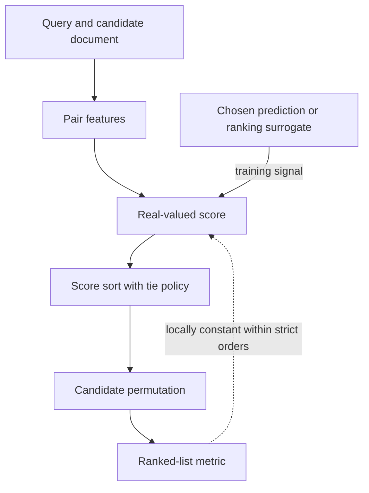
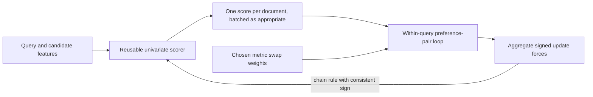
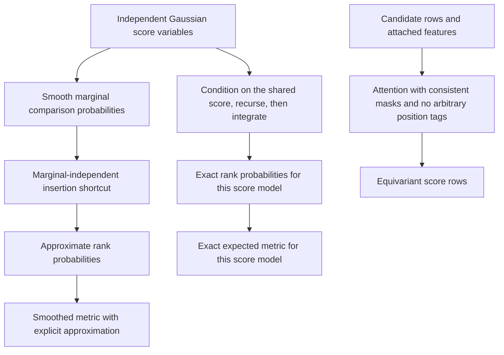
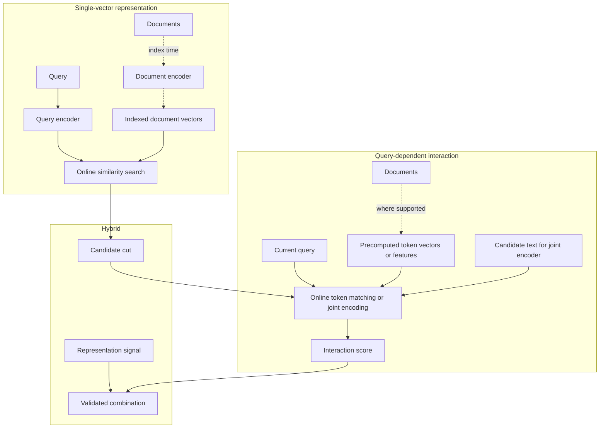

# Chapter 19: Learning to Rank
[00-START-HERE](../00-START-HERE.md) · [01-READING-ROUTES](../01-READING-ROUTES.md) · [18\_classical\_ir\_you\_are\_expected\_to\_know](18_classical_ir_you_are_expected_to_know.md) · [20\_dense\_retrieval](20_dense_retrieval.md)
Purpose: Explain how learning-to-rank objectives relate to ranked-list metrics, identify approximation and implementation limits, and choose a scorer and serving funnel under measured quality and resource constraints.
## TL;DR
- A ranked-list metric reads order, not score scale. Squared error can improve without changing that order, but this does not prove all regression-based rankers invalid.
- NDCG uses an explicit gain utility and position discounts. Expected gain is optimal for expected DCG under the stated assumptions; a random IDCG denominator changes the expected-NDCG objective.
- Pointwise classification can rank by expected gain rather than an argmax class. Ordinal models need correct threshold indexing and do not automatically optimize NDCG.
- RankNet scores can be computed once per document, then coupled through pair forces. Define update-force signs consistently. LambdaRank weights repairs by the chosen full or truncated metric change.
- The marginal SoftRank recurrence is an independence approximation, not an exact rank law for independent Gaussian scores. Conditional integration and one-based ranks repair that distinction.
- Set attention can be permutation-equivariant while remaining dependent on candidate membership. Trees can accept dense numeric features; no architecture wins by definition.
- Representation, late interaction and cross-encoding have different precomputation boundaries. A reranker cannot recover a candidate excluded from its input, and payload-read estimates are not complete serving latency.
## The story
Imagine a parcel depot that must place the most urgent parcels at the front of a conveyor.
Each customer request is a query. Each parcel is a candidate document. Human inspectors attach priority stickers from $`0`$ to $`4`$, which are relevance grades. The numbers show an order, but they do not promise that the jump from $`1`$ to $`2`$ is the same size as the jump from $`3`$ to $`4`$.
The depot first hires a clerk who minimizes numeric squared error. That error can fall while the conveyor order stays fixed. The shipping metric cannot distinguish two score vectors that induce the same ranking, even if their magnitudes differ greatly. This illustrates an objective mismatch in this setup, not a theorem that regression can never learn a useful order.
The sorting gate, $`\mathop{\mathrm{argsort}}\nolimits`$, retains order and a tie policy. For fixed labels, the ranked-list metric is locally constant wherever no relevant score order changes. Gradient-based training therefore needs a surrogate, a relaxation or a defined update rule; derivative-free optimization is another possibility, so a differentiable surrogate is not logically unavoidable for every learning algorithm.
A five-class pointwise inspector should not discard its distribution by emitting only the winning class: that creates at most five score buckets. Computing expected gain uses the whole distribution and matches a specified DCG utility. An ordinal inspector can learn a latent line with ordered thresholds, but a continuous output can still tie and does not by itself certify a metric-optimal ranking.
A pairwise referee asks which parcel should precede another. RankSVM and RankNet smooth preference errors; ordinary equal-weight pair losses do not directly price rank position. LambdaRank multiplies the repair force by the metric change of a swap. Whether a repair is valuable depends on both gains, both positions and the metric cutoff—not position alone.
A listwise supervisor can use a list-aware objective, pseudo-gradient or scorer. Gaussian score smoothing leads to rank probabilities, but a simple recurrence using unconditional pairwise probabilities approximates their dependence. LambdaMART fits trees to metric-weighted update targets. SetRank-style self-attention can preserve input-order symmetry without removing dependence on the competing set.
A representation worker computes document vectors before requests arrive. An interaction worker still performs query-dependent matching later. Some interaction models can precompute token vectors or other document features; a full joint cross-encoder score cannot generally be precomputed. The boundary concerns the final query-dependent computation, not a ban on all document-side preparation.
The depot retrieves candidates, then reranks a limited window when evaluation justifies it. A hybrid can combine complementary signals, but correlation alone does not measure its marginal gain. The final ranked set remains a subset of the reranker's input: no second-stage scorer can return a parcel it never received.
## Decoder table


| Technical term | Plain-English meaning | Why it matters |
| --- | --- | --- |
| Learning to Rank (LTR) | Training a model to order candidates for each query | It is the chapter’s central problem |
| Query $`q`$ | The user’s information request | Rankings are defined within one query |
| Candidate document $`d`$ | One item that might answer the query | The scorer orders these items |
| Relevance label $`y`$ | A human or behavioral judgment of usefulness | It supplies supervision |
| Query-document triple $`(q, d, y)`$ | One query, one candidate, and its label | It is the basic judged record |
| Feature map $`\phi (q, d)`$ | A vector of signals for one query-document pair | Traditional rankers score this vector |
| Feature dimension $`m`$ or $`F`$ | The number of features in a vector | The source uses $`46`$ and $`136`$ in named benchmarks |
| Candidate set $`D_q`$ and depth $`\lvert D_q\rvert`$ or $`n_q`$ | All judged candidates for query $`q`$ and their count | They define the per-query sort, loss normalization, and cost |
| Candidate count $`n`$, class count $`K`$, and cutoff $`k`$ | List length, number of relevance grades, and reported rank depth | The source uses each count for a different boundary |
| Indices $`i`$, $`j`$, and $`r`$ | $`i,j`$ index candidates; $`r`$ is a one-based rank, while $`u=r-1`$ counts candidates ahead | This avoids a zero denominator in the discount |
| Best Matching $`25`$ (BM25) | A lexical relevance score named in the source | It is a feature and a first-stage retriever |
| Term Frequency-Inverse Document Frequency (TF-IDF) | A term-weighting feature family | It is one input to traditional rankers |
| PageRank | A document-level importance feature | It complements query-dependent signals |
| Scorer $`f_{\theta}`$ | A model that maps features to a real score | Its scores induce the ranking |
| Parameters $`\theta`$ and metric $`M`$ | The scorer’s learned values and the ranked-list evaluation function | Training seeks parameters whose induced permutation raises the metric |
| Score $`s_i`$ | The scalar assigned to candidate $`i`$ | Sorting scores produces the output order |
| $`\mathop{\mathrm{argsort}}\nolimits`$ | The operation that returns indices in score order | It discards score magnitudes and keeps order |
| Permutation $`\pi _q`$ | The ordered candidate list for query $`q`$ | Ranking metrics read this object |
| Normalized Discounted Cumulative Gain at $`k`$ ($`\mathop{\mathrm{NDCG}}\nolimits@k`$) | A top-weighted graded ranking score normalized by the ideal order | It is the main reported metric |
| Discounted Cumulative Gain (DCG) | Graded gain reduced by rank-dependent discounts | It values useful documents near the top |
| Ideal Discounted Cumulative Gain (IDCG) | The best DCG over the declared candidate or judged universe | Use the same positive normalizer across compared orders; declare an all-zero-gain policy |
| Mean Reciprocal Rank (MRR) | A rank metric named by the source | It also reads order rather than score scale |
| Mean Average Precision (MAP) | A rank metric named by the source | It is another order-only evaluation |
| Gain $`g(y)`$ | The value assigned to a relevance grade | The standard form here is $`2^y - 1`$ |
| Discount | $`w_k(r)=\mathbf1[r\le k]/\log_2(1+r)`$ for $`r\ge1`$ | A truncated metric assigns zero discount beyond its cutoff |
| Surrogate loss | A substitute objective for learning from continuous scores | Useful for gradient methods; derivative-free optimization is another possibility |
| Squared error | A numeric prediction loss on a specified target coding | Raw ordinal coding selects a spacing; regression to metric gain can be principled for expected DCG |
| Shift invariance | A common within-query score shift preserves the ranking | A loss may additionally calibrate magnitudes without making good rankings impossible |
| Common score shift $`c`$ | One constant added to every score for a query | It exposes squared error’s mismatch with an unchanged ranking |
| Ordinal label | A label whose order is meaningful but whose spacing is not measured | Grades $`0`$ through $`4`$ have this status |
| Interval scale | A numeric scale with meaningful equal intervals but an arbitrary origin | A ratio scale additionally has a meaningful zero; relevance grades do not supply either automatically |
| Per-query normalization | Controlling each query group's total objective weight | Normalize rows or pairs according to the actual objective; zero-size groups need a policy |
| Head query | A query with many judgments or high frequency | Judgment depth can overweight it accidentally |
| Tail query | A query with few judgments | It can disappear from an unnormalized loss |
| Per-query $`z`$-score | Within-query standardization, defined only at nonzero variance | It adds numeric spacing assumptions and candidate-group dependence |
| Uniform Resource Locator (URL) | A document address | Its depth can be a ranking feature |
| Learning to Rank $`4.0`$ (LETOR $`4.0`$) | A public benchmark named by the source | It supplies $`46`$ features per pair |
| Microsoft Learning to Rank WEB30K (MSLR-WEB30K) | A public benchmark named by the source | It supplies $`136`$ features per pair |
| Microsoft Machine Reading Comprehension (MS MARCO) | A passage-ranking collection named by the source | It supplies binary judgments and a scale check |
| Pointwise method | A loss decomposing over individual labeled records | This does not force a univariate or candidate-independent scoring architecture |
| Pairwise method | A loss derived from within-query document preferences | It learns which candidate should beat another |
| Listwise method | A method whose loss, gradient, or scorer uses list structure | It can align more closely with a ranked-list metric |
| Classifier | A model predicting a class distribution | Utility scoring needs the full probabilities and a chosen gain; classification is not the only valid pointwise approach |
| Softmax | A normalized distribution over classes | A flat softmax treats grades as exchangeable classes |
| Cross-entropy | A loss for predicted class or preference probabilities | McRank and RankNet use forms of it |
| $`\mathop{\mathrm{Arg\,max}}`$ | Choosing the class with largest probability | It creates large tied buckets in graded ranking |
| Mode | The most probable class | It is not the same as expected relevance |
| Predicted distribution $`p_j(d)`$ | The probability that document $`d`$ has grade $`j`$ | Its full shape supports expected gain |
| Expected relevance | The probability-weighted mean of numeric grade codes | It can differ in order from expected exponential gain and can still tie |
| Expected gain | The probability-weighted metric utility | Sorting it maximizes expected DCG with fixed discounts; random IDCG needs a different expectation |
| Rearrangement inequality | Pairing larger expected gains with larger fixed discounts | The additive argument needs no independent-label assumption |
| McRank | A multiclass boosted-tree pointwise ranker | It ranks by expected relevance instead of raw regression |
| Ordinal regression | A latent score with ordered grade thresholds | It models class order but neither eliminates every tie nor guarantees optimal NDCG |
| Ordinal direction $`w`$ and threshold index $`r`$ | Latent score $`z=w^{\mathsf T}\phi`$, with grades $`0,\ldots,K-1`$ | Count crossed finite cut points, or use the first higher boundary minus one |
| Monotone thresholds $`b_1,\ldots,b_{K-1}`$ | $`b_1\le\cdots\le b_{K-1}`$ with $`b_0=-\infty`$, $`b_K=+\infty`$ | Endpoint sentinels include the lowest and highest class intervals |
| PRank | A perceptron method for ordinal ranking | It rotates one hyperplane and shifts offending thresholds |
| Perceptron | An online linear update rule | PRank adapts it to ordered classes |
| Large-margin ordinal model | A threshold model that separates neighboring intervals with slack | It extends PRank’s ordinal construction |
| Support Vector Machine (SVM) | A maximum-margin classifier | RankSVM applies it to difference vectors |
| Preference set $`I`$ | Within-query pairs where one label exceeds another | It is pairwise supervision |
| Difference vector $`x_i - x_j`$ | The feature contrast for a preferred pair | RankSVM classifies it through the origin |
| RankSVM | A maximum-margin pairwise ranker | It makes score differences shift-invariant |
| Regularization weight $`C_{\mathrm{SVM}}`$ | $`C_{\mathrm{SVM}}>0`$ multiplies RankSVM slack | It is distinct from the pairwise cross-entropy loss $`C`$ |
| Hinge loss | A margin penalty for an incorrect or weak preference | RankSVM uses its slack form |
| Slack $`\xi _{ij}`$ | The amount by which a pair misses the unit margin | RankSVM sums it across preferences |
| RankNet | A neural pairwise ranker with logistic cross-entropy | It gives smooth, equal-and-opposite pair forces |
| Logistic function $`\sigma`$ | A smooth map from a score gap to a probability | RankNet uses it for preference probability |
| Shape parameter $`\gamma`$ | The steepness applied to score differences | It controls RankNet’s logistic curve |
| Linear score drop $`\alpha`$ | The worked example’s score decrease per rank position | It fixes equal score gaps for the swap comparison |
| Score margin $`s_i - s_j`$ | The difference between two document scores | Pairwise losses depend on it, so they are shift-invariant |
| Softplus | The smooth value $`\log\bigl(1+\exp(-\mathrm{margin})\bigr)`$ | It is RankNet’s collapsed cross-entropy |
| Pair force $`\lambda _{ij}`$ | Positive $`\lambda_{ij}`$ raises preferred document $`i`$ and lowers $`j`$ | It is the negative score-gradient contribution, not the same signed derivative |
| Document force $`\lambda _{i}`$ | Aggregate signed negative-score-gradient target $`\lambda_i`$ | For RankNet, $`\nabla_\theta C=-\sum_i\lambda_i\nabla_\theta s_i`$ |
| Gradient factorization | Reusing univariate document scores before coupling them through pairs | It reduces repeated document-score work, not necessarily call count by the pair/document ratio |
| LambdaRank | RankNet-style forces weighted by metric change | It focuses learning where NDCG can move |
| Delta NDCG $`\Delta\mathrm{NDCG}_{ij}`$ | The chosen full or cutoff metric change from swapping two candidates | Magnitude depends on both gains, both discounts and positive fixed IDCG |
| Gains $`g_i,g_j`$ and ranks $`r_i,r_j`$ | $`g_i=2^{y_i}-1`$, $`g_j=2^{y_j}-1`$ and one-based $`r_i,r_j`$ | Gain differences are not raw grade differences |
| Metric truncation | Assigning zero discount after the evaluation cutoff | Pairs with both endpoints below it have zero swap weight; crossing pairs can still update deep documents |
| LambdaLoss | A family of loss-based interpretations of metric-aware ranking updates | Particular variants must be checked; arbitrary rank-reweighted forces need not form one smooth global gradient |
| SoftRank | Gaussian-score smoothing of a ranking objective | A recurrence using unconditional comparison marginals is an approximation to the stated Gaussian rank law |
| Gaussian score | $`Z_j=\mu_j+\varepsilon_j`$ with independent Gaussian noises | Comparisons against a shared $`Z_j`$ are dependent before conditioning |
| Smoothing width $`\sigma_G`$ | $`\sigma_G>0`$, the Gaussian score standard deviation | It is in score units and differs from RankNet steepness $`\gamma`$ |
| Cumulative normal function $`\Phi`$ | The smooth Gaussian probability function | It yields SoftRank’s pairwise outranking probability |
| Outranking probability $`\pi _{ij}`$ | $`\pi_{ij}=\Pr(Z_i>Z_j)`$ | Marginal outranking probabilities alone do not determine the exact joint rank law |
| Rank distribution $`p_j(r)`$ | $`p_j(r)`$ for one-based rank $`r=1,\ldots,n`$ | Conditional integration gives exact Gaussian ranks; $`\widetilde p_j`$ denotes the marginal shortcut |
| Insertion recurrence | A count-ahead update on $`u=0,\ldots,n-1`$ | It is exact conditionally on the shared score, but approximate with unconditional marginal probabilities |
| SoftNDCG | Expected NDCG under a specified smoothed rank law | Use a positive fixed label normalizer; state whether the rank law is exact or approximated |
| Lambda Multiple Additive Regression Trees (LambdaMART) | LambdaRank gradients fitted by boosted regression trees | It is the source’s production default for tabular features |
| Logistic steepness $`\gamma`$ in LambdaMART | Use the same logistic steepness $`\gamma>0`$ in both lambda sections | A second symbol must not silently reverse the gradient convention |
| Gradient-boosted regression tree | A sequence of trees fitted to residual targets | LambdaMART fits trees to document forces |
| Newton leaf step | An approximate second-order leaf update with stated curvature and regularization | A positive update force goes in the numerator; zero curvature needs a guard |
| SetRank | A multivariate set-scoring ranker | A document score may depend on competitors |
| Self-attention | A learned interaction among all candidate rows | It contextualizes each candidate in SetRank |
| Attention matrices $`Q,K,V`$ and head width $`d_h`$ | $`Q,K,V`$ have consistently permuted rows and per-head width $`d_h`$ | Use row-wise softmax and permute associated masks and features too |
| Permutation matrix $`P`$ | A reordering of candidate rows | It expresses the required input-order symmetry |
| Permutation equivariance | Reordering candidates reorders their corresponding scores | It does not prevent score changes when candidate membership changes |
| Positional embedding | A signal for input position | SetRank removes it to preserve permutation equivariance |
| Ordinal prior-rank embedding | A deliberate attached feature for each document's first-stage rank | It can preserve equivariance if it travels with the document; shuffled row position is different |
| ListNet | A permutation-likelihood method using a top-one distribution | It is cheap but does not optimize NDCG directly |
| Plackett-Luce softmax | A distribution over ranking choices | ListNet uses its top-one form |
| ListMLE | A method that maximizes ground-truth permutation likelihood | It is another listwise likelihood branch |
| NeuralSort | A later differentiable sorting relaxation named by the source | It carries forward SoftRank’s relaxation idea |
| Univariate scorer | A score depending on one query–document pair and candidate-independent features | A fixed model and consistent tie policy can support shard merging and versioned caching |
| Multivariate scorer | A scorer whose outputs depend on the candidate set | It can break shard merges and pagination stability |
| Representation model | A scorer that separately encodes query and document | Document vectors can be precomputed |
| Interaction model | A scorer with online query–document matching or joint encoding | Query-independent document token vectors and features may still be precomputed |
| Hybrid model | A sum or funnel using representation and interaction | It combines channels that fail differently |
| Bi-encoder | A modern representation model with separate encoders | It supports corpus-scale retrieval |
| Cross-encoder | A scorer jointly encoding the query and candidate text | Its scorer arity and training-loss arity are separate; quality and cost are empirical |
| Similarity function $`\mathop{\mathrm{sim}}\nolimits`$ | Cosine or dot-product comparison of vectors | It joins precomputed representations |
| Encoders $`\eta_q,\eta_d`$ | $`\eta_q`$ and $`\eta_d`$ map texts to comparable vectors | Their parameters may be shared or distinct |
| Corpus size $`N`$ | The number of indexed documents | It separates offline document work from per-query work |
| Index-time precomputation | Computing query-independent document work before requests arrive | Possible for single-vector and many late-interaction models, not their complete unknown-query score |
| Deep Structured Semantic Model (DSSM) | A representation ranker using trigram hashing and cosine | It starts the lineage described by the source |
| Letter-trigram hashing | Mapping words to overlapping three-character features | It handles words outside a fixed vocabulary |
| Multi-hot vector | A vector marking every present trigram | DSSM projects it to $`128`$ dimensions |
| Click-through supervision | Behavior-derived training labels | Exposure and examination bias limit treating unclicked results as true negatives |
| Contrastive loss | A family comparing positives with sampled alternatives | Sampling, weighting, supervision, distillation and regularization can differ among methods |
| Dense Passage Retriever (DPR) | A later representation model named by the source | It reuses the softmax-over-negatives shape |
| Contriever | A representation retriever named by the source | It retains the same scoring structure |
| Sparse Lexical and Expansion model (SPLADE) | A sparse retriever named by the source | It is another descendant in the stated loss lineage |
| Convolutional DSSM (C-DSSM) | DSSM with sequence convolution and max pooling | It learns phrases rather than a bag |
| Long Short-Term Memory DSSM (LSTM-DSSM) | A recurrent DSSM variant | Long-range limitations are practical and statistical, not a hard hundred-token length bound |
| MatchPyramid | An interaction ranker over a token similarity matrix | It keeps detailed query-document matches |
| Interaction matrix $`M_{ij}`$ | Cosine similarity for query token $`i`$ and document token $`j`$ | It exposes every token pair to the ranker |
| Two-dimensional convolutional neural network ($`2`$-D CNN) | Filters sliding over the interaction matrix | MatchPyramid uses it to learn match patterns |
| Receptive field | The input region a convolutional filter can combine | Here it spans positions in both texts |
| Deep Relevance Matching Model (DRMM) | An interaction model using similarity histograms | It makes input width independent of document length |
| Histogram aggregator | Fixed-width counts or summaries of similarity entries | It removes their explicit order and downstream length dependence, not all matching cost or contextual information |
| Multilayer perceptron (MLP) | A feed-forward network over fixed-width bins | DRMM learns each histogram bin’s contribution |
| $`32`$-bit floating point (fp32) | Four-byte numeric storage | It sets vector and token-embedding byte counts |
| Vector budget | Nominal finite-precision representation payload | An all-sequences pigeonhole bound does not prove a specific rare literal is lost in a finite corpus |
| Duet | A model that sums representation and interaction channels | Its joint model beat either half in the source claim |
| Approximate nearest neighbor (ANN) index | A fast vector-search structure | Rebuilding it can change tie order from the first stage |
| Queries per second (QPS) | Request throughput | It makes cache and sequential-call costs operational |
| Large language model (LLM) reranker | A listwise or pointwise reranker using an LLM | Its serving boundary depends on windowing and latency |
| Floating-point operations (FLOPs) | Arithmetic work | The source contrasts it with bytes moved |
| $`p_{99}`$ latency | The 99th-percentile response time | It is the tail-latency budget in a design probe |
| $`\mathop{\mathrm{Recall}}\nolimits@k`$ | Fraction of a declared gold set returned by cutoff $`k`$ | Input coverage caps downstream recall; an NDCG ceiling depends on available gains instead |
| MaxSim | A late-interaction token-matching aggregation named by the source | Its cost must be measured; an unmatched latency ratio cannot isolate its contribution |
| Contextualized Late Interaction over Bidirectional Encoder Representations from Transformers (ColBERT) | A multi-vector late-interaction system named by the source | Its reported latency is not a matched validation of the simple payload-read proxy |


## Core mechanics
### Mathematical conventions
For query $`q`$, $`D_q`$ is a fixed candidate set of size $`n_q>0`$. A score-descending permutation $`\pi_q`$ uses a specified deterministic tie policy, and $`r_i\in\{1,\ldots,n_q\}`$ is candidate $`i`$'s one-based rank. Classes are instead zero-based: $`y_i\in\{0,\ldots,K-1\}`$. Use $`n`$ for a candidate count, $`K`$ for class count and a positive integer $`k`$ for the evaluation cutoff. A score can still tie; continuous output does not guarantee a total order.
Choose a gain utility explicitly. Here $`g(y)=2^y-1`$ and $`w_k(r)=\mathbf1[r\le k]/\log_2(1+r)`$. Then $`\mathrm{DCG}@k=\sum_i g(y_i)w_k(r_i)`$ and $`Z_q=\mathrm{IDCG}@k`$ is the ideal DCG over the stated evaluation universe. Use $`\mathrm{NDCG}@k=\mathrm{DCG}@k/Z_q`$ only for $`Z_q>0`$; all-zero-gain queries need a declared skip or zero convention. Averaging queries, weighting traffic and averaging rows are different objectives. Candidate-local and fixed-universe IDCGs are not interchangeable when comparing retrievers.
For RankNet, $`\gamma>0`$, $`I_q=\{(i,j):y_i>y_j\}`$ and $`C=\sum_{(i,j)\in I_q}C_{ij}`$. Define $`\lambda_{ij}>0`$ as the force raising the preferred document, and $`\lambda_i`$ as its aggregate signed update force. Thus $`\partial C/\partial s_i=-\lambda_i`$ for ordinary RankNet; the parameter gradient has a minus sign. Metric-weighted lambdas are pseudo-gradients with rank weights recomputed between updates. Gaussian smoothing width $`\sigma_G>0`$ is distinct from the logistic link or its steepness $`\gamma`$.
An additive expected-DCG argument does not require independent document labels. Independent Gaussian scores, however, do not make all comparisons against one shared score independent. The displayed marginal-probability insertion shortcut below is an approximation; conditional integration gives the correct Gaussian rank law. One-based ranks avoid a zero discount denominator.
A pointwise loss and a univariate scorer are separate properties. Caching, sharding and input-order stability need query/document features independent of the competing candidate set and an appropriate model/index version. Count scored examples rather than confusing them with batched forward-call counts. A pair comparator and a query–document scorer can have different throughput.
Use decimal units, $`1\,\mathrm{GB}=10^9\,\mathrm B`$, $`1\,\mathrm{TB}=10^{12}\,\mathrm B`$, and fp32 payload $`4\,\mathrm B`$ per number. One multiply-accumulate counts as two FLOPs. Keep full precision until reporting. FLOP-time and bandwidth divisions are explicitly conditional work proxies, not measured latency, throughput, training time or a $`p_{99}`$ guarantee. Reported source experiments and software claims are not independently reproduced in this pass.
### 19.1 The LTR setup and limits of raw-label regression
#### What it is
Data contain $`(q,d,y)`$ records and features $`\phi(q,d)\in\mathbb R^m`$, for example lexical scores, PageRank, URL depth or behavioral signals. The source reports $`46`$ LETOR $`4.0`$ features and $`136`$ MSLR-WEB30K features; benchmark schemas and label subsets should be checked rather than assuming every named collection has identical grade support. A univariate scorer and its score-descending order are:

```math
s_i = f_{\theta}\bigl(\phi(q,d_i)\bigr)
```


```math
\pi_q = \mathop{\mathrm{argsort}}\nolimits_{\downarrow}\bigl(s_1,\ldots,s_{\lvert D_q\rvert}\bigr)
```

With a fixed evaluation universe and tie policy, the per-query metric is $`M(\pi_q,y_q)`$. A macro-query objective, or an explicitly chosen weighted version, is:

```math
\max_\theta\ \sum_q\omega_q M(\pi_q,y_q),\qquad \omega_q\ge0,\quad\sum_q\omega_q=1.
```

As a function of the scores, this metric is constant inside regions with a fixed strict order. With suitable continuous scorers it is locally constant in parameters in those regions. A crossing can create a jump when gains and discounts differ; equal-gain swaps need not change it. Ties and discontinuous scorers require their own handling. There is no useful ordinary metric gradient in the fixed-order regions.
#### Why it exists
Gradient methods use a differentiable surrogate, relaxation or pseudo-gradient. Pointwise, pairwise and listwise primarily describe how supervision or list structure enters the objective; they do not force the scorer to have the same arity. Pointwise training may use a set-dependent encoder, and pairwise RankNet may use a univariate scorer. Derivative-free metric optimization is also possible, with different costs.
#### What fails without alignment
Squared error is:

```math
\mathcal L_{\mathrm{reg}}(\theta)=\sum_q\sum_{i=1}^{n_q}(s_{q,i}-y_{q,i})^2.
```

Squared error is not invariant to a common score shift. Adding $`c`$ within one query preserves the ranking but changes the numeric loss by:

```math
L_q(\boldsymbol s+c\boldsymbol1,y)-L_q(\boldsymbol s,y)=2c\sum_{i=1}^{n_q}(s_i-y_i)+n_qc^2.
```

Three distinctions matter. First, lacking shift invariance shows that squared error also calibrates magnitudes; it is not proof that it cannot learn a good ranking. Pointwise cross-entropy is not shift-invariant in every parameterization either. Second, ordinal labels supply order, while squared error on their numeric coding selects a spacing. Exponential gain is itself an explicit utility choice: $`g(4)/g(3)=15/7\approx2.142857`$ versus coding ratio $`4/3\approx1.333333`$, a ratio of ratios approximately $`1.607143`$. Ordinal labels alone give no intrinsic meaning to either ratio. Regression to $`g(y)`$ estimates $`\mathbb E[g(y)\mid\phi]`$ under squared loss in an ideal well-specified population model, so it can be appropriate for expected DCG.
Third, row-summed loss assigns more total coefficient mass to deeper query groups. With $`500`$ versus $`5`$ judged rows and equal per-row weights, coefficient mass is $`100{:}1`$, or $`500/505\approx99.0099\%`$ versus $`0.9901\%`$; actual loss contributions also depend on errors. A two-query macro metric instead weights each query $`50\%`$. Per-query normalization addresses that weighting, not every utility mismatch. Within-query $`z`$-scoring adds its own numeric assumptions, can be undefined at zero variance, and makes targets depend on the candidate group. Classification, ordinal models and regression to a chosen gain are all possible pointwise approaches.
#### Worked example
Use five candidates with grades $`y = (4, 3, 0, 0, 0)`$. The ideal discounted gain is:

```math
Z=\mathop{\mathrm{IDCG}}\nolimits=15+\frac7{\log_2 3}\approx19.416508275.
```

For grades $`(4,3,0,0,0)`$, A predicts $`(2,2.1,0,0,0)`$ and has squared error $`4.81`$. Its top pair is inverted: $`\mathrm{DCG}_A=7+15/\log_2 3\approx16.463946304`$ and $`\mathrm{NDCG}_A\approx0.847935482`$. B predicts $`(0.5,0.2,0.1,0.1,0.1)`$, has squared error $`20.12`$, and has the ideal order, hence NDCG $`1`$. The numeric-loss ratio is $`20.12/4.81\approx4.182952`$, while the NDCG difference is approximately $`0.152064518`$, or $`15.206452`$ percentage points on its zero-to-one scale.
For $`L=\sum_i(s_i-y_i)^2`$, the score-gradient $`\ell_1`$ norms are $`5.8`$ and $`13.2`$, ratio approximately $`2.275862`$. These are gradients with respect to scores, not parameter-gradient norms or guaranteed model-update sizes; parameter gradients also include $`\partial s_i/\partial\theta`$. The example shows different preferences for calibration and order, not universal inconsistency of squared loss. The source cites McRank's reported classification/regression comparison and named survey baselines as empirical context, not a proof that omitted methods cannot work.
#### Cost, complexity, and practice choices
The source's motivating project has $`40{,}000`$ judged rows, a quarter of work, a six-figure budget, halved training loss and only $`0.004`$ movement in held-out $`\mathop{\mathrm{NDCG}}\nolimits@10`$. Those are a vignette, not a controlled causal result. Validate the objective, features, sampling and labels instead of assuming more epochs will fix the problem. For a row-decomposed macro-query objective, weight by $`1/n_q`$ or use balanced sampling; a pair-summed loss instead needs its own query normalization, such as $`1/\lvert I_q\rvert`$ when nonzero. Explicit traffic weighting is a different choice.
Freeze candidate generation or use a common judged evaluation universe when comparing rankers, and report retrieval coverage separately. A final set cannot include an excluded item. With gold set $`G_q`$, reranker input $`S_q`$ and final cutoff $`k`$, its recall is at most $`\min(k,\lvert G_q\cap S_q\rvert)/\lvert G_q\rvert`$ for $`\lvert G_q\rvert>0`$. An NDCG ceiling instead depends on which gains are available and their ideal attainable positions; it is not numerically the recall value.
Use a frozen evaluation set, query-level uncertainty and the product's final metric as release evidence. Surrogate loss also diagnoses optimization before it diverges, but raw loss levels are not calibrated quality. Collapsing grades or rewriting a noisy boundary is a source heuristic requiring validation. Binary labels remove one graded-utility issue but not exposure bias, sampling bias or metric mismatch. Dwell time is numeric, yet censoring, intent, confounding and cross-query comparability still matter; equal thirty-second durations need not mean equal usefulness.
### 19.2 Pointwise classification and ordinal regression
#### What it is
A pointwise objective decomposes over labeled examples but should retain query groups for weighting, sampling and evaluation. A univariate $`s(q,d)`$ with candidate-independent features permits per-pair caching and document batching under an appropriate model/version key. The objective alone does not guarantee that property. Score $`n`$ candidates, sort with a tie policy, and cut at the chosen $`k`$; class count $`K`$ is separate. A binary classifier can rank by $`P(y=1\mid q,d)`$ rather than its hard predicted class. Index changes, feature normalization or candidate membership can still alter the serving problem.
#### Why expected gain fixes the head
An unconstrained flat softmax treats class names symmetrically in its loss; it does not encode ordinal distances by itself. Hard $`\arg\max`$ classes place $`100`$ candidates into at most $`K=5`$ score buckets, with ties whenever sufficiently many candidates share a predicted class. Let $`p_j(d)=P(y=j\mid q,d)`$ and choose $`g(y)=2^y-1`$. The expected gain is:

```math
\mathbb{E}[g(y_d)] = \sum_{j=0}^{K-1}(2^j-1)p_j(d)
```

For a fixed candidate set and permutation, linearity of expectation gives:

```math
\mathbb E[\mathrm{DCG}@k]=\sum_{\ell=1}^{\min(k,n)}\frac{\mathbb E[g(Y_{\pi(\ell)})]}{\log_2(\ell+1)}.
```

Decreasing discounts and the rearrangement argument make descending $`\mathbb E[g(y_i)]`$ optimal for expected DCG if those conditional expectations are correct. Label independence is unnecessary. McRank's expected grade $`\sum_j j p_j`$ uses linear utility instead. It need not agree with exponential gain: grade three with certainty has mean grade $`3`$ and gain $`7`$, while a fifty-fifty mixture of grades four and zero has mean grade $`2`$ but expected gain $`7.5`$.
Expected NDCG requires care. If IDCG is a fixed positive normalizer, maximizing expected DCG also maximizes the normalized objective. If the whole label vector $`Y`$ and $`Z(Y)=\mathop{\mathrm{IDCG}}\nolimits(Y)`$ are uncertain, the optimal additive terms are instead $`\mathbb E[g(Y_i)/Z(Y)]`$ under the declared zero-normalizer policy. Counterexample at cutoff one: with probability $`0.1`$ only A has gain $`15`$; with probability $`0.9`$ only B has gain $`1`$. Expected gains favor A, $`1.5>0.9`$, but expected NDCG favors B, $`0.9>0.1`$. Thus expected-gain ranking is a principled expected-DCG score, not an unconditional expected-NDCG theorem.
#### Ordinal alternative
For zero-based grades, an ordinal model learns latent score $`z=w^{\mathsf T}\phi`$ and $`K-1`$ ordered finite cut points. Add endpoint sentinels when using a first-boundary expression:

```math
b_0=-\infty,\qquad b_1\le\cdots\le b_{K-1},\qquad b_K=+\infty.
```

With equality assigned to the upper interval, the two equivalent predictions are:

```math
\widehat y=\sum_{r=1}^{K-1}\mathbf1[z\ge b_r]=\min\{r\in\{1,\ldots,K\}:z<b_r\}-1.
```

The source attributes PRank to Crammer and Singer (2001), and a large-margin ordinal construction to Shashua and Levin (2002). Their update rules and threshold-order constraints are method-specific. The continuous latent score can rank after thresholds are discarded, but can still tie and need not equal expected metric gain. If probabilities are required, an ordered-probability model can supply a distribution for utility scoring. More than five grades or noisy adjacent labels does not mathematically guarantee an ordinal model wins.
#### What fails without it
Ranking by maximum class confidence is not ranking by utility; a high-confidence low grade can lose to a less certain higher-grade distribution. The full distribution and chosen gain determine the expectation. Pointwise objectives do not directly compare within-query preferences unless coupled through features or the model. With equal row weights, $`500`$ versus $`20`$ examples gives $`25{:}1`$ coefficient mass, not necessarily that loss ratio. A $`90\%`$ majority class can produce high classification accuracy without a useful top ranking. At $`K=2`$, expected grade and exponential expected gain both equal $`p_1`$; hard argmax remains binary and does not become the continuous probability score.
#### Worked example
Use $`10`$ candidates. Truth is $`A = 4`$, $`B = C = 3`$, $`D = E = F = 2`$, and the final four are $`0`$. Exponential gains are $`15, 7, 7, 3, 3, 3`$, then four zeros. The source reports the ideal value as:

```math
Z_{10}=15+\frac7{\log_2 3}+\frac7{\log_2 4}+\frac3{\log_2 5}+\frac3{\log_2 6}+\frac3{\log_2 7}\approx26.437717932.
```

Truth is A grade $`4`$, B/C grade $`3`$, D/E/F grade $`2`$, and four grade-zero candidates. For A at positions one, two or three, keeping the remaining gains ideally placed, DCGs are approximately $`26.437717932`$, $`23.485155961`$ and $`22.437717932`$. NDCGs are $`1`$, $`0.888320090`$ and $`0.848701011`$; the latter placements lose approximately $`2.952561971`$ and exactly $`4`$ DCG.
Use distributions $`p(A)=(0,0.05,0.15,0.45,0.35)`$, $`p(B)=(0,0.05,0.25,0.50,0.20)`$ and $`p(C)=(0.05,0.10,0.30,0.45,0.10)`$. All modes are class three. If the six head orders are uniformly likely, each A position occurs twice and mean NDCG is approximately $`0.912340367`$. Expected grade scores $`(3.10,2.85,2.45)`$ and exponential gain scores $`(8.90,7.30,5.65)`$ both rank A/B/C in this particular example and give NDCG $`1`$, with the other seven held fixed. Relative to uniform ties, the gain is approximately $`0.087659633`$ absolute, or $`9.608216\%`$ relative.
A different baseline breaks the modal tie by class-three confidence and then places A before C under an explicit secondary tie policy: B/A/C scores $`0.888320090`$. Against that baseline, ideal scoring gains approximately $`0.111679910`$ absolute, or $`12.572035\%`$ relative—not the uniform-tie improvement. Computing expectations from existing probabilities needs no extra encoder evaluation, but does require a calibrated or otherwise useful distribution. The source names monoT5's true/false token scoring; the precise probability normalization is implementation-specific and should not be inferred from the ordinal example.
#### Cost, complexity, and practice choices
At a stipulated throughput $`250`$ query–document examples per second, $`100`$ univariate scores require $`0.4\,\mathrm s`$ of throughput work. They may be one or several batched calls, not necessarily a hundred separate calls. A separate joint pair comparator would have $`\binom{100}{2}=4{,}950`$ comparisons; only if its own measured throughput were also $`250\,\mathrm{s^{-1}}`$ would that be $`19.8\,\mathrm s`$. The rough comparison-sort count $`100\log_2 100\approx664.385619`$ would give $`2.657542\,\mathrm s`$ under that same additional assumption. Actual comparison counts, dependency depth, batching and comparator consistency depend on the sorting algorithm; there is no general $`\log_2 n`$-round guarantee. A univariate RankNet scorer already supplies scores and does not need pair-comparator serving.
Normalize pointwise losses per query when that matches evaluation; handle empty groups explicitly. Prefer a utility expectation to hard class buckets, and evaluate latent ordinal scores instead of assuming they are metric-optimal. Cross-query calibration is needed only for a product decision that uses comparable absolute values, with query features and uncertainty represented.
A width-$`20`$, stride-$`10`$ window over $`100`$ candidates has $`1+(100-20)/10=9`$ windows. They are sequential only if the chosen reranking schedule feeds one window's results into the next; independent windows can run in parallel and then need a defined merge. A pointwise $`100\to20`$ followed by listwise $`20\to10`$ funnel is a source heuristic, not a correctness or latency law. Keep loss arity separate from scorer arity: a cross-encoder can be univariate while trained with pairwise or listwise supervision.
### 19.3 Pairwise RankSVM, RankNet, and LambdaRank
#### What it is
Within one query, use only strictly preferred labeled pairs; ties require a separate policy:

```math
I_q=\{(i,j):y_i>y_j\}.
```

Keep every pair within its query. For a linear scorer $`s_i=w^{\mathsf T}x_i+b`$, the common intercept cancels: $`s_i-s_j=w^{\mathsf T}(x_i-x_j)`$. Thus the difference-vector preference test is through the origin; this does not forbid bias terms in all underlying scorers. A soft-margin RankSVM program, with $`C_{\mathrm{SVM}}>0`$, is:

```math
\min_{w,\{\xi_{ij}\}}\ \frac12\lVert w\rVert_2^2+C_{\mathrm{SVM}}\sum_{(i,j)\in I_q}\xi_{ij}.
```


```math
w^{\mathsf T}(x_i-x_j)\ge1-\xi_{ij},\qquad \xi_{ij}\ge0\quad\text{for every }(i,j)\in I_q.
```

The source attributes the method to Herbrich and colleagues (2000), with a search application by Joachims (2002). Its click example turns a click on result three after skipping results one and two into two inferred preferences. Such behavior is not a verified relevance label: exposure, position and examination bias affect which comparisons are defensible.
#### RankNet and factorization
RankNet, attributed to Burges and colleagues (2005), can use a univariate neural scorer. For a strictly preferred pair, set the probability target to one and use a logistic link of steepness $`\gamma>0`$:

```math
P_{ij}=\frac1{1+\exp[-\gamma(s_i-s_j)]},\qquad \overline P_{ij}=1\quad ((i,j)\in I_q).
```

Cross-entropy collapses to:

```math
C_{ij}=\log\bigl(1+\exp(-\gamma(s_i-s_j))\bigr)
```

Differentiate with respect to scores. Define the positive update force $`\lambda_{ij}`$ to raise the preferred document under gradient descent:

```math
\frac{\partial C_{ij}}{\partial s_i}=-\frac{\gamma}{1+\exp[\gamma(s_i-s_j)]}=-\lambda_{ij}.
```


```math
\frac{\partial C_{ij}}{\partial s_j}=+\lambda_{ij}.
```

Aggregate the signed update forces over the query; then $`\sum_i\lambda_i=0`$ because each pair contributes once with each sign:

```math
\lambda_i=\sum_{j:(i,j)\in I_q}\lambda_{ij}-\sum_{j:(j,i)\in I_q}\lambda_{ji}.
```

For $`C=\sum_{(i,j)\in I_q}C_{ij}`$ and differentiable scores, the chain rule therefore gives the negative sign below. A descent update is $`\theta\leftarrow\theta+\eta\sum_i\lambda_i\nabla_\theta s_i`$, for learning rate $`\eta>0`$:

```math
\nabla_\theta C=-\sum_{i=1}^{n_q}\lambda_i\nabla_\theta s_i.
```

Compute $`n_q`$ query–document scores and retain their computation graph; the pair loop then assembles $`O(\lvert I_q\rvert)`$ forces before backpropagation. This counts scored examples, not necessarily separate network calls: batching can combine them. The factorization requires reusable univariate scores and does not apply unchanged to a genuinely joint pair comparator. Any query-normalization factor must also multiply the gradient.
#### Why LambdaRank exists
Ordinary equal-weight RankSVM and RankNet use score gaps without directly pricing positions. At equal gaps they treat preferences alike unless sampling or other weights intervene. The source attributes LambdaRank to Burges, Ragno and Le (2006). Use the chosen gain $`g_i=2^{y_i}-1`$, fixed positive normalizer $`Z_q`$ and cutoff discount $`w_k`$ to compute the swap magnitude:

```math
\bigl|\Delta_{ij}(\mathrm{NDCG}@k)\bigr|=\frac{\lvert g_i-g_j\rvert\,\lvert w_k(r_i)-w_k(r_j)\rvert}{Z_q},\qquad Z_q>0.
```


```math
\lambda_{ij}^{\mathrm{LR}}=\frac{\gamma\,\lvert\Delta_{ij}(\mathrm{NDCG}@k)\rvert}{1+\exp[\gamma(s_i-s_j)]},\qquad (i,j)\in I_q.
```

Multiplication by an already available swap weight is one extra scalar multiplication per pair, but obtaining ranks, discounts and normalizers also costs work. The source says more than ten candidate approximations were tested. For $`w(r)=1/\log_2(1+r)`$, $`\lvert w'(100)\rvert\approx3.222092428\times10^{-4}`$ and $`w(100)-w(101)\approx3.199415917\times10^{-4}`$. The derivative differs by approximately $`0.708770\%`$ of the discrete step, so “within $`0.71\%`$” is the appropriate rounded statement. This is a finite-difference analogy, not a proof that the entire metric has an ordinary position gradient.
#### What fails without it
The source vignette raises pairwise validation accuracy from $`0.71`$ to $`0.84`$ over six hours while $`\mathop{\mathrm{NDCG}}\nolimits@10`$ stays near $`0.3869`$. That is possible because improvements outside the cutoff need not affect the product metric. Pairwise accuracy is diagnostic, not a substitute for the release metric. If metric swap weights are frozen, weighted RankNet has an ordinary weighted logistic loss. Recomputing rank-dependent weights gives a piecewise update rule; it does not automatically yield the gradient of one globally smooth scalar objective or a convergence guarantee. Having an update vector is enough to run an optimizer, not enough to prove descent. The source cites Donmez, Svore and Burges (2009) for empirical evidence, and Wang and colleagues (2018) for LambdaLoss formulations. Those formulations and implementations must be distinguished rather than assuming every lambda variant is the same loss.
#### Worked example
Take $`n=120`$ candidates with binary relevance, positives at ranks two and $`51`$, score drop $`\alpha=0.1`$ per rank, and $`\gamma=1`$. Then $`Z=1+1/\log_2 3\approx1.630929754`$. Swaps $`1\leftrightarrow2`$ and $`50\leftrightarrow51`$ each have preferred-document score margin $`-0.1`$, RankSVM unit-margin slack $`1.1`$, and RankNet force $`1/(1+\exp(-0.1))\approx0.524979187`$. The opposite exponential sign gives $`0.475020813`$ and would be the wrong value for this margin.
There are $`236`$ positive–negative preference pairs. Summing the positive pair-force magnitudes, pairs with both endpoints below rank ten receive approximately $`71.384845\%`$ of ordinary RankNet mass. With full-list NDCG weights, the head-swap magnitude is $`0.226294386`$ and the rank-$`50`$ magnitude is $`0.000531212828`$, a ratio approximately $`425.995709`$. The both-below-ten pair-force share falls to approximately $`21.561205\%`$. These are shares of pair-force sums, not norms of the aggregated document or parameter gradients, where cancellation and Jacobians matter.
For $`\mathop{\mathrm{NDCG}}\nolimits@10`$ weights, pairs with both endpoints below ten have exactly zero weight. A deep document can still receive force through a pair that crosses the cutoff. The top repair changes $`\mathop{\mathrm{NDCG}}\nolimits@10`$ from approximately $`0.386852807`$ to $`0.613147193`$: an absolute gain $`0.226294386`$, or approximately $`58.496250\%`$ relative. The $`50/51`$ repair changes that truncated metric by zero. In this actual label configuration, candidates at ranks $`100`$ and $`101`$ are both irrelevant, so their swap has zero full-list and truncated metric change; a positive–negative pair there would be a different hypothetical configuration.
#### Cost, complexity, and practice choices
For a separate grade-count split $`(80,20,12,6,2)`$ across grades zero through four, $`\binom{120}{2}=7{,}140`$ unordered pairs contain $`3{,}432`$ same-grade and $`3{,}708`$ unequal-grade pairs. A deliberately naive unshared univariate implementation evaluating both documents for every preferred pair performs $`2\times3{,}708=7{,}416`$ document-score evaluations, versus $`120`$ reused scores: $`61.8`$ times as much document-scoring work. The number $`3{,}708/120=30.9`$ is a pair-count/document-count ratio, not a same-unit network-call or latency speedup. A joint pair comparator instead consumes $`3{,}708`$ pair inputs and is a different architecture. Pair enumeration and backward aggregation still cost work after scores are reused; the ratio grows on the order of $`n`$ only when a nonvanishing fraction of all pairs remains unequal-grade.
For the explicit full-bin rank recurrence in Section $`19.4`$, $`O(n^2)`$ describes one document's rank distribution; repeating it for all $`n`$ documents gives $`O(n^3)`$ by that algorithm. Do not confuse those scopes or treat them as a lower bound for all implementations.
Use metric-aware weighting as a baseline when the product metric is truncated and discounted, and validate it against alternatives. At a fixed ten-chunk serving cutoff, $`\Delta\mathop{\mathrm{NDCG}}\nolimits@10`$ explicitly matches that depth; retune if the served depth changes. Assert query-local pair construction and a deliberate per-query weighting policy. For pure $`\mathop{\mathrm{Recall}}\nolimits@100`$, swap change is zero except for relevant–irrelevant pairs crossing the cutoff. Truncated NDCG at $`100`$ is a useful possible surrogate, not exact recall optimization. A generator sensitive to ordering also needs measures beyond candidate recall.
### 19.4 Listwise SoftRank, LambdaMART, and SetRank
#### What it is
For fixed labels and one-based ranks, use the same cutoff and ideal normalizer in training and evaluation:

```math
\mathrm{DCG}@k=\sum_{j=1}^{n}g(y_j)w_k(r_j),\qquad w_k(r)=\frac{\mathbf1[r\le k]}{\log_2(1+r)}.
```


```math
\mathrm{NDCG}@k=\frac{\mathrm{DCG}@k}{Z_q},\qquad Z_q=\mathrm{IDCG}@k>0.
```

A small score change that preserves the strict order leaves the metric fixed. A crossing may jump the metric when the swapped gains and discounts differ; equal-gain or both-below-cutoff swaps need not change it. The ordinary score gradient is zero inside strict-order regions and may be undefined at consequential boundaries. The following routes change the objective, update rule or scorer in different ways.
#### Route one: SoftRank
The source attributes SoftRank to Taylor and colleagues (2008). Gaussian score smoothing starts from model means $`\mu_j=f(x_j)`$ and independent noise $`\varepsilon_j`$ with a positive standard deviation $`\sigma_G`$:

```math
Z_j=\mu_j+\varepsilon_j,\qquad \varepsilon_j\overset{\mathrm{iid}}\sim\mathcal N(0,\sigma_G^2),\qquad \sigma_G>0.
```

Independent score noises give the following marginal pair probability. They do not make different comparisons against the shared random score $`Z_j`$ independent:

```math
\pi_{ij}=\Pr(Z_i>Z_j)=\Phi\!\left(\frac{\mu_i-\mu_j}{\sqrt2\,\sigma_G}\right).
```

Enumerate the other candidates as $`i_1,\ldots,i_{n-1}`$. A shortcut treats their outranking indicators as independent Bernoulli variables with these marginal probabilities. Writing $`u`$ for the zero-based count ahead of $`j`$, its approximate recurrence is:

```math
\begin{aligned}
\widetilde b_{j,0}(u)&=\mathbf1[u=0],\\
\widetilde b_{j,m}(u)&=\pi_{i_mj}\widetilde b_{j,m-1}(u-1)
 +(1-\pi_{i_mj})\widetilde b_{j,m-1}(u),\\
\widetilde p_j(r)&=\widetilde b_{j,n-1}(r-1),\qquad r\in\{1,\ldots,n\}.
\end{aligned}
```

Out-of-range bin values are zero. The number ahead starts at $`u=0`$, but the corresponding rank is $`r=u+1`$, so its discount is $`1/\log_2(2+u)`$, never $`1/\log_2(1+u)`$. Smooth pair probabilities make this shortcut differentiable; they do not make it the exact Gaussian rank law. For three equal-mean iid scores, exact ranks are uniform $`(1/3,1/3,1/3)`$, whereas the marginal shortcut gives $`(1/4,1/2,1/4)`$.
To compute the exact rank distribution under the stated independent Gaussian score model, condition on $`Z_j=z`$. Then comparisons are independent conditional on $`z`$, with $`a_i(z)=\Pr(Z_i>z)=\Phi((\mu_i-z)/\sigma_G)`$. Apply the same recurrence to $`b_{j,m}(u;z)`$ using $`a_{i_m}(z)`$ instead of $`\pi_{i_mj}`$, and integrate over $`z`$. The displayed shortcut is being qualified here; this does not assert that every algorithm or variant in the original SoftRank literature uses that approximation. With fixed labels, the exact smoothed expected NDCG is:

```math
\begin{aligned}
p_j(r)&=\int_{-\infty}^{\infty}\varphi_{\sigma_G}(z-\mu_j)
 b_{j,n-1}(r-1;z)\,\mathrm dz,\\
\mathbb E[\mathrm{NDCG}@k]
&=\frac1{Z_q}\sum_{j=1}^{n}g(y_j)\sum_{r=1}^{n}p_j(r)w_k(r),\qquad Z_q>0.
\end{aligned}
```

Here $`\varphi_{\sigma_G}`$ is the zero-mean Gaussian density with standard deviation $`\sigma_G`$. Substituting $`\widetilde p_j`$ yields the shortcut objective instead. A direct full-bin recurrence uses $`O(n^2)`$ updates for one document and $`O(n^3)`$ for all documents. One rectangular implementation counts $`n^2(n-1)`$ bin updates; skipping inactive bins gives $`n(n-1)(n+2)/2`$. Keeping only top-$`k`$ bins while retaining all candidates gives an $`O(n^2k)`$ implementation. Numerical conditioning/integration adds work, for example a quadrature-node factor. These are costs of stated algorithms, not universal complexity lower bounds. The direct recurrence has an insertion dependency, but vectorization, convolution-based methods and alternative algorithms can change scheduling and constants.
#### Route two: LambdaMART
LambdaMART instead uses rank-weighted pseudo-gradients for a scorer, often a univariate tree ensemble. Retain the positive preferred-document update-force convention from Section $`19.3`$ rather than silently reversing its sign:

```math
\lambda_{ij}^{\mathrm{LR}}=\frac{\gamma\,\lvert\Delta_{ij}(\mathrm{NDCG}@k)\rvert}{1+\exp[\gamma(s_i-s_j)]}>0\quad\text{when its swap weight is positive}.
```

Aggregate signed forces $`\lambda_i`$ as before and fit trees to those negative-score-gradient targets. With swap weights held fixed, a pair contributes curvature $`h_{ij}=\gamma^2\lvert\Delta_{ij}(\mathrm{NDCG}@k)\rvert P_{ij}(1-P_{ij})\ge0`$ to each endpoint's diagonal; let $`h_i`$ sum incident contributions. An illustrative regularized Newton leaf update is $`\Delta v=\sum_{i\in L}\lambda_i/(\sum_{i\in L}h_i+\rho)`$ for $`\rho\ge0`$, with a zero-denominator guard and a separate learning rate. Tree construction, leaf formulas and regularization vary by implementation; rank-dependent weights are not a fixed global Hessian. The source favors tree ensembles for heterogeneous numeric features such as BM25, PageRank, click-through rate and domain age. Trees can also accept dense embedding coordinates; whether they are a good use of those features is empirical.
#### Route three: SetRank
SoftRank-style objectives and LambdaMART can use univariate scores, although the objective alone does not force that architecture. SetRank, attributed to Pang and colleagues (2020), uses a candidate-set-dependent scorer with one output row per input candidate:

```math
\boldsymbol s=f(q,D),\qquad D=(d_1,\ldots,d_n),\qquad \boldsymbol s\in\mathbb R^n.
```

Candidate interactions make scores depend on competitor membership. Input-order symmetry requires permutation equivariance, not invariant output rows. For one attention head with row-wise softmax and head width $`d_h`$, permuting the query, key and value rows consistently gives:

```math
\mathop{\mathrm{softmax}}\nolimits_{\mathrm{row}}\!\left(\frac{P Q K^{\mathsf T}P^{\mathsf T}}{\sqrt{d_h}}\right)PV
=P\mathop{\mathrm{softmax}}\nolimits_{\mathrm{row}}\!\left(\frac{QK^{\mathsf T}}{\sqrt{d_h}}\right)V.
```

The identity extends through row-wise projections, shared feed-forward layers and compatible attention blocks if features and masks are permuted consistently. Evaluation must disable stochastic dropout or otherwise compare the same deterministic computation, and tie handling must be consistent. Removing arbitrary position tags is necessary for this particular construction, not sufficient to certify an entire serving pipeline. An intentional first-stage-rank embedding can preserve equivariance if it travels with its document as an attached feature; it must not be recomputed from the shuffled input position. Test that prior-rank feature by ablation. Equivariance under reordering does not make scores invariant to adding, removing or replacing competitors, so it does not by itself make shard-local scores mergeable or pagination stable.
#### Other listwise likelihood methods
The source attributes ListNet to Cao and colleagues (2007), using a top-one Plackett–Luce softmax and cross-entropy against a label-derived distribution. Evaluating that top-one loss is $`O(n)`$ after scores are available; encoders, feature construction and any sorting are separate. ListMLE, attributed to Xia and colleagues (2008), maximizes a labeled permutation likelihood and needs a policy for equal-grade permutations. Neither likelihood is identical to NDCG. The source also names NeuralSort (Grover and colleagues, 2019) and differentiable ranking (Blondel and colleagues, 2020) as later relaxation approaches. All-zero-gain query handling must remain consistent across objectives and evaluation.
#### What fails and what the evidence limits
In the source's thousand-candidate vignette, many errors lie between ranks $`300`$ and $`800`$. Full-list discounts there are approximately $`0.121453266`$ and $`0.103673586`$, versus one at rank one; under $`\mathop{\mathrm{NDCG}}\nolimits@10`$, both positions instead have zero discount. Pairwise cross-entropy may fall from $`0.61`$ to $`0.54`$ to $`0.49`$ over three weeks while the top-ten metric stays fixed. The direct full-bin Gaussian smoothing calculation can be expensive. Its positive width is in score units: a score rescaling changes its meaning, but a feature-normalization change does not inevitably rescale final scores or require a new width. Validate rather than assert retuning.
The source reports that a winning Track 1 blend in the 2010 Yahoo challenge combined twelve models, eight LambdaMART, in a 2011 report. It names LightGBM's `objective=lambdarank` and XGBoost's `rank:ndcg`; current options and behavior need version-specific checking. Availability of a particular SoftRank implementation is not established by an absolute claim about every mainstream library. Candidate-set dependence can invalidate shard-local merging or stable cached pagination. Use a controlled input-order test and an interaction ablation, plus an end-to-end deployment test; these are different requirements.
#### Worked cost example
Use $`10{,}000`$ query groups with $`n=1{,}000`$ candidates and $`136`$ features per query–document record. For the direct recurrence, the convenient $`n^3`$ proxy is $`10^9`$ bin updates per query and $`10^{13}`$ per epoch. The exact rectangular loop count is $`999{,}000{,}000`$ per query; growing only active bins gives $`500{,}499{,}000`$. They have different constants but the same cubic order. Keeping the same thousand candidates and only the top hundred rank bins gives an $`n^2k=10^8`$ proxy, about ten times lower than $`n^3`$, without dropping candidate coverage. Reducing the input candidate set to a hundred instead gives a $`100^3=10^6`$ proxy and $`10^{10}`$ per epoch, a thousandfold reduction with a different input. A conditional quadrature implementation adds its own integration cost. Sequential insertion passes describe the direct algorithm, not a proof that all implementations must execute serially.
If the same gold sets and averaging convention give first-stage $`\mathop{\mathrm{Recall}}\nolimits@100=0.86`$ and $`\mathop{\mathrm{Recall}}\nolimits@1{,}000=0.94`$, cutting the input loses eight percentage points of available gold coverage on that workload. This is not automatically an eight-point loss in downstream NDCG or answer quality. Under the additional binary-label assumption that all five relevant candidates share the same positive grade, there are $`5\times995=4{,}975`$ unequal-label pairs per query, or $`49{,}750{,}000`$ per epoch. Differently graded positives would add more pairs. The numerical ratio $`10^9/4{,}975\approx201{,}005.025`$ compares bin updates with pair evaluations, not like-for-like FLOPs or wall time. LambdaMART also pays for sorting, tree-feature evaluation, histogram construction and leaf updates.
For a SetRank-style cost proxy, take three attention blocks, model width $`d_{\mathrm{model}}=256`$, head widths summing to that width, and feed-forward width $`4d_{\mathrm{model}}`$. With one multiply-accumulate counted as two FLOPs, each block uses $`4n^2d_{\mathrm{model}}=1{,}024{,}000{,}000`$ attention FLOPs, $`8nd_{\mathrm{model}}^2=524{,}288{,}000`$ projection FLOPs and $`16nd_{\mathrm{model}}^2=1{,}048{,}576{,}000`$ feed-forward FLOPs. Their sum is $`2{,}596{,}864{,}000`$ per block and $`7{,}790{,}592{,}000`$ per three-block forward pass. Using a stipulated training multiplier of three yields $`23{,}371{,}776{,}000`$ FLOPs per query and $`233{,}717{,}760{,}000{,}000`$ per epoch. Dividing by $`3.4\times10^{14}\,\mathrm{FLOP\,s^{-1}}`$ gives $`0.687405176\,\mathrm s`$ of ideal arithmetic work, not a predicted training epoch time. The feature payload alone is $`10^4\times10^3\times136\times4\,\mathrm B=5.44\,\mathrm{GB}`$. Text encoders, the initial feature projection, normalization, softmax, memory movement, kernels, feature loading, losses, optimization and communication are omitted. Dense kernels may be efficient, but unlike work counts do not prove which method is faster.
The source's MSLR-WEB30K totals give $`3{,}771{,}125/31{,}531\approx119.600552`$ records per query. A representative size $`120`$ has $`120^3=1{,}728{,}000`$, approximately $`578.703704`$ times below the thousand-candidate cubic proxy. Actual total work requires $`\sum_q n_q^3`$, not the cube of the mean times query count; list-size variation increases this convex cost.
#### Practice choices
LambdaMART is a useful baseline for heterogeneous numeric features, not an architecture that is forbidden to read $`768`$ embedding coordinates. Compare trees, neural scorers and hybrid features under matched tuning and data budgets. Train or sample candidate depths to reflect serving while measuring the impact of distribution changes. Deepen the cut when available gold coverage or high-gain misses materially limit the product objective. Remove arbitrary position tags; retain first-stage rank only as an intentional attached, ablatable feature. Ten candidate-order shuffles are a diagnostic, not a mathematical proof of symmetry.
In the staff vignette, $`\mathop{\mathrm{NDCG}}\nolimits@10`$ rises from $`0.412`$ to $`0.431`$, an absolute $`0.019`$ gain. If only the new model varies by $`\pm0.015`$, its scores range from $`0.416`$ to $`0.446`$ and gains against a fixed baseline range from $`0.004`$ to $`0.034`$. That does not automatically reverse the gain's sign, and a shuffle range is not a statistical confidence interval. A truly equivariant deterministic implementation should not move materially merely because candidate rows are reordered; such spread calls for inspecting features, masks, ties and code paths. Query-sampling uncertainty and variation in the baseline need separate analysis.
If removing attention preserves the gain in a controlled ablation, interaction was not necessary for that observed gain; this does not uniquely identify its cause or prove all set interactions useless. If a robust interaction gain survives matched-capacity, tuning and seed checks, consider a global rerank above the eight-shard merge. Budget and evaluate that global candidate pool: equivariance alone does not justify merging independently contextualized shard scores.
### 19.5 Neural LTR representation, interaction, and hybrid scoring
#### What it is
Neural LTR learns text features but can still use pointwise, pairwise or listwise supervision. The source illustrates that distinction across a 2016 convolutional ranker, a 2020 bi-encoder and a 2024 LLM reranker. A single-vector representation scorer may factor as:

```math
s_{\mathrm{rep}}(q,d)=\mathop{\mathrm{sim}}\nolimits(\eta_q(q),\eta_d(d)),\qquad \eta_q(q),\eta_d(d)\in\mathbb R^m.
```

The indexed document vector $`\eta_d(d)`$ is query-independent and can be computed at index time. The query and document encoders may share weights, but need not. For interaction scoring, the notation below only says that the final computation uses joint features; it does not alone prove that no algebraic factorization is possible:

```math
s_{\mathrm{int}}(q,d)=f\bigl(\phi(q,d)\bigr)
```

Distinguish single-vector separation, late interaction over precomputed document token vectors, and a cross-encoder whose document states depend on the query. Interaction models can precompute query-independent embeddings and other features; what remains online is query-dependent matching or joint encoding. A complete joint score cannot generally be stored independently of an unknown query. Parameter count alone does not determine this boundary.
#### Representation lineage
The source attributes DSSM to Huang and colleagues (2013): letter-trigram hashing, a reported $`128`$-dimensional projection and cosine scoring with click-derived supervision. Under an assumed thirty-symbol alphabet, there are at most $`30^3=27{,}000`$ ordered trigrams; this is an alphabet-specific counting bound, not a universal Unicode vocabulary size or a verification of a particular hashing table. The stated twenty-six letters plus boundary and punctuation symbols must actually total thirty for that bound to apply. A multi-hot/count feature vector and the chosen normalization are implementation details to record.
Softmax against sampled alternatives is a recurring contrastive pattern, also used in representation retrieval. It does not make DSSM, DPR, Contriever and SPLADE objectives identical: supervision, negative sampling, distillation and sparsity regularization can differ. Unclicked is not automatically irrelevant. The source attributes C-DSSM to Shen and colleagues (2014), with convolution and max pooling, and LSTM-DSSM to Palangi and colleagues (2016). Recurrent networks have practical optimization and long-range dependency limits, not a mathematical prohibition against processing hundreds of tokens. Transformers change the computation and inductive biases; they do not by themselves remove fixed-representation compression.
#### Interaction lineage
The source attributes MatchPyramid to Pang and colleagues (2016). For nonzero query/document token vectors $`q_i`$ and $`d_j`$, its similarity grid may use:

```math
M_{ij}=\frac{q_i^{\mathsf T}d_j}{\lVert q_i\rVert_2\lVert d_j\rVert_2}.
```

A hundred query tokens and a hundred document tokens give $`100\times100=10{,}000`$ pair similarities. A two-dimensional CNN over that grid can combine local match patterns along both text axes, while later layers or pooling expand its receptive field. Convolution remains local in the grid; it is not mathematically equivalent to attention with its softmax removed. Attention also mixes value vectors, which this similarity grid alone does not do.
DRMM, attributed to Guo and colleagues (2016), aggregates each query token's similarities into fixed-width histograms before a learned scorer and query-term weighting. Fixed output width controls downstream feature size; forming the matches can still cost $`O(L_qL_d)`$ for token counts $`L_q,L_d`$, and pooling can also handle variable-sized matrices without inherently forcing truncation. Histograms discard the ordering of their similarity entries. With noncontextual token features this loses document word order; contextual token states can carry order information before aggregation, so not every such architecture loses all order. Direction-sensitive queries such as Boston-to-Denver versus its reverse need a measured order-sensitive signal, not an assumption that a histogram is adequate for every task.
#### Representation bottleneck and hybrid repair
A single-vector encoder compresses a document without knowing its future query. An fp32 vector of width $`m=128`$ has a nominal $`128\times32=4{,}096`$-bit payload and at most $`2^{4096}`$ bit patterns. For all possible fixed-length sequences of four hundred tokens from a vocabulary of size $`30{,}522`$, the log-cardinality is:

```math
\log_2(30{,}522^{400})=400\log_2(30{,}522)\approx5{,}959.024752\ \mathrm{bits}.
```

A fixed-length lossless binary code for every such token sequence needs at least $`\lceil5{,}959.024752\ldots\rceil=5{,}960`$ bits. The vector offers $`4{,}096/400=10.24`$ nominal bits per token, compared with $`\log_2(30{,}522)\approx14.897562`$ under this all-sequences count. Pigeonhole collisions are inevitable over that complete hypothetical sequence space; the calculation is not the entropy of natural language, the number of useful semantic distinctions, or a proof that a real ten-million-document corpus cannot be encoded distinctly. Naming ten million corpus IDs alone needs only $`\lceil\log_2(10^7)\rceil=24`$ bits. Useful similarity geometry and generalization are additional requirements beyond unique IDs.
The constraint motivates measuring rare-literal failures, but does not prove that a part number appearing in one of a million documents has no influence or needs its own dedicated coordinate. Width $`128\to768`$ multiplies fp32 payload by six and can increase representational capacity; it neither guarantees nor makes impossible exact-match recovery. Training, retrieval geometry and indexing matter. The source attributes Duet to Mitra, Diaz and Craswell (2017), combining representation and interaction channels, with a reported gain over either half. Test complementary head/tail failures and the hybrid's incremental quality and actual serving cost. High rank correlation alone does not establish redundancy on the rare cases that matter, nor must adding one channel exactly double cost.
#### Worked cost example
Use $`N=10^7`$ passages for a worked payload model; the cited MS MARCO comparison has about $`8.8\times10^6`$, so these are not identical corpus sizes. Assume a hundred query-independent fp32 token vectors of width $`300`$ per passage, and ten query token vectors. These assumptions describe precomputed-token interaction, not a full joint cross-encoder. Suppose the relevant memory path supplies $`3.35\times10^{12}\,\mathrm{B\,s^{-1}}`$ and the arithmetic proxy uses $`3.4\times10^{14}\,\mathrm{FLOP\,s^{-1}}`$. A complete uncached scan of the stored token payload reads:

```math
(10^7)(100)(300)(4\,\mathrm B)=1.2\times10^{12}\,\mathrm B=1.2\,\mathrm{TB}.
```

At that stipulated bandwidth, the division gives $`0.358208955\,\mathrm s=358.208955\,\mathrm{ms}`$. The token dot products alone cost $`N L_q L_d(2\times300)=6\times10^{12}`$ FLOPs, or $`17.647059\,\mathrm{ms}`$ at the stipulated arithmetic rate, before CNN/histogram scoring, query encoding and other overhead. These are separate work proxies, not values to sum blindly if work overlaps. A $`1.2\,\mathrm{TB}`$ payload may exceed one device's memory, but no device capacity was specified here. Applying its local high-bandwidth-memory rate to data resident in host memory or other devices would be invalid without a placement and transfer model. A single-vector representation scan instead reads:

```math
(10^7)(128)(4\,\mathrm B)=5.12\times10^9\,\mathrm B=5.12\,\mathrm{GB}.
```

Its payload division is $`1.528358209\,\mathrm{ms}`$. Dot products require $`2Nm=2.56\times10^9`$ FLOPs, whose ideal arithmetic division is $`7.529412\,\mathrm{\mu s}`$. The read/compute ratio is approximately $`202.985075`$ under these assumptions, not a measured bottleneck or an ANN-search latency. The full token payload is $`234.375`$ times the single-vector payload.
Reranking a hundred candidates with the same precomputed token payload reads $`100\times100\times300\times4\,\mathrm B=12\,\mathrm{MB}`$, whose division is $`3.582090\,\mathrm{\mu s}`$; the token dot products add $`60\times10^6`$ FLOPs of work. Candidate fraction is $`100/10^7=10^{-5}`$. The token payload-read proxy is $`0.234375\%`$ of the representation payload-read proxy, not the fraction of end-to-end query latency added by a cross-encoder. That scorer also pays its model/activation/encoding costs. No reranker recovers a candidate excluded from its input.
With $`10^4`$ corpus documents, the same token payload is $`1.2\,\mathrm{GB}`$ and the read division is $`0.358209\,\mathrm{ms}`$. This alone does not prove a first stage is unnecessary: compute, memory placement, quality and the actual SLO decide. A separate multi-vector example storing a hundred width-$`128`$ fp32 vectors per passage has $`512\,\mathrm{GB}`$, a hundred times the width-$`128`$ single-vector payload, and a $`152.835821\,\mathrm{ms}`$ read division. Its width differs from the width-$`300`$ token example. The cited ColBERT $`458\,\mathrm{ms}`$ end-to-end measurement is numerically about $`2.996680`$ times that read proxy, but hardware, corpus, precision, compression and ANN/code paths are unmatched. That ratio neither validates the proxy nor identifies the causes of the residual.
#### Practice choices and limits
A representation first stage plus a bounded interaction reranker is a useful starting point, not a universal optimum. Count indexed bytes, resident placement, query work and end-to-end latency separately. A deep cross-encoder can be compute-intensive on a short list, but a compute-bound claim needs profiling. Fixed-width aggregation may help when document lengths vary; “more than three times” is a source heuristic, not a complexity threshold. Uniform chunks can limit padding waste without proving a matrix model best. Obtain quality and cost curves before choosing width: the same ten-million-document fp32 payload grows from $`5.12\,\mathrm{GB}`$ at width $`128`$ to $`30.72\,\mathrm{GB}`$ at width $`768`$.
For rare literal misses, test sparse and late-interaction signals as well as width and training changes. The staff probe lowers a $`p_{99}`$ target from $`400\,\mathrm{ms}`$ to $`80\,\mathrm{ms}`$. Cutting the rerank input from a thousand to fifty reduces candidate count twentyfold, not necessarily wall time twentyfold. Measure the whole request distribution under load; individual component $`p_{99}`$ values cannot generally be added. If $`\mathop{\mathrm{Recall}}\nolimits@50`$ is within one percentage point of $`\mathop{\mathrm{Recall}}\nolimits@1{,}000`$, that bounds the measured gold-coverage difference under its weighting—not NDCG loss, high-severity misses or answer-quality loss. Validate the product metric and important cohorts before calling the cut inexpensive.
## Diagrams
### Figure 19.1



| Trace | Document positions and scores | Squared error | NDCG |
| --- | --- | --- | --- |
| Labels | $`y_1=4`$, $`y_2=3`$, $`y_3=y_4=y_5=0`$ | Not applicable | $`Z\approx19.416508275`$ |
| Model A | $`s_1=2.0`$, $`s_2=2.1`$, $`s_3=s_4=s_5=0`$ | $`4.81`$ | $`\approx0.847935482`$ |
| Model B | $`s_1=0.5`$, $`s_2=0.2`$, $`s_3=s_4=s_5=0.1`$ | $`20.12`$ | $`1`$ |


Figure $`19.1`$: For fixed labels and a tie rule, sorting removes score magnitudes from the metric. Gradient-based learning can use a surrogate or relaxation; this does not rule out derivative-free learning. Here squared error prefers A by a numeric-loss ratio approximately $`4.182952`$, while NDCG prefers B by approximately $`0.152064518`$, or $`15.206452`$ percentage points. The example shows a calibration/order mismatch, not a theorem that every regression target is inappropriate.
### Figure 19.2
(a) Ranking by the hard class $`\arg\max_j p_j`$ puts $`n`$ candidates into at most $`K=5`$ buckets. The three head documents all have modal class three; ordering that bucket requires an explicit tie policy.

```math
\begin{array}{ccccc}
\text{class }0&\text{class }1&\text{class }2&\text{class }3&\text{class }4\\
[\quad]&[\quad]&[\quad]&[\,A\ B\ C\,]&[\quad]\\
&&&\text{tie policy required}&
\end{array}
```

(b) The same distributions yield distinct expected grades and distinct expected gains in this example. Ordinal latent scores are a different model output; their learned cut points should not be drawn as if they were fitted to these expectations.

```math
\begin{array}{c|ccc}
\text{document}&A&B&C\\\hline
\mathbb E[y]&3.10&2.85&2.45\\
\mathbb E[2^y-1]&8.90&7.30&5.65
\end{array}
```

Figure $`19.2`$: These distributions rank A/B/C by either expectation, without another encoder pass. Taking the mode alone leaves a tie, and a confidence-based tie policy instead yields B/A/C. Computing an expectation still needs arithmetic and useful probabilities; continuous scores can tie on other data. Expected gain optimizes expected DCG under fixed discounts, not expected NDCG with an arbitrary random IDCG denominator.
### Figure 19.3



| One-position swap | Metric-change magnitude | Plain RankNet force |
| --- | --- | --- |
| Positive at rank $`2`$ versus negative at $`1`$ | $`\approx0.226294386`$ | $`\approx0.524979187`$ |
| Positive at rank $`51`$ versus negative at $`50`$ | $`\approx0.000531212828`$ | $`\approx0.524979187`$ |
| Hypothetical positive at $`101`$, negative at $`100`$ | $`\approx0.000196171289`$ | $`\approx0.524979187`$ |


The first two full-list metric magnitudes differ by approximately $`425.995709`$ times. Their cutoff-ten magnitudes are approximately $`0.226294386`$ and zero, respectively.
Figure $`19.3`$: A univariate RankNet scorer permits score reuse across pairs. The table uses full-list NDCG, binary gain, two positive documents and preferred margin $`-0.1`$. Its third row is a hypothetical different placement with the same IDCG; in the actual two-positive example, ranks $`100`$ and $`101`$ are both irrelevant and have no preferred pair or swap gain. For cutoff ten, the second and third swaps have zero metric weight. Counts of scored documents, pair comparisons and batched calls are different quantities.
### Figure 19.4

Marginal shortcut, with $`u`$ candidates ahead and one-based rank $`r=u+1`$:

```math
\begin{aligned}
\widetilde b_{j,0}(u)&=\mathbf1[u=0],\\
\widetilde b_{j,m}(u)&=\pi_{i_mj}\widetilde b_{j,m-1}(u-1)
 +(1-\pi_{i_mj})\widetilde b_{j,m-1}(u),\\
\widetilde p_j(r)&=\widetilde b_{j,n-1}(r-1),\qquad r\in\{1,\ldots,n\}.
\end{aligned}
```

Set-score equivariance, with every attached feature and mask permuted consistently:

```math
f(q,PD)=Pf(q,D)\qquad\text{for every permutation }P
```

Figure $`19.4`$: Independent Gaussian scores have dependent comparison events when they share a candidate score. The displayed marginal recurrence is therefore an approximation: three equal-mean scores have exact rank probabilities $`(1/3,1/3,1/3)`$, not $`(1/4,1/2,1/4)`$. Conditional integration in Section $`19.4`$ gives the exact law. The stated direct full-bin algorithm is cubic across all candidates; keeping only top-$`k`$ bins and cutting candidate input are different optimizations. SetRank-style equivariance instead concerns scorer symmetry under reordering, and does not ensure stability under changes of candidate membership.
### Figure 19.5

A single-vector index precomputes one document vector per indexed item and encodes the query online. Late interaction may also precompute document token vectors, but still matches them against the current query. A joint cross-encoder generally recomputes query-conditioned candidate states. A funnel pays online interaction work only for its candidate cut; a score-combination hybrid has its own cost and calibration.
Figure $`19.5`$: Precomputation is a boundary on query-independent work, not a binary property reserved for representation models. The full-query score remains online, while some interaction models can reuse token-level document features. A hybrid is justified by measured incremental quality and operating cost, not merely by naming two complementary architectures.
## Whiteboard pack
### What to draw
1. Draw a query, a fixed candidate set and a declared label/gain utility.
2. Draw scores, a score sort with a tie policy and a cutoff metric with positive IDCG.
3. Label fixed strict-order regions as locally constant in the metric.
4. Separate objective arity from scorer arity; show pointwise, pairwise and listwise training choices.
5. Connect probability estimates to $`\mathbb E[g(y)]`$ for expected DCG, and draw correctly indexed ordinal intervals as a separate option.
6. Define positive preferred-document force $`\lambda_{ij}`$ and write $`\nabla_\theta C=-\sum_i\lambda_i\nabla_\theta s_i`$.
7. Weight pair repairs by $`\lvert\Delta_{ij}(\mathrm{NDCG}@k)\rvert`$; zero both-below-cutoff pairs, not every force on every deep document.
8. Mark marginal Gaussian comparison recurrence as approximate; draw conditional integration for exact ranks with $`r=1+u`$.
9. Show equivariant set attention, then mark its remaining dependence on candidate membership.
10. Draw offline document preparation, online interaction and a measured two-stage candidate cut. Label downstream recall coverage separately from the gain-dependent NDCG ceiling.
### Spoken script
Learning to rank separates numeric scores from the order-based product metric. A surrogate, relaxation or pseudo-gradient can train useful scores, but raw-label squared error and the chosen rank utility need not agree. Expected gain is justified for expected DCG; uncertain IDCG needs additional care. Pairwise score reuse and a consistent gradient sign keep RankNet efficient and correct, while metric swap weights focus repairs at the chosen cutoff. Gaussian rank smoothing needs a stated approximation or conditional integration. Set attention can preserve row-order symmetry while depending on competitors. I choose the objective and scorer separately, retrieve with suitable precomputed features, rerank a validated candidate window, and measure the final metric and end-to-end cost.
## Interview traps
### 1. Are pointwise, pairwise, and listwise model architectures?
Primarily they describe where labels, preferences or list structure enter training. Scorer arity is separate: a query–document cross-encoder can be trained pointwise, pairwise or listwise; RankNet can use a univariate scorer whose scores are coupled only in its loss. A list-dependent architecture adds another axis rather than replacing that distinction.
### 2. Why can squared error fall while NDCG stays flat?
Squared error reads numeric target gaps and score magnitudes; NDCG reads the score-induced permutation under a tie policy. A common shift or calibration change can reduce loss without changing that order. This is not a proof that regression cannot rank: squared loss on a chosen gain target estimates expected gain under suitable population assumptions.
### 3. Why not sort a five-way classifier by its arg max class?
Hard argmax grades discard probability information and create at most five buckets. Expected metric gain uses the distribution and is justified for expected DCG with fixed discounts; expected NDCG with a random ideal denominator is different. An ordinal latent score is another option, but neither continuity nor ordinal thresholds guarantee distinct scores or optimal NDCG.
### 4. What does LambdaRank add to ordinary pairwise learning?
Ordinary equal-weight RankNet gives equal force at equal preferred margins. LambdaRank multiplies by the chosen swap magnitude, which depends on both gains, both positions, cutoff and IDCG. Pairs with both endpoints below a truncated cutoff have zero weight; deep documents can still receive force through crossing pairs. Define update-force and loss-gradient signs consistently.
The source describes LambdaRank historically through metric-aware pseudo-gradients and later LambdaLoss formulations through explicit loss models. Frozen swap weights give a weighted logistic objective locally; recomputed rank weights are not automatically one globally smooth scalar gradient. Check the particular formulation rather than transferring every loss guarantee to every lambda implementation.
### 5. How do you choose among expensive listwise and neural scorers?
Compare LambdaMART and neural baselines on the actual features; trees can read embedding coordinates too. The direct full-bin smoothing recurrence is cubic across all candidates, with different costs for top-bin truncation and candidate truncation. Token-feature interaction may precompute document work; full joint cross-encoding has a different boundary. Candidate-dependent set scoring needs a global serving plan if shard-local scores are not mergeable. Use shuffle diagnostics, controlled interaction ablations, query-level uncertainty and measured latency rather than unlike work counts or payload divisions to select the system.
## Key numbers


| Number or range | What it commits to |
| --- | --- |
| $`40{,}000`$ rows, one quarter, six-figure budget | Reported motivating project, not a controlled proof that its objective alone caused the result |
| Grades $`0`$ through $`4`$ | Standard five-point relevance scale used throughout |
| $`46`$ features | LETOR $`4.0`$ feature count |
| $`136`$ features | MSLR-WEB30K feature count |
| Loss halved, $`\mathop{\mathrm{NDCG}}\nolimits@10`$ moved $`0.004`$ | Opening evidence of objective mismatch |
| $`15/7\approx2.142857`$, $`4/3\approx1.333333`$, ratio $`\approx1.607143`$ | Exponential-gain and raw-label coding ratios; ordinal grades do not intrinsically specify either utility ratio |
| $`500`$ versus $`5`$ rows; coefficient ratio $`100{:}1`$ | Equal row weights give coefficient shares approximately $`99.0099\%`$ and $`0.9901\%`$; a two-query macro objective gives each query $`50\%`$. Actual loss shares also depend on errors |
| $`Z\approx19.416508275`$ | Five-document example IDCG from unrounded discounts |
| $`L_A=4.81`$, $`\mathrm{NDCG}_A\approx0.847935482`$ | Numeric loss and order quality for model A; calling it calibrated is not a probability-calibration claim |
| $`L_B=20.12`$, $`\mathrm{NDCG}_B=1`$ | Model B has the ideal order despite its larger raw-label squared loss |
| $`L_B/L_A\approx4.182952`$; NDCG gain $`\approx0.152064518`$ | The gain is approximately $`15.206452`$ percentage points on the zero-to-one metric, not a universal regression failure |
| $`5.8`$, $`13.2`$; ratio $`\approx2.275862`$ | Score-gradient one-norms for the squared losses, not parameter-gradient magnitudes or update-size ratios |
| $`30`$ seconds | Dwell-time example showing that one duration means different things across queries |
| $`K=5`$, $`n=100`$ | Class count and candidate count; reserve $`k`$ for a metric cutoff |
| About $`90\%`$ class $`0`$ | Source’s typical accuracy-dominating mass |
| $`Z_{10}\approx26.437717932`$ | Ten-candidate pointwise example IDCG; rounding to three decimal places gives $`26.438`$ |
| $`26.437717932\ldots\to26.438`$ | Round the unrounded IDCG only when reporting; do not propagate a truncated denominator |
| $`1`$, $`0.888320090`$, $`0.848701011`$; mean $`\approx0.912340367`$ | A at positions one, two and three; the mean assumes uniform ordering of the six tied-head permutations |
| $`2.952561971\ldots`$ and $`4`$ DCG | DCG loss from placing A second or third while holding the other gains ideally placed |
| $`23.485155961\ldots`$ and $`22.437717932\ldots`$ | Correct DCGs for those placements, computed without premature rounding |
| $`3.10`$, $`2.85`$, $`2.45`$ | Expected grades for A, B, and C |
| $`8.90`$, $`7.30`$, $`5.65`$ | Expected exponential gains for A, B, and C |
| $`0.087659633`$ absolute; $`9.608216\%`$ relative | Ideal order versus uniform modal ties. Versus confidence tie-breaking B/A/C, the gain is instead $`0.111679910`$ absolute and $`12.572035\%`$ relative |
| $`250`$ query–document examples per second | A stipulated univariate-scoring throughput; a joint pair comparator need not have the same throughput |
| $`100`$ scored examples; $`0.4\,\mathrm s`$ | Throughput work under the stipulated rate, not necessarily a hundred separate network calls |
| $`4{,}950`$ pair comparisons; $`19.8\,\mathrm s`$ conditionally | Requires a separate pair comparator also achieving $`250`$ comparisons per second; univariate RankNet does not require pair-comparator serving |
| $`100\log_2 100\approx664.385619`$; $`2.657542\,\mathrm s`$ conditionally | Rough comparison-count proxy at the additional stipulated comparison rate, not an exact call count or a logarithmic-round guarantee |
| $`500{:}20=25{:}1`$ | Ratio of row coefficients, not necessarily the ratio of loss or gradient magnitudes |
| More than five grades | Source heuristic for trying an ordinal model, not a theorem that it wins |
| $`2001`$ and $`2002`$ | PRank and its cited large-margin ordinal successor |
| $`2007`$, $`2009`$, $`2020`$ | McRank, the cited LTR survey, and monoT5 years |
| Width $`20`$, stride $`10`$, $`9`$ windows over $`100`$ candidates | The count is exact for this schedule; calls are sequential only if later windows depend on earlier results |
| $`82\%`$ accuracy | Pointwise interview example with weak $`\mathop{\mathrm{NDCG}}\nolimits@10`$ |
| $`800`$ QPS and hourly updates | Hot-path constraints in the pointwise staff example |
| $`0.71`$ to $`0.84`$ over six hours | Pairwise validation accuracy rise |
| $`\mathop{\mathrm{NDCG}}\nolimits@10`$ $`0.3869`$ | Metric that remained stalled |
| $`F = 136`$ | MSLR-WEB30K pairwise feature count |
| RankSVM years $`2000`$ and $`2002`$ | Introduction and search application cited by the source |
| RankNet $`2005`$ | Cited introduction year |
| LambdaRank $`2006`$ | Cited introduction year |
| More than $`10`$ approximations | Candidate metric-gradient approximations tested |
| $`3.222092428\times10^{-4}`$ and $`3.199415917\times10^{-4}`$ | Magnitude of the derivative at rank one hundred and the discrete full-discount change to rank $`101`$ |
| $`0.708770\%`$ relative discrepancy | Relative to the discrete change; round the agreement statement to within $`0.71\%`$, not strictly $`0.7\%`$ |
| $`n = 120`$, ranks $`2`$ and $`51`$ | Pairwise worked-example setup |
| $`\alpha=0.1`$ and $`\gamma=1`$ | Score slope and logistic shape |
| $`Z\approx1.630929754`$ | IDCG for two binary-relevant items, using unrounded discounts |
| Margin $`-0.1`$ and slack $`1.1`$ | Equal RankSVM treatment of both swaps |
| $`1/(1+\exp(-0.1))\approx0.524979187`$ | Preferred margin $`-0.1`$, steepness one; applies to the two actual adjacent positive–negative swaps and the explicitly hypothetical third pair |
| $`1/(1+\exp(0.1))\approx0.475020813`$ | This value corresponds to preferred margin $`+0.1`$, not the worked inverted margin |
| $`236`$ pairs; $`71.384845\%`$ | Share of summed positive pair forces with both endpoints below ten for ordinary RankNet, not an aggregated parameter-gradient norm |
| $`0.226294386`$ and $`0.000531212828`$ | Full-list NDCG swap magnitudes for ranks $`1/2`$ and $`50/51`$; truncation at ten zeros the latter |
| $`\approx425.995709`$ times | Ratio of the two full-list metric factors at equal score margins |
| $`21.561205\%`$ and $`0\%`$ | Both-below-ten pair-force shares under full-list or cutoff-ten weighting. Crossing pairs can still move deep documents |
| $`0.386852807\to0.613147193`$ | Cutoff-ten NDCG before and after swapping the positive at rank two into rank one |
| $`58.496250\%`$ relative | Relative gain; absolute NDCG increase is $`0.226294386`$ |
| Split $`80/20/12/6/2`$ | Pairwise label counts across grades $`0`$ to $`4`$ |
| $`7{,}140`$, $`3{,}432`$, $`3{,}708`$ | Total, same-label, and discordant pair counts |
| $`120`$ reused document scores versus $`7{,}416`$ naive unshared scores | Document-score work ratio $`61.8`$; $`3{,}708/120=30.9`$ compares pairs with documents, not like-for-like calls or latency |
| $`2009`$ and $`2018`$ | Cited local-optimum and LambdaLoss years |
| $`1{,}000`$ candidates | Main listwise worked-example depth |
| Ranks $`300`$ through $`800`$ | Region containing most stated misordered pairs |
| $`w(300)\approx0.121453266`$, $`w(800)\approx0.103673586`$, $`w(1)=1`$ | Full-list discounts; both deep positions instead have zero cutoff-ten discount |
| Loss $`0.61`$, $`0.54`$, $`0.49`$ over three weeks | Falling pairwise loss with flat $`\mathop{\mathrm{NDCG}}\nolimits@10`$ |
| $`O(n^3)`$ for the stated direct all-document full-bin algorithm | A scope-specific algorithmic cost, not a universal lower bound on Gaussian rank smoothing |
| $`O(n^2)`$ for one document's full rank recurrence | Repeating the calculation for all candidates gives cubic work by that direct algorithm |
| $`12`$ models, $`8`$ LambdaMART | Stated composition of the $`2010`$ Yahoo winning blend |
| $`2011`$ | Year of the cited report describing that blend |
| $`2007`$, $`2008`$, $`2008`$ | ListNet, ListMLE, and SoftRank introduction years |
| $`2019`$ and $`2020`$ | NeuralSort and cited differentiable-ranking years |
| $`10{,}000`$ queries, $`1{,}000`$ candidates, $`136`$ features | The $`4{,}975`$-pair calculation additionally assumes five equal-grade positives and $`995`$ negatives per query |
| $`n^3=10^9`$ per query; $`10^{13}`$ per epoch | Convenient proxy; rectangular count is $`999{,}000{,}000`$ and growing-bin count $`500{,}499{,}000`$ per query. Conditional quadrature adds integration cost |
| $`100`$ input candidates: $`10^6`$ per query and $`10^{10}`$ per epoch | This cuts input coverage. Keeping all $`1{,}000`$ candidates and only $`100`$ rank bins instead gives an $`n^2k=10^8`$ proxy per query |
| $`1{,}000`$ times for candidate truncation; about $`10`$ for top-bin truncation | These compare different recurrence-work proxies and are not measured runtime speedups |
| $`\mathop{\mathrm{Recall}}\nolimits@100=0.86`$, $`\mathop{\mathrm{Recall}}\nolimits@1{,}000=0.94`$ | Same gold sets and query weighting assumed; this is coverage rather than a NDCG value |
| $`8`$ percentage points | Available gold-coverage difference when dropping input candidates, not necessarily downstream NDCG or answer-quality loss |
| $`4{,}975`$ pairs per query; $`49{,}750{,}000`$ per epoch | Binary-label unequal pairs; sorting, tree-feature work, histograms and leaf updates are additional |
| $`10^9/4{,}975\approx201{,}005.025`$ | Bin-update/pair-evaluation count ratio with unlike work units; not a latency or FLOP speedup |
| Three blocks, $`d_{\mathrm{model}}=256`$ | Head widths sum to the model width; feed-forward width is four times the model width |
| $`1{,}024{,}000{,}000`$; $`524{,}288{,}000`$; $`1{,}048{,}576{,}000`$ FLOPs | Per-block attention, projection and feed-forward proxy at a thousand candidates |
| $`2{,}596{,}864{,}000`$; $`7{,}790{,}592{,}000`$ FLOPs | Per block and per three-block forward pass, excluding other work |
| $`23{,}371{,}776{,}000`$; $`233{,}717{,}760{,}000{,}000`$ FLOPs | Per query and epoch under the stipulated three-times-forward training multiplier |
| $`3.4\times10^{14}\,\mathrm{FLOP\,s^{-1}}`$; quotient $`0.687405176\,\mathrm s`$ | Ideal arithmetic-work division only, not measured or predicted epoch latency. Feature payload alone is $`5.44\,\mathrm{GB}`$ |
| $`3{,}771{,}125`$ pairs and $`31{,}531`$ queries | MSLR-WEB30K totals |
| $`3{,}771{,}125/31{,}531\approx119.600552`$ candidates | Mean group size; cubic total work requires the actual $`\sum_q n_q^3`$, not query count times the cube of this mean |
| $`120^3=1{,}728{,}000`$; ratio $`\approx578.703704`$ | Representative-list cubic proxies, not a benchmark epoch calculation from the mean alone |
| Top $`50`$ rerank depth | Source example of training at serving depth |
| Ten candidate-order shuffles | A finite diagnostic, not proof of equivariance or a statistical confidence interval |
| $`0.412\to0.431`$; absolute gain $`0.019`$ | Reported staff vignette; a controlled ablation and query-level uncertainty are still required |
| New score variation $`\pm0.015`$ | Against fixed baseline $`0.412`$, scores span $`0.416`$–$`0.446`$ and gains $`0.004`$–$`0.034`$. This need not reverse the gain and is not a sampling confidence interval |
| Eight shards | Deployment constraint in that probe |
| $`0.03`$ $`\mathop{\mathrm{NDCG}}\nolimits@10`$ drop | Retriever-swap probe from BM25 to dense candidates |
| $`100\times100=10{,}000`$ | Token interaction cells for one pair |
| $`30^3=27{,}000`$ | Maximum ordered trigrams under an assumed thirty-symbol alphabet, not a universal language or implementation-vocabulary bound |
| $`26`$ letters | Main alphabet count inside the trigram bound |
| $`2016`$, $`2020`$, $`2024`$ | CNN, bi-encoder, and LLM ranker timeline used for the structural distinction |
| $`2013`$, $`2014`$, $`2016`$, $`2017`$ | DSSM, C-DSSM, LSTM-DSSM or MatchPyramid, and Duet years |
| $`128`$ dimensions | DSSM projection and source representation default |
| $`4{,}096`$ bits | fp32 bit budget for a $`128`$-dimensional vector |
| $`400`$ tokens, vocabulary $`30{,}522`$ | Representation bottleneck example |
| $`5{,}959.024752\ldots`$ log-cardinality bits; $`5{,}960`$ fixed-code bits | All possible four-hundred-token strings require $`14.897562\ldots`$ bits per token under this count; a width-$`128`$ fp32 vector supplies $`10.24`$ nominal bits per token |
| One in $`10^6`$ documents | A motivating rarity scenario, not a proof that an encoder discards the identifier or requires a unique coordinate |
| $`128\to768`$; payload multiplier $`6`$ | Added capacity neither guarantees exact matching nor makes recovery impossible |
| $`10^7`$ versus $`8.8\times10^6`$ passages | Worked corpus is approximately $`1.136364`$ times the cited comparison size, not identical |
| $`100`$ document tokens, width $`300`$, $`10`$ query tokens | Assumes precomputed query-independent fp32 token vectors, not a fully joint cross-encoder |
| $`3.35\times10^{12}\,\mathrm{B\,s^{-1}}`$ | Conditional bandwidth of the relevant data-resident memory path; remote/host data require a transfer and placement model |
| $`1.2\,\mathrm{TB}`$; read division $`358.208955\,\mathrm{ms}`$ | Complete uncached token-payload scan under the stipulated bandwidth. Token matching alone adds $`6\times10^{12}`$ FLOPs of work; these are not end-to-end latency claims |
| $`5.12\,\mathrm{GB}`$; read division $`1.528358209\,\mathrm{ms}`$ | Width-$`128`$ fp32 complete-vector payload; ignores ANN traversal, query encoding and other serving work |
| $`2.56\times10^9`$ FLOPs; quotient $`7.529412\,\mathrm{\mu s}`$ | Arithmetic proxy at the stipulated throughput, not measured search latency |
| Read/compute quotient ratio $`\approx202.985075`$ | Conditional work comparison; memory placement, kernels and profiling determine the real bottleneck |
| $`234.375`$ times | Width-$`300`$ hundred-token payload divided by width-$`128`$ single-vector payload |
| Top $`100`$; $`12\,\mathrm{MB}`$; read division $`3.582090\,\mathrm{\mu s}`$ | Token-payload read only; token matching has another $`60\times10^6`$ FLOPs and a cross-encoder has a different work model |
| $`10^{-5}`$ of corpus; read-proxy share $`0.234375\%`$ | Not the percentage of end-to-end request latency added by a reranker |
| $`10^4`$ documents; $`1.2\,\mathrm{GB}`$; read division $`0.358209\,\mathrm{ms}`$ | A small-corpus payload example, not proof that a first stage adds no value |
| $`100`$ width-$`128`$ vectors per document; $`512\,\mathrm{GB}`$; $`152.835821\,\mathrm{ms}`$ | Hundredfold single-vector payload; not the same dimensions as the width-$`300`$ token example |
| $`458\,\mathrm{ms}`$ versus read proxy $`152.835821\,\mathrm{ms}`$ | Numerical ratio approximately $`2.996680`$ under unmatched hardware, corpus, precision and code paths; not validation or a decomposition of overhead |
| More than roughly threefold length variation | Source heuristic for trying fixed-width aggregation, not a mathematical architecture-selection threshold |
| $`5.12\to30.72\,\mathrm{GB}`$ | Nominal fp32 single-vector payload growth at fixed ten-million-document count |
| $`p_{99}`$ target $`400\to80\,\mathrm{ms}`$ | Serving vignette; measure the full request distribution rather than adding individual component percentiles |
| $`1{,}000\to50`$; candidate reduction $`20`$ times | This is not automatically a twentyfold wall-time reduction or a guarantee of acceptable quality |
| Within one recall percentage point | Measured coverage difference only; high-gain, important-cohort and final-answer losses still need evaluation |


[00-START-HERE](../00-START-HERE.md) · [01-READING-ROUTES](../01-READING-ROUTES.md) · [18\_classical\_ir\_you\_are\_expected\_to\_know](18_classical_ir_you_are_expected_to_know.md) · [20\_dense\_retrieval](20_dense_retrieval.md)
