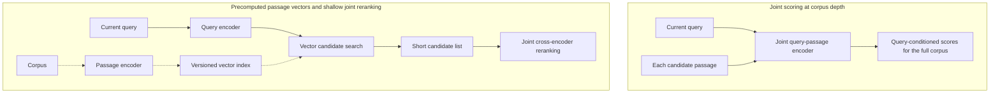
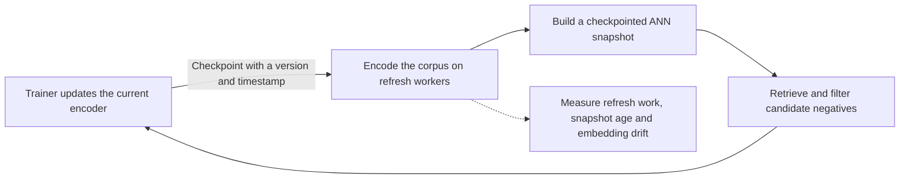
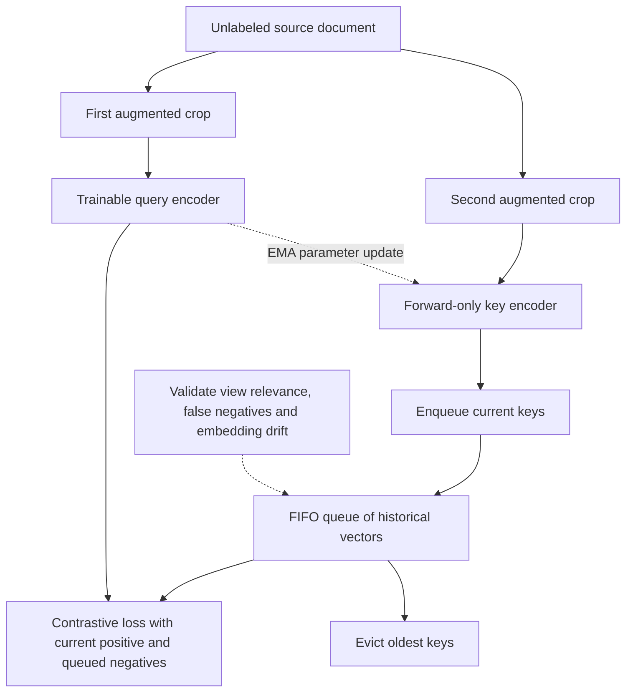
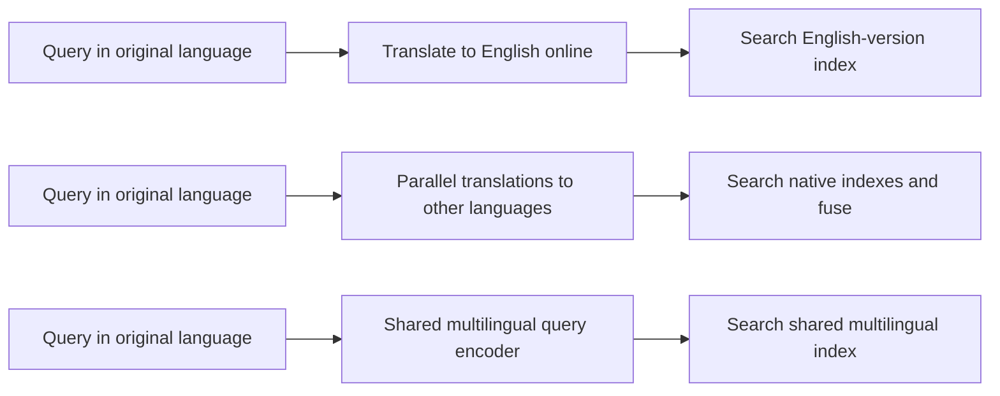

# 20. Dense Retrieval
[00-START-HERE](../00-START-HERE.md) · [01-READING-ROUTES](../01-READING-ROUTES.md) · [19\_learning\_to\_rank](19_learning_to_rank.md) · [21\_learned\_sparse\_and\_multi\_vector\_retrieval](21_learned_sparse_and_multi_vector_retrieval.md)
This chapter prepares a Retrieval-Augmented Generation (RAG) candidate to explain dense retrieval, train it, price it, combine it with lexical search, and extend it across languages.
## TL;DR
- A cross-encoder conditions passages on the current query; a bi-encoder precomputes passage vectors. For the stated corpus, the ideal cross-encoding proxy is $`36.26`$ minutes versus a flat payload-read proxy $`32.28\,\mathrm{ms}`$, not matched measured latencies.
- At $`B=128`$, a two-passage-per-example pool gives $`255`$ negatives before masking. Reusing all $`256`$ passage encodings saves $`128`$ times passage-encoding work compared with independently encoding the same-size pool for every question; this is not an end-to-end speedup.
- Exact lexical matches and learned semantic matches have complementary possible failures. Opposite IDF and toy exposure trends do not establish a document-frequency performance crossover or near-disjoint error sets.
- A margin-one negative has $`e^7\approx1{,}096.63`$ times a margin-eight negative's unnormalized score weight. Parameter-gradient norms also depend on score Jacobians; ANN mining is a heuristic, not the exact variance-optimal distribution.
- Document crops supply proxy positives without human labels. A MoCo queue stores $`65{,}536`$ fp32 width-$`768`$ keys in $`201.326592\,\mathrm{MB}`$, but stop-gradient and stale keys make it different from a fully differentiable current-encoder batch.
- Multilingual vectors can mix language identity and semantics. Per-language centering and language-controlled negatives can help under the stated model; they need native-query and true cross-lingual evaluation.
- Compare dense/sparse candidate unions and shallow reranking on final quality and measured serving tails. Precomputation, payload sizes and nominal translation times do not alone establish a production SLO.
## The story
Imagine a parcel hub that routes millions of parcels when a customer asks a question. A cross-encoder clerk opens the request and parcel together, allowing detailed query-dependent inspection. A bi-encoder crew instead prepares each parcel's vector card before requests arrive and compares that card with a query vector. The card is reusable because it does not depend on the current question; the price is a fixed representation, not a universal claim about model capacity or accuracy. The hub preserves an exact-string lane for codes and quoted material, while a learned lane can connect paraphrases. Which lane succeeds depends on training, analysis, data and the query—not a guaranteed frequency boundary.
Training contrasts a chosen positive with negatives. A near miss can receive a much larger softmax weight than an easy example, but the actual parameter update also depends on how both scores change with the parameters. ANCE retrieves the model's near misses from a checkpointed index. Refreshing that index limits staleness at a real offline compute cost; highly ranked unlabeled positives must not automatically be treated as wrong parcels.
Without labeled requests, the crew can create two cropped views of one document as proxy positives. This assumes those views share useful information; they may overlap, and even disjoint spans may repeat words. A MoCo key encoder supplies a FIFO queue without retaining old encoder activation graphs. The queue saves negative-vector storage relative to fully retained activations, but its stopped gradients and temporal drift differ from a fresh large batch. Negative count affects a contrastive information-bound certificate only under its sampling assumptions; it does not cap everything the model can learn.
In a multilingual hub, a vector may also carry a language direction. Under an explicit toy model, that direction can make a same-language distractor outrank a cross-language answer. Removing estimated means and controlling negative languages are hypotheses to evaluate, not guaranteed fixes on arbitrary corpora. Translation placement adds another choice: offline translation volume affects price, while online autoregressive output affects latency. The final design keeps provenance and access checks, retrieves a measured candidate union, and spends joint scoring only where it demonstrably helps.
## Decoder table

| Technical term | Plain-English meaning | Why it matters |
| --- | --- | --- |
| Retrieval-Augmented Generation (RAG) | A system that retrieves evidence before generating an answer | Retrieval quality limits what evidence the generator can use |
| dense retrieval | Retrieval with learned continuous vectors | It can match meaning across different wording |
| sparse retrieval | Retrieval with term-based sparse features | It preserves exact lexical evidence |
| Best Matching 25 (BM25) | The lexical term-matching ranker used here | The guarded IDF convention matches Chapter 18; rare exact matches can help but are not guaranteed relevant |
| cross-encoder | One encoder that reads a query and passage jointly | It provides rich token-level conditioning at high online cost |
| bi-encoder | Separate query and passage encoders whose outputs meet in a score | It allows passage vectors to be built offline |
| Bidirectional Encoder Representations from Transformers (BERT) | The encoder family used in the chapter’s cost examples | Its parameter and token counts set the compute arithmetic |
| Dense Passage Retrieval (DPR) | A supervised two-tower dense retriever | It supplies the main loss, batch geometry, and benchmark results |
| query tower $`E_Q`$ | The encoder that maps a query to one vector | It runs once per request |
| passage tower $`E_P`$ | The encoder that maps each passage to one vector | It runs offline and binds the index to its weights |
| dot product | The sum of matching vector coordinates | It joins independently computed query and passage vectors cheaply |
| conditioning | Letting a representation depend on the current query | A bi-encoder gives this up at passage-encoding time |
| embedding dimension $`d`$ | The number of stored values in each vector | It controls index memory and bandwidth cost |
| corpus size $`N`$ | The number of passages searched | It multiplies full-scan and re-encoding cost |
| parameter count $`P`$ | Parameters per encoder, not necessarily total parameters in an untied pair | The $`2PT`$ and $`6PT`$ rules are approximate work models |
| floating-point operations (FLOPs) | A count of arithmetic work | It makes architecture costs comparable |
| floating-point operations per second (FLOP/s) | A stipulated or measured arithmetic processing rate | A division gives a conditional work proxy, not a rigorous latency floor or a measured percentile |
| fp32 | $`4\,\mathrm B`$ per value | The exact corpus count gives $`64.559075328\,\mathrm{GB}`$ of vector payload before overhead |
| fp16 | $`2\,\mathrm B`$ per value | It halves this vector payload, not necessarily all index memory or end-to-end latency |
| high-bandwidth memory (HBM) | Accelerator memory with high transfer bandwidth | Payload reads can dominate a flat scan if vectors reside on that memory path; capacity and transfers matter |
| memory-bound | A profiled regime where data movement limits execution | The read/compute quotient comparison motivates a hypothesis, not a measured bottleneck by itself |
| approximate nearest neighbor (ANN) search | Approximate vector search with a quality/work trade-off | Algorithms may traverse graph links or compressed lists; ANN neighbor recall differs from relevant-passage recall |
| hierarchical navigable small world (HNSW) | The graph ANN method used in the worked designs | It replaces a linear scan with a graph walk |
| reranker | A second-stage model that rescores a small candidate set | It restores cross-encoder conditioning where it can affect the top results |
| candidate depth $`k`$ | The number of passages sent to a later stage | It determines reranking cost and first-stage recall requirements |
| top-$`k`$ | The first $`k`$ results under a score | It defines mining pools and candidate handoff depth |
| $`\mathop{\mathrm{Recall}}\nolimits@k`$ | Fraction of known relevant passages returned by depth $`k`$ when the gold set is nonempty | Question-level answer-hit accuracy and ANN neighbor recall have different denominators |
| normalized discounted cumulative gain at $`10`$ ($`\mathop{\mathrm{NDCG}}\nolimits@10`$) | Gain-discounted ranking quality normalized by ideal gain at the cutoff | It is undefined without an explicit policy when ideal gain is zero |
| softmax | A normalization that turns scores into competing weights | DPR uses it to favor the positive over all negatives |
| negative log-likelihood | The loss from taking the negative log of positive probability | It is DPR’s contrastive training objective |
| positive passage | A passage selected as relevant, or a proxy positive in augmentation training | Labels or same-document views can be incomplete or noisy |
| negative passage | A passage treated as irrelevant to a query | Its difficulty determines useful gradient signal |
| in-batch negative | Another example’s passage reused as a negative | It gives many negatives without extra encodings |
| hard negative | A candidate treated as negative whose score is near the positive | Its score weight can be large; relevance, false-negative risk and parameter Jacobians still matter |
| static BM25 negative | A lexical candidate mined at an earlier stage | It may become easy as the model changes, but staleness is not inevitable or set by a universal clock |
| self-mined negative | A near miss retrieved by the current dense model | It tracks the model’s current confusion |
| false negative | A relevant passage that lacks a positive label | Pushing it down teaches the retriever the wrong behavior |
| cross-encoder filtering | Using a joint model to reject likely unlabeled positives from mined negatives | RocketQA uses it to protect sparse relevance labels |
| Sentence-BERT | An encoder family with classification and similarity-training recipes | STS is symmetric; SNLI entailment is directional. Compare objectives and tasks, not only architecture |
| Stanford Natural Language Inference (SNLI) | The natural-language entailment dataset in the cited recipe | Entailment is directional, not universally symmetric sentence supervision |
| Semantic Textual Similarity (STS) | A cosine-similarity regression task | It optimizes sentence likeness rather than question-to-passage relevance |
| document frequency $`n(t)`$ | Number of corpus documents containing an analyzed term | It determines the IDF term and a toy exposure rate, not a proved dense-versus-sparse performance boundary |
| inverse document frequency (IDF) | A decreasing function of analyzed document frequency | It weights rarity, not truth or answer relevance |
| lexical overlap | Exact query terms shared with a passage | BM25 gives no semantic partial credit without it |
| paraphrase | The same meaning expressed with different words | It is the dense retriever’s core advantage |
| hybrid retrieval | Dense/sparse candidate combination with deduplication and fusion | Measure error complementarity and final quality rather than assume near-disjoint failure sets |
| WordPiece | The subword tokenization used in the rare-code example | It can represent an identifier as generic fragments rather than one exact code |
| Benchmarking Information Retrieval (BEIR) | The $`18`$-dataset transfer benchmark cited in the chapter | It shows BM25 remains a strong zero-shot baseline out of domain |
| margin $`\Delta`$ | $`s^+-s_j^-`$, divided by temperature if one is used | Its exponential controls a softmax coefficient; it is not automatically an information quantity in nats |
| gradient norm | $`\lVert g_j\rVert`$ for a complete positive-minus-negative parameter contribution | The optimal supported importance distribution for the stated fixed objective is proportional to this norm |
| stochastic gradient descent (SGD) | Optimization using sampled gradient estimates | Practical mined-softmax objectives need not equal an unbiased estimator of a full-softmax objective |
| importance correction | Dividing a sampled full-objective component by its probability | Unbiasedness requires nonzero support for every nonzero contribution and the correct normalizer |
| descent lemma | The smooth-objective bound used for one SGD step | It isolates the second moment that sampling can reduce |
| second moment | $`\mathbb E\lVert\widehat g\rVert^2`$ for the specified estimator | Its minimizer does not prove ANN score ranking is the exact optimal distribution |
| Cauchy-Schwarz inequality | The inequality used to solve the sampling allocation | Equality gives probability proportional to gradient norm |
| Approximate Nearest Neighbor Negative Contrastive Estimation (ANCE) | Periodic self-mining from an ANN index built by a recent checkpoint | It keeps negatives hard as parameters move |
| negative stagnation | A fixed mined set becoming less informative during a particular trajectory | Score-weight decay is exponential in the margin; actual gradient norms and progress need measurement |
| checkpoint $`\theta _t`$ | A saved parameter state at training step $`t`$ | Checkpoint age, encoder drift and index-building lag are separate quantities |
| RocketQA | The cited system that filters mined negatives with a cross-encoder | It addresses unlabeled positives in sparse judgments |
| asynchronous refresh | Index construction on workers that need not block every training step | It still consumes resources and may contend with training or serving |
| Microsoft Machine Reading Comprehension (MS MARCO) | The passage corpus and training set used in several examples | Its size anchors mining, information, and memory calculations |
| unsupervised dense retrieval | Dense training without labeled query-passage pairs | It is the option for a new corpus with no search logs |
| Contriever | The cited retriever trained from document crops | It manufactures positive pairs without labels |
| independent cropping | Sampling two random spans from one document | It creates a positive pair and may preserve useful token overlap |
| random deletion and masking | Deleting or masking words in augmented views | It may reduce copying shortcuts but does not guarantee their removal or a lexical quality floor |
| Inverse Cloze Task (ICT) | Removing one sentence occurrence and pairing it with the remainder | Repeated words can remain; zero token overlap is not guaranteed |
| Information Noise-Contrastive Estimation (InfoNCE) | A contrastive loss over one positive and $`K`$ negative logits | The standard population information lower bound needs the declared joint/marginal sampling assumptions |
| mutual information | Statistical dependence between the paired random variables | A finite-pool InfoNCE certificate ceiling is not a bound on actual information or representation capacity |
| Momentum Contrast (MoCo) | A queue plus a slowly updated key encoder | It provides many negatives without storing their activations |
| first-in, first-out (FIFO) queue | A buffer that removes the oldest key when adding a new one | It reuses negative vectors across steps |
| query encoder $`E_{\theta}`$ | The branch trained by SGD with activations retained | It produces the current query representation |
| key encoder $`E_{\theta_k}`$ | A forward-only branch whose parameters follow the query encoder by EMA | Comparability of its historical keys depends on measured embedding drift, not momentum alone |
| exponential moving average (EMA) | Update $`\theta_k\leftarrow m\theta_k+(1-m)\theta`$ with $`0\le m<1`$ | The heuristic weight window is $`1/(1-m)`$; mean age is $`m/(1-m)`$ |
| momentum $`m`$ | Weight on the previous key-encoder parameters | It changes the EMA weight distribution, not a mathematically determined maximum useful queue |
| queue span $`\frac{K}{B}`$ | Approximate FIFO turnover span in optimizer steps | Comparing it with an EMA weight window is a drift heuristic, not a necessary or sufficient stability theorem |
| `no_grad` | Forward computation without an autograd graph | It reduces retained activations while changing which paths receive gradients |
| activation | An intermediate value needed by a chosen backpropagation implementation | Retained memory depends on length, batch size, checkpointing, fused kernels and replay |
| temperature $`\tau`$ | Positive divisor on contrastive scores | Bounded unit-cosine scores yield a temperature-dependent optimistic loss floor; small values can amplify noise |
| loss floor | An optimistic lower bound under specified score constraints | The bound need not be jointly attainable across the training set |
| GradCache | Representation-gradient caching with microbatch encoder replay | It reduces activation retention; caches still scale as $`O(Bd)`$, and exactness needs consistent replay and state |
| multilingual encoder | One encoder that embeds several languages into a shared space | It removes the online translation requirement |
| cross-lingual retrieval | Retrieving a document written in a different language from the query | Exact lexical overlap can be empty |
| language direction $`\mu_l`$ and mean $`\bar e_l`$ | Unit language direction $`\mu_l`$ in the toy model; actual mean is $`\alpha\mu_l`$ | Confusing the direction with the empirical mean causes an extra erroneous factor in centering |
| semantic residual $`r(t)`$ | A unit semantic vector orthogonal to all language directions in the toy model | Centering and optional normalization recover it only under the stated assumptions |
| centroid amplitude $`\alpha`$ | Language-component amplitude; squared norm share is $`\alpha^2`$ | The threshold depends on semantic gap and centroid cosine, not a universal norm budget |
| centroid cosine $`c`$ | Cosine of unit language directions, or nonzero means under the model | Zero means have no defined cosine, and empirical topic mixtures can confound the estimate |
| mean-centering | Subtracting the actual estimated per-language mean | Validate the embedding space and renormalization choice; real data need not obey the toy decomposition |
| same-language negative sampling | Drawing negatives from the positive passage's language, not necessarily the query's | It cancels a constant language term in the toy comparison, not all spurious cues or label errors |
| curse of multilinguality | Empirical capacity and resource competition as language coverage grows | It is not a theorem that fewer languages always improve every target task at fixed parameter count |
| Cross-lingual Language Model RoBERTa (XLM-R) | The cited model trained on $`100`$ languages | It illustrates the fixed-capacity multilingual trade-off |
| multilingual BERT (mBERT) | The cited multilingual BERT encoder | Centroid subtraction improved its cross-lingual sentence retrieval |
| Language-Agnostic Retrieval Question Answering (LAReQA) | A benchmark built to expose language bias | It separates translation ability from retrieval geometry |
| multilingual MS MARCO (mMARCO) | Translated MS MARCO training data | It shows translated supervision can work but inherits English query structure |
| multilingual DPR (mDPR) | DPR extended across languages | English-only training underperforms BM25 on most cited Mr. TyDi languages |
| Mr. TyDi | A native-query multilingual retrieval benchmark | Its in-language tasks alone do not certify query-to-different-language alignment |
| Multilingual Information Retrieval Across a Continuum of Languages (MIRACL) | The cited native-query benchmark spanning $`18`$ languages | Distinguish multilingual evaluation from an explicitly cross-language gold set |
| machine translation (MT) | Converting text from one language into another | Query translation adds autoregressive decoding to the critical path |
| reciprocal rank fusion (RRF) | Combining result lists by rank positions | Per-language indexes need this extra stage in the example |
| fertility | Tokenizer tokens per word | High fertility creates more chunks with less context |
| ninety-fifth-percentile latency ($`p_{95}`$) | A request-distribution quantile, not a sum of component $`p_{95}`$ values | The proposed nominal timing sums do not prove a tail-latency SLO |
| remote procedure call (RPC) | A network call to a service | The nominal encoding-service allowance includes arithmetic and overhead; its real bottleneck needs profiling |
| blue-green index cutover | Holding old and replacement indexes during cutover | Two complete vector payloads double that component; other transition and replica costs remain |
| $`q`$, $`p`$, and $`s(q,p)`$ | Query, passage, and their relevance score | They name the two retrieval inputs and the value used to rank them |
| $`L_q`$ and $`L_p`$ | Query and passage token lengths | They set the online encoding work in the corpus-depth calculation |
| $`b`$ in $`N\times d\times b`$ | Bytes stored per embedding coordinate | It converts a vector count into index memory |
| $`B`$ | Number of query-positive examples in one batch | It sets the in-batch negative pool and queue turnover rate |
| $`M`$ and $`K`$ | Negative count in the margin derivation and queue size in MoCo | They size the contrastive denominator in their respective sections |
| $`s^+`$, $`s_j^-`$, $`\Delta_j`$, and $`Z`$ | Positive score, negative score, margin, and softmax normalizer | They expose the exponential weight assigned to each negative |
| $`g`$, $`g_j`$, and $`\hat{g}`$ | Full objective gradient, a positive-minus-negative component, and its sampled estimator | The normalizer couples components; score weights alone are not parameter gradients |
| $`p_j`$ and $`p_j^*`$ | Sampling probabilities and the second-moment minimizing distribution | Full nonzero-gradient support and correction are required; a top list is not itself this distribution |
| $`\eta`$ and smoothness constant $`L_f`$ | Positive step size and gradient-Lipschitz smoothness constant | They govern the conditional descent bound for the declared objective |
| $`I(X;Y)`$ and $`\mathcal L_{\mathrm{NCE}}`$ | Paired-view mutual information and expected contrastive loss | The population bound requires its sampling assumptions; it is not a corpus-identification requirement |
| $`s`$, $`h`$, and $`a`$ in activation accounting | Sequence length, hidden width, and attention-head count | They determine retained training activations per layer |
| $`\frac{K}{B}`$ and $`\frac{1}{1-m}`$ | Approximate queue turnover span and EMA weight-window heuristic | Their comparison is a design policy to test, not a proof that useful queue size is bounded |
| $`f_{\theta}`$, $`E_Q`$, and $`E_P`$ | Joint scorer, query tower, and passage tower | They distinguish online pair conditioning from offline passage encoding |
| $`\theta`$, $`\theta_t`$, and $`\theta_k`$ | Current, checkpointed, and momentum-key parameters | They make mining drift and queue staleness explicit |
| BM25 $`k_1`$ and $`b_{\mathrm{BM25}}`$ | Term-frequency saturation and length-normalization controls | Tuning them cannot create cross-language lexical overlap |

## Core mechanics
### Mathematical conventions
Let $`N`$ be corpus passage count, $`P`$ parameters per encoder, $`d`$ vector width, and $`L_q,L_p`$ tokenized input lengths. Separate towers may share weights or have $`2P`$ total parameters. The proxies $`W_{\mathrm{forward}}\approx2PT`$ and $`W_{\mathrm{train}}\approx6PT`$ for $`T`$ processed tokens omit architecture- and sequence-length-dependent work. A multiply-accumulate counts as two FLOPs. Dividing by stipulated throughput $`R`$ or bandwidth $`\mathcal B`$ gives conditional work proxies, not measured latency, throughput, invoices or a $`p_{95}`$ guarantee. Corpus encoding, index construction, graph links, text, identifiers, replicas and runtime buffers are different costs.
Use decimal units: $`1\,\mathrm{MB}=10^6\,\mathrm B`$, $`1\,\mathrm{GB}=10^9\,\mathrm B`$, $`1\,\mathrm{TB}=10^{12}\,\mathrm B`$. fp32 is $`4\,\mathrm B`$ and fp16 $`2\,\mathrm B`$ per value. Retain full precision until reporting; $`\approx`$ marks rounding or a model approximation. Logarithms are natural, in nats, unless explicitly $`\log_2`$ for bits. Logits are dimensionless; a raw dot-product gap is not information measured in nats merely because it appears in an exponential.
For gold passage set $`G_q`$ and returned set $`S_{q,k}`$, $`\mathop{\mathrm{Recall}}\nolimits@k=\lvert G_q\cap S_{q,k}\rvert/\lvert G_q\rvert`$ when $`\lvert G_q\rvert>0`$. Answer-hit accuracy instead averages $`\mathbf1[G_q\cap S_{q,k}\ne\varnothing]`$ over questions, using the declared answer-matching rule. DPR's cited top-$`k`$ accuracy is this question-level measure, not automatically passage recall. ANN neighbor recall compares approximate results with exact top neighbors and is a third metric. A reranker cannot return an excluded item; its gain-dependent NDCG ceiling is not numerically its input's recall.
For the contrastive loss, let $`M`$ be the number of eligible negatives, $`\Delta_j=s^+-s_j^-`$ the score margin, and $`Z=1+\sum_j e^{-\Delta_j}`$. If a temperature is used, margins in this expression are divided by $`\tau>0`$ and derivatives gain $`1/\tau`$. Positive score-softmax weights do not by themselves specify parameter-gradient norms. Importance-sampling arguments below condition on a fixed full objective and its normalizer; sampled-softmax or truncated mining generally changes that objective.
For in-batch reuse, $`B`$ counts query-positive examples; a two-passage-per-example pool has $`2B-1`$ eligible negatives per query only before duplicate and false-negative masking. For MoCo, $`K`$ counts queued negatives, so there are $`K+1`$ logits. The queue-turnover/EMA comparison is a design heuristic, not a hard stability theorem. Match sequence lengths, trainable branches and processed anchors when comparing costs.
The language-centroid toy model assumes unit centroid directions, orthogonal unit semantic residuals, a common amplitude $`0\le\alpha<1`$, and zero within-language residual mean. Language identity occupies squared norm share $`\alpha^2`$, not $`\alpha`$. Empirical means, topic mixtures, language distributions and optional renormalization can violate this toy geometry; centering needs validation rather than an unconditional production prescription. Reported benchmarks, prices, hardware rates and historical claims are not independently verified here.
### 20.1 Bi-encoders, DPR, and the efficiency-expressiveness trade
#### Joint scoring versus independent scoring
**What:**
A cross-encoder scores the concatenated query and passage.

$$
s(q,p)=f_{\theta}([q;p])
$$

**What:**
A bi-encoder scores two independently computed vectors.

$$
s(q,p)=E_Q(q)^{\top}E_P(p)
$$

**Why:**
$`E_P(p)`$ is independent of the current query and may be computed at index time. Its version includes weights, tokenizer, chunking, pooling and normalization, not just a model name. Query-independent document work can also exist in late-interaction architectures; the single-vector formula describes one particular factorization.
**Failure at corpus depth:** A standard joint cross-encoder must condition on the query for each candidate; with $`N`$ candidates, its pair-work count is linear in $`N`$. Batching changes utilization and call count, not the number of scored query–passage examples in this baseline.
**Trade-off:** Single-vector separation removes online token-level query conditioning of passage states. It does not prove equal parameter capacity: two untied $`P`$-parameter towers have $`2P`$ parameters, while the joint example has one $`P`$-parameter encoder. Comparisons require an explicit capacity and compute budget.
A width-$`768`$ passage vector must support future questions through the chosen vector score. A joint encoder can form a $`32\times128=4{,}096`$ query-to-passage attention-score grid per head and layer; the opposite direction and within-query/within-passage attention are additional. This grid is not the total attention FLOP count, and special tokens are omitted from this length proxy.
#### Corpus-depth arithmetic
Use the approximate forward rule $`2P`$ FLOPs per processed token, with $`P=110\times10^6`$ parameters per BERT-base encoder, $`L_q=32`$ and $`L_p=128`$. These token lengths are stipulated independently of the prose description of a hundred-word passage. Joint attention, embedding/head details and serving overhead are omitted:

$$
W_{\mathrm{pair}}\approx2P(L_q+L_p)=35{,}200{,}000{,}000\ \mathrm{FLOP}.
$$

$$
W_q\approx2PL_q=7{,}040{,}000{,}000\ \mathrm{FLOP}.
$$

With the full corpus count $`N=21{,}015{,}324`$, not a rounded $`21`$ million inside the calculation, the two online arithmetic proxies are:

$$
W_{\mathrm{cross}}\approx NW_{\mathrm{pair}}=7.397394048\times10^{17}\ \mathrm{FLOP}.
$$

$$
W_{\mathrm{bi,flat}}\approx W_q+2Nd=39{,}319{,}537{,}664\ \mathrm{FLOP}.
$$

**Why:**
The arithmetic ratio is approximately $`1.881353263\times10^7`$, about seven orders of magnitude. It excludes the bi-encoder's offline passage encoding, stored index, memory movement, top-$`k`$ selection and index traversal; it is not the query-latency ratio.
**Cost proxy:** At $`R=3.4\times10^{14}\,\mathrm{FLOP\,s^{-1}}`$, $`W_{\mathrm{cross}}/R\approx2{,}175.704132\,\mathrm s\approx36.261736\,\mathrm{min}`$ per query.
**Claim limit:** The throughput and $`2P`$ rule are assumptions, not a benchmark or a rigorous timing lower bound. Long-sequence attention, memory, execution efficiency, batching and I/O change the real result.
#### DPR loss and in-batch negatives
**What:**
For query $`q_i`$, a chosen positive $`p_i^+`$ and $`M_i`$ eligible negatives $`p_{i,j}^-`$, DPR uses a contrastive softmax over dot products. The following equation uses temperature one; a different temperature must rescale every logit consistently.

$$
L(q_i)=-\log\frac{\exp\bigl(E_Q(q_i)^{\top}E_P(p_i^+)\bigr)}{\exp\bigl(E_Q(q_i)^{\top}E_P(p_i^+)\bigr)+\sum_j\exp\bigl(E_Q(q_i)^{\top}E_P(p_{i,j}^-)\bigr)}
$$

**Why:**
The training objective encourages separately computed vectors to meet the supervision task. It does not recreate arbitrary query-conditioned token interaction at inference or guarantee relevance generalization; augmentation, labels, negatives and architecture still matter.
**Sampling:** Reuse passage encodings across all questions in a batch. Other examples' positives and hard negatives are candidates for negatives, not verified negatives for every query; mask known shared positives, duplicates and invalid candidates.
At $`B=128`$ with one positive and one hard-negative passage per example, the shared pool has $`2B=256`$ encoded passages. Each question has one chosen positive and $`2B-1=255`$ remaining negatives before masking. Independently encoding a same-size positive-plus-negative pool for each question costs $`128\times256=32{,}768`$ passage encodings instead of $`256`$, exactly $`128`$ times the passage-encoding work. Counting only $`128\times255=32{,}640`$ negatives on one side but all $`256`$ passages on the other gives $`127.5`$, an unmatched comparison. Query encodings and pair-score arithmetic remain; including the stipulated query/passage token work changes the encoder-work ratio to approximately $`113.888889`$, before other costs. Neither ratio counts batched network calls or guarantees a wall-time speedup.
**Failure without useful negatives:** The training objective becomes easy while live-corpus recall stays poor.
#### Retrieval is not symmetric sentence similarity
**Task distinction:** The source describes Sentence-BERT training using SNLI classification and STS cosine regression. STS similarity is symmetric, but natural-language entailment itself is directional; do not describe every component as symmetric supervision. A model name or shared encoder does not uniquely determine its retrieval objective.
**Why transfer can fail:** A short question and a longer passage need not be paraphrases to be relevant. Retrieval supervision must teach that relationship rather than merely sentence likeness. A shared encoder with different role prompts or task training can still serve retrieval; untied towers alone are not a quality guarantee.
**Comparison:** The cited DPR recipe trains query and passage encoders on question–passage relevance. Evaluate the objective and data, not just whether tower weights are tied.
The source reports Natural Questions top-$`20`$ answer-hit accuracy $`78.4\%`$ for DPR versus $`59.1\%`$ for BM25, a $`19.3`$-percentage-point gap in the cited setup. These are question-level answer hits, not passage-level recall against an exhaustive gold set.
**Claim limit:** This comparison applies to the cited Natural Questions setup and does not establish universal dominance.
#### Worked deployment configurations
The worked deployment uses $`N=21{,}015{,}324`$, $`d=768`$, fp32 vector payload, the token lengths and per-encoder parameter count above, and a nominal $`50\,\mathrm{ms}`$ target. The following architectures are compared through work proxies, not matched measured latencies.
**Configuration 1:** Full joint scoring has the $`7.397394048\times10^{17}`$-FLOP proxy and the $`2{,}175.704132\,\mathrm s`$ arithmetic division.
That division is approximately $`43{,}514.082635`$ times the $`0.05\,\mathrm s`$ target. Batching may improve utilization; it does not remove corpus-linear pair work in this baseline or turn the proxy into a latency measurement.
**Configuration 2:**
A flat bi-encoder index occupies:

$$
N d(4\,\mathrm B)=64{,}559{,}075{,}328\,\mathrm B\approx64.559075328\,\mathrm{GB}.
$$

Dot products cost $`2Nd=32{,}279{,}537{,}664`$ FLOPs, whose arithmetic division is $`94.939817\,\mathrm{\mu s}`$. A complete uncached payload pass at $`\mathcal B=2.0\times10^{12}\,\mathrm{B\,s^{-1}}`$ takes $`32.279538\,\mathrm{ms}`$ by division. The read/compute quotient ratio is exactly $`340`$ under these constants. This suggests a bandwidth bottleneck for this flat resident scan, not a measured universal limit. Halving $`d`$ halves these two work terms; it does not necessarily halve end-to-end latency. Doubling arithmetic throughput leaves the payload-read division unchanged, not every component of serving. Capacity, data placement, query encoding, selection, kernels and overhead require separate accounting.
**Configuration 3:** An HNSW candidate stage may visit far fewer vectors, then a cross-encoder reranks $`k=100`$. The visited count and quality depend on data, graph parameters, filters and search settings; “a few thousand” is not an ANN guarantee.
The hundred-pair work proxy is $`3.52\times10^{12}`$ FLOPs, with arithmetic division $`10.352941\,\mathrm{ms}`$. Stipulating an additional $`5\,\mathrm{ms}`$ inclusive query/ANN stage gives a nominal $`15.352941\,\mathrm{ms}`$ budget sum, not a measured total. Its cross-encoder pair count is $`N/100=210{,}153.24`$ times smaller than full-corpus joint scoring. ANN recall, queueing, batching, transfer and reranker utilization must be measured.
**Reported throughput check:** The source cites DPR at $`995`$ questions per second over a roughly twenty-one-million-vector FAISS index, and BM25/Lucene at $`23.7`$ questions per second. Those are throughput observations under their stated experimental conditions.
The numerical throughput ratio is approximately $`41.983122`$. Reciprocal throughput $`1/995\approx1.005025\,\mathrm{ms}`$ is an average completion-spacing or amortized work figure, not necessarily single-request latency when queries overlap or batch. The query arithmetic proxy $`W_q/R\approx20.705882\,\mathrm{\mu s}`$ is numerically $`2.060235\%`$ of that reciprocal, but comes from an assumed accelerator rate, not a matched component profile. This does not establish that the index rather than encoding or other overhead dominates the published system.
#### Practical boundaries
A retrieval–reranking funnel is a useful baseline. Under only the pair-FLOP proxy, a $`50\,\mathrm{ms}`$ arithmetic allowance buys $`\lfloor0.05R/W_{\mathrm{pair}}\rfloor=482`$ pairs; five hundred pairs already give $`51.764706\,\mathrm{ms}`$ before omitted work. Thus “roughly five hundred documents” is a planning illustration, not a guarantee that a small corpus meets the target. Benchmark full joint scoring if the collection is small enough.
Fine-tune with suitable in-domain pairs and compare tied, untied and role-prompted encoders. Fewer than roughly a thousand labels is a source heuristic for trying an unsupervised initializer, not a theorem that fine-tuning loses. Increasing $`B`$ from eight to $`128`$ changes the unmasked $`2B-1`$ pool from $`15`$ to $`255`$; quality does not depend on count alone. Symmetric tasks can use shared encoders, while retrieval still needs task-matched supervision.
Price nominal vector payload as $`Ndb`$ bytes per coordinate width $`b`$, with index/runtime overhead separate. The fp16 payload here is $`32{,}279{,}537{,}664\,\mathrm B=32.279537664\,\mathrm{GB}`$. Report task passage recall or answer-hit accuracy with its actual definition, ANN neighbor recall separately, and a final ranking/answer metric. An answer-bearing passage at rank $`87`$ survives a hundred-candidate cut; survival does not certify the final answer.
#### Re-indexing when the model changes
When the passage embedding function changes incompatibly, existing passage vectors no longer belong to the new scoring contract. Query-only updates can sometimes reuse a fixed passage index, and an explicitly valid vector-space transformation is another special case; validate compatibility rather than assuming every parameter edit forces re-encoding. For a full rebuild of $`500\times10^6`$ chunks at $`256`$ tokens, the encoding work proxy is:

$$
W_{\mathrm{reencode}}\approx2(110\times10^6)(256)(500\times10^6)=2.816\times10^{19}\ \mathrm{FLOP}.
$$

Division by $`R`$ gives $`82{,}823.529412\,\mathrm s\approx23.006536\,\mathrm h`$ on one stipulated accelerator, or $`1.917211\,\mathrm h`$ on twelve only under perfect scaling. The width-$`768`$ fp32 payload is $`1.536\,\mathrm{TB}`$; keeping old and new payloads gives $`3.072\,\mathrm{TB}`$. Graphs, source data, replicas, build buffers and dual-write ingestion are additional. Version the tokenizer, chunking, encoder, pooling, normalization, any language centroids and search metric, then use a validated cutover.
**Decision boundary:** A shadow change smaller than a well-specified uncertainty interval has not demonstrated a benefit, but is not proof of equivalence. Use paired query analysis, important cohorts, serving compatibility and rebuild cost rather than an unspecified “noise band.”
### 20.2 Where dense wins and where BM25 wins
#### Opposite dependence on document frequency
**What:** A standard lexical BM25 sum includes terms present in the analyzed query and document. This chapter uses the positive guarded IDF convention from Chapter 18:
Its inverse document frequency is:

$$
\mathop{\mathrm{IDF}}\nolimits_+(t)=\ln\!\left(1+\frac{N-n(t)+0.5}{n(t)+0.5}\right)=\ln\frac{N+1}{n(t)+0.5}.
$$

**Why:**
With fixed $`N`$ and $`0\le n(t)\le N`$, this guarded weight is positive, finite and decreases with frequency. Raw RSJ log odds and log odds plus one are other conventions, not algebraically the same formula. The examples below consistently use the guarded version; benchmark results are not recomputed from these toy weights.
**Failure without overlap:** If every analyzed query term has zero frequency in a candidate, this lexical sum is zero, absent additional signals or boosts. Synonym expansion or a different analyzer can change the overlap; tuning term saturation alone cannot create it.
On the $`21{,}015{,}324`$-passage corpus, $`n(t) = 3`$ gives:

$$
\mathop{\mathrm{IDF}}\nolimits_+(n=3)=\ln\frac{21{,}015{,}325}{3.5}\approx15.607999523.
$$

At $`n(t)=100{,}000`$, $`\mathop{\mathrm{IDF}}\nolimits_+(t)\approx5.347832026`$, so the rare/frequent IDF ratio is approximately $`2.918565775`$. These are dimensionless scoring weights formed with natural logarithms, not measured mutual information or full-document BM25 ratios; term frequency and length factors also matter.
#### Dense supervised exposure
**Toy exposure model:** Suppose each positive training passage is sampled independently and uniformly from the corpus. Then training count $`T`$ gives expected term sightings $`Tn(t)/N`$. Real query-positive supervision is not uniform; pretraining, subwords, related terms and generalization also affect dense behavior.
For $`T=58{,}880`$ training pairs and $`n(t)=3`$, that explicit toy model gives:

$$
\mathbb E[C_t]=\frac{(58{,}880)(3)}{21{,}015{,}324}\approx0.008405295.
$$

Under the same independent-draw assumption, the probability of at least one sighting is $`1-(1-3/N)^{58{,}880}\approx0.008370070`$, about one in $`119.473314`$. An expectation alone is not that probability. With $`n(t)=100{,}000`$, expected count is approximately $`280.176504`$; this is not a measured count of useful supervised examples.
**Why it can help:** Repeated useful patterns can receive more training support, but the count above does not prove a dense accuracy curve or a universal relation between frequency and competence.
**Possible failure:** New identifiers, version strings and names can remain poorly supported or difficult to preserve exactly. Subword representation makes them encodable, not guaranteed to be retrieved correctly.
**Comparison:** Guarded IDF decreases with frequency, while the toy expected sighting count increases. Their units and functions differ; neither one is a retrieval-accuracy curve.
Equating these two arbitrary numeric scales would give $`n\approx3{,}143.552230`$ for the guarded formula and these constants. That numerical intersection is not a dense-versus-BM25 performance crossover. It moves under score conventions or rescaling without changing model competence. Only frequency-stratified evaluation can locate an empirical preference region; no exact boundary or near-disjoint error sets follow from these equations.
#### Paraphrase and rare-string regimes
A semantic encoder may connect a waterway paraphrase to an Irish Sea passage even without exact query wording. A lexical retriever may fail when the analyzed terms do not overlap. Conversely, an exact rare code can receive high lexical weight while several distinct codes occupy nearby dense positions. Neither paraphrase success nor rare-string success is guaranteed by architecture, and high IDF alone does not prove a document outranks every competitor.
**Bigger-model limit:** Increasing width changes capacity and geometry but does not create new observed examples by itself. It can still improve retrieval; absence of occurrences is not a theorem that extra width cannot help through generalization.
Thakur et al. report BM25 as a strong zero-shot baseline that most dense retrievers failed to beat across $`18`$ BEIR datasets out of domain.
**Claim limit:** The chapter uses this as a transfer result, not a claim that BM25 wins every dataset.
#### Enterprise support worked example
The constructed support example has $`N=2\times10^6`$ documents and $`d=768`$. Assume the SSO-certificate query and the relevant SAML/signing-key passage share no terms after the specified analysis; the lexical sum is then zero. Its dense rank one is an assumed outcome, not a deduction from a paraphrase. For `ERR_SSL_5417 remediation`, assume the analyzer preserves the code as a searchable literal with document frequency four:

$$
\mathop{\mathrm{IDF}}\nolimits_+(\text{code})=\ln\frac{2{,}000{,}001}{4.5}\approx13.004580842.
$$

For `remediation` at frequency $`200{,}000`$, guarded IDF is approximately $`2.302583093`$. The code's share of these two IDF weights is approximately $`13.004580842/(13.004580842+2.302583093)=84.957481\%`$, not necessarily its share of a document's BM25 score once frequency and length factors apply.
If all four code-matching passages are relevant and the constructed BM25 top twenty includes all four, passage recall is $`100\%`$ and answer-hit rate is also $`100\%`$. That ranking is stipulated, not proved by IDF alone. For a clean comparison, suppose a dense neighborhood has $`1{,}800`$ candidate passages including those four, and chooses twenty uniformly without replacement. Expected passage recall is $`20/1{,}800\approx1.111111\%`$, but probability of at least one relevant result is $`1-\binom{1796}{20}/\binom{1800}{20}\approx4.374504\%`$. Counting distinct codes instead of passages would be a different sampling model.
**Claim limit:** These are constructed candidate and random-selection assumptions, not empirical dense/BM25 guarantees. Distinguish expected recall, probability of a hit and a particular realized ranking.
#### Hybrid union and benchmark reversal
A union of dense top twenty and lexical top twenty contains at most forty distinct candidates after deduplication. Its maximal forty-pair proxy is $`1.408\times10^{12}`$ FLOPs, or $`4.141176\,\mathrm{ms}`$ of arithmetic division; smaller overlap-adjusted unions cost less pair work. The source reports top-twenty answer-hit accuracy $`78.4\%`$ versus $`59.1\%`$ on Natural Questions, but $`63.2\%`$ versus $`68.8\%`$ on SQuAD, reversing the gap by $`5.6`$ percentage points in favor of BM25 there. The authors' proposed explanation concerns passage-visible question writing and lexical overlap; these results do not identify a universal winner or prove a causal effect in a different collection.
**Decision boundary:** Collection process can make a benchmark recommend the wrong retriever for a different query process.
#### Practical boundaries
Compare dense, lexical and hybrid baselines, particularly identifier, rare-term, quoted-text and important tail cohorts. Document-frequency bins are useful slices; a non-dictionary-token detector is only a proxy when corpus statistics are unavailable. A hybrid union may help before increasing width from $`768`$ to $`1{,}536`$, but depth choices such as sparse twenty and dense fifty to a hundred are workload heuristics. Sparse hits are not automatically relevant or “near-certain,” so do not always cut dense depth first under a fixed budget. Measure each arm's marginal coverage and final-quality contribution.
Track lexical zero-overlap queries and semantic-only hits without equating either with correctness. For a literal-containment requirement, use an exact verified field/string check with a declared normalization and tokenization policy; ordinary BM25 ranking or an analyzer that splits codes does not itself guarantee verbatim containment. Enforce required filters and access constraints before allowing a result into the serving set.
### 20.3 Hard negatives, gradient norm, and ANCE
#### Margin form of the contrastive loss
For temperature-one logits, let $`s^+`$ be the chosen positive score, $`s_j^-`$ the $`j`$th negative score, and $`\Delta_j=s^+-s_j^-`$. The same contrastive loss can be written in margin form:

$$
\mathcal L=\ln\!\left(1+\sum_{j=1}^{M}e^{-\Delta_j}\right).
$$

For $`Z=1+\sum_j e^{-\Delta_j}`$, define the negative softmax probability $`w_j=e^{-\Delta_j}/Z`$. Score derivatives and the complete parameter gradient are:

$$
\frac{\partial\mathcal L}{\partial s_j^-}=w_j,\qquad \frac{\partial\mathcal L}{\partial s^+}=-\sum_jw_j.
$$

$$
\begin{aligned}
g_j&=w_j\bigl(\nabla_\theta s_j^- -\nabla_\theta s^+\bigr),\\
\nabla_\theta\mathcal L&=\sum_{j=1}^{M}g_j.
\end{aligned}
$$

**What:**
A negative's unnormalized score weight is $`e^{-\Delta_j}`$. Its parameter-component norm is $`\lVert g_j\rVert=w_j\lVert\nabla_\theta(s_j^- -s^+)\rVert`$, so the margin alone is insufficient. It is not generally the gradient of an independent loss $`\mathcal L_j`$, because the normalizer couples all scores. If every score only shares one additive-shift parameter, the entire parameter gradient is zero despite nonzero score weights.
**Why hardness helps:** Within one fixed denominator and comparable score Jacobians, smaller margins receive exponentially larger weights. Different denominators, temperatures, Jacobian norms or cancelling directions can change the actual update comparison.
For margins eight and one, unnormalized weights are $`e^{-8}\approx0.000335462628`$ and $`e^{-1}\approx0.367879441`$. Their ratio is $`e^7\approx1{,}096.633158`$. Rounding it to $`1{,}097`$ is reasonable, but it is not an unconditional ratio of parameter-gradient norms or empirical learning efficiency.
**Failure without hard negatives:** A near-zero loss can report an easy task rather than a good retriever.
#### Variance-optimal sampling
Condition on parameters and a fixed complete negative pool, so $`g=\nabla f(\theta)=\sum_jg_j`$ is the exact gradient of that objective. Draw one index $`J`$ with probabilities $`p_j\ge0`$, $`\sum_jp_j=1`$, requiring $`p_j>0`$ whenever $`g_j\ne0`$. The importance estimator $`\widehat g=g_J/p_J`$ is unbiased. For an $`L_f`$-smooth objective and step $`\theta^\prime=\theta-\eta\widehat g`$, the conditional descent bound is:

$$
\mathbb E[f(\theta^\prime)\mid\theta]\le f(\theta)-\eta\lVert g\rVert_2^2+\frac{L_f\eta^2}{2}\mathbb E[\lVert\widehat g\rVert_2^2\mid\theta].
$$

For that particular estimator, sampling controls the second moment. Cauchy–Schwarz yields:

$$
\mathbb E[\lVert\widehat g\rVert_2^2]=\sum_j\frac{\lVert g_j\rVert_2^2}{p_j}\ge\left(\sum_j\lVert g_j\rVert_2\right)^2.
$$

When at least one component is nonzero, equality holds at the distribution below, with zero probability allowed for zero components. If all components are zero, any supported sampling rule has zero variance:

$$
p_j^*=\frac{\lVert g_j\rVert_2}{\sum_i\lVert g_i\rVert_2}.
$$

Even with this result, an ANN-ranked top list is not the exact optimal sampling distribution. Norms include score Jacobians, while ANN typically ranks scores. Top-$`k`$ truncation drops nonzero-gradient support, and a list does not specify probabilities or importance correction. Moreover, evaluating $`g_j`$ for the fixed contrastive objective presumes its complete normalizer; replacing that denominator with a sampled one is generally not an unbiased full-softmax gradient. High-score mining is a useful heuristic motivated by informative examples, not an equality proved by the variance bound.
**Claim limit:** The bound is for a fixed smooth objective with supported importance correction. Practical ANCE or sampled-softmax training can intentionally optimize a different sampled objective. Good retrieval quality is an empirical result, not a consequence of variance-optimality alone.
#### Dynamic mining with ANCE
**What:** ANCE mines candidate near misses from an ANN index built using a recent checkpoint. Record which checkpoint encoded the passages and which query encoder retrieves them; approximate search, filters and sampling influence the actual negatives.
**Why:** The hardest useful negative depends on current parameters $`\theta _t`$.
**Possible static-mining failure:** In an illustrative training trajectory, a negative's margin grows from one to four. This is not an inevitable drift or a universal refresh clock.
That change divides its unnormalized coefficient by $`e^3\approx20.085537`$. A margin-four coefficient is $`e^4\approx54.598150`$ times a margin-eight coefficient and $`e^3\approx20.085537`$ below a margin-one coefficient. Normalized weights also depend on the changing denominator, and parameter updates depend on Jacobians. Matching one margin-one coefficient needs roughly $`e^7\approx1{,}096.633158`$ margin-eight terms in this toy sum; it does not prove that a batch of $`128`$ must become $`140{,}416`$, or that summed gradients or training quality would match. Keep query batch size, encoded passage count and negative count distinct.
BM25 bootstrap negatives and later self-mining are possible schedules. Switch based on judged hard-negative quality, false-negative rates and held-out retrieval—not a universal requirement that the model first beat BM25 overall. Diversify language, domain and difficulty when hardest-only mining would amplify noise.
#### False negatives and RocketQA
High-ranked unlabeled passages may be true answers. The source describes RocketQA filtering mined candidates through a cross-encoder to reduce this problem. A teacher can also be wrong; validate filtering thresholds, mask known positives and duplicates, and avoid treating one-positive judgments as exhaustive relevance. Hardness is not the same as a verified negative label.
#### MS MARCO worked example
For the numerical example, use $`N=8{,}841{,}823`$, $`P=110\times10^6`$, $`d=768`$, $`B=128`$ and a baseline pool providing $`255`$ negatives per query. Compare this baseline with one additional negative for each query. The added slot is distinct from replacing an existing slot and may require additional passage encoding.
**Configuration 1:** Suppose all $`255`$ baseline negative margins are eight. Their total unnormalized weight is $`255e^{-8}\approx0.085542970`$.
Then $`Z\approx1.085542970`$, loss $`\ln Z\approx0.082080295`$ nats, and summed negative softmax probability $`\sum_jw_j\approx0.078802012`$, or $`7.880201\%`$. This is not the fraction of a parameter-update vector attributable to negatives. The positive score derivative has the opposite total magnitude; parameter Jacobians and cancellation remain relevant.
**Configuration 2:** Add one margin-four negative, weight $`e^{-4}\approx0.018315639`$.
Now $`Z\approx1.103858609`$, loss $`\approx0.098811868`$ nats and summed negative softmax probability $`\approx9.408688\%`$. That score-probability sum is approximately $`1.193965`$ times Configuration 1, not necessarily that ratio of gradient norms or learning progress.
**Configuration 3:** Instead add one margin-one negative, weight $`e^{-1}\approx0.367879441`$. There are now $`256`$ negatives, not $`255`$.
Here $`Z\approx1.453422411`$, loss $`\approx0.373921059`$ nats and summed negative probability $`\approx31.196878\%`$, a ratio $`3.958894`$ versus Configuration 1. The hard candidate has softmax probability $`25.311254\%`$ and each easy candidate approximately $`0.023080876\%`$; neither is a “share of the whole parameter step.” If all component-Jacobian norms were equal, the gradient-norm sampling proxy would allocate the hard negative $`e^{-1}/(255e^{-8}+e^{-1})\approx81.133934\%`$ of negative draws. Uniform allocation is $`1/256=0.390625\%`$, a ratio approximately $`207.702872`$. This allocation is conditional on the equal-norm assumption and full-objective estimator, not ANCE's proved optimality.
#### Refresh cost and cadence
Encoding a $`128`$-token passage has proxy $`2PL_p=2.816\times10^{10}`$ FLOPs. The MS MARCO refresh is $`2.4898573568\times10^{17}`$ FLOPs, or $`732.310987\,\mathrm s`$ by division at $`R`$. This excludes ANN construction, reading/tokenizing the corpus and writing vectors. For the baseline $`B`$ queries and $`2B`$ passages, training work is:

$$
W_0\approx6P(BL_q+2BL_p)=2.433024\times10^{13}\ \mathrm{FLOP}.
$$

The baseline step division is $`0.071559529\,\mathrm s`$, so one refresh has the same encoder-work proxy as $`10{,}233.591435`$ baseline steps. At an interval of ten thousand steps, refresh adds approximately $`102.335914\%`$ to baseline training work, for a total factor $`2.023359`$.
If each query gets one distinct extra mined passage used only in its own denominator, the additive-slot example instead encodes $`3B`$ passages: $`W_1\approx6P(BL_q+3BL_p)=3.514368\times10^{13}`$ FLOPs, or $`0.103363765\,\mathrm s`$ by division. A refresh then equals approximately $`7{,}084.794071`$ augmented steps. Replacing a passage already in the $`2B`$ pool avoids this extra encoding but does not add a $`256`$th negative to the original denominator. Specify the design before comparing cadence.
For Wikipedia at the same $`128`$-token length, re-encoding has proxy $`5.9179152384\times10^{17}`$ FLOPs, or $`29.009388`$ minutes on the one stipulated accelerator. The source reports an $`8.8`$-hour run on eight GPUs: $`70.4`$ GPU-hours. Its wall time divided by the one-accelerator proxy is approximately $`18.201004`$, whereas total GPU-hours divided by the proxy GPU-hours is approximately $`145.608033`$. These are unmatched hardware and system conditions; neither ratio isolates overhead or validates a “FLOP floor.”
**Claim limit:** FLOP divisions are model-based work proxies, not rigorous time bounds or matched published-hardware predictions. Asynchronous workers still consume resources and may contend with training or serving unless isolated.
Use asynchronous refresh when its resource budget justifies it. Monitor current-versus-indexed margins, embedding drift, judged negative quality and false positives. A three-logit-unit margin shift is a source heuristic, not a universal time-to-refresh. To keep refresh work at most half of baseline training work, interval $`S`$ must satisfy $`S\ge\lceil2W_{\mathrm{refresh}}/W_0\rceil=20{,}468`$ steps under these constants. Twenty thousand gives slightly more than half, not a strict bound. With the augmented-slot $`W_1`$, the corresponding minimum is $`14{,}170`$. The mining refresh does not add an online stage by itself, but it is not free aggregate compute or a guarantee of unchanged serving behavior.
#### Large-corpus boundary
At $`500\times10^6`$ chunks of $`128`$ tokens, encoding work is $`1.408\times10^{19}`$ FLOPs, or $`11.503268`$ hours by division. This uses half the token length of the earlier $`256`$-token rebuilding example. A pool of $`32{,}768`$ margin-eight negatives has the same unnormalized total coefficient as approximately $`32{,}768/e^7=29.880548`$ margin-one terms, not equivalent parameter directions or training quality. It also processes a different negative pool and activation workload.
Uniformly sampling ten percent of the corpus gives an encoding proxy $`1.408\times10^{18}`$ FLOPs, or $`1.150327`$ hours, before index work. For a fixed exact global score order and a uniform sample of $`m_s`$ items without replacement, the expected global rank of its $`k`$th best item is $`\mathbb E[R_k]=k(N+1)/(m_s+1)\approx k/0.1=10k`$. This is an expectation, not a rank guarantee or an ANN-recall bound. For a large population and small sampled rank, the rough standard deviation is $`\sqrt{90k}`$; sample quality varies. Nonuniform mining, ties, false-negative exclusions and approximate search change that model. Treat corpus subsampling as an evaluated compromise, not a reported result.
### 20.4 Unsupervised dense retrieval: Contriever and MoCo
#### What labels supplied
DPR supervision supplies a chosen query-positive passage pair; sampled negatives are not exhaustive human judgments. Contriever instead forms two independently cropped views of one document as proxy positives. They may overlap or repeat words; deletion and masking can reduce simple lexical copying but do not guarantee a lexical retrieval floor or remove every shortcut. Crops can also cover different topics, so view construction is a relevance assumption to evaluate.
**Transfer boundary:** The source reports that the evaluated transferred supervised dense retrievers lost to BM25 on most out-of-domain BEIR collections. That is a result for particular models, training data and metrics, not a theorem about every dense encoder or every domain shift.
MS MARCO is reported to have $`502{,}939`$ training queries and $`8{,}841{,}823`$ passages, a passage/query ratio approximately $`17.580309`$. This is not the fraction of passages with a unique annotation: one query can have several relevant passages and passages can recur across queries. Matching only this count ratio on an eight-million-document collection would mean approximately $`455{,}055`$ queries; it does not establish how many labels that product actually needs.
#### InfoNCE: an information-bound certificate, not a capacity ceiling
Let $`X,Y`$ be paired augmented views, with one positive from their joint distribution and $`K`$ negatives independently drawn from the appropriate marginal. Under the standard population InfoNCE sampling and critic assumptions, with expected loss $`\mathcal L_{\mathrm{NCE}}`$ in nats:

$$
I(X;Y)\ge\ln(K+1)-\mathcal L_{\mathrm{NCE}}.
$$

**What:**
Because the contrastive loss is nonnegative, the right-hand certificate cannot exceed $`\ln(K+1)`$ nats, or $`\log_2(K+1)`$ bits. This limits that certificate, not the actual mutual information or the encoder's capacity. Correlated, stale, mined or filtered negatives require checking the derivation rather than automatically importing the same IID bound.
**Training levers:** Negative count is not the only lever without human labels. Augmentation quality, initialization, proxy-positive discovery, negative sampling and temperature can change what is learned. Unsupervised mining is possible using proxy pairs; it is not ruled out by the absence of manually labeled queries.
For one positive per example in a $`B=128`$ view pool, there are $`127`$ negatives and a nominal $`\log_2(128)=7`$-bit certificate ceiling. The earlier DPR pool has $`2B=256`$ passages and $`255`$ negatives, a different nominal ceiling of eight bits; its hard-negative construction is not the simple IID-marginal setting. A uniformly distributed corpus identity among $`8{,}841{,}823`$ passages has entropy $`\log_2(8{,}841{,}823)\approx23.075912`$ bits, numerically $`16.075912`$ above seven. Uniform identity entropy is not the information required for useful retrieval, where several passages may be relevant and queries are not uniform identifiers. The difference does not prove that an affordable batch is incapable of the task.
#### Activation cost versus a queue
For a particular uncheckpointed half-precision implementation, the cited activation accounting per layer is $`s h(34+5as/h)`$ bytes, for token length $`s`$, hidden width $`h`$ and head count $`a`$. With twelve layers, define $`A(s)=12s h(34+5as/h)\,\mathrm B`$. This is implementation-specific accounting, not a universal physical-memory requirement; activation checkpointing, fused attention and replay change it. For $`h=768`$ and $`a=12`$:

$$
A(128)=51{,}904{,}512\,\mathrm B=51.904512\,\mathrm{MB},\qquad A(32)=10{,}764{,}288\,\mathrm B=10.764288\,\mathrm{MB}.
$$

Retaining $`65{,}536`$ passage activation graphs by this accounting uses $`3{,}401{,}614{,}098{,}432\,\mathrm B=3.401614098432\,\mathrm{TB}`$. A width-$`768`$ fp32 key is $`768\times4=3{,}072\,\mathrm B`$; the same number of keys is $`201{,}326{,}592\,\mathrm B=201.326592\,\mathrm{MB}=192\,\mathrm{MiB}`$. The activation/key component ratio is exactly $`16{,}896`$. This does not compare total training memory: query and current-key activations, gradients, parameters, optimizer state and score matrices remain.
**Trade-off:** Queued keys carry no retained encoder graph, so gradients do not flow through the historical key computations. MoCo also uses momentum-encoder keys rather than recomputing every negative with the current query encoder. This changes the gradient and temporal objective relative to a fully differentiable fresh large batch.
Easy negatives can individually receive small softmax weights, but many such terms can have substantial aggregate mass. Their parameter contributions also depend on Jacobians and direction. Stopping their gradients is an algorithmic choice justified by measured training behavior, not a proof that the discarded gradient is negligible.
#### MoCo timescales: a drift heuristic, not a stability theorem
MoCo enqueues new key vectors and evicts older ones in FIFO order. For momentum $`0\le m<1`$, the key encoder follows the query encoder by an exponential moving average:

$$
\theta_k\leftarrow m\theta_k+(1-m)\theta.
$$

With $`B`$ new keys per step, queue turnover spans roughly $`K/B`$ steps, with an indexing-dependent one-batch difference in the oldest age. The EMA weight window $`1/(1-m)`$ is a useful heuristic. Its steady-state mean weight age is $`m/(1-m)`$ steps; for $`0<m<1`$, its exponential-decay timescale is $`-1/\ln m`$. A common design comparison is:

$$
\frac{K}{B}\lesssim\frac{1}{1-m}\qquad\text{(heuristic only)}.
$$

**Why monitor drift:** Queue contents should remain comparable with current queries. Actual embedding drift depends on the training trajectory, optimizer and normalization, not solely on the EMA weight distribution.
The timescale comparison is neither necessary nor sufficient for convergence. With constant encoder parameters, even $`m=0`$ and a long queue have no representation staleness. Conversely, a numerically long momentum window does not guarantee compatible embeddings during a rapidly changing trajectory.
**Reported failure:** He et al. report failure to converge at $`m=0`$ in their experiment. That observation supports testing momentum and drift in comparable training conditions; it does not establish a universal impossibility theorem for zero momentum.
#### Temperature and a bounded-cosine loss floor
For unit-norm vectors with cosine logits divided by $`\tau>0`$, a positive-minus-negative cosine margin is at most two. With $`K`$ negatives, the per-example loss therefore obeys:

$$
\mathcal L_{\mathrm{NCE}}\ge\ln\left(1+Ke^{-2/\tau}\right).
$$

At $`K=65{,}536`$, this optimistic floor is approximately $`9.090468`$ nats for $`\tau=1`$, and $`2.558976\times10^{-8}`$ nats for $`\tau=0.07`$. Simultaneous extreme margins may not be attainable across an entire dataset. For this floor to be no greater than $`\varepsilon=0.01`$, the exact temperature condition is:

$$
\tau\le\frac{2}{\ln\!\left(K/(e^{\varepsilon}-1)\right)}\approx0.127465494\quad(K=65{,}536,\ \varepsilon=0.01).
$$

The expression $`2/\ln(100K)\approx0.127424855`$ replaces $`e^{0.01}-1`$ with $`0.01`$ and is a slightly stricter small-loss approximation for the floor. Neither threshold guarantees successful optimization or good retrieval; the floor is only an optimistic necessary feasibility check for reaching that loss. The bounded-margin argument does not apply unchanged to unnormalized dot products. Trying $`\tau=0.01`$ for sharp distillation is a source heuristic, not the only valid use of that temperature.
**Failure without this distinction:** Loss can reflect the score scale and geometry rather than retrieval quality. Very small temperature multiplies score derivatives by $`1/\tau`$, can emphasize noisy or false negatives, and needs numerical and validation checks; a lower training loss alone is not evidence of better ranking.
#### Three negative-pool configurations
Use $`P=110\times10^6`$, $`d=h=768`$, twelve layers and twelve attention heads. For a matched unsupervised comparison, both augmented views have $`s=128`$ tokens. The earlier supervised example instead has $`32`$-token questions and $`128`$-token passages; mixing those lengths changes activation and encoder-work comparisons. All memory figures below are scoped activation or vector payloads, not all-in requirements.
**Configuration 1: ordinary in-batch contrast.** With $`B=128`$ paired views and one positive per anchor, each anchor has $`127`$ negatives and the nominal certificate ceiling is seven bits, under the earlier sampling assumptions.
For the matched two-$`128`$-token-view setting, retained activations are $`2B A(128)=13{,}287{,}555{,}072\,\mathrm B=13.287555072\,\mathrm{GB}`$. A different one-passage asymmetric setting gives $`B[A(32)+A(128)]=8.0216064\,\mathrm{GB}`$. Actual DPR with $`B`$ questions and $`2B`$ passages instead gives $`B A(32)+2B A(128)=14.665383936\,\mathrm{GB}`$ under this same accounting. None alone explains or reproduces the reported eight-V100 deployment; device precision, memory units, optimizer state, partitioning and implementation matter.
**Configuration 2: fresh large in-batch contrast.** At $`B_L=65{,}536`$, there are $`65{,}535`$ negatives per anchor and the nominal ceiling is $`\log_2(65{,}536)=16`$ bits. The batch also processes $`512`$ times as many anchors as the $`B=128`$ baseline.
Passage-side activation retention is $`3.401614098432\,\mathrm{TB}`$, requiring at least $`\lceil3{,}401.614098432/32\rceil=107`$ devices of decimal $`32\,\mathrm{GB}`$ if that component alone were partitioned perfectly. Retaining both $`128`$-token views gives $`6.803228196864\,\mathrm{TB}`$, or at least $`213`$ such devices before other tensors. These are accounting examples, not unavoidable device counts when checkpointing or gradient replay is available. Encoder work rises $`512`$ times per step only relative to the same fully trainable two-view baseline; score-matrix work has a different scaling.
**Configuration 3: MoCo queue.** At $`K=65{,}536`$ queued negatives and $`B=128`$ current anchors, there are $`65{,}537`$ logits per anchor, not $`65{,}536`$. The nominal count term is $`\log_2(65{,}537)\approx16.000022`$ bits. Queued-vector payload is $`201.326592\,\mathrm{MB}`$, but stale correlated keys do not automatically satisfy the IID population-bound assumptions.
For $`m=0.999`$, queue turnover spans $`512`$ steps against the heuristic $`1{,}000`$-step EMA window, a ratio $`1.953125`$. The EMA mean weight age is $`999`$ steps and its decay timescale approximately $`999.499917`$ steps. These are timescale descriptions, not a guarantee that every key remains compatible.
Match the two $`128`$-token branches before pricing them. The trainable query branch has proxy $`6PBs=1.081344\times10^{13}`$ FLOPs and the forward-only key branch $`2PBs=3.60448\times10^{12}`$ FLOPs. Their total is $`8PBs=1.441792\times10^{13}`$ FLOPs; keys are $`25\%`$ of that encoder-work proxy. The factor $`8/6=4/3`$ compares MoCo with the query branch alone, not ordinary fully differentiable contrastive training. At the same $`B,s`$, two trainable branches have proxy $`12PBs=2.162688\times10^{13}`$ FLOPs, or $`1.5`$ times MoCo's encoder work per processed anchor.
A fully trainable $`B_L=65{,}536`$ two-view step has proxy $`12PB_Ls=1.107296256\times10^{16}`$ FLOPs, which is $`768`$ times a $`B=128`$ MoCo step while processing $`512`$ times as many anchors. Neither ratio establishes cost per learned bit, total training speedup or equivalent gradients. Score matrices, queue operations, replay, communication and optimizer work are outside this encoder proxy. The previous “$`384`$ times cheaper per bit” comparison mixed baselines and is not justified.
#### Queue size, memory and measured staleness
The source reports $`K=65{,}536`$, $`B=256`$ and $`m=0.999`$. The turnover span is $`256`$ steps, with heuristic window/span ratio $`3.90625`$. At $`m=0`$, that comparison becomes $`256`$ steps versus one, but it is not a mathematical violation of a necessary convergence condition.
Storing all $`8{,}841{,}823`$ width-$`768`$ fp32 keys takes $`27{,}162{,}080{,}256\,\mathrm B=27.162080256\,\mathrm{GB}`$ and turns over in approximately $`69{,}076.742188`$ steps at $`B=128`$. If the chosen policy enforces $`K/B\le1/(1-m)`$, it asks for $`m\ge1-B/K\approx0.999985523347`$; rounding up to $`0.99999`$ satisfies that heuristic, not a universal requirement. A high-momentum encoder can lag adaptation, but it is not necessarily an average of an untrained network: initialization and actual parameter drift matter.
Under that same policy, $`B=128,m=0.999`$ gives the nominal bound $`K\le128{,}000`$. It is not a hard maximum queue size. Raising momentum to $`0.9999`$ makes the weight window ten thousand steps and the policy allowance $`1.28\times10^6`$ keys. The tenfold window change does not by itself prove tenfold embedding drift or acceptable retrieval. Track key/query compatibility, optimization and judged quality.
#### Practical and experimental boundaries
Evaluate independent crops, inverse-cloze pairs and natural title/body or question/body pairs on the target corpus. ICT removes one sentence occurrence and pairs it with the remainder; words or phrases may recur in that remainder, so zero token overlap is not guaranteed. Cropping likewise does not guarantee a BM25-quality floor. When labels exist, unsupervised pre-training is a candidate initializer. The source reports gains from fine-tuning Contriever rather than raw BERT on MS MARCO and BEIR transfer, and unsupervised Contriever beating BM25 on $`\mathop{\mathrm{Recall}}\nolimits@100`$ on eleven of fifteen BEIR datasets. Preserve that model/metric scope; the source also reports BM25 as stronger on average for precision-oriented ranking in that comparison.
**Metric limit:** Candidate recall is important before reranking, but assess final ranking, answer correctness and important cohorts too. High $`\mathop{\mathrm{Recall}}\nolimits@100`$ alone is not equivalent to good top-of-list precision or a final-system guarantee.
Deployment may discard the momentum key encoder and build a compatible index with the selected serving encoder. A bi-encoder has the same architectural serving pattern as a supervised bi-encoder, not automatically the same measured latency, vectors or retrieval quality. Version which encoder, pooling, normalization and index are used.
GradCache reduces encoder activation retention by caching representations and representation-level gradients, then replaying encoder microbatches. It does not make total memory constant in batch size: cached vectors and gradients scale as $`O(Bd)`$, and the contrastive score computation may also require a large matrix unless chunked. Exactness relative to the chosen large-batch computation requires correct gradient accumulation and consistent stochastic replay, including dropout RNG and any stateful or batch-dependent layers. Replay adds encoder forward work, roughly an extra forward pass in the basic scheme; it does not erase large-batch arithmetic or make a stopped-gradient queue equivalent to that batch.
### 20.5 Cross-lingual and low-resource retrieval
#### Why lexical retrieval returns zero
For ordinary lexical BM25 without expansion or extra scoring features, an empty analyzed term overlap makes the query-document score sum zero. If every candidate has empty overlap, ranking is determined by a tie policy rather than semantic evidence. An Arabic query and English passages can have this failure, but mixed-script names, codes and analyzer behavior can also create overlap; zero is not inevitable for every language pair.
**Failure of parameter tuning alone:** Changing length normalization or term-frequency saturation cannot supply a missing analyzed term. Translation, multilingual expansion, learned lexical representations or a separate dense path change the available matches and therefore the premise.
Keep a lexical route for native-language exact matches and language-independent identifiers where it helps. Do not assume that every cross-language query lacks overlap or that a Latin-script match is necessarily the right answer. Preserve source-language text, analyzer settings and access constraints.
#### Language centroid model
The following is a toy unit-norm embedding decomposition, not a claim that a real multilingual encoder has a separable language subspace. For text $`t`$ in language $`l`$:

$$
e(t)=\alpha\mu_l+\sqrt{1-\alpha^2}\,r(t),\qquad0\le\alpha<1.
$$

Assume unit language directions $`\mu_l`$, unit semantic residuals $`r(t)`$ orthogonal to every language direction, a common amplitude $`\alpha`$, and $`\mathbb E[r(t)\mid l]=0`$. Then $`\mathbb E[e(t)\mid l]=\alpha\mu_l`$, not $`\mu_l`$. The language component has norm $`\alpha`$ and squared norm share $`\alpha^2`$. For query language $`a`$ and document language $`b`$:

$$
e(q)^{\mathsf T}e(d)=\alpha^2\mu_a^{\mathsf T}\mu_b+(1-\alpha^2)s,\qquad s=r(q)^{\mathsf T}r(d).
$$

For a cross-language positive, let centroid-direction cosine $`c=\mu_a^{\mathsf T}\mu_b\in[-1,1]`$, semantic score $`s^+`$, and a same-query-language distractor have semantic score $`s^-`$. If $`\Delta s=s^+-s^->0`$, the positive outranks that distractor exactly when:

$$
(1-\alpha^2)\Delta s>\alpha^2(1-c).
$$

Equivalently:

$$
\alpha^2<\frac{\Delta s}{\Delta s+1-c}.
$$

For $`s^+=0.9`$, $`s^-=0.1`$ and $`c=0.5`$, the exact squared-amplitude threshold is $`0.8/1.3\approx0.615384615`$, so $`\alpha<\sqrt{0.8/1.3}\approx0.784464541`$. At $`\alpha=0.9`$, these specified examples score $`0.81(0.5)+0.19(0.9)=0.576`$ for the cross-language answer and $`0.81+0.19(0.1)=0.829`$ for the same-language distractor. They are the given scores, not global best/worst bounds. For $`c=0`$, the amplitude threshold is exactly $`2/3\approx0.666666667`$, not an exact cutoff of $`0.67`$.
**Model-specific failure:** At $`\alpha=0.9,c=0.5`$, even a cross-language residual score of one gives at most $`0.81(0.5)+0.19=0.595`$, while a same-language residual score of minus one gives at least $`0.81-0.19=0.620`$. Thus no residual semantic gap can overcome language in this particular toy case. More generally $`\Delta s\le2`$; this is not a universal diagnosis of multilingual encoders or proof that centering fixes them.
#### Mean-centering and sampling fixes
Under the assumptions, the true language mean is $`\bar e_l=\alpha\mu_l`$. Its norm identifies $`\alpha`$ and, when means are nonzero, their cosine identifies $`c`$. A thousand documents per language is a source sampling heuristic, not a precision guarantee; topic mixtures, domain imbalance, sample error and drift can confound the estimates. If $`\alpha=0`$, means vanish and their cosine is undefined even though there is no language component.
Subtract the actual mean $`\bar e_l`$, not $`\alpha`$ times that mean again. Centered vectors are $`\sqrt{1-\alpha^2}\,r(t)`$, whose dot product is $`(1-\alpha^2)s`$. With the common nonzero residual scale assumed here, renormalizing centered vectors makes cosine exactly $`s`$. Real encoders can have unequal amplitudes, residual norms and topic-dependent means; subtraction can hurt useful signal or produce near-zero vectors and requires held-out evaluation. The source reports improved cross-lingual sentence retrieval after centroid subtraction on mBERT and describes LAReQA as testing cross-language alignment beyond translation-pair ranking.
Language-controlled negatives can remove one shortcut in the toy model. Draw them from the positive passage's language, which need not be the query's language. Then the centroid term is the same for positive and negative. An eighty-percent-English negative pool can offer a language shortcut when the positives are minority-language and language matches reveal the label; the corpus proportion alone does not prove this for every query-positive pair. Controlled sampling does not guarantee that all remaining cues are semantic or that false negatives disappear.
#### Capacity and tokenization
The source reports XLM-R training on $`2.5\,\mathrm{TB}`$ across one hundred languages and describes capacity/resource competition as the curse of multilinguality. Its outcome depends on parameter budget, data allocation, vocabulary, languages and tasks. An eight-language model does not mathematically have to outperform a hundred-language model on those eight at equal parameter count; compare them with matched training resources and target-language evaluation.
Fertility is tokenizer tokens per word. Under constant mean fertilities, a $`512`$-token window corresponds to $`512/1.3\approx393.846154`$ English words or $`512/3\approx170.666667`$ Swahili words. For equal word volume and negligible boundary losses, the token/chunk-volume ratio is $`3/1.3\approx2.307692`$. Swahili context per window is $`1.3/3\approx43.333333\%`$ of English context in this model. Do not divide rounded word counts and call the result exact. Real chunk counts depend on length distributions, overlap, truncation and document boundaries. Use meaningful boundaries when possible, then enforce the model's actual tokenizer limit and preserve source metadata.
#### Translation placement and latency
Assume twenty million documents across eight equally sized language partitions, a nominal $`25`$-token query, and a $`300\,\mathrm{ms}`$ request-$`p_{95}`$ target. Translation is priced at an assumed $`\$1.00`$ per million output tokens with a nominal autoregressive decode rate of $`20\,\mathrm{ms/token}`$. For the worked prices, stipulate $`250`$ output tokens per translated document and $`25`$ output tokens per query translation; source input lengths alone do not imply those output lengths. These are scenario assumptions, not measured latency distributions or a verified vendor quote.
**Configuration 1:** Translate the corpus to English offline.
If all twenty million documents incur a $`250`$-output-token conversion, the volume is $`5\times10^9`$ output tokens and the one-time charge is $`\$5{,}000`$. Uniform five-percent monthly churn gives one million conversions, $`250\times10^6`$ output tokens and $`\$250`$. If one of eight equal partitions is already English and identity translation is skipped, instead translate $`17.5`$ million documents: $`4.375\times10^9`$ output tokens costing $`\$4{,}375`$, with $`\$218.75`$ monthly under uniform churn. Translation expansion, retries and input-side billing can change the invoice.
A non-English query producing $`25`$ English output tokens has nominal decode component $`25(20\,\mathrm{ms})=500\,\mathrm{ms}`$ and output-token charge $`\$0.000025`$. Adding a stipulated $`10\,\mathrm{ms}`$ search stage gives a nominal $`510\,\mathrm{ms}`$ path, excluding translation prefill, time to first token, networking and queues. An English query need not take this translation path. This deterministic sum is not the request $`p_{95}`$.
**Configuration 2:** Keep eight native indexes, nominally $`2.5\times10^6`$ one-vector documents each, and translate the query to the seven other languages in parallel. Chunking and language imbalance can change those counts.
For seven fully concurrent translations with the same stipulated output length/rate, nominal decode critical path is their maximum, $`500\,\mathrm{ms}`$ in this deterministic example, not seven times that. Output-token cost is seven times the single-target cost, $`\$0.000175`$ per query. If eight searches and fusion together add a stipulated $`15\,\mathrm{ms}`$, the nominal path is $`515\,\mathrm{ms}`$; real scheduling and resource contention need measurement.
Tail probabilities do not inherit an individual service's percentile. If seven translation times were independent and identically distributed, all seven finish by their individual $`p_{95}`$ with probability $`0.95^7\approx0.698337`$, not $`0.95`$. For their maximum to meet a ninety-fifth-percentile target, the corresponding individual quantile would be $`0.95^{1/7}\approx0.992699`$. Dependence and heterogeneous paths change that calculation. Do not add individual component percentiles to claim an aggregate request percentile.
**Configuration 3:** Use one multilingual bi-encoder and one index.
For one multilingual query encoder, the forward proxy is $`2(110\times10^6)(25)=5.5\times10^9`$ FLOPs. At a stipulated effective $`50\times10^{12}\,\mathrm{FLOP\,s^{-1}}`$, division gives $`0.11\,\mathrm{ms}`$. Assign a nominal $`10\,\mathrm{ms}`$ encoding-service time inclusive of that arithmetic, plus $`10\,\mathrm{ms}`$ search, to obtain a nominal $`20\,\mathrm{ms}`$ path. Calling the first ten milliseconds additional overhead and then ignoring the arithmetic would be inconsistent.
The nominal ratios are $`510/20=25.5`$ and $`515/20=25.75`$, not matched measured speedups or a demonstrated $`p_{95}`$ guarantee. This design has no online translation fee, not zero serving cost. With exactly one width-$`768`$ fp32 vector per document, payload is $`(20\times10^6)(768)(4)=61.44\times10^9\,\mathrm B=61.44\,\mathrm{GB}`$ before graph links, identifiers, text, replicas and runtime buffers.
**Claim limit:** Tokenization, fertility, translation expansion and chunk boundaries can change vector counts. Corpus payload and a nominal encoding/search sum neither establish all-in memory fit nor prove either the original $`300\,\mathrm{ms}`$ or tightened $`150\,\mathrm{ms}`$ request-$`p_{95}`$ target.
#### Cross-lingual evaluation boundaries
The source reports that English-only mDPR underperformed BM25 on most of the eleven Mr. TyDi languages in its comparison, while its BM25-dense hybrid beat both constituents. Keep the benchmark/model scope; hybrid gains and error complementarity must be measured. Translated mMARCO retains English-query construction biases, while native-speaker queries in Mr. TyDi and MIRACL add valuable language-specific tests. Their eleven- and eighteen-language counts are reported inputs.
Multilingual native-query retrieval is not automatically cross-language retrieval: many such tasks retrieve passages in the query's own language. To validate Swahili queries against English answers, build an explicitly cross-language gold set or an appropriate alignment benchmark, not just an in-language aggregate. Fifty hand-written Swahili queries with known English passages can be a useful smoke test, with declared passage recall versus answer-hit rules and uncertainty; it is not a release guarantee. Evaluate unsupervised crops, translated supervision and mined positives according to translation quality, label availability and target distribution rather than a universal ordering.
#### Shared-index design boundary
A shared multilingual index is one candidate, with per-language centering an evaluated option rather than an unconditional default. If language or tenant is an access boundary, enforce permissions on every retrieval and fusion path whether indexes are shared or partitioned. Centering, tokenizer and model versions belong to the index contract. Preserve original documents, identifiers, language, licenses and original-language citation provenance; translated text inherits the original access and removal obligations.
A proposed design indexes original and English versions in one multilingual space without online translation. If every document has two distinct indexed versions, there are forty million vectors and $`122.88\,\mathrm{GB}`$ of fp32 payload. If already-English originals are not duplicated, twenty million originals plus $`17.5`$ million translations give $`37.5`$ million vectors and $`115.2\,\mathrm{GB}`$ instead. Both assume one vector per version and exclude index overhead; real chunking can change them. Deduplicate evidence from an original and its translation rather than treating them as independent corroboration. Quality, access checks, fusion, operational cost and measured request tails must establish whether the design meets the tightened $`150\,\mathrm{ms}`$ target. It is a proposal, not a reported benchmark or guaranteed SLO.
## Diagrams
### Figure 20.1

> Figure $`20.1`$: At $`N=21{,}015{,}324`$, the full joint-encoding proxy is $`7.397394048\times10^{17}`$ FLOPs, giving $`36.261736`$ minutes by the stipulated throughput. The fp32 vector payload is $`64.559075328\,\mathrm{GB}`$; reading it at $`2\,\mathrm{TB\,s^{-1}}`$ gives $`32.279538\,\mathrm{ms}`$, not measured bi-encoder response time. Reranking one hundred candidates has proxy $`3.52\times10^{12}`$ FLOPs, giving $`10.352941\,\mathrm{ms}`$. These are differently scoped work quotients, not a matched latency experiment. Dashed paths are precomputed; solid paths are request-dependent.
### Figure 20.2

$$
\begin{array}{c|rr}
 n(t)&\text{guarded BM25 IDF}&\mathbb E[\text{toy training sightings}]\\\hline
 3&15.607999523&0.008405295\\
 10^5&5.347832026&280.176503584
\end{array}
$$

$$
\frac{d}{dn}\ln\frac{N+1}{n+0.5}=-\frac{1}{n+0.5}<0,\qquad\frac{d}{dn}\left(\frac{Tn}{N}\right)=\frac{T}{N}>0.
$$

> Figure $`20.2`$: Use $`N=21{,}015{,}324`$ and $`T=58{,}880`$ uniform IID training-passage draws. Guarded IDF decreases with document frequency and expected sightings increase. Treating integer frequency as continuous gives the displayed derivatives. IDF and counts have different units: their numerical intersection near $`n\approx3{,}143.55`$ is not a dense/sparse performance boundary. These toy trends do not prove either model dominates any frequency interval, or that their error sets barely overlap.
### Figure 20.3

| Negative type | Margin $`\Delta`$ | Per-negative weight $`e^{-\Delta}`$ |
| --- | --- | --- |
| top-ANN negative | $`1`$ | $`0.367879441`$ |
| static BM25 negative | $`4`$ | $`0.018315639`$ |
| random in-batch negative | $`8`$ | $`0.000335462628`$ |

These are unnormalized score coefficients. Their hard/easy ratio is $`e^7\approx1{,}096.633158`$, not exactly $`1{,}097`$. A full component is $`g_j=w_j(\nabla_\theta s_j^- -\nabla_\theta s^+)`$, so score Jacobians and the common denominator still matter.

In an illustrative trajectory, a mined margin changing from one to four reduces its unnormalized score coefficient by $`e^3\approx20.085537`$. This is not an inevitable drift, a measured parameter-gradient ratio or a universal refresh schedule.
> Figure $`20.3`$: Raw logit gaps are not information quantities in nats. High-score mining can find informative near misses, but a score-ranked ANN list is not the exact gradient-norm importance distribution. Under the stated MS MARCO constants, corpus encoding equals approximately $`10{,}233.591435`$ baseline-step work proxies with $`B`$ queries and $`2B`$ passages. Encoding an additional distinct mined passage per query instead gives approximately $`7{,}084.794071`$ augmented-step equivalents. Both omit index construction and I/O. Snapshot age also includes build and publication delays; a refresh interval alone does not bound it.
### Figure 20.4

> Figure $`20.4`$: Two document views supply proxy positives, not guaranteed semantic labels. A $`B=128`$ one-positive in-batch pool has $`127`$ negatives; a queue with $`K=65{,}536`$ has $`65{,}537`$ logits including the positive. Count terms are seven versus approximately $`16.000022`$ bits, but the population InfoNCE certificate needs its sampling assumptions. Queued fp32 payload is $`201.326592\,\mathrm{MB}`$ versus $`3.401614098432\,\mathrm{TB}`$ for retaining that many passage activation graphs under the particular accounting. This is not all-in memory, matched fresh gradients or a proved learned-information gain. At $`B=128,m=0.999`$, span $`512`$ versus weight window $`1{,}000`$ is a heuristic only.
### Figure 20.5

$$
\begin{array}{c}
 d^+\text{ in English},\quad q,d^-\text{ in Swahili},\\
 \lVert\mu_{\mathrm{en}}\rVert=\lVert\mu_{\mathrm{sw}}\rVert=1,\quad
 c=\mu_{\mathrm{en}}^{\mathsf T}\mu_{\mathrm{sw}}=0.5,\\
 \bar e_l=\alpha\mu_l\quad\text{under the zero-mean-residual assumption}.
\end{array}
$$

$$
\begin{aligned}
\alpha&=0.9,\quad s^+=0.9,\quad s^-=0.1,\\
e(q)^{\mathsf T}e(d^-)&=0.81+0.19(0.1)=0.829,\\
e(q)^{\mathsf T}e(d^+)&=0.81(0.5)+0.19(0.9)=0.576.
\end{aligned}
$$

Subtract the actual mean $`\bar e_l=\alpha\mu_l`$. Under the toy assumptions, $`e(t)-\bar e_l=\sqrt{1-\alpha^2}\,r(t)`$, so centered dot product is $`(1-\alpha^2)s`$ and, after renormalization, cosine is $`s`$. Do not multiply an already estimated mean by $`\alpha`$ again.

> Figure $`20.5`$: The toy language term is $`\alpha^2`$ for same-language passages and $`\alpha^2c`$ for cross-language passages. The specified distractor/answer scores are $`0.829/0.576`$, not their global worst/best bounds. Mean subtraction fixes that additive term only under the stated geometry; production quality needs validation. Separately, a stipulated twenty-five-output-token translation contributes $`500\,\mathrm{ms}`$ of decoding. Nominal path sums are $`510`$, $`515`$ and $`20\,\mathrm{ms}`$, giving ratios $`25.5`$ and $`25.75`$; these are not measured speedups or request-percentile guarantees. One-version vector payload is $`61.44\,\mathrm{GB}`$ before overhead.
## Whiteboard pack
### What to draw
1. Draw query and passage entering a joint cross-encoder. Label $`N`$ request-dependent pair evaluations, not necessarily $`N`$ separate batched calls.
2. For $`N=21{,}015{,}324`$, write the full-encoding work proxy and its $`36.261736`$-minute throughput quotient. Mark omitted work and assumed hardware.
3. Draw separate query and passage towers, with passage vectors behind an offline boundary. Mark model, tokenizer and normalization versions.
4. Add a vector-search box. Write fp32 payload $`64.559075328\,\mathrm{GB}`$ and read quotient $`32.279538\,\mathrm{ms}`$, explicitly not measured response latency.
5. Split candidates into lexical and dense lanes. Label possible complementary errors, not guaranteed frequency territories or disjoint failures.
6. Deduplicate the union, enforce permissions, and score a measured candidate depth with a cross-encoder. At depth one hundred, write $`10.352941\,\mathrm{ms}`$ as a FLOP quotient only.
7. Beside training, write $`w_j=e^{-\Delta_j}/Z`$ and $`g_j=w_j(\nabla s_j^- -\nabla s^+)`$. Separate score coefficients from parameter gradients.
8. Draw checkpoint, corpus encoding, ANN publication, filtering and training as the mining loop. Include build lag, drift and offline resource cost.
9. Add two augmented views, a forward-only momentum key encoder and a FIFO queue. Label the queue-span/EMA comparison as heuristic, and the InfoNCE bound with its assumptions.
10. Draw language directions and actual means separately. For centering, subtract $`\bar e_l=\alpha\mu_l`$; state whether centered vectors are renormalized.
11. Draw negative candidates from the positive passage's language. Compare centering, native/cross-language evaluation and online translation placement as separate decisions.
### Spoken script
Dense retrieval precomputes passage vectors and scores them against a current query vector, reducing online joint-encoding work at the cost of a fixed representation and an index. Lexical matching may rescue identifiers or quoted strings while dense matching may connect paraphrases; verify that complementarity on the workload. Training depends on informative, correctly treated positives and negatives. A small margin increases a score-softmax weight, but the parameter gradient also depends on both score Jacobians. ANCE refreshes model-mined candidates at a real offline cost. Document crops and a MoCo queue offer a label-free initializer with proxy-positive, stale-key and stopped-gradient assumptions. In multilingual retrieval, language and topic can confound embeddings; evaluate centering and language-controlled negatives rather than assume a cure. Keep access checks and original citation provenance, fuse candidates, and rerank only the depth supported by measured quality and request-tail budgets.
## Interview traps
### 1. If cross-encoders are more accurate, why use a bi-encoder?
A full-corpus joint encoder has proxy $`7.397394048\times10^{17}`$ FLOPs and a $`36.261736`$-minute quotient under these assumptions. A bi-encoder moves passage encoding offline. The flat vector-read quotient $`32.279538\,\mathrm{ms}`$ is not measured query latency, and ANN changes both work and neighbor recall. At depth one hundred the joint reranker has proxy $`3.52\times10^{12}`$ FLOPs, divided to $`10.352941\,\mathrm{ms}`$, so two-stage retrieval is a candidate architecture to benchmark rather than a proved SLO.
### 2. Dense retrieval beats BM25 on Natural Questions. When must BM25 stay?
Keep and evaluate lexical candidates for identifiers, codes and quoted evidence, especially when literal containment is required. Use a verified analyzer-aware containment rule when it is a hard product constraint; BM25 ranking alone is not proof. Rarity increases the guarded IDF and can reduce training exposure in the toy model, but those trends do not prove near-disjoint errors or an exact performance crossover. Measure cohort-specific candidate coverage and final answer quality before dropping either route.
### 3. A contrastive loss is already 0.08, but recall is flat. What failed?
Easy negatives are one possible cause, not a diagnosis from loss alone. With $`255`$ margins equal to eight, the loss is approximately $`0.082080295`$ nats. One margin-one term has $`e^7\approx1{,}096.633158`$ times each easy term's unnormalized score coefficient, not necessarily its parameter-gradient norm. Inspect score distributions, temperature, label coverage, false negatives, objective mismatch and validation recall. Mine and judge current near misses if they help, then refresh based on measured drift and resource cost.
### 4. How do you train dense retrieval with no labeled queries?
Create proxy pairs from independently augmented views, and evaluate whether they preserve useful relevance. Contrastive training and a momentum queue can increase the negative pool without retaining every historical activation graph. The InfoNCE information bound requires its sampling assumptions; queue span versus EMA window is a drift heuristic, not a stability theorem. For unit-cosine scores, the finite-score floor gives a necessary temperature feasibility check, not a guarantee of quality. Compare with gradient replay, mined proxy positives and any available labels on the target task.
### 5. Why can a multilingual encoder still rank the wrong language-matched passage first?
The toy embedding uses language amplitude $`\alpha`$, squared norm share $`\alpha^2`$, and true mean $`\bar e_l=\alpha\mu_l`$. A same-language term can dominate a cross-language semantic advantage. Estimate means with uncertainty, evaluate subtraction and renormalization, and draw controlled negatives from the positive passage's language. These are geometry/training choices, not proofs of production correctness. Removing an online translation hop is a separate serving choice: the nominal $`500\,\mathrm{ms}`$ is output decoding under assumed lengths and rate, not a measured request percentile.
## Key numbers

| Topic | Number | Meaning or boundary |
| --- | --- | --- |
| source corpus | $`N=21{,}015{,}324`$ passages | Reported English Wikipedia corpus used in the architecture and lexical examples |
| BERT-base | $`P=110\times10^6`$ parameters per encoder | Two untied towers total $`2P`$; the cost comparison is not automatically capacity-matched |
| token lengths | $`L_q = 32`$ and $`L_p = 128`$ | Query and passage lengths in the main compute example |
| embedding | $`d = 768`$ | Vector size used throughout the chapter’s examples |
| cross-encoder pair | $`3.52\times10^{10}`$ FLOPs | Joint length $`160`$ under the approximate $`2PT`$ rule, omitting attention and implementation details |
| query encoding | $`7.04\times10^9`$ FLOPs | Forward proxy for one length-$`32`$ question |
| full cross-encoding | $`7.397394048\times10^{17}`$ FLOPs | Uses the complete corpus count before rounding |
| flat bi-encoder arithmetic | $`39{,}319{,}537{,}664`$ FLOPs | Query-encoding plus full dot-product work proxy; not all search work |
| architecture factor | $`\approx1.881353263\times10^7`$ | Arithmetic ratio only; offline encoding, storage and online data movement are excluded |
| assumed throughput | $`R=3.4\times10^{14}\,\mathrm{FLOP\,s^{-1}}`$ | Stipulated sustained rate, not a measured latency or hardware peak |
| full cross-encoder time | $`2{,}175.704132\,\mathrm s\approx36.261736\,\mathrm{min}`$ | Throughput division of the approximate full-corpus joint work |
| token interactions | $`32\times128=4{,}096`$ | One-direction query-to-passage attention-score grid per head and layer, not all attention FLOPs |
| DPR batch | $`B = 128`$ | Questions per training batch |
| passage pool | $`2B=256`$ passages | Chosen positives plus one mined passage per example; eligible labels require masking |
| per-query negatives | $`2B-1=255`$ | Remaining candidates before duplicate, shared-positive and validity masks |
| independent encodings | $`32{,}768`$ versus $`256`$ passage encodings | Like-for-like positive-plus-negative pools. Counting only negatives on one side gives an unmatched comparison |
| in-batch savings | $`128`$ times passage work; total-token proxy $`\approx113.888889`$ times | Queries remain; neither factor is an end-to-end speedup |
| Natural Questions | $`78.4\%`$ versus $`59.1\%`$ | Reported DPR/BM25 top-twenty question-level answer-hit accuracy, not passage recall |
| Natural Questions gap | $`19.3`$ percentage points | Absolute gap in that reported task, not a relative percentage |
| retrieval budget | $`50\,\mathrm{ms}`$ | Scenario retrieval target; work divisions do not guarantee it |
| cross-encoder overrun | $`\approx43{,}514.082635`$ | Full-corpus proxy divided by the stipulated budget, not a measured request-overrun distribution |
| flat fp32 index | $`64.559075328\,\mathrm{GB}`$ | $`N\times768\times4\,\mathrm B`$ vector payload; graph, metadata and buffers excluded |
| flat fp16 index | $`32.279537664\,\mathrm{GB}`$ | fp16 vector payload only; runtime and all-in memory need separate accounting |
| dot products | $`32{,}279{,}537{,}664`$ FLOPs; quotient $`94.939817\,\mathrm{\mu s}`$ | Full dot-product arithmetic only, excluding reads and top-list selection |
| HBM bandwidth | $`2\times10^{12}\,\mathrm{B\,s^{-1}}`$ | Stipulated resident-memory bandwidth; capacity and host/remote transfers matter |
| flat scan | $`32.279538\,\mathrm{ms}`$ | Payload-read quotient, not measured search or total bi-encoder latency |
| memory-bound factor | $`340`$ | Conditional payload-read quotient divided by dot-product quotient; profile the actual bottleneck |
| rerank depth | $`k = 100`$ | Candidate count in the two-stage example |
| rerank work | $`3.52\times10^{12}`$ FLOPs | Joint-encoding work proxy for one hundred candidates |
| rerank time | $`10.352941\,\mathrm{ms}`$ | Stipulated-throughput quotient, not measured reranker latency |
| two-stage total | $`15.352941\,\mathrm{ms}`$ | Nominal five-millisecond query/ANN service plus reranker quotient; not a measured request percentile |
| depth reduction | $`210{,}153.24`$ times | Reduction in pair count from full corpus to depth one hundred, not complete architecture speedup |
| DPR throughput | $`995\,\mathrm{queries\,s^{-1}}`$ | Reported indexed throughput; batching and concurrency prevent direct conversion to request latency |
| BM25 throughput | $`23.7\,\mathrm{queries\,s^{-1}}`$ | Reported Lucene throughput. Numerical ratio to the DPR rate is approximately $`41.983122`$, under the cited setup |
| DPR reciprocal throughput | $`1/995\,\mathrm s\approx1.005025\,\mathrm{ms}`$ | Reciprocal throughput is a serial-equivalent interval, not measured latency under batching/concurrency |
| derived query arithmetic | $`20.705882\,\mathrm{\mu s}`$ | Query arithmetic quotient; its numerical ratio to reciprocal throughput does not establish a measured service-time share |
| all-cross threshold | $`\lfloor482.954545\ldots\rfloor=482`$ pairs | Conditional pair-work budget ignoring all other work; approximate timing cannot guarantee a real cutoff |
| corpus boundary | Roughly $`500`$ documents; pair quotient $`51.764706\,\mathrm{ms}`$ | A source architecture heuristic, not a strict fifty-millisecond guarantee at that corpus size |
| label boundary | Roughly $`1{,}000`$ labeled pairs | Source initialization heuristic; task, coverage, labels and pre-training matter |
| small batch | $`B=8`$ gives $`2B-1=15`$ candidates as negatives | Two passages per example, before masking; not the one-view unsupervised pool |
| dense candidate depth | $`50`$–$`100`$ candidates | Source heuristic; select against measured coverage, final quality and request tails |
| sparse candidate depth | About $`20`$ candidates | Exact-hit depth heuristic, not a guarantee that every literal match or answer is included |
| larger dense vector | $`d=1{,}536`$ | Doubling width doubles this payload; width alone neither creates tail training examples nor proves no quality gain |
| monthly re-index corpus | $`500\times10^6`$ chunks, $`256`$ tokens each | Offline version-change example; distinct from the later half-length mining refresh |
| monthly re-index compute | $`2.816\times10^{19}`$ FLOPs | Complete forward-encoding proxy, excluding index construction and I/O |
| monthly re-index time | $`82{,}823.529412\,\mathrm s\approx23.006536\,\mathrm h`$ | One stipulated-accelerator work quotient, not a rigorous lower bound |
| parallel re-index time | $`1.917211\,\mathrm h`$ on $`12`$ accelerators | Perfect scaling assumed; not a measured rebuild schedule |
| 500-million-chunk live payload | $`1.536\,\mathrm{TB}`$ | Width-seven-hundred-sixty-eight fp32 vector payload only |
| blue-green footprint | $`3.072\,\mathrm{TB}`$ | Two complete vector versions before graph, text, replication and runtime overhead |
| rare BM25 term | $`n(t)=3`$; guarded IDF $`\approx15.607999523`$ | Uses the logarithm-of-one-plus-odds convention, not an added constant outside the logarithm |
| frequent BM25 term | $`n(t)=10^5`$; guarded IDF $`\approx5.347832026`$ | Same corpus and IDF variant as the rare term |
| IDF ratio | $`\approx2.918565775`$ times | Rare/frequent guarded IDF ratio, not a retrieval-success ratio |
| supervised set | $`5.888 \times  10^{4}`$ pairs | Filtered Natural Questions training set |
| rare expected exposure | $`\mathbb E[C_t]\approx0.008405295`$; $`\Pr(C_t>0)\approx0.008370070`$ | Under uniform IID passage draws; seen probability corresponds to roughly one in $`119.47`$, not exactly the expected count |
| frequent exposure | $`\mathbb E[C_t]\approx280.176504`$ | Toy expected sightings at document frequency one hundred thousand, not actual supervised term exposure |
| no proved frequency crossover | $`n\approx3{,}143.55`$ is only a numerical intersection | IDF and expected-count units differ; no exact dense/BM25 performance boundary follows |
| BEIR | $`18`$ datasets in the cited description | Reported transfer-benchmark scope; evaluate model, task and metric rather than infer a universal dense deficit |
| support corpus | $`N = 2{,}000{,}000`$ | Rare-code worked example |
| code frequency | $`n(t) = 4`$ | Documents containing `ERR_SSL_5417` |
| code IDF | $`\approx13.004580842`$ | Guarded IDF for the code; not proof it is relevant |
| remediation frequency | $`n(t) = 2 \times  10^{5}`$ | Comparison term frequency |
| remediation IDF | $`\approx2.302583093`$ | Guarded IDF of the comparison term under the same convention |
| code weight share | $`\approx84.957481\%`$ | Code IDF divided by the sum of two IDFs, not necessarily its fraction of full BM25 document score |
| sparse code recall | $`100\%`$ at depth $`20`$, by construction | Assumes all four relevant code passages occur in the sparse candidate list; IDF alone does not prove it |
| dense code pool | $`1{,}800`$ candidate passages including four gold passages | Explicit uniform-random retrieval toy, not a measured dense neighborhood of codes |
| dense code recall | $`\mathbb E[\mathop{\mathrm{Recall}}\nolimits@20]=1.111111\%`$; any-hit probability $`\approx4.374504\%`$ | Uniform sampling without replacement from the stated pool; neither is a measured encoder result |
| hybrid union | at most $`40`$ candidates | Top $`20`$ from each retriever |
| hybrid rerank | $`1.408\times10^{12}`$ FLOPs; quotient $`4.141176\,\mathrm{ms}`$ | Maximum forty-candidate joint-encoding proxy, excluding retrieval/fusion/overhead |
| SQuAD | $`63.2\%`$ versus $`68.8\%`$ | Reported DPR/BM25 top-twenty question-level answer-hit accuracy for that SQuAD evaluation |
| SQuAD reversal | $`5.6`$ percentage points | Absolute BM25 advantage in that reported setup |
| hard loss opening | Loss near $`0.08`$ nats | Easy negatives are one possible cause; low loss alone does not diagnose flat recall |
| top-ANN margin | $`\Delta=1`$; $`e^{-\Delta}\approx0.367879441`$ | Unnormalized score coefficient, not the full parameter gradient |
| static BM25 margin | $`\Delta=4`$; $`e^{-\Delta}\approx0.018315639`$ | Illustrative static-negative coefficient, not a universal margin |
| random margin | $`\Delta=8`$; $`e^{-\Delta}\approx0.000335462628`$ | Illustrative easy-negative coefficient before softmax normalization |
| hard-to-random ratio | $`e^7\approx1{,}096.633158`$ | Unnormalized coefficient ratio; not exact integer equality or empirical learning efficiency |
| BM25-to-random ratio | $`e^4\approx54.598150`$ | Coefficient ratio only; different score Jacobians change gradient norms |
| top-ANN-to-BM25 ratio | $`e^3\approx20.085537`$ | Coefficient ratio only; not a universal dynamic-mining gain |
| random-term coefficient equivalence | $`e^7\approx1{,}096.633158`$ easy terms per hard coefficient | This does not imply that a batch must grow to $`140{,}416`$ or that summed parameter updates would match |
| in-batch-only Z | $`Z\approx1.085542970`$ | One chosen positive and 255 margin-eight negatives |
| in-batch-only loss | $`\ln Z\approx0.082080295`$ nats | Rounded worked loss, not an exact equality to four decimals |
| in-batch negative mass | $`\sum_jw_j\approx7.880201\%`$ | Summed negative softmax probability; positive score derivative has opposite total magnitude, not a vector-step share |
| BM25-added Z | $`Z\approx1.103858609`$ | One additional margin-four negative, giving 256 negatives |
| BM25-added loss | $`\ln Z\approx0.098811868`$ nats | Rounded worked loss with the added slot |
| BM25-added mass | $`\sum_jw_j\approx9.408688\%`$ | Summed negative softmax probability, not parameter-step share |
| BM25-added score-mass ratio | $`\approx1.193965`$ times | Ratio of negative score-probability sums, not proved optimization improvement |
| ANN-added Z | $`Z\approx1.453422411`$ | One margin-one negative added to 255 margin-eight negatives |
| ANN-added loss | $`\ln Z\approx0.373921059`$ nats | Rounded worked loss; a larger loss is not itself a quality gain |
| ANN-added mass | $`\sum_jw_j\approx31.196878\%`$ | Negative score-probability sum, not a fraction of the parameter update |
| ANN-added score-mass ratio | $`\approx3.958894`$ times | Ratio of score-probability sums under the two denominators |
| one hard negative | $`w_{\mathrm{hard}}\approx25.311254\%`$ | Hard-candidate softmax probability, not the share of a vector-valued step |
| one easy negative | $`w_{\mathrm{easy}}\approx0.023080876\%`$ | Per-easy-negative softmax probability in the added-hard configuration |
| equal-Jacobian hard-draw proxy | $`\approx81.133934\%`$ | Conditional gradient-norm allocation if all component-Jacobian norms are equal; not proved ANN optimality |
| uniform hard budget | $`1/256=0.390625\%`$ | Uniform negative-index draw probability |
| undersampling | $`\approx207.702872`$ times | Conditional allocation ratio; not a measured SGD variance or speed ratio |
| MS MARCO corpus | $`8{,}841{,}823`$ passages | Hard-negative and unsupervised examples |
| refresh compute | $`2.4898573568\times10^{17}`$ FLOPs | MS MARCO passage encoding at 128 tokens, excluding index building and I/O |
| refresh work quotient | $`732.310987\,\mathrm s`$ | Assumed-throughput quotient, not a rigorous timing floor |
| training step | $`W_0\approx2.433024\times10^{13}`$ FLOPs; quotient $`0.071559529\,\mathrm s`$ | Baseline $`B`$ length-32 queries and $`2B`$ length-128 passages. One distinct added mined passage per query instead gives $`W_1\approx3.514368\times10^{13}`$ FLOPs |
| refresh equivalent | $`10{,}233.591435`$ baseline or $`7{,}084.794071`$ augmented steps | Use the matching passage-pool design; these are encoder-work equivalents |
| aggressive cadence | Every $`10{,}000`$ baseline steps: $`102.335914\%`$ refresh overhead | Total encoder work factor approximately $`2.023359`$; workers still consume aggregate resources |
| cadence for half-work overhead | At least $`20{,}468`$ baseline or $`14{,}170`$ augmented steps | Ceiling of twice refresh/step work to keep refresh overhead at most half, under the stated proxy |
| Wikipedia refresh | $`5.9179152384\times10^{17}`$ FLOPs; quotient $`29.009388\,\mathrm{min}`$ | Wikipedia at the same 128-token length; not a measured bound |
| reported embedding run | $`8.8\,\mathrm h`$ on $`8`$ GPUs, totaling $`70.4`$ GPU-hours | Reported embedding run; hardware and execution are not matched to the proxy |
| reported/proxy comparisons | Wall-time ratio $`\approx18.201004`$; GPU-hour ratio $`\approx145.608033`$ | Comparing unlike resource/time units gives different ratios; neither isolates implementation overhead |
| large refresh | $`1.408\times10^{19}`$ FLOPs; quotient $`11.503268\,\mathrm h`$ | Five hundred million length-128 chunks, half the earlier rebuild token length |
| giant random batch | $`32{,}768`$ margin-eight negatives | Different candidate and activation workload, not a prescribed query batch size |
| giant batch equivalence | $`\approx29.880548`$ margin-one coefficients | Unnormalized scalar sum equivalence, not matching parameter directions or retrieval quality |
| sampled refresh | $`10\%`$ sample; $`1.408\times10^{18}`$ FLOPs; quotient $`1.150327\,\mathrm h`$ | Uniform-sample exact-order expectation $`\mathbb E[R_k]=k(N+1)/(m_s+1)\approx10k`$ is not a rank guarantee |
| MS MARCO labels | $`502{,}939`$ queries | Supervised query count |
| label density | $`8{,}841{,}823/502{,}939\approx17.580309`$ passages per query | Count ratio, not verified passage annotation density or a required labeling budget |
| InfoNCE batch ceiling | $`\log_2(128)=7`$ bits for $`127`$ negatives | Nominal InfoNCE certificate ceiling under its assumptions. The earlier DPR 256-passage pool instead has a nominal eight-bit count term |
| corpus identification | $`\log_2(8{,}841{,}823)\approx23.075912`$ bits | Uniform corpus-identity entropy, not a proved information requirement for useful retrieval |
| information gap | $`23.075912-7\approx16.075912`$ bits | Numerical difference between unlike capacity/identification concepts; not a demonstrated capability shortfall |
| one activation | $`51.904512\,\mathrm{MB}`$ per length-$`128`$ passage | Specific uncheckpointed half-precision accounting; length-32 query uses $`10.764288\,\mathrm{MB}`$ |
| large-batch activations | $`3.401614098432\,\mathrm{TB}`$ passage side; $`6.803228196864\,\mathrm{TB}`$ for both views | Retained activation components for $`65{,}536`$ examples, not all-in or unavoidable memory |
| queued key | $`3{,}072\,\mathrm B`$ | Width-seven-hundred-sixty-eight fp32 vector with no historical encoder graph |
| queue storage | $`201.326592\,\mathrm{MB}=192\,\mathrm{MiB}`$ | Queued-vector payload for $`65{,}536`$ keys, not total training memory |
| queue memory saving | $`16{,}896`$ times | Specified passage-activation component divided by one key payload; different gradient paths |
| MoCo queue | $`K = 65{,}536`$ | Negative count in the main example |
| MoCo logits | $`K + 1 = 65{,}537`$ | One positive plus the queued negatives |
| MoCo batch | $`B = 128`$ | Main queue example |
| MoCo momentum | $`m = 0.999`$ | Main queue example |
| queue span | $`512`$ steps | $`K`$ divided by $`B`$ |
| momentum window | $`1/(1-m)=1{,}000`$ steps | Heuristic window at momentum $`0.999`$; exact EMA mean weight age is 999 steps |
| span headroom | $`1.953125`$ | Weight-window/turnover-span ratio, not a stability safety factor |
| loss floor at $`\tau  = 1`$ | $`\ln(1+65{,}536e^{-2})\approx9.090468`$ nats | Optimistic unit-cosine lower bound, not a statement about every dot-product objective |
| MoCo temperature | $`\tau=0.07`$; floor $`\approx2.558976\times10^{-8}`$ nats | Low optimistic floor does not guarantee feasible dataset-wide margins or good training |
| temperature ceiling | $`\tau\le2/\ln(K/(e^{0.01}-1))\approx0.127465494`$ | Necessary for the optimistic floor to be at most $`0.01`$ nats; not sufficient for actual loss or quality |
| sharp temperature | $`\tau=0.01`$ | Source sharp-distillation heuristic, not an exclusive use case; score gradients scale with inverse temperature |
| large batch | $`B_L=65{,}536`$; $`65{,}535`$ negatives | Sixteen-bit nominal count ceiling in a fresh in-batch pool, versus $`65{,}536`$ negatives in the queue |
| large-batch devices | At least $`107`$ passage-only or $`213`$ two-view devices of $`32\,\mathrm{GB}`$ | Rounded upward activation accounting under perfect partitioning; checkpointing/replay can change it |
| large-batch compute | $`512`$ times per step versus matched full in-batch $`B=128`$ | Also 512 times as many anchors; large-batch encoder work proxy is $`1.107296256\times10^{16}`$ FLOPs |
| momentum branch | $`25\%`$ of the $`8PBs`$ encoder proxy | Matched 128-token branches: query training $`6PBs`$, key forward $`2PBs`$ |
| queue training | $`4/3`$ versus the query branch alone; $`2/3`$ versus full two-branch training | MoCo proxy $`1.441792\times10^{13}`$ FLOPs at batch 128; not $`1.33`$ times ordinary full contrastive cost |
| matched large-batch/MoCo proxies | $`768`$ times encoder work per large step; $`1.5`$ times per anchor | Large fresh step processes 512 times the anchors of a MoCo step. No justified 384-fold cost-per-learned-bit claim |
| shipped MoCo batch | $`B = 256`$ | He et al. sanity check |
| shipped queue span | $`256`$ steps | $`K`$ divided by $`B`$ |
| shipped headroom | $`3.90625`$ | Heuristic weight-window/turnover-span ratio for reported batch 256 |
| $`m=0`$ timescale comparison | $`256`$-step span versus one-step window | Not a universal convergence violation: fixed parameters have no drift even at zero momentum |
| whole-corpus queue | $`27.162080256\,\mathrm{GB}`$; $`69{,}076.742188`$ steps | Whole-corpus key payload and turnover span at batch 128; not actual embedding drift |
| whole-corpus momentum heuristic | $`m\ge0.999985523347\ldots`$ only under the chosen timescale policy | The rounded $`0.99999`$ satisfies that heuristic, not a necessary stability theorem |
| queue-size timescale heuristic | $`K\le128{,}000`$ only under that policy | At batch 128 and momentum $`0.999`$; not a mathematical cap on useful queue size |
| Contriever result | $`11`$ of $`15`$ BEIR datasets | $`\mathop{\mathrm{Recall}}\nolimits@100`$ wins over BM25 |
| language skew | $`80\%`$ English in a toy negative pool | Language shortcut depends on the positive/query languages and labels, not this proportion alone |
| semantic scores | $`s^+=0.9`$, $`s^-=0.1`$ | Specified semantic residual scores; not global extrema |
| centroid cosine | $`c = 0.5`$ | Main geometric example |
| centroid threshold | $`\alpha<\sqrt{0.8/1.3}\approx0.784464541`$ | Strict amplitude threshold for this gap and centroid cosine, squared share below $`0.615384615`$ |
| stronger separation | $`\alpha<2/3\approx0.666666667`$ at $`c=0`$ | Exact amplitude threshold for the same $`0.8`$ residual gap |
| biased centroid | $`\alpha=0.9`$ and squared norm share $`\alpha^2=0.81`$ | Do not confuse amplitude with a 90-percent squared-norm allocation |
| wrong distractor | $`0.829`$ | Specified same-language distractor score, not global worst score |
| right answer | $`0.576`$ | Specified cross-language positive score, not global best score |
| centroid measurement | $`1{,}000`$ documents per language | Sampling heuristic; estimate uncertainty, topic effects and model/index drift |
| XLM-R training | $`2.5\,\mathrm{TB}`$ and $`100`$ languages | Reported training scale, not proof that a smaller-language encoder must win |
| multilingual corpus | $`20\times10^6`$ documents, $`8`$ languages; $`250`$ output tokens per conversion | Output-length assumption for prices, not implied by input length |
| per-language index | $`2.5\times10^6`$ one-vector documents | Equal language partitions assumed; actual chunk counts can differ |
| query length | $`25`$ output tokens per query translation | Stipulated for decode/pricing; the query encoder separately uses a length-25 input proxy |
| $`p_{95}`$ budget | $`300\,\mathrm{ms}`$ | Request-percentile target, not established by component arithmetic |
| tightened $`p_{95}`$ | $`150\,\mathrm{ms}`$ | Tightened request-percentile target; the dual-index proposal still needs measurement |
| translation price | $`\$1.00`$ per million output tokens | Cost assumption |
| decoding rate | $`20\,\mathrm{ms/token}`$ | Nominal output decoding rate; time to first token, prefill and queues are omitted |
| offline translation | $`5\times10^9`$ output tokens, $`\$5{,}000`$; skipping English: $`\$4{,}375`$ | All-document conversion versus 17.5-million non-English-document conversion under equal partitions |
| monthly churn | $`5\%`$ churn; all conversions $`\$250`$, non-English only $`\$218.75`$ monthly | Uniform churn, same assumed output lengths and prices; not a verified invoice |
| query translation | $`500\,\mathrm{ms}`$ nominal decode; $`\$0.000025`$ per target | Seven targets cost $`\$0.000175`$ while parallel critical path depends on the maximum runtime |
| translated search | $`510\,\mathrm{ms}`$ nominal path | Assumed decode plus ten-millisecond search, not measured request latency or its percentile |
| per-language design | $`515\,\mathrm{ms}`$ nominal path | Parallel translations plus assumed search/fusion allowance; maxima have different tails from individual services |
| multilingual query compute | $`5.5 \times  10^{9}`$ FLOPs | $`25`$-token forward pass |
| effective throughput | $`50\times10^{12}\,\mathrm{FLOP\,s^{-1}}`$ | Assumed sustained rate for the multilingual-query work quotient |
| arithmetic time | $`0.11\,\mathrm{ms}`$ | Approximate encoding work divided by stipulated rate, not a physical timing floor |
| multilingual service | $`10\,\mathrm{ms}`$ encode service including arithmetic, plus $`10\,\mathrm{ms}`$ search | Nominal allowances only; do not add arithmetic twice or infer component percentiles |
| multilingual total | $`20\,\mathrm{ms}`$ nominal path | No online translation charge is not zero serving cost; request tails need measurement |
| latency improvement | $`510/20=25.5`$ and $`515/20=25.75`$ | Nominal path ratios, not measured speedups |
| one multilingual index | $`61.44\,\mathrm{GB}`$ | One width-768 fp32 vector per original document before all other index/runtime costs |
| English fertility | $`1.3`$ tokenizer tokens per word | Constant mean assumption in the length model |
| Swahili fertility | $`3.0`$ tokenizer tokens per word | Constant mean assumption; real fertility and document lengths vary |
| English chunk | $`512/1.3\approx393.846154`$ words | Illustrative average context, not a guarantee that every chunk has this many words |
| Swahili chunk | $`512/3\approx170.666667`$ words | Use full-precision mean fertility rather than divide rounded word counts |
| fertility penalty | $`3/1.3\approx2.307692`$ token-volume ratio; $`43.333333\%`$ context | Equal word volume, negligible boundary/overlap effects; actual chunk count can differ |
| Mr. TyDi | $`11`$ languages | Reported native-query benchmark; in-language tasks alone do not prove cross-language alignment |
| MIRACL | $`18`$ languages | Reported native-query benchmark; distinguish target passage language in the gold set |
| cross-lingual smoke set | $`50`$ query/English-passage examples | A smoke test with declared recall versus answer-hit rules and uncertainty, not a release guarantee |
| dual original-translation index | $`122.88\,\mathrm{GB}`$ for all doubled; $`115.2\,\mathrm{GB}`$ if English is not duplicated | One vector per version, equal partitions, no overhead; preserve original rights/citations and deduplicate evidence |

[00-START-HERE](../00-START-HERE.md) · [01-READING-ROUTES](../01-READING-ROUTES.md) · [19\_learning\_to\_rank](19_learning_to_rank.md) · [21\_learned\_sparse\_and\_multi\_vector\_retrieval](21_learned_sparse_and_multi_vector_retrieval.md)
