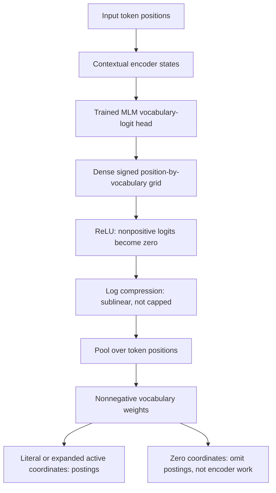
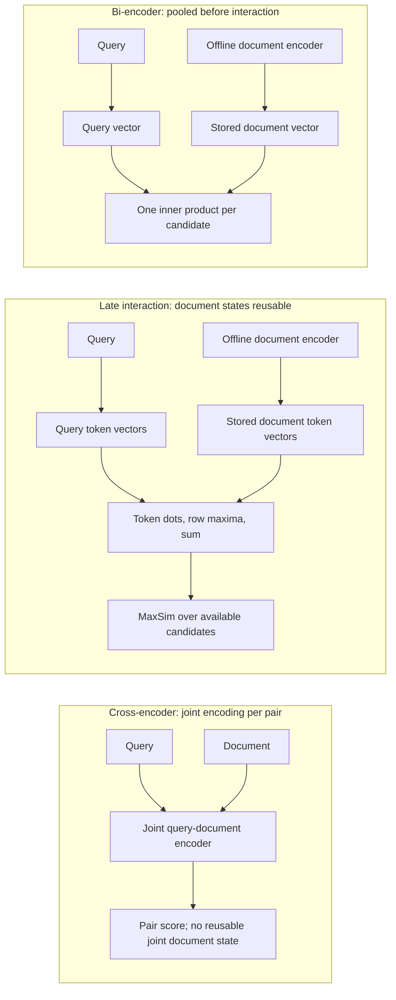

# Chapter 21: Learned Sparse and Multi-Vector Retrieval
[00-START-HERE](../00-START-HERE.md) · [01-READING-ROUTES](../01-READING-ROUTES.md) · [20\_dense\_retrieval](20_dense_retrieval.md) · [22\_reranking](22_reranking.md)
This chapter prepares you to explain how learned lexical weights, token-level matching, compression, pruning, and rank fusion trade retrieval quality against index size and latency.
## TL;DR
- BM25 and SPLADE can be expressed as sparse dot products. SPLADE learns nonnegative weights over vocabulary pieces, including absent pieces; support does not guarantee literal containment or relevance.
- ReLU supplies exact zeros. The logarithm compresses large positive logits but is unbounded and does not cap repeated contributions under sum pooling.
- FLOPS regularization penalizes squared batch-mean weights. It can encourage balanced activation, but mean weights are not probabilities. A feasible capped-Zipf example at $`160`$ average nonzeros gives a $`5.910484`$-fold posting-work gap against effective support $`4{,}000`$; the previous $`56`$-fold example violated probability constraints.
- ColBERT preserves token vectors and scores a sum of row maxima after independent encoding. A fixed per-token ANN depth can still omit the globally best MaxSim document.
- The reported ablations show different losses under one recipe, not universal architecture gaps. Match precision, vector width and score units when pricing them.
- ColBERTv2 uses centroid identifiers and quantized residuals. PLAID uses centroid proxies before reconstructing survivors; compression and pruning need quality checks, and selected-list sizes are not bounded by their global average.
- RRF combines ranks without raw-score calibration. Its constant and list depth determine agreement trade-offs; extra correlated lists are not independent evidence and can change the fused head.
## The story
Imagine one large library with a librarian named Mira. The old card catalog uses BM25, a literal-word clerk that files a book only under words printed in it. A patron asks for “laptop won’t charge,” while the manual says “AC adapter fails to supply power.” Mira owns the right manual, but the catalog cannot connect the two phrasings.
Mira upgrades each catalog card with SPLADE. SPLADE is a learned sparse clerk that predicts useful vocabulary labels, including labels absent from the page. The manual can now receive a positive “charge” label even if that word never appears. Mira still uses the same inverted catalog. She has changed the weights written on the cards, not the shelves or the lookup rule.
The learned vocabulary produces many possible labels. ReLU gives exact blanks that need no posting, while the logarithm reduces each large logit's marginal influence without imposing a hard cap. Repeating the same positive contribution still scales a sum-pooled weight linearly. FLOPS regularization penalizes crowded mean-weight dimensions; its relationship to posting traffic also depends on which dimensions become nonzero.
Some questions need more than vocabulary labels. Mira then uses ColBERT, a reference method that keeps a small note for every query token and every document token. Each query note scans the document notes and keeps its best match. MaxSim is this best-match rule. The interaction happens late, after Mira has prepared every document note offline, so she preserves detail without rereading every document through a joint model.
Mira compares three controlled changes under one training recipe: collapsing token vectors, replacing maxima with means, and removing augmented query positions. In the reported experiment, token collapse has the largest loss, then mean pooling, then removal of query augmentation. Those separate ablations do not assign independent additive shares of quality or prove that every well-trained single-vector model must lose the same amount.
Token vectors occupy more space. ColBERTv2 stores a centroid identifier plus a quantized residual for each one. This preserves a selected cluster label exactly, not every semantic distinction in the original vector. PLAID reuses centroid scores to rank and prune candidates, then reconstructs the final survivors. Both quantization and candidate pruning can change rankings, so Mira checks quality at every stage.
Mira keeps the literal and learned catalogs because each may help different requests. Their raw scores have different scales, so a direct uncalibrated sum needs validation rather than a claim of impossibility. RRF gives reciprocal-rank contributions and can reward agreement. Its rank constant, list depths, weights and treatment of missing documents determine the result; two correlated catalogs do not become independent corroboration.
The full lesson stays inside this library. Learn better catalog labels, balance crowded drawers, retain token notes when detail pays, compress shared patterns, postpone expensive reconstruction, and fuse distinct catalogs only with a rule whose exchange rate you can explain.
## Decoder table

| Technical term | Plain-English meaning | Why it matters |
| --- | --- | --- |
| Retrieval-Augmented Generation (RAG) | A system retrieves external text before a generator answers | Retrieval quality determines what evidence reaches the generator |
| Sparse retrieval | Retrieval with mostly zero vocabulary coordinates | An inverted index omits zero-weight postings; encoding and head evaluation still have a cost |
| BM25 | A lexical ranker with term-frequency saturation and inverse-frequency weights | It can exactly evaluate its lexical scoring rule with a suitable index; that is not exact semantic relevance |
| Inverted index | A map from each term to documents carrying that term | It evaluates sparse dot products without scanning every document |
| Posting | One term, document identifier, and weight entry | Posting count sets index size and contributes to query work |
| Posting list | All postings for one vocabulary dimension | Each active query dimension opens one such list |
| Vocabulary gap | A mismatch between query words and relevant document words | It explains failures such as “charge” versus “supply power” |
| WordPiece vocabulary $`\mathcal V`$ and size $`V=\lvert\mathcal V\rvert`$ | The encoder's fixed subword inventory, here $`V=30{,}522`$ entries | SPLADE predicts vocabulary weights; a BM25 analyzer need not use this same inventory |
| Exact match | Evidence that the same literal token occurs on both sides | It remains valuable for part numbers, versions, and error codes |
| Sparse score $`s(q,d)`$ and weights $`w_j^q,w_j^d`$ | A sum of query/document weight products over shared active coordinates | BM25 can be written in a compatible coordinate form; SPLADE learns support and weights |
| Term weight | The importance assigned to one vocabulary entry | Learned weights can represent context and absent terms |
| Term support | The set of dimensions with nonzero weight | Support determines which postings exist |
| Inverse document frequency (IDF) | A corpus-frequency weight that generally favors rarer terms | The positive guarded variant used here is finite and nonnegative; it is not probability calibration |
| docT5query | Discrete document expansion by generated likely queries | Ordinary backpropagation does not pass through discrete generation/ranking; alternative estimators are not mathematically forbidden |
| Sequence-to-sequence model | A model that generates one token sequence from another | docT5query uses it to append synthetic queries |
| Implicit expansion | Positive weights on terms absent from the original text | SPLADE closes vocabulary gaps without generating strings |
| Masked language model (MLM) head | A vocabulary-logit head evaluated at every input position | SPLADE initializes from pretraining and then learns under its retrieval objective; expansion is not a free untrained side effect |
| BERT-base | The worked encoder has $`110\times10^6`$ parameters and hidden width $`768`$ | Its FLOP proxy is an input assumption, not a latency model |
| Contextual state $`h_i`$, term embedding $`E_j`$ and logit $`\ell_{ij}`$ | A contextual state, output vocabulary embedding and signed pre-activation score | Use a separate symbol for the signed logit rather than confuse it with the final nonnegative retrieval weight |
| Tied input embedding | The vocabulary embedding reused by the output head | It maps contextual states back onto vocabulary dimensions |
| Gaussian Error Linear Unit (GELU) | The nonlinearity inside the MLM transform block | It is part of the unchanged pre-training head SPLADE reuses |
| Layer normalization (LayerNorm) | A normalization step inside the MLM transform block | It is part of the per-position vocabulary scorer |
| ReLU | $`\operatorname{ReLU}(x)=\max(0,x)`$ | Nonpositive logits become zero; shared-parameter updates can later reactivate a coordinate |
| Log compression $`\ln(1+x)`$ | Applying $`\ln(1+x)`$ for $`x\ge0`$ | It is unbounded and sublinear, not a finite cap; sum pooling still adds repeated contributions |
| Sum pooling | Adding one term’s contribution across token positions | It returns one sparse document weight per vocabulary entry |
| Max pooling | Keeping the strongest position for each vocabulary term | It improved one Microsoft Machine Reading Comprehension (MS MARCO) result, but the source says the gain is not universal |
| Nonzero | A vocabulary coordinate that survives sparsification | Nonzeros create postings and query traversals |
| In-batch negative | Another example in the training batch used as a negative | SPLADE v1 combines these with one BM25 hard negative |
| Hard negative | A high-ranked but irrelevant passage used for training | It teaches the model distinctions that random negatives miss |
| Cross-encoder teacher | A joint query-document model that supplies training scores | Distillation from it produced a larger gain than tuning sparsity alone |
| Distillation | Training a smaller or restricted model to match teacher scores | It raises retrieval quality without changing the serving architecture |
| Dense vector | A representation whose dimensions are generally all stored | It offers semantic matching but has different index economics |
| fp32 | A $`32`$-bit floating-point value using $`4\,\mathrm B`$ | This is coordinate payload, not an all-in vector-index size |
| fp16 | A $`16`$-bit floating-point value using $`2\,\mathrm B`$ | Keep precision fixed when attributing a footprint difference to width alone |
| Floating-point operations (FLOPs) | A count of floating-point operations in a stated work proxy | It excludes memory and many execution effects; do not divide unlike FLOP proxies to explain measured latency |
| Multiply-accumulate (MAC) | One multiplication with accumulation, counted here as two FLOPs | Posting-traversal MACs are a simplified work model, not a universal instruction or latency count |
| $`\ell_0`$ support count | The number of nonzero coordinates | It is discontinuous and locally constant away from zero; thresholding/regularization can change support |
| $`\ell_1`$ penalty | The sum of absolute coordinate weights | It promotes small weights under appropriate optimization; it does not by itself bound nonzero count or popularity |
| Least Absolute Shrinkage and Selection Operator (LASSO) | A common use of an $`\ell_1`$ penalty | A convex-envelope interpretation requires a bounded domain; it does not turn the penalty into exact posting cost |
| Activation profiles $`p_j,q_j`$ | Probabilities that a document/query activates coordinate $`j`$, each in $`[0,1]`$ | For a randomly drawn query against a fixed corpus, the document activation fraction gives expected posting traversal |
| Nonzero budgets $`\bar u_d,\bar u_q`$ and work $`C`$ | Average active-coordinate counts and an expected posting-traversal MAC proxy | Support controls payload; its distribution and query alignment also control work |
| Zipfian profile | A skewed rank profile, for example $`p_j=\min(1,c/j)`$ | A normalized reciprocal-rank mass is not automatically a valid activation-probability vector |
| Harmonic number $`H_V`$ | $`H_V=\sum_{j=1}^{V}1/j`$ | The unconstrained Zipf participation ratio is not feasible at every prescribed nonzero budget |
| Participation ratio $`m_{\mathrm{eff}}`$ | $`m_{\mathrm{eff}}=(\sum_jp_j)^2/\sum_jp_j^2`$ for nonzero $`p`$ | With activation probabilities and mass $`\bar u_d`$, it obeys $`\max(1,\bar u_d)\le m_{\mathrm{eff}}\le V`$ |
| Effective support | A participation-ratio description of how activation mass is distributed | Larger effective support lowers the proxy when the query profile is proportional to the document profile; it is not a universal ordering |
| FLOPS penalty $`\mathcal L_{\mathrm{FLOPS}}`$, batch mean $`\bar a_j`$ and size $`B`$ | The squared norm of batch mean nonnegative weights, $`\sum_j\bar a_j^2`$ | It couples examples within a batch; weights are not the same as binary activation probabilities |
| Ranking objective $`\mathcal L_{\mathrm{rank}}`$ and weights $`\lambda_q,\lambda_d`$ | A ranking loss with separately weighted query/document regularizers | The multipliers control a coupled shared-encoder trade-off, not independent guaranteed support budgets |
| Ranking loss | The objective that rewards relevant passages over negatives | It must establish useful dimensions before strong sparsity pressure begins |
| Quadratic warm-up | A gradually increasing regularization schedule | It can reduce early over-sparsification, but does not guarantee avoidance of or recovery from an all-inactive local state |
| Weak AND (WAND) | A dynamic-pruning algorithm for top-$`k`$ sparse retrieval | Its benefit depends on score bounds and the workload; no universal BM25-versus-learned-sparse pruning ordering follows |
| BlockMax-WAND | A block-level form of dynamic pruning | Learned impact distributions can change skipping effectiveness; benchmark it rather than infer p99 from MAC counts |
| Impact-ordered evaluation | Scoring higher-impact postings before lower-impact ones | The source names it as an alternative when learned weights hurt WAND pruning |
| Service-level objective (SLO) | A promised latency or reliability target | Query and document penalties should respect distinct operational limits |
| Latency percentiles $`p_{95},p_{99}`$ | The ninety-fifth and ninety-ninth percentile response times | Averaged support or MACs alone do not determine either tail percentile |
| Bi-encoder | Separate query and document encoders with one vector per side | It allows document precomputation but pools away token detail |
| Cross-encoder | One joint encoder over the query-document pair | It retains all-to-all interaction but cannot precompute document states |
| Dense Passage Retrieval (DPR) | A single-vector dense baseline, here width $`768`$ in fp32 and $`3{,}072\,\mathrm B`$ per passage | Do not assign the same format to a different single-vector system without specifying it |
| ColBERT counts $`N_q,n_d`$, width $`h_c`$ and vectors $`E_{qi},E_{dj}`$ | Processed query rows, stored document rows, projected width and token embeddings | Query masks/specials and document-length policy affect both work and payload |
| Late interaction | Cross-side scoring after both encoders have finished | It makes document token vectors reusable across queries |
| $`\ell_2`$ normalization | Scaling a nonzero vector to unit Euclidean norm | This makes token dot products cosine similarities; declare a zero-vector policy |
| Classification token \[CLS\] | A single encoder position used as a pooled summary | Collapsing to it measures the loss from representation granularity |
| Mask token \[MASK\] | A pre-training placeholder that BERT predicts from context | ColBERT uses padded mask rows as query augmentation |
| MaxSim score $`S(q,d)`$ | $`S(q,d)=\sum_i\max_j E_{qi}^{\mathsf T}E_{dj}`$ | It preserves per-query-row local evidence; fixed token-ANN depths need not recover its global top documents |
| Approximate nearest-neighbor (ANN) search | Approximate search for close vectors | Candidate generation can miss documents with strong aggregate MaxSim even if each individual token probe is accurate |
| Inverted file index with product quantization (IVF-PQ) | A partitioned compressed vector index | Original end-to-end ColBERT used it for candidate generation |
| $`\operatorname{Recall}@1000`$ | The fraction of gold-relevant passages retained among the first thousand | Reranking the same thousand cannot change their set recall; evaluate the final smaller cutoff separately |
| $`\operatorname{MRR}@10`$ | The mean reciprocal rank of the first relevant passage, set to zero beyond rank ten | Scores are fractions in $`[0,1]`$; one scaled MRR point is an absolute $`0.01`$ change |
| Ablation | A controlled component change under a stated recipe | It measures a conditional difference, not an additive causal share or the ceiling of another architecture |
| Representation granularity | Keeping one representation or multiple token representations per passage | It produced the largest reported drop among these specific ColBERT ablations, not a universal ranking of design choices |
| Query augmentation | Adding extra query-side rows beyond literal tokens | ColBERT obtains it from contextualized \[MASK\] positions |
| Approximate Nearest Neighbor Negative Contrastive Estimation (ANCE) | A later single-vector training system named in the source | Its result limits what the ColBERT \[CLS\] ablation proves |
| K-means | Clustering vectors around learned centers | ColBERTv2 uses it to build the centroid codebook |
| Codebook $`C`$, assignment $`t(v)`$, embedding $`v`$ and residual $`r`$ | A shared codebook, centroid assignment, token embedding and residual | The centroid identifier is an exact cluster address, not exact lexical/semantic identity |
| Codebook size $`K_c`$, embedding count $`T_c`$ and residual width $`b`$ | Number of centroids, number of stored token embeddings and residual bits per coordinate | Identifier packing, codebook precision and metadata must also be specified |
| Residual $`r`$ | The exact difference $`r=v-C_{t(v)}`$ | Storing a quantized residual instead gives a lossy reconstruction |
| Residual quantization | Storing a low-bit code $`Q_b(r)`$ and reconstructing $`\widehat v=C_{t(v)}+Q_b(r)`$ | It preserves a cluster address but changes vectors and can change retrieval ranks |
| Quantile bucket edges | Thresholds chosen from the residual distribution | They define the one-bit or two-bit residual codes |
| Inverted File with Asymmetric Distance Computation (IVFADC) | A coarse/residual representation scored with asymmetric distance computation | Product-quantization codes can be scored by lookup tables without reconstructing every full vector |
| PLAID | A centroid-first late-interaction candidate and scoring funnel | Final scoring is exact only for the retained reconstructed vectors; earlier pruning and quantization remain approximate |
| Candidate generation | Probing selected centroid lists and mapping hits to passages | Global average list length does not upper-bound query-selected hits or unique candidate passages |
| Centroid pruning | Removing centroids too dissimilar to every query token | It shrinks later stages before they read more bytes |
| Centroid interaction | A cheaper centroid-based proxy for MaxSim | The worked funnel keeps $`n_{\mathrm{docs}}`$ then $`n_{\mathrm{docs}}/4`$ candidates; proxy errors can remove a relevant passage |
| Ragged gather | Loading variable numbers of token vectors per passage | Reshape and padding make it a major runtime cost |
| Lookup table | Precomputed values used during decompression or scoring | PLAID uses them to accelerate central processing unit execution |
| Central processing unit (CPU) | A general-purpose processor | PLAID reports a larger speedup there than on a GPU |
| Graphics processing unit (GPU) | A highly parallel processor | Parallelism already hides some padding waste there |
| Peripheral Component Interconnect Express (PCIe) | The host-to-accelerator data path named in the serving discussion | Crossing it makes byte traffic more important than arithmetic |
| MiniLM | The 22-million-parameter cross-encoder teacher in ColBERTv2 | It supplies soft scores for denoised distillation |
| Kullback-Leibler (KL) divergence | A loss that matches two score distributions | ColBERTv2 uses it over 64-way tuples |
| Denoised distillation | Teacher training that reduces noisy binary-label effects | The source credits it, not compression, for ColBERTv2’s quality gain |
| $`\operatorname{NDCG}@10`$ | A discounted, ideal-normalized top-ten gain metric | A reported scaled-point aggregate gain does not rule out important cohort regressions |
| Cosine similarity | For nonzero vectors, normalized inner product in $`[-1,1]`$ | It is not a calibrated relevance probability; raw dense dot products need not have this bound |
| Min-max normalization | Rescaling a nonconstant list window to $`[0,1]`$ | It depends on window extremes and needs a zero-range fallback and a missing-list policy |
| Convex combination | A weighted sum whose nonnegative weights total one | It can outperform RRF after sound normalization and in-domain tuning |
| Fusion weight $`\alpha`$ | The sparse share $`\alpha\in[0,1]`$ in a two-list convex combination | Tune with independent in-domain judgments and important slices, not on the final test set |
| Rank | A one-based document position within one returned list | Define treatment of tied input scores and absent documents |
| RRF score $`\operatorname{RRF}(d)`$ and ranks $`r_\ell(d)`$ | A sum of reciprocal-rank contributions from lists in which the document appears | It avoids raw-score scale matching, but is not a confidence or independence model |
| Rank constant $`\kappa`$, list count $`L`$ and depth $`m`$ | Nonnegative offset $`\kappa`$, number of lists $`L`$ and per-list depth $`m`$ | The constant, depth and list weights jointly affect head rank versus agreement |
| Raw score $`s_\ell(d)`$ and fusion weight $`\alpha`$ | An individual retriever score and the sparse share of score fusion | Normalization and held-out validation matter; a bounded score is not automatically calibrated |
| Weighted RRF | RRF with nonnegative list weights $`\omega_\ell`$ | Weights can be validated or learned; they do not automatically correct correlated errors |
| Hierarchical fusion | Combine correlated lists within a family before combining families | It can cap a family's voting budget, but changes the algorithm and is not a guaranteed quality improvement |
| RAG-Fusion | RRF across lists from generated paraphrases of one query | Correlated agreement can amplify a shared near-miss |
| Calibration | A validated mapping from scores to an interpretable outcome probability | Rank fusion is not itself calibration; a score threshold can be tested but is not justified by the RRF range alone |

## Core mechanics
### Mathematical conventions
Use decimal $`\mathrm{kB},\mathrm{MB},\mathrm{GB},\mathrm{TB}`$ for powers of ten and binary $`\mathrm{KiB},\mathrm{MiB},\mathrm{GiB}`$ for powers of two: $`1\,\mathrm{GB}=10^9\,\mathrm B`$ and $`1\,\mathrm{GiB}=2^{30}\,\mathrm B`$. fp32 and fp16 use $`4\,\mathrm B`$ and $`2\,\mathrm B`$ per value. One multiply-accumulate (MAC) counts as two FLOPs in the work proxies. Vector or posting payloads exclude dictionaries, source text, graph links, identifiers not already counted, allocation, replicas and runtime buffers unless stated. Keep full precision until reporting; $`\approx`$ marks rounding or modeling approximation.
For sparse examples, let $`\mathcal V`$ be the vocabulary with size $`V=\lvert\mathcal V\rvert=30{,}522`$, $`N=8{,}841{,}823`$, $`p_j=\Pr(w_j^d>0)`$ and $`q_j=\Pr(w_j^q>0)`$ describe document and query activation profiles. Thus $`0\le p_j,q_j\le1`$ and $`\bar u_d=\sum_jp_j`$ is average nonzero count. Learned mean weight $`\mu_j=\mathbb E[w_j^d]`$ is not generally $`p_j`$. The exhaustive posting-work proxy $`N\sum_jq_jp_j`$ is distinct from actual latency with pruning, query encoding, score accumulation and top-result selection.
For the late-interaction payload examples, use the separately stipulated rounded corpus $`N_c=8.8\times10^6`$, $`n_d=68`$ indexed token vectors per passage, $`N_q=32`$ query positions and projection width $`h_c=128`$. Do not silently mix this with the exact sparse corpus count. A BERT-base encoder has $`P=110\times10^6`$ parameters; $`2PT`$ forward FLOPs for $`T`$ processed positions is approximate and omits attention-length effects, projections and other work. Lengths omit any additional special tokens unless included in the stipulated count. Dividing work by hardware rates is not a measured latency, physical lower bound or request-percentile guarantee.
MRR is a fraction: $`\operatorname{MRR}@10=Q^{-1}\sum_{i=1}^{Q}\mathbf1[r_i\le10]/r_i`$, with zero contribution if no relevant result is found, where $`r_i`$ is the first relevant one-based rank. One scaled MRR point is $`0.01`$ on this scale; relative loss instead divides an absolute score change by a specified baseline. Passage recall, answer-hit accuracy and ANN neighbor recall have different reference sets and denominators. The cited scores, ablations and latency profiles are reported inputs; they are not all one matched experiment.
In fusion, use $`\kappa\ge0`$ for the RRF rank constant, $`m`$ for list depth and $`L`$ for list count, distinct from BM25 $`k_1`$, projection width and rerank depth. A document absent from a truncated list contributes zero; ranks are one-based, with a declared deterministic tie policy. Min-max normalization requires a nonzero score range and a documented constant-list fallback. Normalized or fused scores are not automatically probabilities. Historical software, benchmark and hardware assertions remain reported source claims, not independent verification.
### 21.1 SPLADE: MLM-predicted term importance and implicit expansion
#### The shared sparse scoring form
- **What:** Let $`V`$ be a shared abstract term-coordinate set with $`V=30{,}522`$ in the SPLADE WordPiece example. Weights $`w_j^q,w_j^d`$ refer to query and document coordinate $`j`$.
- **Why:** Sparse dot-product scoring supports inverted lists, with contributions only from nonzero query dimensions and stored nonzero document dimensions.
- **Scope:** Real BM25 analyzers need not use WordPiece; sharing the scoring shape does not make every implementation's vocabulary or posting format identical.
- **Cost:** Exhaustively visiting eligible postings is one work model. Dynamic pruning, quantization and top-result selection change execution cost.
$$
s(q,d)=\sum_{j=1}^{V}w_j^q w_j^d.
$$
For one unfielded BM25 variant, let $`f_{j,d}`$ be analyzed term count, $`L_d`$ document length, $`\overline L>0`$ average length, $`k_1>0`$ and $`0\le b_{\mathrm{BM25}}\le1`$. Use the guarded positive IDF convention from Chapters 18 and 20, and ignore query-frequency weighting in this particular decomposition:
$$
w_j^d=\begin{cases}\displaystyle\frac{f_{j,d}(k_1+1)}{f_{j,d}+k_1(1-b_{\mathrm{BM25}}+b_{\mathrm{BM25}}L_d/\overline L)},&f_{j,d}>0,\\0,&f_{j,d}=0.\end{cases}
$$
$$
w_j^q=\operatorname{IDF}_+(j)\mathbf1[j\in q],\qquad\operatorname{IDF}_+(j)=\ln\frac{N+1}{n_j+0.5}.
$$
- **What:** A zero document term count contributes zero under this lexical variant; learned expansion changes that literal-support property.
- **Why:** An exact posting match is evidence of analyzed term occurrence, not proof of relevance. BM25 can use other query terms and length effects, but does not itself contextualize the word “bank.”
- **Failure case:** A relevant passage may paraphrase all informative query terms and have no analyzed overlap. Translation, expansion or another retrieval route changes that premise.
- **Reported scenario:** The opening example gives BM25 request $`p_{99}=40\,\mathrm{ms}`$ and an audited unacceptable-candidate rate $`12\%`$. These are scenario observations, not consequences of the formula or a general BM25 failure rate.
#### Discrete expansion versus direct vocabulary weighting
- **Discrete expansion:** The cited docT5query configuration generates forty possible queries, appends their text and indexes it with BM25. Generation settings change the resulting corpus and term counts. Ordinary backpropagation does not pass directly through discrete decoding, although other training estimators or surrogates are possible.
- **Reported result:** The chapter gives $`\operatorname{MRR}@10=0.277`$ versus BM25 $`0.184`$ in that comparison; do not combine these automatically with the separate ColBERT baseline.
- **Direct weights:** SPLADE's MLM vocabulary head scores vocabulary pieces at contextual positions, so absent pieces can receive weight without generating a string. This is one expansion parameterization, not a theorem that no other architecture can expand absent terms.
- **Intermediate size:** At $`n=128`$ and $`V=30{,}522`$, there are $`nV=3{,}906{,}816`$ logits, or $`15.627264\,\mathrm{MB}`$ if materialized in fp32. Implementation and streaming can change peak memory.
$$
\ell_{ij}=\left\langle T(h_i),E_j\right\rangle+b_j,\qquad h_i,E_j\in\mathbb R^{768}.
$$
Here $`T`$ is the MLM dense/GELU/LayerNorm transform, $`E_j`$ the tied vocabulary embedding and $`b_j`$ its output bias. The position set used for pooling must follow the attention and special-token policy; padding positions must not accidentally create indexed terms.
#### Exact zeros, saturation, and pooling
- **What:** ReLU sets nonpositive logits to zero. For positive logits, $`\ln(1+\ell)`$ grows sublinearly but remains unbounded; its derivative is $`1/(1+\ell)`$.
- **Why:** Exact output zeros can be omitted from the inverted index. The log transform reduces marginal scale, not the total number of active dimensions.
- **Limit:** ReLU can leave many positives, and sum pooling still adds repeated contributions. It does not impose a posting budget or a hard per-term cap.
- **Cost:** Sparse serving does not imply sparse indexing computation: the vocabulary head can still be dense.
$$
a_{ij}=\ln\!\left(1+\max(0,\ell_{ij})\right),\qquad w_j^d=\sum_{i=1}^{n}a_{ij}.
$$
Five logits equal to twelve have raw sum $`60`$, versus $`5`$ for five logits equal to one, a raw ratio $`12`$. Transformed sums are $`5\ln13\approx12.824746787`$ and $`5\ln2\approx3.465735903`$, ratio $`\ln13/\ln2\approx3.700439718`$. The transform compresses the ratio; doubling the number of identical positions still doubles either sum-pooled weight.
Pooling removes explicit position indexing only after contextual encoding, so the output is a vocabulary-weight vector rather than a literal order-free input model. A max-pooled variant uses $`w_j^d=\max_i a_{ij}`$. The chapter reports $`\operatorname{MRR}@10`$ changing from $`0.322`$ to $`0.340`$ for a cited variant, but not reproducing universally. Treat the result as a reported configuration comparison, not proof that max pooling always wins or that pooling alone explains every v2 gain.
#### Training and interpretability
- **Training:** The cited SPLADE v1 recipe uses in-batch candidates and one BM25-mined hard negative per query. Mask known positives and duplicates; mined candidates are not exhaustively judged negatives.
- **Objective:** Ranking supervision can train the vocabulary weights end to end, with ReLU's local zero derivatives and shared parameters accounted for. It does not automatically enforce sparsity or calibrated expansion.
- **Reported results:** The chapter gives $`\operatorname{MRR}@10=0.322`$ for v1 and $`0.368`$ for a distilled v2 configuration, versus $`0.184`$ BM25 and $`0.277`$ docT5query in that comparison. Distillation, training and architecture changes must not all be attributed to one pooling operation.
SPLADE coordinates are inspectable vocabulary pieces, not necessarily whole readable words or a faithful explanation of the complete ranking decision. The source suggests reviewing the top twenty coordinates on a few hundred documents. Check context, negation, brands and unsupported expansions against judgments; deleting a coordinate can remove useful matches too. An expanded posting does not certify that its label literally occurred in the source.
#### Worked index economics
For a payload example use $`N=8{,}841{,}823`$, $`V=30{,}522`$ and $`8\,\mathrm B`$ per posting: a four-byte document identifier plus four-byte weight. Assume forty stored BM25 terms per passage. To make the query arithmetic explicit, the following table uses uniform activation across the vocabulary, not an observed natural-language frequency distribution. For the unregularized row, $`p_j=0.30`$ gives average $`0.30V=9{,}156.6`$ active dimensions; its fractional totals are expected quantities, not literal fractional records.

| Configuration | Index arithmetic | Query arithmetic | Result |
| --- | --- | --- | --- |
| BM25 | $`N(40)=353{,}672{,}920`$ postings | $`N(8)(40)/V\approx92{,}699.802110`$ MACs | $`2.82938336\,\mathrm{GB}`$ payload |
| Unregularized SPLADE at $`30\%`$ positive | $`\mathbb E[\text{postings}]=N(0.30V)\approx8.09610364818\times10^{10}`$ | $`N(100)(0.30)=265{,}254{,}690`$ expected MACs | $`\approx647.688292\,\mathrm{GB}`$ expected payload; $`2{,}861.4375`$ times BM25 toy work |
| SPLADE at 160 nonzeros | $`N(160)=1{,}414{,}691{,}680`$ postings | $`N(100)(160)/V\approx4{,}634{,}990.105498`$ MACs | $`11.31753344\,\mathrm{GB}`$ payload; $`50`$ times BM25 toy work |

At $`160`$ stored pairs, each document uses $`1{,}280\,\mathrm B`$ under this posting format. A width-$`768`$ fp32 vector uses $`3{,}072\,\mathrm B`$; corpus payloads are $`11.31753344`$ versus $`27.162080256\,\mathrm{GB}`$, a ratio $`2.4`$. This is not an all-in sparse/dense index ratio; real engines use different compression, dictionaries and auxiliary structures.
The vocabulary projection alone has proxy $`2(128)(768)(30{,}522)=6{,}000{,}869{,}376`$ FLOPs per passage, compared with encoder proxy $`2(110\times10^6)(128)=28{,}160{,}000{,}000`$ FLOPs, a ratio $`21.309905\%`$. The preceding dense transform adds another $`2(128)(768)^2=150{,}994{,}944`$ FLOPs before nonlinearities, normalization, bias and pooling. The head percentage alone does not establish indexing throughput or the dominant production bill.
At five hundred million chunks, payloads are $`1.536\,\mathrm{TB}`$ for width-$`768`$ fp32 dense vectors, $`160\,\mathrm{GB}`$ for forty eight-byte postings and $`640\,\mathrm{GB}`$ for one hundred sixty postings. Learned sparse expansion still uses lexical coordinates, but does not provide a hard literal-containment guarantee. Compare measured request $`p_{99}`$, candidate coverage and final quality before choosing one learned index over a lexical/dense pair.
An average of one hundred sixty nonzeros—four times the forty-term baseline—is a source starting heuristic, not a universal optimum. Query sparsity can reduce posting traffic without reducing the dense query encoder/head work. Use an index that supports learned posting weights and its quantization/pruning contract. Dense materialization of all $`30{,}522`$ fp32 coordinates costs $`122{,}088\,\mathrm B=122.088\,\mathrm{kB}`$ per document and $`1.079480486424\,\mathrm{TB}`$ over this exact corpus. The cited SPLADE-doc option removes the learned query-side encoder/expansion in favor of lexical query coordinates; evaluate its quality. docT5query is another option when the serving engine accepts expanded text but not custom impact weights.
### 21.2 FLOPS regularization: making sparsity a trainable objective
#### Model the work the index performs
- **What:** Let $`p_j`$ be corpus activation probability and $`q_j`$ query activation probability. An exhaustive traversal opens list $`j`$ with probability $`q_j`$ and its modeled length is $`Np_j`$.
- **Why:** Expected posting visits depend on the product of the two profiles, not just their separate nonzero totals. One posting contribution uses one MAC in this proxy.
- **Scope:** Corpus frequencies can be fixed empirical fractions; query randomness supplies the expectation. Dynamic skipping, caches, score quantization and query encoding are not counted.
$$
C_{\mathrm{post}}=N\sum_{j=1}^{V}q_jp_j\quad\text{MACs per query}.
$$
The exact $`\ell_0`$ support count is piecewise constant and has zero derivative almost everywhere, so naive gradient descent on it is unsuitable. The identity $`\mathbb E\lVert w^d\rVert_0=\sum_jp_j=\bar u_d`$ is about nonzero indicators, not an identity for $`\ell_1`$ weight mass. With arbitrary nonnegative weights, shrinking every positive weight reduces $`\ell_1`$ without changing any support. Calling $`\ell_1`$ the tightest convex relaxation needs a domain: on a bounded unit $`\ell_\infty`$ box it is the convex envelope of $`\ell_0`$, not an unqualified statement on unbounded weights. Support budgets still require measurements, thresholds or further assumptions.
For the following tractable toy only, assume proportional activation profiles $`q_j=(\bar u_q/\bar u_d)p_j`$, with $`\bar u_d>0`$ and probabilities remaining in $`[0,1]`$. The worked case has $`\bar u_q=30<160=\bar u_d`$, so the query constraint is feasible. This assumption is not implied by the FLOPS penalty:
$$
q_j=\frac{\bar u_q}{\bar u_d}p_j.
$$
Then expected cost and effective support become:
$$
C_{\mathrm{post}}=\frac{N\bar u_q\bar u_d}{m_{\mathrm{eff}}(p)}.
$$
$$
m_{\mathrm{eff}}(p)=\frac{\left(\sum_jp_j\right)^2}{\sum_jp_j^2},\qquad\sum_jp_j>0.
$$
Cauchy–Schwarz gives $`m_{\mathrm{eff}}(p)\le V`$, with equality for equal nonzero popularity across all vocabulary coordinates. Also $`\sum_jp_j^2\le\sum_jp_j=\bar u_d`$ because $`p_j\le1`$, so $`m_{\mathrm{eff}}(p)\ge\max(1,\bar u_d)`$. At $`\bar u_d=160`$, the tight minimum is $`160`$, achieved by one hundred sixty always-active dimensions. Thus the maximum cost ratio between feasible profiles at these fixed proportional counts is $`30{,}522/160=190.7625`$, not the vocabulary size. Against the specific $`m_{\mathrm{eff}}=4{,}000`$ comparison below, the greatest possible ratio is $`25`$.
#### Why a Zipfian profile is expensive
An uncapped reciprocal profile has harmonic sums $`H_V=\sum_{j=1}^{V}1/j\approx10.903435060`$ and $`H_V^{(2)}=\sum_{j=1}^{V}1/j^2\approx1.644901304`$. Its scale-invariant effective support is $`H_V^2/H_V^{(2)}\approx72.274790`$. This is a valid concentration statistic for arbitrary nonnegative weights, but not a feasible probability profile at mean support one hundred sixty: normalization would require $`p_1=160/H_V\approx14.674275>1`$. The previous fifty-six-fold posting-cost example therefore mixed weight mass with activation probabilities.
A feasible concentrated example is $`p_j=\min(1,c/j)`$, choosing $`c`$ so $`\sum_jp_j=160`$. Numerically $`c\approx19.168819842`$; the first nineteen probabilities equal one. Then $`\sum_jp_j^2\approx37.827100078`$ and $`m_{\mathrm{eff}}(p)\approx676.763483`$. This is a constructed capped-Zipf example, not a theorem that an $`\ell_1`$-trained model must learn this profile. Harmonic approximations include finite-size terms; do not replace $`H_V`$ by $`\ln V+\gamma`$ as an exact equality.
#### FLOPS as load balancing
For a batch of $`B`$ nonnegative document-weight vectors, define a mean weight and the named FLOPS surrogate. These are real weights, not automatically binary activation probabilities:
$$
\bar a_j=\frac1B\sum_{b=1}^{B}w_j^{(b)}.
$$
$$
\mathcal R_{\mathrm{FLOPS}}=\sum_{j=1}^{V}\bar a_j^2.
$$
For this penalty, $`\partial\mathcal R_{\mathrm{FLOPS}}/\partial w_j^{(b)}=2\bar a_j/B`$. For $`\mathcal R_1=B^{-1}\sum_{b,j}w_j^{(b)}`$, the derivative on a positive weight is $`1/B`$. Mean weights $`2.0`$ and $`0.05`$ therefore have a fortyfold FLOPS derivative ratio before coefficients and the activation chain rule. The pressure is on output weights; derivatives through ReLU/log pooling and shared encoder parameters are different quantities.
For $`B>1`$, squaring the mean introduces cross-document coupling. Under IID batches, $`\mathbb E[\bar a_j^2]=\mu_j^2+\operatorname{Var}(w_j)/B`$, not exactly $`\mu_j^2`$. Batch size one lacks cross-document coupling. Finite-batch variance, active-weight magnitudes and the query/document relation all affect how this surrogate translates into support and real posting traffic.
For a nonzero mean-weight vector $`\mu`$, define $`m_{\mathrm{eff}}(\mu)=(\sum_j\mu_j)^2/\sum_j\mu_j^2`$. At fixed mean $`\ell_1`$ mass $`M_1=\sum_j\mu_j`$, the population mean-square term is $`M_1^2/m_{\mathrm{eff}}(\mu)`$, so minimizing it spreads that weight mass. Equating this with $`\bar u_d^2/m_{\mathrm{eff}}(p)`$ additionally needs binary weights or a fixed common active amplitude. Arbitrary SPLADE weights need not satisfy it. FLOPS can encourage sparsity and load balance but does not guarantee a fixed support count, profile proportionality or latency optimum.
#### Separate query and document penalties
$$
\mathcal L=\mathcal L_{\mathrm{rank}}+\lambda_q\mathcal R_{\mathrm{FLOPS}}(q)+\lambda_d\mathcal R_{\mathrm{FLOPS}}(d),\qquad\lambda_q,\lambda_d\ge0.
$$
Document support affects persistent postings and traffic; query support affects posting traffic and transient query work. Both sides can affect relevance, encoder cost and caches. The source suggests trying $`\lambda_q`$ roughly an order of magnitude above $`\lambda_d`$ when query latency binds, but the coefficients depend on loss normalization, weight scales, parameter sharing and task. Stronger query regularization does not automatically leave the document profile unchanged in a shared encoder; measure both after training.
The all-zero output minimizes either nonnegative penalty. A strictly negative logit has zero local derivative through ReLU, but this alone does not make a vocabulary dimension permanently dead: shared parameters can move from other examples, and optimizer state or weight decay can change logits. A completely inactive model can be locally stuck if every training gradient reaches only these zero-derivative paths and no other update acts. The source describes a quadratic regularization warm-up; trying the first ten to fifteen percent of steps is a scheduling heuristic, not a guarantee against collapse or proof that full initial regularization always kills outputs.
#### Worked cost profiles
Use the exact sparse corpus $`N=8{,}841{,}823`$, average document support $`\bar u_d=160`$ and query support $`\bar u_q=30`$. Keep proportional probability profiles explicit; this is a different query support from the preceding one-hundred-coordinate payload example.
$$
N\bar u_q\bar u_d=(8{,}841{,}823)(30)(160)=42{,}440{,}750{,}400.
$$

| Configuration | Effective support | Query cost | Index size |
| --- | --- | --- | --- |
| Feasible capped-Zipf profile (constructed) | $`m_{\mathrm{eff}}(p)\approx676.763483`$ | $`C_{\mathrm{post}}\approx62{,}711{,}348.154760`$ MACs | $`11.31753344\,\mathrm{GB}`$ payload |
| Balanced profile on $`4{,}000`$ dimensions (constructed) | $`m_{\mathrm{eff}}(p)=4{,}000`$ | $`C_{\mathrm{post}}=10{,}610{,}187.6`$ MACs | $`11.31753344\,\mathrm{GB}`$ payload |
| Reduce query support to eight, holding document profile fixed | $`m_{\mathrm{eff}}(p)=4{,}000`$ | $`C_{\mathrm{post}}=2{,}829{,}383.36`$ MACs | Unchanged only because the document profile is held fixed |

The feasible concentrated and balanced examples have the same average document support and a posting-work ratio $`4{,}000/676.763483\approx5.910484`$, not fifty-six. Reducing query support from thirty to eight gives another factor $`30/8=3.75`$ only with the document profile and proportionality held fixed. The balanced document profile is feasible: take $`p_j=0.04`$ on four thousand dimensions and zero elsewhere; its corresponding query probabilities are $`0.0075`$.
The balanced and capped-Zipf proxies are approximately $`114.4575`$ and $`676.499267`$ times the earlier uniform BM25 posting estimate $`92{,}699.802110`$ MACs. These compare different constructed query/document profiles, not shipped query latency. The invalid uncapped calculation does not justify a six-thousand-four-hundred-fold production claim. WAND and BlockMax-WAND can skip contributions using upper bounds; their benefit depends on score distributions, impact quantization, list order, cutoffs and implementation. The source reports difficulties with dynamic pruning for some learned sparse distributions, not a theorem that every SPLADE index prunes worse than BM25. Evaluate document-at-a-time, impact-ordered and score-at-a-time engines on the deployment workload.
Report document/query support distributions, activation-based effective support, mean-weight concentration and measured request tails together. Estimating frequencies from one hundred thousand vectors is a source sampling heuristic; unseen rare dimensions and domain shift add uncertainty. A target of one hundred sixty document nonzeros and effective support at least four thousand is a candidate budget, not a theorem. At five hundred million chunks that posting payload is $`640\,\mathrm{GB}`$ under this format. Compare training-time regularization with serving-time top-coordinate truncation: neither universally preserves recall or fixes skew. Recompute profiles after changing corpus, tokenizer, thresholds, weights or domain.
### 21.3 ColBERT and late interaction
#### Locate the architectural gap
- **Architecture:** A single-vector bi-encoder scores two query-independent-side vectors. A standard cross-encoder jointly conditions token states on the current query/document pair; reusable final document states are therefore unavailable in that baseline, even though raw text and some preprocessing can be cached.
- **Representation limit:** A simple mean gives equal coefficients to contextual token vectors, not necessarily equal semantic importance to the original words. Contextual states can already encode salience. A single vector is a bottleneck, but its width alone does not prove a fixed quality gap.
- **Reported comparison:** The chapter gives cross-encoder $`\operatorname{MRR}@10=0.347`$ and $`10{,}700\,\mathrm{ms}`$ at candidate depth one thousand. Keep measured configuration and approximate work models distinct.
$$
s_{\mathrm{bi}}(q,d)=\eta_Q(q)^{\mathsf T}\eta_D(d).
$$
#### Keep token vectors and interact late
- **What:** ColBERT independently encodes the two texts, projects token states to $`h_c=128`$ and normalizes nonzero token vectors. A zero vector or empty document requires an explicit masking/fallback policy rather than division by zero or a maximum of an empty set.
- **Query positions:** The cited recipe augments queries to $`N_q=32`$ positions with mask tokens. These contextual outputs are not zero-padding vectors.
- **Why:** Documents remain precomputable, while query-token-specific matching is delayed until scoring. Contextual encoding still precedes the late interaction.
- **Cost:** Payload scales with indexed document-token count and vector width/precision, not merely passage count.
$$
S(q,d)=\sum_{i=1}^{N_q}\max_{1\le j\le n_d}\left\langle E_{qi},E_{dj}\right\rangle.
$$
For a single query row, suppose a document of $`68`$ vectors has one similarity $`0.95`$ and the other $`67`$ similarities $`0.10`$. Replacing its maximum by its mean yields:
$$
\frac{0.95+67(0.10)}{68}=\frac{7.65}{68}=0.1125.
$$
A comparison row with all similarities $`0.10`$ scores $`0.10`$. Maximum similarity has ratio $`0.95/0.10=9.5`$ and additive gap $`0.85`$, while the mean has ratio $`1.125`$ and gap $`0.0125`$. These are similarity-score comparisons, not likelihood ratios or calibrated evidence. With one strong cell and a fixed background, the mean gap shrinks as $`0.85/n_d`$. MaxSim can also match several query tokens to the same document token and does not itself enforce joint factual consistency.
#### End-to-end candidate generation
A token-driven candidate stage can issue ANN probes for query vectors, map hits to passages, deduplicate and rescore their union with MaxSim. This changes the first-stage candidate set; it does not remove all coverage ceilings. A fixed probe depth is not guaranteed to retrieve the global MaxSim winner. For example, take orthogonal unit query vectors $`e_1,e_2`$, two single-token distractors $`e_1,e_2`$, and a single-token relevant document $`(e_1+e_2)/\sqrt2`$. That document has total score $`\sqrt2>1`$, but each query token's nearest single token is its corresponding distractor. Two top-one probes omit the highest-scoring document.
The source reports end-to-end $`\operatorname{Recall}@1000=96.8\%`$ versus BM25-candidate reranking $`81.4\%`$. If a reranker receives and returns exactly the same thousand documents, its recall at that same depth is unchanged by reordering. At smaller output depths ranking can help. Token ANN, filters and later pruning impose their own candidate-survival limits, and passage recall is not numerically a universal NDCG ceiling.
#### Worked architecture costs
For matched work proxies use $`N_c=8.8\times10^6`$, $`n_d=68`$, $`N_q=32`$, $`h_c=128`$, fp16 token vectors, $`P=110\times10^6`$ and a fixed candidate depth $`K_r=1{,}000`$. The cross-encoder proxy processes $`32+68=100`$ positions per pair, with any extra special positions omitted. Token candidate generation, projection/normalization, maximum reductions, data movement and selection are not included in the dot-product FLOP formulas.

| Architecture | Online arithmetic | Stored bytes per passage | Reported behavior |
| --- | --- | --- | --- |
| Cross-encoder | $`K_r2P(N_q+n_d)=2.2\times10^{13}`$ FLOPs | No reusable final query-conditioned vectors; source/cache storage remains | Reported $`10{,}700\,\mathrm{ms}`$ and $`\operatorname{MRR}@10=0.347`$, not derived from this proxy |
| ColBERT | $`7.04\times10^9+557{,}056{,}000=7{,}597{,}056{,}000`$ FLOPs | $`68(128)(2)=17{,}408\,\mathrm B`$ | Reported reranking time $`61\,\mathrm{ms}`$; ANN generation is a separate stage |
| Single-vector bi-encoder | $`7.04\times10^9+2(1{,}000)(768)=7{,}041{,}536{,}000`$ FLOPs | $`768(4)=3{,}072\,\mathrm B`$ in the DPR fp32 example | Submillisecond dot scoring, where reported, excludes query encoding and full retrieval |

The query encoder proxy is $`2(110\times10^6)(32)=7.04\times10^9`$ FLOPs. Candidate token dot products add $`2(1{,}000)(32)(68)(128)=557{,}056{,}000`$ FLOPs, for total $`7.597056\times10^9`$. These shares are approximately $`92.667475\%`$ encoding and $`7.332525\%`$ token dots, summing to one hundred percent. Max comparisons, row summation, projections and system work remain outside this accounting.
At the matched lengths, the cross/ColBERT work-proxy ratio is approximately $`2.2\times10^{13}/(7.597056\times10^9)=2{,}895.858606`$. The previous ninety-seven-trillion-FLOP figure is not implied by those lengths; under the same $`2P`$ rule it would require roughly $`440.909091`$ processed positions per pair. Do not combine it with a rounded seven-billion denominator as though all numbers describe one experiment.
The reported latency ratio is $`10{,}700/61\approx175.409836`$. Dividing an unmatched FLOP ratio by that measured ratio does not prove a seventy-ninefold overstatement or isolate overhead. The cited profile allocates $`13`$ of $`61\,\mathrm{ms}`$ to encoding/interaction and the remaining $`48\,\mathrm{ms}`$ to gathering, stacking and transfers. That profile motivates a data-movement optimization in its configuration, not a universal bottleneck for all late-interaction systems.
Token payload is $`68(128)(2)=17{,}408\,\mathrm B`$ per passage. The width-$`768`$ fp32 single-vector example is $`3{,}072\,\mathrm B`$, giving ratio $`17/3\approx5.666667`$. At the rounded corpus $`N_c`$, totals are $`153{,}190{,}400{,}000\,\mathrm B\approx142.669678\,\mathrm{GiB}`$ and $`27{,}033{,}600{,}000\,\mathrm B\approx25.177002\,\mathrm{GiB}`$. The comparison deliberately uses different widths/precisions and excludes auxiliary index structures; it is not a universal multi-vector multiplier.
At fixed passage count and storage format, doubling indexed token count doubles raw multi-vector payload. A single-vector payload stays constant only if chunk count and width remain fixed; longer chunks can change tokenization limits, quality and serving work.
For $`N_c`$ and sixty-eight vectors per passage, width-$`128`$ fp32 payload is $`285.339355\,\mathrm{GiB}`$ and width-$`24`$ fp16 payload is $`26.750565\,\mathrm{GiB}`$, ratio $`10.666667`$. The source's rounded reported footprints are $`286`$ and $`27\,\mathrm{GiB}`$, a ratio approximately $`10.592593`$; do not equate rounded empirical totals with the exact toy count. This change includes both width and precision. Holding fp16 fixed, width $`128\to24`$ gives ratio $`5.333333`$ instead.
The cited quality operating points are $`\operatorname{MRR}@10=0.349`$ and $`0.339`$, an absolute loss $`0.010`$, or one scaled MRR point. Relative loss from the larger baseline is $`0.010/0.349\approx2.865330\%`$; relative gain of the larger over the smaller is $`0.010/0.339\approx2.949853\%`$. These are different denominators and are not a universal marginal price of dimensions.
The source reports end-to-end retrieval at $`458\,\mathrm{ms}`$ versus reranking at $`61\,\mathrm{ms}`$, ratio approximately $`7.508197`$ for those configurations. End-to-end retrieval replaces the BM25 candidate ceiling with token-search and pruning constraints; it does not eliminate candidate loss. A sub-hundred-millisecond target may motivate shallow reranking, but nominal or average measurements do not establish a request-tail SLO. The source's roughly one-million-chunk affordability boundary is a workload heuristic; evaluate payload, all-in index size, candidate coverage and measured latency.
### 21.4 The three ablations that show what makes ColBERT work
#### Read controlled deletions correctly
The chapter reports all three variants reranking BM25's top thousand passages on MS MARCO development data, with full $`\operatorname{MRR}@10=0.349`$. The following differences use that baseline and a fractional MRR scale. They are separate reported ablations, not additive causal allocations or a complete factorial experiment.

| Controlled deletion | MRR@10 | Absolute drop | Relative drop | What it isolates |
| --- | --- | --- | --- | --- |
| Collapse token vectors to one \[CLS\] vector | $`0.285`$ | $`0.064`$ (scaled points $`6.4`$) | $`18.338109\%`$ | Changing the token representation/score bottleneck under this recipe |
| Replace row maximum with row mean | $`0.331`$ | $`0.018`$ (scaled points $`1.8`$) | $`5.157593\%`$ | Loss of nonlinear per-query-token selection; the stated pure mean score factorizes |
| Remove \[MASK\] query augmentation | $`0.343`$ | $`0.006`$ (scaled points $`0.6`$) | $`1.719198\%`$ | Removing contextual augmentation under this recipe, not all possible expansion methods |

Against the separately reported BM25 $`0.187`$ baseline in this comparison, the full model gains $`0.349-0.187=0.162`$ and the pooled variant $`0.285-0.187=0.098`$. Token collapse loses $`0.064/0.162\approx39.506173\%`$ of that measured improvement. This is a descriptive gain ratio, not a fraction of all useful knowledge or a universal attribution of architectural value.
The absolute-drop ratio is $`0.064/0.018\approx3.555556`$; using the rounded relative percentages gives a less precise comparison. In this recipe the token-collapse ablation loses more than the mean-score ablation. A fixed representation cannot recover a distinction if it maps the relevant inputs identically, but this does not prove which distinctions another trained representation can preserve, or that granularity and aggregation have independent effects.
A literal grid-based mean implementation still computes the same dot-product grid, but the chapter's unweighted row-mean score has an exact real-arithmetic factorization:
$$
\begin{aligned}
S_{\mathrm{mean}}(q,d)
&=\sum_i\frac1{n_d}\sum_jE_{qi}^{\mathsf T}E_{dj}\\
&=\left(\sum_i E_{qi}\right)^{\mathsf T}
  \left(\frac1{n_d}\sum_jE_{dj}\right).
\end{aligned}
$$
For this score alone, precompute the document mean and score one vector pair; retaining the full token grid is unnecessary. Do not renormalize pooled vectors and claim the same score, because document-dependent norm changes can change ranks. Finite-precision pooling introduces its own numerical differences. If a separate token-ANN candidate stage is retained, it may still need token vectors; scorer and candidate-index storage must be distinguished. Thus “mean saves zero storage and zero FLOPs” is not a mathematical consequence of the stated score. MaxSim's nonlinearity prevents this simple factorization and preserves per-query-token best matches.
Mask-augmentation positions pass through the contextual encoder and can learn useful latent query features; they are not guaranteed literal synonyms predicted by pre-training alone. One independently supplied, compatible query vector adds $`n_dh_c`$ dot-product MACs per candidate, plus maximum/accumulation work. Re-encoding an augmented text can also change every original query vector, unlike merely appending a fixed vector after encoding. End-to-end token retrieval may require new ANN probes and a changed candidate union. Document-side expansion likewise changes stored vectors/postings and indexing work. Evaluate arbitrary term-table or centroid-vector additions for training compatibility rather than assume equivalence to the cited mask ablation.
#### Price each deletion
For consistent payload arithmetic, use the fp16 width-$`128`$ baseline $`142.669678\,\mathrm{GiB}`$ and reranking proxy $`7.597056\times10^9`$ FLOPs. The following storage-per-score comparisons are illustrative ratios of operating-point differences, not causal derivatives or confidence intervals.
- **Token-collapse payload:** One width-$`128`$ fp16 vector is $`256\,\mathrm B`$ per passage, or $`2.098083\,\mathrm{GiB}`$ at $`N_c`$. Against the raw token payload it saves $`140.571594\,\mathrm{GiB}`$. Dividing by the reported $`6.4`$ scaled MRR-point loss gives $`21.964312\,\mathrm{GiB}`$ per point in this illustrative comparison.
- **Width payload:** Holding fp16 fixed, width $`128\to24`$ saves $`115.919113\,\mathrm{GiB}`$. Pairing this payload difference with the reported one-point operating-point loss gives a descriptive ratio $`5.277612`$ times the preceding storage-per-point number. The source's footprint/quality configurations are not proof that width alone caused this result.
- **Mean-score lever:** The pure mean-dot score can store an aggregate document vector instead of all token vectors; it has potential scorer-storage and interaction savings. A retained token candidate index changes the all-in saving. Its reported $`0.018`$ MRR loss is not payment for mathematically zero efficiency gain.
- **Augmentation proxy:** If processed query positions drop from thirty-two to eight, including the chosen special-token policy, the encoder proxy becomes $`1.76\times10^9`$ FLOPs and token-dot work $`139{,}264{,}000`$, total $`1.899264\times10^9`$, exactly one quarter of this matched proxy. Eight query words plus extra positions are a different length.
For an Amdahl-style scenario, hold the reported $`48\,\mathrm{ms}`$ gathering/transfer component fixed and suppose the affected $`13\,\mathrm{ms}`$ component becomes four times faster. Then time would be $`48+13/4=51.25\,\mathrm{ms}`$, saving $`9.75\,\mathrm{ms}`$ or $`15.983607\%`$ of the baseline. This is conditional arithmetic, not a measured new latency or a universal upper bound derived from FLOPs. The reported augmentation score drop is $`1.719198\%`$ relative MRR, a different metric. Fixed shapes can aid batching, but modern ragged kernels and changed candidate counts require benchmarking.
For a precomputed appended query vector, the extra dot work is $`2(68)(128)=17{,}408`$ FLOPs per candidate and $`17{,}408{,}000`$ over a thousand candidates. That is approximately $`0.229141\%`$ of $`7.597056\times10^9`$. It excludes producing/normalizing that vector, row maxima, extra token probes, candidate changes and data movement; it is not the percentage of end-to-end latency.
These ablations do not prove all single-vector retrieval is $`18.338109\%`$ worse. The source reports ANCE $`\operatorname{MRR}@10=0.330`$ with a different training/negative recipe. A one-vector footprint is one sixty-eighth of the token payload only at the same width-$`128`$ fp16 format; the width-$`768`$ fp32 payload is smaller by a factor $`5.666667`$. Do not assign the former ratio to ANCE without specifying its dimensions and precision. A width-$`24`$ fp16 token payload is $`26.750565\,\mathrm{GiB}`$, but fitting a $`30\,\mathrm{GiB}`$ device/index budget still depends on auxiliary structures and runtime memory. Measure the relevant candidate and final-quality differences rather than apply a universal one-to-two-recall-point cutoff or assume short texts erase every architecture gap.
### 21.5 Making multi-vector affordable: ColBERTv2 and PLAID
#### Factor shared identity from contextual detail
The rounded corpus $`N_c=8.8\times10^6`$ with sixty-eight stored vectors per passage has $`T_c=N_cn_d=598{,}400{,}000`$ token vectors. A width-$`128`$ fp16 vector is $`256\,\mathrm B`$. Actual filtered/tokenized lengths vary; all following totals condition on this average and format.
- **What:** Learn a centroid codebook, assign each token vector to a centroid and quantize its residual. The stored centroid identifier is a cluster address, not an exact lexical-token identity.
- **Why:** If within-cluster residuals have a smaller useful range than raw coordinates, low-bit residual coding can reduce distortion at a given size. This is a distributional advantage to measure, not a guarantee for every domain.
- **Limit:** Direct coordinate quantization can lose important detail, but it is not mathematically required to fail; error depends on scaling, codebook and retrieval margins. Residual quantization is also lossy.
- **Cost:** Two bits give four code levels per dimension, with packing and metadata assumptions stated below.
$$
v=C_{t(v)}+r,\qquad\widehat v=C_{t(v)}+Q_b(r).
$$
$$
r=v-C_{t(v)},\qquad t(v)\in\operatorname*{arg\,min}_{c}\lVert v-C_c\rVert_2^2.
$$
With $`K_c=2^{18}=262{,}144`$ centroids, a packed identifier needs at least eighteen bits; this example stores it in $`4\,\mathrm B`$. A two-bit width-$`128`$ residual uses $`128(2)/8=32\,\mathrm B`$, so a record is $`36\,\mathrm B`$ rather than $`256\,\mathrm B`$, a payload-only factor $`256/36\approx7.111111`$. Assuming fp16 centroids, the shared codebook is $`(262{,}144)(128)(2)=67{,}108{,}864\,\mathrm B=64\,\mathrm{MiB}`$, approximately $`0.311520\%`$ of compressed token payload. Scale tables, offsets and other metadata are not included.
The source relates this design to centroid/residual quantization and reports little or no measured quality loss in a comparison. Quality neutrality is not guaranteed by the representation identity. Residual drift, clipping, codebook mismatch and reconstruction/normalization policies can change ranks.
For unit query rows and document-vector perturbations $`e_j=\widehat v_j-v_j`$ measured after the scoring pipeline's normalization policy, a useful bound is
$$
\left|S(q,\widehat d)-S(q,d)\right|
\le\sum_{i=1}^{N_q}\max_j|E_{qi}^{\mathsf T}e_j|
\le N_q\max_j\lVert e_j\rVert_2.
$$
If both documents have error at most $`\varepsilon`$ per vector, an original score gap greater than $`2N_q\varepsilon`$ is sufficient to preserve their order. Smaller gaps need not flip, but are not protected by this bound. This is a deterministic error statement under its norm assumptions, not a benchmark guarantee.
#### Reuse centroids in the PLAID funnel
1. Score the $`N_q`$ query vectors against the shared centroid table, then probe selected centroid lists and map hits to candidate passages. Candidate generation still reads the required posting metadata; “no residuals” does not mean “no other reads.”
2. Apply the configured centroid-pruning rule. Similarity thresholds and probe limits are approximate candidate controls, not automatic exact MaxSim bounds.
3. Use centroid identifiers for a cheaper proxy score, such as $`\widetilde S(q,d)=\sum_i\max_j E_{qi}^{\mathsf T}C_{t(v_j)}`$, and retain configured candidate depths. The proxy omits residual contributions and can reorder documents.
4. Reconstruct surviving quantized vectors and compute the full retained-vector score. “Exact” here means scoring that reconstructed representation, not recovering pre-quantization vectors or the exhaustive global ranking.
Generic IVF-PQ is not inherently opaque until full reconstruction: asymmetric distance computation can score product-quantization codes with lookup tables, and generic indexes can use coarse centroids and pruning. The source reports PLAID gains from a retrieval-specific centroid-interaction/decompression funnel and optimized kernels. It does not prove that every alternative must decompress all candidates, or that sharing a codebook alone explains a measured speedup.
#### Worked storage and traffic
Use $`K_c=2^{18}`$ centroids, two residual bits per dimension, $`N_q=32`$, $`n_d=68`$ and two probes per query position. The example funnel retains $`n_{\mathrm{docs}}=256`$ then $`n_{\mathrm{docs}}/4=64`$ passages. For traffic arithmetic, separately stipulate $`U=146{,}112`$ unique candidate passages; that count is not an upper bound derivable from average centroid-list length. All traffic rows below count compressed input payload, not complete memory traffic.

| Configuration | Arithmetic | Result |
| --- | --- | --- |
| Uncompressed float16 | $`598{,}400{,}000(256)\,\mathrm B`$ | $`\approx142.669678\,\mathrm{GiB}`$ token payload |
| Centroid plus two-bit residual | $`598{,}400{,}000(36)\,\mathrm B`$ | $`\approx20.062923\,\mathrm{GiB}`$ token payload, plus $`64\,\mathrm{MiB}`$ codebook |
| Ordinary decompression after candidate generation | $`U(68)(36)=357{,}682{,}176\,\mathrm B`$ | $`341.112305\,\mathrm{MiB}`$ compressed candidate-record reads, conditional on $`U`$ |
| PLAID centroid interaction plus final decompression | $`U(68)(4)+64(68)(36)=39{,}899{,}136\,\mathrm B`$ | $`38.050781\,\mathrm{MiB}`$ scoped record reads, not full traffic |

The compressed payload plus codebook is $`20.125423\,\mathrm{GiB}`$, saving $`122.544254\,\mathrm{GiB}`$ against this raw fp16 payload. The size ratio including that codebook is approximately $`7.089027`$, rather than exactly the per-record factor. The separate width-$`24`$ fp16 payload saves $`115.919113\,\mathrm{GiB}`$ and is paired with a reported one-point MRR operating-point difference; neither comparison proves lossless quality or a causal width/compression trade-off.
Across all token-assignment lists, the mean length is $`598{,}400{,}000/262{,}144=2{,}282.71484375`$ token entries. Sixty-four uniformly selected distinct lists would have expected total $`146{,}093.75`$ token hits. Query-selected lists are not uniform, popular lists can be much longer, probes can repeat centroids, and many token hits can map to one passage. An index with per-centroid deduplicated passage postings has another list-size distribution. Thus neither $`146{,}112`$ unique passages nor a $`1.7\%`$ corpus upper bound follows from that mean. The separately assumed $`U`$ is about $`1.660364\%`$ of $`N_c`$, purely for the worked payload comparison.
Under that stipulated $`U`$, full compressed-record reads are $`341.112305\,\mathrm{MiB}`$ and identifier-only reads $`37.901367\,\mathrm{MiB}`$. Rereading complete records for sixty-four survivors adds $`156{,}672\,\mathrm B=153\,\mathrm{KiB}`$, for $`38.050781\,\mathrm{MiB}`$ total. The ratio is approximately $`8.964660`$, slightly below nine; $`36/4=9`$ holds only before the extra survivor read. Reusing already read identifiers would instead add only residual payload, giving $`38.034180\,\mathrm{MiB}`$ under this format.
These are not all-in traffic totals. If both paths additionally read one cold $`64\,\mathrm{MiB}`$ codebook, the corresponding ratio becomes approximately $`3.969713`$. Centroid scores, posting metadata, code lookup, temporary buffers and reconstructed-vector writes matter too; merely writing the sixty-four fp16 reconstructed passages is $`1{,}114{,}112\,\mathrm B`$. Actual cache reuse and kernels determine reads and writes. Do not infer a ninefold latency improvement from the record-size ratio.
The payload reduction lies within the source's reported six-to-tenfold ColBERTv2 size range. The source also reports up to sevenfold GPU and forty-fivefold CPU latency gains for PLAID in particular comparisons. A scoped record-traffic ratio does not establish or decompose those gains. Candidate pruning, cache behavior, batching, codebooks, CPU kernels and reshape/padding overhead all require profiling; their relative effects are not proved by the size arithmetic alone.
#### Quality, bit width, and codebook limits
Do not assign a training-quality gain to compression. The source reports $`\operatorname{MRR}@10`$ changing from $`0.360`$ to $`0.397`$ with a denoised-distillation recipe using a twenty-two-million-parameter MiniLM teacher and a KL loss over sixty-four-way tuples. That is not a controlled proof that quantization improves relevance. One-bit residuals have two levels per coordinate rather than four, and use $`4+16=20\,\mathrm B`$ per token record. The payload is $`11.146069\,\mathrm{GiB}`$, or $`11.208569\,\mathrm{GiB}`$ with this codebook, saving $`8.916855\,\mathrm{GiB}`$ versus two-bit records. Halving the bit count does not imply halving numerical error or “precision”; distortion depends on quantizer and scale. Choose bit width from measured retrieval, including out-of-domain behavior.
At $`K_c=2^{18}`$, centroid-dot work is $`2(32)(262{,}144)(128)=2{,}147{,}483{,}648`$ FLOPs, approximately $`30.504029\%`$ of the $`7.04\times10^9`$ query-encoder proxy. At $`K_c=2^{20}`$ it becomes $`8{,}589{,}934{,}592`$ FLOPs, approximately $`122.016116\%`$ of that proxy, before list traversal and scoring. Centroid count, list imbalance and token count create a work/coverage trade-off, not a fixed “few thousand per cell” rule. Instrument gold-passage survival against an exhaustive scoring reference on the same candidate set and also measure the initial candidate-stage loss; testing only survivors hides earlier omissions. Final MRR alone cannot identify the failed stage.
### 21.6 Hybrid retrieval and Reciprocal Rank Fusion
#### Why raw score fusion fails
Hybrid retrieval can help when dense and lexical paths have complementary errors, but neither “dense for meaning” nor “BM25 for codes” guarantees a slice win. The source's deployment vignette reports a four-point aggregate NDCG change alongside exact-string regressions; audit the relevant cohorts and candidate coverage.
BM25 is not normalized to a global probability scale. For the positive-IDF variant and a fixed finite query, however, its score is bounded: $`0\le s_{\mathrm{BM25}}(q,d)\le(k_1+1)\sum_{j\in q}\operatorname{IDF}_+(j)`$. Calling every fixed-query BM25 score unbounded ignores term-frequency saturation. Unit-vector cosine lies in $`[-1,1]`$, while an unnormalized dense dot product has a different range. An uncalibrated sum can be dominated by scale; it is not mathematically impossible to work, but needs explicit weighting and validation.
For a list with score range $`s_{\max}>s_{\min}`$, min-max normalization is $`\widehat s=(s-s_{\min})/(s_{\max}-s_{\min})`$. It preserves ordering within that window and is invariant to positive affine score changes, but it is not probability calibration. Specify a constant-list fallback if the range is zero and how absent documents are handled; the worked example assigns missing-list contribution zero. A convex combination then uses $`0\le\alpha\le1`$:
$$
s_{\mathrm{mix}}(d)=\alpha\widehat s_{\mathrm{sparse}}(d)+(1-\alpha)\widehat s_{\mathrm{dense}}(d),\qquad\alpha\in[0,1].
$$
The same raw score $`18.2`$ maps to $`(18.2-6.1)/(31.4-6.1)\approx0.478260870`$ in the first window and $`(18.2-12.4)/(31.4-12.4)\approx0.305263158`$ in the shorter window. That is a decrease $`0.172997712`$ in normalized-score units, or $`36.172249\%`$ relative to the first value. Window selection and outliers affect these values. Every nonconstant-list maximum becomes one, but other normalized gaps can still differ; it is not true that min-max erases all confidence-margin information.
Raw rank summation assigns the same numerical rank difference to positions one/two and sixty-one/sixty-two. That is a design choice rather than a theorem that it must fail. Missing-list penalties and ties are additional choices; reciprocal ranks offer another rank-sensitive weighting.
#### RRF and the meaning of the rank constant
$$
\operatorname{RRF}(d)=\sum_{\ell:d\in L_\ell}\frac1{\kappa+r_\ell(d)},\qquad\kappa\ge0.
$$
Here $`L_\ell`$ is a truncated ranked list, distinct from its list-count parameter $`L`$. A document must be in the candidate union to be scored, and tied input scores need a declared rank policy. Within one list, define $`w(r)=1/(\kappa+r)`$. Its ratio to a rank-one vote is:
$$
\frac{w(r)}{w(1)}=\frac{\kappa+1}{\kappa+r}.
$$
This ratio reaches one half at $`r=\kappa+2`$ when that is an available integer rank. The rank constant controls the relative strength of a deep vote versus a top vote; it is not probability calibration or an assumption that different lists are independent.
Compare a document at the same rank $`r`$ in all $`L`$ equally weighted lists with a different document at rank one in exactly one list and absent from the others. Only under that equal-rank/solo-hit comparison does the condition become:
$$
\frac{L}{\kappa+r}>\frac1{\kappa+1}.
$$
$$
r<L(\kappa+1)-\kappa.
$$
For $`L=2,\kappa=60`$, common equal rank $`r\le61`$ strictly wins and $`r=62`$ ties the solo top hit. For $`L=2,\kappa=0`$, common rank one wins and common rank two ties. Unequal-rank agreement can also win: ranks one and one hundred contribute $`1+1/100>1`$ at zero constant. For three-way equal-rank agreement with $`\kappa=60`$, ranks through $`122`$ win and rank $`123`$ ties. These are not thresholds for every arbitrary combination of ranks or list weights.
At $`m=100,\kappa=60`$, the within-list top/bottom vote ratio is $`(\kappa+m)/(\kappa+1)=160/61\approx2.622951`$. At $`\kappa=0`$ it is $`100`$, so list-head rank differences are much stronger, but agreement still matters. For $`\kappa=5`$, two-way equal-rank agreement ties a solo top hit at rank seven, and the within-list ratio is $`105/6=17.5`$. These describe truncated list weights, not confidence or the expected benefit of another retriever.
#### Worked fusion example
Use two lists of depth $`m=100`$. Let $`d_A`$ be sparse rank one only, $`d_B`$ dense rank one only, $`d_C`$ ranks four/three and $`d_D`$ ranks nine/seven. The numerical table below uses explicit tie groups, and the subsequent paragraph fully specifies the raw scores needed for min-max fusion; ranks alone cannot determine that fusion.

| Fusion choice | $`d_A`$ | $`d_B`$ | $`d_C`$ | $`d_D`$ | Final order |
| --- | --- | --- | --- | --- | --- |
| RRF at $`\kappa=60`$ | $`0.016393443`$ | $`0.016393443`$ | $`0.031498016`$ | $`0.029418127`$ | $`d_C>d_D>(d_A=d_B)`$ |
| RRF at $`\kappa=0`$ | $`1`$ | $`1`$ | $`0.583333333`$ | $`0.253968254`$ | $`(d_A=d_B)>d_C>d_D`$ |
| Min-max at $`\alpha=0.5`$ | $`0.5`$ | $`0.5`$ | $`0.674614306`$ | $`0.483297208`$ | $`d_C>(d_A=d_B)>d_D`$ |
| Min-max at $`\alpha=0.7`$ | $`0.7`$ | $`0.3`$ | $`0.596072931`$ | $`0.392745123`$ | $`d_A>d_C>d_D>d_B`$ |

At $`\kappa=60`$, $`d_C`$ has $`1/64+1/63\approx0.031498016`$ and $`d_D`$ has $`1/69+1/67\approx0.029418127`$. Each solo winner receives $`1/61\approx0.016393443`$. The solo winners are tied by the score; any deterministic ordering between them is only a tie-break.
At $`\kappa=0`$, scores are $`1/4+1/3=7/12\approx0.583333333`$ for $`d_C`$ and $`1/9+1/7=16/63\approx0.253968254`$ for $`d_D`$. Both solo winners receive one. Agreement remains in the formula even though these top single-list hits lead this particular example.
To complete the previously underspecified min-max example, stipulate sparse window $`[6.1,31.4]`$ with raw scores $`31.4,18.2,12.6`$ for $`d_A,d_C,d_D`$, and dense window $`[0.52,0.83]`$ with raw scores $`0.83,0.79,0.74`$ for $`d_B,d_C,d_D`$. These are illustrative inputs, not recovered benchmark data. Normalized sparse values are $`1,0.478260870,0.256916996`$; dense values are $`1,0.870967742,0.709677419`$. Missing-list contribution is zero. Combine full-precision values before rounding: the half-and-half score of $`d_D`$ is $`0.483297208`$, not $`0.484`$ obtained from prematurely rounded inputs.
#### Cost and limits of rank fusion
For $`L`$ lists of depth at most $`m`$, accumulation has $`O(Lm)`$ arithmetic/hash work and at most $`U\le Lm`$ distinct documents; a full final sort costs $`O(U\log U)`$, or use a partial top-result selection. Two depth-hundred lists contribute at most two hundred reciprocal terms, not necessarily two hundred distinct documents. If full retrieval paths take deterministic $`15`$ and $`8\,\mathrm{ms}`$, start together and do not contend, their parallel wait is $`\max(15,8)=15\,\mathrm{ms}`$ versus $`23\,\mathrm{ms}`$ serially, before fusion. Query encoding, launch delays, load, network and shared resources can change this. Request percentiles do not equal the maximum of individual percentiles by simple substitution.
The source gives $`\kappa=60`$ as an untuned historical default and suggests windows around fifty to one hundred, not a parameter-free optimum. Tune the constant jointly with depth and list weights on held-out judgments. Increasing depth can alter the fused head, not merely enlarge a rerank pool: at $`\kappa=60`$, an existing solo rank-one hit gains $`1/161\approx0.006211180`$ if it newly appears at rank $`101`$ in another list.
For a concrete head reversal, a document at ranks two/one hundred scores $`1/62+1/160\approx0.022379032`$. A rival at rank one only initially scores $`1/61\approx0.016393443`$, but adding its other-list rank $`101`$ gives $`1/61+1/161\approx0.022604623`$, overtaking the first document. Suitable remaining list entries can have lower fused scores. The common-rank-sixty-two crossover does not rule out this change.
The source reports tuned convex combinations outperforming RRF in an in-domain comparison and sensitivity to constants/depth. A few hundred labeled queries is a tuning-budget heuristic, not a guarantee of statistical sufficiency or generalization. Use independent validation, relevant slices and uncertainty rather than retune on the final test set.
RRF uses ranks, so different positive monotone transformations of raw scores leave its result unchanged when ranks/ties are preserved. It discards raw margins: a top sparse score with a large gap and one with a small gap both contribute $`1/61`$ at $`\kappa=60`$. For candidate-union documents with $`L=2,m=100`$, scores lie in $`[1/160,2/61]`$, whose bound ratio is $`320/61\approx5.245902`$; documents outside the union have zero. Log the raw fused score for diagnostics if useful, but do not label it a correctness probability. A score threshold or a separate calibrated confidence model requires held-out task-specific validation, not this range alone.
Weighted RRF can assign nonnegative list weights $`\omega_\ell`$. This is another design/tuning choice, not an independence correction by itself:
$$
\operatorname{RRF}_{\omega}(d)=\sum_{\ell:d\in L_\ell}\frac{\omega_\ell}{\kappa+r_\ell(d)},\qquad\omega_\ell\ge0.
$$
Choose or learn weights on held-out final ranking/answer quality and important cohorts, with coverage checks; isolated slice recall alone does not identify the best fusion weights. BM25 and SPLADE can be correlated, but measure that correlation and their actual errors rather than assume the learned sparse path is just a duplicate lexical vote.
With three lists and $`\kappa=60`$, rank $`123`$ is the tie point for a document present at that same rank in all three. A document appearing only in the two lexical lists still has two votes, so its equal-rank tie against one solo dense top hit remains rank $`62`$, not $`123`$. Hierarchical family fusion or weights such as $`(\omega_{\mathrm{BM25}},\omega_{\mathrm{SPLADE}},\omega_{\mathrm{dense}})=(0.5,0.5,1)`$ can limit the family's total voting budget, but change the algorithm and are not guaranteed quality improvements.
Generated-query variants can use the same fusion formula, yet correlated rewrites are not independent evidence. Repeated passages and original/translated copies need deduplication and access checks. If every path retrieves the same unsupported near miss, agreement does not supply the missing fact or certify answer correctness.
## Diagrams
### Figure 21.1

Figure $`21.1`$: In the worked $`128`$-position, $`V=30{,}522`$ setup, the MLM head produces $`3{,}906{,}816`$ signed logits. The pretrained head is adapted by retrieval training; absent vocabulary terms can receive positive weights without generating strings. ReLU creates zeros for nonpositive logits, while $`\ln(1+x)`$ compresses positive values without bounding them. Sum/max pooling supplies one coordinate per term. Zero final coordinates have no postings, but computing the encoder/head was not free. Vocabulary coordinates offer inspection handles, not a certified faithful explanation.
### Figure 21.2
$$
\begin{aligned}
\frac{\partial\mathcal L_{\ell_1}}{\partial a_{bj}}&=\frac1B\quad(a_{bj}>0),&
\frac{\partial\mathcal L_{\mathrm{FLOPS}}}{\partial a_{bj}}&=\frac{2\bar a_j}{B},\\
p_j^{\mathrm{cap}}&=\min(1,c/j),&c&\approx19.168819842,\\
\sum_jp_j^{\mathrm{cap}}&=160,&m_{\mathrm{eff}}^{\mathrm{cap}}&\approx676.763483,\\
p_j^{\mathrm{bal}}&=0.04\ \text{on }4{,}000\text{ dimensions},&m_{\mathrm{eff}}^{\mathrm{bal}}&=4{,}000,\\
C_{\mathrm{cap}}&\approx62{,}711{,}348.155\ \mathrm{MAC/query},&C_{\mathrm{bal}}&=10{,}610{,}187.6\ \mathrm{MAC/query},\\
\frac{C_{\mathrm{cap}}}{C_{\mathrm{bal}}}&\approx5.910484.
\end{aligned}
$$
Figure $`21.2`$: The derivative comparison is with respect to positive output weights, before penalty multipliers and the encoder chain rule. A squared batch-mean weight penalty is not identically a probability penalty. For the two feasible activation profiles shown, use $`N=8{,}841{,}823`$, $`\bar u_q=30`$, $`\bar u_d=160`$ and $`q_j=(30/160)p_j`$. The posting proxy is $`N\bar u_q\bar u_d/m_{\mathrm{eff}}`$ and differs by about $`5.910484`$ times. The former $`m_{\mathrm{eff}}\approx72`$ example at mass $`160`$ violated $`p_j\le1`$; its claimed roughly fifty-sixfold gap was not valid under that model. These profiles illustrate a mechanism, not inevitable outcomes of particular penalties.
### Figure 21.3

Figure $`21.3`$: At depth $`1{,}000`$, $`N_q=32,n_d=68,h_c=128`$ and encoder size $`P=110\times10^6`$, the matched linear encoder proxy gives $`22\times10^{12}`$ cross-encoder FLOPs versus $`7.597056\times10^9`$ for ColBERT query encoding plus token dots and $`7.041536\times10^9`$ for query encoding plus width-$`768`$ bi-encoder dots. ColBERT token payload is $`17{,}408\,\mathrm B`$ per passage versus $`3{,}072\,\mathrm B`$ for the stated DPR format, a factor $`5.666667`$. These omit attention-length corrections, reductions, candidate search, memory traffic and other costs. The source's $`10{,}700`$ versus $`61\,\mathrm{ms}`$ timing comparison is reported separately, not predicted by the FLOP ratio.
### Figure 21.4

| Panel | Rows and columns | Cells that enter the score | Result |
| --- | --- | --- | --- |
| a. Full ColBERT | Query-token rows by document-token columns | One row maximum per query row, then sum | $`\operatorname{MRR}@10=0.349`$ |
| b. \[CLS\] pooled pair | Token grid replaced by a pooled pair | One pooled-vector dot | $`0.285`$; $`18.338109\%`$ relative loss |
| c. Mean instead of max | The stated row-mean dot score factorizes | Sum query rows dotted with the document mean; token grid need not be materialized for this scorer | $`0.331`$; $`5.157593\%`$ relative loss |
| d. No query augmentation | Remove contextualized augmentation rows under the stated length policy | Maxima over remaining processed query rows | $`0.343`$; $`1.719198\%`$ relative loss |

Figure $`21.4`$: The absolute score losses from the reported $`0.349`$ baseline are $`0.064,0.018,0.006`$ for pooled, mean and no-augmentation variants. Their relative losses are $`18.338109\%,5.157593\%,1.719198\%`$. That ordering is conditional on this recipe; it is not a universal or additive causal decomposition. The pure unweighted mean-dot formula factorizes, so it can save scorer storage/work; retaining a token candidate index affects all-in savings. This does not assert the implementation details of an externally unverified benchmark.
### Figure 21.5

```mermaid
flowchart TD
    subgraph A["Lossy token-vector representation"]
        V["Original vector"] --> C["Centroid identifier plus quantized residual"]
        C --> X["Reconstructed vector; retrieval error must be evaluated"]
    end
    subgraph B["Centroid-first retrieval funnel"]
        Q["Query vectors and shared codebook"] --> G["Probe selected centroid lists and read posting metadata"]
        G --> N["Candidate passage union: count depends on selected lists"]
        N --> I["Centroid-ID proxy scoring and candidate pruning"]
        I --> S["Retained final candidates"]
        S --> R["Read residuals and reconstruct retained token vectors"]
        R --> T["Full reconstructed-vector MaxSim, then final ranking"]
    end
```

Figure $`21.5`$: A width-$`128`$ fp16 token payload uses $`256\,\mathrm B`$; the example compressed record uses a $`4\,\mathrm B`$ centroid address and $`32\,\mathrm B`$ residual, totaling $`36\,\mathrm B`$, plus a shared $`64\,\mathrm{MiB}`$ codebook. With $`K_c=2^{18}`$ and two probes per each of $`32`$ query rows, global mean list length is not a bound on candidate passages. Separately assuming $`U=146{,}112`$ candidates and a funnel $`256\to64`$, identifier-plus-final-record reads are $`38.050781\,\mathrm{MiB}`$ versus $`341.112305\,\mathrm{MiB}`$ full candidate-record reads. This scoped ratio is $`8.964660`$, excluding codebook and other traffic, not a guaranteed latency gain or exact global ranking.
### Figure 21.6

| BM25 list | Dense list | RRF fused at $`\kappa=60`$ |
| --- | --- | --- |
| Rank $`1`$: $`d_A`$ | Rank $`1`$: $`d_B`$ | First: $`d_C`$, $`1/64+1/63\approx0.031498016`$ |
| Rank $`4`$: $`d_C`$ | Rank $`3`$: $`d_C`$ | Second: $`d_D`$, $`1/69+1/67\approx0.029418127`$ |
| Rank $`9`$: $`d_D`$ | Rank $`7`$: $`d_D`$ | Tied next: $`d_A`$, $`1/61\approx0.016393443`$ |
| Absent: $`d_B`$ | Absent: $`d_A`$ | Same tie: $`d_B`$, $`1/61\approx0.016393443`$ |

$$
\begin{aligned}
\frac{w(r)}{w(1)}&=\frac{\kappa+1}{\kappa+r},\\
\begin{array}{c|ccc}
\kappa & r=1&r=62&r=100\\\hline
60&1&1/2&61/160=0.38125\\
0&1&1/62&1/100
\end{array}
\end{aligned}
$$
Figure $`21.6`$: At $`\kappa=60`$, two equal rank-$`62`$ votes tie a solo rank-one vote; common rank $`61`$ strictly wins. At $`\kappa=0`$, an individual rank-$`62`$ vote is $`1/62`$ of a rank-one vote, but cross-list agreement still contributes. The example fused order is $`d_C>d_D>(d_A=d_B)`$ at the first constant and $`(d_A=d_B)>d_C>d_D`$ at zero. A deterministic ordering inside the solo-hit tie is not a mathematical score difference. Deeper windows can change existing head scores and even reverse the winner.
## Whiteboard pack
### What to draw
1. Draw query/document vocabulary vectors and the sparse dot score. Label BM25's lexical weights versus SPLADE's learned support, without assuming their analyzers coincide.
2. Show signed MLM logits becoming nonnegative pooled weights; distinguish head-computation cost from omitted zero postings. Label $`\ln(1+x)`$ sublinear, not bounded.
3. Draw feasible skewed and balanced probability profiles, each with $`\sum_jp_j=160`$ and $`0\le p_j\le1`$. Write $`C=N\sum_jp_jq_j`$ and the conditions behind effective-support comparisons.
4. Separate learned mean-weight regularization from activation probabilities. Draw constant positive-weight $`\ell_1`$ versus load-dependent FLOPS derivatives before their coefficients and encoder chain rule.
5. Draw the token grid and one maximum per query row for MaxSim. Add that the pure mean-dot alternative factorizes, while fixed token-ANN probes can miss the global MaxSim winner.
6. Draw a centroid address plus a quantized residual. Mark the reconstruction lossy and show candidate/quantization losses separately.
7. Draw the PLAID funnel with the separately stipulated $`146{,}112`$-candidate scenario and $`64`$ final reconstructed-vector survivors. Do not turn a mean posting-list size into a maximum.
8. Draw rank lists entering $`\operatorname{RRF}(d)=\sum_{\ell:d\in L_\ell}1/(\kappa+r_\ell(d))`$. Mark one-based ranks, absence, ties, list depth and weights; agreement is not correctness confidence.
### Spoken script
SPLADE keeps an inverted index while learning vocabulary weights, including terms absent from the literal passage. ReLU can create zeros; log compression is not a finite cap. Posting cost depends on the joint query/document activation profiles, not just average nonzeros, and squared mean-weight regularization is a useful proxy rather than exact support accounting. ColBERT precomputes document token vectors and scores local evidence with MaxSim, at a token-storage and candidate-search cost. Candidate coverage and final ranking remain separate. Centroid/residual compression is lossy; PLAID uses cheap proxy stages before scoring retained reconstructed vectors, with stage loss and traffic measured explicitly. RRF combines ranks without requiring raw-score scale matching, but its depth, weights and tie policies matter and its score is not a correctness probability.
## Interview traps
### 1. Why can equally sparse SPLADE models have very different query costs?
Average support fixes $`\sum_jp_j`$, while the posting proxy is $`C=N\sum_jp_jq_j`$. When $`q`$ is proportional to $`p`$, cost depends on $`m_{\mathrm{eff}}`$. At document mass $`160`$, probabilities require $`m_{\mathrm{eff}}\ge160`$, so the former effective-support-$`72`$ example was infeasible. A valid capped Zipf profile has $`m_{\mathrm{eff}}\approx676.763483`$ and about $`5.910484`$ times the cost of the stated $`4{,}000`$-effective-support profile. FLOPS regularizes mean learned weights, not binary support directly; measure actual support, overlap, pruning and tail latency.
### 2. What is late about ColBERT, and when would you not use it?
Document vectors do not depend on the query until late interaction, so they can be precomputed. A cross-encoder instead recomputes a joint state per pair. Choose based on candidate coverage, final ranking quality, memory, serving latency and operational budget. A reranker cannot recover passages missing from its fixed candidate pool; reranking the same thousand does not change $`\operatorname{Recall}@1000`$, though smaller-cutoff ranking can improve. Token-ANN candidate limits and lossy compression need their own recall checks rather than an assumption that late interaction guarantees global coverage.
### 3. What do the three ColBERT ablations actually prove?
The reported ablations lose $`18.338109\%,5.157593\%,1.719198\%`$ relative $`\operatorname{MRR}@10`$ for pooling, mean scoring and no augmentation under one recipe. They do not prove a universal architecture ordering or additive causal shares. The pure mean-dot score can aggregate document vectors and factorize, so its efficiency gain is not necessarily zero. The reported ANCE score $`0.330`$ uses another training recipe and cannot be assigned a width-$`128`$ fp16 footprint without specifying that format. Compare matched inputs, candidate coverage and serving budgets.
### 4. Why does ColBERTv2 use a centroid plus residual, and why does PLAID keep the centroid stage?
The centroid identifier preserves a codebook address exactly, not a token's semantic identity; its quantized residual reconstructs the vector approximately. That approximation can change ranks, and centroid pruning can discard relevant passages before final scoring. In the separately assumed $`U=146{,}112`$ candidate scenario, scoped record reads change from $`341.112305`$ to $`38.050781\,\mathrm{MiB}`$, excluding codebook and other traffic. Preserve the funnel only when measured stage survival, final quality and real latency justify it. No arithmetic here proves lossless compression or an all-in ninefold speedup.
### 5. When does RRF lose to score fusion, and what happens when you add SPLADE to BM25 plus dense retrieval?
RRF is a useful label-free starting point, not an always-winning default. Tuned convex score fusion can win in-domain, but needs defined normalization, missing scores and held-out validation. With three lists at $`\kappa=60`$, rank $`123`$ is a tie only for agreement in all three; a hit in just the two lexical lists still ties a solo dense top hit at common rank $`62`$. Measure correlated errors, and validate family weights or hierarchical fusion rather than assert either guarantees improvement. Keep candidate recall, final quality and calibrated confidence distinct.
## Key numbers

| Topic | Number | Meaning or limit |
| --- | --- | --- |
| Opening BM25 service | $`40\,\mathrm{ms}`$ at $`p_{99}`$ | Opening hypothetical service baseline, not derived from FLOPs |
| Opening failure audit | $`12\%`$ | Opening hypothetical failure fraction; define the audit acceptance rule |
| SPLADE latency incident | $`4`$ scaled recall points; $`15\to900\,\mathrm{ms}`$ | Hypothetical incident; expanded query support alone does not prove the latency change |
| WordPiece vocabulary | $`V=30{,}522`$ | The worked output vocabulary, not a required BM25 analyzer |
| BERT hidden width | $`768`$ | Hidden-state width of the assumed encoder |
| Example sequence length | $`128`$ positions | Worked MLM sequence length including the declared special-token policy |
| Dense SPLADE logit grid | $`3{,}906{,}816`$ values; $`15.627264\,\mathrm{MB}`$ in fp32 | $`128\times30{,}522`$ signed logits; activation buffers are not posting payload |
| docT5query expansion | $`40`$ generated queries per passage | Reported expansion configuration; discrete strings are appended |
| BM25 MRR@10 | $`0.184`$ MRR fraction | Reported BM25 baseline |
| docT5query MRR@10 | $`0.277`$ MRR fraction | Reported docT5query comparison |
| SPLADE v1 MRR@10 | $`0.322`$ MRR fraction | Reported SPLADE v1 with its negative recipe |
| SPLADE v2 max-pool MRR@10 | $`0.340`$ MRR fraction | Reported max-pooling result, not universal across settings |
| Distilled SPLADE v2 MRR@10 | $`0.368`$ MRR fraction | Reported cross-encoder-distilled SPLADE result |
| Raw-logit example | $`60`$ versus $`5`$ | Raw sums for five logits of twelve versus five logits of one |
| Log-compressed sums | $`5\ln13\approx12.824746787`$ versus $`5\ln2\approx3.465735903`$ | Log compression, not bounded saturation |
| Log-compressed ratio | $`\ln13/\ln2\approx3.700439718`$ | Raw ratio twelve is reduced, but repeated contributions still add |
| MS MARCO passages | $`N=8{,}841{,}823`$ | Sparse worked corpus; do not silently replace it by the rounded multi-vector corpus size |
| BM25 terms per passage | $`40`$ active terms per passage | BM25 support assumption |
| Posting size | $`8\,\mathrm B`$ per posting | $`4\,\mathrm B`$ document identifier plus $`4\,\mathrm B`$ weight, before other index overhead |
| BM25 postings | $`353{,}672{,}920`$ postings; $`2.82938336\,\mathrm{GB}`$ | Eight-byte posting payload, not all-in index size |
| BM25 average list | $`N(40)/V\approx11{,}587.475264`$ entries | Global mean list length; query-selected lists can differ |
| BM25 query work | $`N(8)(40)/V\approx92{,}699.802110`$ MAC/query | Uniform-profile proxy with eight active query dimensions |
| Unregularized positive share | $`0.3`$ active fraction; $`9{,}156.6`$ expected nonzeros | An average/expectation need not be an integer |
| Unregularized postings | $`80{,}961{,}036{,}481.8`$ expected postings; $`647.688292\,\mathrm{GB}`$ | Expected eight-byte payload; not a literal fractional stored posting |
| Unregularized average list | $`0.3N=2{,}652{,}546.9`$ entries | Uniform document-activation assumption |
| Unregularized query work | $`265{,}254{,}690`$ MAC/query | Hundred-active-dimension uniform-query example |
| Unregularized multiplier | $`2{,}861.4375`$ times | Unrounded uniform-profile work ratio versus the eight-term BM25 proxy |
| Regularized SPLADE nonzeros | $`160`$ active dimensions per document | Support budget, not a guarantee from a particular penalty coefficient |
| Regularized SPLADE postings | $`1{,}414{,}691{,}680`$ postings; $`11.31753344\,\mathrm{GB}`$ | Eight-byte learned-sparse payload |
| Regularized average list | $`N(160)/V\approx46{,}349.901055`$ entries | Global mean list length, not a maximum |
| Regularized query work | $`4{,}634{,}990.105498`$ MAC/query | Hundred-term uniform-query proxy, fifty times the stated BM25 proxy |
| Sparse bytes per document | $`160(8)=1{,}280\,\mathrm B`$ | Learned-sparse posting payload per document |
| Dense bytes per document | $`768(4)=3{,}072\,\mathrm B`$ | One fp32 dense vector per document |
| Flat dense collection | $`27.162080256\,\mathrm{GB}`$ | Flat dense-vector payload, not ANN graph or all-in memory |
| Sparse storage advantage | $`3{,}072/1{,}280=2.4`$ | Dense/sparse payload ratio for these formats |
| MLM-head indexing cost | $`6{,}000{,}869{,}376`$ FLOPs | $`2(128)(768)(30{,}522)`$ vocabulary projection, excluding the preceding transform |
| BERT-base indexing cost | $`28{,}160{,}000{,}000`$ FLOPs | $`2(110\times10^6)(128)`$ linear encoder proxy |
| MLM-head overhead | $`21.309905\%`$ | Vocabulary-projection/encoder work ratio; transform adds further work |
| Dense SPLADE materialization | $`122.088\,\mathrm{kB}`$ per document; $`1.079480486424\,\mathrm{TB}`$ | All $`30{,}522`$ fp32 coordinates materialized; sparse postings avoid this format |
| Audit depth | $`20`$ highest-weight dimensions | Source inspection heuristic; learned weights are not a certified faithful explanation |
| Large-corpus example | $`500\times10^6`$ chunks | Separate sizing scenario |
| Large dense index | $`1.536\,\mathrm{TB}`$ | One width-768 fp32 vector per chunk, excluding ANN overhead |
| Large BM25 index | $`160\,\mathrm{GB}`$ | Forty eight-byte postings per chunk |
| Large SPLADE index | $`640\,\mathrm{GB}`$ | One hundred sixty eight-byte postings per chunk |
| Zipf harmonic sum | $`H_V\approx10.903435060`$ | Finite harmonic sum used in the profile calculation |
| Squared-reciprocal sum | $`\sum_{j=1}^{V}j^{-2}\approx1.644901304`$ | Finite sum; the infinite limit is slightly larger |
| Infeasible uncapped activation example | $`H_V^2/\sum_jj^{-2}\approx72.274789873`$ | Unconstrained reciprocal-rank profile only: at mass 160 its first activation would exceed one |
| FLOPS pressure example | $`2/0.05=40`$ | Ratio of derivatives at two mean weights, before coefficients/chain rule |
| FLOPS worked query nonzeros | $`\bar u_q=30`$ | Separate work-model query support, not the hundred-term uniform example |
| FLOPS cost numerator | $`N(30)(160)=42{,}440{,}750{,}400`$ | Numerator for the proportional-profile effective-support formula |
| Capped-profile query cost | $`62{,}711{,}348.155`$ MAC/query | Feasible capped Zipf: $`c\approx19.168819842`$, $`m_{\mathrm{eff}}\approx676.763483`$ |
| Balanced effective support | $`m_{\mathrm{eff}}=4{,}000`$ | Feasible balanced profile, active probability $`0.04`$ on four thousand coordinates |
| Balanced query cost | $`10{,}610{,}187.6`$ MAC/query | About $`5.910484`$ times below the capped profile, not the invalid fifty-sixfold claim |
| Literal query nonzeros | $`\bar u_q=8`$ | Query-side target; hold the document profile and proportionality assumptions fixed |
| Reduced query cost | $`2{,}829{,}383.36`$ MAC/query | Balanced-profile work falls by $`30/8=3.75`$ under those fixed assumptions |
| Balanced versus BM25 | $`114.4575`$ times | Balanced-profile cost versus the separate uniform BM25 proxy |
| Capped profile versus BM25 proxy | $`676.499267`$ times | Capped-profile cost versus the separate uniform BM25 proxy; not a measured deployment ratio |
| Profile sample | $`100{,}000`$ sampled vectors | Source measurement-budget heuristic; report profile/weight uncertainty and query dependence |
| Lambda warm-up | $`10\%`$ to $`15\%`$ of training steps | Source warm-up heuristic, not a guarantee against inactive local solutions |
| Lambda ratio default | About $`10`$ times | Source query/document coefficient starting heuristic; scales and objectives matter |
| FLOPS warning run | $`158`$ versus target $`160`$; hypothetical $`40`$-fold p99 overrun | Average support alone does not certify a latency budget |
| Same-count checkpoint example | $`160`$ nonzeros; hypothetical $`40\,\mathrm{ms}`$ versus $`2\,\mathrm s`$ | Posting profiles can matter, but effective support alone does not determine tail latency |
| Cross-encoder depth | $`1{,}000`$ candidate passages | Rerank depth; declare the candidate source |
| Cross-encoder quality | $`0.347`$ MRR fraction | Reported cross-encoder result, not a mathematically comparable recipe guarantee |
| Cross-encoder latency | $`10{,}700\,\mathrm{ms}`$ | Reported comparison timing, not the matched FLOP proxy |
| Matched cross-encoder work proxy | $`22\times10^{12}`$ FLOPs | Matched proxy $`1{,}000(2P)(32+68)`$; the former 97-trillion figure was not implied |
| ColBERT query tokens | $`N_q=32`$ processed positions | Includes the stated padded/masked query policy |
| ColBERT projection | $`h_c=128`$ | Projected token-vector width |
| Average document tokens | $`n_d=68`$ | Assumed average stored document-token rows |
| ColBERT query encoder | $`7.04\times10^9`$ FLOPs | $`2(110\times10^6)(32)`$ query-encoder proxy |
| ColBERT MaxSim | $`557{,}056{,}000`$ FLOPs | $`2(1{,}000)(32)(68)(128)`$ token dots, excluding maxima and reductions |
| ColBERT total | $`7{,}597{,}056{,}000`$ FLOPs | Query encoder plus token-dot proxy, excluding candidate search and data movement |
| MaxSim share | $`7.332525\%`$ | Dot share of this proxy; query encoding is $`92.667475`$ percent |
| FLOP ratio | $`2{,}895.858606`$ | Matched cross-encoder/ColBERT proxy ratio; not a latency prediction |
| Measured latency ratio | $`10{,}700/61\approx175.409836`$ | Reported end-to-end timing ratio for that comparison |
| FLOPs versus latency caution | Not inferable as a causal factor | The earlier 79-fold assertion mixed an inconsistent FLOP numerator with measured timings |
| ColBERT latency | $`61\,\mathrm{ms}`$ | Reported depth-thousand reranking time |
| Compute portion | $`13\,\mathrm{ms}`$ | Reported affected compute component in the timing illustration |
| Data-movement portion | $`48\,\mathrm{ms}`$ | Reported gather/stack/transfer component; not a universal physical floor |
| ColBERT bytes per passage | $`68(128)(2)=17{,}408\,\mathrm B`$ | Per-passage fp16 token-vector payload |
| DPR bytes per passage | $`768(4)=3{,}072\,\mathrm B`$ | Per-passage DPR-format payload |
| Passage storage ratio | $`17{,}408/3{,}072\approx5.666667`$ | Changes both representation granularity and stated format |
| ColBERT collection | $`142.669678\,\mathrm{GiB}`$ | At rounded $`N_c=8.8\times10^6`$; token-vector payload only |
| DPR collection | $`25.177002\,\mathrm{GiB}`$ | Same rounded corpus, width-768 fp32 payload |
| End-to-end recall | $`96.8\%`$ at depth $`1{,}000`$ | Reported end-to-end ColBERT candidate recall, not a guarantee from token ANN |
| BM25 ceiling | $`81.4\%`$ at depth $`1{,}000`$ | Reported BM25 candidate recall; reranking that same set does not change it |
| End-to-end latency | $`458\,\mathrm{ms}`$; $`458/61\approx7.508197`$ | Reported end-to-end/rerank-only timing ratio; different serving paths |
| Local-evidence example | $`0.95`$ versus $`0.10`$; mean $`0.1125`$ | Max gives a 9.5-times similarity ratio; mean gives $`1.125`$ times, not probability odds |
| Dimension footprint range | $`285.339355\to26.750565\,\mathrm{GiB}`$ | Matched rounded-corpus payloads: width-128 fp32 to width-24 fp16; source footprints round to 286/$`27\,\mathrm{GiB}`$ |
| Dimension quality range | $`0.349\to0.339`$ MRR fraction | Absolute $`0.010`$ loss, one scaled point; the source configurations are not a controlled width-only proof |
| Dimension storage ratio | $`10.666667`$ payload factor; $`2.865330\%`$ relative score loss | The payload factor includes a precision change; reverse quality gain uses another denominator |
| Small-corpus heuristic | Roughly one million chunks | Source affordability heuristic; real budget depends on lengths, precision and all-in overhead |
| Full ColBERT ablation score | $`0.349`$ MRR fraction | Reported full fixed-recipe baseline |
| \[CLS\] ablation | $`0.285`$; loss $`0.064`$ absolute or $`18.338109\%`$ relative | Pooled-token ablation, not a universal single-vector ceiling |
| Mean ablation | $`0.331`$; loss $`0.018`$ absolute or $`5.157593\%`$ relative | The pure mean-dot formula factorizes and may save scorer storage/work |
| No-augmentation ablation | $`0.343`$; loss $`0.006`$ absolute or $`1.719198\%`$ relative | Reported no-augmentation ablation under its recipe |
| BM25 ablation floor | $`0.187`$ MRR fraction | First-stage baseline reported in that ablation comparison |
| Full headroom | $`0.349-0.187=0.162`$ | Absolute full-model headroom in MRR fraction units |
| \[CLS\] headroom | $`0.285-0.187=0.098`$ | Absolute remaining pooled-model headroom |
| Headroom surrendered | $`0.064/0.162\approx39.506173\%`$ | Fraction of that headroom lost, distinct from relative full-model score loss |
| Granularity ratio | $`0.064/0.018\approx3.555556`$ | Ratio of absolute drops with a common denominator, computed before rounding |
| \[CLS\] total footprint | $`2.098083\,\mathrm{GiB}`$ | Hypothetical one width-128 fp16 vector per passage; retained token candidate index excluded |
| \[CLS\] storage freed | $`140.571594\,\mathrm{GiB}`$ | Token payload minus that aggregate payload, paired descriptively with a 6.4-scaled-point loss |
| \[CLS\] rate | $`21.964312\,\mathrm{GiB}`$ per scaled MRR point | Descriptive payload/quality ratio, not a universal causal efficiency rate |
| Dimension rate | $`115.919113\,\mathrm{GiB}`$ per scaled point | Fixed-fp16 width payload difference, $`5.277612`$ times the preceding descriptive ratio |
| Eight-token no-mask encode | $`1.76\times10^9`$ FLOPs | Exactly eight processed positions; eight words plus extra special tokens are different |
| Eight-token MaxSim | $`139{,}264{,}000`$ FLOPs | Depth-thousand token dots for eight processed query rows |
| No-mask total | $`1.899264\times10^9`$ FLOPs | One quarter of the matched thirty-two-row proxy, not a guaranteed latency ratio |
| Conditional Amdahl scenario | $`9.75\,\mathrm{ms}`$ saved; new time $`51.25\,\mathrm{ms}`$ | Conditional scenario: fixed 48-ms portion and a fourfold faster 13-ms portion |
| Wall-clock gain | $`15.983607\%`$ latency saving | Conditional arithmetic; the 1.719198-percent MRR loss is a different metric |
| Added query vector | $`17{,}408`$ FLOPs per candidate; $`17{,}408{,}000`$ per thousand | Precomputed added query row only; producer cost, candidates and reductions excluded |
| Expansion cost share | $`0.229141\%`$ | Fraction of matched query-plus-dot FLOPs, not of full request latency |
| ANCE result | $`0.330`$ MRR fraction | Reported ANCE with a different training recipe; footprint requires its actual format |
| \[CLS\] versus DPR footprint | $`3{,}072/256=12`$ | Stated DPR format versus hypothetical width-128 fp16 pooled payload |
| Senior storage budget | $`30\,\mathrm{GiB}`$ budget; $`26.750565\,\mathrm{GiB}`$ width-24 payload | Payload alone does not establish all-in fit or acceptable quality |
| Token embeddings | $`T_c=598{,}400{,}000`$ | Rounded passage count times sixty-eight stored vectors |
| Original token embedding | $`256\,\mathrm B`$ | Width-128 fp16 token payload |
| Centroid count | $`K_c=2^{18}=262{,}144`$ | Worked codebook count |
| Centroid identifier | $`18`$ minimum packed bits; stored $`4\,\mathrm B`$ | Exact codebook address, not exact semantic identity |
| Two-bit residual | $`128(2)/8=32\,\mathrm B`$ | Two bits per residual coordinate, four code levels |
| Compressed embedding | $`4+32=36\,\mathrm B`$ | Token record excluding shared codebook and other metadata |
| Compression ratio | $`256/36\approx7.111111`$ | Record-only payload factor; including codebook gives $`7.089027`$ |
| Codebook | $`64\,\mathrm{MiB}`$; $`0.311520\%`$ of compressed token payload | Shared fp16 codebook, not a universal fraction of all-in memory |
| Compressed collection | $`20.062923\,\mathrm{GiB}`$ token payload; $`20.125423\,\mathrm{GiB}`$ with codebook | Other metadata and serving buffers excluded |
| Reported footprint band | Sixfold to tenfold | Reported ColBERTv2 footprint range; not guaranteed for every format |
| Centroid probes | $`2`$ probes per query row; $`64`$ probe operations | Probe operations need not target distinct or equally sized centroid lists |
| Average centroid list | $`2{,}282.71484375`$ token entries | Global mean assignment-list length, not the selected-list size |
| Stipulated candidate count | $`U=146{,}112`$ assumed unique passages; $`1.660364\%`$ of corpus | Separate traffic-scenario input, not a maximum derived from the mean list size |
| PLAID ndocs | $`n_{\mathrm{docs}}=256`$; final $`64`$ | Final full scoring uses reconstructed vectors from retained candidates |
| Ordinary candidate traffic | $`341.112305\,\mathrm{MiB}`$ | Candidate compressed-record reads, conditional on U and lengths |
| Centroid interaction traffic | $`37.901367\,\mathrm{MiB}`$ | Candidate identifier reads under that stipulated scenario |
| Final exact traffic | $`156{,}672\,\mathrm B=153\,\mathrm{KiB}`$ | Complete compressed survivor-record reread, not all final-stage traffic |
| Scoped PLAID record traffic | $`38.050781\,\mathrm{MiB}`$; ratio $`8.964660`$ | Identifier plus survivor-record reads; codebook and other traffic excluded |
| Reported GPU speedup | Up to sevenfold | Reported GPU speedup in the source comparison, not implied by byte ratios |
| Reported CPU speedup | Up to forty-fivefold | Reported CPU speedup, not a universal factor |
| ColBERT quality | $`0.360`$ MRR fraction | Reported pre-v2 comparison point |
| ColBERTv2 quality | $`0.397`$ MRR fraction | Reported denoised-distillation recipe, not proof that compression caused the gain |
| MiniLM teacher | $`22\times10^6`$ parameters | Reported MiniLM cross-encoder teacher |
| Distillation tuple | $`64`$-way tuples | Reported distillation configuration; normalized score distributions and KL loss |
| One-bit embedding | $`20\,\mathrm B`$ | Four-byte address plus sixteen-byte one-bit residual; two code levels per coordinate |
| One-bit collection | $`11.146069\,\mathrm{GiB}`$ payload; $`11.208569\,\mathrm{GiB}`$ with codebook | Saves $`8.916855\,\mathrm{GiB}`$ versus two-bit records, not necessarily lossless quality |
| $`2^{18}`$-centroid scan | $`2{,}147{,}483{,}648`$ FLOPs; $`30.504029\%`$ | Centroid-dot work relative to the query-encoder proxy |
| $`2^{20}`$-centroid scan | $`8{,}589{,}934{,}592`$ FLOPs; $`122.016116\%`$ | Centroid-dot work alone exceeds that query-encoder proxy |
| Hybrid quality story | $`4`$ scaled NDCG points | Deployment vignette aggregate gain does not preclude exact-string slice regressions |
| Cosine bounds | $`-1\le\operatorname{cos}(q,d)\le1`$ | Unit-vector cosine bound; fixed finite-query positive-IDF BM25 is also bounded, but differently scaled |
| Min-max depth shift | $`0.478260870\to0.305263158`$ | Same raw $`18.2`$; decrease $`0.172997712`$ normalized units or $`36.172249`$ percent relative |
| Min-max windows | $`[6.1,31.4]`$ and $`[12.4,31.4]`$ | Illustrative different normalization windows, not probability scales |
| RRF starting constant | $`\kappa=60`$ | Historical untuned starting point, not a universal optimum |
| Two-list crossover | $`r=62`$ ties; $`r\le61`$ wins | Two equal-rank votes versus a solo rank-one hit, at constant sixty |
| $`\kappa=0`$ equal-rank crossover | $`r=2`$ ties; common $`r=1`$ wins | Equal-rank comparator only; unequal ranks one/one hundred also beat a solo top hit |
| Three-list crossover | $`r=123`$ ties; $`r\le122`$ wins | All-three-list equal-rank agreement, not merely two lexical votes |
| Weight span | $`160/61\approx2.622951`$ | Within-list top/bottom vote ratio at depth one hundred and constant sixty |
| $`\kappa=5`$ span and crossover | $`105/6=17.5`$; two-list tie at $`r=7`$ | Equal-rank comparator, not a universal threshold for arbitrary rank pairs |
| Worked RRF $`d_C`$ | $`1/64+1/63\approx0.031498016`$ | Ranks four/three for $`d_C`$ at $`\kappa=60`$ |
| Worked RRF $`d_D`$ | $`1/69+1/67\approx0.029418127`$ | Ranks nine/seven for $`d_D`$ at $`\kappa=60`$ |
| Worked solo hit | $`1/61\approx0.016393443`$ | $`d_A,d_B`$ are genuinely tied solo rank-one hits at $`\kappa=60`$ |
| Worked $`\kappa=0`$, $`d_C`$ | $`7/12\approx0.583333333`$ | Ranks four/three for $`d_C`$ |
| Worked $`\kappa=0`$, $`d_D`$ | $`16/63\approx0.253968254`$ | Ranks nine/seven for $`d_D`$ |
| Convex alpha values | $`\alpha=0.5`$ and $`0.7`$ | Explicit raw windows/scores and missing-list zeros are needed; ranks alone do not determine these values |
| Fusion work | At most $`200`$ reciprocal contributions | Two depth-hundred lists; distinct-document count may be smaller, sorting is additional |
| Concurrent retrieval | $`\max(15,8)=15\,\mathrm{ms}`$ before fusion | Conditional deterministic parallel paths, equal start and no contention; not a percentile identity |
| Serial retrieval | $`15+8=23\,\mathrm{ms}`$ before fusion | Conditional serial arithmetic on the same two timings |
| Typical list windows | $`50`$ to $`100`$ results per list | Source starting heuristic; tune jointly with the constant and weights |
| Deeper-list example | $`100\to1{,}000`$ results per list | Can change existing head scores and reverse winners, not merely grow a rerank pool |
| Labeled tuning point | A few hundred judged queries | Source tuning-budget heuristic; adequacy depends on slices, uncertainty and generalization |
| RRF score band | $`[1/160,2/61]`$ within the candidate union | Two lists, constant sixty, depth one hundred; outside-union scores are zero |
| RRF dynamic range | $`320/61\approx5.245902`$ | Ratio of those union-score bounds for that configuration, not a universal cross-query confidence scale |
| Uncalibrated confidence threshold | $`\operatorname{RRF}(d)>0.02`$ is not a correctness probability | Such a threshold can be empirically validated for an operational task; the range alone neither justifies nor universally forbids it |

[00-START-HERE](../00-START-HERE.md) · [01-READING-ROUTES](../01-READING-ROUTES.md) · [20\_dense\_retrieval](20_dense_retrieval.md) · [22\_reranking](22_reranking.md)
