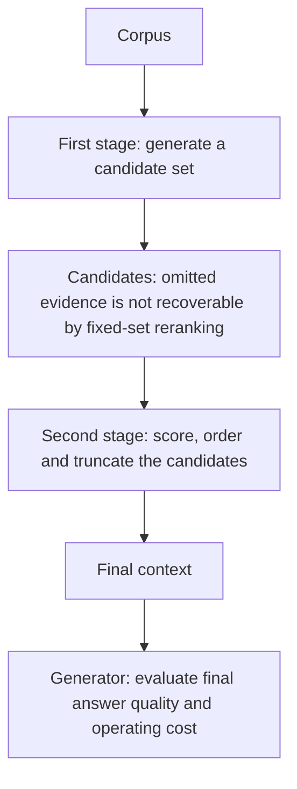
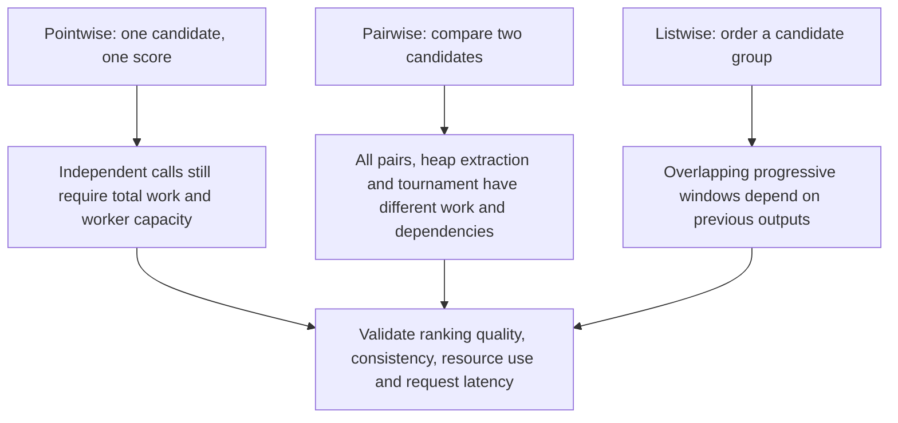
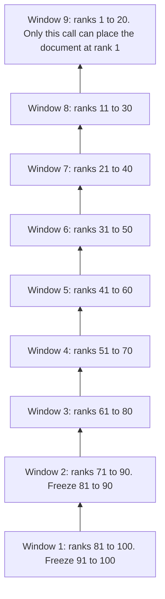

# Chapter 22: Reranking
[00-START-HERE](../00-START-HERE.md) · [01-READING-ROUTES](../01-READING-ROUTES.md) · [21\_learned\_sparse\_and\_multi\_vector\_retrieval](21_learned_sparse_and_multi_vector_retrieval.md) · [23\_generative\_retrieval](23_generative_retrieval.md)
This chapter explains why Retrieval-Augmented Generation (RAG) needs a second ranking stage, how to price and size it, and how cross-encoders, large language model (LLM) ranking modes, ranking losses, sliding-window prompting, instruction-aware scoring, and document-bound versus model-bound diagnosis support that choice.
## TL;DR
- A fixed-candidate reranker cannot retrieve omitted evidence. The exact recall product needs a second-stage probability conditioned on first-stage inclusion.
- Compute, serial dependencies and hardware capacity are different budgets. The fuller BERT proxy is $`0.195346\,\mathrm{ms}`$ per pair at the assumed rate, not a measured response time.
- Choose depth from measured first-stage coverage, conditional reranking quality and cost. A fixed IID distractor model illustrates a possible trade-off, not inevitable collapse.
- Pointwise, pairwise and listwise LLM modes trade tokens, comparisons, dependencies, calibration and order sensitivity. Unlimited parallelism cannot be assumed for free.
- Listwise loss couples same-query candidates; pointwise classification is not inherently incapable of ranking. Negative sampling and explicit probability/logit conventions matter.
- Tail-to-head overlapping windows give deep candidates a promotion path in this one-pass schedule. Call counts are integers, and rescue probabilities require conditional hand-off assumptions.
- Instruction-aware scoring needs informative supervision and explicit intent access, not necessarily one particular architecture. Symmetry-based blind-model floors require a fixed balanced candidate scenario.
- Compare one more document with a specific stronger ranker at the current context size, including costs. The toy crossover near five is not a universal pipeline boundary.
## The story
Think of retrieval as auditions for a small theater. The casting assistant invites candidates; the director can only choose among those invited. Keeping fewer, better-ordered passages can save generator work, but the saving and quality gain must be measured. Pointwise auditions score one actor, pairwise auditions compare two, and listwise auditions order a group. Some decisions run independently, yet a single theater has finite staff: many independent auditions are not one audition's wall-clock time at no extra cost. A tail-to-head relay lets a deep candidate move through overlapping groups; a disconnected single-pass schedule cannot move it across block boundaries. Instructions are role notes. On-topic candidates that differ in whether they satisfy those notes help reveal whether the director actually uses them. Finally, compare the next extra context passage with a named better director at today's cast size and budget. The useful next investment can change with the operating point; neither a toy threshold nor one ablation determines it forever.
## Decoder table

| Term | Meaning | Why it matters |
| --- | --- | --- |
| RAG | Retrieval-Augmented Generation | Retrieval selects evidence before generation. |
| $`N`$ | Corpus size in chunks | The cheap first stage may scan or index all $`N`$. |
| $`k`$ | Candidate depth passed to reranking | At fixed pair lengths, cross-encoder resource work is linear in depth; latency also depends on capacity and overhead |
| $`m`$ | Documents sent to the generator | Generator prefill and evidence coverage change with $`m`$. |
| $`R_1(k)`$ | Probability that a specified gold item is in the first-stage candidate set | The fixed-set second stage cannot recover omitted evidence |
| $`R_2(m\mid k)`$ | Probability of final-context inclusion conditional on first-stage inclusion | Use the same evidence population and averaging rule in both factors |
| $`R(m)`$ | Probability that the final context contains that gold item | $`R(m)=R_1(k)R_2(m\mid k)`$ when the conditional factor is defined; this is not answer accuracy |
| $`d`$ | Dense embedding width | A dot product costs $`2d`$ floating-point operations (FLOPs). |
| $`P`$ | Encoder parameter count | $`2PL`$ is the declared linear forward-work proxy; attention and real implementation costs are separate |
| $`L_q`$ | Query token count | It contributes to every query-document pair. |
| $`L_p`$ or $`L_d`$ | Passage or document token count | It dominates pair length and listwise prompt size. |
| $`L_i`$ | Instruction token count | It is the extra input cost for instruction-aware reranking. |
| $`L`$ | Processed joint pair length | $`L=L_q+L_d+L_i+L_{\mathrm{special}}`$ when instructions are used; worked lengths omit uncounted special positions |
| $`h`$ | Transformer hidden width | It appears in the attention-cost term. |
| $`\ell`$ | Transformer layer count | It multiplies the attention-cost term. |
| First-stage retriever | Cheap sparse or dense scorer over the corpus | It buys recall at large depth. |
| Dense Passage Retrieval (DPR) | Dense first stage in the reported Natural Questions comparison | The two-endpoint fit gains $`3.014736`$ percentage points per depth doubling, not a general law |
| BM25 | Sparse first stage in that comparison | The same fit gains $`6.287878`$ points per doubling; extrapolated depths are not new measurements |
| Approximate nearest neighbor (ANN) index | Index that can avoid scoring every stored vector | The flat-read roofline scenario is not an upper bound on ANN or actual first-stage time |
| Cross-encoder | Joint query-document transformer | It can condition every document token on every query token. |
| Bi-encoder | Separate query and document encoders | It permits document-side precomputation but lacks joint token interaction. |
| `[CLS]` and `[SEP]` | Classification position used for the score and separator token placed between fields | They mark the joint sequence and expose the final relevance representation. |
| $`\epsilon`$ and $`\lambda=(k-1)\epsilon`$ | IID distractor outranking probability and the Poisson approximation mean | An explicitly single-gold, fixed-error toy; score dependence or heterogeneous distractors change the tail |
| Pointwise mode | Score one candidate per decision | Independent calls still consume total work and finite worker capacity; scores need task-specific validation |
| Pairwise mode | Compare two candidates per decision | It creates ordinal judgments but may produce cycles. |
| Listwise mode | Order or train on a same-query candidate group | A joint loss need not require a joint forward pass; prompted windows introduce schedule and order effects |
| Serial depth | Longest dependency chain of model calls | A latency constraint in addition to total work, throughput, concurrency limits and request overhead |
| Comparator cycle | A result such as $`A > B`$, $`B > C`$, and $`C > A`$ | A sort can hide the inconsistency and return arrival-order-dependent output. |
| $`w`$ | Listwise window size | It controls candidates seen per listwise decision. |
| $`s`$ (window use) | Sliding-window stride | It controls overlap and how many ranks each call freezes. |
| $`N_{\mathrm{pointwise}},N_{\mathrm{all\text{-}pairs}},N_{\mathrm{listwise}},N_{\mathrm{calls}}`$ | Call counts under a declared algorithm and window policy | Separate call count, dependency rounds, total tokens and actual resource capacity |
| $`g`$ and $`n(g)`$ (window use) | Initial rank and participating calls along an aligned promotion path | Intermediate overlap survival and a final rank-one result are different required events |
| $`p_{\mathrm{window}}`$ | A stipulated common conditional probability for every required path event | The power $`p_{\mathrm{window}}^{n(g)}`$ needs that assumption; the schedule alone supplies no event probabilities |
| $`g_{\mathrm{train}}`$ (training list size) | Number of separately scored candidates per same-query training list | The scenario compares two versus sixteen candidates per query-group epoch; other uses of the letter g are unrelated |
| monoT5, $`z_i`$ and $`r_i=\sigma(z_i)`$ | Pointwise T5, a true-minus-false output logit and its two-token probability | BCE is separable across supplied examples, but shared parameters can still couple representations |
| RankT5, $`\pi_i,\pi_t,y_i`$ | Unbounded relevance logits normalized over a list, gold probability and target label | Listwise softmax loss makes supplied candidates compete; the forward architecture must be specified separately |
| Binary cross-entropy | Summed pointwise classification loss | Per-logit derivative $`r_i-y_i`$; weighting and normalization affect aggregate gradient mass |
| Listwise softmax cross-entropy | Loss that normalizes scores over one query’s list | Its denominator makes candidates compete. |
| LambdaRank | Pairwise method that rescales gradients by absolute normalized discounted cumulative gain change | It prices head-of-list inversions more heavily. |
| poly-1, $`\varepsilon_{\mathrm{poly}}`$ and $`\pi_t`$ | An extra gold-probability penalty, its coefficient and the gold softmax probability | The added logit gradient is $`\varepsilon_{\mathrm{poly}}\pi_t`$ times the list cross-entropy gradient under the stated one-hot loss |
| Mean reciprocal rank at ten ($`\operatorname{MRR}@10`$) | Mean reciprocal relevant rank, zero for misses or ranks below the cutoff | Distinguish conditional and unconditional scores; this metric alone does not identify a rank distribution |
| Normalized discounted cumulative gain (NDCG) | Gain discounted by rank and normalized by ideal gain | For the same gain difference and normalizer, adjacent head swaps have larger discount gaps; cutoff and ties matter |
| Mean average precision (MAP) | Mean of per-query average precision | A strictly increasing within-query score transform preserves ranking metrics under unchanged tie handling; a non-strict transform can create ties |
| $`I`$, $`q`$, $`d`$, and $`u`$ | Intent instruction, query, document, and the two-document score gap | They make the instruction-aware function and its impossibility proof explicit. |
| Task-aware Retrieval with Instructions full model (TART-full) | Instruction-aware model recipe described by the source | The reported $`90\%/10\%`$ negative pool is not a theorem about gradient allocation or sufficient coverage |
| $`\operatorname{Intent\text{-}correct}@1`$ and $`n`$ | Intent success at rank one and the number of symmetric intents | The $`1/n`$ blind-model bound requires fixed inputs/candidates, equally likely distinct golds and no intent side channel |
| $`A`$ | Constant extraction success with gold in context in the simplified answer model | General success can depend on context size/order and can be nonzero without that gold; the toy fixes $`A_m=A,B_m=0`$ |
| $`C(m)`$ | Conditional ranker coverage within the first context slots | The unbounded geometric approximation is $`1-q^m`$; a finite candidate pool needs normalization |
| $`E(m),E_{\mathrm{new}}(m)`$ | Baseline and specified-upgrade answer-success probabilities | Compare absolute gains and intervention costs on the same evaluated population |
| $`p_{\mathrm{rank}},p_{\mathrm{new}}`$ | Baseline and new geometric parameters | The scenario uses $`0.18`$ and $`0.212`$; their difference is not an observed MRR or answer-quality gain |
| $`q_{\mathrm{rank}},q_{\mathrm{new}}`$ | Complements of those parameters | $`q=1-p`$ and $`q_{\mathrm{new}}=1-p_{\mathrm{new}}`$ in the abbreviated marginal derivation |
| Document-bound | The specified extra-document intervention has the larger raw marginal gain | An operating-point comparison, not a cost-adjusted investment theorem |
| Model-bound | The specified available ranker has the larger raw gain at fixed context size | Depends on the upgrade, extraction behavior, candidate pool and resource constraints |
| $`m^\star`$ | Real-valued equality of the two unbounded geometric marginals | $`m^\star\approx4.985422`$ in this toy; integer comparison changes between four and five, not a universal threshold |

## Core mechanics
### Mathematical conventions
Use decimal storage units: $`1\,\mathrm{GB}=10^9\,\mathrm B`$ and $`1\,\mathrm{TB}=10^{12}\,\mathrm B`$; fp32 stores $`4\,\mathrm B`$ per coordinate. One multiply-accumulate counts as two FLOPs. Keep full precision until reporting, and use $`\approx`$ for rounded results or a model approximation. A percentage-point change is absolute; relative change divides by a stated baseline.
For the worked compute scenarios, $`P=110\times10^6`$ encoder parameters, $`P_g=7\times10^9`$ generator/LLM parameters, $`F=3.4\times10^{14}\,\mathrm{FLOP\,s^{-1}}`$ sustained throughput per assumed accelerator and $`B_{\mathrm{mem}}=2.0\times10^{12}\,\mathrm{B\,s^{-1}}`$ memory bandwidth. $`2PL`$ is a linear forward-work proxy, not a measured latency. The fuller encoder proxy adds $`4\ell L^2h`$ for attention matrix products. Numerical pair lengths $`288`$ and $`320`$ omit extra special/formatting positions unless already counted. Biases, normalization, activation functions, output selection, transfers, queues and many kernel costs remain outside these proxies.
Work divided by throughput is an idealized resource-time estimate, not a latency or p99 guarantee. Independent calls do not all finish in one call-time on one fixed-throughput device. An unlimited-resource critical path and total work are separate quantities; batching does not create extra aggregate throughput. The flat-read estimate assumes the stated bytes actually stream through the bandwidth bottleneck and is not an upper bound on first-stage latency. Generator prefill examples count only document tokens and omit attention-length effects, fixed prompt work and decode.
The recall product uses nested events for one specified gold evidence item, on the same query population. $`R_2`$ is conditional on that item being retrieved, not an independently averaged recall. Multi-document evidence, multiple golds and macro averaging need their own denominators. The distractor model assumes a single gold, no score ties and IID outranking indicators with fixed error probability; real score dependence and query heterogeneity can violate it.
For losses, $`z_i`$ is an unbounded relevance logit, $`r_i=\sigma(z_i)`$ a binary probability, and $`\pi_i=e^{z_i}/\sum_j e^{z_j}`$ a within-list softmax probability. Do not feed binary probabilities into a logit formula without defining that change. All cited empirical scores and configurations remain reported source inputs. The geometric, window-survival and instruction-symmetry examples are conditional models, not calibrated production laws.
### 22.1 Why a second stage exists at all
#### What
Let $`G`$ denote inclusion of one specified gold item in the candidate set and $`H`$ its inclusion in final context. Because fixed-set reranking selects only from those candidates, $`H\subseteq G`$:
$$
R(m)=\Pr(H)=\Pr(G)\Pr(H\mid G)=R_1(k)R_2(m\mid k)\le R_1(k).
$$
This is a set-membership ceiling for a fixed candidate pool, with $`1\le m\le k\le N`$. If $`R_1(k)=0`$, final gold inclusion is zero and the conditional factor need not be defined. For a micro-average over gold items, sample/weight the same evidence population in both factors. Multiplying separately macro-averaged per-query recalls generally does not give macro end-to-end recall. Candidate recall also does not determine answer quality or context-order effects.
#### Why
A dense first-stage dot product costs
$$
2d = 2(768) = 1{,}536\ \text{FLOPs per chunk}.
$$
Use the assumed $`P=110\times10^6`$ encoder parameters, $`32`$ query positions and $`256`$ document positions. The simple $`2PL`$ proxy, before the attention correction, is:
$$
2(1.10 \times 10^8)(32 + 256) = 6.336 \times 10^{10}\ \text{FLOPs per pair}.
$$
One cross-encoder pair is
$$
\frac{6.336\times10^{10}}{1{,}536}=41{,}250{,}000.
$$
times the dot-product work in this proxy, not the measured latency. Exhaustive cross-encoding over $`N=10^7`$ passages would use:
$$
10^7(6.336\times10^{10})=6.336\times10^{17}\ \mathrm{FLOP/query}.
$$
The staged system with $`k = 100`$ costs
$$
10^7(1{,}536)+100(6.336\times10^{10})=6.35136\times10^{12}\ \mathrm{FLOP/query}.
$$
The work-proxy reduction is $`6.336\times10^{17}/(6.35136\times10^{12})\approx99{,}758.162031`$. Stage two scores $`100/10^7=10^{-5}`$ of the corpus and uses approximately $`99.758162\%`$ of this retrieval arithmetic. The source reports that moving answer-bearing text within context can change generation quality. A set-recall number cannot measure that positional effect, and a relevance sort is not automatically the generator-optimal ordering.
#### Failure without it
If the specified evidence is missing from the candidate set, a fixed-set reranker cannot recover it. If it was retrieved but cut before the final $`m`$, inspect ranking/truncation, though first-stage candidate composition can still affect difficulty. End-to-end accuracy alone does not separate those failures, and a generator can sometimes answer without that particular gold chunk. Passing every candidate avoids this truncation but increases context work and can change generation quality; it is not guaranteed to bury or harm the answer on every query.
#### Cost, complexity, and worked example
For this resource scenario use $`N=10^7`$, document length $`256`$, embedding width $`d=768`$ in fp32, the stated BERT and generator proxies, and the common throughput/bandwidth assumptions. Flat vector payload is:
$$
10^7(768)(4\,\mathrm B)=30{,}720{,}000{,}000\,\mathrm B=30.72\,\mathrm{GB}.
$$
Dividing by $`2.0\,\mathrm{TB/s}`$ gives $`15.36\,\mathrm{ms}`$ of idealized streaming time. Dot work alone gives approximately $`0.045176\,\mathrm{ms}`$ at the stated FLOP rate, so the larger roofline component is memory here. This is not a first-stage upper bound: query encoding, selection, nonideal bandwidth, index traversal and queues can add cost. ANN may read fewer vectors but can also have irregular accesses and other overhead. The following partial-time scenarios assume sequential stages and the idealized flat-read component; they are not measured request latencies.

| Configuration | First-stage and rerank work / rate | Document-prefill work / rate | Partial sequential proxy | Evidence/quality scope |
| --- | --- | --- | --- | --- |
| One stage, raw top $`5`$ | $`15.36\,\mathrm{ms}`$ | $`52.705882\,\mathrm{ms}`$ | $`68.065882\,\mathrm{ms}`$ | Gold inclusion $`R_1(5)`$; no learned reorder |
| Retrieve $`100`$, rerank to $`5`$ | $`15.36+18.635294\,\mathrm{ms}`$ | $`52.705882\,\mathrm{ms}`$ | $`86.701176\,\mathrm{ms}`$ | Gold inclusion $`R_1(100)R_2(5\mid100)`$, not guaranteed to reach the ceiling |
| Retrieve $`100`$, send all $`100`$ | $`15.36\,\mathrm{ms}`$ | $`1{,}054.117647\,\mathrm{ms}`$ | $`1{,}069.477647\,\mathrm{ms}`$ | About $`12.335215`$ times the preceding partial-time scenario; generation quality must be evaluated |

The $`100`$-candidate reranker costs
$$
\frac{100(6.336\times10^{10})}{3.4\times10^{14}}\,\mathrm s\approx18.635294\,\mathrm{ms}.
$$
Reducing the document prefill from one hundred passages to five removes approximately $`1{,}001.411765\,\mathrm{ms}`$ under the linear generator proxy, or $`53.737374`$ units of resource time per unit of the $`18.635294\,\mathrm{ms}`$ linear rerank estimate. Adding reranking to raw top-five increases this partial-time baseline by $`27.378319\%`$. Two hundred passages contain $`51{,}200`$ document tokens, with proxy $`7.168\times10^{14}`$ FLOPs and $`2{,}108.235294\,\mathrm{ms}`$; linear reranking of those candidates is $`37.270588\,\mathrm{ms}`$. Actual long-context attention and serving costs can differ. The source reports DPR hit rates $`78.4\%`$ at depth twenty and $`85.4\%`$ at one hundred: the $`7.0`$ percentage-point ceiling increase is $`32.407407\%`$ of the former $`21.6`$-point retrieval miss rate, not a guaranteed answer-quality gain.
#### Decisions and limits
- Measure candidate coverage and final context inclusion on the same held-out population, with explicit gold and averaging rules.
- Compare reranking cost with generator work saved and the final answer-quality change, not only one latency component.
- Use both set and rank metrics, plus generation tests where context order matters.
- Treat depth one hundred as a starting heuristic; benchmark actual tails and capacity.
- Recompute dollar savings under actual token/call billing, caching and fixed serving costs.
- Cached prefill or position-insensitive generation can reduce some benefits, but neither proves that all ranking, diversity or noise-filtering value disappears.
### 22.2 Cross-encoders and choosing rerank depth
#### What
A cross-encoder forms a joint sequence such as `[CLS] query [SEP] document [SEP]`. Its final document token states depend on the current query. Those joint states cannot be reused as a query-independent document embedding in this baseline, although text, tokenization and other preprocessing can be cached. Joint interaction can improve ranking but does not mathematically guarantee a quality win over every bi-encoder.
#### Why
Let $`L=L_q+L_d+L_{\mathrm{special}}`$. The worked numbers set additional special positions to zero; an actual tokenizer may add them. With layer count $`\ell`$ and width $`h`$, define the fuller proxy:
$$
W_{\mathrm{pair}}(L)\approx2PL+4\ell L^2h.
$$
For BERT-base with $`P = 1.10 \times  10^{8}`$, $`\ell = 12`$, $`h = 768`$, and $`L = 288`$, the linear term is
$$
2(1.10 \times 10^8)(288) = 6.336 \times 10^{10}.
$$
The attention term is
$$
4(12)(288^2)(768)=3{,}057{,}647{,}616\ \mathrm{FLOP}.
$$
The total proxy is $`66{,}417{,}647{,}616`$ FLOPs per pair; attention matrix products are $`4.825833\%`$ of the linear term. At $`L=1{,}024`$, linear and quadratic terms are $`225{,}280{,}000{,}000`$ and $`38{,}654{,}705{,}664`$ FLOPs. The total increases by $`3.973864`$ for a length factor $`3.555556`$. A two-point power-law interpolation gives exponent approximately $`1.087684`$; this is a fitted description over those lengths, not a universal transformer exponent. Actual pair shape and implementation matter.
$$
\frac{66{,}417{,}647{,}616}{3.4\times10^{14}}\,\mathrm s\approx0.195346\,\mathrm{ms}.
$$
At fixed lengths, total resource work scales with depth, giving $`0.195346k\,\mathrm{ms}`$ at this rate. Fit the reported two endpoint hit rates exactly: $`b_D=(0.854-0.784)/\log_2(100/20)\approx0.030147359`$ and $`b_B=(0.737-0.591)/\log_2(100/20)\approx0.062878777`$ recall fraction per doubling. The dense fit gains $`3.014736`$ points from depths twenty to forty for $`3.906920\,\mathrm{ms}`$ additional work, or $`0.771640`$ points per resource millisecond; from one hundred to two hundred the corresponding ratio is $`0.154328`$. The BM25 fit reaches $`78.4\%`$ around continuous depth $`167.884612`$, so integer depth $`168`$ is needed under that interpolation, about $`8.4`$ times dense depth twenty. This is an extrapolation beyond the fitted BM25 endpoint, not a measured guarantee.
#### Failure without it
To illustrate distractor accumulation, condition on one specified gold being in the pool. Assume each of the other $`k-1`$ candidates is irrelevant and independently outranks it with the same fixed probability $`\epsilon`$, with no ties. Then the number above gold is:
$$
X_k\sim\operatorname{Binomial}(k-1,\epsilon).
$$
with approximation
$$
X_k\ \dot\sim\ \operatorname{Poisson}((k-1)\epsilon)\quad\text{for a suitable rare-error approximation}.
$$
In this toy, $`R_2(m\mid k)=\Pr(X_k\le m-1)`$. A shared random gold score can correlate outranking events, and hard negatives need not have a common error probability. Multiple relevant passages, listwise context effects and query-dependent difficulty change the model.
With fixed IID error, increasing distractors lowers this conditional survival while a fitted first-stage curve rises; the product can have an interior maximum. Neither monotonic conditional degradation nor collapse is a universal empirical law. The population conditioned on retrieval can change with depth, as can scores and error distributions. Redeem a stronger first stage as lower depth only after validating the resulting quality and costs.
#### Cost, complexity, and worked example
Use $`m=5`$, $`\epsilon=0.01`$ and dense hit-rate fit $`\widehat R_1(k)=0.784+b_D\log_2(k/20)`$ over the displayed range. Retain the unrounded endpoint slope. The table uses the exact Binomial conditional CDF, not rounded Poisson values. A $`20\,\mathrm{ms}`$ proxy-work budget permits at most $`\lfloor20/0.1953460224\rfloor=102`$ candidates. At depth one hundred the reported BM25 and dense candidate ceilings are $`73.7\%`$ and $`85.4\%`$; dense depth twenty has a $`78.4\%`$ ceiling. Candidate ceilings are not final answer accuracies.

| Depth $`k`$ | Fuller rerank work / rate | Fitted $`R_1(k)`$ | Toy conditional $`R_2(5\mid k)`$ | Gold inclusion product |
| --- | --- | --- | --- | --- |
| $`20`$ | $`3.906920\,\mathrm{ms}`$ | $`78.400000\%`$ | $`99.999897\%`$ | $`78.399919\%`$ |
| $`50`$ | $`9.767301\,\mathrm{ms}`$ | $`82.385264\%`$ | $`99.986779\%`$ | $`82.374372\%`$ |
| $`100`$ | $`19.534602\,\mathrm{ms}`$ | $`85.400000\%`$ | $`99.671257\%`$ | $`85.119253\%`$ |
| $`200`$ | $`39.069204\,\mathrm{ms}`$ | $`88.414736\%`$ | $`94.914682\%`$ | $`83.918565\%`$ |
| $`500`$ | $`97.673011\,\mathrm{ms}`$ | $`92.400000\%`$ | $`44.137460\%`$ | $`40.783013\%`$ |
| $`1{,}000`$ | $`195.346022\,\mathrm{ms}`$ | $`95.414736\%`$ | $`2.887367\%`$ | $`2.754973\%`$ |

The exact displayed model has an unconstrained integer maximum at $`k=137`$, inclusion probability approximately $`85.706257\%`$, at $`26.762405\,\mathrm{ms}`$ of proxy work. That is outside the stated budget. Within $`k\le102`$, it selects $`k=102`$, approximately $`85.179939\%`$. The former “near one hundred fifty” observation was only approximate and did not enforce the budget. Values above depth one hundred extrapolate the first-stage fit; the model is not a production forecast.
The source reports BERT-large reranking at depth one thousand with MS MARCO $`\operatorname{MRR}@10=0.365`$, versus $`0.187`$ for BM25. This does not identify a distractor rate. At $`\epsilon=0.005`$, the exact toy has top-ten inclusion $`0.968714724`$ but truncated expected reciprocal rank only $`0.195975404`$, even with first-stage recall one. Its untruncated expected reciprocal rank is bounded by $`[1-(1-\epsilon)^k]/(k\epsilon)\approx0.198669206`$, so it cannot simultaneously explain MRR $`0.365`$. A first-stage miss factor only lowers that number. Matching $`0.365`$ under this particular toy with recall one would need approximately $`\epsilon=0.002519761`$, not an empirically established rate.
In general, $`\operatorname{MRR}@10=P(\mathrm{rank}\le10)\,\mathbb E[1/\mathrm{rank}\mid\mathrm{rank}\le10]`$. The harmonic-mean rank among successes is that success probability divided by MRR, not simply one divided by MRR unless every query succeeds. The source's Natural Questions and MS MARCO figures are not one matched calibration experiment.
#### Decisions and limits
- Start with a tractable depth such as one hundred, then measure candidate coverage, conditional rank metrics and actual latency tails after each first-stage change.
- Evaluate several depths on the same held-out queries; attach uncertainty and important cohorts.
- Measure full gold-rank/error distributions. A single mean outranking rate is not enough to validate IID Binomial tails.
- Compare a better first stage with recurring rerank work under a common quality and cost target.
- Recompute pair lengths when truncating. A shorter selected window can save work but can also remove needed evidence, and finding the best window is not free.
- Validate early exits, token policies and long-evidence cases; neither an empirical layer choice nor the two-point length exponent is a universal guarantee.
### 22.3 LLM rerankers: pointwise, pairwise, listwise
#### What
Pointwise prompts return a candidate score, pairwise prompts compare two candidates, and listwise prompts order a group. Classical learning-to-rank can put coupling in the training loss without placing multiple documents in one forward pass. RankNet is one such pattern; the source also discusses McRank and SetRank. Without order-dependent features, self-attention produces permutation-equivariant per-document scores, not an invariant score vector: permuting inputs permutes outputs. A resulting document order can be invariant after mapping scores back, subject to ties and implementation. A frozen LLM can sometimes supply useful pointwise rankings; joint comparison is an option to test, not a logical necessity or a guarantee of calibration.
#### Why
For a $`7`$-billion-parameter reranker under the $`2P`$ rule and the stated throughput, one input token costs
$$
\frac{2(7\times10^9)}{3.4\times10^{14}}\,\mathrm{s/token}\approx0.041176471\,\mathrm{ms/token}.
$$
With query/instruction preamble $`32+50=82`$ tokens and $`256`$ document tokens, pointwise input is $`338`$ tokens and pairwise input $`594`$, with work proxies $`13.917647`$ and $`24.458824\,\mathrm{ms}`$ per call. Their verdict output tokens are omitted. For $`w=20`$, listwise prefill is $`5{,}202`$ tokens and the assumed identifier output is $`3w=60`$, totaling $`5{,}262`$ and $`216.670588\,\mathrm{ms}`$. This deliberately applies one FLOP rate to prefill and serial decode; actual decode throughput, identifier lengths and formatting differ. Call counts are:
$$
N_{\text{pointwise}} = k,
$$
$$
N_{\text{all-pairs}} = \binom{k}{2},
$$
and, at stride $`\frac{w}{2}`$,
$$
N_{\mathrm{listwise}}=1+\frac{k-w}{w/2}=\frac{2k}{w}-1\quad\text{when }k\ge w,\ w\text{ even, and }(k-w)/(w/2)\in\mathbb Z.
$$
For $`k=100,w=20`$, that aligned schedule has nine dependent calls. Pairwise top-$`m_h`$ extraction need not compare all pairs. For a deterministic transitive comparator, Floyd heap construction plus repeated extraction has a conservative comparison bound:
$$
N_{\mathrm{heap}}\le2k+2m_h\lceil\log_2 k\rceil.
$$
At $`k=100,m_h=10`$, the bound is $`340`$ comparisons versus $`4{,}950`$ all-pairs comparisons. It is not a fixed observed count. Extraction and heap construction both have dependencies; the extraction term $`140`$ alone is not the full serial depth. A balanced tournament uses $`k-1=99`$ comparisons for a winner and at most $`\lceil\log_2k\rceil=7`$ rounds, with adequate parallel workers and explicit byes. A cyclic, stochastic LLM comparator need not define a total order, so different schedules can yield different results.
#### Failure without it
Pointwise scores need validation for ranking and cross-query confidence; a prompted scalar is not automatically calibrated. Pairwise cycles or inconsistent repeated judgments can make a comparator-based algorithm return an unstable order or fail its assumed ordering contract. Listwise outputs can depend on input permutation, context length and formatting. Declaring candidates together does not remove positional bias. The source treats the origin of zero-shot comparative ability as a hypothesis, not a proved result.
#### Cost, complexity, and worked example

| Mode | Calls | Counted model positions/tokens | Total work / single-resource rate | Dependency and capacity scope |
| --- | --- | --- | --- | --- |
| BERT-base cross-encoder baseline | $`100`$ | $`28{,}800`$ input positions | $`19.534602\,\mathrm{ms}`$ single-device work proxy | One dependency layer; $`0.195346\,\mathrm{ms}`$ only with one full-rate worker per pair, before overhead |
| Pointwise LLM | $`100`$ | $`33{,}800`$ input tokens | $`1.391765\,\mathrm s`$ single-device work proxy | One dependency layer; $`13.917647\,\mathrm{ms}`$ only with enough independent full-rate workers |
| Pairwise all-pairs | $`4{,}950`$ | $`2{,}940{,}300`$ input tokens | $`121.071176\,\mathrm s`$ single-device work proxy | One layer, not one call-time on one fixed-throughput device |
| Pairwise heap top $`10`$ | At most $`340`$ | At most $`201{,}960`$ input tokens | At most $`8.316\,\mathrm s`$ proxy work | Implementation-dependent heap-build/extraction critical path; not a fixed depth of one hundred forty |
| Pairwise tournament top $`1`$ | $`99`$ | $`58{,}806`$ input tokens | $`2.421424\,\mathrm s`$ single-device work proxy | At most seven rounds; ideal unlimited-resource path $`171.211765\,\mathrm{ms}`$ |
| Listwise with $`w = 20`$ | $`9`$ | $`47{,}358`$ input/output tokens | $`1.950035\,\mathrm s`$ work proxy | Nine dependent calls; same resource-time sum before request overhead |

For these specific input/output counting rules and windows, pointwise uses the least modeled LLM work, not universally the cheapest LLM ranking design. Its work is approximately $`71.246125`$ times the fuller BERT proxy. The parameter-and-input-length-only ratio is:
$$
\frac{7\times10^9}{110\times10^6}\frac{338}{288}\approx74.684343.
$$
Dividing that ratio by the full attention correction $`1+3{,}057{,}647{,}616/(6.336\times10^{10})`$ gives approximately $`71.246125`$. Do not explain a difference between rounded inputs as measured overhead. These resource-time totals are neither invoices nor measured response times.
Independent calls permit concurrency only when hardware and service limits support it. For total work $`W`$ on $`G`$ identical resources, $`W/(GF)`$ is a work-capacity constraint under the assumed rate; the model-call dependency path is another constraint. Giving a hundred pointwise calls one-call wall time implicitly supplies a hundred full-rate workers in this idealization. Batching can improve utilization but cannot increase fixed aggregate capacity without bound.
A cascade reranks one hundred candidates to twenty with the fuller cross-encoder proxy, then uses one listwise call. Its modeled sum is $`19.534602+216.670588\approx236.205190\,\mathrm{ms}`$ before request overhead, about $`8.255684`$ times below the full nine-window work sum, with nine times fewer LLM tokens. Add a stipulated $`80\,\mathrm{ms}`$ round trip for the LLM call and it becomes $`316.205190\,\mathrm{ms}`$. The cascade may discard candidates the LLM would have rescued. Under the simplified total context budget:
$$
w_{\max}=\left\lfloor\frac{8{,}192-82}{256+3}\right\rfloor=31.
$$
At $`w=20`$, this simplified prompt/output count uses $`5{,}262`$ of $`8{,}192`$ tokens, leaving $`35.766602\%`$ of capacity. Eleven additional passage slots are $`55\%`$ of twenty used slots, not fifty-five percent of the context budget. Actual identifiers, separators, instructions and model output reserves can lower capacity. Quality and ordering reliability can bind before nominal fit; raw fit alone does not prove the limiting factor.
#### Decisions and limits
- Benchmark frozen pointwise, pairwise and listwise prompts against a trained cross-encoder; treat any default as a starting heuristic.
- Count actual tokens, model calls, dependency rounds and available worker capacity. Report both work and request latency.
- A cross-encoder cascade can reduce LLM work but creates a candidate ceiling; evaluate disagreements and gold survival.
- Validate pointwise calibration where needed, pairwise cycles/repeatability and listwise permutation sensitivity and repair rates.
- Larger all-pairs or repeated-permutation designs can be useful offline, but hardware cost remains even when user latency is irrelevant.
### 22.4 monoT5 to RankT5: from classification to ranking losses
#### What
monoT5 prompts a query/document pair with `Relevant:` and uses the output-token logits for `true` and `false`. The renormalized probability over those two tokens, rather than their raw vocabulary probability, is:
$$
z_i=z_{\mathtt{true}}-z_{\mathtt{false}},\qquad r_i=\frac{e^{z_{\mathtt{true}}}}{e^{z_{\mathtt{true}}}+e^{z_{\mathtt{false}}}}=\sigma(z_i).
$$
The source reports monoT5 transfer from MS MARCO training to TREC Robust04, and describes RankT5 using a relevance logit associated with the sentinel `extra_id_10`. Reported improvements depend on the model variant, loss and training recipe; separable classification is not a theorem that ranking must fail. For the workload arithmetic below, separately assume $`Q_{\mathrm{train}}=500{,}000`$ query groups. That is not interchangeable with five hundred thousand individual query-document pairs.
#### Why
The monoT5 pointwise objective is
$$
\mathcal L_{\mathrm{point}}=-\sum_i\left[y_i\ln r_i+(1-y_i)\ln(1-r_i)\right],\qquad r_i=\sigma(z_i).
$$
Its per-logit derivative is $`r_i-y_i`$, while shared parameters can still couple the learned representations. Compare two-candidate lists: a negative binary probability changes $`0.02\to0.10`$, while the positive is either $`0.90`$ or $`0.05`$. BCE on the negative has the same increase in both cases:
$$
\Delta\mathcal L_{\mathrm{BCE}}=-\ln(0.90)+\ln(0.98)\approx0.085157808\ \mathrm{nats}.
$$
For the one-positive illustrative listwise loss, convert those binary probabilities to logits $`z_i=\ln[r_i/(1-r_i)]`$, then apply a candidate softmax. RankT5 can learn unbounded logits directly; the conversion here only makes the numerical comparison fully specified:
$$
\mathcal L_{\mathrm{list}}=-\ln\pi_t.
$$
$$
\pi_i=\frac{e^{z_i}}{\sum_j e^{z_j}}.
$$
With exactly one positive and the changing negative, listwise loss increases by $`0.010005086`$ nats for gold probability $`0.90`$, and $`0.807292526`$ nats for gold probability $`0.05`$, a ratio $`80.688215`$. The earlier $`0.5859`$ and $`58.8`$ figures did not follow from these stated probabilities. Adding other candidates changes the denominator and these values; they are not universal penalties. For a one-hot target:
$$
\frac{\partial\mathcal L_{\mathrm{list}}}{\partial z_i}=\pi_i-y_i.
$$
The positive logit has pull magnitude $`1-\pi_t`$ and all negative logits together have equal opposing mass. Individual negatives receive weights $`\pi_i`$. With summed unweighted BCE, the negative-to-positive logit-gradient mass is instead:
$$
\frac{\sum_{j\ne t}\sigma(z_j)}{1-\sigma(z_t)}.
$$
At positive probability $`0.90`$ and all $`k-1`$ negatives $`0.02`$, that mass ratio is $`3.8`$ at $`k=20`$ and $`19.8`$ at $`k=100`$. Class weighting or separately normalized positive/negative terms changes it. Neither gradient balance nor coupling alone proves better held-out ranking.
#### Failure without it
High classification accuracy can coexist with poor ranking, but calibrated relevance probabilities can also produce useful rankings. A strictly increasing within-query map preserves all score order and ties, so it cannot change MRR, NDCG or MAP if tie handling is unchanged. Converting a sigmoid to its logit has this property away from numerical saturation. Positive-slope Platt scaling does too; isotonic regression is only nondecreasing and can merge distinct scores into ties, allowing metric changes under a tie policy. A negative-slope map can reverse order. Calibration is not a replacement for discriminative ranking supervision.
For the same gain difference and ideal-gain normalizer, full-depth DCG/NDCG discount gaps are $`1-1/\log_2 3\approx0.369070246`$ between ranks one/two and $`1/\log_2 100-1/\log_2 101\approx0.000324515`$ between ranks ninety-nine/one hundred. Their ratio is about $`1{,}137.299329`$. Actual NDCG swap changes also multiply the gain difference and divide by IDCG. At cutoff ten, both tail ranks are outside the metric and their swap has zero effect; the quoted finite ratio does not apply there. LambdaRank can weight score-pair updates by the relevant metric change, under its own conventions.
#### Cost, complexity, and worked example
The $`32{,}128`$-entry language-model head costs
$$
W_{\mathrm{head}}=2(768)(32{,}128)=49{,}348{,}608\ \mathrm{FLOP}.
$$
A full vocabulary projection is approximately $`0.094938\%`$ of the encoder-only proxy below, so changing only a selected output row offers a small arithmetic saving. It does not follow that the complete encoder-decoder scoring step is that encoder cost alone. For the explicit width-$`768`$, feed-forward width-$`3{,}072`$, twelve-layer encoder scenario:
$$
P_{\mathrm{enc,blocks}}=12\left[4(768)^2+2(768)(3{,}072)\right]=84{,}934{,}656.
$$
At $`L=288`$, encoder linear work is $`48{,}922{,}361{,}856`$ FLOPs and attention matrix products add $`3{,}057{,}647{,}616`$, giving $`W_{\mathrm{enc}}=51{,}980{,}009{,}472`$. Embedding lookups, norms, biases and nonlinearities are not counted.
A full encoder-decoder variant also needs document-dependent cross-attention keys/values for its single decoder step. They cannot be assumed already cached for a newly scored candidate. With twelve decoder layers of the same width and feed-forward size, their projections alone cost $`4(12)(288)(768)^2=8{,}153{,}726{,}976`$ FLOPs. Other one-position decoder linear maps cost $`2(12)[6(768)^2+2(768)(3{,}072)]=198{,}180{,}864`$ FLOPs; self/cross attention dot/value products add $`10{,}653{,}696`$, and the full vocabulary head adds $`49{,}348{,}608`$. This explicit decoder total is $`8{,}411{,}910{,}144`$, approximately $`16.182972\%`$ of encoder work, not the earlier under-one-percent claim.
Use $`W_{\mathrm{T5}}=60{,}391{,}919{,}616`$ FLOPs, or $`0.177623\,\mathrm{ms}`$ at the assumed rate, for the following matched full encoder-decoder workload. This is a stated architecture/caching scenario, not an externally verified implementation profile. An encoder-only variant, projected/cached memory or a selected-head-row implementation has another budget. Changing the loss while preserving the scoring architecture need not change per-candidate serving work; it does not imply all model variants have identical cost.

| Workload design | Scored sequences per group epoch | Training-proxy FLOPs | Work / assumed rate | Serving scope |
| --- | --- | --- | --- | --- |
| monoT5, one positive and one negative | $`2Q_{\mathrm{train}}=1{,}000{,}000`$ | $`3W_{\mathrm{T5}}(10^6)=1.81175758848\times10^{17}`$ | $`532.869879\,\mathrm s`$ proxy | $`17.762329\,\mathrm{ms}`$ proxy for one hundred candidates |
| RankT5, list size $`g = 16`$ | $`16Q_{\mathrm{train}}=8{,}000{,}000`$ | $`3W_{\mathrm{T5}}(8\times10^6)=1.449406070784\times10^{18}`$ | $`4{,}262.959032\,\mathrm s`$ proxy | Same only when the scoring architecture and lengths are held fixed |

The eightfold training-work ratio comes from equal query-group epochs with two versus sixteen scored candidates and the same assumed $`3W_{\mathrm{T5}}`$ training work per candidate. It is not an unavoidable eightfold measured training-time penalty or a conclusion from a pair count. List construction, optimizer state, backward work, batching and hardware are additional factors.
For a matched sixteen-candidate loss example, let the positive binary probability be $`0.90`$. Fifteen random negatives with probability $`0.001`$ give $`\pi_t\approx0.998334444`$ and list loss $`0.001666945`$ nats after the defined logit transform. Replace one by a $`0.92`$ hard negative and retain fourteen at $`0.001`$: the loss becomes $`0.823883686`$, about $`494.247709`$ times larger. Uniform sampling from a large corpus does not by itself establish any of those predicted probabilities.
In the separate twenty-document gradient figure, probabilities are $`0.90`$ for gold, $`0.92`$ for one distractor and $`0.02`$ for eighteen tails. Summed BCE allocates $`71.875\%`$ of negative logit-gradient mass to the top distractor; softmax list loss allocates $`96.904557\%`$. Neither number is a fraction of encoder-parameter gradient norm. Subtracting the source's rounded BERT embedding count gives $`86.2\times10^6`$ nonembedding parameters, approximately $`1.489785\%`$ above the simple T5 encoder-block count. Embeddings are about $`21.636364\%`$ of the stated BERT total; a percentage markup over a smaller nonembedding denominator is a different quantity. These bookkeeping differences do not isolate a measured architecture-latency cause.
$$
\mathcal L_{\mathrm{poly1}}=\mathcal L_{\mathrm{list}}+\varepsilon_{\mathrm{poly}}(1-\pi_t).
$$
For a one-hot target and the same softmax logits, the added-term gradient equals $`\varepsilon_{\mathrm{poly}}\pi_t`$ times the cross-entropy gradient. If $`\varepsilon_{\mathrm{poly}}\ge0`$, the combined gradient is $`(1+\varepsilon_{\mathrm{poly}}\pi_t)`$ times it. The ratio can be large near high confidence, but both terms vanish as the example becomes perfectly classified. This identity is not a guarantee of improved generalization or a reason to ignore negative quality.
#### Decisions and limits
- Compare pointwise, pairwise and listwise losses under controlled candidate lists and evaluation, rather than call one universally correct.
- Train on useful competing candidates from refreshed retrieval pools; account for false negatives and label uncertainty.
- Define query-group count, list size, epoch and loss normalization before quoting a training multiplier.
- Keep the scoring architecture fixed before claiming unchanged serving work; include decoder memory projections if applicable.
- Calibrate cross-query abstention separately. A pointwise loss is neither necessary nor sufficient for calibrated confidence, and a ranking loss can be combined with calibration.
- Test any poly-1 coefficient after the base objective and negative sampling are sound.
### 22.5 Zero-shot listwise prompting and the sliding window
#### What
A prompted listwise ranker returns a permutation of local passage identifiers; it does not return calibrated relevance scores. For this one-pass progressive schedule, start with the tail window, rank it in place, and shift toward the head by $`1\le s\le w`$. For an implementation that clamps the last full window to start at rank one:
$$
N_{\mathrm{calls}}=1+\left\lceil\frac{\max(0,k-w)}s\right\rceil.
$$
For $`k=100,w=20,s=10`$, the count is nine. When $`k\le w`$, use one window over the available candidates. If $`(k-w)/s`$ is not an integer, the last shift is shorter under this policy; an implementation using partial windows can have different token counts.
#### Why
For aligned full windows, the top $`w-s`$ positions of a ranked window overlap the next one; its bottom $`s`$ never get revisited in this pass. A candidate initially at rank $`g`$ first enters a particular window and, if retained in every overlap, can reach the final head window after:
$$
n(g)=\min\!\left(\left\lceil\frac gs\right\rceil,N_{\mathrm{calls}}\right),\qquad (k-w)/s\in\mathbb Z,\quad k\ge w,\quad0<s<w.
$$
The default counts are nine participating calls from rank one hundred, five from fifty, two from twenty and one from ten. To finish at rank one, the required events are intermediate overlap survival and then winning the final window; merely surviving that final window is not enough. Let $`p_t`$ be each required event's probability conditional on all earlier successes. The chain rule is:
$$
\Pr(\text{reach rank }1)=\prod_{t=1}^{n(g)}p_t=p_{\mathrm{window}}^{\,n(g)}\quad\text{only if all required conditional probabilities equal }p_{\mathrm{window}}.
$$
At an assumed constant conditional value $`p_{\mathrm{window}}=0.9`$, tail and head examples give $`0.9^9\approx0.387420489`$ and $`0.9`$, ratio $`2.323057`$. The schedule determines the number of required hand-offs, not their probabilities. Different window content, position bias and correlated model errors can change those conditional values. This is one progressive block-ranking pass, not a guarantee of a globally sorted list.
#### Failure without it
Five disjoint windows of size twenty can promote a rank-one-hundred candidate only to rank eighty-one in that pass. A single head-to-tail overlapping sweep has the same limit for that candidate because it appears only in the last window. These facts do not rule out other algorithms, repeated passes, tournaments or global comparisons. Parse permutation output explicitly: retain valid identifiers in first-appearance order, remove duplicates/out-of-range values and append missing identifiers in their original relative order. On total parse failure, fall back to the input order and log the failure; repair can conceal an ineffective ranker if not monitored.
#### Cost, complexity, and worked example
The worked budget assumes $`82+256w`$ input tokens and $`3w`$ output identifier tokens per full window, ignoring additional input labeling/formatting. It applies the same forward-FLOP rate to both phases. Thus total modeled tokens per call are:
$$
T_{\mathrm{call}}=82+259w.
$$
Add a separately stipulated $`80\,\mathrm{ms}`$ request/queue overhead per call. The windows depend on earlier outputs, so those overheads cannot be hidden by parallelizing windows within the same pass. The compute column remains a work proxy, not measured decode latency.

| Schedule | Calls | Modeled tokens | Compute work / rate | With stipulated round trips | Best possible tail rank in this pass |
| --- | --- | --- | --- | --- | --- |
| $`w = 10`$, $`s = 5`$ | $`19`$ | $`50{,}768`$ | $`2090.447059\,\mathrm{ms}`$ | $`3610.447059\,\mathrm{ms}`$ | $`1`$ |
| $`w = 20`$, $`s = 10`$ | $`9`$ | $`47{,}358`$ | $`1950.035294\,\mathrm{ms}`$ | $`2670.035294\,\mathrm{ms}`$ | $`1`$ |
| $`w = 40`$, $`s = 20`$ | $`4`$ | $`41{,}768`$ | $`1719.858824\,\mathrm{ms}`$ | $`2039.858824\,\mathrm{ms}`$ | $`1`$ |
| $`w = 20`$, $`s = 20`$ | $`5`$ | $`26{,}310`$ | $`1083.352941\,\mathrm{ms}`$ | $`1483.352941\,\mathrm{ms}`$ | $`81`$ |

At stride $`\frac{w}{2}`$, document slots total
$$
N_{\mathrm{calls}}w=2k-w\quad\text{only for aligned half-window stride }s=w/2.
$$
The default uses $`180`$ document slots, $`46{,}080`$ document tokens and $`1{,}278`$ preamble/output tokens, totaling $`47{,}358`$. Changing to $`w=40,s=20`$ gives four calls and $`41{,}768`$ modeled tokens: an $`11.803708\%`$ token saving. With the stipulated round trips, time-proxy saving is $`23.601803\%`$. Wider windows alter both content and the number of hand-offs. Under separate constant-conditional-success assumptions, the tail comparison is:
$$
p_{40}^4 > p_{20}^9,
$$
or
$$
p_{40} > p_{20}^{2.25}.
$$
At $`p_{20}=0.9`$, break-even is $`p_{40}\approx0.788943035`$, an absolute drop about $`11.105697`$ percentage points. This is conditional arithmetic, not proof that wider windows meet that reliability. No-overlap windows save $`44.444444\%`$ of these modeled tokens but disconnect the tail-to-head path. Cutting depth to fifty with the default window/stride gives four calls and $`1{,}186.682353\,\mathrm{ms}`$ including overhead, a $`55.555556\%`$ decrease from $`2{,}670.035294\,\mathrm{ms}`$; recall below the cut is lost. In these scenarios listwise reads $`1.8`$ times the document tokens but $`1.401124`$ times the modeled total tokens of pointwise, which omits its own verdict output. Depth, window size, overlap, output lengths and real decode rates jointly determine actual costs.
#### Decisions and limits
- Treat window twenty/half overlap and tail-to-head motion as one practical starting schedule, not the only possible ranking algorithm.
- Validate integer window boundaries, output reserve, candidate labels and special-token accounting.
- Measure candidate loss when reducing depth or inserting a cascade; measure window reliability and permutation bias when changing width.
- Log repair/fallback rates, gold survival by hand-off and final ranking metrics, not only output/input rank correlation.
- Twenty serial repeated default passes have $`39.000706\,\mathrm s`$ modeled compute and $`53.400706\,\mathrm s`$ including the stipulated round trips, before other overhead. Independent repetitions still need resource capacity if run concurrently.
- A cross-encoder-to-twenty cascade saves modeled LLM work but inherits its upstream omissions; compare it on the same judged queries.
### 22.6 Instruction-aware reranking
#### What
Instruction-blind scoring uses $`s_\theta(q,d)`$. An instruction-aware cross-encoder can instead use $`s_\theta(I,q,d)`$, implemented by a declared concatenation template rather than numeric addition. It permits document states to depend on instruction tokens. Other architectures can also condition on intent; a metadata filter, query encoder, routing policy or other explicit side information can carry it. A document index need not be rebuilt merely because the scorer reads an instruction.
#### Why
For a deliberately symmetric impossibility example, fix the same query and two candidate documents under two equally likely instructions, with a different gold document for each. Assume the scorer and tie-breaking see neither the instruction nor any correlated side channel. It assigns fixed logits $`a,b`$, gap $`u=a-b`$. The sum of the two one-positive list losses is:
$$
\begin{aligned}
\mathcal{L}_1+\mathcal{L}_2&=\log(1+e^{-u})+\log(1+e^u)\\
&=\log(2+e^u+e^{-u})\\
&\ge\log4.
\end{aligned}
$$
The mean floor is $`\ln2\approx0.693147181`$ nats. For the same $`n`$ candidates under $`n`$ equally likely instructions with distinct golds, fixed softmax probabilities $`v_i`$ obey $`-\sum_i\ln v_i\ge n\ln n`$; mean loss is at least $`\ln n`$. An instruction-independent winner has average intent-correct-at-one at most $`1/n`$. These are symmetry/missing-information bounds, not universal ceilings for all instruction-blind deployments. With unequal intent frequencies the analogous optimal mean log loss is their entropy and best fixed-winner accuracy is the largest frequency. Candidate filtering, query changes or other intent-correlated inputs can invalidate the fixed-input assumptions.
The source describes TART-full training on task instructions and a negative pool mixing random and mined instruction violations, nominally $`90\%/10\%`$. This is reported recipe context, not a proof that all random negatives carry zero instruction gradient or that ten percent is universally sufficient. On-topic instruction-conflicting examples make intent dependence identifiable in the relevant comparisons; labels, coverage and optimization still determine whether the model learns it.
#### Failure without it
An instruction-conditioned query embedding can select among document directions already represented by a fixed index, including directions learned during instruction-aware training. It is not generally impossible to support new intent without re-embedding documents. A standard nonnegative bag-of-terms score does not enforce a hard logical exclusion by itself, but retrieval systems can combine filters, negative weights or query operators. Explicit instruction input is not sufficient for learning or ranking quality. A single-intent benchmark cannot isolate sensitivity to conflicting instructions; use matched queries/candidates with differing golds. Random-only negative training does not mathematically force no quality improvement.
#### Cost, complexity, and worked example
The work example uses a separate $`4\times10^6`$-chunk corpus, the same BERT proxy, $`32`$ query and $`256`$ document positions, depth $`100`$, and an extra $`32`$ instruction positions. The corpus size does not multiply this rerank cost once the candidate set is fixed. Intent-success predictions below are conditional statements, not benchmark measurements.

| Scorer design | Processed pair positions | Forward-proxy FLOPs | Pair work / rate | Depth-hundred work / rate | Intent-success scope |
| --- | --- | --- | --- | --- | --- |
| Instruction-blind | $`288`$ | $`66{,}417{,}647{,}616`$ | $`0.195346\,\mathrm{ms}`$ | $`19.534602\,\mathrm{ms}`$ | At most $`50\%`$ only in the fixed balanced two-intent example |
| Add $`32`$-token instruction, random negatives | $`320`$ | $`74{,}174{,}873{,}600`$ | $`0.218161\,\mathrm{ms}`$ | $`21.816139\,\mathrm{ms}`$ | No guaranteed improvement; random negatives do not logically force failure either |
| Same input, $`90/10`$ negatives | $`320`$ | $`74{,}174{,}873{,}600`$ | $`0.218161\,\mathrm{ms}`$ | $`21.816139\,\mathrm{ms}`$ | Conflicting on-topic supervision supplies an intent signal, not a guaranteed score gain |

At $`L=320`$, the linear term is $`70{,}400{,}000{,}000`$ and attention adds $`3{,}774{,}873{,}600`$ FLOPs. The added depth-hundred work is $`2.281537\,\mathrm{ms}`$ at the assumed rate, or $`11.679465\%`$. If exactly ten percent of equally weighted training examples, not merely negatives, are the balanced contradictory pairs above, an instruction-blind model has at least this contribution:
$$
0.10\ln2\approx0.069314718\ \mathrm{nats/example}.
$$
A loss plateau near that value is not a diagnostic proof: other losses, label noise, normalization and regularization can contribute. Verify instruction-dependent ranking on controlled conflicting examples. The extra instruction work is equivalent to this many additional baseline-length candidates in the same proxy:
$$
\frac{2.281537054117647}{0.1953460224}\approx11.679465.
$$
Only eleven full additional candidates fit that budget; rounding to twelve exceeds it slightly. At the unrounded dense endpoint slope, increasing depth one hundred to one hundred eleven would change the fitted candidate ceiling by:
$$
100b_D\log_2(111/100)\approx0.453898\ \text{percentage points}.
$$
This is a hypothetical compute exchange, not an observed equivalence between intent quality and recall. Twelve extra candidates would give about $`0.492905`$ fitted points but cost more than the exact budget. The two-point length exponent predicts:
$$
\left(\frac{320}{288}\right)^{1.087683586}\approx1.121424.
$$
The fitted increase is approximately $`12.142355\%`$, versus $`11.679465\%`$ from the explicit linear-plus-quadratic proxy. A two-point power-law fit is not identical to that sum, whose local elasticity varies with length. Neither is a measured hardware scaling law.
#### Decisions and limits
- Prefer reliable metadata constraints for hard requirements when available, without mistaking approximate ranking preference for enforcement.
- Give the scorer a documented intent input and train/test on topical conflicts where the intended winner changes.
- Treat the source's ten-percent mined pool as a recipe to validate, not a universal information threshold.
- Swap instructions on matched queries/candidates and inspect pairwise margins, gold order and success. Absolute score changes alone can reflect a common offset rather than useful rank changes.
- Test instruction robustness across tasks and free-text phrasing; a fixed one-instruction-per-task dataset can have confounds.
- Keep the document encoder/index contract explicit. A changed query-side intent does not automatically require all four million documents to be re-embedded; changing the stored document representation may.
### 22.7 Document-bound versus model-bound
#### What
For a fixed first-stage pool, let $`h_m=R_1C(m)`$ be the probability that specified gold evidence is in context. In general, answer success is $`E(m)=A_mh_m+B_m(1-h_m)`$, where $`A_m`$ and $`B_m`$ are success probabilities with and without that evidence. The following toy sets $`B_m=0`$ and the same $`A_m=A`$ for both context sizes and rankers:
$$
E(m)=AR_1C(m)\quad\text{under the stated fixed-extraction, zero-without-gold model}.
$$
Compare $`E(m+1)-E(m)`$ with $`E_{\mathrm{new}}(m)-E(m)`$ for a specific available ranker. Calling the larger document gain “document-bound” and the larger ranker gain “model-bound” is an operational label, not an intrinsic pipeline property. If the interventions have different costs, also compare gains per added latency, price or other constrained resource; raw gains alone do not identify the better investment.
#### Why
Use an unbounded geometric placement surrogate with $`0<p_{\mathrm{rank}}<1`$. A real candidate set has finite size $`k`$; the next equation is the surrogate, not an exactly normalized finite-pool rank law:
$$
\Pr[\text{rank} = r] = (1 - p_{\text{rank}})^{r-1}p_{\text{rank}}.
$$
With $`q_{\mathrm{rank}}=1-p_{\mathrm{rank}}`$, the exact version conditioned on rank at most $`k`$ and its large-pool approximation are:
$$
C_k(m)=\frac{1-q_{\mathrm{rank}}^{\,m}}{1-q_{\mathrm{rank}}^{\,k}}\approx1-q_{\mathrm{rank}}^{\,m},\qquad1\le m\le k.
$$
The source reports $`\operatorname{MRR}@10=0.365`$ in a different MS MARCO reranking comparison. The chosen geometric parameter $`p=0.18`$ gives $`\sum_{r=1}^{10}p(1-p)^{r-1}/r\approx0.366885810`$, not the untruncated mean $`-p\ln p/(1-p)\approx0.376419167`$. Numerical closeness does not identify the true rank distribution, and conditional-on-retrieval MRR cannot be fitted directly to an unconditional score without accounting for misses. Combining this illustrative parameter with DPR Natural Questions recall is a scenario, not one benchmark fit. In the unbounded surrogate, one more document gains:
$$
\Delta_{\mathrm{doc}}C(m)=pq^m.
$$
Upgrading from $`q`$ to the specified smaller $`q_{\mathrm{new}}`$ changes the large-pool conditional coverage by:
$$
\Delta_{\mathrm{rank}}C(m)=q^m-(q_{\mathrm{new}})^m,\qquad0<q_{\mathrm{new}}<q<1.
$$
Equating the two gives
$$
m^\star=\frac{\ln q}{\ln q_{\mathrm{new}}-\ln q}.
$$
The common positive factors $`A,R_1`$ cancel only because this scenario holds them fixed for both interventions. If extraction changes with context order/length, or the first-stage pool changes, they need not cancel. For $`p=0.18,q=0.82`$ and $`p_{\mathrm{new}}=0.212,q_{\mathrm{new}}=0.788`$:
$$
m^\star=\frac{\ln0.82}{\ln0.788-\ln0.82}\approx4.985422.
$$
At integer $`m=4`$, document/ranker coverage gains are $`8.138192`$ and $`6.655031`$ percentage points; at $`m=6`$, they are $`5.472120`$ and $`6.458839`$. Thus the surrogate favors another document through $`m=4`$ and the specific ranker from $`m=5`$. At five, the end-to-end gain difference is only about $`0.011296`$ percentage points after the common scale, far below many practical measurement resolutions. The $`0.032`$ increase is in the geometric parameter, not an observed $`3.2`$-point MRR or answer-quality gain. Finite-pool normalizers depend on each ranker and alter the exact crossing; at $`k=100`$ their corrections are tiny here, but the closed-form formula is still the unbounded approximation.
#### Failure without it
A removal ablation tests the total contribution of the current reranker, not the marginal return from an available upgrade. Increasing context coverage is monotone in the placement toy; real answer success need not be, because extra distractors, positional changes and extraction behavior can hurt. There is no general theorem that real answer quality follows a particular U-shaped curve or that a single context-count threshold captures every harm. Measure the relevant interventions and budget at the current operating point.
#### Cost, complexity, and worked example
For the illustrative combined scenario take $`R_1=0.854,A=0.75,p=0.18,p_{\mathrm{new}}=0.212`$. The following table uses the large-pool geometric approximation, with common factor:
$$
AR_1 = 0.75(0.854) = 0.6405.
$$

| Context size | Baseline toy success | With one more document | With specified new ranker | Raw marginal comparison |
| --- | --- | --- | --- | --- |
| $`m = 3`$ | $`28.734880\%`$ | $`35.091601\%`$; gain $`6.356722`$ percentage points | $`32.710087\%`$; gain $`3.975207`$ points | Document gain larger by $`2.381514`$ points, before comparing intervention costs |
| $`m = 8`$ | $`50.957278\%`$ | $`53.313968\%`$; gain $`2.356690`$ percentage points | $`54.527985\%`$; gain $`3.570707`$ points | Specific ranker gain larger, before comparing intervention costs |

One extra $`256`$-token document costs
$$
2(7 \times 10^9)(256) = 3.584 \times 10^{12}\ \text{FLOPs},
$$
or
$$
\frac{3.584\times10^{12}}{3.4\times10^{14}}\,\mathrm s\approx10.541176\,\mathrm{ms}.
$$
Dividing modeled absolute quality gains by this added-document proxy gives $`0.603037`$ percentage points per resource millisecond at $`m=3`$ and $`0.223570`$ at $`m=8`$. A comparable cost for the ranker upgrade is still required for an investment decision. At $`m=5`$, the scenario gives:
$$
0.6405(1-0.82^5)\approx0.403041130=40.304113\%.
$$
The source cites an end-to-end Natural Questions score $`41.5\%`$. Merely forcing the toy to that endpoint would require:
$$
A_{\mathrm{matched}}=\frac{0.415}{0.854(1-0.82^5)}\approx0.772253690.
$$
That endpoint adjustment is $`2.225369`$ percentage points above the assumed $`75\%`$ extraction, but does not establish the actual system's extraction probability or validate the combined model. The reported experiments differ. At $`m=100`$ the modeled extra-document gain is only about $`2.774450\times10^{-10}`$ in answer-success fraction; that is a toy extrapolation, not evidence that all additional text is useless. Going from five to one hundred documents adds $`1{,}001.411765\,\mathrm{ms}`$ under the document-only linear prefill proxy, before real long-context costs and quality effects.
#### Decisions and limits
- Measure both interventions on one held-out query set at the actual context size and report uncertainty and cohort effects.
- Compare absolute gains and gain per constrained resource; name the purchasable upgrade and its cost.
- An oracle evidence ordering gives a candidate-coverage ceiling for a specified retrieval metric, not automatically an upper bound on every generator behavior.
- Refit after changing context length, first-stage pool, chunking, ranker or generator; extraction need not remain constant.
- Treat the worked crossing near five as an illustration, not a below-five/above-five rule.
- Do not manufacture a flip from changes within measurement noise, and do not use a removal ablation as the return from a different ranker upgrade.
## Diagrams
### Figure 22.1

**Figure **$`22.1`$**:** For the same gold-item events, $`R(m)=R_1(k)R_2(m\mid k)\le R_1(k)`$. With $`N=10^7,k=100,m=5`$, the linear-work scenario scores $`10^{-5}`$ of the corpus in stage two and spends $`99.758162\%`$ of the retrieval arithmetic there. Its $`18.635294\,\mathrm{ms}`$ rerank work proxy is smaller than the $`1{,}001.411765\,\mathrm{ms}`$ document-prefill proxy removed by reducing context one hundred to five. These are scoped resource-time estimates, not measured savings, a flat-search upper bound or a proof of better answers.
### Figure 22.2
$$
\begin{array}{c|ccc}
\text{depth }k&20&50&100\\\hline
\text{dense hit rate}&78.4\%&82.385264\%&85.4\%\\
\text{BM25 hit rate}&59.1\%&67.412122\%&73.7\%
\end{array}
$$
$$
\begin{array}{c|rrrr}
k&20&50&100&200\\\hline
W_{\mathrm{rerank}}/F\ (\mathrm{ms})&3.906920&9.767301&19.534602&39.069204
\end{array}
$$
The fits are $`\widehat R_D(k)=0.784+0.030147359\log_2(k/20)`$ and $`\widehat R_B(k)=0.591+0.062878777\log_2(k/20)`$, using unrounded slopes for calculations. Only depths twenty and one hundred are the supplied endpoints; fifty is interpolation. BM25 reaches the dense depth-twenty ceiling at fitted depth $`167.884612`$, rounded upward to $`168`$, about $`8.4`$ times the rerank depth.
**Figure **$`22.2`$**:** The fitted slopes are $`3.014736`$ and $`6.287878`$ percentage points per doubling. Equal predicted candidate recall is not equal answer quality. The depth-one-hundred-sixty-eight comparison extrapolates the BM25 fit, and the costs are resource proxies, not benchmarked latency. The independent-distractor survival model is a separate toy and should not be inferred from these first-stage endpoints.
### Figure 22.3

**Figure **$`22.3`$**:** At depth one hundred, the stated prompts give pointwise $`100`$ calls and $`1.391765\,\mathrm s`$ modeled work; all-pairs $`4{,}950`$ calls and $`121.071176\,\mathrm s`$; tournament winner $`99`$ calls, at most seven comparison rounds and $`2.421424\,\mathrm s`$ total work; default listwise nine dependent calls and $`1.950035\,\mathrm s`$ work. The heap bound is at most $`340`$ comparisons, not a full serial depth of $`140`$. Dependency rounds, total work and available throughput all constrain latency. This comparison mixes input-only verdict proxies with explicitly counted list output, as stated in the workload.
### Figure 22.4

| Loss design | Candidate encoding | Output/loss convention | Gold logit-gradient magnitude | Top-negative magnitude | Eighteen-tail sum | Negative logit allocation |
| --- | --- | --- | --- | --- | --- | --- |
| monoT5 classification | One separately encoded query-document pair per score | Binary probability with summed BCE | $`0.100000`$ | $`0.920000`$ | $`0.360000`$ | Top distractor receives $`71.875\%`$ of negative logit-gradient mass |
| RankT5 ranking | Separately encoded pairs coupled by a same-query loss | Unbounded logits with candidate softmax | $`0.568704`$ | $`0.551100`$ | $`0.017604`$ | Top distractor receives $`96.904557\%`$ of negative logit-gradient mass |

**Figure **$`22.4`$**:** Numerical magnitudes of derivatives with respect to each relevance logit, not encoder-parameter gradient norms. Gold binary probability is $`0.90`$, the top distractor $`0.92`$, and eighteen tails $`0.02`$ each. BCE derivatives are $`r_i-y_i`$; the list example first maps $`z_i=\ln[r_i/(1-r_i)]`$ and uses $`\pi_i-y_i`$. The gold derivative is negative; tabulated entries are magnitudes. Total negative logit mass equals the gold magnitude for the list loss. The table is not a to-scale bar plot and does not establish that every monoT5 and RankT5 implementation has identical forward cost.
### Figure 22.5

**Figure **$`22.5`$**:** The displayed tail-to-head sweep has $`k=100,w=20,s=10`$. Each nonfinal window fixes its bottom ten positions because later windows no longer touch them; the last window fixes the full remaining head. A rank-one-hundred candidate needs eight successful top-ten hand-offs and then a rank-one result in the final window. This supplies a possible promotion path, not guaranteed global sorting. Only under equal required conditional success probabilities is its final rank-one probability $`p_{\mathrm{window}}^9`$. Other algorithms or repeated passes can create different paths.
### Figure 22.6

|  | Off topic | On topic |
| --- | --- | --- |
| Follows instruction | Can be rejected by topical relevance | A relevant positive when labeled for this intent |
| Violates instruction | Off-topic negatives; the reported recipe draws many at random | On-topic conflicting negatives can distinguish instruction-dependent preferences |

> With the fixed, balanced two-intent assumptions, an instruction-blind scorer has mean list-loss floor $`\ln2\approx0.693147181`$ nats and intent-correct-at-one at most $`1/2`$.
**Figure **$`22.6`$**:** Topical, instruction-violating examples directly test the distinction that query-topic matching cannot resolve. The reported $`90\%/10\%`$ negative pool is a recipe, not a proof that random negatives have zero instruction gradient or that the negative fraction equals a fraction of equally weighted training-example losses. Use controlled instruction swaps and ranking margins to test learned intent dependence.
### Figure $`22.7`$
$$
\begin{array}{c|rrrrr}
m&3&4&5&6&8\\\hline
100\Delta_{\mathrm{doc}}C(m)&9.924624&8.138192&6.673317&5.472120&3.679454\\
100\Delta_{\mathrm{rank}}C(m)&6.206413&6.655031&6.690954&6.458839&5.574874
\end{array}
$$
$$
\begin{aligned}
m^\star&\approx4.985422,\\
\Delta_{\mathrm{doc}}C(m)&>\Delta_{\mathrm{rank}}C(m),&&m\in\{1,2,3,4\},\\
\Delta_{\mathrm{doc}}C(m)&<\Delta_{\mathrm{rank}}C(m),&&m\ge5\quad\text{(integer context size, surrogate).}
\end{aligned}
$$
**Figure **$`22.7`$**:** The unbounded geometric scenario compares $`p=0.18`$ with $`p_{\mathrm{new}}=0.212`$, not a measured $`3.2`$-point MRR upgrade. The new ranker wins the raw marginal comparison from integer context size five. Common fixed positive factors $`A,R_1`$ preserve this crossing only under the zero-without-gold, constant-extraction assumptions; differing extraction or first-stage behavior can change it. Finite candidate sets need their normalizers. The source MRR is only a rough motivation for a hypothetical parameter, not an identified rank-distribution fit. Costs and uncertainty are needed before recommending an investment.
## Whiteboard pack
### What to draw
1. Draw corpus $`N`$, candidate set $`k`$ and final context $`m`$ as a funnel.
2. Label the gold-item ceiling $`R(m)=R_1(k)R_2(m\mid k)\le R_1(k)`$ and define the conditional factor.
3. Add $`1{,}536`$ FLOPs per dot and $`0.195346\,\mathrm{ms}`$ fuller pair work divided by the assumed rate. Say these are proxies, not measured latency.
4. Contrast endpoint-fitted candidate coverage with an explicitly IID distractor-survival toy. Enforce the depth budget.
5. Compare pointwise, pairwise and listwise calls, tokens, dependency paths and finite resource capacity.
6. Draw nine overlapping tail-to-head windows. Distinguish eight hand-offs from the final rank-one decision.
7. Add explicit instruction access and on-topic conflicting supervision. State the balanced fixed-input assumptions behind a blind-score bound.
8. Compare two measured interventions at current $`m`$, their costs and uncertainty. Label the toy crossing $`m^\star\approx4.985422`$, not a universal design threshold.
### Spoken script
Start with a candidate funnel. A fixed-set ranker cannot recover omitted gold evidence; its conditional inclusion factor multiplies first-stage coverage. Price resource work, then benchmark actual latency under the available hardware. Select depth from measured coverage, rank quality and cost rather than a fixed tradition or an uncalibrated distractor toy. Compare LLM ranking modes by tokens, comparisons, dependency paths and worker capacity. A tail-to-head overlap schedule supplies one promotion path, but final rank one needs more than merely surviving a window. Give instruction-aware scoring useful intent information and conflicting examples, then test matched instruction swaps. Finish by comparing one more document with a named stronger ranker at the current context size, including intervention costs and uncertainty.
## Interview traps
### 1. “What rerank depth do you use, and why?”
Answer: measure first-stage gold inclusion, conditional final-context inclusion, ranking metrics and actual latency on the same query cohorts at several depths. The worked fuller pair proxy is $`0.195346\,\mathrm{ms}`$; the endpoint fits gain $`3.014736`$ dense and $`6.287878`$ BM25 percentage points per doubling. They are not universal slopes. A fixed IID-error toy favors depth $`137`$ without a budget, but the stated $`20\,\mathrm{ms}`$ resource budget allows at most $`102`$ and favors that endpoint within the feasible range. Real heterogeneous or correlated errors need measured distributions; deeper is not inevitably worse.
### 2. “Pointwise, pairwise, or listwise for a frozen LLM over 100 candidates?”
Answer: benchmark frozen pointwise, pairwise and listwise prompts on judged data; prompted scalar scores are not automatically calibrated, but a frozen prompt is not logically incapable of useful pointwise ranking. The example work sums are $`1.391765\,\mathrm s`$ pointwise, $`121.071176\,\mathrm s`$ all-pairs and $`1.950035\,\mathrm s`$ nine-window listwise. Independent calls do not become one-call wall time on one fixed-throughput device. The cross-encoder-to-twenty cascade plus one listwise call is $`236.205190\,\mathrm{ms}`$ of proxy work, or $`316.205190\,\mathrm{ms}`$ with its stipulated round trip, and inherits upstream omissions.
### 3. “Why slide listwise windows from the back, and why overlap them?”
Answer: in this one-pass schedule, overlap creates a tail-to-head promotion path. A rank-one-hundred candidate needs eight top-ten hand-offs plus a final rank-one win when $`w=20,s=10`$. A head-to-tail single sweep or disjoint blocks can move that candidate no higher than rank eighty-one, but that is not an impossibility claim for other ranking algorithms or repeated passes. Use integer/clamped window counts and log malformed-output repair, fallback, permutation sensitivity and gold loss by hand-off.
### 4. “We added an instruction and quality did not change. What failed?”
Answer: test fixed queries and candidate lists whose gold ordering changes with the instruction. Mine relevant topical conflicts and inspect instruction-dependent margins and ranking changes, not only a common absolute score shift. The source's ten-percent mined negative pool is a recipe to tune; random negatives do not mathematically imply zero intent gradient. A balanced fixed-input two-intent setup gives a blind-model mean loss floor $`\ln2`$ and intent success at most $`50\%`$, but intent-correlated filtering or query changes invalidate that particular bound. Query-side intent can work with a fixed document index.
### 5. “Should we send more documents or buy a better reranker?”
Answer: evaluate quality at $`m+1`$ and with a specific stronger ranker at the original $`m`$, then compare gains per relevant resource and uncertainty. The combined toy gives document/ranker gains $`6.356722/3.975207`$ percentage points at $`m=3`$, and $`2.356690/3.570707`$ at $`m=8`$. It changes the larger raw gain between integer sizes four and five, but at five the difference is only $`0.011296`$ end-to-end points. Context-dependent extraction, different pools and actual intervention costs can change the decision. Removing the present reranker measures total contribution, not a purchasable upgrade's marginal return.
## Key numbers
### Two-stage arithmetic

| Quantity | Value |
| --- | --- |
| Dense dot product at $`d = 768`$ | $`1{,}536`$ FLOPs in the declared multiply-add proxy |
| BERT-base pair under simple $`2PL`$ rule | $`6.336\times10^{10}`$ FLOPs at exactly $`288`$ processed positions |
| Full BERT-base pair with attention term | $`66{,}417{,}647{,}616`$ FLOPs including the stated attention matrix products |
| Pair versus dot-product ratio | $`41{,}250{,}000`$ for the linear pair proxy divided by one dot |
| One-stage cross-encoding over $`10`$ million chunks | $`6.336\times10^{17}`$ FLOPs; linear proxy only |
| Staged retrieval with $`k = 100`$ | $`6.35136\times10^{12}`$ FLOPs including flat dots and linear rerank work |
| Staging reduction | $`99{,}758.162031`$ work ratio under those matched proxies |
| Stage-$`2`$ corpus share | $`10^{-5}`$ of corpus candidates |
| Stage-$`2`$ retrieval arithmetic share | $`99.758162\%`$ of the staged retrieval arithmetic |
| Flat-search bytes | $`30.72\,\mathrm{GB}`$ flat fp32 vector payload |
| Idealized flat-read resource time | $`15.36\,\mathrm{ms}`$ at the stipulated streaming bandwidth, not an upper latency bound |
| Rerank $`100`$ candidates | $`18.635294\,\mathrm{ms}`$ linear proxy; $`19.534602\,\mathrm{ms}`$ with attention |
| Prefill five $`256`$-token chunks with $`7\,\mathrm{B}`$ generator | $`52.705882\,\mathrm{ms}`$ document-only generator proxy |
| Prefill $`100`$ chunks | $`1{,}054.117647\,\mathrm{ms}`$ document-only generator proxy |
| Prefill removed by reranking $`100`$ to five | $`1{,}001.411765\,\mathrm{ms}`$ modeled difference, not measured end-to-end savings |
| Prefill-work saving divided by linear rerank work | $`53.737374`$ ratio; excludes attention and other serving work |

### Depth and recall

| Quantity | Value |
| --- | --- |
| DPR Natural Questions top $`20`$ | $`78.4\%`$ reported candidate hit rate |
| DPR Natural Questions top $`100`$ | $`85.4\%`$ reported candidate hit rate |
| DPR slope | $`3.014736`$ percentage points per doubling in the two-endpoint fit |
| BM25 Natural Questions top $`20`$ | $`59.1\%`$ reported candidate hit rate |
| BM25 Natural Questions top $`100`$ | $`73.7\%`$ reported candidate hit rate |
| BM25 slope | $`6.287878`$ points per doubling in that fit |
| BM25 depth for $`78.4\%`$ fitted recall | $`167.884612`$ continuous; integer $`168`$, extrapolated beyond the endpoint |
| Cost multiplier against DPR at $`20`$ | About $`8.4`$ times the candidate work at fixed pair lengths, not a measured request-latency ratio |
| Cross-encoder cost per candidate | $`0.195346\,\mathrm{ms}`$ fuller pair work divided by the assumed rate |
| IID-toy optimum and resource budget | $`k=137`$ unconstrained; $`26.762405\,\mathrm{ms}`$. A $`20\,\mathrm{ms}`$ budget instead selects feasible $`k=102`$ |
| Nogueira and Cho $`\operatorname{MRR}@10`$ at $`k = 1{,}000`$ | $`0.365`$ reported score; it does not identify a distractor probability |
| Distractor-model cross-check | $`\epsilon=0.005`$ yields toy $`\operatorname{MRR}@10\approx0.195975`$ at recall one, not $`0.365`$; matching the latter needs about $`0.002519761`$ under that toy |

### LLM ranking modes

| Quantity | Value |
| --- | --- |
| $`7\,\mathrm{B}`$ reranker token time | $`0.041176471\,\mathrm{ms/token}`$ forward-work proxy |
| Pointwise prompt | $`338`$ input tokens; $`13.917647\,\mathrm{ms}`$ proxy per call, verdict output omitted |
| Pairwise prompt | $`594`$ input tokens; $`24.458824\,\mathrm{ms}`$ proxy per call, verdict output omitted |
| Listwise $`w = 20`$ call | $`5{,}202`$ input plus $`60`$ output tokens; $`216.670588\,\mathrm{ms}`$ proxy |
| All-pairs at $`k = 100`$ | $`4{,}950`$ calls in one dependency layer; finite throughput still limits completion time |
| Heap top $`10`$ | At most $`340`$ comparisons; extraction term $`140`$ excludes heap-build dependencies |
| Tournament top $`1`$ | $`99`$ comparisons, at most seven rounds with suitable workers and byes |
| Sliding listwise | Nine dependent calls for the aligned default schedule |
| Pointwise accelerator bill | $`1.391765\,\mathrm s`$ total single-device work proxy, not a quoted invoice |
| All-pairs accelerator bill | $`121.071176\,\mathrm s`$ total work proxy |
| Listwise accelerator bill | $`1.950035\,\mathrm s`$ total work proxy |
| Least LLM work in the specified comparison versus fuller BERT | $`71.246125`$ ratio for pointwise under the stated token-count conventions |
| Cross-encoder to $`20`$ plus one listwise window | $`236.205190\,\mathrm{ms}`$ work proxy; $`316.205190\,\mathrm{ms}`$ with one stipulated round trip |

### Losses and training

| Quantity | Value |
| --- | --- |
| Language-model head cost | $`49{,}348{,}608`$ FLOPs for one full vocabulary projection |
| Head share of T5 encoder pass | $`0.094938\%`$ of encoder-only proxy; this does not include decoder work |
| Pointwise penalty in both perturbation cases | $`0.085157808`$ nats for the same changing negative in either two-candidate example |
| Listwise easy-query penalty | $`0.010005086`$ nats under the explicit probability-to-logit transform |
| Listwise hard-query penalty | $`0.807292526`$ nats under that transform and the stated two candidates |
| Penalty ratio | $`80.688215`$ hard/easy loss-increase ratio |
| Pointwise negative-to-positive ratio at $`k = 20`$ | $`3.8`$ summed unweighted negative/positive logit-gradient magnitude ratio |
| Pointwise negative-to-positive ratio at $`k = 100`$ | $`19.8`$ under the same probabilities and loss normalization |
| nDCG swap ratio, head versus ranks $`99`$ and $`100`$ | $`1{,}137.299329`$ only for equal gain differences, common IDCG and a cutoff including both tail ranks |
| Explicit full encoder-decoder pair scenario | $`60{,}391{,}919{,}616`$ FLOPs; $`0.177623\,\mathrm{ms}`$ proxy, including $`8{,}411{,}910{,}144`$ decoder/head FLOPs |
| monoT5 equal-query workload scenario | $`500{,}000`$ groups, two candidates each; $`1.81175758848\times10^{17}`$ training-proxy FLOPs, $`532.869879\,\mathrm s`$ |
| RankT5 workload at $`g_{\mathrm{train}}=16`$ | $`8\times10^6`$ scored pairs; $`1.449406070784\times10^{18}`$ proxy FLOPs, $`4{,}262.959032\,\mathrm s`$ |
| Training multiplier | Eightfold work for the declared equal-group epochs, not a universal measured training-time penalty |
| Serving cost for either at $`k = 100`$ | $`17.762329\,\mathrm{ms}`$ only if the same full architecture and lengths are used |
| Random-negative listwise loss | $`0.001666945`$ nats for one positive and fifteen stipulated easy negatives |
| Hard first-stage list loss | $`0.823883686`$ nats after replacing one of those fifteen by the stipulated hard negative |
| Loss ratio | $`494.247709`$ matched sixteen-candidate loss ratio |

### Sliding windows and instructions

| Quantity | Value |
| --- | --- |
| Default sliding schedule | $`k=100,w=20,s=10`$ under the clamped-full-window policy |
| Default calls | Nine calls; general count $`1+\lceil\max(0,k-w)/s\rceil`$ |
| Default tokens | $`47{,}358`$ modeled input/output tokens; labeling overhead omitted |
| Default compute | $`1{,}950.035294\,\mathrm{ms}`$ total work proxy |
| Default with $`80`$ ms round trip per call | $`2{,}670.035294\,\mathrm{ms}`$ under the stipulated sequential overhead model |
| Rank-$`100`$ rescue at $`p_{\text{window}} = 0.9`$ | $`0.387420489`$ only for the common required conditional-event probability $`0.9`$ |
| Rank-$`10`$ rescue at $`p_{\text{window}} = 0.9`$ | $`0.9`$ for the corresponding single final rank-one event, not a measured rescue rate |
| Wider-window token saving | $`11.803708\%`$ with $`w=40,s=20`$ |
| Wider-window round-trip-aware saving | $`23.601803\%`$ under that sequential compute-plus-round-trip model |
| No-overlap token saving | $`44.444444\%`$ modeled token saving; one-pass tail best rank $`81`$ |
| Halving depth in the stipulated sequential model | $`55.555556\%`$ time-proxy saving, with possible candidate-recall loss |
| TART negative mix | $`90\%`$ random/$`10\%`$ mined negatives as reported, not a universal gradient or loss fraction |
| Two-intent blind loss floor | $`\ln2\approx0.693147181`$ nats, under fixed balanced contradictory inputs |
| Two-intent top-$`1`$ cap | $`50\%`$ only under those same symmetry and no-side-channel assumptions |
| Instruction-aware pair-time increase | $`11.679465\%`$ fuller work increase from length $`288`$ to $`320`$ |
| Instruction time at depth $`100`$ | $`2.281537\,\mathrm{ms}`$ added work proxy at depth one hundred |
| Equivalent added candidates | $`11.679465`$ baseline pairs by work; only eleven whole extra candidates fit |
| Equivalent fitted recall | $`0.453898`$ percentage points from the fit at feasible depth $`111`$; twelve candidates exceed the budget |

### Bound diagnostic

| Quantity | Value |
| --- | --- |
| Baseline geometric $`p_{\text{rank}}`$ | $`p_{\mathrm{rank}}=0.18`$, chosen as an illustrative placement parameter |
| Upgraded $`p_{\text{rank}}`$ | $`p_{\mathrm{new}}=0.212`$, not an observed MRR increase of $`3.2`$ points |
| Geometric MRR check | $`\operatorname{MRR}@10\approx0.366885810`$ versus reported $`0.365`$; untruncated mean is $`0.376419167`$, and neither identifies the real rank law |
| Worked crossing | $`m^\star\approx4.985422`$ in the unbounded fixed-extraction toy; integer flip between four and five |
| At $`m = 3`$, document gain | $`6.356722`$ answer-success percentage points under the combined toy |
| At $`m = 3`$, ranker gain | $`3.975207`$ points for the specified ranker before comparing its cost |
| At $`m = 8`$, document gain | $`2.356690`$ points under the same assumptions |
| At $`m = 8`$, ranker gain | $`3.570707`$ points before comparing ranker cost |
| One extra $`256`$-token chunk | $`3.584\times10^{12}`$ FLOPs; $`10.541176\,\mathrm{ms}`$ document-only prefill proxy |
| Predicted exact match at $`m = 5`$ | $`40.304113\%`$ under the chosen common extraction/coverage scale |
| Cited exact match | $`41.5\%`$ separately reported; not a matched validation of this combined toy |
| Extraction rate needed to match cited value | $`A_{\mathrm{matched}}\approx0.772253690`$ is a forced endpoint fit, not measured extraction |

[00-START-HERE](../00-START-HERE.md) · [01-READING-ROUTES](../01-READING-ROUTES.md) · [21\_learned\_sparse\_and\_multi\_vector\_retrieval](21_learned_sparse_and_multi_vector_retrieval.md) · [23\_generative\_retrieval](23_generative_retrieval.md)
