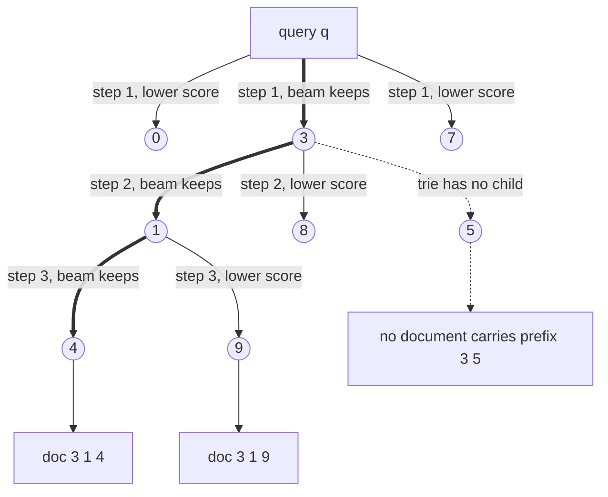
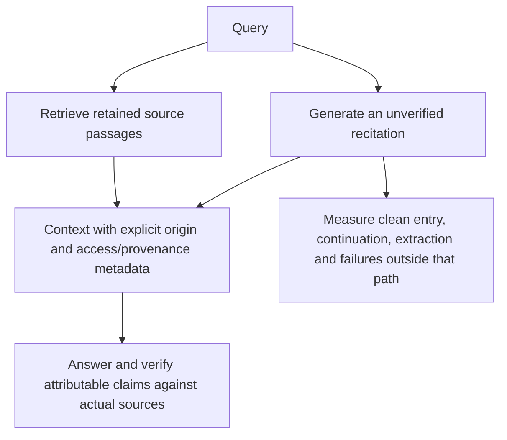

# Chapter 23: Generative Retrieval
[00-START-HERE](../00-START-HERE.md) · [01-READING-ROUTES](../01-READING-ROUTES.md) · [22\_reranking](22_reranking.md) · [24\_query\_reformulation](../part-07-query-control/24_query_reformulation.md)
This chapter explains when a model can retrieve by generating document identifiers, what that relocation costs, why updates remain hard, and how recitation can complement Retrieval-Augmented Generation (RAG).
## TL;DR
- Generating a document identifier relocates part of retrieval into model decoding, but valid-ID constraints and the ID-to-content store remain external structures.
- An atomic output head has $`N`$ learned rows. The exhaustive baseline scores them all; an ANN approximation can accelerate inner-product ranking if one accepts a conventional index again.
- Semantic identifiers can shorten the output alphabet. Tree balance, identifier assignment, constrained decoding and beam pruning determine achieved behavior; a trie provides validity, not relevance or exact global top-k search.
- Fixed-length identifiers need at least $`\lceil\log_V N\rceil`$ symbols, but this is not a universal achieved latency law. Model compute, memory traffic, beam work and auxiliary structures matter.
- Stored model bits divided by corpus size are a useful footprint comparison, not a mathematical retrieval-quality ceiling or a necessary prototype-rejection threshold.
- Updates need explicit freshness and preservation tests. A frozen learned base with a mutable conventional delta is one design, not the only possible local-update architecture.
- Recitation can supply unverified context, including on some retrieval misses. Clean-continuation decay and voting improvements depend on stated probability assumptions. Prefer retained sources for freshness, privacy controls and attributable evidence.
## The story
Imagine a library with an extraordinary librarian. In a normal library, the librarian searches a catalog. The catalog is the runtime index. It stores one addressable record for every book.
Generative retrieval trains the librarian to say a call number such as $`629.2`$ directly after hearing a question. The call number is the document identifier, a short token sequence that names one document. The catalog did not disappear. Part of it moved into the librarian’s memory, and part became the system used to organize call numbers.
Giving every book one unique spoken word is the atomic identifier design. It sounds simple, but the librarian must choose among every book in one step. That choice recreates a full shelf-sized catalog inside the final scoring layer.
A better design gives books hierarchical call numbers. The first digit chooses a broad wing, the next chooses an aisle, and later digits choose a shelf and book. These are semantically structured identifiers, which means nearby topics share early digits. The librarian now makes several small coarse-to-fine choices.
A prefix trie acts like a floor plan that lists every legal partial call number. If no book begins with 3 5, the floor plan closes that branch before it wastes a candidate slot. The librarian can carry several possible call numbers at once. That is beam search, a decoding method that keeps a fixed number of live prefixes.
In a balanced fixed-length identifier design, a larger collection may require another symbol when alphabet capacity is exhausted. That gives a staircase in decode depth, not constant query cost or a guarantee that an unbalanced semantic tree has the minimum depth.
The model has finite stored weights, but dividing their bytes equally among documents does not measure the information it actually learned. Related documents can share structure, while even a large model can learn a poor query-to-identifier mapping. Comparing model bytes with catalog-record bytes is useful bookkeeping, not a theorem predicting which retriever wins.
A conventional catalog has addressable records. A shared learned mapping can change older associations during training, but it is too strong to say every insertion must rewrite every parameter. A new atomic row, an adapter or another update policy has different preservation and query-cost trade-offs; each needs tests beyond the training examples.
The practical library therefore freezes the librarian’s learned catalog. It puts new books into a small mutable side catalog, searches both, and periodically retrains the librarian during compaction.
A second route asks the model to recite a passage before answering. Exact continuation from a remembered beginning can drift as it grows. That describes this recitation procedure, not a theorem that an autoregressive model cannot answer a fact directly from a suitable question. An externally retrieved passage instead supplies an addressable source, though retrieval and extraction can still fail.
The two routes therefore cooperate. The catalog supplies private, recent, and citable books. The librarian’s recitation can cover a vocabulary-mismatched zero-hit question. Both routes produce passages for the same final answer writer. The system keeps their provenance labels separate so a remembered imitation never receives a false citation.
## Decoder table


| Technical term | Plain-English meaning | Why it matters |
| --- | --- | --- |
| Retrieval-Augmented Generation (RAG) | A system that retrieves external passages and gives them to a generator | It keeps changing and citable facts outside model weights |
| Generative retrieval | Retrieve by generating an identifier | The ID stage still needs external constraints/mappings and a content store for passage fetch |
| Generative Information Retrieval (GenIR) | The chapter’s short name for generative retrieval | It distinguishes learned identifier generation from conventional search |
| Corpus $`D`$ | The document collection | Classical indexes address its records; generated IDs still need a mapping back to content |
| Query $`q`$ | The user’s information request | It conditions identifier decoding and passage selection |
| Document $`d`$ | One retrievable item in the corpus | It receives an identifier or an index record |
| Document identifier (docid) $`i(d)`$ | A token string that names one document | The model retrieves by generating this string |
| Sequence-to-sequence model | A model that maps one token sequence to another | It maps documents and queries to identifiers |
| Autoregressive decoding | Generate $`t_j`$ from $`p_\theta(t_j\mid t_{<j},q)`$ | The product over $`L_{\mathrm{id}}`$ steps defines the ID probability; variable lengths need termination rules |
| Differentiable Search Index (DSI) | A learned retriever that stores query-to-docid behavior in parameters | It demonstrates the model-based retrieval program |
| Indexing task | Training that maps a document’s text to its own identifier | It teaches corpus memorization |
| Retrieval task | Training that maps a query to the relevant identifier | It teaches the behavior served at query time |
| Atomic identifier | One learned output class per document | The exhaustive baseline has $`N d_{\mathrm{model}}`$ head weights; approximate row indexing is possible |
| Structured identifier | A multi-token code | Its length and prefix meanings depend on assignment, not alphabet size alone |
| Semantically structured identifier | An ID whose prefixes reflect semantic clusters | May help learning; no universal accuracy or balance guarantee |
| Naively structured identifier | An arbitrary multi-token assignment | Prefix decisions can exclude the target branch, while beam alternatives can preserve it |
| Hierarchical $`k`$-means | Repeated clustering that creates a tree of document groups | It supplies coarse-to-fine semantic call numbers |
| Branching factor $`k`$ | The number of child choices at a tree level | It trades identifier length against softmax width |
| Leaf capacity $`c`$ | The maximum documents allowed in one terminal cluster | It determines how many final digits identify a document within a leaf |
| Symbols $`N`$, $`d`$, $`P`$, $`b_w`$, $`L_{\mathrm{id}}`$, $`V`$, $`T_{\mathrm{work}}`$, and $`E`$ | Corpus size, embedding width, model parameters, stored bits, ID length, alphabet, work tokens and epochs | Use distinct beam and bit variables; summation/product symbols retain their usual mathematical meaning |
| Output embedding matrix | Learned vectors scored by the decoder’s final layer | Atomic identifiers hide a dense document index here |
| Maximum inner product search | Ranking candidate vectors by an inner product | Exhaustive atomic output scoring is one implementation; ANN can approximate its top results |
| Softmax | Normalize logits over available classes | A new class can alter normalized probabilities without changing every old logit or old pairwise order |
| Best Match 25 (BM25) | The lexical retrieval method named in Figure $`23.3`$ | Its inverted index supports local posting-list writes |
| Inverted file (IVF) | Clustered vector search | Coarse centroid work and selected PQ-code scans have different operation costs |
| Approximate nearest neighbor (ANN) | Fast vector search that avoids scanning all records | It is the conventional runtime alternative and the practical mutable delta |
| Hierarchical Navigable Small World (HNSW) | A graph-based ANN index | It offers local insertion and fast lookup at a resident-memory cost |
| Inverted File with Product Quantization (IVF-PQ) | A clustered vector index with compact codes | It is the quantized index baseline for latency and capacity comparisons |
| Product quantization (PQ) | Compact vector records | A $`64`$-byte code is a payload choice, not the information-theoretic minimum for useful retrieval |
| Prefix trie | A tree containing all legal identifier prefixes | It masks impossible next tokens during decoding |
| Constrained decoding | Restrict permitted continuations | Correct masks and terminal handling ensure registered identifiers, not relevance or exact global ranking |
| Generative Entity Retrieval (GENRE) | The named entity-retrieval system in the source | It introduced title decoding under a prefix trie |
| SEAL | A source-reported substring retrieval system | Valid corpus substrings can map to multiple documents and need document aggregation |
| Ferragina-Manzini index (FM-index) | A compressed substring index used to test legal continuations | It supports constrained decoding for arbitrary corpus n-grams |
| Beam search | Retain a bounded set of live prefix hypotheses | The final-beam-only candidate cap is algorithm-specific; beam search can prune the global optimum |
| Beam width $`\beta`$ | Number of active hypotheses | Arithmetic, KV traffic and selection grow even if per-step weight reads are shared |
| Search controls $`e_{\mathrm{search}}`$, $`n_{\mathrm{list}}`$, $`n_{\mathrm{probe}}`$, and $`ef_{\mathrm{construction}}`$ | HNSW query breadth, IVF list count, IVF lists probed, and HNSW insertion breadth | They set the worked search and write costs |
| Cross-entropy training | Training that raises probability on target sequences | It can make invalid identifiers unlikely but cannot forbid them |
| Top-$`k`$ retrieval | Requested retrieval-list depth | A final beam limits that list under its stated completion policy; separate beam width from alphabet size |
| Text-to-Text Transfer Transformer base model (T5-base) | The 220M-parameter backbone used in the worked examples | Its size anchors memory, bandwidth, and capacity calculations |
| Microsoft Machine Reading Comprehension (MS MARCO) | The 8.8M-passage benchmark corpus in the source | It exposes the scale failure of atomic identifiers |
| Neural Corpus Indexer (NCI), SEAL, and DSI with query generation (DSI-QG) | Named published generative retrievers in the source | They use structured or substring identifiers at passage scale |
| A100 accelerator | Hardware named in the planning examples | Rates are stipulated; comparisons are not independently measured A100 benchmarks |
| doc2query-style generation | Manufacturing likely queries from each document | It reduces the mismatch between document training and query serving |
| Query-time footprint | Weights, indexes and other structures used while serving | Model-only bytes omit trie/ID mapping and passage-fetch storage |
| Bandwidth-bound decoding | A regime where memory streaming dominates | Must be checked against arithmetic, KV/cache traffic, beam size and implementation |
| Floating-point operation (FLOP) | One arithmetic operation in a compute budget | It prices encoding, decoding, training, and insertion |
| fp32, fp16, bf16, and int8 | 32-bit, 16-bit, brain 16-bit, and 8-bit numeric formats | They change model and index memory costs |
| Nominal stored budget $`\kappa_{\mathrm{gen}}`$ | Stored model bits divided by document count | $`\kappa_{\mathrm{gen}}=b_wP/N`$ is not learned information or a necessary quality bound |
| Index record payload $`\kappa_{\mathrm{idx}}`$ | Stored bits in one chosen index-record representation | A record size is not a universal retrieval-information requirement |
| Parity point $`N^\star`$ | Equality of two nominal payload budgets | $`N^\star=b_wP/\kappa_{\mathrm{idx}}`$ is neither a necessary nor sufficient quality condition |
| Quality ceiling | An empirical limit of a specified learned retriever | Cannot be deduced by equating stored model bits to an arbitrary PQ-code size |
| Dual encoder | A retriever that independently embeds queries and documents | It is the tuned quality baseline that large generative retrievers failed to match |
| Cross-encoder reranker | A model scoring query-candidate interaction | Can reorder retained candidates, with quality and costs to measure rather than guarantee |
| Write locality | Addressable state changed by an update | Conventional records, atomic rows and modular learned designs have different local-write options |
| Posting list | The documents associated with one lexical term | An inverted-index insertion touches only lists for the new document’s terms |
| HNSW degree parameter $`M`$ | HNSW neighbor-degree parameter | Base-layer slot convention can allow twice that count; search/rewiring costs are not universally logarithmic |
| Parameter superposition | Shared parameters can represent many mappings | Interference is possible without a nonzero gradient or rewrite for every parameter |
| Catastrophic forgetting | Loss of old-task behavior during updates | A risk to measure, not a theorem that every new-only update damages all old mappings |
| DSI++ | The continual-indexing method named in the source | It combines flatter updates with rehearsal to reduce forgetting |
| DSI-XXL | A reported eleven-billion-parameter variant | Large stored payload alone does not guarantee quality or identify the source of a quality gap |
| Sharpness-aware minimization | Training that favors parameter regions tolerant to perturbations | It helps preserve old mappings during continual updates |
| Generative memory | Pseudo-query rehearsal for already indexed documents | It restores old-document coverage during updates |
| Hits@10 | Whether a relevant item appears among ten returned items | It is the metric used for the reported DSI++ improvement |
| IncDSI | A source-reported atomic-row update method | Frozen feature extraction permits local row insertion, with preservation constraints and row-search cost |
| Classifier row $`w_i`$ | One learned vector assigned to document $`i`$ | Adding one row creates local insertion but restores a flat scan |
| Log-structured merge (LSM) pattern | A frozen base plus a mutable delta and periodic compaction | It is the practical update architecture proposed by the source |
| Mutable delta $`N_{\mathrm{delta}}`$ | A small conventional index for documents newer than the learned base | It gives fresh documents local writes and immediate searchability |
| Compaction | Periodically rebuilding the learned base and clearing the delta | It amortizes expensive global retraining |
| Tombstone | A serving-time deletion marker | Must be enforced on every relevant read path; not erasure from weights or all retained copies |
| Staleness window | Elapsed ingestion-to-successful-retrieval time | Includes snapshot waits, queues, preparation, release and other delays, not just insertion compute |
| Service-level agreement (SLA) | A promised freshness or availability target | Retraining time can make the design fail before quality matters |
| Service-level objective (SLO) | The measured operating target for a service | The source recommends p99 ingest-to-retrieval freshness |
| Low-Rank Adaptation (LoRA) | Updates in a low-rank trainable subspace | Does not guarantee old outputs remain unchanged or prove that all parameters must be rewritten |
| Parametric store $`\theta`$ | Learned behavior in weights | Without fresh evidence it has no verified source-update channel; it may still infer or guess facts |
| Non-parametric store $`D`$ | External indexed documents | It supports updates, random access, and provenance |
| Recite-then-answer | Generate a remembered passage, then answer from it | It turns continuation memory into temporary context |
| Random access | Directly address a stored record | The analyzed recitation procedure is sequential, but a model can answer a suitably prompted fact directly |
| Entry-point probability $`p_{\mathrm{loc}}`$ | Probability of the chosen true passage entry | One conditional-chain factor in the clean-path contribution, not all answer success |
| Per-token faithfulness $`\phi`$ | Conditional survival for each next clean step | $`\phi^{L_{\mathrm{roll}}}`$ requires a common conditional value; marginal token accuracy is insufficient |
| Roll-forward length $`L_{\mathrm{roll}}`$ | Generated distance from the chosen entry to the answer | Different from identifier length; only the declared exact-continuation path has this distance factor |
| Extraction accuracy $`A`$ | Success conditional on the specified clean path | The toy fixes it; actual extraction can vary with context, order and missing evidence |
| Marginalization over recitations | Sum $`p(a\mid q,r)p(r\mid q)`$ over recitations | A distributional identity; sample voting uses an additional aggregation policy |
| Context set $`C`$ | Passages handed to the final generator | Retrieval and recitation both produce this same object |
| First-stage recall $`R_1`$ | A specified useful-evidence inclusion probability | Top-one-hundred candidate coverage is not five-passage context coverage |
| Zero-hit query | No useful evidence was returned | An online trigger needs a detector; measure recitation on the actual miss cohort |
| Provenance | Verifiable source/history metadata | Generated text alone supplies no source evidence; a separately verified source can be cited |
| Dense Passage Retrieval (DPR) | Dense retriever in the reported comparison | Its top-one-hundred hit rate and answer score are not automatically one conditional extraction measurement |
| Natural Questions | The open-domain question-answering benchmark in the worked example | It anchors the recitation and retrieval measurements |
| Exact match | Answer accuracy requiring the expected answer string | It is the end-to-end outcome in the worked example |
| Self-consistency | Aggregate sampled answers | Benefit depends on identities of wrong answers, ties and the joint sample distribution |
| Error scattering | Incorrect answers rarely repeat | Two correct copies can form a unique plurality in the specified five-sample example; single-copy ties need a rule |
| Error concentration | Incorrect samples name one repeated alternative | A strict-majority rule can underperform a sample even when correctness indicators are independent |
| Prefill | Process supplied prompt/context positions | The linear proxy is a resource-work estimate; actual latency and long-context attention need benchmarking |
| p95 and p99 | The 95th and 99th latency percentiles | They expose tail latency and freshness behavior |
| Normalized Discounted Cumulative Gain (nDCG) | A ranking-quality metric | A good score cannot rescue a design that misses its freshness SLA |


## Core mechanics
### Mathematical conventions
Storage uses decimal units: $`1\,\mathrm{MB}=10^6\,\mathrm B`$, $`1\,\mathrm{GB}=10^9\,\mathrm B`$ and $`1\,\mathrm{TB}=10^{12}\,\mathrm B`$. Count a multiply-accumulate as two FLOPs. Keep full precision until reporting. Percentages are fractions scaled by one hundred; percentage-point changes are absolute differences.
Use $`b_w`$ for stored bits per parameter and $`\beta`$ for beam width, avoiding the source's overloaded letter. $`L_{\mathrm{id}}`$ counts identifier tokens; $`L_{\mathrm{roll}}`$ counts generated passage tokens in the recitation toy. Fixed-length identifier calculations omit extra end/formatting tokens. A branching factor does not guarantee a balanced tree, and an alphabet-size lower bound is not an achieved path length for every identifier design.
The examples deliberately use different resource assumptions: the identifier comparison uses $`F_{\mathrm{id}}=1.25\times10^{14}\,\mathrm{FLOP\,s^{-1}}`$ and $`B_{\mathrm{id}}=2.0\times10^{12}\,\mathrm{B\,s^{-1}}`$; the later decoder-stream example uses $`1.6\times10^{12}\,\mathrm{B\,s^{-1}}`$ and the PQ scan assumes $`10^9`$ code lookups per core-second. For this recalculation the identifier scenario fixes the summary's approximately $`125\,\mathrm{TFLOP/s}`$ as the stated rate rather than inferring a different rate from rounded times. Training assumes eight devices at $`1.5\times10^{14}\,\mathrm{FLOP/s}`$ each, perfect aggregation and a price $`\$2`$ per device-hour. The recitation/prefill example separately assumes $`2.0\,\mathrm{TB/s}`$ and $`3.4\times10^{14}\,\mathrm{FLOP/s}`$. These are planning inputs, not reproduced hardware measurements.
Work divided by a sustained rate and bytes divided by bandwidth are resource-time components, not measured latency, invoices or p99 bounds. For a compute/memory roofline use the larger component, not their sum, before adding dependent stages. Actual kernels, attention, caches, trie traversal, selection, transfer, queues and deployment overhead can change the result. Model memory comparisons exclude the identifier trie, mapping back to documents, source text and other metadata unless explicitly included. Generating an identifier is not fetching the identified passage.
The quantity $`b_wP/N`$ is a nominal stored-bit budget per document, not learned information, a guaranteed capacity allocation or a retrieval-quality bound. It cannot be equated to PQ record bits to prove necessary starvation. The retraining formula $`6PT_{\mathrm{work}}`$ is a simplified token-work proxy: applying all model parameters to encoder and decoder positions is not a faithful encoder-decoder operation count. Updated examples count declared target positions as well as inputs and still exclude pseudo-query generation, attention overhead and evaluation.
Recitation equations describe a specified clean entry/continuation/extraction path. Equal conditional continuation probabilities yield a power; marginal per-token accuracy alone does not. Voting examples additionally assume IID correctness indicators, a single canonical correct answer and a declared tie rule. Concentrated wrong-answer identity is different from statistical correlation between samples.
### 23.1 Generating document IDs instead of searching
#### Classical search keeps the corpus on the query path
- Classical scoring defines $`\hat d\in\mathop{\mathrm{arg\,max}}_{d\in D}s(q,d)`$, with a declared tie policy. Approximate search need not return that exact maximizer.
- Inverted lists, IVF and HNSW reduce evaluated records under their own assumptions; corpus vectors, postings or other index data remain in the retrieval path.
- Full materialization, sharding and replication are deployment choices, not a mathematical requirement that all source text be resident on one machine. The worked payload comparison explicitly excludes several serving structures.
#### Generative retrieval turns retrieval into decoding
Assign an injective identifier $`i(d)=(t_1,\ldots,t_{L_{\mathrm{id}}})`$ from an alphabet of size $`V`$. The autoregressive factorization is

```math
p_\theta(i\mid q)=\prod_{j=1}^{L_{\mathrm{id}}}p_\theta(t_j\mid t_{<j},q).
```

The ID-generation stage can consult weights and a constraint structure rather than scanning document vectors. Returning a passage still requires an identifier-to-document mapping and content access. Training and constraint storage do not disappear, and variable-length schemes need explicit termination semantics.
#### DSI trains memorization and generalization together
- What: Tay et al. (2022) train an indexing task from document text to its docid and a retrieval task from query to docid. Metzler et al. (2021) frame the program as replacing the index with parameters.
- Why: The indexing task teaches the corpus. The retrieval task teaches the mapping used in production.
- Without it: Document-only training does not match query-only serving.
- Cost: Training needs examples for both tasks. Generated queries cover documents that lack real query logs.
#### Atomic identifiers rebuild the index inside the softmax
In the exhaustive atomic baseline, one document receives one output class, so the added head has $`N`$ rows of width $`d_{\mathrm{model}}`$. At $`N=8.8\times10^6,d_{\mathrm{model}}=768`$, its fp32 payload is

```math
B_{\mathrm{atomic}}=N d_{\mathrm{model}}(4\,\mathrm B)=27{,}033{,}600{,}000\,\mathrm B=27.0336\,\mathrm{GB}.
```

The stipulated $`220\times10^6`$-parameter backbone is $`880\,\mathrm{MB}`$ in fp32, so that added table is exactly $`30.72`$ times the backbone payload. The total is $`27.9136\,\mathrm{GB}`$ under this additive, non-shared-table accounting. Exhaustive output scoring is maximum-inner-product ranking. It is not intrinsically impossible to index those rows with ANN for approximate top results; doing so reintroduces a conventional search structure. Full softmax normalization and exact class probabilities have additional requirements.
#### Semantic hierarchy spends the identifier space differently
The source uses hierarchical clustering with branching factor ten and leaf capacity one hundred. At least $`\lceil8.8\times10^6/100\rceil=88{,}000`$ leaves are necessary. A sufficiently balanced ten-way tree can use five tree digits and two within-leaf digits, giving seven-token IDs; the leaf-count calculation alone does not guarantee that depth for recursive k-means. Unbalanced splits or unsuccessful clustering termination require another policy. Semantic prefixes may help learning, but do not prove more accurate decisions than arbitrary prefixes.
In a balanced first split, committing to one wrong branch retains about one tenth of documents and discards about nine tenths, including the gold branch. Beam search can retain alternatives. The ten-symbol fp32 head is $`10(768)(4)=30{,}720\,\mathrm B=30.72\,\mathrm{kB}`$, excluding other vocabulary rows, special tokens and tree storage. The source reports semantic identifiers strongest among its compared schemes at the tested scale; that is not a universal result.
#### The hierarchy resembles an autoregressive IVF probe
The coarse-to-fine path resembles successive IVF choices, but ordinary IVF ranks coarse centroids once and may probe several lists; it is not simply making statistically independent decisions. Autoregressive prefixes allow later scores to depend on earlier choices. At fixed per-step work and beam policy, decode work grows with $`L_{\mathrm{id}}`$, while prefix pruning can lose the globally best full identifier.
#### Constrained decoding provides validity, not relevance
A prefix trie masks children not present in the registered identifier set. With correct terminal handling, a complete accepted path names a registered item; truncation, stale mappings and output parsing still need checks. This is validity, not relevance. In the fixed seven-digit example there are $`10^7`$ strings and $`1.2\times10^6`$ unused strings, or $`12\%`$ of the code space. That unused-space fraction is not the trained decoder's invalid-output probability.
The chapter cites GENRE for title-trie decoding and SEAL for corpus-substring constraints using an FM-index. A legal substring can occur in multiple documents, so substring-to-document aggregation is not automatically a unique docid mapping. Constraint memory and updates belong in the serving budget.
#### Beam width is retrieval depth
For a final-beam-only implementation, width $`\beta`$ retains at most $`\beta`$ active hypotheses and returns at most that many final IDs before deduplication/filtering. Algorithms that accumulate completed hypotheses or run extra searches can return a different number. Approximate beam search does not guarantee the globally highest-probability identifiers. A final beam of ten alone cannot supply twenty unique candidates.
Wider beams can share weight reads within a decode step, but still increase arithmetic, KV-cache traffic, selection and active-prefix work. Post-filtering invalid results wastes slots; maintaining validity during search does not fix a bad relevance model.
#### Worked comparison at 8.8M passages
Configuration 1 uses dense vectors and HNSW.
- At the stated fp32 width, vector payload is $`27.0336\,\mathrm{GB}`$.
- Under the base-layer allocation convention $`M=32`$, up to $`2M=64`$ four-byte neighbor slots budget $`256\,\mathrm{B/node}`$ or $`2.2528\,\mathrm{GB}`$.
- Their sum is $`29.2864\,\mathrm{GB}`$; three such copies are $`87.8592\,\mathrm{GB}`$. Upper graph layers, identifiers, allocation overhead, source text and other metadata are excluded, so this is not complete resident memory.
- $`e_{\mathrm{search}}=128`$ does not mathematically imply exactly one thousand visited vectors. Stipulate one thousand for the traffic example: each payload is $`3{,}072\,\mathrm B`$, and dot work is $`1{,}536{,}000`$ FLOPs.
- A fully serialized thousand-fetch scenario at $`100\,\mathrm{ns/fetch}`$ sums to $`0.1\,\mathrm{ms}`$. Dependence, overlap, locality, graph work, selection and query encoding can change actual latency. This is not an independently measured HNSW benchmark.
Configuration 2 uses atomic generative identifiers.
The added atomic table streams $`27.0336\,\mathrm{GB}`$ in fp32, a $`13.5168\,\mathrm{ms}`$ bandwidth component at $`2.0\,\mathrm{TB/s}`$. At fp16 the corresponding table/read component is $`13.5168\,\mathrm{GB}`$ and $`6.7584\,\mathrm{ms}`$. Backbone forward work, query encoding and output selection are additional. These are not end-to-end latencies. The fp32 table-plus-backbone sum $`27.9136\,\mathrm{GB}`$ is actually below the scoped HNSW $`29.2864\,\mathrm{GB}`$ payload-plus-links estimate, so these numbers do not establish the source's “strictly dominated on both memory and speed” claim. Precision, quality, auxiliary data, devices and full costs must be matched.
Configuration 3 uses hierarchical identifiers.
For one explicit hierarchical scenario, divide the $`220\times10^6`$ stored parameters into two stipulated equal halves: encoder and decoder each $`110\times10^6`$. This is simplified accounting, not a measured T5 implementation profile. The fp16 total is $`440\,\mathrm{MB}`$; each half is $`220\,\mathrm{MB}`$.
A thirty-two-position query uses linear work $`2(110\times10^6)(32)=7.04\times10^9`$ FLOPs, or $`0.056320\,\mathrm{ms}`$ at $`F_{\mathrm{id}}`$. A full encoder-half read costs $`0.11\,\mathrm{ms}`$ at $`B_{\mathrm{id}}`$. Seven decoder-half reads use $`1.54\,\mathrm{GB}`$, or $`0.77\,\mathrm{ms}`$. Beam ten adds linear decoder work $`2(110\times10^6)(10)(7)=15.4\times10^9`$ FLOPs, or $`0.123200\,\mathrm{ms}`$. The partial sequential roofline estimate is therefore

```math
t_{\mathrm{partial}}\approx\max(0.056320,0.11)+\max(0.123200,0.77)=0.88\,\mathrm{ms}.
```

If instead every decode step reads the full backbone, seven reads use $`3.08\,\mathrm{GB}`$; the corresponding partial sum is $`0.11+1.54=1.65\,\mathrm{ms}`$. Neither byte sum is an upper bound on real latency. The earlier calculation mixed decoder parameter counts with full-model traffic and omitted the encoder read.
Model-only versus HNSW payload-plus-base-links storage ratio is $`29.2864/0.44=66.56`$, not an all-in index ratio because the trie and ID mapping are omitted. Int8 vector payload is $`6.7584\,\mathrm{GB}`$; with the same graph-link budget it is $`9.0112\,\mathrm{GB}`$, ratio $`20.48`$. Quantization can change quality. The $`0.88/0.1=8.8`$ and $`1.65/0.1=16.5`$ partial-time ratios compare stipulated components, not controlled architecture benchmarks.
#### Scale checks and operating choices
- The source reports atomic-ID tests through $`320{,}000`$ documents. Their fp32 added table is $`983.04\,\mathrm{MB}`$, larger than the stipulated $`880\,\mathrm{MB}`$ backbone.
- Fixed-length unique IDs over a ten-symbol alphabet require $`L_{\mathrm{id}}\ge\lceil\log_{10}N\rceil`$. Seven is the lower bound at $`8.8\times10^6`$; achieving it with semantic clustering needs a suitable assignment. EOS and formatting are extra if used.
- At $`10^5`$ documents, the atomic table is $`307.2\,\mathrm{MB}`$. Strictly under one decimal GB allows up to $`325{,}520`$ rows; the source's roughly one-hundred-thousand recommendation is a heuristic, not the arithmetic one-GB boundary.
- One hundred symbols need at least four fixed-length tokens. Seven-to-four reduces only the fixed per-step decode component by $`42.857143\%`$; including one unchanged encoder-half read changes this partial model from eight to five equal reads, a $`37.5\%`$ reduction. The symbol head is tenfold wider; total softmax/model/runtime need not be tenfold.
- Tenfold growth to $`8.8\times10^7`$ requires at least eight decimal digits, a $`14.285714\%`$ step increase, or $`12.5\%`$ in the equal encoder-plus-decoder read scenario. Balance, beam work and model quality can also change.
- Preserve a stable ID policy or version migrations. Reclustering can rename old paths and force mapping/model updates.
- Compare structured, substring, atomic and conventional retrievers on matched quality, hardware, all-in footprint and freshness. Co-train document and query tasks and validate generated-query coverage; no single scheme is universally best.
### 23.2 Query scaling, stored budgets, and empirical quality limits
#### Query latency depends on the model and identifier
A stipulated batch-one decoder may be bandwidth-bound if weight reads dominate arithmetic and other traffic; this is not automatic for every model, beam or implementation. Reusing a read across beam hypotheses helps, but does not make hypotheses free. Under a fixed per-step regime, the weight-stream component is proportional to $`L_{\mathrm{id}}`$.
For $`N`$ fixed-length unique IDs over $`V`$ symbols,

```math
V^{L_{\mathrm{id}}}\ge N\quad\Longrightarrow\quad L_{\mathrm{id}}\ge\lceil\log_VN\rceil.
```

This is an identifier-space lower bound, not a universal achieved complexity. At minimum length, decimal IDs need six tokens at $`320{,}000`$, seven at $`8.8\times10^6`$ and nine at $`10^9`$ documents. Thousandfold growth adds three minimal decimal digits. Variable lengths, nonuniform IDs and unbalanced semantic trees need their own maximum/mean-length analysis.
#### Index cost still grows with the corpus
For IVF with $`C`$ coarse lists, exhaustive centroid selection evaluates $`C`$ centroid vectors. Under balanced-list or mean-size assumptions, probing $`n_{\mathrm{probe}}`$ lists scans about $`n_{\mathrm{probe}}N/C`$ document codes. At $`C\approx\sqrt N`$, their total *number* is approximately $`(1+n_{\mathrm{probe}})\sqrt N`$, but a centroid comparison and a PQ code scan are not equal-cost operations.
With width $`d`$ and $`m`$ PQ subquantizers, price coarse inner products as $`2dC`$ FLOPs and code scans as $`m n_{\mathrm{probe}}N/C`$ lookups. A query lookup-table build with $`256`$ centroids per subspace adds roughly $`2(256)d`$ dot-product FLOPs. Query-selected lists need not equal the global average length. HNSW often has favorable empirical/logarithmic-like scaling, not a universal guaranteed logarithmic hop count. Resident versus disk-based indexes, sharding, caches and fan-out are design choices; maxima of shard timings must not be replaced by an identity involving individual p99 values.
#### Stored-bit parity is not a quality theorem
The model's stored payload is $`b_wP`$ bits. Dividing by the corpus size gives nominal budget $`\kappa_{\mathrm{gen}}=b_wP/N`$. A width-$`768`$ fp32 vector uses $`24{,}576`$ bits; a sixty-four-byte PQ code uses $`512`$ bits. Their byte-budget equality is

```math
N^\star=\frac{b_wP}{\kappa_{\mathrm{idx}}}.
```

It is **not** a necessary quality bound, a guarantee of starvation above the crossing, or a guarantee of good retrieval below it. Model weights can share structure across documents; PQ codes store a particular representation, not the information-theoretic minimum for retrieval. Model payload also excludes the trie, mapping and source text. There is no justified inference that below five hundred twelve stored weight bits per document forces a model to lose.
A genuine counting bound needs a declared function family. If all information for an arbitrary bijection from $`N`$ fixed labeled queries to $`N`$ document IDs must reside in quantized weights, distinguishing all $`N!`$ bijections requires $`b_wP\ge\log_2(N!)`$. At $`8.8\times10^6`$, this is about $`21.626379`$ bits per document, not $`512`$. This hypothetical counting requirement is not a sufficiency theorem for learning or natural-language retrieval, and external structures can carry information too.
#### If model size grows with the corpus
Keeping the nominal ratio $`b_wP/N`$ fixed means scaling $`P`$ linearly with $`N`$ at fixed precision. Under fixed hardware and full uncached per-step weight streaming, that makes each stream component linear in $`N`$; when minimal ID length also grows, the product is roughly $`N\log_VN`$, not merely linear overall. It does not prove that quality requires proportional model growth. Compression, routing, caching, learned structure and other algorithms change the premise. An atomic head instead incurs linear row payload immediately, but approximate head indexing or local-row updates remain possible design choices.
#### Worked latency and capacity comparison
Use $`P=220\times10^6`$ and $`b_w=16`$, totaling $`3.52\times10^9`$ stored bits. These are payload budgets, not measured learned information.
Assume the decoder holds one half of the stored weights: $`110\times10^6(2\,\mathrm B)=0.22\,\mathrm{GB}`$. At the separate bandwidth $`1.6\,\mathrm{TB/s}`$, its stream component is $`0.1375\,\mathrm{ms/step}`$. One full encoder-half stream adds another $`0.1375\,\mathrm{ms}`$ per query in this simple memory-only comparison.
For the IVF-PQ example choose integer $`C=\lceil\sqrt N\rceil`$, $`d=768,m=64,n_{\mathrm{probe}}=32`$, and a stipulated $`10^9`$ code-table lookups per core-second. Compute the code-scan lookup component separately from centroid scoring, table construction, query encoding, selection and other costs. The code-scan times below are not complete IVF-PQ latency or controlled same-hardware comparisons with the decoder.
At $`N = 320,000`$ documents:
At $`N=320{,}000`$, minimum decimal length is six. Decoder-half streaming is $`0.825\,\mathrm{ms}`$, or $`0.9625\,\mathrm{ms}`$ including the encoder-half stream. For $`C=566`$, coarse scoring costs $`869{,}376`$ dot-product FLOPs. Balanced-list code scans average $`32N/C\approx18{,}091.872792`$ records, or $`1{,}157{,}879.858657`$ table lookups and $`1.157880\,\mathrm{ms}`$ at the assumed lookup rate. These expected counts need not be integers; actual selected-list totals are integers. Stored model budget is $`11{,}000`$ bits per document, $`21.484375`$ times the PQ-code payload, not proven superior learned capacity.
At $`N = 8.8\mathrm{M}`$ passages:
At $`N=8.8\times10^6`$, minimum decimal length is seven. Decoder streaming is $`0.9625\,\mathrm{ms}`$, or $`1.1\,\mathrm{ms}`$ with the encoder stream. For $`C=2{,}967`$, coarse scoring costs $`4{,}557{,}312`$ FLOPs. Mean code scans are $`94{,}910.684193`$, giving $`6{,}074{,}283.788338`$ lookups and $`6.074284\,\mathrm{ms}`$ of lookup-rate resource time. A separate LUT build is approximately $`393{,}216`$ dot-product FLOPs in both examples.
The corpus grew $`27.5`$-fold. Decoder-only stream time grew $`16.666667\%`$, encoder-plus-decoder stream time $`14.285714\%`$, and this particular code-scan component $`424.603977\%`$. Do not count all coarse comparisons as sixty-four PQ lookups or call these partial component ratios benchmarked speedups. The stored model budget is $`400`$ bits per document; its being below a $`512`$-bit code does not make retrieval-quality failure follow mathematically.
The memory comparison has an important limit.
Model weights are $`440\,\mathrm{MB}`$. PQ codes alone are $`8.8\times10^6(64)=563.2\,\mathrm{MB}`$, ratio $`1.28`$; the fp32 vector payload is $`27.0336\,\mathrm{GB}`$, ratio $`61.44`$. None is an all-in memory comparison: the model needs identifier constraints/mappings, and IVF-PQ needs centroids, codebooks, IDs, lists and serving data. Index quantization also changes its accuracy/cost trade-off.
#### Evidence checks and decision rules
- Against $`512`$-bit records, $`N^\star=6{,}875{,}000`$; $`8.8\times10^6`$ is $`28\%`$ beyond that **stored-payload** crossing, not necessarily beyond a quality boundary.
- The source reports that scaled generative systems in the cited comparison did not match a tuned dual encoder on the full corpus. This is empirical evidence in that setup, not proof that identifier assignment alone caused the gap.
- An $`11\times10^9`$-parameter fp16 model has $`1.76\times10^{11}`$ stored bits and parity $`343{,}750{,}000`$ against those codes. Poor quality below that number does not make parity a necessary condition; it shows only that byte counts do not predict the outcome.
- Source factor-two rejection and below-one-tenth preference rules are unvalidated screening heuristics. Do not treat them as mathematical prototype gates.
- At $`20\times10^6`$ documents the base model budget is $`176`$ stored bits per document. Halving code bytes doubles the payload crossing; neither change determines learned accuracy.
- Beam fifty still has the same number of token steps, but not the same arithmetic, KV or selection cost. In the simplified first example, linear beam work alone reaches the decoder-half read component near width $`62.5`$; other overhead can bind earlier.
- Keep conventional retrieval unless matched quality, total footprint, full latency and updates justify replacement. A generator chunk's $`10.541176\,\mathrm{ms}`$ linear prefill proxy can exceed the $`6.074284\,\mathrm{ms}`$ lookup component, but unlike partial costs do not prove one component irrelevant.
- Keep the same half-model convention for the large-model check: an $`11`$-billion total parameter model has $`11\,\mathrm{GB}`$ per decoder-half read, $`6.875\,\mathrm{ms/step}`$ at $`1.6\,\mathrm{TB/s}`$, and $`48.125\,\mathrm{ms}`$ for seven reads. Reading all $`22\,\mathrm{GB}`$ every step would instead give $`96.25\,\mathrm{ms}`$. Neither is total query latency.
### 23.3 Incremental indexing: the open wound
#### Fresh documents have zero recall
If a frozen valid-ID constraint excludes every newly registered document, that serving path has zero recall for those new IDs. Adding IDs to the constraint permits outputs but does not teach a useful query mapping. Once permitted, a new ID can have nonzero probability even without a targeted update, so universal zero recall then no longer follows. Prior exposure to the text and changed external inputs are separate questions.
#### Classical indexes have write locality
Appending postings requires work proportional to processed terms/postings under a chosen dictionary/storage design, often modeled as $`O(\lvert d\rvert)`$ plus lookup, allocation and durability costs. HNSW allocates a new node, searches for neighbors and may alter reciprocal neighbor lists. A frequently used $`O(M\log N)`$ description relies on graph/search assumptions; it is not a universal worst-case bound on rewritten edges. Indexes can support concurrent serving, but locking, versions, compaction and replication are implementation obligations. Local addressability does not mean cost is exactly independent of corpus size.
#### A learned index superposes every document
Shared learned mappings can interfere: updating one query-to-ID path can alter older scores. A softmax denominator couples probabilities within one decision, but it does not prove every parameter has a nonzero gradient or that every correct insertion must rewrite the entire parameter field. Frozen features plus a new atomic row, sparse or adapter updates and modular models are counterexamples to that absolute claim. They still need preservation tests and can have other serving costs. A missing preservation term provides no guarantee, not a theorem of inevitable forgetting.
#### Full retraining prices one refresh workflow, not every update method
The source prices a DSI-style retriever with $`N = 10^{7}`$ and $`P = 2.2 \times 10^{8}`$.
The indexing input is $`64`$ positions plus ten pseudo-query inputs of sixteen positions: $`224`$ inputs per document and epoch. The original $`6PT`$ estimate counted only those inputs. This revised workload reserves fixed eight-digit identifiers for the update scenario, allowing growth beyond ten million without immediately exhausting seven-digit space. Eleven tasks per document therefore add $`11(8)=88`$ target positions, with no extra EOS in this declared proxy.

```math
\begin{aligned}
T_{\mathrm{work}}&=10^7(224+88)(10)=3.12\times10^{10},\\
W_{\mathrm{refresh}}&\approx6(2.2\times10^8)T_{\mathrm{work}}=4.1184\times10^{19}\,\mathrm{FLOP},\\
t_{\mathrm{job}}&\approx\frac{4.1184\times10^{19}}{8(1.5\times10^{14})}=34{,}320\,\mathrm s=9.533333\,\mathrm h,\\
H_{\mathrm{GPU}}&\approx76.266667\,\mathrm{GPU\text{-}hours}.
\end{aligned}
```

The earlier input-only $`T=2.24\times10^{10}`$ gives $`2.9568\times10^{19}`$ FLOPs and $`6.844444`$ hours under the same simplified rule. Neither is a measured encoder-decoder training runtime or a strict freshness floor: parameter participation differs by stage, attention and decoder memory projections are not modeled, and pseudo-query generation, evaluation, queues and release work are excluded. Count targets explicitly and benchmark the actual recipe instead of presenting the input-only value as a complete job estimate.
#### New-only fine-tuning forgets old mappings
The source reports continual-indexing forgetting and describes DSI++ using sharpness-aware minimization and generative-memory rehearsal. Its quoted average Hits-at-ten improvement is $`21.1\%`$ relative to its stated baselines, not automatically twenty-one-point-one absolute points. The reported sixfold reduction concerns model updates across five sequential corpora, not an externally reproduced cost ratio.
New-only training lacks a direct old-example preservation objective, but does not necessarily damage every old mapping. Rehearsal covers only its sampled/generated distribution. LoRA restricts update parameters without making old and new outputs probabilistically disjoint or guaranteeing no forgetting. Evaluate old and new cohorts independently, with retrieval constraints and denominators documented.
#### IncDSI restores locality by restoring a flat layer
For frozen query features and atomic scores $`s_i(q)=h(q)^\mathsf T w_i`$, a new row $`w_{N+1}`$ is an addressable update. Older pairwise logits and odds can stay unchanged even though adding the new softmax class reduces their normalized probabilities. New rows can still outrank an old correct document, so constraints on finite training queries are not universal preservation guarantees.
The chapter reports IncDSI insertions around $`20`$–$`50\,\mathrm{ms}`$ and competitive quality in its setup. This is reported implementation context, not a universal service SLA. Exhaustive evaluation of all rows has linear row traffic; ANN acceleration is possible but introduces a conventional index. Local row insertion does not require retraining all network parameters.
#### Frozen base plus mutable delta as one deployment option
One update design freezes a learned base, inserts new documents into a mutable ANN delta, searches both, merges scores with an explicit policy and periodically compacts. Measure score calibration, duplicate versions, delta growth, old/new recall and cutover correctness. A decode constraint, tombstone or serving filter can block registered IDs if every read enforces it, but stale caches, replicas and alternate paths still matter. Retrieval exclusion is not erasure from weights or all source copies, and it does not eliminate recitation exposure.
#### Worked updates with fifty thousand daily net additions
Initially there are $`10^7`$ documents and $`50{,}000`$ net additions per day, $`0.5\%`$ of the initial base. This is a fixed count, not a perpetually compounded half-percent growth rate. The update workload uses eight-digit IDs, ten epochs and the revised target-inclusive token-work proxy. An annualized initial-size budget and a growing-corpus forecast are different calculations.
Each new vector has $`d = 768`$ fp32 dimensions.
Configuration 1 retrains nightly.
One initial-size refresh has proxy $`4.1184\times10^{19}`$ FLOPs, $`9.533333`$ idealized hours on eight devices and $`76.266667`$ device-hours. At $`\$2`$ per device-hour it costs $`\$152.533333`$. Repeating that same-size workload daily for $`365`$ days annualizes to $`\$55{,}674.67`$, excluding other costs.
For net additions and a refresh after each day's arrivals, $`N_j=10^7+50{,}000j`$. Holding model, token counts, rates and epochs fixed, the corresponding annual proxy is $`\sum_{j=1}^{365}(\$152.533333)N_j/10^7\approx\$106{,}616.99`$, ending at $`28.25\times10^6`$ documents. The original flat annual number did not account for this growth. This is the work/price of the requested jobs, not a guarantee that an eight-device cluster can deliver each refresh nightly: this proxy first exceeds twenty-four hours on arrival day $`304`$, so the final part of that schedule needs extra capacity, fewer jobs or a longer freshness window.
Job time is not ingest freshness. With one snapshot every twenty-four hours and a deterministic initial job duration, arrivals wait for the next eligible snapshot. Uniform arrival phases yield mean wait-plus-job $`21.533333`$ hours and supremum $`33.533333`$ hours, before queues and release checks. Later larger jobs take longer under this proxy. A replacement corpus held at fixed size would require an explicit retirement/deletion policy and a different growth interpretation.
Configuration 2 inserts one IncDSI row per document.
At stipulated row service time $`50\,\mathrm{ms}`$, fifty thousand rows sum to $`2{,}500\,\mathrm s`$ of device service. This is not fifty milliseconds of end-to-end freshness for every arrival. A simultaneous batch on one serial worker has last completion at $`2{,}500\,\mathrm s`$ and mean $`1{,}250.025\,\mathrm s`$, before preparation/publishing. At a uniform daily rate, arrivals average $`0.578704\,\mathrm{s^{-1}}`$ and nominal utilization is $`2.893519\%`$, but burstiness can still create queues. The $`34{,}320/0.05=686{,}400`$ job/service ratio is not an SLA speedup.
The initial fp32 row payload is $`30.72\,\mathrm{GB}`$. Exhaustive scoring needs $`1.536\times10^{10}`$ dot-product FLOPs and a $`15.058824\,\mathrm{ms}`$ read component at $`2.04\,\mathrm{TB/s}`$, excluding query encoding, output selection and other serving work. This demonstrates a flat-read trade-off, not that every atomic design must use brute force.
Configuration 3 uses an HNSW delta and weekly compaction.
The HNSW delta uses $`M=32,ef_{\mathrm{construction}}=200`$. Their product does not determine actual visited distances; separately stipulate $`6{,}400`$ dot-product-equivalent distances per insertion. At $`2d=1{,}536`$ FLOPs each, graph-insertion work is $`9{,}830{,}400`$ FLOPs. At the stated $`10^{10}\,\mathrm{FLOP/s}`$ per core, that is $`0.98304\,\mathrm{ms}`$ per insertion and $`49.152\,\mathrm s`$ for the daily batch. These are arithmetic service proxies, not ingest or p99 freshness.
Seven days add $`350{,}000`$ vectors: $`3.5\%`$ of the original base, or $`3.381643\%`$ of the resulting total. Their fp32 vector payload is $`1.0752\,\mathrm{GB}`$; base-layer links add up to $`0.0896\,\mathrm{GB}`$ under the same slot budget, sum $`1.1648\,\mathrm{GB}`$ before other overhead.
An initial-size weekly refresh annualizes to $`10.895238`$ device-hours per day and $`\$7{,}953.52`$ per year. With net growth and fifty-two compactions after days seven through three hundred sixty-four, the same linear work proxy instead sums to $`\$15{,}288.42`$ for compaction, excluding delta serving, embedding, pseudo-queries and other costs.
Daily graph insertion is $`4.9152\times10^{11}`$ FLOPs; the initial full refresh is $`83{,}789{,}062.5`$ times that **graph-only** work. Producing new vectors is not free: the separate $`110\times10^6`$-parameter, $`256`$-position encoder proxy adds $`2.816\times10^{15}`$ daily FLOPs, changing that scoped arithmetic ratio to about $`14{,}622.447718`$. These workloads have different learning goals and hardware costs, so neither ratio is an end-to-end price or latency speedup.
#### Sanity checks and decision rules
- The source reports Chinchilla $`5.76\times10^{23}`$ FLOPs; $`6(7\times10^{10})(1.4\times10^{12})=5.88\times10^{23}`$ is $`2.083333\%`$ above it. This decoder-training sanity check does not validate a sequence-to-sequence update estimate.
- Re-embedding all ten million documents with the stated encoder proxy costs $`5.632\times10^{17}`$ FLOPs, $`469.333333\,\mathrm s`$ or $`7.822222`$ minutes at the same idealized cluster throughput. The revised GenIR refresh is $`73.125`$ times that arithmetic. An unchanged document encoder can embed new documents only; a changed document encoder may require migration/re-embedding to keep one compatible index.
- Treat snapshot waiting, token preparation, evaluation, release and queues as part of freshness. A failed full-refresh SLA does not rule out every alternate update architecture.
- With two percent of the *initial* base added daily, a fortnight's delta is $`28\%`$ of that base, not a rival-sized full copy. With two percent compounded growth it is $`31.947876\%`$; reaching the original base size takes thirty-six whole days. The source's fortnight claim is incorrect under either interpretation.
- Frozen base/delta is one practical option. Validate merge quality, tombstones and compaction before choosing it over a conventional retriever or another continual-update method.
- New-only training offers no general preservation guarantee; rehearsal is a mitigation to evaluate, not proof of no forgetting. Atomic head indexing and semantic identifier stability have distinct costs.
- Measure p99 ingest-to-successful-retrieval under actual arrival bursts and queries. Never replace it with one insertion's arithmetic service time.
- Read-time ID blocking is logical exclusion, not deletion from model weights, logs, backups or every replica. Route revocable/private content according to actual retention and compliance requirements.
### 23.4 Recite-then-answer, and GenIR as RAG’s complement
#### Two stores can produce the same context object
An external datastore $`D`$ retains documents; weights $`\theta`$ encode learned behavior. A model that emits a docid still needs a content store to turn it into a retrieved passage. A reciter instead generates a passage-like string, which may be wrong or untraceable. Either can supply context set $`C`$ to a final generator, but they do not confer the same provenance. A smaller model plus external retrieval beating a larger model is a workload-dependent reported motivation, not a universal seven-billion-versus-seventy-billion substitution law.
#### Recitation converts continuation into temporary access
Autoregressive generation factorizes a string into next-token probabilities $`p_\theta(x_t\mid x_{<t})`$. A model can also directly answer a question from its prompt; it is not architecturally forced to reproduce all earlier tokens of a remembered source. The procedure analyzed here intentionally locates a passage beginning and generates forward. It is not a keyed database read, and its exact-continuation reliability is a property to measure rather than a certified source-access operation.
#### Recitation success has an exponential distance term
For a specified recitation-and-answer distribution, the law of total probability gives

```math
p(a\mid q)=\sum_r p(a\mid q,r)p(r\mid q).
```

Sampling recitations approximates expectations under that declared distribution; voting is a different aggregation rule, not exact marginalization. Locating a particular true passage start is event $`G`$, maintaining the chosen clean continuation to answer distance $`L_{\mathrm{roll}}`$ is $`H`$, and answering correctly after it is $`J`$. The path contribution obeys a conditional chain:

```math
\begin{aligned}
s_{\mathrm{clean}}&=\Pr(G\cap H\cap J)\\
&=p_{\mathrm{loc}}\left(\prod_{t=1}^{L_{\mathrm{roll}}}\phi_t\right)A,\\
s_{\mathrm{clean}}&=p_{\mathrm{loc}}\phi^{L_{\mathrm{roll}}}A\quad\text{if each required conditional }\phi_t=\phi.
\end{aligned}
```

This is overall accuracy only under the further toy assumption that success on all other paths is zero. Correct answers can survive imperfect wording or arise without that entry path. A marginal average per-token accuracy does not by itself justify the power. At $`\phi=0.995`$, the clean factors are $`0.995^{60}\approx0.740260958`$ and $`0.995^{200}\approx0.366957822`$. Retrieval avoids generating every preceding token of a source, but has its own coverage, selection and extraction errors.
#### Retrieval and recitation cover different misses
Let $`R`$ and $`S`$ be retrieved-evidence and clean-recitation coverage events on the same query population. The exact union is

```math
\Pr(R\cup S)=\Pr(R)+(1-\Pr(R))\Pr(S\mid R^c).
```

Only under independence does it reduce to $`1-(1-R_1)(1-p_{\mathrm{loc}}\phi^{L_{\mathrm{roll}}})`$. The marginal probabilities alone bound the union between $`\max(\Pr R,\Pr S)`$ and $`\min(1,\Pr R+\Pr S)`$. A fallback deployed only on retrieval misses needs measured $`\Pr(S\mid R^c)`$, not recitation accuracy averaged over all queries. Oracle zero-hit labels are not automatically available online; a no-evidence detector has its own errors.
The source reports combining generated and retrieved documents in GenRead. That supports evaluating complementarity, not independence or a guaranteed union/answer gain. Adding noisy context can harm the final reader. Retained sources can supply fresh, private and attributable content when correctly indexed and controlled. A frozen model without new evidence offers no verified update channel; it can still infer or guess answers, so lack of freshness is not a blanket claim that every post-training fact is impossible to output. Keep origin labels and verify any cited source independently.
#### Worked recitation and retrieval comparison
These are constructed coverage and clean-answer scenarios, not reproduced Natural Questions measurements for a particular seven-billion-parameter model.
Use $`\phi=0.995,A=0.75`$ and a separately reported DPR top-one-hundred hit rate $`R_{100}=0.854`$. The last number is not automatically the coverage of five passages in a final prompt.
Configuration 1 is a head entity with recitation only.
For the head example $`p_{\mathrm{loc}}=0.70,L_{\mathrm{roll}}=60`$, clean coverage is $`0.70(0.995^{60})\approx0.518182670`$ and the toy answer success is $`0.388637003`$, or $`38.863700\%`$. All later calculations use these unrounded inputs.
Configuration 2 is a tail entity with recitation only.
For the tail example $`p_{\mathrm{loc}}=0.15,L_{\mathrm{roll}}=200`$, clean coverage is $`0.055043673`$ and toy answer success $`0.041282755`$, or $`4.128275\%`$. The head/tail ratio is $`9.414028`$. Both location probability and distance changed, so this ratio is not an isolated distance or entity-popularity causal effect.
Configuration 3 fuses retrieved and recited contexts.
Using the head clean coverage and $`R_{100}=0.854`$ in the independence scenario gives union $`0.929654670`$, or $`92.965467\%`$, an absolute $`7.565467`$ percentage-point increase. Without an overlap estimate, the marginals permit anything from $`85.4\%`$ to $`100\%`$. This is coverage, not final exact match. For a five-item prompt chosen from one hundred, substitute $`R_{\mathrm{context}}=R_{100}R_2(5\mid100)`$, with conditional retention measured separately; the top-one-hundred number alone does not determine that union.
#### Voting depends on the error structure
Use five independent correctness indicators with common per-sample success $`s=0.388637003`$ from the unrounded head scenario. Then $`K\sim\mathop{\mathrm{Binomial}}\nolimits(5,s)`$. Suppose all correct outputs canonicalize to one answer.
If every wrong answer is distinct, at least two correct copies form the unique plurality. With ties declared unsuccessful/abstained, success is

```math
\Pr(K\ge2)=1-(1-s)^5-5s(1-s)^4\approx0.643129485.
```

Uniformly breaking the five-way tie when exactly one sample is correct instead gives $`0.697422098`$. The tie rule therefore matters. If all incorrect samples name the same wrong alternative while correctness indicators remain IID, the correct answer needs a strict majority:

```math
\Pr(K\ge3)=\sum_{j=3}^{5}\binom5j s^j(1-s)^{5-j}\approx0.297997075.
```

That is $`9.063993`$ percentage points below the single-sample success. This failure requires no correlation between correctness indicators: concentrated wrong labels suffice. With statistically correlated samples, the Binomial formulas no longer apply; perfectly shared successes/failures, for example, leave voting at single-sample accuracy. Measure aliases, abstention, ties, repeated wrong labels and dependence rather than asserting that correlation alone always makes voting harmful below one half.
#### Recitation is slower in the worked serving model
The separate serving proxy assumes one full fp16 seven-billion-parameter weight read, $`14\,\mathrm{GB}`$, for each generated token at $`2.0\,\mathrm{TB/s}`$. That stream component is $`7\,\mathrm{ms/token}`$: sixty sequential tokens give $`420\,\mathrm{ms}`$ and two hundred give $`1{,}400\,\mathrm{ms}`$. Batching, caches, arithmetic, KV traffic, input prefill and answer generation change actual cost; the stream number is not measured token latency.
For another partial scenario, stipulate ANN service $`10\,\mathrm{ms}`$ and five retrieved chunks of $`256`$ positions. Their document-only prefill proxy is

```math
W_{\mathrm{prefill}}\approx2(7\times10^9)(1{,}280)=1.792\times10^{13}\,\mathrm{FLOP},\qquad W_{\mathrm{prefill}}/F\approx52.705882\,\mathrm{ms}.
```

The sum is $`62.705882\,\mathrm{ms}`$; $`420/62.705882\approx6.697936`$. This compares unlike partial context-production costs, not quality-matched measured request latencies. In particular, top-one-hundred DPR hit rate cannot be assigned to this five-chunk prompt without measuring truncation/reranking. Shared prompt/answer costs and reader behavior also need accounting.
#### Sanity checks and operating choices
- The source reports DPR Natural Questions exact match $`41.5\%`$. The constructed head example gives $`38.863700\%`$, numerically $`2.636300`$ points lower, but invented path probabilities and a different extraction assumption do not demonstrate competitive measured performance.
- $`0.415/0.854\approx0.485948478`$ is an effective ratio of the cited answer score to candidate coverage. It is not automatically a measured conditional clean-passage extraction rate: query populations, gold definitions, final-context retention and success without that gold matter.
- A catalog pasted into a prompt is not the same operation as generated-ID retrieval. Full attention can scale with that supplied context; caching and sparse attention change costs, so no universal linear per-request latency law follows.
- Use a validated no-evidence detector if routing recitation to misses. Test on the actual miss cohort, not only a head-heavy aggregate. Source availability and citation requirements still govern whether generated context is acceptable.
- The clean-path half-survival threshold is $`L_{\mathrm{roll}}\le\ln(0.5)/\ln(0.995)\approx138.282573`$, hence at most $`138`$ whole positions. It is not a theorem that half of all answers are wrong after that distance.
- Measure conditional continuation behavior on known source passages and test alternatives to a constant-probability model. Verify recited text against a retained source before making an attributable citation; do not invent citations from the recitation itself.
- Five recitations across two hundred queries is a source pilot heuristic, not a powered guarantee of benefit. Measure disagreement structure, canonicalization, tie handling and latency; keep one sample unless the intended aggregation shows benefit with uncertainty.
- In a fixed $`400{,}000`$-document population, $`12{,}000`$ revisions per week is $`3\%`$. Under independent uniform weekly hazards and no refresh, the expected fraction touched at least once after thirteen weeks is $`1-0.97^{13}\approx32.697291\%`$. Repeatedly changing the same documents or disjoint weekly sets gives different fractions; document revisions are not automatically the fraction of facts or queries answered incorrectly.
- For changing internal content, retain an updatable, access-controlled source system. Consider generated-context fallback only when its measured benefit and evidence limitations meet the use case.
## Diagrams
### Figure 23.1

Figure $`23.1`$: A trie masks unregistered continuations. The highlighted path illustrates one accepted identifier, not an exact global top-beam guarantee. For fixed-length IDs, $`L_{\mathrm{id}}\ge\lceil\log_VN\rceil`$; a balanced decimal assignment can reach seven at $`N=8.8\times10^6`$. A semantic tree may be deeper. This ID stage touches weights and external constraints; returning passage text still needs the mapping and content store.
### Figure 23.2
The following are component models, not measured latency curves:

```math
\begin{array}{c|rr}
N&320{,}000&8{,}800{,}000\\\hline
L_{\mathrm{id,min}}&6&7\\
\text{decoder stream }(\mathrm{ms})&0.825&0.9625\\
\text{with encoder stream }(\mathrm{ms})&0.9625&1.1\\
\text{PQ lookup component }(\mathrm{ms})&1.157880&6.074284\\
b_wP/N\ (\mathrm{bits/document})&11{,}000&400
\end{array}
```


```math
\kappa_{\mathrm{PQ}}=512\ \mathrm{bits/document},\qquad N^\star_{\mathrm{PQ}}=6{,}875{,}000,\qquad N^\star_{\mathrm{fp32}}\approx143{,}229.167.
```

Figure $`23.2`$: Stored-bit parity compares footprints, not learned information or a retrieval-quality ceiling. The integer-list PQ lookup component excludes separately counted centroid work and LUT construction. The decoder stream includes neither complete query compute nor real service overhead. Devices and resource denominators differ. Identifier length grows in steps with the minimum fixed-length space; it is not flat in corpus size for all designs.
### Figure 23.3


| Index design | Storage rewritten by inserting one document | Write cost |
| --- | --- | --- |
| Inverted index, BM25 | Addressable term/posting regions plus storage bookkeeping | Often $`O(\lvert d\rvert)`$ posting work plus dictionary, durability and merge costs |
| Graph index, HNSW | New node and selected reciprocal neighbor lists | Search and rewiring depend on graph/search settings; no universal logarithmic-edge guarantee |
| Learned index, DSI-style GenIR | Chosen trainable parameters or module; effects can be shared | Preservation is a learning problem, not a theorem requiring every parameter to be rewritten |
| Frozen learned base plus mutable delta | Mutable delta plus serving versions; frozen base unchanged until compaction | Local addressability with conventional insertion costs and periodic separately priced compaction |


Figure $`23.3`$: Addressable index records make local updates possible, but graph traversal and storage overhead are not fixed by a symbolic complexity label. Shared learned updates can interfere with old behavior without touching every parameter. A frozen-base/delta system is one way to isolate serving changes; atomic rows and other modular designs provide different trade-offs. Validate freshness and preservation rather than claiming every generative insertion is necessarily global.
### Figure 23.4

Figure $`23.4`$: Recitation is one context producer, not the only way an autoregressive model can express learned facts. Its specified clean-path contribution is $`p_{\mathrm{loc}}\phi^{L_{\mathrm{roll}}}A`$ only under equal conditional survival and extraction assumptions. The exact coverage union uses miss-conditional recitation success; independence is a special case. Union coverage does not guarantee improved final answers, and generated text alone is not attributable evidence.
## Whiteboard pack
### What to draw
1. Draw separate ID generation, ID-to-document mapping and passage fetch stages.
2. Contrast the added atomic head $`N d_{\mathrm{model}}`$ with structured identifiers and their external constraints.
3. Draw a trie mask and label it validity, not relevance or globally exact top-k.
4. Write $`L_{\mathrm{id}}\ge\lceil\log_VN\rceil`$ for fixed-length identifiers; state the balance/assignment assumptions behind equality.
5. Separate encoder work, decoder weight traffic, beam work, auxiliary memory and actual hardware capacity.
6. Compare stored-bit budgets $`b_wP/N`$ and $`\kappa_{\mathrm{idx}}`$, explicitly not a quality theorem.
7. Add a frozen base, mutable delta, merge policy and separately priced compaction as one update option.
8. Price inputs and identifier targets, then add snapshot waits, queues and deployment to freshness.
9. Draw a recitation branch with $`p_{\mathrm{loc}}\phi^{L_{\mathrm{roll}}}A`$ labeled clean-path model.
10. Use $`\Pr(R)+(1-\Pr R)\Pr(S\mid R^c)`$ for union coverage; annotate independence only when assumed.
11. Mark generated context unverified until checked against an actual source. Measure final answer quality and voting ties/dependence.
### Spoken script
Generating IDs relocates part of search, not the document store or every index structure. Atomic heads are large flat classifiers; semantic IDs trade a smaller alphabet for sequential decisions and constraint storage. Minimum identifier length is not an achieved latency guarantee, and stored bytes do not prove a quality ceiling. Measure model quality, full footprint and update behavior together. Shared updates risk interference, but not every insertion must rewrite every parameter. A frozen base and mutable delta is one practical option. Recitation can produce extra context, particularly on some retrieval misses, but exact-continuation decay is a conditional model rather than a universal limit on answering. Preserve origin labels and ground citations in retained, verified sources.
## Interview traps
### 1. Where did the index go when the model generates document IDs?
An exhaustive atomic head adds $`N d_{\mathrm{model}}`$ learned weights and scores every row; an ANN approximation can index those rows if desired. Structured identifiers distribute work across learned token decisions and an external constraint/mapping structure. Neither design eliminates the content store needed to fetch passages, and model-only byte counts omit that auxiliary footprint.
### 2. Why can generated IDs be invalid, and what does a trie actually guarantee?
There are $`V^{L_{\mathrm{id}}}`$ fixed-length strings but only the registered subset names documents. Correct trie masking plus termination can guarantee membership in that subset, not relevance, freshness, successful content fetch or globally exact top-k ranking. The unused-code fraction is not the decoder's measured error probability. Variable-length IDs and corpus substrings require their own stopping and document-aggregation rules.
### 3. Is generative retrieval constant time, and where does its quality ceiling come from?
Fixed-length identifiers need at least $`\lceil\log_VN\rceil`$ symbols, but semantic-tree balance and assignment determine actual depth. Compute, weights, KV traffic, beam work and constraints determine real query cost. The ratio $`b_wP/N`$ is nominal stored payload per document; its equality with a PQ code size is not a necessary or sufficient retrieval-quality condition. Report empirical scaling instead of converting byte parity into a rejection theorem.
### 4. What happens when new documents arrive?
New IDs excluded by the frozen constraint have zero recall on that path. Registering a new ID removes that structural exclusion but does not create reliable learned relevance. Shared updates can interfere without necessarily modifying every parameter or always forgetting. Frozen features plus atomic rows, rehearsal, modular methods and base/delta designs offer different trade-offs. Measure old/new quality, snapshot waits, queues and release freshness; one service-time number is not an ingest SLA.
### 5. When should recite-then-answer complement retrieval, and when should it not?
Evaluate generated-context fallback on the actual detected no-evidence cohort. A clean-continuation model can decay as $`\phi^{L_{\mathrm{roll}}}`$ under constant conditional faithfulness, but total answer accuracy need not obey it, and coverage events need not be independent. Retained sources support verified freshness, access control and citations. Recitation alone supplies none of those guarantees; if verified against an actual source, cite that source rather than an invented provenance trail. Voting benefit depends on wrong-answer identities, ties and sample dependence.
## Key numbers


| Topic | Number | Meaning or calculation |
| --- | --- | --- |
| Chapter span | 18 physical PDF pages | Source page-span metadata: 563 through 580, not a mathematical result |
| MS MARCO corpus | $`8.8\times10^6`$ passages | The main corpus-size scenario |
| Atomic output width | $`d_{\mathrm{model}}=768`$ | Atomic head width |
| Atomic fp32 table | $`27.0336\,\mathrm{GB}`$ | $`8.8\times10^6(768)(4\,\mathrm B)`$ added head payload |
| T5-base | $`220\times10^6`$ parameters; $`880\,\mathrm{MB}`$ fp32 | Stipulated backbone payload, excluding added non-shared head |
| Atomic-to-backbone ratio | $`30.72`$ times | Added atomic table divided by that fp32 backbone payload |
| Hierarchy fan-out and leaf cap | $`V=10,c=100`$ | Ten-way clustering/decimal alphabet and stipulated terminal leaf capacity |
| Required leaves and tree depth | At least $`88{,}000`$ leaves; five tree digits are feasible if balanced | Leaf-count requirement does not guarantee hierarchical k-means depth |
| Within-leaf and full identifier | Two within-leaf digits; seven total in the balanced example | Not a universal achieved length for unbalanced semantic trees |
| Structured output table | $`30{,}720\,\mathrm B=30.72\,\mathrm{kB}`$ | Ten fp32 rows of width 768; special/other vocabulary excluded |
| Seven-digit identifier space | $`10^7`$ strings; $`1.2\times10^6`$ unused, $`12\%`$ | Unused-space fraction is not trained invalid-output probability |
| HNSW degree and base neighbors | $`M=32`$; up to $`2M=64`$ base-layer slots | Allocation convention, not exact realized degree |
| HNSW neighbor and graph memory | $`256\,\mathrm{B/node}`$; $`2.2528\,\mathrm{GB}`$ | Base-layer link budget only |
| Dense HNSW resident memory | $`29.2864\,\mathrm{GB}`$; three copies $`87.8592\,\mathrm{GB}`$ | Vectors plus base-layer slots, not all-in resident memory |
| HNSW search and candidates | $`e_{\mathrm{search}}=128`$; stipulated $`1{,}000`$ vectors | Visited count is not derived from the breadth parameter |
| Vector fetch | $`3{,}072\,\mathrm B`$; assumed $`100\,\mathrm{ns/fetch}`$ | Payload and hypothetical serialized fetch timing |
| HNSW query work | $`0.1\,\mathrm{ms}`$ serialized fetch sum; $`1{,}536{,}000`$ FLOPs | Excludes graph work, query encoding and many serving costs |
| Worked A100 hardware | $`2.0\,\mathrm{TB/s}`$; $`125\,\mathrm{TFLOP/s}`$ | Explicit identifier scenario rates, not an independently reproduced hardware profile |
| Atomic decode | $`13.5168\,\mathrm{ms}`$ fp32; $`6.7584\,\mathrm{ms}`$ fp16 | Atomic-table stream components only |
| Hierarchical fp16 model | $`440\,\mathrm{MB}`$ | Full fp16 backbone, excluding trie, mapping and source text |
| Query encoding | $`32`$ positions; $`7.04\times10^9`$ FLOPs | Linear encoder-half proxy |
| Query encoding and weight reads | $`0.056320\,\mathrm{ms}`$ compute; $`0.11\,\mathrm{ms}`$ encoder read | Take the larger roofline component, not just the compute term |
| Hierarchical decode and beam | $`1.54\,\mathrm{GB}`$ decoder-half reads; $`0.77\,\mathrm{ms}`$ | Seven half-model reads; beam width ten |
| Beam arithmetic | $`15.4\times10^9`$ FLOPs; $`0.123200\,\mathrm{ms}`$ | Consistent 110-million decoder proxy, not the earlier 140-million count |
| Structured query and memory win | $`0.88\,\mathrm{ms}`$ partial proxy; storage ratio $`66.56`$ | Encoder-half plus decoder-half roofline; ratio excludes model auxiliary structures |
| Latency and int8 index | $`1.65\,\mathrm{ms}`$ full-stream alternative; $`6.7584\,\mathrm{GB}`$ int8 vectors | Alternative full-backbone reads per step, not a universal latency claim |
| Quantized gap and atomic test scale | $`9.0112\,\mathrm{GB}`$ int8-plus-links; ratio $`20.48`$ | Source reports atomic evaluation through $`320{,}000`$ documents; no universal quality equivalence |
| Atomic table and boundary | $`983.04\,\mathrm{MB}`$ at $`320{,}000`$; at most $`325{,}520`$ under one GB | Roughly one-hundred-thousand is a source heuristic, not that arithmetic boundary |
| Wider branching | $`V=100`$, minimum four digits | Decode component decreases $`42.857143`$ percent; equal-read encoder-plus-decoder decreases $`37.5`$ percent |
| Wider-softmax and tenfold depth | Tenfold alphabet width; minimum eight digits at $`8.8\times10^7`$ | Head width is not total model/runtime width |
| Tenfold query increase and 320K length | $`14.285714\%`$ extra decode steps; six at $`320{,}000`$ | With one encoder-half read included, seven-to-eight-step partial growth is $`12.5`$ percent |
| Base-ten lengths | Seven at $`8.8\times10^6`$; nine at $`10^9`$ | Minimum fixed-length decimal ID depths |
| Thousandfold growth and fp32 record | Three extra decimal digits; $`24{,}576`$ bits | Thousandfold corpus growth and width-768 fp32 record payload |
| PQ setup and record | $`64(8)=512`$ bits or $`64\,\mathrm B`$ | One PQ code, excluding shared/auxiliary structures |
| Model bits and PQ parity | $`3.52\times10^9`$ stored bits; $`N^\star=6{,}875{,}000`$ | Model/PQ stored-payload equality, not a quality limit |
| fp32 parity and decoder share | $`143{,}229.167`$ fp32-record parity; $`110\times10^6`$ decoder-half parameters | Arithmetic equality and declared half-model convention |
| Step stream and bandwidth | $`0.22\,\mathrm{GB}`$ at $`1.6\,\mathrm{TB/s}`$ | Separate decoder-stream scenario |
| Per-step latency and $`n_{\mathrm{probe}}`$ | $`0.1375\,\mathrm{ms/step}`$; $`n_{\mathrm{probe}}=32`$ | Read component and number of selected lists |
| IVF-PQ rule and throughput | $`m n_{\mathrm{probe}}N/C`$ lookups; $`10^9`$ lookups/core-second | $`C=\lceil\sqrt N\rceil`$; coarse $`2dC`$ FLOPs are separate, not sixty-four lookups each |
| 320K query comparison | $`0.825\,\mathrm{ms}`$ decoder only; $`C=566`$ | Including encoder stream gives $`0.9625\,\mathrm{ms}`$; coarse scoring is $`869{,}376`$ FLOPs |
| 320K IVF-PQ work | $`18{,}091.872792`$ mean codes; $`1{,}157{,}879.858657`$ lookups | Lookup component $`1.157880\,\mathrm{ms}`$; means need not be integers |
| 320K capacity | $`11{,}000`$ stored model bits/document; ratio $`21.484375`$ | Nominal payload ratio, not measured capacity or superior accuracy |
| 8.8M query comparison | $`0.9625\,\mathrm{ms}`$ decoder only; $`C=2{,}967`$ | Including encoder gives $`1.1\,\mathrm{ms}`$; coarse scoring costs $`4{,}557{,}312`$ FLOPs |
| 8.8M IVF-PQ and corpus growth | $`94{,}910.684193`$ mean codes; $`6.074284\,\mathrm{ms}`$ lookup component | $`6{,}074{,}283.788338`$ lookups; corpus grew 27.5-fold; other IVF work excluded |
| Latency growth | $`16.666667\%`$ decoder; $`424.603977\%`$ lookup growth | Encoder-plus-decoder stream grows $`14.285714`$ percent; not measured end-to-end latency growth |
| 8.8M capacity and PQ memory | $`400`$ stored bits/document; $`563.2\,\mathrm{MB}`$ PQ codes | Below 512 bits is not proof of model failure |
| fp32 ratio and parity position | $`61.44`$ vector/model payload ratio; $`28\%`$ beyond PQ byte parity | Neither ratio identifies a retrieval-quality threshold |
| DSI-XXL scale | $`11\times10^9`$ parameters | Source-reported large DSI variant |
| DSI-XXL stored bits | $`1.76\times10^{11}`$ stored bits | Eleven-billion fp16 parameter payload |
| DSI-XXL parity | $`343{,}750{,}000`$ documents | Stored-bit equality against 512-bit codes, not a necessary quality condition |
| Prototype caution band | Within a factor of two of byte parity | Unvalidated source screening heuristic, not a mathematical rejection bound |
| Preferred static regime | Below one tenth of byte parity | Source preference heuristic; quality/freshness still need measurement |
| Candidate beam | $`\beta=50`$ | Same token-step count, but increased arithmetic, cache and selection work |
| 20M capacity | $`176`$ stored bits/document | Nominal ratio at twenty million documents, not measured learned information |
| 11B step stream | $`11\,\mathrm{GB}`$ decoder half; $`22\,\mathrm{GB}`$ full model | Keep the half/full read convention explicit |
| 11B step latency | $`6.875\,\mathrm{ms}`$ half read; $`13.75\,\mathrm{ms}`$ full read | At $`1.6\,\mathrm{TB}`$/s, before other costs |
| 11B seven-step latency | $`48.125\,\mathrm{ms}`$ half-read sum; $`96.25\,\mathrm{ms}`$ full-read sum | Seven steps, not complete or matched-hardware query latency |
| Full-retrain corpus | Initially $`10^7`$ documents | Net-addition scenario reserves eight-digit IDs |
| Direct-index text | $`64`$ input positions | Document-indexing task input |
| Pseudo-queries | Ten pseudo-queries per document | Ten retrieval tasks in addition to one indexing task |
| Pseudo-query length | $`16`$ input positions each | Generated-query production cost excluded from the training proxy |
| Tokens per document per epoch | $`224`$ input plus $`88`$ target positions; $`312`$ total | Eleven eight-digit outputs; extra EOS/formatting excluded |
| Training epochs | Ten epochs | Declared token-work workload |
| Training tokens | $`T_{\mathrm{work}}=3.12\times10^{10}`$ positions | Includes declared input and ID targets; source input-only count was $`22.4`$ billion |
| Training compute | $`4.1184\times10^{19}`$ proxy FLOPs | Simplified 6PT rule, not a faithful encoder-decoder operation count |
| Training hardware | Eight devices | Idealized training cluster |
| Sustained rate per A100 | $`1.5\times10^{14}\,\mathrm{FLOP/s}`$ per device | Stipulated sustained rate, not a reproduced utilization measurement |
| Aggregate training rate | $`1.2\times10^{15}\,\mathrm{FLOP/s}`$ | Assumes perfect eight-device aggregation |
| Reindex duration | $`34{,}320\,\mathrm s=9.533333\,\mathrm h`$ | Initial job proxy, not snapshot-to-serving freshness |
| Reindex consumption | $`76.266667`$ device-hours | Initial refresh resource consumption |
| DSI++ Hits-at-ten gain | $`21.1\%`$ reported relative Hits-at-ten improvement | Not automatically an absolute percentage-point gain |
| DSI++ update reduction | Sixfold fewer model updates across five sequential corpora | Reported comparison, not an externally verified full-cost ratio |
| IncDSI insertion | Reported $`20`$–$`50\,\mathrm{ms}`$ service | Per-row insertion context; queues and prerequisites excluded |
| Daily churn | $`50{,}000`$ net additions/day; $`0.5\%`$ of initial base | Fixed arrival count, not a permanently compounded percentage |
| Refresh price | $`\$2`$ per device-hour | Stipulated hardware price |
| Refresh cost | $`\$152.533333`$ | Revised initial refresh proxy, excluding other expenses |
| Annual nightly cost | $`\$55{,}674.67`$ initial-size annualization; $`\$106{,}616.99`$ growing proxy | Work budget for 365 growing jobs, not a feasible nightly delivery guarantee on eight fixed devices; daily runtime exceeds 24 hours from day 304 |
| Daily IncDSI GPU time | $`2{,}500\,\mathrm s`$ total device service | A simultaneous serial batch does not make every document searchable in fifty milliseconds |
| IncDSI staleness gain | $`686{,}400`$ job/service ratio | Not an ingest-SLA improvement; queues and snapshot waits differ |
| Atomic matrix at 10M | $`30.72\,\mathrm{GB}`$ | Initial ten-million-row fp32 atomic head |
| Atomic query compute | $`1.536\times10^{10}`$ FLOPs | Exhaustive head dot work, not the whole query |
| Atomic HBM read | $`15.058824\,\mathrm{ms}`$ | Read component at $`2.04\,\mathrm{TB}`$/s |
| HNSW $`ef_{\mathrm{construction}}`$ | $`ef_{\mathrm{construction}}=200`$ | Search parameter, not an exact distance count |
| Delta distances | $`6{,}400`$ distances separately assumed | M times search breadth is not a universal visits identity |
| FLOPs per distance | $`1{,}536`$ FLOPs | Declared width-768 dot-product proxy |
| FLOPs per delta insert | $`9{,}830{,}400`$ FLOPs | Graph-only insertion work; vector production excluded |
| CPU-core rate | $`10^{10}\,\mathrm{FLOP/s}`$ per core | Stipulated vectorized arithmetic rate |
| Delta insert latency | $`0.98304\,\mathrm{ms}`$ | Graph arithmetic service proxy, not full ingest freshness |
| Daily delta insertion | $`49.152\,\mathrm s`$ | Daily graph-only work divided by the core rate |
| Weekly delta count | $`350{,}000`$ vectors | Seven daily arrival batches |
| Weekly delta share | $`3.5\%`$ of initial base; $`3.381643\%`$ of resulting total | Denominator matters |
| Weekly delta memory | $`1.0752\,\mathrm{GB}`$ vectors; $`1.1648\,\mathrm{GB}`$ with base links | Excludes upper layers, IDs, metadata and other overhead |
| Amortized compaction | $`10.895238`$ device-hours/day at initial size | Weekly refresh annualization; growing base costs more |
| Annual hybrid cost | $`\$7{,}953.52`$ initial-size annualization; $`\$15{,}288.42`$ growing proxy | 52 compactions after days 7 through 364, excluding other costs |
| Daily delta compute | $`4.9152\times10^{11}`$ graph FLOPs; $`2.816\times10^{15}`$ embedding FLOPs | Daily insertion plus separately priced production of new vectors |
| Arithmetic ratio | $`83{,}789{,}062.5`$ graph-only ratio; $`14{,}622.447718`$ including embedding | Different workload objectives; neither is an end-to-end speedup |
| Chinchilla parameters | $`7\times10^{10}`$ parameters | Reported Chinchilla comparison input |
| Chinchilla tokens | $`1.4\times10^{12}`$ tokens | Reported decoder-training comparison input |
| Reported Chinchilla compute | $`5.76\times10^{23}`$ FLOPs | Source-reported training compute |
| Predicted Chinchilla compute | $`5.88\times10^{23}`$ proxy FLOPs | Simple 6PT arithmetic for that comparison |
| Compute-model error | $`2.083333\%`$ high | Relative to the reported compute; does not validate the seq2seq update proxy |
| Dense encoder scale | $`110\times10^6`$ parameters | Separate document-encoder proxy |
| Dense document length | $`256`$ positions | Processed input length for re-embedding |
| Dense re-embedding compute | $`5.632\times10^{17}`$ FLOPs | Re-embedding the initial ten million documents |
| Dense re-embedding time | $`469.333333\,\mathrm s=7.822222\,\mathrm{min}`$ | Same idealized aggregate training-cluster rate |
| Dense cost advantage | $`73.125`$ arithmetic ratio | Revised refresh divided by that complete initial re-embedding proxy |
| High-churn threshold | $`28\%`$ linear or $`31.947876\%`$ compounded after fourteen days | Two-percent daily additions do not make a full-base delta in a fortnight |
| Recitation faithfulness | $`\phi=0.995`$ | Common conditional clean-step probability assumption |
| Faithfulness at 60 tokens | $`0.740260958`$ | Clean-path factor at sixty generated positions |
| Faithfulness at 200 tokens | $`0.366957822`$ | Clean-path factor at two hundred generated positions |
| Generator scale | $`7\times10^9`$ generator parameters | Seventy-billion-versus-seven-billion is reported motivation, not a guaranteed substitution |
| Extraction accuracy | $`A=0.75`$ | Toy success conditional on its specified clean path |
| DPR top-100 accuracy | $`R_{100}=0.854`$ | Reported top-one-hundred hit rate, not five-passage prompt coverage |
| Head $`p_{\mathrm{loc}}`$ | $`p_{\mathrm{loc}}=0.70`$ | Head-example entry probability |
| Head roll-forward | $`L_{\mathrm{roll}}=60`$ | Head-example generated distance |
| Head recitation coverage | $`51.818267\%`$ | Entry probability times unrounded clean-continuation factor |
| Head exact match | $`38.863700\%`$ | Clean-path answer success; total accuracy only under the extra no-other-success toy assumption |
| Tail $`p_{\mathrm{loc}}`$ | $`p_{\mathrm{loc}}=0.15`$ | Tail-example entry probability |
| Tail roll-forward | $`L_{\mathrm{roll}}=200`$ | Tail-example generated distance |
| Tail recitation coverage | $`5.504367\%`$ | Tail clean coverage |
| Tail exact match | $`4.128275\%`$ | Tail clean-path answer success |
| Head-to-tail drop | $`9.414028`$ head/tail ratio | Both entry and distance changed; not an isolated causal distance effect |
| Fused coverage | $`92.965467\%`$ | Independent union of top-one-hundred evidence and head clean-recitation coverage |
| Fusion gain | $`7.565467`$ percentage points | Coverage gain, not a guaranteed exact-match improvement |
| Voting samples | Five samples | Binomial voting examples require IID correctness indicators and canonical answers |
| Per-sample success | $`s\approx0.388637003`$ | Use unrounded head inputs, not the rounded $`0.389`$ as a new exact input |
| Scattered-error vote | $`64.312949\%`$; $`69.742210\%`$ with uniform singleton-tie breaking | All wrong labels distinct; unique-plurality/tie policy must be declared |
| Concentrated-error vote | $`29.799707\%`$ | All wrong labels concentrated on one alternative, still IID correctness indicators |
| Single-sample advantage | $`9.063993`$ percentage points | Single-sample success minus concentrated-wrong majority success |
| 7B fp16 weight read | $`14\,\mathrm{GB}`$ per full fp16 weight read | Stream assumption, not all traffic or measured memory behavior |
| Recitation bandwidth | $`2.0\,\mathrm{TB/s}`$ | Separate recitation bandwidth assumption |
| Decode latency | $`7\,\mathrm{ms/token}`$ | Weight-stream component, not measured token latency |
| 60-token recitation | $`420\,\mathrm{ms}`$ | Sixty sequential weight reads; two hundred give $`1{,}400\,\mathrm{ms}`$ |
| ANN search | Stipulated $`10\,\mathrm{ms}`$ ANN service | Not independently benchmarked in this review |
| Retrieved chunks | Five chunks | Cost scenario only; candidate coverage from one hundred does not transfer automatically |
| Tokens per chunk | $`256`$ positions per chunk | Document-only prefill input |
| Total prefill tokens | $`1{,}280`$ positions | Five-chunk document-token count |
| Prefill compute | $`1.792\times10^{13}`$ FLOPs | Linear generator prefill proxy |
| Prefill throughput | $`3.4\times10^{14}\,\mathrm{FLOP/s}`$ | Separate prefill throughput assumption |
| Prefill latency | $`52.705882\,\mathrm{ms}`$ | Document-only resource-time estimate |
| Retrieval path | $`62.705882\,\mathrm{ms}`$ | Stipulated ANN plus partial prefill, not complete request time |
| Recitation latency ratio | $`6.697936`$ partial-cost ratio | Not a quality-matched or same-system measured latency comparison |
| DPR exact match | $`41.5\%`$ | DPR Natural Questions answer score reported by the source |
| Recitation gap to DPR | $`2.636300`$ percentage points | Numeric reported-score minus constructed head toy; not an empirical performance comparison |
| DPR implied extraction | $`0.485948478`$ | Answer-score/candidate-hit-rate ratio, not automatically a clean-passage conditional extraction measurement |
| Half-faithful cap | $`138.282573`$ real; $`138`$ whole positions | Largest whole clean-path distance meeting the half-survival inequality under constant conditional probability |
| Error-structure test | Five recitations across two hundred queries | Source pilot heuristic, not a powered benefit guarantee |
| Internal corpus | $`400{,}000`$ documents | Fixed-population revision example |
| Weekly changes | $`12{,}000`$ weekly revisions; $`3\%`$ | Uniform independent weekly revision hazard is an additional assumption |
| Quarterly staleness | $`32.697291\%`$ touched at least once | Thirteen weeks under that hazard; not the fraction of incorrect answers or all memorized facts |
| Decode blocklist | Illustrative $`1\,\mathrm{ms}`$ serving block; $`15`$-minute deadline | Not benchmarked or universal; logical exclusion is not erasure from weights or all copies |


[00-START-HERE](../00-START-HERE.md) · [01-READING-ROUTES](../01-READING-ROUTES.md) · [22\_reranking](22_reranking.md) · [24\_query\_reformulation](../part-07-query-control/24_query_reformulation.md)
