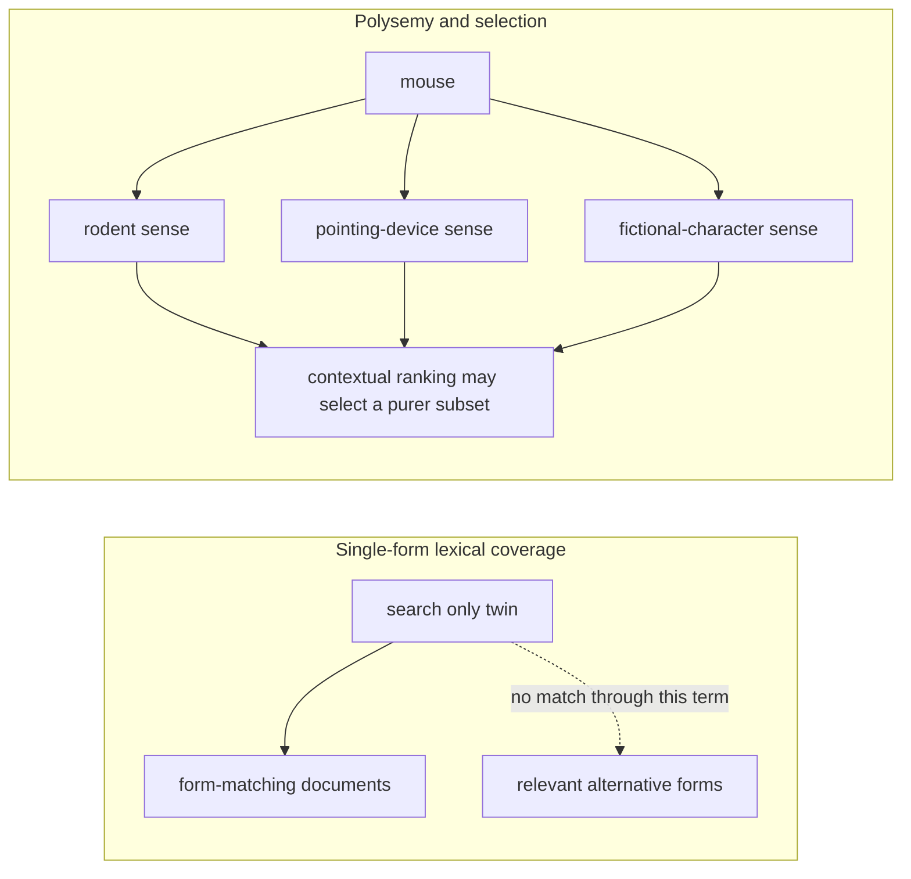
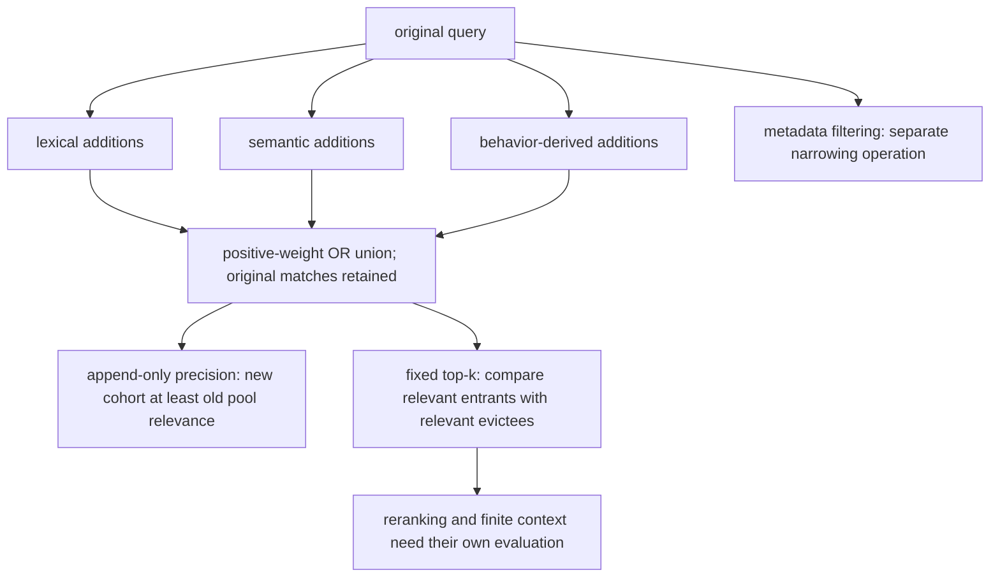
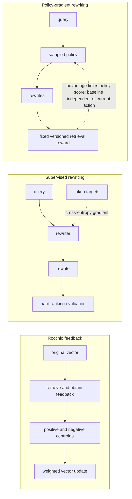
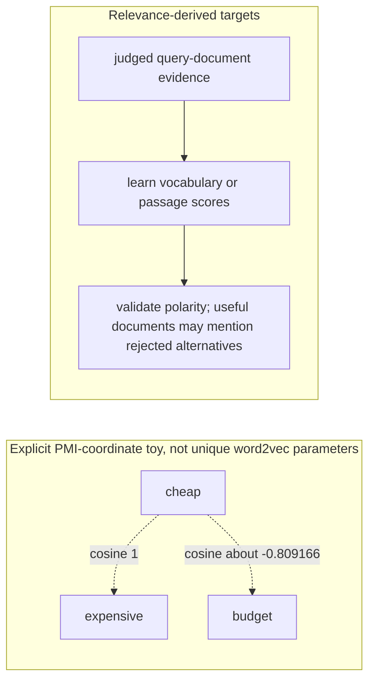
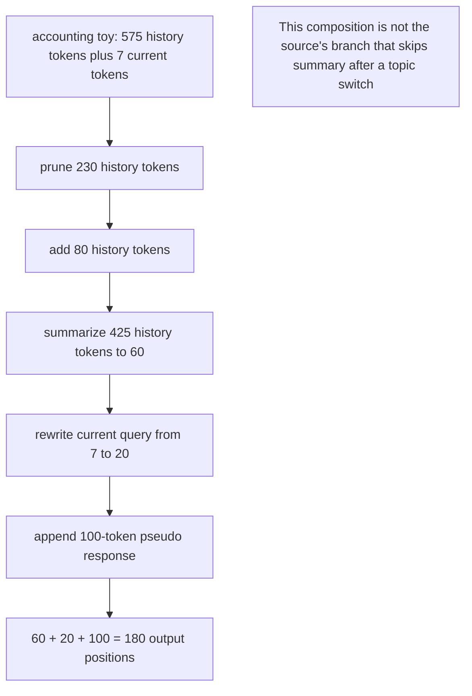
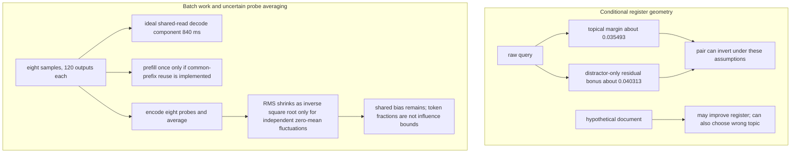

# Chapter 24: Query Reformulation
[00-START-HERE](../00-START-HERE.md) · [01-READING-ROUTES](../01-READING-ROUTES.md) · [23\_generative\_retrieval](../part-06-retrieval-ranking/23_generative_retrieval.md) · [25\_routing\_and\_adaptive\_retrieval](25_routing_and_adaptive_retrieval.md)
This chapter prepares you to explain how Retrieval-Augmented Generation (RAG) systems diagnose weak queries, expand or rewrite them, train retrieval-aware representations, repair conversational context, and search with hypothetical answers.
## TL;DR
- Diagnose misspelling, synonymy and polysemy separately. Full-pool coverage and sense purity are not universal top-$`k`$ ceilings.
- Add-only disjunctive sparse expansion preserves the unpruned admitted set under stated conditions. Fixed-size result lists can still lose recall and precision.
- In a growing pool, precision holds when the newly admitted cohort is at least as relevant as the old pool. At a fixed cutoff, compare incoming relevance with the documents evicted instead.
- Rocchio uses feedback centroids, supervised rewriting imitates targets, and REINFORCE can learn from retrieval reward with an action-independent baseline.
- Context prediction and relevance prediction are different objectives. Their relationship does not uniquely determine learned-vector cosine or guarantee that relevance training removes antonyms.
- Conversational rewriting repairs history and references; choose operations using an explicit dependency graph and measured latency rather than token counts alone.
- HyDE can provide a document-shaped probe, but topical correctness, batching gains and variance reduction need validation. Pooling does not certify a small fabrication share, and caching must meet the actual percentile target.
## The story
Imagine a librarian running a huge reference desk. A patron hands over a short request slip, and the librarian must use the catalog to find the right books before a researcher starts writing an answer.
The first slip says “twn bed.” The catalog recognizes “bed” but has no entry for “twn.” The librarian can still return bed books, yet the missing rare word removed most of the clue that distinguished the request.
Another patron writes “single bed,” while the useful books say “twin bed.” This is synonymy, which means two surface forms express the same concept. The librarian misses books that use the other wording.
A third patron writes “mouse” and means the animal. The catalog also finds books about pointing devices and Mickey Mouse. This is polysemy, which means one surface form carries several concepts. The librarian now has a precision problem instead of a recall problem.
Under add-only disjunctive sparse matching, expansion can open more catalog drawers without removing an old admitted book. That statement stops at the unpruned candidate union: a fixed first shelf can still lose a relevant book when new results displace it.
For an enlarged pool, the new books must be relevant at least as often as the old pool to preserve precision. For a fixed first shelf, compare the books arriving with those actually removed; the old shelf average is not automatically the right threshold.
Rocchio acts like a clerk who reads the first returned books and moves the request slip toward their common vocabulary. Pseudo-relevance feedback means the clerk assumes those first books are relevant without asking the patron. One off-topic book then pulls the slip in the wrong direction.
A sequence-to-sequence rewriter acts like an editor who learned to imitate better slips. It can delete, reword, correct, and resolve. Its weakness is that a beautiful imitation may not retrieve anything better because token agreement is not recall.
A reinforcement-learning rewriter acts like a trainee paid for finding the right books. The catalog cannot send a normal gradient through its sorting step, so the trainee samples new slips and learns from their retrieval rewards.
The shelf map matters too. A general word embedding is like arranging words by the sentences they usually inhabit. “Cheap” and “expensive” occupy similar sentence frames, so that map can place them together even though they express opposite needs.
Relevance training can favor terms supported by useful documents, but it does not guarantee a polarity-aware map. A good budget-laptop review may mention expensive machines to contrast them; merely appearing in a relevant document is not proof that a term is a safe expansion.
Conversation adds a stack of earlier slips and librarian replies. Blindly stapling the stack together can bury the current request, retain an abandoned topic, and leave “he” or “the company” unresolved.
The conversational librarian uses five operations. The librarian detects a topic switch, enriches terse replies, summarizes surviving history, binds references, and may append a guessed answer. The first three repair history. The last two repair the current slip.
HyDE changes the object in the librarian’s hand. Instead of searching with a question-shaped slip, the librarian drafts a hypothetical page that could answer it and searches with that page-shaped probe.
A hypothetical page may invent a detail. Averaging genuinely independent, zero-mean embedding fluctuations can reduce variance, but a short invented span is not guaranteed to have a small effect on a contextualized or normalized embedding. Shared wrong assumptions survive averaging.
The reference desk succeeds when it chooses the smallest repair that matches the failure. It corrects vocabulary gaps, disambiguates overloaded terms, learns from retrieval when labels exist, preserves a printable conversational rewrite, and pays HyDE’s generation bill only when document-shaped probing earns it.
## Decoder table

| Technical term | Plain-English meaning | Why it matters |
| --- | --- | --- |
| Retrieval-Augmented Generation (RAG) | A system that retrieves source material before generating an answer | Reformulation changes what evidence reaches the generator |
| Query reformulation | Changing the user’s query before retrieval | It repairs wording or representation failures upstream |
| Information need | The underlying concept or answer the user wants | Several query strings can express the same need |
| Concept $`c`$ | The intended meaning behind a query form | It separates meaning from spelling |
| Surface form $`f`$ | The actual word or phrase used for a concept | Indexes usually match forms rather than concepts |
| $`\Pr(F\mid C)`$ and $`\Pr(C\mid F)`$ | Document-level form coverage and matching-pool purity | Identities for full form matching, not a universal selected-subset precision bound |
| Synonymy | Different forms can describe the same need | A single searched form can miss relevant documents unless other terms or retrieval legs recover them |
| Polysemy | A form can have several senses | Full matching-pool purity can be low; contextual selection can be more precise |
| Misspelling | A query spelling with few or no corpus matches | A zero-postings term adds no match through that term, not necessarily zero overall recall |
| Lexical retrieval | Retrieval based on exact terms and their statistics | It exposes vocabulary gaps clearly |
| Inverted index | A map from each term to the documents containing it | Missing terms have no posting list |
| Posting list | The documents associated with one indexed term | Traversing more postings raises retrieval work |
| Best Matching 25 (BM25) | The stated Lucene-style nonnegative lexical score | The union proof also requires positive added weights, retained old weights and OR matching |
| Inverse document frequency (IDF) | A log rarity weight | Rarity is not relevance or proved semantic information |
| Term frequency | The count of a term inside one document | BM25 saturates its contribution |
| BM25: $`N`$, $`n_t`$, $`f_{t,d}`$, $`k_1`$, $`b`$, $`\vertd\vert`$, and $`\bar L`$ | Corpus size, document frequency, term frequency, saturation, length control and average length | Use positive lengths and a declared term/boost policy |
| Recall | Relevant returned documents divided by all relevant documents | At a filled cutoff, recall cannot exceed $`\min(k,\vertR\vert)/\vertR\vert`$ for $`\vertR\vert>0`$ |
| Precision | Relevant returned documents divided by returned documents | Undefined for an empty result without a stated convention; pool purity is not a top-k ceiling |
| Recall at $`k`$ | Recall measured within the first $`k`$ results | Expansion has no monotone guarantee at a fixed cutoff |
| Precision at $`k`$ | Relevant fraction in a declared top result list | Preservation at fixed size compares entrants with evictees, not necessarily with old mean precision |
| Candidate pool | Documents admitted before reranking or a final cutoff | Add-only sparse union can preserve this set; arbitrary reformulation need not |
| Superset property | The old unpruned positive-score set remains included | Requires the stated OR/nonnegative-weight policy, not filters or every BM25 query syntax |
| Expansion arm | One added term or retrieval variant | Arms can be ranked by relevant gain per posting scanned |
| Query $`q`$, expansion $`E`$, counts $`n`$ and $`m`$, and expanded $`q^\prime`$ | Original query, added terms, their term counts, and the issued union | They define the reformulation object and its score-mass dilution |
| Pool notation: $`D(q)`$, $`D(q^\prime)`$, $`R`$, $`a`$, $`n_D`$, $`\Delta`$, $`\rho`$, $`P`$ | Old/new sets, relevance, baseline counts and added-cohort statistics | For positive pool and addition sizes, append-only precision holds iff $`\rho\ge P`$ |
| Lexical expansion | Adding spelling, morphology, acronym, or thesaurus variants | It is cheap but weakly conditioned on intent |
| Semantic expansion | Adding entities, ontology neighbors, or intent-level subqueries | It uses meaning but can still make polarity errors |
| Signal-based expansion | Additional terms proposed from observed behavior | Clicks need bias-aware validation before treating them as true relevance labels |
| Filter signal | Metadata-based narrowing, distinct from expansion | Can improve precision without recall loss if only irrelevant items are removed |
| Query-independent global expansion | Applying one fixed expansion map to every context | Wrong senses often enter with near-zero relevance |
| doc2query | Predicting likely queries for each document before indexing | It moves expansion generation off the request path |
| Score-mass dilution | A smaller original share of the total IDF-weight budget | Old raw term contributions need not fall; changed rank is the relevant failure mode |
| Reciprocal rank fusion (RRF) | Rank-based combination of separate lists | Avoids directly adding their raw scores, not all fixed-cutoff regressions |
| Dense retrieval | Search by a query representation and document-vector similarity | Appending text changes a vector; fusion is optional, not a necessary theorem |
| Cross-encoder reranker | Joint query-candidate scoring after initial retrieval | Can improve precision but cannot recover excluded evidence without another retrieval step |
| Rocchio algorithm | A vector update toward relevant documents and away from non-relevant ones | It is the classical feedback-based reformulator |
| Rocchio: $`q_0`$, $`q_m`$, $`D_r`$, $`D_{nr}`$, $`\alpha_R`$, $`\beta_R`$, $`\gamma_R`$ | Original/modified queries, feedback sets and nonnegative centroid coefficients | Empty centroids are zero by convention before division; negative-weight clamping is implementation-specific |
| Relevant centroid | The mean vector of documents judged relevant | Rocchio pulls the query toward it |
| Non-relevant centroid | The mean vector of documents judged non-relevant | Rocchio discounts and subtracts it |
| Pseudo-relevance feedback (PRF) | Treating top retrieved documents as if they were relevant | It removes label needs but can cause query drift |
| Query drift | Feedback shifts a query toward unhelpful coordinates | Centroid weights are linear in a fixed mixture; rank damage need not be linear or inevitable |
| Sequence-to-sequence rewriting | Generating a new query string from the original query | It can delete, reword, and resolve rather than only add |
| GenQR and GenPRF | The two weakly supervised generation systems named by the source | They mine rewrite targets from co-retrieval behavior |
| Weak supervision | Mining approximate labels from existing retrieval behavior | It avoids paying for reference rewrites at scale |
| Co-retrieval overlap | Similarity based on shared top-ranked documents | It can identify paraphrase-like query pairs |
| Cross-entropy | Token-level loss against a reference rewrite | It may improve while retrieval recall stays flat |
| Retrieval objective mismatch | Training on text imitation while shipping a ranking metric | It motivates direct retrieval reward |
| Argsort | Hard ranking indices from document scores | No useful ordinary pathwise rank gradient almost everywhere; expected policy reward can still be differentiable |
| Reinforcement learning (RL) | Learning from rewards produced by sampled actions | It can optimize a retrieval metric without differentiating the index |
| REINFORCE | The score-function policy-gradient estimator used here | It routes sampled retrieval reward into rewriter parameters |
| Policy | The probability distribution over rewritten queries | Sampling from it creates reward-bearing rewrites |
| Rewriter $`q^*`$, parameters $`\theta`$, reward $`R(q^\prime)`$, and sample count $`m`$ | Target rewrite, trainable policy, retrieval score, and sampled candidates | They distinguish supervised imitation from retrieval-reward learning |
| Reward baseline $`b(q_0)`$ | A reference value independent of the current sampled action conditional on the query | A valid fixed baseline preserves the expected policy gradient; a same-sample mean is generally biased |
| Long short-term memory (LSTM) | A recurrent sequence model used for long dependencies | The cited generation reformulator uses it instead of a plain recurrent model |
| Normalized discounted cumulative gain (nDCG) | Discounted relevance in the ranked list | Rewards head order; fixed-k recall is already sensitive to irrelevant occupancy |
| Mean reciprocal rank (MRR) | The reciprocal rank of the first relevant result, averaged over queries | It exposes head-ranking regressions |
| Bilingual Evaluation Understudy (BLEU) | A reference-overlap score for generated text | The source rejects it as the primary retrieval reward |
| Kullback-Leibler (KL) penalty | A penalty comparing the new and reference policies | Can limit policy drift, not guarantee readability or intent preservation |
| word2vec | A word embedding trained from nearby context words | Its objective can place antonyms together |
| Skip-gram with negative sampling | The word2vec objective used in the derivation | It learns context predictability rather than relevance |
| Pointwise mutual information (PMI) | Log conditional-to-marginal context ratio | The SGNS PMI shift needs marginal negative sampling and an ideal scalar-score optimum |
| Embedding notation: $`w`$, $`c`$, $`D`$, $`k`$, $`P_n`$, $`\sigma`$, $`V`$, $`R_q`$, $`\hat p`$, $`p^{\mathrm{ML}}`$, $`\lambda`$ | Center/context words, pair data, negative distribution and relevance targets | Raw hidden dot products are scores, not normalized vocabulary probabilities |
| Context distribution | A word's conditional context law | Equal laws give equal target score rows, not uniquely identical learned vectors or cosines |
| Antonym inversion | Adding an opposite term as a semantic neighbor | It can reverse the user’s intent and ranking |
| Relevance-based word embedding | Representation learned from relevant-document evidence | An objective change that still needs polarity and intent checks |
| Relevance distribution | A declared term distribution in judged useful documents | Relevant documents can mention opposite or negated concepts |
| Maximum-likelihood baseline | Normalized query-term frequency for a nonempty query | Mix with a normalized learned distribution; query retention alone does not guarantee top-k quality |
| Interpolation weight $`\lambda`$ | Weight between two normalized vocabulary distributions | Use $`0\le\lambda\le1`$; otherwise the mixture need not be a probability law |
| Dense Passage Retrieval (DPR) | Passage relevance-pair retriever reported in the source | Reported hit-at-twenty is not generic document recall or proof of a word-expansion guarantee |
| Sparse Lexical and Expansion (SPLADE) | The learned sparse expansion model named by the source | It is one possible relevance-based expansion scorer |
| Polarity regression set | Queries whose meaning flips under one token substitution | It catches antonym expansion failures |
| Conversational query | A query whose meaning depends on earlier turns | It often contains unresolved references |
| Dialogue: $`C_{t-1}`$, $`q_i`$, $`r_i`$, $`q_t`$, $`q_t^*`$ | An ordered dialogue sequence, current query and standalone rewrite | An ambiguous referent should not be silently converted into an unsupported certainty |
| CHIQ | The source’s 2024 five-operation conversational-rewriting line | It separates history repair from current-query repair |
| Standalone query | A text query that contains enough context without the transcript | It works with sparse, dense, and hosted retrievers |
| Bidirectional Encoder Representations from Transformers (BERT) | The encoder family used for an illustrative tokenizer limit | Capacity, reserved tokens and truncation policy depend on the actual version and configuration |
| Topic switch detection | Estimate where the dialogue topic changed | Can gate later operations, which puts the decision on their critical path |
| Response expansion | Enriching terse or truncated prior answers | Later operations get denser history material |
| History summary | Compressing surviving history to salient content | It controls token dilution |
| Question disambiguation | Replacing pronouns and vague references with explicit entities | The retriever receives content-bearing terms |
| Pseudo response | A hypothesized answer appended to a query | It supplies answer-side vocabulary |
| Oracle rewrite | A target written while the gold passage is visible | It supplies silver supervision unavailable at inference |
| Iterative retrieval | Multiple retrievals used to discover intermediate facts | It solves a different problem from conversational rewriting |
| Approximate nearest-neighbor (ANN) lookup | Fast vector search over a large index | Rewriting latency is paid before this lookup |
| Graphics processing unit (GPU) | The device in the resource-work assumptions | Weight streaming can dominate in a stated regime; a parameter count alone does not prove latency |
| Key-value (KV) cache | Stored attention state for generated tokens | Batched HyDE samples consume it |
| Hypothetical Document Embeddings (HyDE) | Generate a passage-like probe, embed it and retrieve | Can improve register alignment but can choose an incorrect topic |
| LameR | The cited comparison of query rewriting with pseudo-answer generation | It reports richer pseudo-answer semantics winning the comparison |
| Frequently asked questions (FAQ) | Documents written in question-and-answer form | Their question register can attract a raw query for the wrong reason |
| Contriever | The zero-shot dense encoder in the source example | It was trained on document-document crops, not questions |
| Query register | The linguistic shape of a question | It can create similarity to question-shaped documents |
| Document register | The linguistic shape of corpus passages | HyDE generates this shape before embedding |
| HyDE geometry: $`u`$, $`\gamma`$, $`\bar s_{qd}`$, $`\bar s_{dd}`$ | A conditional unit-vector geometry and illustrative similarity means | The ratio identifies a coefficient only with matched topical expectations |
| Probe notation: $`n`$, $`L`$, $`m`$, $`h_i`$, $`\bar h`$ | Unit residual, positions, sample count and probe embeddings | Position fractions and covariance models are different quantities |
| Register bonus $`\phi`$ and candidates $`d^-`$ and $`d^+`$ | Residual alignment and a distractor/relevant pair | A difference in residual bonuses can overwhelm a topical margin under the toy assumptions |
| Mean pooling | Average token representations | A norm perturbation bound needs bounded fixed-vector changes; token fractions alone do not bound influence |
| Sample averaging | Average multiple generated-document embeddings | Independent zero-mean fluctuations shrink in RMS; shared bias remains and final normalization is nonlinear |
| query2doc | Combine an original query with generated passage text | Can retain lexical anchors, but appending text does not guarantee preserved ranking |
| Distillation | Fit a serving encoder to teacher probes offline | Moves generation cost into data/training; student retrieval quality needs validation |
| Hierarchical navigable small world (HNSW) | The source's graph-search planning component | Five milliseconds is stipulated here, not an independently reproduced measurement |
| Remote procedure call (RPC) | Networked service work | Use a consistent allowance in both compared paths and price extra generator-service calls separately |
| 95th-percentile latency (p95) | The smallest latency bound whose CDF reaches at least ninety-five percent | A point service-time proxy or sixty-percent cache hit rate does not establish the percentile |

## Core mechanics
### Mathematical conventions
Use natural logarithms and decimal storage units: $`1\,\mathrm{GB}=10^9\,\mathrm B`$ and $`1\,\mathrm{TB}=10^{12}\,\mathrm B`$. Retain full precision until rounding. An IDF is a log weight, not information gain proved by the model; an IDF-weight share is not a probability or semantic importance measure. Percentage points denote absolute changes between percentages.
Define recall and precision on a stated document population, relevance set and returned set. Full admitted-pool metrics differ from top-$`k`$ metrics. The add-only expansion proof assumes positive-weight disjunctive term matching, unchanged original weights and no new mandatory clauses, filters, pruning or cutoff. It does not cover arbitrary query rewriting or dense-vector displacement. Pool sizes count unique documents; posting work counts processed list entries, which can overlap.
The lodging example distinguishes standard BM25 OR scoring from a separate strict seed arm. To make its pool arithmetic well defined, the seed arm and broad single/cot expansion arms are an explicitly disjoint toy, not a consequence of the reported document frequencies. The support-search example additionally assumes exactly four relevant documents per query; multiplying average recall by average relevant-set size is not valid in general.
Rocchio omits an empty feedback centroid before division. REINFORCE uses a fixed reward/index, a differentiable policy and a baseline independent of the current sampled rewrite conditional on the original query; the baseline is treated as fixed during the policy-gradient update. The SGNS derivation is an unconstrained scalar-score optimum; its familiar PMI shift needs the negative distribution to equal the context marginal. Learned embedding cosines are not uniquely determined by that factorization.
The resource estimates stipulate full weight streaming and exclude attention, KV traffic, kernels, communication, queues and deployment overhead unless named. The conversational scenario uses $`1.4\times10^{12}\,\mathrm{B/s}`$ effective bandwidth and $`10^4\,\mathrm{prompt\ tokens/s}`$. HyDE separately uses $`2.0\times10^{12}\,\mathrm{B/s}`$, $`1.56\times10^{14}\,\mathrm{FLOP/s}`$ generation compute and $`5.0\times10^{13}\,\mathrm{FLOP/s}`$ encoder compute. Count a multiply-accumulate as two FLOPs. These are planning inputs, not reproduced device measurements. A critical path needs a declared dependency graph; a service-time estimate is not a measured p95 or capacity guarantee.
HyDE geometry, pooling perturbations and sampling variance are separate models. Token fractions do not bound normalized embedding influence or hallucination probability. A $`1/\sqrt m`$ RMS reduction requires independent zero-mean fluctuations around a fixed mean; shared bias remains. Batch amortization requires matched compute, prefix handling and KV capacity. Cache-hit rate must be evaluated against the latency distribution, not substituted for a p95 calculation.
### 24.1 Why queries fail: misspelling, synonymy, polysemy
**What it is.** Fix a uniformly sampled document from the evaluation population. Let $`C`$ mean that it is relevant to concept $`c`$, and let $`F`$ mean that it contains the searched form $`f`$. This makes the two conditionals comparable; mention-level form frequencies would require a different sampling model.

$$
\Pr(F\mid C)=\text{fraction of relevant documents containing the form}
$$

$$
\Pr(C\mid F)=\text{relevant fraction of all form-matching documents}
$$

Searching only that form admits set $`D_f`$. For nonempty relevant and matching sets, its full-pool metrics are identities. A selected subset $`S\subseteq D_f`$ has a recall ceiling, but its precision can exceed the pool average:

$$
\mathop{\mathrm{Recall}}\nolimits(D_f)=\Pr(F\mid C),\qquad \mathop{\mathrm{Recall}}\nolimits(S)\le\Pr(F\mid C).
$$

$$
\mathop{\mathrm{Precision}}\nolimits(D_f)=\Pr(C\mid F),\qquad \mathop{\mathrm{Precision}}\nolimits(S)\text{ need not be bounded above by }\Pr(C\mid F).
$$

Bayes connects the conditionals, but it does not make them move together.

$$
\Pr(C\mid F)=\frac{\Pr(F\mid C)\Pr(C)}{\Pr(F)},\qquad \Pr(F)>0.
$$

The marginal $`\Pr(F)`$ is not independent of the other quantities, but can vary across corpora and forms. A common form can have broad concept coverage and low pool purity. The source uses “single” as a bed-related example: other senses can dominate its matching pool, while a contextual ranker can still select a high-precision subset.
**Why it exists.** Synonymy can leave relevant documents outside a single-form pool; polysemy can add other senses. A zero-postings typo contributes no lexical match through that term. Other query terms, correction rules or a fallback retriever may still retrieve relevant documents; this is not a universal zero-recall claim.
**Failure without diagnosis.** One generic synonym lever can raise recall while lowering every shallow quality measure. Dense retrieval absorbs synonymy, but it does not structurally remove polysemy. A short query supplies little context for sense resolution.
Dense retrieval also changes observability. A lexical index exposes a zero-postings term. A dense encoder can return high-similarity but irrelevant neighbors; similarity is not a calibrated confidence. A document with $`400`$ tokens may supply more sense context than a one-token query. The chapter reports Zhuang and Zuccon (2021) finding degradation on typo-perturbed BERT retrieval/ranking tasks and recovery from typo-aware training, not a guarantee for every encoder.
**Cost and complexity.** A missing rare term can remove most query discrimination. Lucene’s IDF formula in the source is:

$$
I(t)=\ln\!\left(1+\frac{N-n_t+0.5}{n_t+0.5}\right)=\ln\frac{N+1}{n_t+0.5}.
$$

For $`N = 10^{7}`$ chunks, $`n(\mathrm{bed}) = 10^{5}`$, and $`n(\mathrm{twin}) = 10^{4}`$:

$$
I(\mathrm{bed})=\ln\frac{10{,}000{,}001}{100{,}000.5}\approx4.605165286.
$$

$$
I(\mathrm{twin})=\ln\frac{10{,}000{,}001}{10{,}000.5}\approx6.907705380.
$$

The two IDF weights sum to $`11.512870666`$. Keeping only bed retains $`4.605165286`$ and removes about $`59.999852\%`$ of that weight sum. This is not an entropy decomposition or a proved fraction of semantic discrimination. The smoothed values are only approximately $`\ln100`$ and $`\ln1000`$.
BM25’s term-frequency factor is:

$$
F(f,\ell_d)=\frac{f(k_1+1)}{f+k_1(1-b+b\ell_d)},\qquad \ell_d=\frac{|d|}{\bar L}.
$$

Take $`k_1=1.2`$, $`0\le b\le1`$, positive document lengths and positive average length. For $`f>0`$ and positive length factor, $`F(f,\ell_d)<2.2`$ and tends to $`2.2`$ as $`f`$ grows. A bed-only document therefore has score below $`10.131363629`$. An average-length document with each of bed and twin once scores $`11.512870666`$, about $`13.635944\%`$ above that supremum. In this declared two-term example, stuffing bed alone **cannot** overtake that reference document. Different lengths, boosts or extra query terms require a new comparison.
#### Worked lodging example
The index has $`N = 10^{7}`$ chunks. Posting counts are $`n(\mathrm{bed}) = 10^{5}`$, $`n(\mathrm{twin}) = 10^{4}`$, $`n(\mathrm{single}) = 3 \times 10^{5}`$, and $`n(\mathrm{cot}) = 9 \times 10^{4}`$.
The relevant set contains $`1{,}000`$ chunks: $`550`$ use twin bed, $`300`$ use single bed without twin, and $`150`$ use cot without bed or twin. These are assumed relevance groups. For the next OR-scoring comparison, additionally suppose all $`10{,}000`$ twin documents also contain bed, and every twin-bed document has average length with each query term once. Document frequencies alone do not imply these intersections or term frequencies.
With twn bed, the typo has no postings, leaving the $`100{,}000`$-document bed pool with $`850`$ relevant items. If its top one hundred is a relevance-independent uniform sample, expected true positives are $`100(850/100{,}000)=0.85`$, so expected $`\mathop{\mathrm{Recall}}\nolimits@100=0.00085=0.085\%`$. This is a sampling assumption, not a prediction from BM25 or document frequencies alone.
After correction, ordinary two-term OR BM25 still admits the same bed pool in this containment toy, with full-pool recall $`85\%`$. The stipulated twin-bed matches outrank bed-only matches by the score bound above. With uniform tie-breaking among the $`10{,}000`$ twin-bed documents, expected top-one-hundred true positives are $`100(550/10{,}000)=5.5`$, so recall is $`0.55\%`$, about $`6.47`$ times the typo expectation. Any top-one-hundred list has recall at most $`100/1{,}000=10\%`$, not $`55\%`$; even its best possible ratio to the typo expectation is about $`117.65`$, not three orders of magnitude.
A **different** policy can use a mandatory twin-and-bed seed arm. Its $`10{,}000`$ candidates contain $`550`$ relevant chunks: full-pool recall $`55\%`$ and precision $`5.5\%`$. These are admitted-pool metrics, not recall or a precision ceiling at one hundred. In a positive-score-only retriever, zero-score items are excluded; a system that fills with zero-score ties or another retrieval leg can still return them.
For a separate, explicit disjoint-arm expansion toy, keep that strict seed and add broad single and cot arms with $`300{,}000`$ and $`90{,}000`$ candidates. Assume these arms are mutually disjoint, with $`300`$ and $`150`$ newly relevant items. The logical policy is `(twin AND bed) OR single OR cot`; it is not the narrower `(single AND bed)` branch. Then the full union has $`400{,}000`$ candidates and contains all $`1{,}000`$ relevant items. Candidate-count work is forty times the seed only under equal per-candidate costs. Without the disjoint assumption these counts are an upper bound, and actual posting scans, overlaps and Boolean execution must be measured.
This disjoint full pool has precision $`1{,}000/400{,}000=0.25\%`$, which is twenty-two times lower than the seed pool, and recall $`100\%`$, about $`1.81818`$ times the seed recall. Neither ratio predicts fixed-cutoff ranking quality or a wall-clock scoring bill.
The cot arm adds $`150/90{,}000\approx1.666667\times10^{-3}`$ relevant items per candidate; single adds $`300/300{,}000=10^{-3}`$. In the disjoint toy, seed plus cot has $`100{,}000`$ candidates, recall $`70\%`$ and precision $`0.70\%`$. This is $`2.8`$ times full-union precision at one quarter its candidate count. Overlap, filter costs and execution strategy can change an arm's marginal gain per posting scanned.
The same smoothed formula gives $`I(\mathrm{single})\approx3.506556331`$ and $`I(\mathrm{cot})\approx4.710525246`$, both below $`I(\mathrm{twin})\approx6.907705380`$. The rounded ratios inside a logarithm should not be restated as exact identities. A rare off-sense term can carry a high IDF because rarity is not correctness.
Furnas et al. (1987) found that two people spontaneously chose the same term for the same object less than 20 percent of the time across five domains. The source therefore calls its assumed 55 percent dominant-form share generous. It does not present 55 percent as a measurement.
#### Practical decisions and limits
Correct spelling against the index vocabulary rather than a general dictionary. Fold spelling variants at index time if dirty documents have created postings for misspellings.
Measure the single-form recall ceiling. Buy expansion arms by relevant gain per posting scanned. In recall-mandatory domains, the full pool may be required and precision becomes the reranker’s problem.
Cap the weight of a synonym that is rarer than its source term. Make an exception only for a genuine single-sense domain identifier.
For a stable corpus, doc2query-style document expansion from Nogueira et al. (2019) amortizes generation and indexing over future queries. Prefer query-time work when the corpus changes faster than reindexing or when the gap comes from user jargon.
Route polysemy to disambiguation. Distinct result clusters can motivate diversification or a clarifying question. When interaction is unavailable, use available metadata, an intent model, abstention or diversification; diversification is not the only remaining option and has no universal precision guarantee.
An illustrative twelve-token RAG question supplies more context than a one-word query, but its effect on sense resolution and typo sensitivity must be tested. Adding low-IDF function words does not divide or reduce the original terms' raw BM25 contributions. It can change a normalized weight share, matching, query processing or truncation; these are separate mechanisms.
### 24.2 Expansion: lexical, semantic, signal-based
**What it is.** Let $`q`$ be the original term set and $`E`$ a set of $`m`$ additional distinct terms not already in its $`n`$ terms. Write $`q^\prime=q\cup E`$. Define $`D(q)=\{d:s(q,d)>0\}`$ before cutoffs, filters or approximate pruning, and let $`R`$ be the fixed, nonempty relevance set. Bag weights and repeated query terms need an explicit scoring policy.
Lexical expansion conditions $`E`$ on word form. It includes thesaurus synonyms, morphology, acronyms, and spelling corrections.
Semantic expansion conditions $`E`$ on query meaning. It includes entity links, ontology neighbors, and generated subqueries.
Signal-based expansion uses observed behavior such as co-clicked or same-session queries. Metadata filtering is a distinct narrowing operation, not an add-only expansion arm.
**Why it exists.** Under the positive Lucene-style IDF above, nonnegative additional term weights, retained original weights and disjunctive matching, $`s(q^\prime,d)\ge s(q,d)`$. Thus every old positive-score candidate remains admitted. Mandatory new clauses, negative boosts, filters, query-length normalization, pruning and a returned top-$`k`$ list need not preserve this set.

$$
D(q) \subseteq D(q^\prime)
$$

$$
\lvert D(q^\prime)\cap R\rvert \ge \lvert D(q)\cap R\rvert
$$

These inclusions prove only unpruned admitted-set recall monotonicity for $`|R|>0`$. They do not imply fixed-cutoff or dense-retrieval monotonicity.
**Failure without precision accounting.** Let $`a=|D(q)\cap R|`$ and $`n_D=|D(q)|>0`$, so $`P=a/n_D`$. For a genuine add-only expansion, let $`\Delta=|D(q^\prime)\setminus D(q)|>0`$ and let $`\rho`$ be the newly admitted cohort's relevant fraction. This denominator excludes overlaps with old candidates.

$$
P^\prime = \frac{a+\rho\Delta}{n_D+\Delta}
$$

The precision break-even is:

$$
P^\prime-P=\frac{\Delta(\rho-P)}{n_D+\Delta},\qquad P^\prime\ge P\ \Longleftrightarrow\ \rho\ge P\quad(n_D>0,\ \Delta>0).
$$

The sign test is independent of the positive expansion size, although the magnitude of the precision change is not. If $`\Delta=0`$, precision is unchanged and the relevance fraction of an empty added cohort is undefined. If the baseline pool is empty, its precision needs a declared convention; this derivation does not divide by zero.
Lexical, semantic and behavioral expansion can have different relevance rates, but no universal ordering follows from their names. Click relevance needs evaluation for position, exposure and selection bias. For a filter, precision improves only when the removed cohort is less relevant than the original pool; a perfectly targeted filter can remove only irrelevant items and lose no recall.
Global query-independent expansion often admits the wrong sense with $`\rho`$ approximately zero. Voorhees (1994) found WordNet relations helped only the shortest Text Retrieval Conference (TREC) topics and degraded the rest. Xu and Croft (1996) found locally drawn expansion terms beat global corpus terms. The source limits these claims to the reported settings.
**Cost and complexity.** With equal mean IDF, equal term weights and a common term-frequency factor, the original terms have fraction $`n/(n+m)`$ of the total IDF-weight budget. More generally use the ratio of weighted IDF sums. A common BM25 saturation factor cancels in that ratio, but the budget is neither a confidence nor each document's actual score. Added terms do not reduce the old terms' raw contributions; they can change relative ranks.
Down-weight additions with $`0\le\alpha_E<1`$, or retrieve variants separately and fuse their lists with RRF. Fusion avoids directly summing incomparable variant scores but does not guarantee preserved top-$`k`$ quality. Appending dense-query text can move its embedding in either a useful or harmful direction; fusion is an option, not a mathematical requirement.
The admitted-set guarantee does not imply recall at $`k`$. With filled lists of the same size and fixed relevance set, let $`g`$ be relevant entrants and $`\ell`$ relevant evictees. Then

$$
P_k^\prime-P_k=\frac{g-\ell}{k},\qquad
R_k^\prime-R_k=\frac{g-\ell}{|R|}.
$$

The correct non-degradation test is $`g\ge\ell`$, or entrant relevance rate at least the evicted cohort's rate when both cohorts have the same positive size. It is not automatically $`\rho\ge P_k`$. Evidence at one thousand results does not establish quality at five.
#### Worked support-search example
The illustrative corpus has $`2\times10^6`$ chunks. For the following conversion assume **exactly four** relevant chunks for every query, not merely four on average, and filled lists of size $`k`$. Mean recall at five is $`0.31`$ and at fifty is $`0.58`$. With varying relevant-set sizes, macro mean recall times mean relevant count need not equal mean true positives.
For rotate signing certificate, the stipulated IDFs are $`4.1`$, $`5.3`$ and $`3.8`$, summing to $`13.2`$, with mean $`4.4`$. Call this an IDF-weight budget. It equals the three-term score only for average-length documents matching each term once, without other matching terms.
Twelve distinct full-weight additions—rotation, renew, renewal, cert, certs, certificates, sign, signed, signature, key, credential and x509—have stipulated mean IDF $`4.4`$. Their budget is $`12(4.4)=52.8`$, and the original share is $`13.2/(13.2+52.8)=20\%`$. The ratio says nothing by itself about relevance or achievable probability mass.
Compare average-length documents with once-per-term matches: an expansion-only document matching five additions of IDF $`4.4`$ scores $`22.0`$; one matching all three originals and no addition scores $`13.2`$. These explicit term-frequency and length assumptions produce the rank inversion; a count of matching terms alone is insufficient.
At $`\alpha_E=0.3`$, that expansion-only document scores $`6.6`$. The weighted budget is $`13.2+0.3(52.8)=29.04`$, so the original share is $`45.454545\%`$. The original-match document now leads this pair. This is not a general ranking guarantee.
At $`k=50`$, the constant-four assumption gives mean true positives $`4(0.58)=2.32`$ and mean precision $`2.32/50=0.0464=4.64\%`$. This is the append-only break-even rate if such a list is treated as a pool and new results are simply added; it is not a fixed-fifty replacement gate.
At $`k=5`$, mean true positives are $`4(0.31)=1.24`$ and mean precision is $`24.8\%`$. This is about $`5.344828`$ times the deep-list average. At either fixed cutoff, measure the relevant items actually gained and lost; an incoming rate above the old average can still hurt if it evicts an even more relevant cohort.
The stipulated traversal counts are $`240{,}000`$ original postings and $`1.9\times10^6`$ additional list entries. At a constant $`40\times10^6\,\mathrm{postings/s}`$, service-work components are $`6.0\,\mathrm{ms}`$ and $`53.5\,\mathrm{ms}`$, ratio $`8.916667`$. Overlapping lists still incur entries if actually traversed, but these are not $`2.14\times10^6`$ distinct documents in a $`2\times10^6`$-chunk corpus. Skipping, cache locality, query planning and reranking can alter real work and latency.
Twenty serial variants each costing the stipulated $`6.0\,\mathrm{ms}`$ sum to $`120\,\mathrm{ms}`$ of retrieval work. Parallel fan-out and caching can reduce elapsed time but consume capacity and add tail/coordination effects. The source's historical roughly twenty-backend web-search comparison is reported context, not a benchmark reproduced here.
#### Practical decisions and limits
Expand into a sufficiently broad, measured candidate pool before reranking rather than directly feeding five documents to generation. The worked list averages are $`4.64\%`$ at fifty and $`24.8\%`$ at five, not fixed-cutoff entrant thresholds. The source suggests one hundred candidates, but supplies neither its recall nor the evicted cohort's relevance; no one-hundred-result precision gate follows from those numbers.
Start around $`\alpha_E=0.3`$ only as a tunable addition-weight heuristic. A spelling correction replaces a form rather than adding a sense; validate that it preserves the intended identifier or name before giving it full weight.
With traffic, mine co-click and same-session variants over a rolling 30-day window. The source proposes roughly 20 sessions as minimum support. Without logs, use whole-query semantic expansion rather than isolated nearest neighbors.
Start with one weighted sparse query if it suits the failure. Compare list fusion when variants represent different intents or an appended dense query harms its original representation; neither fusion nor a cross-encoder guarantees every query improves.
Route known-item queries such as part numbers, error codes, versions, and filenames around expansion. Treat a documented alias such as x509 and X.509 as a spelling correction.
For $`2\times10^6`$ chunks, three predicted queries of sixty generated tokens require $`360\times10^6`$ output tokens. At $`10^4\,\mathrm{tokens/s}`$ this is ten ideal GPU-hours. Online expansion of $`10^6`$ queries/day at forty output tokens each is $`40\times10^6`$ tokens/day, or $`1.111111`$ GPU-hours/day. Under matched rates and a static corpus, the output-generation-only payback is **nine days**, excluding input tokens, ingestion/index updates, storage, caching and changing-corpus refresh costs. This is not a complete cost or latency comparison.
### 24.3 Rewriting: Rocchio to sequence-to-sequence to reinforcement learning
**What it is.** The three generations differ in their learning signal.
Rocchio’s 1971 algorithm moves a query vector using judged documents.

$$
\begin{aligned}
\bar d_A&=\begin{cases}|A|^{-1}\sum_{d\in A}\vec d,&|A|>0,\\0,&|A|=0,\end{cases}\\
\vec q_m&=\alpha_R\vec q_0+\beta_R\bar d_{D_r}-\gamma_R\bar d_{D_{nr}}.
\end{aligned}
$$

The source reports Manning et al. (2008) recommending $`\alpha_R=1`$, $`\beta_R=0.75`$, $`\gamma_R=0.15`$. The negative centroid coefficient is one fifth of the positive one; actual term effects also depend on the centroid values. Positive-only PRF can treat the top ten as relevant and set $`\gamma_R=0`$. Omit an empty centroid before division rather than writing zero times an undefined fraction. Sparse implementations often clamp negative weights; specify that policy.
Supervised sequence-to-sequence training maps original $`q_0`$ to target $`q^*`$. Wang et al. (2023) mine weak pairs for their GenQR and GenPRF systems. Two queries are paired when their top-ranked documents overlap substantially. The more effective query becomes the target, and stopwords are removed. Their ablation found all three filters together beat any subset.
Their contextual variant concatenated feedback documents into the generation prompt. It helped on only one dataset, and only the instruction-tuned model benefited there. The source does not claim that more prompt context generally helps.
The supervised token objective is:

$$
L = -\sum_t \log p_\theta(q_t^* \mid q_{<t}^*,q_0)
$$

The shipped metric is $`R(q^\prime) = \mathrm{Recall}@k`$ for the rewritten query. Similar token loss can hide large recall differences because one discriminative term moves documents across the cutoff.
A hard ranking metric is piecewise constant in continuous document scores away from ranking boundaries, so its ordinary pathwise derivative there is zero. Rewritten token strings are discrete, so a derivative with respect to their string value is not defined. Neither fact makes the expected reward gradient with respect to the sampling policy zero. Differentiable ranking surrogates are another possible approach.
REINFORCE treats the rewriter as policy $`p_\theta(q^\prime\mid q_0)`$ and uses the score-function estimator.

$$
\begin{aligned}
J(\theta)&=\mathbb E_{q^\prime\sim p_\theta(\cdot\mid q_0)}[R(q^\prime)],\\
\nabla_\theta J&=\mathbb E\!\left[(R(q^\prime)-b(q_0))\nabla_\theta\log p_\theta(q^\prime\mid q_0)\right],\\
\hat g&=\frac1m\sum_{i=1}^m(R(q_i^\prime)-b(q_0))\nabla_\theta\log p_\theta(q_i^\prime\mid q_0),\\
\theta&\leftarrow\theta+\eta\hat g,\qquad \eta>0.
\end{aligned}
$$

For the fixed reward/index, suitable support/differentiability and expectation-interchange conditions, this score-function estimator does not differentiate the index. An action-independent baseline has zero expected score contribution. A past running mean or leave-one-out baseline can satisfy that condition. Subtracting the **same sampled batch's** reward mean instead yields expected gradient factor $`1-1/m`$ for IID samples; at $`m=8`$ the factor is $`0.875`$. Stop gradients through a learned baseline in this policy-gradient term; it can have a separate fitting loss. Variance reduction depends on the baseline, not every constant being better.
Nogueira and Cho (2017) implement a term-selection model that keeps candidate terms above a probability threshold and a sequence-generation model that decodes with an LSTM. Both use REINFORCE against retrieval reward. They report that the RL reformulator beat supervised learning on the same task.
**Why it exists.** Rocchio offers a no-training baseline. Sequence generation can delete, reword, correct, and resolve. RL aligns the learning signal with the metric the system reports.
**Failure without objective alignment.** Positive-only Rocchio PRF with $`\alpha_R=1`$ and nonnegative feedback can only add coordinate weight, so it does not remove the original typo. It can still add a correct spelling, an explicit entity or a new term found in feedback. Classical negative feedback can reduce or remove coordinates, and changing $`\alpha_R`$ can attenuate the original query. None of these vector operations by itself guarantees intent-preserving, grammatical reference resolution or detects that an assumed-positive document is off topic.
Supervised rewriting can fit one reference while retrieval stays flat. A raw admitted-count or unrestricted recall reward can favor overbroad queries, but fixed-$`k`$ recall already penalizes irrelevant occupancy and cannot be increased merely by enlarging an unranked pool. Add nDCG or MRR when order within the returned list matters, and validate constraints and relevance labels to avoid reward artifacts.
Conversational rewriting can be well suited to supervised learning when trustworthy standalone targets exist. That is a task/data argument, not a theorem that supervised training wins or that dialogue annotations alone guarantee retrieval effectiveness.
**Cost and complexity.** Retrieval reward requires sampled queries, repeated index calls, and a frozen versioned index. A changing corpus changes the reward function during training.
#### Worked PRF example
The query “reset token expiry” starts with unit weight on each term. PRF takes the top 5 documents.
Each on-topic document has weights reset $`0.4`$, token $`0.8`$, expiry $`0.6`$, session $`0.5`$, firmware $`0.0`$. One off-topic router document has reset $`0.9`$, firmware $`0.8`$, and zero for the other terms.
With four on-topic and one off-topic document, the centroid is $`(0.500,0.640,0.480,0.400,0.160)`$. With $`\alpha_R=1`$, $`\beta_R=0.75`$, $`\gamma_R=0`$, weights are $`(1.375,1.480,1.360,0.300,0.120)`$ and sum to $`4.635`$. These are coordinate weights, not calibrated relevance probabilities.
Session contributes $`0.300/4.635\approx6.472492\%`$ of the coordinate-weight sum; firmware contributes $`0.120/4.635\approx2.588997\%`$. Term normalization, query boosting and document scoring determine their downstream effect.
With three on-topic and two off-topic documents, the centroid is $`(0.600,0.480,0.360,0.300,0.320)`$. Weights become $`(1.450,1.360,1.270,0.225,0.240)`$, summing to $`4.545`$.
Firmware now has $`0.240/4.545\approx5.280528\%`$ of the weight sum and exceeds session's $`0.225`$, about $`4.950495\%`$. The second bad document reverses this coordinate ordering. It does not prove that ranking damage is linear in feedback impurity or that every additional bad document worsens the output.
Training on $`100{,}000`$ queries with eight rewrites over three epochs issues $`2.4\times10^6`$ retrieval calls. At a constant $`20\,\mathrm{ms/call}`$ the aggregate serial work is $`48{,}000\,\mathrm s=13.333333\,\mathrm h`$. Ideal thirty-two-way execution takes twenty-five minutes only if the index and clients sustain that concurrency without extra overhead or slowdown. Policy generation, updates and evaluation are not included.
If weak-supervision mining needs only one hundred thousand calls, its index-call count is twenty-four times lower and serial index time is $`33.333333`$ minutes. That ratio is not total training cost. PRF's two serial index calls sum to $`40\,\mathrm{ms}`$ before feedback extraction. A sixteen-token rewrite at $`250\,\mathrm{tokens/s}`$ adds $`64\,\mathrm{ms}`$; one index call gives a partial $`84\,\mathrm{ms}`$, excluding prompt prefill and other serving overhead.
The source anchors these volumes against web search fan-out of roughly twenty retrievals inside a few hundred milliseconds. It identifies index freezing, not call volume alone, as the distinctive RL burden.
#### Practical decisions and limits
Start with the source's top-ten PRF and $`\alpha_R=1`$, $`\beta_R=0.75`$, $`\gamma_R=0`$ only as tunable defaults. Below roughly $`0.5`$ measured top-ten precision, test shallower feedback, a relevance gate or no PRF. An absolute raw retrieval-score threshold is not portable or automatically calibrated across queries, corpora and model versions.
Mine supervision through co-retrieval overlap. Use real gold rewrites when the setting already has them.
Reward the retrieval metric you report; do not substitute fluency, reference overlap or BLEU without validating the trade-off. If constraining policy drift, a term such as $`\zeta\mathop{\mathrm{KL}}\nolimits(p_\theta\Vert p_{\mathrm{ref}})`$ with $`\zeta\ge0`$ compares policies on the same inputs. It does not prove readable or faithful rewrites; those require explicit evaluation, especially when the reference policy is weak.
Retain the original-query leg as a diagnostic and possible fallback. A union protects candidate membership before truncation, but rank fusion, reranking and finite contexts can still harm the original query's top results. Report per-query gains and regressions as well as mean recall.
Freeze and version the index during RL training. For hourly corpus updates, train against periodic snapshots and pin each rewriter to its snapshot.
### 24.4 Retrieval-specific embeddings: why context similarity can mislead expansion
**What it is.** General word2vec training predicts context, not relevance. Skip-gram with negative sampling maximizes:

$$
\max_{\vec w,\vec c}\sum_{(w,c)\in D}\left[\log\sigma(\vec w\cdot\vec c)+k\,\mathbb E_{c_n\sim P_n}\log\sigma(-\vec w\cdot\vec c_n)\right]
$$

Here $`\vec w`$ is the center-word vector, $`\vec c`$ is the context-word vector, $`D`$ contains observed word-context pairs, and $`k`$ is the sampled negatives per positive.
Under an idealized unconstrained score matrix and positive pair/noise probabilities, optimize the scalar score $`s_{wc}=\vec w^{\mathsf T}\vec c`$ for each pair. With negative sampling distribution $`P_n`$, the stationary optimum is:

$$
s_{wc}^\star=\ln\frac{p(c\mid w)}{kP_n(c)}=\mathop{\mathrm{PMI}}\nolimits(w,c)-\ln k+\ln\frac{p(c)}{P_n(c)}.
$$

$$
\mathop{\mathrm{PMI}}\nolimits(w,c)=\ln\frac{p(c\mid w)}{p(c)};\qquad P_n(c)=p(c)\ \Longrightarrow\ s_{wc}^\star=\mathop{\mathrm{PMI}}\nolimits(w,c)-\ln k.
$$

Finite-dimensional, regularized or incompletely optimized SGNS need not attain every scalar optimum. The familiar PMI shift specifically assumes context-marginal negative sampling; another noise distribution adds the displayed context-dependent shift. Identical context distributions imply identical target score rows, **not uniquely identical learned vectors or their cosine**. An invertible nonorthogonal change of factorization can preserve every center-context dot product while changing center-center cosines. Antonyms can nevertheless share predictive contexts, which exposes an objective mismatch rather than proving one universal embedding geometry.
**Why retrieval-specific training exists.** The chapter reports Zamani and Croft (2017) targeting a query-conditioned term distribution from relevant documents rather than a center-word context distribution. For the probability and KL formulas, assume a nonempty judged relevant set with nonzero token mass and normalize its term counts into $`p(w\mid R_q)`$. Empty or unjudged cases need a separate policy.
For vocabulary $`V`$, the learned query-conditioned distribution is:

$$
\hat p(w\mid q) = \frac{\exp(\vec w\cdot\vec q)}{\sum_{w^\prime\in V}\exp(\vec w^\prime\cdot\vec q)}
$$

The first variant minimizes:

$$
L = \sum_q \mathop{\mathrm{KL}}\nolimits\left(p(\cdot\mid R_q)\,\Vert\,\hat p(\cdot\mid q)\right)
$$

The source's second variant uses a binary relevance classifier with terms from relevant sets as positives and synthetic negative vectors that need not name vocabulary items. This is not the same objective as a normalized vocabulary softmax. Judge its actual word-ranking behavior rather than interpreting every hidden dot product as a probability.
For the following mixture, the learned vocabulary scores must first be converted into a nonnegative distribution $`\hat p(\cdot\mid q)`$ summing to one. A raw dot-product score is not such a distribution. Let $`p^{\mathrm{ML}}(w\mid q)`$ be normalized query-term frequency on a nonempty query; then:

$$
p^*(w\mid q)=\lambda\hat p(w\mid q)+(1-\lambda)p^{\mathrm{ML}}(w\mid q),\qquad 0\le\lambda\le1.
$$

One can append the top-$`k`$ scored vocabulary terms and retrieve again. Relevance-derived targets can favor budget language, but relevant cheap-laptop documents may mention expensive alternatives or negation. Such words can receive positive target mass, and imperfect fitting adds error. The objective alone does not guarantee polarity preservation or that expensive is pushed away.
**Failure without it.** An in-domain word2vec model can be perfectly trained and still return the wrong neighbor. A larger model fitting the same context objective does not repair the mismatch.
Antonym lexicons, syntax/polarity constraints, attribute filters, contextual models and relevance feedback have different coverage limits. Requiring occurrence in a relevant document is one signal, not the only possible general filter and not a sufficient intent test: a relevant document can explicitly reject the term it mentions.
**Cost and complexity.** Relevance training needs judged queries, pseudo-feedback, or synthetic query-document pairs. The serving procedure then scores and appends top-$`k`$ terms. If relevance data is scarce, a strong general encoder plus a cross-encoder can beat a badly fit in-domain model.
#### Toy context-distribution example
The toy supplies context marginals $`(0.2,0.5,0.3)`$ for price, laptop and deal. Cheap and expensive each have ten thousand occurrences and conditional row $`(0.3,0.4,0.3)`$; budget has $`(0.1,0.5,0.4)`$. Interpret the next vectors as **explicit PMI-row coordinates**, not uniquely recovered word2vec parameters. Equivalently, they are an unshifted score-coordinate example with $`k=1`$ and $`P_n=p`$. Other words in the corpus can supply the remaining marginal mass.
The PMI rows are:

$$
v_{\mathrm{cheap}}=v_{\mathrm{expensive}}=(\ln1.5,\ln0.8,0)\approx(0.405465,-0.223144,0).
$$

$$
v_{\mathrm{budget}}=(\ln0.5,0,\ln(4/3))\approx(-0.693147,0,0.287682).
$$

Using the unrounded PMI coordinates gives $`\cos(v_{\mathrm{cheap}},v_{\mathrm{expensive}})=1`$ and $`\cos(v_{\mathrm{cheap}},v_{\mathrm{budget}})\approx-0.809166`$. This constructed representation ranks the antonym nearest. A different factorization, negative distribution or learned representation need not have these same cosines; the example shows possibility, not inevitability.
#### Worked BM25 example
The product index has $`N = 1,000,000`$ documents with $`k_1 = 1.2`$ and $`b = 0.75`$.

$$
\mathop{\mathrm{BM25}}\nolimits(q,d) = \sum_{t\in q}\mathop{\mathrm{IDF}}\nolimits(t)\,\frac{f_{t,d}(k_1+1)}{f_{t,d}+k_1\left(1-b+b\frac{\lvert d\rvert}{\mathrm{avgdl}}\right)}
$$

$$
\mathop{\mathrm{IDF}}\nolimits(t) = \ln\left(1+\frac{N-n_t+0.5}{n_t+0.5}\right)
$$

The document frequencies for affordable, cheap, budget, expensive and laptop are $`5{,}000`$, $`30{,}000`$, $`40{,}000`$, $`20{,}000`$ and $`50{,}000`$. Their smoothed IDFs are approximately $`5.298218`$, $`3.506542`$, $`3.218864`$, $`3.911999`$ and $`2.995723`$. Use full precision when calculating scores.
Let the original query be affordable laptop with each term once. Both candidates have average length, so $`F(f,1)=2.2f/(f+1.2)`$. A contains affordable once, budget three times and laptop five times. B contains expensive four times and laptop six times. Assume cheap and discount occur in neither, and the unlisted query/expansion terms have zero frequency.
Without expansion, $`S_A\approx10.613211`$ and $`S_B\approx5.492159`$, giving margin $`5.121052`$. These are BM25 scores, not probabilities or a general product-relevance model.
Unweighted additions cheap and expensive leave A unchanged. B gains $`I(\mathrm{expensive})F(4,1)\approx6.620306`$, reaching $`12.112465`$ and overtaking A. The previously constructed PMI toy does not itself derive affordable's nearest neighbors; treat these issued additions as a separate stipulated bad expansion.
For a separate stipulated useful expansion, add budget and discount. Budget adds $`I(\mathrm{budget})F(3,1)\approx5.058215`$ to A; discount adds zero under the stated absence assumption. A reaches $`15.671427`$ while B stays $`5.492159`$, giving margin $`10.179267`$. This demonstrates the effect of the chosen terms, not a guarantee that a relevance-trained model will select them.
At expansion weight $`\alpha_E=0.5`$, B's expensive gain is $`3.310153`$ and its score is $`8.802312`$, below A. This gain is about $`62.476719\%`$ of A's affordable contribution. It is not the same increment in every one of the twenty thousand expensive-containing documents: frequencies and length normalization differ. Weight control limits this pair's damage without repairing the semantic direction.
The chapter reports Karpukhin et al. (2020) comparing DPR top-twenty hit accuracy $`78.4\%`$ with BM25 $`59.1\%`$ on Natural Questions, an absolute $`19.3`$-percentage-point difference. A hit-at-twenty rate is not document-level recall when multiple passages are relevant; this passage-level result does not independently establish the word-expansion toy or every relevance-trained encoder's advantage.
#### Practical decisions and limits
Score expansions with relevance rather than raw language-model cosine. The source names relevance embeddings, a supervised sparse model such as SPLADE, and top-10 PRF as valid signals.
If raw similarity expansion must be tested, the source suggests at most three additions and $`\alpha_E=0.5`$ as blast-radius heuristics. They are not universal safe limits; compare query-level regressions and hard-constraint failures.
Build a 50-query polarity regression set. Include cheap versus expensive, with versus without, increase versus decrease, and refurbished versus new.
Parse hard constraints such as under $`\$500`$, dates, negation, and required attributes into metadata filters when the corpus has fields for them.
The source suggests a few thousand relevance pairs as a specialist-training starting point. The crossover depends on label quality, domain shift, model size and validation; no fixed pair count proves a specialist beats a strong general encoder with reranking.
### 24.5 Conversational rewriting: five operations
**What it is.** At turn $`t`$, conversation history is:

$$
C_{t-1}=\big((q_1,r_1),\ldots,(q_{t-1},r_{t-1})\big).
$$

The system needs passages relevant to current query $`q_t`$ given $`C_{t-1}`$. It can train a query encoder over the whole history, or emit a standalone text query $`q_t^*`$. The chapter develops $`q_t^*`$ because plain text works with BM25, dual encoders, and hosted search interfaces.
The illustrative transcript starts with an e-commerce-company question about Elon Musk, then asks when he started the company. The scenario stipulates that the intended referent is PayPal and that a raw search returns Tesla material. Without enough dialogue evidence the referent or intended milestone can remain ambiguous; ask or preserve that uncertainty rather than silently inventing a unique standalone interpretation.
The 2024 CHIQ conversational-rewriting line decomposes the task into five operations:
1. Topic switch detection asks whether $`q_t`$ starts a new subject and drops turns before the pivot.
2. Response expansion enriches terse, templated, or truncated system replies.
3. History summary compresses surviving history to salient content.
4. Question disambiguation binds expressions such as “he” to Elon Musk and “the company” to PayPal.
5. Pseudo response appends a hypothesized answer so the query matches answer-side vocabulary.
The first three repair history. The last two repair the query.
**Why it exists.** Raw $`q_t`$ can contain no indexable content. Concatenation adds words but can drown or truncate the current need.
Assume the counts use the same tokenizer and ignore special-token overhead. Five past query-response pairs of fifteen and one hundred tokens contain $`575`$ tokens; adding the seven-token current query gives $`582`$. Under an illustrative first-$`512`$ retention policy, seventy trailing tokens are removed, including all seven current-query tokens. Actual encoder versions, truncation side, pair handling and reserved tokens must be checked; a generic BERT-family name does not prescribe that policy.
The current query occupies $`7/582\approx1.202749\%`$ of positions. That is not the fraction of semantic influence: contextual attention, pooling, weighting and redundancy can change which positions matter.
As a **token-accounting toy**, prune $`230`$ tokens from the $`575`$-token history and add eighty, leaving $`425`$. Summarize that history to sixty tokens, rewrite the current query from seven to twenty and append a one-hundred-token pseudo response: $`60+20+100=180`$. The explicit current-query portion is $`20/180=11.111111\%`$ of positions, not a measured semantic mass. This composed accounting toy is not asserted to be the exact branch of the source's conditional CHIQ schedule.
**Failure without composition rules.** The source describes a prompting schedule that skips summary after a detected topic switch and uses it when no switch fires. Therefore a diagram that prunes at a switch and then always summarizes is not that exact schedule. Summarize only retained history when your chosen policy requires it; a detected switch, summary and explicit-reference resolution can each be wrong.
The source generates training targets while a gold passage is visible, then imitates those oracle-like targets at serving without the passage. Keep target construction inside the training split, evaluate on held-out cases and do not expose test gold evidence at inference. Silver supervision does not make inferred references or retrieved answers certain.
A standalone text rewrite works with sparse and hosted string interfaces and is printable. A joint conversational encoder can emit, for example, a $`768`$-dimensional vector and requires compatible document representations. A query-only update need not always rebuild an unchanged compatible document index; changing document embeddings usually does require re-embedding. The source reports its enhanced history beating its raw-history baselines, without supplying margins here.
Conversational rewriting repairs an under-specified request using dialogue; iterative retrieval obtains intermediate evidence through additional searches. They are different operations, but a system can combine them and a conversational pipeline is not restricted by definition to one lookup.
**Cost and complexity.** Declare a dependency graph. The next latency scenario uses a gated serial schedule: topic detection determines retained history, then expansion, summary, disambiguation and pseudo response run in order. A fused call, cached history operation, proven independent branch or parallel requests have different critical paths and resource costs.
#### Worked latency example
The worked rewriter has $`8\times10^9`$ parameters at two bytes each, a $`16\,\mathrm{GB}`$ weight payload. Stipulate a batch-one full weight read per decode step and effective bandwidth $`0.7(2.0)=1.4\,\mathrm{TB/s}`$. The seventy-percent factor is an assumed utilization, not a guaranteed realistic achievement for every A100 workload.

$$
t_{\mathrm{weight/token}}=\frac{16\times10^9\,\mathrm B}{1.4\times10^{12}\,\mathrm{B/s}}\approx11.428571\,\mathrm{ms}.
$$

Stipulate prompt processing at $`10^4\,\mathrm{tokens/s}`$. The five operations emit $`3`$, $`80`$, $`60`$, $`20`$ and $`100`$ tokens, summing to $`263`$. Their prompt budgets are $`590`$, $`355`$, $`435`$, $`90`$ and $`90`$, totaling $`1{,}560`$. Actual prompts and accepted outputs are workload-dependent.
Using the unrounded token component gives $`263(80/7)\approx3{,}005.714286\,\mathrm{ms}`$ decode plus $`156\,\mathrm{ms}`$ prefill, total $`3{,}161.714286\,\mathrm{ms}`$. Rounding to $`11.4\,\mathrm{ms/token}`$ before multiplying caused the earlier inconsistent total. These partial resource-time components omit extra attention/cache/serving costs; benchmark real latency.
In the declared gated schedule, the three-token topic decision lies **on** the critical path. Subtracting it to claim a $`260`$-token path and a $`34\,\mathrm{ms}`$ overlap saving is unjustified. If a different implementation speculates or caches operations, its branch, wasted-work and prefill costs need a separate dependency analysis.
The trimmed scenario retains topic detection and disambiguation, emits twenty-three tokens and separately budgets $`950`$ prompt tokens. Its components are $`262.857143\,\mathrm{ms}`$ decode plus $`95\,\mathrm{ms}`$ prefill, totaling $`357.857143\,\mathrm{ms}`$. It is about $`8.835130`$ times faster than the full partial estimate. The pseudo response alone is $`100/263\approx38.022814\%`$ of output positions, not necessarily that share of total measured latency.
If one reserved device executes these partial jobs strictly serially without idle time, their arithmetic capacities are about $`1{,}138.62`$ and $`10{,}059.88`$ turns/hour. These are not measured fleet throughput or tail-latency limits. Batching across requests can change capacity. Full outputs use $`263/20=13.15`$ times a twenty-token call's decode positions, not necessarily its total work or wall time.
The chapter reports Nielsen/Miller interaction anchors of roughly one second and ten seconds, not universal psychophysical deadlines. Under the declared additive budget, the full $`3.162\,\mathrm s`$ rewrite alone misses a one-second target. The trimmed $`357.857\,\mathrm{ms}`$ leaves room but does not guarantee the full retrieval-and-generation target.
#### Practical decisions and limits
Topic detection emits three tokens, whose weight-stream component is about $`34.285714\,\mathrm{ms}`$ here. Its full call also processes its prompt—$`590`$ tokens or $`59\,\mathrm{ms}`$ in this scenario—and other overhead. Run it before operations that depend on its decision, or justify a different cached/speculative schedule. It is not a $`34\,\mathrm{ms}`$ complete gate.
Ship question disambiguation alone as a first version. Add pseudo response when failure analysis shows vocabulary mismatch rather than unresolved reference.
Cache history summaries across turns. Do not precompute operations that depend on the current query.
Prefer a printable text rewrite. Use an end-to-end encoder only when you own the encoder and index, have hundreds of thousands of conversational relevance labels, and can retrain them together.
Distill a small rewriter from oracle-like targets when relevance labels exist. Use prompting when they do not.
Log the resolved $`q_t^*`$ and retrieved identifiers subject to privacy, permissions, redaction, retention and user constraints. The source's one-percent logging suggestion is an operational heuristic, not a statistical minimum that overrides these requirements; choose sampling to support a stated error-detection or estimation goal.
An additive one-second target with $`120\,\mathrm{ms}`$ retrieval and $`600\,\mathrm{ms}`$ generation leaves $`280\,\mathrm{ms}`$ before any unbudgeted network/queue work. A stipulated $`10^9`$-parameter fp16 model streams $`2\,\mathrm{GB}`$ per token, giving $`1.428571\,\mathrm{ms/token}`$ at the same effective bandwidth. Smaller parameter count alone does not establish its prompt throughput or p95.
All $`263`$ output tokens take $`375.714286\,\mathrm{ms}`$ in that weight-stream model, already above the rewrite allowance. Dropping the final one-hundred-token pseudo-response call leaves $`163`$ outputs and, retaining the other prompt budgets, $`1{,}470`$ prompt tokens. Decode takes $`232.857143\,\mathrm{ms}`$. At the same $`10^4\,\mathrm{prompt\ tokens/s}`$, prefill adds $`147\,\mathrm{ms}`$, so the total is $`379.857143\,\mathrm{ms}`$ and **does not fit**.
To fit before other overhead, prefill must take at most $`47.142857\,\mathrm{ms}`$, requiring at least approximately $`31{,}181.82\,\mathrm{prompt\ tokens/s}`$ for those prompts. If a measured smaller-model implementation instead achieves the source's separately assumed $`18\,\mathrm{ms}`$ prefill, total becomes $`250.857143\,\mathrm{ms}`$; that implies about $`81{,}666.67\,\mathrm{prompt\ tokens/s}`$ and is an added assumption, not derived from the weight size. The trimmed twenty-three-output, $`950`$-prompt path on this small model is $`127.857143\,\mathrm{ms}`$ at the original prompt rate, before omitted costs.
### 24.6 HyDE: searching with a hypothetical answer
**What it is.** The source motivates HyDE with a document-crop-trained encoder. As a conditional geometry toy, take unit vectors $`q`$, $`u`$ and $`n`$, with $`u\perp n`$ and $`0<\gamma\le1`$, and decompose the query into a topical direction and a residual:

$$
q = \gamma u + \sqrt{1-\gamma^2}\,n
$$

The unit residual $`n`$ represents whatever orthogonal content the toy assigns to question register. This is an assumed decomposition, not a measured universal separation of syntax, topic and length. At $`\gamma=1`$ the residual coefficient is zero; at $`\gamma=0`$ pure scaling cannot preserve a meaningful topical ranking.
For a unit document vector $`d`$, if $`n^{\mathsf T}d=0`$ exactly, then:

$$
\cos(q,d)=\gamma\cos(u,d).
$$

Positive uniform scaling preserves ranks only when the compared documents have identical zero residual alignment. If residual alignments are merely near zero, use an approximation and compare their errors with the margin. Estimating $`\gamma`$ from mean query-gold similarity divided by mean document-pair similarity additionally requires matched topical-pair expectations; arbitrary cohorts need not identify this coefficient.

$$
\hat\gamma=\frac{0.42}{0.71}\approx0.591549296,\qquad \sqrt{1-\hat\gamma^2}\approx0.806268833.
$$

Treat the source's one-thousand query-gold and one-thousand document-pair counts as the stated illustration, not a reproduced experiment. No uncertainty interval follows without the scores or their variance and dependence. Under the matched toy, a document-space margin of $`0.06`$ becomes approximately $`0.035492958`$.
A question-shaped distractor can instead have $`n^{\mathsf T}d^-=\phi>0`$. If the relevant document has zero residual alignment, this adds a distractor-only bonus:

$$
\cos(q,d^-)=\gamma\cos(u,d^-)+\sqrt{1-\gamma^2}\,\phi.
$$

At $`\phi=0.05`$, the bonus is about $`0.040313442`$, greater than the $`0.035492958`$ topical margin. In this matched toy the distractor wins by $`0.004820484`$; the inversion threshold is $`\phi>\gamma(0.06)/\sqrt{1-\gamma^2}\approx0.044021245`$. If both candidates have residual alignment, use their difference instead.
HyDE generates an answer-like passage, embeds it and searches with that probe. It may better match document register and vocabulary, but there is no guarantee that its topical coefficient becomes one or that all register effects disappear. A fluent wrong passage can point at the wrong topic.
**Why it exists.** The method aligns the probe with the comparison the encoder learned. It does not merely improve query wording. It changes a question-shaped object into a document-shaped object.
**Failure without it.** A rewrite can remain interrogative or can be instructed to use document style; its register is not fixed by definition. The chapter reports LameR comparisons favoring richer pseudo-answer generation in its tested settings, not a proof that document generation always beats rewriting or addresses every encoder mismatch.
The source describes query2doc combining a pseudo-document with the original query. Retaining the lexical query can help preserve anchors, but concatenation can still change scores, embeddings or truncation; it is not a monotone quality guarantee.
A generated document can fabricate details. Eight of one hundred twenty positions is $`6.666667\%`$, while thirty positions is $`25\%`$. These are **position fractions**, not fractions of embedding magnitude, semantic influence or error probability. In a fixed-vector mean-pooling perturbation model, if only $`s`$ token vectors change by at most $`K`$ in norm, then

$$
\left\|\frac1L\sum_{j=1}^L x_j-\frac1L\sum_{j=1}^L x'_j\right\|\le\frac{sK}{L}.
$$

For vectors bounded by norm $`M`$, one may take $`K=2M`$. But changing eight input tokens in a contextual encoder can alter **all** token vectors, and normalization can amplify a perturbation when the mean norm is small. No universal $`6.7\%`$ probe-influence bound follows.
For a separate sampling model, let unnormalized probe embeddings be $`h_i=\mu+\varepsilon_i`$, with zero-mean independent fluctuations and common covariance $`\Sigma`$. Then

$$
\bar h=\frac1m\sum_{i=1}^m h_i,\qquad
\mathbb E\|\bar h-\mu\|^2=\frac{\mathop{\mathrm{tr}}\nolimits\Sigma}{m}.
$$

RMS deviation, not a deterministic fabrication share, scales as $`1/\sqrt m`$. With common pairwise covariance $`\rho\Sigma`$, the variance factor becomes $`[1+(m-1)\rho]/m`$; at $`m=8`$, $`\rho=0.5`$ leaves RMS factor $`0.75`$, not $`1/\sqrt8`$. Shared bias in $`\mu`$ never vanishes by this argument. The same statement applies to independently sampled normalized embeddings around their mean, but renormalizing their average adds a nonlinear step.
Only if one **additionally stipulates** single-sample RMS noise scale $`8/120`$ and signal scale $`30/120`$ do eight independent samples give noise scale $`0.023570226`$, or $`2.357023\%`$ in those chosen units, and signal-to-noise ratio $`3.75\sqrt8\approx10.606602`$ rather than $`3.75`$. These numbers are not measured hallucination rates or certified embedding bounds.
A shared false detail or wrong topic is bias, not zero-mean noise, and averaging can preserve or reinforce it. The chapter reports sensitivity to instruction-model and language quality. Sampling independence for a fixed query is a generation-policy assumption; it does not make systematic errors zero-mean or guarantee independent correctness events.
**Cost and complexity.** HyDE adds a full generation before a cheap vector search. Distillation can train a query encoder to regress the averaged hypothetical embedding and move this cost offline.
#### Worked clinical-search example
The planning corpus has $`2\times10^6`$ clinical documents at $`250`$ tokens each, or $`5\times10^8`$ tokens. Contriever width is $`768`$, and queries average eleven tokens. The service target is p95 below $`800\,\mathrm{ms}`$, which requires an empirical latency distribution; the following resource calculations alone cannot establish it.
Stipulate a $`7\times10^9`$-parameter fp16 generator with $`14\,\mathrm{GB}`$ weights, effective bandwidth $`2.0\,\mathrm{TB/s}`$ and generation compute $`1.56\times10^{14}\,\mathrm{FLOP/s}`$. A full batch-one weight read per step is the assumed regime, not a universal execution fact for a named accelerator.

$$
\frac{14\,\mathrm{GB}}{2.0\,\mathrm{TB/s}} = 7.0\,\mathrm{ms}\text{ per decoded token}
$$

The clinical example stipulates a duration question, an answer-bearing protocol and a lexical FAQ distractor. To compare term frequencies, assume a common normalized indexed term or phrase represents the wisdom-tooth variants; raw tooth/teeth strings need not be identical lexical features. The example does not establish medical advice or a real clinical ranking from title wording alone.
At average length and equal positive IDF for that one indexed feature, its BM25 factors are $`F(15,1)=33/16.2\approx2.037037`$ for the FAQ and $`F(1,1)=1`$ for the protocol. This one-feature ratio favors the FAQ, but full query terms, phrase processing, lengths and field boosts could change the actual rank.
Query encoding uses the linear proxy $`2(110\times10^6)(11)=2.42\times10^9`$ FLOPs. At $`5.0\times10^{13}\,\mathrm{FLOP/s}`$ this is $`0.0484\,\mathrm{ms}`$ of compute work, not measured encoder latency. Stipulate $`5\,\mathrm{ms}`$ HNSW search and a common $`7\,\mathrm{ms}`$ RPC allowance: the partial retrieval-only sum is $`12.0484\,\mathrm{ms}`$. The rates omit attention, model reads, kernels and other costs.
If the earlier geometry toy is also imposed on these candidates, the distractor's $`0.040313442`$ bonus beats the $`0.035492958`$ topical margin. This is a constructed example, not a measured claim that raw Contriever ranks every such FAQ first.
For $`m = 1`$, prefill of the 60-token instruction and query costs:

$$
t_{\mathrm{prefill},1}\approx\frac{2(7\times10^9)(60)}{1.56\times10^{14}}\,\mathrm s\approx5.384615\,\mathrm{ms}.
$$

A one-hundred-twenty-token decode has a $`840\,\mathrm{ms}`$ weight-stream component. The encoder work proxy for that probe is $`0.528\,\mathrm{ms}`$. Including the stipulated search but not RPC gives

$$
t_1^{\mathrm{no\ RPC}}\approx5.384615+840+0.528+5=850.912615\,\mathrm{ms}.
$$

Adding the **same** $`7\,\mathrm{ms}`$ RPC budget used for the raw path gives $`857.912615\,\mathrm{ms}`$, about $`71.205522`$ times the raw partial sum. Both this estimate and decode alone exceed the $`800\,\mathrm{ms}`$ allowance under the declared streaming regime; neither is a measured p95. Extra generation-service RPCs, queues or kernels are not priced.
For eight equal-length samples in one batch, shared weight reads may amortize. The linear compute per decode step is $`8(2P)/F\approx0.717949\,\mathrm{ms}`$, below the stipulated $`7\,\mathrm{ms}`$ weight component; this partial roofline supports, but does not guarantee, a memory-bound batch. KV traffic, attention and actual achieved rates still matter. Eight probe encodes use $`4.224\,\mathrm{ms}`$ of the work proxy.
If the common sixty-token prompt is computed once and reused, the no-RPC sum is $`854.608615\,\mathrm{ms}`$, or $`861.608615\,\mathrm{ms}`$ with the common RPC budget. If it is prefilled independently for each sample, prefill work is $`43.076923\,\mathrm{ms}`$ and the corresponding sums are $`892.300923`$ and $`899.300923\,\mathrm{ms}`$. Simply retaining the single-sample prefill without specifying reuse understates batch work.
The source's nominal cache rate $`0.5\,\mathrm{MB}`$ per sequence-token is an extra architecture assumption. With replicated $`180`$-token contexts, eight sequences budget $`720\,\mathrm{MB}=0.72\,\mathrm{GB}`$ total, versus $`90\,\mathrm{MB}`$ for one—an increment of $`0.63\,\mathrm{GB}`$, not $`0.72\,\mathrm{GB}`$. Actual KV payload depends on layers, KV heads, head width, precision and sharing. Weights plus cache fitting an eighty-GB device does not prove admission once activations, workspaces and other traffic are counted.
The ideal shared-prefix partial difference is $`3.696\,\mathrm{ms}`$, but without prefix reuse it is $`41.388308\,\mathrm{ms}`$ before other costs. Eight samples also produce $`960`$ generated tokens rather than $`120`$ and consume sample slots that could serve other queries. No universal “four extra milliseconds buys a certified fabrication reduction” or free-batch recommendation follows.
For one explicitly reserved GPU allocated exclusively throughout the single-query no-RPC partial job, with price $`\$2`$ per hour, the allocation proxy is

$$
C_1\approx\frac{0.850912615\,\mathrm s}{3{,}600\,\mathrm{s/h}}\frac{\$2}{\mathrm h}
\approx\$4.727292\times10^{-4}.
$$

At $`10^6`$ such queries/day this is approximately $`\$472.73`$ per day or $`\$14{,}181.88`$ per thirty-day month. It is not a complete invoice: separate CPU search/RPC resources, embedding/index storage, idle reserve, batching policy and final answer generation differ. The allocation is about $`9.848526`$ GPU-days of work per day, so one device cannot serve that workload; even ideal exclusive serial scheduling needs at least ten available devices in this exclusive serial-job model, before headroom. Comparing these generation-dominated costs with a cheap search component is not a measured all-in two-orders-of-magnitude price ratio.
Gao et al. (2023) report HyDE beating BM25 and bare Contriever by a wide margin and matching or exceeding fine-tuned retrievers on several tasks. Their reported result concerns retrieval quality rather than p95 latency. The source uses this to explain why HyDE looks free on a leaderboard but expensive in a service.
#### Practical decisions and limits
Use a hypothetical document when validation shows that document-shaped probes help the actual corpus and encoder. A question-shaped corpus can favor direct queries, but FAQ or ticket formatting alone is not a theorem that HyDE must fail; such documents may also contain rich answers. Compare direct, rewritten, hybrid and generated probes on quality, safety and cost.
Test sample counts against measured retrieval gains and actual batching or token billing. With independent zero-mean fluctuations, $`m=3`$ gives RMS factor $`1/\sqrt3`$ and $`\sqrt3\approx1.732051`$ signal-to-noise improvement in the stated model. Metered generation still pays for three outputs, and shared bias does not shrink. Neither three nor eight is a universal optimum.
The source's one-hundred-to-one-hundred-fifty-token recommendation is a heuristic to validate against corpus chunk shape. Eight positions are $`6.666667\%`$ of one hundred twenty and $`26.666667\%`$ of thirty; these fractions are not embedding-influence or hallucination-probability bounds. Longer generated text also creates more opportunities for unsupported details.
Classify the query and choose a domain-specific instruction. Use one fixed instruction for a single-domain corpus.
Cache normalized, resolved queries only when the key preserves intent and the cache is scoped to permissions, corpus/index version, language and other relevant context. In conversation, an unresolved phrase is unsafe as a shared key. Cache freshness and privacy requirements remain even when hit rates are high.
Do not ship HyDE in an unmeasured language. Fall back to the chapter’s hybrid dense and lexical approach when the generator is weak.
A twenty-five-token decode has a $`175\,\mathrm{ms}`$ weight-stream component, leaving $`75\,\mathrm{ms}`$ of a $`250\,\mathrm{ms}`$ budget for all other work. It does not itself establish p95 feasibility. An eight-position span is $`32\%`$ of those positions, not a bound on error influence. Short declarative probes need not remain interrogative; test their retrieval behavior rather than deducing register from length alone.
Caching, distillation or relevance-trained retrieval can avoid repeated generation. The source's roughly sixty-percent cache-hit decision point is a product heuristic, **not a p95 guarantee**. For cache-hit rate $`h`$ and conditional latency CDFs,

$$
F_T(b)=hF_{\mathrm{hit}}(b)+(1-h)F_{\mathrm{miss}}(b).
$$

If all hits meet $`b=250\,\mathrm{ms}`$ and all HyDE misses exceed it, meeting $`F_T(b)\ge0.95`$ requires $`h\ge0.95`$. With $`h=0.6`$, the overall ninety-fifth percentile lies at the miss distribution's $`87.5`$th percentile under this separated-latency case. If some misses are faster or some hits slower, evaluate the mixture with actual distributions. Distillation also needs quality validation; it does not automatically preserve the teacher's retrieval gains.
## Diagrams
### Figure 24.1

Figure $`24.1`$: Single-form coverage and sense purity describe the full form-matching population under the declared document sampling model. Other query terms can still retrieve a synonym-only document. A contextual subset can have higher precision than the full matching pool, so sense purity is not a universal top-$`k`$ precision ceiling. Expansion is useful or harmful according to the actual candidate and ranking changes.
### Figure 24.2

Figure $`24.2`$: For $`n_D>0`$ and $`\Delta>0`$, append-only pool precision holds iff $`\rho\ge P`$. At a fixed filled cutoff, the exact test is $`g\ge\ell`$, not an incoming-rate threshold copied from the old list average. In the constant-four example, list precisions are $`4.64\%`$ at fifty and $`24.8\%`$ at five. They are not automatically the relevance rates of documents evicted by expansion. Filters and dense displacement do not satisfy the sparse superset proof.
### Figure 24.3

Figure $`24.3`$: These three methods use different optimization signals. REINFORCE estimates the expected retrieval-reward gradient without a pathwise derivative through hard ranking. This is not a claim that it is the only possible retrieval-aware training method: differentiable surrogates and other estimators exist. Rocchio can subtract negative feedback; positive-only PRF is a narrower special case.
### Figure 24.4

Figure $`24.4`$: The stated cosines use the explicit unshifted PMI coordinates, not a universal identifiable SGNS geometry. The scalar-score shift requires $`P_n=p(c)`$; a different noise law changes it. Relevance supervision changes the target but does not prove that expensive is absent from relevant documents or always a distant neighbor.
### Figure 24.5

Figure $`24.5`$: The illustrative arithmetic is $`575-230+80=425`$ history tokens and $`60+20+100=180`$ final positions. The explicit current-query share changes from $`7/582\approx1.202749\%`$ to $`20/180=11.111111\%`$, not a measured fraction of semantic information. The source's conditional summary policy and the later gated serial latency schedule must not be conflated with a universal five-call execution graph.
### Figure 24.6

Figure $`24.6`$: With $`\gamma=0.42/0.71`$, the conditional geometry can invert a pair; generating a passage does not guarantee removal of that effect. Mean pooling does not bound an invented span to $`6.7\%`$ of a normalized contextual embedding. Eight-sample RMS reduction needs its own noise assumptions. Including the same RPC allowance, ideal partial times are $`857.913\,\mathrm{ms}`$ for one probe and $`861.609\,\mathrm{ms}`$ for eight with common-prefix reuse, versus $`899.301\,\mathrm{ms}`$ without reuse. They are not measured p95 values or guaranteed batch costs.
## Whiteboard pack
### What to draw
1. Separate misspelling, synonymy and polysemy, and define the document relevance population.
2. Draw a positive-score sparse admitted set. Mark zero-score items excluded only by that declared serving policy, not unreachable for every retriever.
3. Draw add-only OR expansion separately from metadata filters and dense-query movement.
4. Write $`P^\prime-P=\Delta(\rho-P)/(n_D+\Delta)`$ for growing pools; write $`g\ge\ell`$ for fixed-cutoff preservation.
5. Compare Rocchio centroids, supervised targets and retrieval-reward policy gradients with a valid baseline.
6. Use the explicit PMI-coordinate toy to show an objective mismatch without claiming unique learned cosines.
7. Draw an ordered conversation and a declared operation-dependency graph; budget prompts as well as outputs.
8. End with HyDE generation, encoding, search and conditional noise averaging. State the missing latency, bias and provenance guarantees.
### Spoken script
Query reformulation changes a request into a probe the index can use. Diagnose vocabulary gaps separately from ambiguity. Add-only sparse expansion preserves the unpruned union under stated conditions, but a finite list improves only if relevant entrants compensate for relevant evictees. Rocchio, supervised targets and retrieval reward provide different signals, none guaranteeing intent. In dialogue, preserve an ordered history, resolve only supported references and price the actual dependency graph. HyDE can help a document-trained encoder, but generation can choose a wrong topic; pooling is no fabrication certificate. Validate quality, percentile latency, cost and source attribution on the serving workload.
## Interview traps
### 1. Does expansion always improve recall?
Only positive add-only disjunctive sparse matching with unchanged original scores and no new filters or pruning proves an admitted superset. At fixed $`k`$, new items can evict relevant ones. The growing-pool condition $`\rho\ge P`$ is not the fixed-cutoff test; use relevant entrants $`g`$ versus relevant evictees $`\ell`$.
### 2. When do Rocchio, supervised rewriting, and reinforcement learning each win?
Use Rocchio when labels are absent and one extra retrieval is acceptable. Use supervised sequence-to-sequence when real standalone targets exist, especially in conversation, and use REINFORCE when retrieval reward exists, the index can stay versioned, and repeated training retrievals are affordable.
### 3. Why can a strong in-domain word embedding be wrong for expansion?
Context prediction can favor antonyms because they appear in similar contexts. The explicit PMI-coordinate toy demonstrates possibility, not unique learned-vector cosines. Relevance supervision is useful but can still reward terms mentioned as rejected alternatives; validate polarity and encode trustworthy hard constraints explicitly.
### 4. Why not concatenate the last few conversational turns?
Under a declared right-truncation policy, $`582`$ tokens overflow a $`512`$-token limit and can remove the seven-token current query. Position share alone is not semantic influence. Preserve supported topic boundaries and explicit references, and compare chosen operations on measured quality and full latency. A token-accounting diagram is not automatically the source's conditional schedule.
### 5. When should you not use HyDE?
Avoid or gate HyDE when measured incremental retrieval value does not justify its generation, safety or latency costs, or the generator/language is unreliable. Corpus formatting alone is not a proof. A short invented span can strongly affect contextual embeddings, while averaging reduces only the appropriately modeled random component, not shared error. Caching helps the latency percentile only at a sufficient hit rate for the observed hit/miss distributions.
## Key numbers

| Area | Values | Meaning or limit |
| --- | --- | --- |
| Opening query failures | Illustrative $`400`$-token document, one-token query and twelve-token RAG question | Context lengths are scenario inputs, not calibrated sense-confidence values |
| Lexical IDF setup | $`N=10^7`$; frequencies $`10^5`$, $`10^4`$, $`3\times10^5`$, $`9\times10^4`$ | Smoothed IDFs: $`4.605165`$, $`6.907705`$, $`3.506556`$, $`4.710525`$ |
| Typo loss | $`11.512871`$ to $`4.605165`$; $`59.999852\%`$ of the IDF sum removed | A log-weight accounting change, not proved semantic information loss |
| BM25 saturation | $`k_1=1.2`$, factor supremum $`2.2`$; $`10.131364`$ vs $`11.512871`$ | Reference pair gap $`13.635944\%`$; stuffing bed alone cannot overtake it in the declared model |
| Lodging relevance | $`1{,}000`$ relevant, groups $`550`$, $`300`$, $`150`$ | Term intersections and score assumptions are separately stipulated |
| Typo retrieval | $`0.85`$ expected top-one-hundred true positives; $`0.085\%`$ recall | Uniform relevance-independent sampling assumption, not a BM25 measurement |
| Corrected query | OR pool recall $`85\%`$; top-one-hundred cap $`10\%`$; tie expectation $`0.55\%`$ | Separate strict seed pool: $`55\%`$ recall and $`5.5\%`$ precision; not a fixed-cutoff ceiling |
| Full lodging expansion | Disjoint-arm pool $`400{,}000`$; $`100\%`$ full recall; $`0.25\%`$ precision | Fortyfold candidate count, twenty-twofold lower precision and 1.81818-fold recall versus the strict seed; not ranked-list metrics |
| Cot-only arm | $`150/90{,}000\approx0.001666667`$; pool $`100{,}000`$; recall $`70\%`$; precision $`0.70\%`$ | Disjoint seed-plus-cot toy; 2.8-fold full-union precision at one quarter the candidate count |
| Vocabulary study | Less than $`20\%`$ spontaneous term agreement in five domains | Furnas et al. result as reported by the chapter, not the assumed lodging distribution |
| Expansion baseline | $`2\times10^6`$ chunks; exactly four relevant/query; $`R_5=0.31`$, $`R_{50}=0.58`$ | Constant relevant-set size is needed for the simple conversion from mean recall to mean true positives |
| Expansion service frame | Illustrative six-week service and p99 target $`250\,\mathrm{ms}`$ | A point work estimate cannot establish percentile feasibility |
| Expansion score mass | Three original IDFs sum to $`13.2`$; additions $`52.8`$; share $`20\%`$ | Under average length and once-per-term matches, five additions score $`22.0`$ vs $`13.2`$ |
| Expansion weighting | $`\alpha_E=0.3`$; added score $`6.6`$; original budget share $`45.454545\%`$ | Restores this stipulated pair only; old raw BM25 terms did not lose their contributions |
| Break-even | Growing pool: $`\rho\ge P`$; fixed cutoff: $`g\ge\ell`$ | Old mean precisions $`4.64\%`$ at fifty and $`24.8\%`$ at five are not evictee rates; no threshold derived at one hundred |
| Posting work | $`240{,}000`$ to $`2.14\times10^6`$ traversed entries; $`6.0`$ to $`53.5\,\mathrm{ms}`$ | Work ratio $`8.916667`$; posting entries are not unique document counts |
| Variant fan-out | Twenty serial $`6\,\mathrm{ms}`$ retrievals sum to $`120\,\mathrm{ms}`$ | Parallel fan-out and caching need a capacity and tail-latency model |
| Signal mining | Thirty-day history; roughly twenty sessions | Source heuristic; behavioral labels can have exposure and selection bias |
| Offline versus online generation | $`360\times10^6`$ output tokens once vs $`40\times10^6`$/day | Ten ideal GPU-hours vs 1.111111/day; nine-day output-generation-only payback |
| Rocchio defaults | $`\alpha_R=1`$, $`\beta_R=0.75`$, $`\gamma_R=0.15`$; positive-only PRF uses $`\gamma_R=0`$ | Negative coefficient is one fifth of positive; empty centroids are omitted before division |
| PRF defaults | Top-ten feedback; source suggests depth three to five below roughly $`0.5`$ precision | Heuristic requiring measured feedback quality, not a universal drift threshold |
| PRF drift example | Weight sums $`4.635`$, $`4.545`$; firmware shares $`2.588997\%`$, $`5.280528\%`$ | Second mixture has firmware $`0.240`$ vs session $`0.225`$; coordinate ordering, not guaranteed ranking damage |
| RL training | $`100{,}000(8)(3)=2.4\times10^6`$ calls | $`13.333333`$ hours of serial index work; twenty-five ideal minutes at thirty-two-way capacity, excluding policy work |
| Rewriter opportunity | Source scenario: hand-edited $`\mathop{\mathrm{Recall}}\nolimits@20=61\%`$ | Reported motivation, not a causal estimate that all misses come from wording |
| Rewrite serving | PRF index work $`40\,\mathrm{ms}`$; learned partial path $`64+20=84\,\mathrm{ms}`$ | Feedback extraction and learned-rewrite prefill/other serving work are omitted |
| Context toy model | Marginals $`(0.2,0.5,0.3)`$; explicit PMI-row cosines $`1`$ and $`-0.809166`$ | A constructed coordinate representation, not uniquely identified learned word2vec vectors |
| Embedding incident | Source incident: $`\$2{,}399`$ item in slot two; three neighbors above cosine $`0.8`$ | Reported example; similarity is not calibrated relevance probability |
| Product ranking | Base A/B $`10.613211/5.492159`$; bad expansion B $`12.112465`$ | Explicit affordable-laptop query, average lengths and declared term frequencies; chosen additions are stipulated |
| Relevance ranking | A $`15.671427`$, B $`5.492159`$; margin $`10.179267`$ | Budget adds $`5.058215`$; discount absent; no theorem that relevance training chooses these terms |
| Retrieval comparison | DPR $`78.4\%`$ vs BM25 $`59.1\%`$, top-twenty hit accuracy | Reported Natural Questions comparison; $`19.3`$ percentage points, not generic document recall |
| Embedding safeguards | Source heuristics: up to three additions, $`\alpha_E=0.5`$, fifty polarity queries | Validate sample size, data availability and general-versus-specialist choice on the actual workload |
| Conversation size | $`575+7=582`$ positions; first-$`512`$ policy removes seventy | Current-query share $`1.202749\%`$ of positions, not semantic influence; tokenizer/special-token handling matters |
| Five-operation result | $`575-230+80=425`$ history; $`60+20+100=180`$ final positions | Explicit query share $`11.111111\%`$; accounting toy differs from the source branch that skips summary after a switch |
| Full conversational rewrite | $`263`$ outputs; $`1{,}560`$ prompt tokens; decode $`3{,}005.714286\,\mathrm{ms}`$; total $`3{,}161.714286\,\mathrm{ms}`$ | Unrounded 8B streaming proxy; topic decision is on the gated critical path, so no derived thirty-four-ms overlap saving |
| Conversational capacity | Ideal exclusive serial capacity $`1{,}138.62`$ vs $`10{,}059.88`$ turns/hour | Not measured fleet throughput; $`13.15`$ times the twenty-token output count, not necessarily total work |
| Trimmed conversational rewrite | Twenty-three outputs, $`950`$ prompt tokens; $`357.857143\,\mathrm{ms}`$ | Partial trimmed estimate, about 8.835130-fold faster before other overhead |
| Interaction anchors | Source interaction anchors: roughly one and ten seconds | Not universal guarantees; full 3.162-second proxy alone misses the one-second target |
| Distilled 1B path | 1B token component $`1.428571\,\mathrm{ms}`$; no-pseudo path $`379.857143\,\mathrm{ms}`$ at same prompt rate | Does not fit $`280\,\mathrm{ms}`$; separately assumed 18-ms prefill gives $`250.857143\,\mathrm{ms}`$ and needs validation |
| HyDE geometry | $`\gamma\approx0.591549296`$; margin $`0.035492958`$; bonus $`0.040313442`$ | Conditional unit-vector toy; arbitrary cohort mean ratio does not identify a universal register coefficient |
| Clinical miss | Source illustration: answer at rank sixty-three and a thirty-minute duration | Not reproduced clinical evidence or medical advice; the ranking toy stipulates its lexical/geometry conditions |
| Fabrication control | $`8/120=6.666667\%`$ of positions; conditional RMS scale $`2.357023\%`$ at eight samples | Not an embedding influence bound; assumed signal-to-noise ratio $`3.75`$ to $`10.606602`$ needs independent zero-mean fluctuations |
| Clinical setup | $`2\times10^6`$ documents, $`250`$ tokens each, width $`768`$, eleven-token query, 7B fp16 | Raw partial work $`12.0484\,\mathrm{ms}`$ with common RPC allowance; p95 target $`800\,\mathrm{ms}`$ needs measurement |
| HyDE single and batch | Single $`857.912615\,\mathrm{ms}`$; eight shared-prefix $`861.608615\,\mathrm{ms}`$; no reuse $`899.300923\,\mathrm{ms}`$ | Matched-RPC partial estimates; replicated nominal KV total $`0.72\,\mathrm{GB}`$, increment $`0.63\,\mathrm{GB}`$ versus one sample |
| HyDE spend | $`\$4.727292\times10^{-4}`$/exclusive no-RPC job; $`\$472.73`$/day; $`\$14{,}181.88`$/thirty-day month | One million daily queries require $`9.848526`$ ideal GPU-days/day, at least ten device-equivalents before headroom; not all-in invoice |
| HyDE defaults | Source sample/length heuristics: eight samples, one hundred to one hundred fifty outputs | Three samples yield conditional RMS improvement $`1.732051`$ only under the stated noise law; output billing is not free |
| Tight-budget warning | Twenty-five outputs: $`175\,\mathrm{ms}`$ stream work; eight positions: $`32\%`$ | At $`250\,\mathrm{ms}`$, all-slow misses require cache hit rate at least $`95\%`$ for p95, not the source heuristic $`60\%`$ |

[00-START-HERE](../00-START-HERE.md) · [01-READING-ROUTES](../01-READING-ROUTES.md) · [23\_generative\_retrieval](../part-06-retrieval-ranking/23_generative_retrieval.md) · [25\_routing\_and\_adaptive\_retrieval](25_routing_and_adaptive_retrieval.md)
