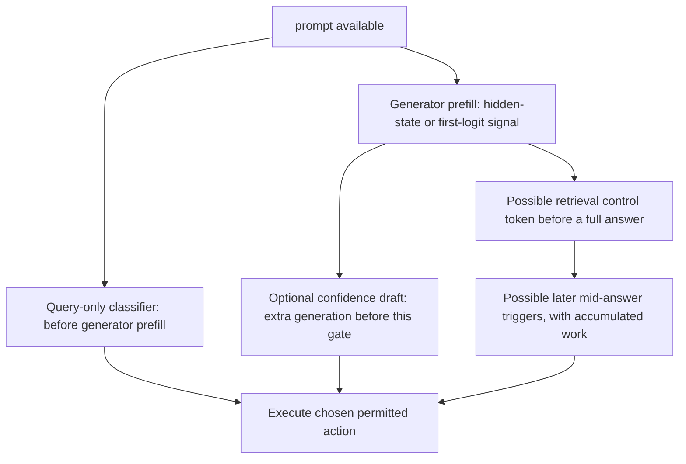
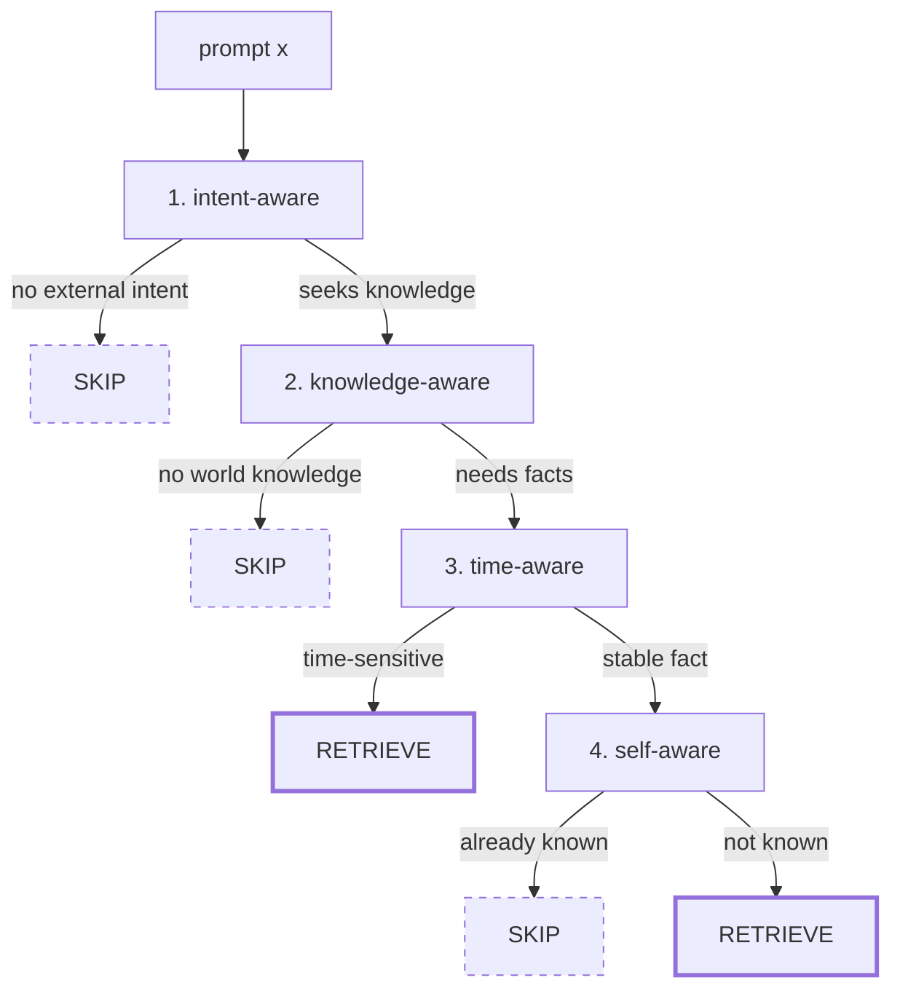
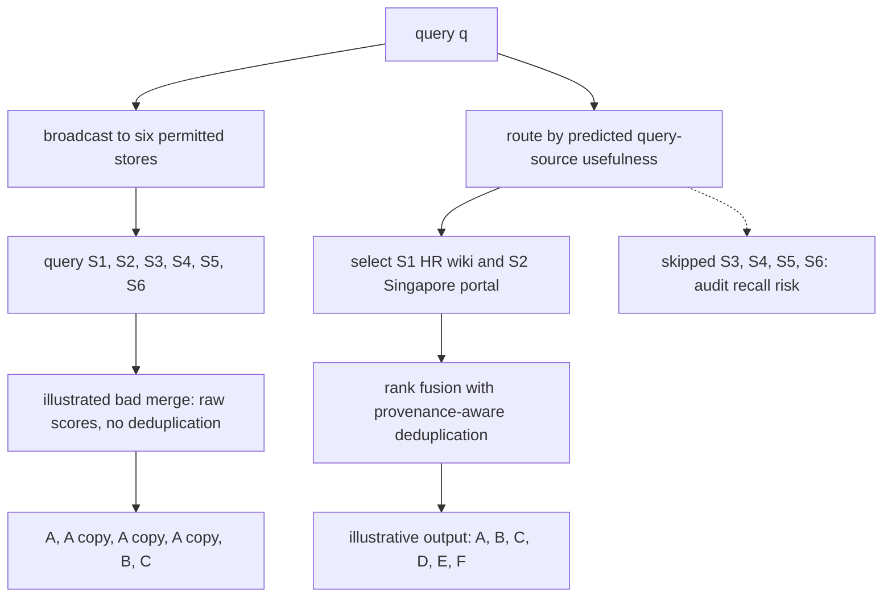
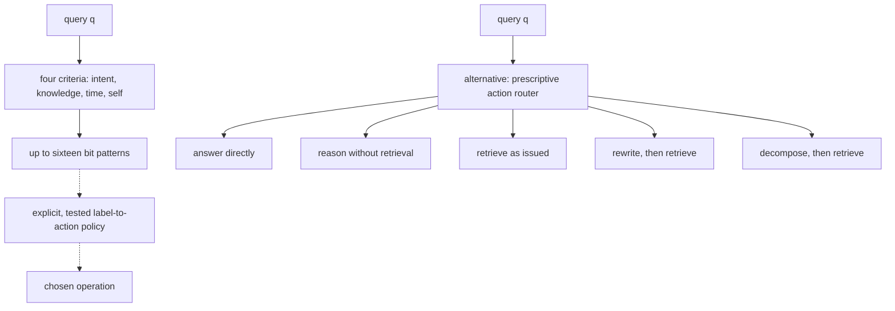
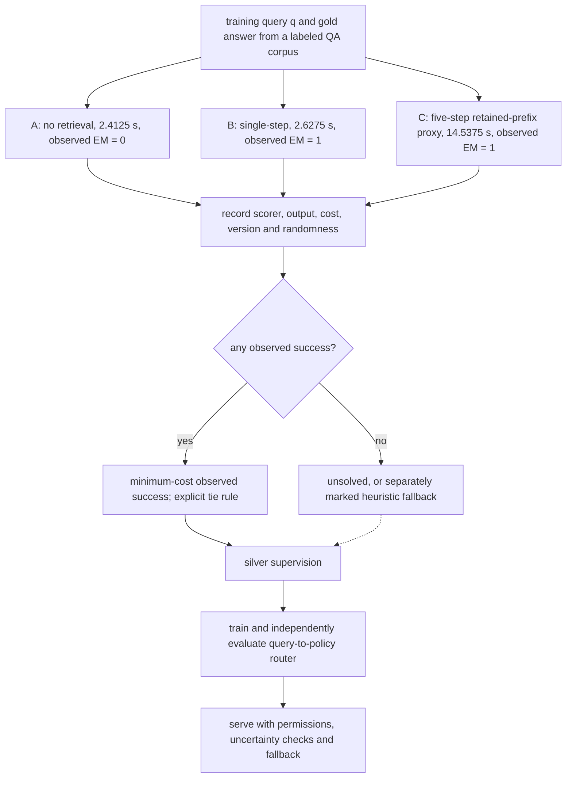

This example compares a small classifier that can decide before answer generation with a particular confidence gate that generates a draft first. These are alternative implementations, not a rule that every confidence signal requires a full draft. The estimates below separate arithmetic and weight-stream components from stipulated wall time.
### 1. The four outcome groups
Fix a paired evaluation of closed-book and retrieval-augmented answers. Divide the scored questions by their observed binary outcomes:
- $`\alpha=52\%`$: both answers are correct.
- $`\beta=10\%`$: the closed-book answer is correct and retrieval is wrong.
- $`\gamma=18\%`$: retrieval is correct and the closed-book answer is wrong.
- $`\delta=20\%`$: both answers are wrong.
Always retrieving scores $`\alpha+\gamma=70\%`$; answering closed-book scores $`\alpha+\beta=62\%`$. An outcome-clairvoyant selector reaches $`\alpha+\beta+\gamma=80\%`$, ten percentage points above always retrieving. This ceiling is for the fixed paired outcomes, not a promise that an input-only gate can recognize every successful branch. All four percentages are scenario assumptions. A reported PopQA harm result motivates the example but does not establish that its harm rate has this example's all-query denominator.
### 2. What the 30% skip rate does
The hypothetical gate skips retrieval on $`30\%`$ of all questions. Its skips rescue six percentage points from $`\beta`$ and lose three percentage points from $`\gamma`$. These are fractions of the entire workload, not conditional percentages of skipped questions.
The resulting accuracy is

```math
A_g=0.70+0.06-0.03=0.73=73\%.
```

The net gain recovers $`3/10=30\%`$ of the outcome-oracle's ten-percentage-point headroom, not one third. Skips in $`\alpha`$ or $`\delta`$ change cost but not this paired score.
At $`100{,}000`$ daily queries, always using a $`2{,}200`$-token prompt processes $`220\times10^6`$ prompt tokens. If the skipped queries instead use $`200`$ tokens, the daily total is

```math
T_g=70{,}000(2{,}200)+30{,}000(200)=160\times10^6\ \text{prompt tokens}.
```

Prompt-token work falls by $`60/220\approx27.272727\%`$, while retrieval calls fall by $`30\%`$. Neither percentage is automatically the reduction in total serving cost or latency.
### 3. Why the classifier saves time
Under the serial proxy used in section $`25.1`$, retrieval adds $`83\,\mathrm{ms}`$ of embedding/search/reranking and $`82.352941\,\mathrm{ms}`$ of extra-prompt arithmetic: $`165.352941\,\mathrm{ms}`$ in total. Skipping it on $`30\%`$ of queries avoids an average $`49.605882\,\mathrm{ms}`$ per query.
Charging a separately stipulated $`2\,\mathrm{ms}`$ classifier to every query leaves $`47.605882\,\mathrm{ms}`$ of modeled mean saving. This is approximately $`48\,\mathrm{ms}`$, not a measured production result.
### 4. Why the confidence check can cost more than it saves
For the compared confidence implementation, a thirty-token draft incurs $`125.373134\,\mathrm{ms}`$ of modeled weight-stream work before every decision. In the no-reuse comparison, the draft is additional to the common answer-generation budget. Thus

```math
\Delta t_{\mathrm{saved}}
\approx49.605882-125.373134
=-75.767252\,\mathrm{ms}.
```

That implementation is approximately $`76\,\mathrm{ms}`$ slower per query under the stated proxy. A draft reused as the final answer on skipped queries changes the comparison; discarded drafts, extra prefill, cache validity and answer length must be accounted for explicitly. Token-logit, hidden-state and pre-answer control-token gates have different timing.
### 5. Use one reconciled set of numbers
Using full precision until the final rounding gives approximately $`47.61\,\mathrm{ms}`$ saved by the classifier and $`75.77\,\mathrm{ms}`$ added by this no-reuse draft gate. The earlier $`44\,\mathrm{ms}`$ and $`80\,\mathrm{ms}`$ summaries do not follow from these inputs and are not alternative computed results.
# Chapter 25: Routing and Adaptive Retrieval
[00-START-HERE](../00-START-HERE.md) · [01-READING-ROUTES](../01-READING-ROUTES.md) · [24\_query\_reformulation](24_query_reformulation.md) · [26\_iterative\_recursive\_and\_agentic\_retrieval](26_iterative_recursive_and_agentic_retrieval.md)
This chapter explains how a Retrieval-Augmented Generation (RAG) system decides whether to retrieve, which permitted stores to query, which operation to run, and how to manage uncertain or unfamiliar inputs without equating more computation with safety.
## TL;DR
- Optimize retrieval against expected answer benefit, resource cost and operational risk. In a fixed paired binary-outcome evaluation, only the closed-book-only cell supplies accuracy headroom over always retrieving; stochastic expected-accuracy oracles require a different definition.
- A useful gate separates cases retrieval spoils from cases it saves. “Easy versus hard” is not the same decision boundary.
- Unified Active Retrieval (UAR) combines external intent, world-knowledge need, time sensitivity and self-knowledge. Separately trained probes are not necessarily statistically independent, and their shared generator prefill has a cost.
- Source routing can enforce permissions and reduce calls, transferred candidates and fan-out exposure. It can also silently miss the right store. Deduplication, version-aware evidence handling and score fusion are separate controls.
- A descriptive classifier names query properties; a prescriptive router selects an operation such as direct answering, rewriting or decomposition. Their quality must be judged by final outcomes and asymmetric costs, not routing accuracy alone.
- Query stratification distinguishes explicit facts, combinations of facts, written procedures and policies inferred from cases. Retrieval and corpus design matter at all four levels; case examples do not necessarily identify a unique hidden rule.
- Adaptive-RAG can obtain silver labels by executing candidate policies and selecting the cheapest observed success. Handle ties, failed policies, stochasticity and version changes explicitly. Router confidence is not a general distance-to-data measure or an OOD safety certificate; an input-distance signal is useful only with its own calibration and failure analysis.
## The story
Imagine a library with a service desk, archive rooms, and a clerk who can sometimes answer from memory. A records runner can rescue an answer the clerk does not know, but an old or distracting page can also spoil an answer the clerk would have given correctly. The librarian compares the rescued pile with the spoiled pile. A gate should learn that distinction, not merely “easy” versus “hard.” Four cards help organize the decision: whether the patron wants outside knowledge, whether facts beyond the supplied text are needed, whether those facts can change, and whether the clerk already knows a stable answer. Checking freshness prevents confident recall of an obsolete office holder from masquerading as current knowledge.
If a trip is appropriate, the librarian chooses permitted rooms. Broadcasting may call a costly partner desk, cross a residency boundary, or bring back several photocopies of one stale memo. Copies are not independent witnesses. The librarian merges comparable evidence, groups copies by provenance, and distinguishes an amendment from an older version before using agreement. Routing and deduplication help in different ways; a routed room can still return duplicates, and broadcasting need not use a bad merge policy.
The next choice is the operation: answer directly, reason from the supplied facts, search as written, rewrite a follow-up, or split a compound question. A label such as “needs outside knowledge” does not choose between those operations. Some requests need one written fact; others need several facts, a procedure, or representative past decisions. Different evidence units and budgets may be appropriate. Past cases alone need not reveal a unique unwritten policy.
To train the dispatcher, the library can run its candidate routes on questions with known answers and retain the cheapest observed success. This is silver supervision, not clairvoyance about future answers. If every route fails, a dataset-based fallback is a heuristic label rather than a verified success. Finally, an unfamiliar patron can receive a confidently wrong route. Neither confidence nor distance to familiar requests is a safety proof. The library checks both where useful, validates them on held-out traffic, and has a permitted fallback that may be broader retrieval, clarification, abstention or human review—not automatically the most expensive investigation.
## Decoder table


| Technical term | Plain-English meaning | Why it matters |
| --- | --- | --- |
| Retrieval-Augmented Generation (RAG) | A generator answers with retrieved external context | Retrieval can add evidence or corrupt an answer the model already knew |
| Closed-book answer | An answer produced without retrieved context | It is the baseline branch that a retrieval gate may preserve |
| Parametric memory | Facts represented in the model’s weights | Popular facts may already be available without retrieval |
| Non-parametric memory | Facts stored outside the model and fetched at request time | It provides updateable evidence but can add noise |
| Exact match (EM) | A declared exact-string/normalized-answer scorer against a gold answer | Observed success is scorer-dependent; semantic equivalence and truth can differ |
| Retrieval gate | A controller that chooses retrieve or skip | It can recover accuracy and cost when always-retrieve is harmful |
| Oracle gate | Either an oracle over conditional mean accuracies or a selector that sees realized paired outcomes | Define which oracle; the second can have a strictly higher ceiling |
| $`\alpha`$ cell | Questions both closed-book and retrieval answer correctly | Skipping these changes cost but not accuracy |
| $`\beta`$ cell | Closed-book correct and retrieval wrong in the fixed paired evaluation | Its mass is outcome-oracle headroom, not necessarily attainable query-only gain |
| $`\gamma`$ cell | Questions only the retrieval branch answers correctly | Skipping these questions gives accuracy back |
| $`\delta`$ cell | Both specified branches wrong in the paired evaluation | Selection cannot repair these fixed outputs; other policies or new generations may differ |
| Classifier-based gate | Predict retrieve/skip from query features or an acquired hidden state | Query-only can act before prefill; hidden-state gating must obtain or reuse prefill |
| Discriminative model | A model predicting a class or score rather than a free-form answer | Can be inexpensive; validate latency and calibration rather than assuming either |
| Large Language Model (LLM) | The generator whose weights and hidden states support answering | Its competence boundary determines useful routes |
| Hidden state | An activation produced while the generator processes the prompt | Includes model-specific features, but requires state acquisition and is not certified self-knowledge |
| Frozen model | A model whose weights stay unchanged while small probes train | UAR adds control without retraining the generator |
| Confidence-based gate | Thresholds a competence proxy, model score or draft-based estimate | Timing depends on the signal; a full draft is not inherent to every confidence gate |
| Token probability | The model-assigned conditional probability of a token | Not a calibrated probability of truth; useful confidence requires task-specific validation |
| Perplexity | A scalar derived from how surprising tokens are to a model | It is a possible confidence signal, not a truth detector |
| Entity popularity | A query-side proxy for how likely a fact appeared in pre-training | It is available before generation and supported adaptive retrieval in PopQA |
| Self-reflective gate | A model-produced control requesting retrieval or critique | May occur before a full answer or later in generation; charge the work already performed |
| Control token | A special generated token that changes the pipeline action | It lets the generator request retrieval itself |
| Prefill | Processing prompt and retrieved context before token generation | Retrieved chunks can make this stage expensive |
| Decode | Generating output tokens one step at a time | A confidence gate may pay a full draft decode before deciding |
| Floating-Point Operation (FLOP) | An arithmetic-operation count | Measures arithmetic work, not memory traffic, wall time or monetary cost |
| 16-bit floating-point (FP16) | A compact weight format used in the decode estimate | The 7B example occupies $`14\,\mathrm{GB}`$ at this precision |
| High Bandwidth Memory 3 (HBM3) | Accelerator-memory technology in a stated byte-rate example | Byte rate supplies a weight-stream component or bound, not full decode latency |
| bfloat16 (BF16) | A sixteen-bit format with a separately stated peak device rate | Peak arithmetic division omits actual utilization, weight reads and kernel latency |
| Unified Active Retrieval (UAR) | Four binary probes composed into a retrieval decision tree | It separates intent, knowledge, freshness, and self-knowledge |
| Intent-aware probe | A test for whether the instruction seeks external knowledge | It skips creative or formatting tasks that do not need facts |
| Knowledge-aware probe | A test for whether world knowledge is required | It skips pure reasoning over text already present |
| Time-aware probe | A test for whether the answer can become stale | It retrieves current facts even when the model is confident |
| Self-aware probe | A test for whether this model already knows a stable answer | It can skip retrieval for known facts |
| Multilayer Perceptron (MLP) | A small feed-forward classifier | UAR uses one lightweight probe per criterion |
| Logit | An unnormalized class score | A score gap is not automatically a calibrated risk or input-distance measure |
| Boolean composition | A stated rule using AND, OR and NOT on predicted bits | Preserves chosen logical precedence, not the truth of noisy predictions |
| Cascade | Stop later checks when an earlier verdict is terminal | Serial early exit can save work even when per-check costs are equal |
| Conditional termination rate | Termination probability conditional on reaching a gate in the current order | Valid for the current-order expectation; changes after reordering can change the rates |
| Hit-rate per unit cost | Stopping probability divided by positive evaluation cost | Local exchange criterion for interchangeable verdicts after the same prefix; static optimal sorting needs more assumptions |
| Source routing | Select a permitted subset of sources for the current request | Can reduce calls and transfer but does not itself deduplicate evidence or guarantee recall |
| Broadcast | Query every permitted source in the chosen baseline | Avoids source-selection omission, not all retrieval misses; duplicates and fusion remain separate choices |
| Fan-out | Issue multiple source calls, possibly concurrently | Wait-for-all retrieval follows a maximum plus overhead; cancellation/timeouts change the path |
| Tail latency | High quantiles or budget-exceedance probability of latency | Independent source tails give a union formula; correlated tails need their joint law |
| Source-selection accuracy | A defined measure of source selection relative to useful evidence | Unchosen sources require audits or controlled exploration to measure omissions |
| Cross-source duplication | The same document appearing in several stores | Copies consume context slots and create false agreement |
| Lineage | Provenance linking copies, common origins and effective versions | Collapse copies without discarding distinct authoritative versions or treating them as independent votes |
| Heterogeneous stores | Sources with differing corpora, models, filters or score distributions | A shared model does not by itself make scores calibrated across stores |
| BM25 | A lexical ranking function whose score depends on collection statistics | Equal scores from different stores need not mean equal relevance |
| Cosine similarity | The angular similarity used by many embedding systems | Different models can occupy different effective score ranges |
| Pointwise cross-encoder | Scores query-document pairs without explicit list-level redundancy control | May give duplicates similar high scores; does not necessarily promote every near-copy |
| Reciprocal Rank Fusion (RRF) | Combine ranks without directly comparing raw score magnitudes | An alternative to raw-score calibration, not a guarantee of relevance, recall or deduplication |
| Metadata filtering | Narrowing candidates inside a chosen store | It cannot recover a store that routing never opened |
| Source abstention | Choose no source or a no-relevant-source outcome under a tested rule | Can avoid weak evidence, but low scores alone do not prove every source irrelevant |
| Descriptive controller | A classifier that outputs properties of a query | Its label still needs a separate action policy |
| Prescriptive router | A controller that directly outputs the operation to execute | It closes the gap between description and behavior |
| Label space | Descriptions a classifier can emit | Four binary criteria allow up to $`2^4=16`$ patterns; not all need be feasible or observed |
| Action space | The set of operations the system can execute | The chapter’s router uses five concrete actions |
| Hand-written policy | An explicit mapping from properties to operations | Can be valid and small; missing properties and large products can complicate maintenance |
| Action label | A route selected from observed outputs and a stated cost/scorer | Define ties, all-failed cases, execution randomness and the producing system version |
| Bidirectional Encoder Representations from Transformers base model (BERT-base) | An approximately $`110\times10^6`$-parameter encoder | Its short-query arithmetic can be small; compare measured end-to-end latency on matched hardware |
| Softmax | Normalize logits to nonnegative class scores summing to one | Probabilistic form does not imply calibration, OOD reliability or literal geometric distance |
| Reason without retrieval | Reasoning over available inputs; in this action set, no retrieval | A reasoning method may also be combined with retrieval in other policies |
| Query rewrite | Turning an underspecified follow-up into a self-contained search query | It restores terms that lexical and dense retrievers can match |
| Query decomposition | Split an information need into focused subqueries | Can change coverage and cost; gains and dependence must be measured |
| Margin threshold | A cutoff on a defined route-score or logit difference | Can trigger a fallback after validation, but is not inherently a calibrated error probability |
| Query stratification | Classifying what kind of information the corpus must supply | It reveals which pipeline changes can raise the ceiling |
| Level 1 explicit facts | One written passage contains the answer | Chunk retrieval and reranking can solve it |
| Level 2 implicit facts | Combine evidence facts to support an answer | Decomposition or iteration may help; a single colocated result can also suffice |
| Level 3 interpretable rationales | A written procedure or rationale supplies relevant steps and exceptions | Preserve needed context and authority; the whole manual is not always necessary |
| Level 4 hidden rationales | Examples may reflect an unwritten decision process | Case retrieval helps only if representative evidence and governance support the inference |
| Joint coverage | The chance every required fact reaches usable context | $`p^h`$ needs independent capture events with common marginal $`p`$, not merely distinct required facts |
| Parent-document retrieval | Matching a chunk but returning its full document | It preserves multi-step procedures that chunking would cut apart |
| Exemplar selection | Retrieving prior cases to guide a new decision | It is the relevant form of retrieval when no rule is written |
| Outcome match | Evaluate selected cases against appropriate held-out outcomes | Outcome similarity alone does not establish authority, fairness or generalization |
| Adaptive-RAG | A three-way router over no retrieval, single-step retrieval, and multi-step retrieval | Its main contribution here is executable supervision |
| Silver label | An automatically produced, potentially noisy training label | Execution can yield model-specific observed-policy labels; not an annotation-impossibility theorem |
| Policy execution | Run a complete versioned pipeline on a labeled question | Observes one scored outcome and cost; repeat trials where success is stochastic |
| Hop count | A defined count of retrieval/reasoning steps for a policy or task | Dataset structure and minimal reliable model-specific route are different quantities |
| Multi-step loop | Repeated retrieval/generation under a specified stop rule and cap | Cost depends on output length, accumulated prompts, caching and final-answer accounting |
| Source-corpus bias | A source-dataset-based heuristic for all-failed execution cases | May retain difficult examples, but must not be called an observed successful route |
| Class prior | The fraction of labels assigned to each route | It inherits the benchmark mix and may not match production |
| Reinforcement Learning (RL) | Optimize a policy from stated sampled rewards and costs | A gold scorer can supply reward in training; unlabeled production traffic need not have it |
| Out-of-distribution (OOD) query | A query unlike the router’s training inputs | The router can classify it confidently and silently choose the wrong plan |
| Decision boundary | A surface separating predicted classes | Softmax confidence is not general geometric distance; a binary linear relationship needs a fixed norm |
| Training centroid | A prototype of familiar query embeddings | Distance is an additional fallible diagnostic, not statistically independent proof of novelty |
| Cluster radius | A specified scale of dispersion around a prototype | Define its metric and estimator; no universal radius threshold certifies OOD safety |
| $`k`$-nearest-neighbor ($`k`$-NN) distance | Distance to nearby reference examples | Can represent multiple modes but still has coverage, metric and high-dimensional limitations |
| Under-routing | Sending a hard query to a cheaper, insufficient branch | It can cause a wrong answer that downstream stages cannot recover |
| Over-routing | Use a higher-cost route when a cheaper one would suffice | Can waste work, introduce bad evidence or violate constraints; not inherently harmless |
| Cost-sensitive threshold | A decision rule using calibrated event probabilities, route benefit/harm and commensurate costs | The simple ratio threshold assumes perfect rescue and no new harm |
| Branch share | The fraction of traffic assigned to each route | It is observable without production route labels and can expose shift |
| Distribution shift | A change in inputs, sources or other relevant deployment conditions | May break learned assumptions or calibration; not every shift necessarily does so |
| Corrective Retrieval-Augmented Generation (CRAG) | A system with a trained evaluator in front of retrieval decisions | It illustrates the shared OOD weakness of supervised controllers |
| $`p(q)`$, $`r(q)`$, and $`g(q)`$ | Closed-book correctness, retrieval correctness, and the binary retrieve decision for query $`q`$ | They define the retrieval-gating objective |
| $`A(g)`$, $`A(1)`$, $`A(0)`$, and $`A^\star`$ | Gate, retrieve-only, closed-book and explicitly defined oracle accuracies | Distinguish conditional-mean and realized-outcome ceilings; estimate uncertainty |
| $`S`$ | Set of queries on which a real gate skips retrieval | Its intersections with $`\beta`$ and $`\gamma`$ determine accuracy gained and lost |
| $`a_{\mathrm{int}}`$, $`a_{\mathrm{know}}`$, $`a_{\mathrm{time}}`$, and $`a_{\mathrm{self}}`$ | External intent, world-knowledge need, time sensitivity, and model self-knowledge bits | UAR composes these distinct predicates instead of learning one opaque label |
| $`y_{\mathrm{ret}}`$ | The binary retrieval decision of the chosen UAR composition | Noisy inputs can still produce a wrong route |
| $`h(x)`$ and $`d`$ | Acquired prompt hidden state and its vector width | Share valid prefill state where possible; include its incremental cost |
| $`c_i`$, $`p_i`$, $`n`$, and $`\mathbb{E}[C]`$ | Gate cost, current-order conditional termination, gate count and expected work | Common-prefix stopping-per-cost gives a local exchange test under verdict-preserving conditions |
| $`N`$, $`S_i`$, $`K_i`$, and $`M`$ | Source count, store, indexed-unit count and selected-source subset | Catalog size differs from actual ANN visits and from request latency |
| $`\ell_i`$ and tail probabilities $`u_i`$ | Per-source latency and budget-exceedance probability | Use wait-for-all semantics and a joint tail law; independence is an additional assumption |
| $`k`$, replication $`r`$, and $`k_{\mathrm{distinct}}`$ | Result slots, maximum duplicate-group size and distinct count | Maximum group size $`r`$ implies at least $`\lceil k/r\rceil`$ distinct objects, not equality |
| $`P(\text{relevant} \mid q, S_i)`$ | A precisely labeled query-conditioned source-usefulness target | Need not equal static authority; learn/calibrate against the downstream objective |
| $`q`$, $`L`$, $`A`$, $`f_{\mathrm{desc}}`$, $`f_{\mathrm{pres}}`$, $`l`$, and $`\pi`$ | Query, property/action spaces, descriptive/prescriptive maps, label and policy | Count feasible source-free actions and source subsets; a naive product can miscount |
| $`h`$, per-fact $`p`$, pooled $`p_1`$, and decomposed $`p_d`$ | Required facts and stipulated marginal capture probabilities | General joint coverage uses conditional probabilities; independent common marginals give powers |
| Policies $`A`$, $`B`$, and $`C`$ | Direct, one-retrieval and capped multi-step pipelines | Choose a cheapest observed success only for a nonempty successful set |
| $`a^\star`$, $`\Pi`$, $`G_\pi(q)`$, $`c(\pi)`$, $`\pi^\star`$, $`T`$, and $`f_\phi`$ | Gold answer, policy set/output/cost, silver label, loop cap and router | Version the producer, define cost units, break ties and distinguish unsuccessful fallbacks |
| $`p`$, wrong-answer loss $`L`$, $`\Delta C`$, and $`\tau^\star`$ | Needed-route probability, error loss, added cost and decision threshold | Compare utilities in common units; validate benefit, harm and calibration |
| OOD fraction $`f`$ and retrieval lift $`d`$ | Replaced traffic share and router disadvantage within the shifted slice | Exact mixture gap is $`(1-f)g-fd`$, where $`g`$ is the original ID advantage |
| Text-to-Text Transfer Transformer (T5) | Encoder-decoder family used by the Adaptive-RAG router and CRAG evaluator | It shows that these controllers are trained models, not score thresholds |
| Forward-Looking Active Retrieval augmented generation (FLARE) | Mid-generation retrieval triggered by low token confidence | Its signal arrives only after generation has begun |
| Self-RAG | A system whose model emits retrieval and critique controls | It is another supervised controller exposed to distribution shift |
| RAGRoute | A learned source router in the chapter-reported comparison | Its reported aggregate reductions do not independently establish OOD failure rates or a source-affinity explanation |
| Interleaving Retrieval with Chain-of-Thought (IRCoT) | A method alternating reasoning and retrieval | Its reported gains do not determine the toy per-fact coverage assumptions |
| Approximate Nearest Neighbor (ANN) search | Approximate indexed neighbor search | May avoid exhaustive scanning; visited work and recall depend on implementation and data |
| Hierarchical Navigable Small World (HNSW) graph | An approximate vector index often efficient in practice | No universal corpus-size-to-latency bound or speedup follows from its catalog sizes |
| Generative Pre-trained Transformer 4 (GPT-4) | Model used to produce reflection labels in the Self-RAG example | Distillation transfers its label blind spots into the critic |
| Medical Information Retrieval-Augmented Generation Evaluation (MIRAGE) | Medical benchmark used in the source-routing measurements | It grounds the reported $`72.22\%`$ to $`72.24\%`$ accuracy change over five MedRAG corpora, while the $`77.5\%`$ query and $`76.2\%`$ transfer cuts come from MMLU (corrected from it grounds the reported query, transfer, and accuracy changes) |
| PageRank | A query-independent recursive link-authority score in its standard form | Query-conditioned variants exist; authority alone does not establish query relevance |
| Binary cross-entropy | A loss applied to binary targets, possibly one target per source | Separate binary heads or summed losses do not prove statistical independence of source events |
| Mutual information | A dependence measure for a stated joint distribution | Marginal association can reflect query mix; choose joint versus factorized heads by held-out quality and cost |


## Core mechanics
### Mathematical conventions
Probabilities and accuracy are fractions unless followed by $`\%`$; a change from $`70\%`$ to $`73\%`$ is three percentage points. Use natural logarithms and decimal storage units, with $`1\,\mathrm{GB}=10^9\,\mathrm B`$ and $`1\,\mathrm{TB}=10^{12}\,\mathrm B`$. Retain full precision until rounding.
The compute proxies are $`W_{\mathrm{forward}}\approx2NT`$ and $`t_{\mathrm{arith}}=W/F`$, with sustained arithmetic rate $`F=3.4\times10^{14}\,\mathrm{FLOP\,s^{-1}}`$ where specified. An fp16/bf16 weight-stream component is $`t_{\mathrm{stream}}=2N/B`$ at byte rate $`B`$. A simple roofline-style proxy compares both components through $`\max(W/F,\,\text{bytes}/B)`$; attention, cache traffic, kernels, communication and scheduling can change the actual execution time. Neither component by itself is measured wall time. A separately stipulated $`2\,\mathrm{ms}`$ encoder latency must not be replaced by its much smaller arithmetic component. Billing, work, critical-path latency and tail latency have different units and denominators.
Distinguish an oracle over conditional expected accuracies from an oracle that sees realized outcomes of both branches. Binary outcome tables concern a specified paired evaluation, generator/corpus/prompt versions, decoding policy and scoring rule. Their empirical headroom need not be attainable by a query-only classifier. Treat reported study percentages and hardware specifications as inputs, not mathematical guarantees. All routing policies remain subject to provenance, privacy, residency and tool-permission constraints.
### 25.1 When to retrieve: classifier, confidence, and self-reflective families
#### What it is
Let $`p(q)=\Pr(B=1\mid q)`$ and $`r(q)=\Pr(R=1\mid q)`$ be closed-book and retrieval-branch correctness probabilities for fixed system versions and a stated scoring rule. Let $`g(q)\in\{0,1\}`$ choose retrieval. If the gate uses additional features, condition both correctness models on that same available information. With branch randomness averaged under the prescribed decoding law,

```math
A(g)=\mathbb E_q\!\left[g(q)r(q)+(1-g(q))p(q)\right].
```

Always retrieving has expected accuracy $`\mathbb E[r]`$ and never retrieving has $`\mathbb E[p]`$. An oracle that knows the conditional means achieves $`A_{\mathrm{mean}}^\star=\mathbb E[\max(p,r)]`$; its gain is $`\mathbb E[(p-r)_+]`$, where $`(u)_+=\max(u,0)`$.
For a specified joint pairing of realized binary outcomes, define $`\alpha=\Pr(B=1,R=1)`$, $`\beta=\Pr(B=1,R=0)`$, $`\gamma=\Pr(B=0,R=1)`$ and $`\delta=\Pr(B=0,R=0)`$. An outcome-clairvoyant oracle reaches $`A_{\mathrm{outcome}}^\star=\alpha+\beta+\gamma`$ and gains exactly $`\beta`$ over always retrieving. In general $`A_{\mathrm{mean}}^\star\le A_{\mathrm{outcome}}^\star`$; equality is not automatic. For example, with the same observable input and independent branches each correct with probability $`1/2`$, the two ceilings are $`1/2`$ and $`3/4`$. A real gate cannot observe future decoding outcomes. The cell-based examples below concern fixed paired outcomes; their attainable accuracy must still be measured.
#### Why it exists
The chapter cites Mallen et al.'s PopQA result as evidence that retrieval can turn correct closed-book answers into errors, giving a roughly $`10\%`$ harm figure and reporting harm for popular facts. Verify that study's denominator, model and setup before treating its percentage as a population cell mass: a percentage conditional on closed-book success is not an all-query $`\beta`$. The worked $`\beta=10\%`$ below is an explicit scenario assumption, not a transferred estimate. Popularity may help predict useful retrieval, but is neither a correctness guarantee nor a substitute for current evidence.
#### Failure without it
Skipping $`\alpha`$ saves resource cost without changing paired accuracy; skipping $`\beta`$ improves it, skipping $`\gamma`$ worsens it, and skipping $`\delta`$ leaves it wrong. “Easy” questions can belong to more than one cell. The exact paired-score change is $`\Pr(\mathrm{skip},B=1,R=0)-\Pr(\mathrm{skip},B=0,R=1)`$. A gate should optimize this trade-off together with costs and required grounding, rather than treating confidence or difficulty as the objective.
#### Signal families and timing
Classifier gates can use the query before generator work or a frozen generator's hidden state after prefill. A hidden-state signal is pre-answer, not pre-compute. Confidence signals also vary: popularity is available before answering, next-token entropy requires logits and usually prefill, and a draft-based confidence estimate incurs the draft's work. Confidence is not simply fluency; it can be useful when calibrated for the relevant event, but may be wrong or miscalibrated. Self-RAG's retrieval token can occur before a full answer, while FLARE-style triggers occur during generation. Repeated sentence-level checks have their own accumulated cost. Compare specific implementations and valid cache reuse, not an inherent timing hierarchy among the family names.
#### Cost and worked example
The constructed system serves $`100{,}000`$ queries daily with $`N=7\times10^9`$ parameters. Set the fixed paired-outcome cells to $`\alpha=52\%`$, $`\beta=10\%`$, $`\gamma=18\%`$, $`\delta=20\%`$. Always retrieving scores $`70\%`$, closed-book $`62\%`$, and the outcome-clairvoyant oracle $`80\%`$. A hypothetical popularity gate skips $`30\%`$ of all queries, including six percentage points from $`\beta`$ and three from $`\gamma`$. Its score becomes $`73\%`$, recovering $`30\%`$ of the ten-percentage-point headroom.
The closed-book prompt has $`200`$ tokens; five retrieved chunks of $`400`$ tokens give a $`2{,}200`$-token RAG prompt. Daily prompt work changes from $`220\times10^6`$ to $`160\times10^6`$ tokens, a $`27.272727\%`$ reduction. Embedding, ANN search and reranking take stipulated serial times $`8+15+60=83\,\mathrm{ms}`$. Extra-prompt arithmetic is $`2N(2{,}000)/F\approx82.352941\,\mathrm{ms}`$, making the combined retrieval proxy $`165.352941\,\mathrm{ms}`$. At the stated skip rate the avoided mean is $`49.605882\,\mathrm{ms}`$; charging a stipulated $`2\,\mathrm{ms}`$ classifier leaves $`47.605882\,\mathrm{ms}`$ saved.
A $`110`$-million-parameter encoder on $`32`$ tokens has a forward proxy $`7.04\times10^9`$ FLOPs, or $`0.020705882\,\mathrm{ms}`$ at $`F`$. That component does not establish its wall time; the $`2\,\mathrm{ms}`$ allowance is a separate assumption. The fp16 generator has $`14\,\mathrm{GB}`$ of weights. At $`3.35\,\mathrm{TB\,s^{-1}}`$, streaming them once per token costs $`4.179104\,\mathrm{ms}`$ per token. A thirty-token draft therefore has a $`125.373134\,\mathrm{ms}`$ streaming component. If every query pays this additional draft and no draft output replaces later answer generation, mean net saving is $`49.605882-125.373134\approx-75.767252\,\mathrm{ms}`$.
If the draft instead supplies the complete closed-book answer on skipped queries, its additional decode work may be charged only to the remaining $`70\%`$ under a matched common-answer budget. That changes the extra draft component to $`87.761194\,\mathrm{ms}`$ and the proxy to $`-38.155312\,\mathrm{ms}`$, before differing answer lengths, draft prefill and validation. Retrieved context can invalidate reuse of a draft's prefix states. Benchmark the actual implementation. Neither case proves that all confidence gates lose. Use the reconciled $`47.61\,\mathrm{ms}`$ saving and $`75.77\,\mathrm{ms}`$ no-reuse penalty, not the unsupported $`44/80`$ summary.
#### Practice decisions and limits
Evaluate both branches on representative production queries, retaining paired outcomes, attempt counts, scoring rules and system versions. Estimate $`\beta`$ and $`\gamma`$ for that setup, and evaluate the learned gate independently; an empirical oracle ceiling is not an attainable guarantee. A stronger generator or a changed corpus can change either cell. Account for a false retrieval call's latency, money, possible answer harm and compliance risk. Use query features before generation where adequate; include shared generator prefill when probes need it. Deploy a fallback appropriate to the permissions and loss function, not a universal “retrieve on every doubt.” Preserve required evidence even when the model appears to know the answer.
### 25.2 Unified Active Retrieval: four criteria as a decision tree
#### What it is
Let binary criteria $`a_{\mathrm{int}}`$, $`a_{\mathrm{know}}`$, $`a_{\mathrm{time}}`$ and $`a_{\mathrm{self}}`$ indicate external-knowledge intent, need for world knowledge, time sensitivity and sufficient stable self-knowledge. Under this chosen UAR policy, the retrieval decision is

```math
y_{\mathrm{ret}}=a_{\mathrm{int}}\land a_{\mathrm{know}}\land\bigl(a_{\mathrm{time}}\lor\neg a_{\mathrm{self}}\bigr).
```

First skip if external intent is absent; otherwise skip if no world knowledge is needed. Retrieve for a time-sensitive request. For a stable request, skip only if the self-knowledge criterion is positive. This tree is one implementation of the Boolean rule; it prioritizes freshness over self-knowledge. Its bits are predictions whose errors can still produce a bad decision.
#### Why it exists
A skip label alone does not distinguish missing external intent, no need for outside facts and sufficient stable knowledge. Separately supervising these criteria can provide a useful inductive bias; it does not prove the criteria are statistically independent or that they are the unique necessary decomposition. A probe can read a frozen model's final-prompt hidden state, but obtaining that state entails generator prefill unless already available and validly reusable. Shared representations do not certify introspective self-knowledge; simpler query/metadata features may suffice for some decisions.
#### Failure without it
An intent-only gate may retrieve roadmap text for a limerick. A self-knowledge-only gate may preserve an obsolete office holder because the model remembers the name confidently. The chosen Boolean policy handles those cases differently. “Freshness before memory” is a precedence rule for this policy, not a theorem about all classifiers. If all bits are precomputed, the order of an OR expression changes no logical value. A frozen corpus does not imply a timeless domain: it may contain stale facts, and a current-world question may require a permitted fresh source or abstention.
#### Cost and ordering
A probe with input width $`4{,}096`$, hidden width $`512`$ and two logits has $`4{,}096(512)+512(2)=2{,}098{,}176`$ matrix weights. Including $`512+2`$ biases gives $`2{,}098{,}690`$ parameters. At two FLOPs per multiply-accumulate, its linear-layer work is $`4{,}196{,}352`$ FLOPs; four probes use $`16{,}785{,}408`$ FLOPs, omitting nonlinearities and other overhead. A 7B forward-token proxy is $`14\times10^9`$ FLOPs, so the four-probe arithmetic ratio is $`0.001198958`$, or $`0.119896\%`$ of that one-token work—not of end-to-end latency. For scale, acquiring a $`200`$-token hidden state with the same generator has a $`2.8\times10^{12}`$-FLOP prefill proxy, $`8.235294\,\mathrm{ms}`$ of arithmetic; whether it is incremental depends on the actual reuse path.
For a serial cascade, let $`c_i`$ be gate evaluation cost and $`p_i=\Pr(\text{termination at }i\mid\text{gate }i\text{ is reached})`$. With deterministic costs, the chain rule gives

```math
\mathbb E[C_{\mathrm{serial}}]
=\sum_{i=1}^{n}c_i\Pr(\text{reach }i)
=\sum_{i=1}^{n}c_i\prod_{j\lt i}(1-p_j).
```

Conditional termination rates make this expectation valid without independence, provided they are measured for the actual order. They cannot in general be reused unchanged after reordering correlated gates. For interchangeable terminal predicates that preserve the same overall verdict, compare two candidates after a common prefix. If their stopping probabilities under that prefix are $`q_i,q_j`$, the local costs are $`c_i+(1-q_i)c_j`$ versus $`c_j+(1-q_j)c_i`$. The first is no larger exactly when $`q_i/c_i\ge q_j/c_j`$, for positive costs. A universal static sort needs additional stability assumptions, such as independent terminal events; arbitrary UAR criteria are not all interchangeable because some terminal verdicts differ.
Equal-cost gates still save arithmetic with serial early exit: fewer gates are evaluated on stopped queries. Running all four probes in a batch may instead have lower wall time by exploiting parallelism. That scheduling trade-off is not “no work saving.” Measure prefill, weight reads, launch overhead and elapsed time in addition to FLOPs.
#### Worked example
The example serves $`10{,}000`$ prompts daily. A retrieval adds $`3{,}000`$ tokens and a stipulated $`220\,\mathrm{ms}`$: $`15`$ embedding, $`25`$ ANN search, $`80`$ reranking and $`100\,\mathrm{ms}`$ extra prefill. Input billing at $`\$3`$ per million tokens gives $`\$0.009`$ per retrieval and $`\$90`$ daily for always retrieving. Let the actual-order conditional termination rates be $`p_1=0.30`$, $`p_2=0.20`$, $`p_3=0.25`$. Gate 1 skips $`3{,}000`$ queries; gate 2 skips $`1{,}400`$ of $`7{,}000`$ survivors; gate 3 retrieves for $`1{,}400`$ of $`5{,}600`$. Gate 4 skips $`55\%`$ and retrieves for $`45\%`$ of the remaining $`4{,}200`$: $`2{,}310`$ skips and $`1{,}890`$ retrievals. Total retrieval rate is $`3{,}290/10{,}000=32.9\%`$.
Retrieved-token billing becomes $`\$29.61`$ daily, saving $`\$60.39`$ per day or $`\$22{,}042.35`$ over $`365`$ days. Retrieval-only mean latency is $`0.329(220)=72.38\,\mathrm{ms}`$ before incremental gating costs. Evaluating all four probes on every prompt uses $`167.85408\,\mathrm{GFLOP/day}`$. Dividing by the cited A100 dense-BF16 peak of $`312\,\mathrm{TFLOP\,s^{-1}}`$ gives $`0.537994\,\mathrm{ms/day}`$ of ideal arithmetic, or $`53.799385\,\mathrm{ms/day}`$ at one percent of that rate. These are not accelerator wall times: probe weight traffic, state acquisition, kernels and utilization are omitted.
Serial early exit evaluates an expected $`1+0.70+0.56+0.42=2.68`$ probes per query. Its linear work is $`112.4622336\,\mathrm{GFLOP/day}`$, $`33\%`$ below evaluating all four, despite equal per-probe costs. If the last criterion instead uses a sixty-four-token draft, its forward proxy is $`896\,\mathrm{GFLOP}`$ per reached query. Only $`42\%`$ reach it, giving $`376.32\,\mathrm{GFLOP}`$ of expected draft work per original query; the first three cheap probes add about $`9.483756\,\mathrm{MFLOP}`$. The combined daily total is about $`3.763295\times10^{15}`$ FLOPs. Thus “$`376`$ GFLOPs” is a per-query expectation, not a daily total. The last decision always terminates routing, but that does not mean its prediction is always correct. Gate 1's termination-per-linear-cost ratio is $`0.071490666`$ per MFLOP, versus $`1.116071\times10^{-6}`$ for that draft, a ratio of about $`64{,}055.64`$. This is an illustration of conditional compute avoidance, not a proof that all four UAR tests may be reordered.
#### Practice decisions and limits
Version the probes with their generator, tokenizer, state extraction, prompts and data. Revalidate after changes rather than promising “fail closed” by invoking an unpermitted or low-quality source. A time-sensitivity criterion can be constant only when the allowed questions and source freshness justify it, not merely because a corpus snapshot is frozen. A structured self-knowledge verdict may require fewer generated tokens than a full draft, but remains a fallible prediction. Compare accuracy, calibration, token billing, prefill reuse and elapsed latency for the chosen implementation.
### 25.3 Where to retrieve: source selection, conflict, heterogeneity
#### What it is
Let stores $`S_1,\ldots,S_N`$ have $`K_1,\ldots,K_N`$ indexed units, and let $`M(q)\subseteq\{1,\ldots,N\}`$ be the permitted sources selected for query $`q`$. Broadcast issues $`N`$ source calls; routing issues $`|M(q)|`$. Their covered catalog sizes are $`\sum_iK_i`$ and $`\sum_{i\in M(q)}K_i`$. These are indexed-unit counts, not the number of vectors an ANN algorithm actually visits. Calls may run in parallel, so call count is not a sum of serial round-trip latencies. Source selection can precede within-store formulation, but the useful order and shared features depend on the architecture.
#### Why it exists
Residency, permissions and contractual rules can exclude stores before relevance is considered. Other stores impose per-call charges, bulk-export restrictions, stale replicas or incompatible scores. A source-level target might be $`\Pr(\text{source contributes useful evidence}\mid q,S_i)`$, with “useful” defined for the downstream answer and available budget. It is not a static popularity leaderboard or necessarily a calibrated probability. Document counts and citation totals alone do not identify per-query usefulness. Standard PageRank is a query-independent recursive link-authority signal; personalized or topic-conditioned variants are different models. Neither raw inbound-link counts nor recursive authority alone proves source credibility or relevance.
#### Failure without it
If a request waits for every selected source, its parallel retrieval latency is approximately the maximum source latency plus shared overhead, subject to deadlines and cancellation. With independent per-source budget-exceedance events of probability $`u`$, the request exceeds that budget with probability $`1-(1-u)^N`$. At $`u=0.01`$, six calls give $`5.851985\%`$ and two give $`1.99\%`$. Without independence, the union probability lies between $`\max_i u_i`$ and $`\min(1,\sum_i u_i)`$; perfect correlation can eliminate the purported fan-out multiplier.
If one document occupies $`r`$ of $`k`$ slots and every other slot is unique, the number of distinct documents is $`k-r+1`$. If every duplicate group has at most $`r`$ members, the distinct count is at least $`\lceil k/r\rceil`$, not necessarily equal to it. With $`k=10`$ and a maximum group size of three, the distinct count can range from four to ten. Separate exact duplicates, policy families and distinct effective versions before counting evidence. Copies are not independent votes. A pointwise reranker may give copies similar high scores, but need not promote every near-copy identically.
Raw scores across stores need calibration or an explicitly justified common scale. BM25 depends on document frequencies and length normalization: $`14.2`$ in a short wiki need not mean the same relevance as $`14.2`$ in a long-PDF collection. Cosines from different embedding models—or differently distributed stores using one model—are not automatically comparable relevance probabilities. Relevant-pair means near $`0.85`$ and $`0.35`$ illustrate that risk; their nominal cosine range alone does not fix it. Rank fusion can avoid directly comparing score magnitudes, but does not guarantee correct rankings or remove duplicate votes. Unopened stores provide no observed relevance evidence, so measure skipped-source recall through audits or controlled exploration.
#### Reported measurement
The chapter reports RAGRoute results on MIRAGE medical question answering and MMLU: $`77.5\%`$ fewer source calls, $`76.2\%`$ less transferred data, and accuracy moving from $`72.22\%`$ to $`72.24\%`$. Correction: the $`77.5\%`$ call cut and the $`76.2\%`$ transfer cut ($`73.3\,\mathrm{MB}`$ to $`17.42\,\mathrm{MB}`$) are MMLU results over ten simulated sources built as k-means clusters of Wikipedia snippets, and MMLU accuracy fell from $`43.59\%`$ to $`43.29\%`$ with routing. The $`72.22\%`$ to $`72.24\%`$ change is a MIRAGE result over the five MedRAG corpora, where routing cut source queries by about $`29\%`$ to $`71\%`$ and transfer by $`41.13\%`$ (Dhasade, Guerraoui, Kermarrec, Petrescu, Pires, Randl, and de Vos, 2025, arXiv 2502.19280). The accuracy change is $`0.02`$ percentage points; without sample sizes, paired outcomes and uncertainty it is not evidence of a statistically significant improvement or exact equivalence. If the call reductions have a common workload denominator, broadcast uses $`1/0.225\approx4.444444`$ times as many calls. Correction: that ratio is an MMLU saving, and on MMLU it comes with a $`0.30`$-point accuracy loss. The four-corpus fan-out interpretation needs the additional checks in section $`25.7`$.
#### Worked example
The six-store toy catalogs contain $`40{,}000`$, $`8{,}000`$, $`60{,}000`$, $`300{,}000`$, $`900{,}000`$ and $`1{,}200{,}000`$ chunks, totaling $`2{,}508{,}000`$. Call the first two stores $`S_1`$ (human-resources wiki) and $`S_2`$ (Singapore portal). Each source returns twenty candidates averaging $`600`$ tokens. Broadcast issues six calls, returning $`120`$ candidates and $`72{,}000`$ transferred tokens. Routing to $`S_1,S_2`$ issues two calls, returning forty candidates and $`24{,}000`$ tokens: a $`66.666667\%`$ reduction in candidates and transfer. Parallel call latencies need not fall in the same proportion.
The selected catalogs have $`48{,}000`$ indexed vectors; the catalog-size ratio is $`2{,}508{,}000/48{,}000=52.25`$. It is neither a search-latency estimate nor a universal upper bound on search savings: index topology, filters, caches, hardware and recall targets determine actual work. Assume the reranker processes $`200`$ pairs per second at a fixed $`512`$-token query-document window. The nominal reranking service work is $`120/200=0.60\,\mathrm s`$ versus $`40/200=0.20\,\mathrm s`$, a $`400\,\mathrm{ms}`$ difference before other work. The $`600`$-token transferred chunks must be windowed or truncated for this assumption; missing relevant text can change quality. A rate measured at $`512`$ tokens cannot silently be applied to full longer pairs.
For the final ten slots, suppose four hits belong to one policy family: three are copies of its old version and one is an amendment. Six other slots are unrelated unique documents. This gives seven policy families but eight distinct versioned source objects—not seven distinct versioned documents. A raw vote is three stale hits to one amendment. Grouping identical old copies leaves one old version and one amendment, not independent witnesses of equal authority. Select the amendment only if its provenance and effective/supersession metadata establish that it governs this question; recency alone need not trump an older contract or ruling. Deduplicate and resolve version lineage before using agreement, regardless of whether source routing was used.
#### Practice decisions and limits
The source suggests broadcast for $`N\le3`$ homogeneous, permitted, in-region stores; that is a workload heuristic, not a threshold proved by the fan-out equation. Route sooner for billed, restricted or tail-dominating sources. Deduplicate exact copies with provenance keys, but retain legally or technically distinct translations, jurisdictions, effective versions and amendments. Rank fusion such as RRF with constant $`k_{\mathrm{RRF}}\approx60`$ is an option for heterogeneous lists; do not confuse its constant with context depth $`k`$. Reserving at least one slot per selected store requires $`k\ge|M|`$ and can displace better evidence. A shared scorer or embedding model does not by itself establish cross-store score calibration.
Stamp chunks with source, ingest time, effective date, authority and version relations. Surface unresolved conflicts. Permit a no-relevant-source or clarification/abstention branch when warranted; a low source score is not proof that all sources are irrelevant. Within-store metadata filtering cannot recover an unqueried store. In the source's seventh-store scenario, a $`30`$-million-document billed partner interface and residency restrictions motivate unrestricted replication where allowed and live federation for the restricted European slice. Permission enforcement is a hard constraint, not a learned relevance trade-off.
### 25.4 Query routers: descriptive versus prescriptive
#### What it is
A descriptive controller maps $`q`$ to properties $`l\in L`$; a prescriptive router maps it to an action $`a\in A`$. Four binary properties admit at most $`2^4=16`$ bit patterns, not necessarily sixteen feasible or observed semantic classes. This chapter considers five actions: answer directly, reason from the supplied information without retrieval, retrieve as issued, rewrite then retrieve, and decompose then retrieve. Choosing a non-retrieval action also resolves whether to retrieve, but computing that action decision is not free. Conversely, a retrieve/skip bit does not identify the right retrieval operation.
#### Why it exists
“Needs external knowledge” can fit as-issued retrieval, rewriting or decomposition. Ambiguity, evidence structure, context and system capabilities affect the choice. A small hand-written policy may be appropriate when these distinctions are explicit and tested; it is not automatically baseless because it uses descriptive labels. Direct action supervision is useful when the available actions can be executed and their final answer quality and costs evaluated. Select a cheapest observed successful operation with tie and failure handling, rather than treating descriptive classification as equivalent to prescriptive optimization.
#### Failure without it
A follow-up such as “what about the second one” can lack standalone referents and need dialogue context or clarification before retrieval. A fully specified arithmetic problem can need reasoning over its supplied facts rather than outside documents. An action set containing only “retrieve as issued” cannot express these distinctions. Other retrieval variants may help a follow-up, so it is not true that all retrieval-only dispatchers necessarily fail it; the limitation is the chosen operations and context, not the descriptive label format itself.
#### Cost and alternatives
A five-way BERT-base classifier has roughly $`110\times10^6`$ parameters. At $`2NT`$, a thirty-two-token query has $`7.04\times10^9`$ FLOPs and a $`0.020705882\,\mathrm{ms}`$ arithmetic component at $`F`$. The model still has to move weights and activations and launch kernels. An 8B bf16 generator has $`16\,\mathrm{GB}`$ of weights; at $`3.35\,\mathrm{TB\,s^{-1}}`$ its single-sequence weight-stream component is $`4.776119\,\mathrm{ms}`$ per decoded token, or $`23.880597\,\mathrm{ms}`$ for five tokens, before its prompt prefill. The roughly thousand-fold ratio between these different components is not an end-to-end encoder-versus-generator latency result. A comparison with a separately stipulated $`2\,\mathrm{ms}`$ encoder is on a different, still conditional footing.
A generator can expose logits or class-token log probabilities when its interface supports them; generated routing labels do not inherently lack a score distribution. Sampling-based scores and calibrated action probabilities require their own design. A router can use a separate generation model or adapter without modifying the answer generator. A fixed softmax can enumerate hundreds of known tools; its trade-off is closed-set supervision and updates for changing catalogs. A generative or retrieval-based router can support dynamic tool descriptions, but still needs permission checks, evaluation and cost accounting.
#### Worked example
For the 8B example, Query A asks the capital of France and is assumed suitable for direct answering. Its thirty-two-token prompt proxy is $`5.12\times10^{11}`$ FLOPs, or $`1.505882\,\mathrm{ms}`$ of arithmetic; five output tokens add $`23.880597\,\mathrm{ms}`$ of weight streaming, for a partial serial estimate $`25.386479\,\mathrm{ms}`$. Query B gives four animals with ten legs. If every animal is either a two-legged chicken or a four-legged rabbit, $`c+r=4`$ and $`2c+4r=10`$ yield $`c=3,r=1`$. Without that species/leg assumption, the question is underdetermined. Fetching five four-hundred-token chunks adds $`2{,}000`$ prompt tokens and $`94.117647\,\mathrm{ms}`$ of arithmetic under the same 8B proxy, not a guaranteed distractor penalty or measured latency.
Query C is an ambiguous follow-up; a twenty-token rewrite has a $`95.522388\,\mathrm{ms}`$ streaming component before retrieval, plus rewrite prefill and validation. Query D compares two Frankfurt data-center renewal dates; a two-subquery policy can spend two retrieval calls and two $`94.117647\,\mathrm{ms}`$ extra-prefill components. Parallel subqueries may overlap those components, so their sum is work, not necessarily critical-path latency.
Ignoring quality changes, an arithmetic-only diversion threshold is $`7.04\times10^9/(3.2\times10^{13})=0.00022=0.022\%`$. With a stipulated $`2\,\mathrm{ms}`$ encoder latency and the same $`94.117647\,\mathrm{ms}`$ avoided-prefill proxy, the fraction is instead $`2/94.117647=2.125\%`$. Neither is a valid business break-even if routing makes new errors or changes other costs. A $`110`$-million-parameter cross-encoder over one hundred $`256`$-token pairs processes $`25{,}600`$ positions, eight hundred times thirty-two. Its linear proxy is $`5.632\times10^{12}`$ FLOPs or $`16.564706\,\mathrm{ms}`$ of arithmetic. Attention-length effects mean total FLOPs are not exactly proportional to that position ratio.
#### Practice decisions and limits
Prefer a small supervised action space when it can be evaluated reliably; a descriptive policy remains an option while labels are limited. Include non-retrieval operations unless the product requires corpus grounding for every answer. A small logit margin can trigger a risk-appropriate fallback, but is not a calibrated probability of answer failure. Extra retrieval can corrupt an answer or breach a permission boundary, not merely add a bill. Grade final answer quality, asymmetric error costs, resource use and compliance. A reported $`82\%`$ routing accuracy can coexist with worse answers because confusions have different consequences.
Count feasible joint decisions before estimating supervision. If all five actions independently choose exactly one of $`N`$ sources, the product has $`5N`$ labels, but this needlessly sources the two non-retrieval actions. With two source-free actions and three retrieval actions choosing exactly one source, there are $`2+3N`$ possibilities. If each of the latter can select any nonempty source subset, there are $`2+3(2^N-1)`$ before other constraints; decomposition can have a richer policy space still. Factorized or multilabel source prediction need not enumerate every subset as a softmax class. Compare separate and joint heads by held-out quality and cost. Marginal mutual information between action and source can reflect the query mixture; it is not by itself a proof that one architecture is better or that conditional dependence is absent.
### 25.5 Query stratification: four levels of information need
#### What it is
The level describes a query-and-corpus pair. Level 1 needs an explicit answer fact; Level 2 combines several facts; Level 3 applies a written procedure, rationale or regulation; Level 4 infers an unwritten decision policy from examples. The same question can change levels when documentation changes. These are useful design categories, not a mathematically exhaustive or mutually exclusive ontology. A case collection may support predictions without uniquely identifying the hidden policy or justifying its use for a new person or jurisdiction.
#### Why it exists
Retrieval tuning can improve all four levels, but different failures need different remedies. Fact coverage matters for Levels 1 and 2; preserving relevant steps and exceptions matters for Level 3; representative cases, outcome labels and policy identifiability matter for Level 4. Better retrieval cannot manufacture evidence that the corpus does not contain, yet it can improve the selection of procedures or exemplars. One chunk size, depth and reranker need not address every information need. No theorem here says retrieval has zero possible benefit at Levels 3 and 4.
#### Coverage mechanics
Let $`E_i`$ mean that required fact $`i`$ reaches the usable context, for $`h`$ facts. The general identity is $`\Pr(\cap_{i=1}^hE_i)=\prod_{i=1}^h\Pr(E_i\mid E_1,\ldots,E_{i-1})`$. Distinct required facts do not imply independent retrieval events. If those events are independent with common coverage $`p`$, joint coverage is $`p^h`$. With $`p=0.9,h=3`$, it is $`0.729`$. With only equal marginals and no dependence assumption, the bounds are $`\max(0,hp-h+1)\le\Pr(\cap_i E_i)\le p`$, giving $`0.7`$ to $`0.9`$ in that example.
Under the independent common-$`p`$ scenario, achieving joint coverage at least $`0.9`$ for three facts needs $`p\ge0.9^{1/3}\approx0.965489385`$. Raising $`p`$ from $`0.9`$ to $`0.94`$ raises joint coverage from $`0.729`$ to $`0.830584`$, a $`0.101584`$ fractional gain, or $`10.1584`$ percentage points. Ten context slots do not guarantee equal allocation across three facts: a chunk can contain multiple facts, several chunks can duplicate one, and dependencies affect coverage. Answer correctness additionally requires interpreting the retrieved evidence.
#### Worked example
The toy corpus has $`500{,}000`$ chunks of $`200`$ tokens, totaling $`10^8`$ tokens. At $`k=10`$, Level 1 uses $`2{,}000`$ retrieved tokens with stipulated single-fact coverage $`0.9`$. A Level 2 query about Tier-2 products and an EU minimum needs three facts. Assume independent pooled per-fact coverage $`0.6`$, giving $`0.6^3=0.216`$. A decomposed policy is separately assumed to reach $`0.9`$ per fact, giving $`0.729`$ joint coverage: a factor $`3.375`$, not a general benefit guaranteed by decomposition. Three top-ten searches return thirty raw chunks and $`6{,}000`$ tokens before deduplication, overlap or further selection.
For Level 3, a nine-step procedure spans nine $`200`$-token evidence chunks, or $`1{,}800`$ tokens in this accounting. Returning it as a parent unit plus six other chunks uses $`3{,}000`$ tokens. This is a changed evidence unit and budget, not ten unchanged $`200`$-token slots. If the physical chunks overlap, count unique assembled tokens and repeated prompt tokens separately. Level 4 retrieves eight resolved tickets averaging $`600`$ tokens, or $`4{,}800`$ tokens. Such cases need representative outcomes, relevant exceptions and privacy controls; they do not necessarily determine a unique rule.
With traffic proportions $`60\%,25\%,10\%,5\%`$, mean retrieved context is $`0.60(2{,}000)+0.25(6{,}000)+0.10(3{,}000)+0.05(4{,}800)=3{,}240`$ tokens, $`1.62`$ times the level-blind $`2{,}000`$-token budget. The remaining $`40\%`$ of traffic is non-Level-1; the mix alone does not prove the baseline fails all of it or that the new policy repairs it. The chapter reports IRCoT gains up to twenty-one retrieval percentage points in its own setup. That result does not establish the toy's $`0.6\to0.69`$ change. As an independent sensitivity assumption, taking pooled coverage $`0.69`$ gives $`0.69^3=0.328509`$ and ratio $`0.729/0.328509\approx2.219117`$. Do not treat this sensitivity as a reproduced empirical effect.
#### Practice decisions and limits
The source suggests labeling two hundred production queries by level as an initial diagnostic, not a confidence guarantee. Multiple evidence dependencies can motivate decomposition, while reliably colocated facts can favor parent-document retrieval or one search; $`h\ge2`$ alone is not a necessary or sufficient routing rule. Preserve fine fact chunks and larger procedure units where appropriate. The source's $`200`$-token chunks with $`20\%`$ overlap need not preserve a nine-step procedure. A procedure fits one such chunk only if it fits its actual usable capacity; “under four hundred tokens” does not imply it fits two hundred. A larger parent unit is a separate choice.
Evaluate case selection with held-out outcomes and policy/ethical constraints, and document a rule when it can be justified. Report quality and abstention separately by level. A slice below $`1\%`$ of traffic can still dominate risk and cannot be discarded merely for being rare. The source's one-week, $`12\%`$ failing-slice scenario motivates labeling two hundred failures before choosing new infrastructure; sample requirements depend on the decision and uncertainty.
### 25.6 Adaptive-RAG and silver-label supervision
#### What it is
Adaptive-RAG selects among A (no retrieval), B (one retrieval) and C (a retrieve-and-reason loop capped at $`T`$ iterations). For fixed system versions, let $`G_\pi(q;\xi)`$ be the output for query $`q`$ and execution randomness $`\xi`$, and let $`c_\pi(q;\xi)`$ be a specified measured or modeled cost. The illustrative configuration orders nominal costs A, B, C, but real costs can vary with length, early stopping and scheduling. With gold answer $`a^\star`$, form the observed successful set $`I(q,\xi)=\{\pi:\mathop{\mathrm{EM}}\nolimits(G_\pi(q;\xi),a^\star)=1\}`$. Exact match is a declared scoring convention, not universal truth or complete semantic correctness. For a nonempty set,

```math
\pi^\star(q,\xi)\in\underset{\pi\in I(q,\xi)}{\mathop{\mathrm{arg\,min}}\nolimits}\ c_\pi(q;\xi),
\qquad I(q,\xi)\ne\varnothing.
```

Break cost ties by an explicit rule. If no tested policy succeeds, there is no cheapest successful policy; record “unsolved,” improve the policy set, or retain a clearly marked heuristic fallback. The source uses a dataset's single-hop/multi-hop bias as such a fallback. That label is not an observed success and should not silently be mixed into verified successful-policy labels. Repeated stochastic executions can estimate route success and cost more reliably than one lucky output.
#### Why it exists
Some QA datasets annotate supporting facts or reasoning structure, but they do not generally provide the minimal reliable route for each particular generator, corpus, prompt and tool configuration. A human cannot infer memorized model facts merely by inspecting the question; humans can still design and run tests. Execution changes that inference problem into an observed-policy evaluation, not an impossible annotation problem solved exactly. Run each candidate policy on each labeled training query, score the outputs, and retain costs, failures, ties and randomness. One trial needs $`|\Pi|`$ policy executions per query; a multi-step policy can contain several generation calls. A router, including a small encoder-decoder, can learn these silver labels without independently proving that its chosen route will solve an unseen question. Freeze/version the producing system and relabel or revalidate after changes.
#### Failure without it
Always using a multi-step loop can waste substantial work on simple questions; one retrieval can miss bridging evidence. The magnitude is configuration-dependent, not inherently tenfold. Unsolved or noisy silver labels need separate accounting. A correct route label does not ensure final correctness when generation, retrieval, sources or inputs change.
#### Worked example
Assume serial service rates of $`50`$ decoded tokens per second and $`8{,}000`$ prompt tokens per second, plus $`90\,\mathrm{ms}`$ per retrieval returning five $`200`$-token chunks. Instruction and question use $`100`$ tokens. A generates $`120`$ answer tokens and takes $`100/8{,}000+120/50=2.4125\,\mathrm s`$. B takes $`1{,}100/8{,}000+0.09+120/50=2.6275\,\mathrm s`$. These are conditional service-time proxies, not measured request latencies.
For C, specify the accumulated prefix. Each of $`T`$ iterations retrieves $`1{,}000`$ new tokens and generates $`120`$ tokens; take the last iteration's output as the final answer, so no extra final-generation call is hidden. Retain all previous retrieved text and generated outputs, and recompute the full prompt without valid KV reuse on each iteration. Iteration $`t`$ prefills $`100+1{,}000t+120(t-1)`$ tokens. Thus

```math
\begin{aligned}
P_C(T)&=100T+\frac{1{,}000T(T+1)}2+\frac{120T(T-1)}2,\\
c_C(T)&=0.09T+2.4T+\frac{P_C(T)}{8{,}000}
=2.5575T+0.07T^2\quad\text{seconds}.
\end{aligned}
```

At $`T=5`$, prefill is $`16{,}700`$ tokens or $`2.0875\,\mathrm s`$, retrieval is $`0.45\,\mathrm s`$ and decode is $`12\,\mathrm s`$, totaling $`14.5375\,\mathrm s`$—$`5.532826`$ times B. The earlier $`14.3875\,\mathrm s`$ proxy corresponds instead to dropping all previous generated reasoning from subsequent prompts: $`P_C=15{,}500`$ and $`c_C(T)=2.565T+0.0625T^2`$. It is not the full retained-reasoning accounting. Valid append-only KV reuse, summaries, changed prompts or an additional final answer would require a different cost model.
For $`30{,}000`$ silver-labeled queries, suppose a perfect label router chooses A/B/C in proportions $`22\%,51\%,27\%`$. Its mean proxy is $`0.22(2.4125)+0.51(2.6275)+0.27(14.5375)=5.7959\,\mathrm s`$, versus $`14.5375\,\mathrm s`$ for always C, a factor $`2.508239`$. Equal success to always C is an additional empirical condition, not implied by those proportions or single-run labels.
Testing all policies uses $`1+1+5=7`$ generation calls per query, or $`210{,}000`$ calls. Decode alone takes $`504{,}000\,\mathrm s=140`$ serial service-hours, ideally $`4.375`$ hours at thirty-two-way independent capacity. Including the modeled prompts and retrieval across all policies gives $`163.145833`$ service-hours, or $`5.098307`$ ideal hours at the same capacity. Batching, dependencies, shared hardware and queues can prevent that ideal speedup. Human work at thirty seconds per query is $`250`$ annotator-hours but is a different activity and does not reveal model-specific memory without tests.
The chapter's roughly tenfold reported multi-step timing cannot be reproduced from this five-iteration configuration alone. Solving the retained-prefix model for $`c_C(T)=10c_B=26.275\,\mathrm s`$ gives continuous $`T\approx8.360544`$; integer eight and nine give $`24.94`$ and $`28.6875\,\mathrm s`$. That is a sensitivity check, not evidence that the reported experiment actually used those iterations.
#### Practice decisions and limits
Start with a small policy set that covers meaningful alternatives and evaluate whether added routes pay for labeling and data fragmentation. The source's $`70\%`$ dominant-class, roughly one-third unsolved and two-thousand-query relabel checks are workflow heuristics; imbalance alone does not require splitting a class, and an unsolved label is not a successful route. Version the generator, corpus, tools, prompts and scorer. Quantify uncertainty and confusion costs, not only changes in class frequencies.
In the retained-reasoning example the A-to-B gap is $`0.215\,\mathrm s`$, B-to-C is $`11.91\,\mathrm s`$, and A-to-C is $`12.125\,\mathrm s`$. A hypothetical $`65\%`$ routing accuracy says nothing sufficient about final answer quality. Under-routing can miss evidence; over-routing can waste work, introduce bad evidence or violate constraints. Favor a higher-cost route only when its expected benefit justifies its cost and risk.
A product of three policies, two rewrite settings, three source choices and two rerank depths has $`3(2)(3)(2)=36`$ nominal configurations, twelve times the number of policy executions if every combination is feasible and tested. Execution counts do not necessarily multiply actual service cost twelvefold because paths can differ or share work. Thirty thousand balanced labels would average $`833.333333`$ per class before imbalance. Factorized supervision, sampled evaluations or a learned policy can reduce exhaustive enumeration. Gold-answer exact match can supply a verifiable training reward under that scorer; it is not automatically a reward available for unlabeled production traffic or a semantic-correctness oracle.
### 25.7 The out-of-distribution weakness every router shares
#### What it is
The chapter reports several learned controllers: CRAG's fine-tuned $`770`$-million-parameter T5-large document evaluator, Adaptive-RAG's silver-label route predictor, RAGRoute's query/centroid network with binary cross-entropy, and Self-RAG reflection supervision distilled from GPT-4 judgments. These have different inputs, architectures, labels and timing; separate binary source predictions are not proof that source usefulness events are independent. Their common concern is that finite training/evaluation coverage does not establish reliable routing under every deployment shift. This is not a theorem that every router fails every OOD input or that all of these controllers are equivalent small classifiers.
#### Why it is different from retrieval failure
A bad retrieval result can sometimes be detected from weak evidence or generator abstention; a bad early route can prevent those checks from seeing the useful branch at all. Neither path is guaranteed to leave an obvious residual. The source's launch incident describes a two-percentage-point total accuracy drop after $`4\%`$ of traffic shifts to a new vertical, with the confidence histogram and mass above $`0.9`$ apparently unchanged. If only that slice changed and the other $`96\%`$ stayed identical, this would require a $`0.02/0.04=0.5`$ fractional, or fifty-percentage-point, degradation within the shifted slice. It is possible but large; without those conditions the aggregate numbers do not identify the cause. An unchanged confidence histogram does not establish unchanged correctness or calibration.
#### Cost-sensitive decision
Let $`p`$ be a calibrated probability that the expensive route is needed, $`L`$ the loss per wrong answer, and $`\Delta C`$ the incremental route cost in the same value units. In a simplified model where the cheap route fails exactly in the needed cases and the expensive route fixes all of them without causing new errors, escalate when $`pL\gt \Delta C`$, giving $`\tau^\star=\Delta C/L`$. If this threshold exceeds one, the extra route is never worthwhile under that simplified loss; thresholds also depend on the allowed actions.
For a less ideal model, let $`b`$ be the expensive route's expected accuracy benefit conditional on “needed,” and $`h`$ its expected accuracy harm conditional on “not needed.” Choose it when $`L[pb-(1-p)h]\gt \Delta C`$. For $`b+h\gt 0`$, the decision boundary is $`p\gt (\Delta C/L+h)/(b+h)`$, provided these conditional gains, costs and losses are applicable. More generally compare conditional expected utilities directly. Higher cost is not a safety guarantee.
The monetary example separately assumes the expensive path costs ten times the $`\$0.002`$ cheap path, giving $`\Delta C=\$0.018`$. A tenfold latency report alone does not establish tenfold dollar cost. Fifteen minutes of support at $`\$24`$ per hour gives $`L=\$6`$, hence $`\tau^\star=0.003=0.3\%`$ under the perfect-rescue/no-harm model. The symmetric $`0.5`$ threshold is $`166.666667`$ times this threshold, not proof of that many times fewer escalations; actual escalation counts depend on the probability distribution and calibration.
#### Failure without an input-side gate
A softmax value is a normalized function of logits, not in general Euclidean distance to a decision boundary. For a binary linear logit $`z=w^{\mathsf T}x+b`$, confidence is $`\sigma(z)`$ and signed boundary distance is $`z/\|w\|_2`$ for $`w\ne0`$; the relation depends on the weight norm. Nonlinear/multiclass models and arbitrary logit scaling further break a universal distance interpretation. A point can move arbitrarily far along a direction tangent to a linear boundary while keeping the same logit. Confidence therefore need not measure familiarity or remain calibrated under shift.
An input-side distance can add another diagnostic, not a statistically independent or certified OOD detector. For normalized query and prototype vectors, cosine distance is $`1-x^{\mathsf T}\mu`$ after normalizing each; fix the embedding model, normalization and prototype construction. Nearest-centroid distance can miss gaps between clusters, and nearest-neighbor methods have their own high-dimensional and coverage limits. Set a percentile on a held-out in-distribution calibration set rather than optimistic training-to-self distances. A ninety-ninth-percentile threshold nominally flags about $`1\%`$ of a matching continuous ID distribution, subject to finite-sample uncertainty; it says nothing universal about OOD detection or safe answers.
Combine appropriately validated distance, uncertainty, permissions, evidence checks and a tested fallback. Audit skipped branches and collect labels beyond the router's own observed failures to limit selection bias. The chapter's observation about router shift benchmarks is a reported coverage concern, not proof that no relevant benchmark or robust method exists.
#### Worked example
The reported four-corpus example gives broadcast/routed accuracies $`72.22\%/72.24\%`$, call reduction $`77.5\%`$ and data-transfer reduction $`76.2\%`$. Correction: RAGRoute's MIRAGE setting uses five MedRAG corpora, and the $`77.5\%`$ and $`76.2\%`$ cuts come from its MMLU setting with ten simulated Wikipedia sources, so this worked example mixes two benchmarks (Dhasade et al., 2025, arXiv 2502.19280). The fan-out, saved-call, shift-allowance and dollar figures below are a constructed four-source illustration that pairs the MMLU savings with the MIRAGE accuracy change. Under one benchmark alone, the MMLU savings come with a $`0.30`$-point accuracy loss, so that setting leaves no positive margin for unseen traffic. If broadcast truly makes four calls on every query and all reductions share that query denominator, routed mean fan-out is $`4(0.225)=0.9`$ and saving is $`3.1`$ calls/query. A system that always calls at least one source cannot have mean fan-out below one. This interpretation therefore requires some zero-source queries—at least $`10\%`$—or a different aggregation/denominator. It does not establish that the study actually used a particular skip branch. Check its definitions before importing these means into a deployment model.
For a separate shift sensitivity, write the in-distribution accuracy advantage as $`g=0.0002`$ (the reported $`0.02`$ percentage-point point estimate). Suppose a replaced fraction $`f`$ of traffic has router accuracy disadvantage $`d\gt 0`$, while the remaining fraction keeps advantage $`g`$. The shifted overall gap is $`(1-f)g-fd`$, so accuracy neutrality requires $`f\le g/(g+d)`$. For $`d=0.10,0.05,0.20`$, the maximum fractions are approximately $`0.199601\%`$, $`0.398406\%`$, and $`0.099900\%`$. The simpler $`fd\le g`$ omits the lost ID advantage on replaced traffic and is only a small-$`f`$ approximation. These thresholds assume the point estimates are exact and do not provide statistical guarantees.
At a stipulated $`\$0.0004`$ per source call and $`3.1`$ saved calls on every query, savings are $`\$0.00124`$ per query or $`\$12{,}400`$ at ten million monthly queries. If one ignores any ID accuracy benefit and charges only the additional OOD error loss $`fdL`$ with $`d=0.10,L=\$6`$, the saving-versus-harm break-even is $`f=0.00124/(0.10\cdot6)\approx0.206667\%`$. If the same ledger also credits the remaining ID accuracy gain, neutrality is $`0.00124+6[(1-f)0.0002-0.10f]=0`$, giving $`f\approx0.405855\%`$. Keep those ledgers distinct; their proximity to any accuracy-only threshold is not independent validation, and constant call savings under shift is another assumption.
Reported call and byte fractions, if comparably aggregated, imply mean payload per retained call relative to baseline of $`0.238/0.225\approx1.057778`$, or $`5.777778\%`$ larger. Correction: both fractions are MMLU figures over ten simulated Wikipedia sources, so the ratio describes retained Wikipedia clusters and not medical corpora (Dhasade et al., 2025, arXiv 2502.19280). That is a payload-per-call ratio, not proof that retained corpora are larger, that sources are interchangeable, or that one-source affinity explains the result.
#### Practice decisions and limits
Choose a risk-appropriate permitted fallback for ambiguous or unfamiliar inputs: it may be broader retrieval, clarification, abstention or human review. An expensive route can still fail or introduce harmful evidence. If latency or capacity caps bind, log and alert on the affected traffic and use an explicit degraded-mode policy; a cap can signal overload as well as distribution shift. Set thresholds from written benefit, harm and cost assumptions, then validate calibration and outcomes by segment.
Monitor branch share, scores, distance, permissions, evidence outcomes and sampled unchosen alternatives. Feedback or escalations are imperfect outcome proxies and need periodic validation. Sample flagged queries and coherent new verticals for new labels. Diffuse noise or adversarial traffic is not a reason to raise a distance threshold automatically and send it through an unvalidated cheap branch. Change thresholds only with held-out risk/capacity evidence and a documented fallback.
## Diagrams
### Figure 25.1
#### Panel A: paired-outcome accuracy headroom


| Closed-book outcome | RAG correct | RAG wrong |
| --- | --- | --- |
| Correct | $`\alpha=52\%`$ | $`\beta=10\%`$; outcome-oracle headroom |
| Wrong | $`\gamma=18\%`$ | $`\delta=20\%`$ |


```math
\begin{aligned}
A_{\mathrm{retrieve}}&=\alpha+\gamma=70\%,\\
A_{\mathrm{closed}}&=\alpha+\beta=62\%,\\
A_{\mathrm{outcome}}^\star&=\alpha+\beta+\gamma=80\%.
\end{aligned}
```

#### Panel B: when each family’s signal becomes available

These are alternative signal paths, not three mandatory sequential gates. The stipulated classifier allowance is $`2\,\mathrm{ms}`$, and the no-reuse thirty-token draft has a $`125.373134\,\mathrm{ms}`$ streaming component in the worked 7B example. Hidden-state acquisition and subsequent triggers require their own cost accounting.
**Figure **$`25.1`$**:** In this fixed paired table, $`\beta`$ is the outcome-oracle's ten-percentage-point accuracy headroom over always retrieving. Real skips gain in $`\beta`$, lose in $`\gamma`$, and save work without score changes in $`\alpha`$ or $`\delta`$. A conditional-mean oracle and a realizable query-only gate can have less headroom. Signal timing depends on the implementation, not a universal ordering of “classifier,” “confidence,” and “self-reflection.”
### Figure 25.2

The four probes may share a state from one generator prefill and be trained separately. They are not thereby statistically independent. Charge state acquisition when incremental, and distinguish serial early-exit work from parallel probe latency.
**Figure **$`25.2`$**:** The tree implements $`a_{\mathrm{int}}\land a_{\mathrm{know}}\land(a_{\mathrm{time}}\lor\neg a_{\mathrm{self}})`$. Under the stipulated traffic rates it retrieves on $`32.9\%`$ of queries. Serial execution evaluates $`2.68`$ probes on average instead of four; precomputing all four changes scheduling, not the Boolean rule. Predicted bits and versioned self-knowledge remain fallible.
### Figure 25.3

This schematic uses six output slots: its bad merge has three distinct documents, whereas its illustrated deduplicated merge has six. The selected $`S_1,S_2`$ catalogs total $`48{,}000`$ units. The ten-slot policy-version example in the text is a separate construction with seven policy families and eight versioned objects.
**Figure **$`25.3`$**:** Routing, score fusion and deduplication are distinct design decisions. Broadcasting can also use rank fusion and deduplication; routing does not guarantee unique or relevant results. The source target $`\Pr(\text{useful evidence}\mid q,S_i)`$ needs a defined label and calibration. The covered-catalog ratio $`52.25`$ is not measured search speedup. Source omissions require explicit auditing.
### Figure 25.4

The first two actions do not invoke retrieval; the last three do. Selecting a non-retrieval action subsumes the retrieve/skip decision, but routing itself still costs work.
**Figure **$`25.4`$**:** Descriptive properties and prescriptive actions are different outputs. A hand-written mapping can work when its required distinctions are available and validated; omitted distinctions create ambiguity. Direct action supervision is another option. Evaluate the final answer, asymmetric errors and permitted resource use, rather than assuming either output format is intrinsically correct.
### Figure 25.5


| Level | What the corpus must supply | Machinery | Ceiling effect |
| --- | --- | --- | --- |
| L1, explicit facts | An explicit answer fact in usable evidence | Fact retrieval, chunking, embeddings, reranking and depth $`k`$ | Coverage and generation both limit quality |
| L2, combined facts | Evidence whose combination supports the answer | Focused queries, decomposition, iteration, graph or structured-query tools where appropriate | Joint evidence coverage depends on retrieval-event dependence |
| L3, written procedures | Relevant steps, exceptions and authority from a written procedure | Procedure/parent retrieval and validated procedure following | Retrieve usable rationale; the entire manual is not always necessary |
| L4, policy inferred from cases | Representative, appropriately permitted cases and outcomes | Case selection, justified rule mining, evaluated learning or abstention | Examples need not identify a unique unwritten rule; rationale need not be written |


**Figure **$`25.5`$**:** The levels describe the evidence needed for a query in a particular corpus. Retrieval can help each level, but cannot create missing evidence or guarantee that an unwritten policy is identifiable or appropriate. Procedures require relevant steps and exceptions, not necessarily every page of a manual. Case-based inference needs held-out validation, uncertainty and governance.
### Figure 25.6

**Figure **$`25.6`$**:** Silver supervision comes from executions, not a human guess at a particular model's required hop count. The displayed times use the explicit retained-reasoning, no-KV-reuse model. Exact match and a single execution only establish observed success under that scorer. An all-failed fallback is heuristic, not a cheapest successful policy; track it separately and revalidate after system changes.
### Figure 25.7

```math
\begin{aligned}
w&=(1,0)^{\mathsf T},\quad b=0,\quad \mu=(2,0)^{\mathsf T},\quad r\gt 0,\\
x_{\mathrm{near}}&=(2,0)^{\mathsf T},\quad x_{\mathrm{far}}=(2,2.6r)^{\mathsf T},\\
w^{\mathsf T}x_{\mathrm{near}}+b&=w^{\mathsf T}x_{\mathrm{far}}+b=2,\\
\sigma(2)&\approx0.880797,\\
\|x_{\mathrm{near}}-\mu\|_2&=0,\qquad \|x_{\mathrm{far}}-\mu\|_2=2.6r.
\end{aligned}
```

**Figure **$`25.7`$**:** This explicit two-dimensional binary-linear example replaces unreproducible millimeter measurements of an ASCII drawing. Both points have logit two, the same confidence and the same distance two from the boundary $`x_1=0`$, yet differ in Euclidean distance to prototype $`\mu`$. The positive scale $`r`$ and factor $`2.6`$ are stipulated, not measured training statistics. The example proves that a logit alone need not identify input familiarity; it does not prove a centroid threshold detects all unfamiliar inputs, that all softmax confidence is geometric distance, or that escalation is safe.
## Whiteboard pack
### What to draw
1. Draw query inputs and permission constraints.
2. Illustrate either the UAR retrieve/skip tree or an action router with non-retrieval actions; both are not mandatory sequential stages.
3. Show the UAR rule's intent, knowledge, time and self-knowledge criteria, including shared-prefill cost if used.
4. Give the prescriptive alternative five actions: direct, reason without retrieval, retrieve, rewrite, decompose.
5. Route retrieval actions to permitted stores; draw fusion and version-aware deduplication as separate controls.
6. Add four evidence needs: one fact, combined facts, written procedure, representative cases.
7. Annotate budgets and state the independence assumption if using $`p^h`$ for joint coverage.
8. Add a validated input-distance/uncertainty check with clarification, allowed retrieval, abstention or human review as appropriate—not an automatically safe expensive path.
9. End at generation and verification; log actions, score calibration, terminating gates, branch shares, versions and sampled missed alternatives.
### Spoken script
Start by comparing cases retrieval saves with cases it spoils. The paired outcome table defines potential headroom, not a guarantee the gate can realize it. Choose signals whose availability and full incremental cost match the design. Separate source permission and selection from fusion, deduplication and conflict handling. Use actions and evidence units that fit the question: facts, combinations, procedures or cases. Silver labels come from actual candidate executions, with unsolved cases and stochasticity recorded. Finally, neither router confidence nor distance to past inputs proves safety. Validate both where useful, audit unchosen branches and keep a tested permitted fallback.
## Interview traps
### 1. Retrieval raises overall accuracy but hurts common questions. What should trigger it?
Build a paired closed-book/RAG outcome table with a specified scorer and system versions. Its $`\beta`$ cell is the outcome-clairvoyant headroom over always retrieving, not necessarily the attainable gain of a query-only or conditional-mean gate. Track rescued $`\beta`$ and lost $`\gamma`$ mass plus cost and required grounding. A draft-based gate pays for a draft only in that implementation; pre-answer logits, hidden states or query features have different costs.
### 2. Why not query every source and let the reranker choose?
Broadcast can add independent tail exposure, billed calls, restricted-source risk and duplicate evidence, while routing can silently omit the right store. The exact tail expression needs independence and wait-for-all semantics. Reranking does not inherently remove redundancy or make heterogeneous raw scores comparable. Use permitted sources, justified fusion, provenance/version-aware deduplication and skipped-source audits; neither routing nor RRF guarantees recall.
### 3. Is a when-to-retrieve classifier the same as a router, and how does query level change the answer?
A descriptive classifier predicts properties; a prescriptive router selects an operation. Non-retrieval actions can subsume a separate retrieve/skip gate. Evidence need is a query-and-corpus property: one fact, combined facts, a written procedure or policy-bearing cases. All can benefit from retrieval, but a different unit, tool or validation method may be required. Multiple facts do not alone prove decomposition is best, and examples need not uniquely identify a policy.
### 4. Nobody labels hop counts. How does Adaptive-RAG get supervision?
Run the candidate policies on labeled questions, retain outputs and costs, and pick a minimum-cost observed success with an explicit tie rule. Record all-failed queries separately; a dataset-biased fallback is not a verified successful label. Repeat stochastic trials when reliability matters. Revalidate labels and the router after changes in generator, corpus, prompts, tools or scoring.
### 5. Why is router confidence not enough for OOD safety?
Confidence is a function of model scores, not a general distance-to-training-data measure or a guarantee of answer correctness. Even a linear model can assign the same logit to inputs arbitrarily far apart along a tangent direction. Input distances add a separately validated signal, not an independent safety certificate. Calibrate thresholds on held-out matching traffic, test relevant shifts, evaluate both branches' benefit and harm, and select a permitted fallback using common-unit loss and resource costs.
## Key numbers


| Topic | Number or threshold | Exact meaning or limit |
| --- | --- | --- |
| PopQA retrieval harm | Reported roughly $`10\%`$ harm figure | Verify the cited denominator; do not transfer a closed-book-success-conditional rate into an all-query cell |
| Figure $`25.1`$ $`\alpha`$ | $`52\%`$ | Both paired outputs correct; scenario assumption |
| Figure $`25.1`$ $`\beta`$ | $`10\%`$ | Only closed-book correct; outcome-oracle headroom is ten percentage points |
| Figure $`25.1`$ $`\gamma`$ | $`18\%`$ | Only retrieval correct; scenario assumption |
| Figure $`25.1`$ $`\delta`$ | $`20\%`$ | Both paired outputs wrong; scenario assumption |
| Figure $`25.1`$ always-retrieve | $`70\%`$ | $`\alpha+\gamma`$ for the fixed paired evaluation |
| Figure $`25.1`$ closed-book | $`62\%`$ | $`\alpha+\beta`$ for the same evaluation |
| Figure $`25.1`$ oracle | $`80\%`$ | $`\alpha+\beta+\gamma`$; clairvoyant selection, not necessarily attainable from query features |
| Gate signal timing | $`2\,\mathrm{ms}`$ | Separately stipulated classifier wall-time allowance, not derived from its arithmetic component |
| Gate signal timing | $`125.373134\,\mathrm{ms}`$ | Thirty-token 7B weight-stream component before the particular draft gate, excluding draft prefill |
| Gate workload | $`100{,}000`$ queries/day | Worked gating workload |
| Gate generator | $`N=7\times10^9`$ parameters | Worked generator; forward and byte-stream proxies have different bottlenecks |
| Prompt sizes | $`200`$ vs $`2{,}200`$ prompt tokens | Five four-hundred-token chunks add two thousand prompt tokens |
| Retrieval stages | $`8+15+60=83\,\mathrm{ms}`$ | Stipulated serial embedding, search and reranking times |
| Extra prefill | $`2{,}000`$ extra prompt tokens | Increment due to retrieval in this scenario |
| Prefill compute | $`2.8\times10^{13}`$ FLOPs | $`2NT`$ forward proxy for the extra 7B prompt tokens |
| Effective throughput | $`3.4\times10^{14}`$ FLOPs/s | Assumed arithmetic throughput; not a peak-to-wall-time equivalence |
| Prefill latency | $`82.352941\,\mathrm{ms}`$ | Extra-prompt arithmetic component; round only after calculation |
| Total retrieval overhead | $`165.352941\,\mathrm{ms}`$ | Serial retrieval proxy: stipulated eighty-three ms plus extra-prefill arithmetic |
| Always-retrieve prefill | $`220\times10^6`$ prompt tokens/day | Always-retrieve workload |
| Popularity-gate skip | $`30\%`$ skipped | Hypothetical gate; rescue/loss masses are specified independently |
| Infrastructure skip request | Source scenario: $`50\%`$ desired skip rate | Not intrinsically incompatible with no score loss: the stipulated both-correct cell alone has fifty-two percent of queries |
| Gate rescue and loss | $`6`$ rescued points, $`3`$ lost points; $`73\%`$ final score | Net three-point gain recovers $`30\%`$, not one third, of outcome-oracle headroom |
| Gated prefill | $`160\times10^6`$ prompt tokens/day | $`27.272727\%`$ fewer prompt tokens; not a total serving-cost guarantee |
| Expected latency avoided | $`49.605882\,\mathrm{ms}`$ avoided per query | Thirty percent of the unrounded retrieval-overhead proxy |
| Classifier encoder | $`110\times10^6`$ parameters; $`32`$ tokens; $`7.04\times10^9`$ FLOPs | $`0.020705882\,\mathrm{ms}`$ arithmetic differs from the stipulated two-ms wall allowance |
| Classifier net saving | $`47.605882\,\mathrm{ms}`$ mean modeled saving | Avoided retrieval minus the separately stipulated classifier allowance |
| Confidence weight read | $`14\,\mathrm{GB}`$ weights; $`3.35\,\mathrm{TB/s}`$ | Stream component $`4.179104\,\mathrm{ms}`$ per 7B decoded token, before other work |
| Confidence net effect | $`-75.767252\,\mathrm{ms}`$ net saving | No-reuse thirty-token draft makes this comparison slower; reuse changes the budget |
| Source discrepancy | Reconciled: $`47.61\,\mathrm{ms}`$ saved, $`75.77\,\mathrm{ms}`$ added | The prior $`44/80`$ summaries were unsupported by these inputs; not alternative calculated results |
| UAR hidden state | $`4{,}096`$ hidden coordinates | State acquisition/prefill must be costed when incremental |
| UAR probe hidden width | $`512`$ hidden units | MLP hidden width |
| UAR output | $`2`$ logits per probe | Two-way output, not a calibration guarantee |
| UAR probe parameters | $`2{,}098{,}176`$ matrix weights | Including biases: $`2{,}098{,}690`$ parameters per probe |
| UAR probe compute | $`4{,}196{,}352`$ linear FLOPs per probe | Two FLOPs per multiply-accumulate; other work omitted |
| UAR total compute | $`16{,}785{,}408`$ linear FLOPs | Four probe evaluations; no shared-prefill cost included |
| One 7B decode step | $`14\times10^9`$ FLOPs | One 7B forward-token proxy |
| UAR overhead | $`0.001198958`$; $`0.119896\%`$ | Four-probe linear arithmetic relative to one generator token, not wall time |
| UAR traffic | $`10{,}000`$ prompts/day | Worked UAR traffic |
| UAR retrieved context | $`3{,}000`$ retrieved tokens | Context increment per UAR retrieval |
| UAR retrieval latency | $`220\,\mathrm{ms}`$ stipulated overhead | $`15+25+80+100`$ ms across embedding/search/rerank/prefill |
| UAR input price | $`\$3`$ per million input tokens; $`\$0.009`$ per retrieval | Retrieved-token billing only, not all infrastructure cost |
| Always-retrieve cost | $`\$90`$/day | Always retrieving on the ten-thousand-prompt workload |
| UAR termination rates | $`p_1=0.30`$, $`p_2=0.20`$, $`p_3=0.25`$ | Conditional termination rates for this actual cascade order |
| UAR final split | $`55\%`$ skip, $`45\%`$ retrieve at the last gate | Conditional on reaching the remaining forty-two percent of original traffic |
| UAR retrieval rate | $`3{,}290`$ retrievals/day; $`32.9\%`$ | Fourteen hundred at time gate plus eighteen hundred ninety at last gate |
| UAR daily cost | $`\$29.61`$/day | UAR retrieved-token cost; gating costs excluded |
| UAR savings | $`\$60.39`$/day; $`\$22{,}042.35`$/year | Year assumes three hundred sixty-five identical days |
| UAR mean added latency | $`72.38\,\mathrm{ms}`$ | Mean retrieval-only overhead, before incremental probes and state acquisition |
| UAR daily control compute | $`167.85408`$ GFLOPs/day for all four | Serial early-exit: $`112.4622336`$ GFLOPs/day, expected $`2.68`$ probes per query |
| A100 reference | $`0.537994\,\mathrm{ms}`$ at peak; $`53.799385\,\mathrm{ms}`$ at one percent | Arithmetic divisions at the cited 312-TFLOP/s BF16 rate, not accelerator wall times |
| Draft self-aware gate | $`64`$ draft tokens; $`896`$ GFLOPs | Per reached query under the fourteen-GFLOP/token proxy |
| Draft gate ordering | $`42\%`$ reach the draft; $`376.32`$ GFLOPs/query expected | Daily draft-plus-first-probe work about $`3.763295\times10^{15}`$ FLOPs; distinguish the units |
| Ordering reduction | $`58\%`$ draft-component reduction | Skipping the draft on earlier exits; cheap first probes, prefill and runtime overhead remain |
| Hit-rate-cost ratio gap | About $`64{,}055.64`$ times | Gate-one versus sixty-four-token-draft stopping-per-linear-FLOP ratio; not a legal arbitrary gate reorder |
| Source-tail probability | $`5.851985\%`$ for six; $`1.99\%`$ for two | Independent one-percent source budget exceedances and wait-for-all semantics |
| Duplicate collapse | $`k=10`$, maximum duplicate group $`r=3`$ | At least four distinct objects; not necessarily exactly four |
| Heterogeneous lengths | $`120`$-token wiki vs $`900`$-token PDF | Example corpus-length heterogeneity; not measured score calibration |
| BM25 comparison | Raw BM25 score $`14.2`$ in each source | Equal raw values need not imply equal relevance |
| Cosine comparison | Illustrative relevant cosines $`0.85`$ and $`0.35`$ | Different models/distributions; cosine is not itself calibrated source usefulness |
| RAGRoute reduction | $`77.5\%`$ fewer calls, $`76.2\%`$ less transfer | MMLU savings over ten simulated sources, where accuracy fell from $`43.59\%`$ to $`43.29\%`$ (corrected from chapter-reported RAGRoute aggregates; check matching denominators) |
| RAGRoute accuracy | $`72.22\%`$ to $`72.24\%`$ accuracy | MIRAGE point-estimate change of $`0.02`$ percentage points over five MedRAG corpora, with about $`29\%`$ to $`71\%`$ fewer queries and no significance established here (corrected from a point-estimate change of $`0.02`$ percentage points) |
| Broadcast query ratio | $`4.444444`$ call-count ratio | Broadcast calls divided by the MMLU remaining routed fraction, where routing cost $`0.30`$ accuracy points (corrected from broadcast calls divided by remaining routed fraction, under common aggregation) |
| Constructed store sizes | $`40{,}000`$, $`8{,}000`$, $`60{,}000`$, $`300{,}000`$, $`900{,}000`$, $`1{,}200{,}000`$ | Six toy catalog counts, totaling $`2{,}508{,}000`$ indexed chunks |
| Source return size | $`20`$ candidates/source, average $`600`$ tokens | Transferred source chunks; reranking window must be specified separately |
| Broadcast transfer | $`120`$ candidates, $`72{,}000`$ transferred tokens | Six-store broadcast; calls can be concurrent |
| Duplicate vote | Four policy-family hits: three old copies and one amendment | With six other documents: seven policy families but eight versioned objects; raw vote three to one |
| Routed transfer | $`40`$ candidates, $`24{,}000`$ transferred tokens | Two selected stores; reduction $`66.666667\%`$ |
| Selected vectors | $`48{,}000`$ vs $`2{,}508{,}000`$ indexed vectors; ratio $`52.25`$ | Catalog-size ratio only; not search-speedup estimate or universal upper bound |
| Reranker throughput | $`200`$ pairs/s at a stated $`512`$-token window | $`0.60`$ vs $`0.20\,\mathrm s`$ reranking work; transferred six-hundred-token chunks require explicit windowing/truncation |
| Router default | Source heuristic $`N\le3`$ | Validate permitted broadcast against costs, tails and missed-evidence risk |
| RRF constant | $`k_{\mathrm{RRF}}\approx60`$ | Rank-fusion constant; distinct from context depth |
| Partner source | $`30\times10^6`$ partner documents | Source scenario with billed calls, metadata limits and residency constraints |
| Descriptive labels | Up to $`2^4=16`$ bit patterns | Not all necessarily feasible, observed or distinguishable action classes |
| Prescriptive actions | $`5`$ actions | Direct, reason without retrieval, retrieve, rewrite/retrieve, decompose/retrieve |
| BERT-base router | $`7.04\times10^9`$ FLOPs; $`0.020705882\,\mathrm{ms}`$ | Thirty-two-token encoder arithmetic component, not measured wall time |
| Generative router | $`16\,\mathrm{GB}`$ weights; $`4.776119\,\mathrm{ms/token}`$ | 8B bf16 weight-stream component at the stated bandwidth |
| Routing generation | $`5`$ routing-label tokens; $`23.880597\,\mathrm{ms}`$ | Decode component only; no thousand-fold end-to-end latency claim established |
| Direct-answer example | $`1.505882`$ ms prefill plus $`23.880597`$ ms decode | Partial direct-path proxy $`25.386479\,\mathrm{ms}`$; other serving work omitted |
| Arithmetic distraction | $`2{,}000`$ added tokens; $`94.117647\,\mathrm{ms}`$ | 8B extra-prompt arithmetic component |
| Rewrite example | $`20`$ rewrite outputs; $`95.522388\,\mathrm{ms}`$ | Weight streaming before rewrite prefill and retrieval work |
| Router break-even | $`0.022\%`$ arithmetic-only; $`2.125\%`$ with two-ms allowance | Different encoder cost assumptions; neither includes new route errors or all serving cost |
| Cross-encoder comparison | $`25{,}600`$ pair positions; $`16.564706\,\mathrm{ms}`$ arithmetic | Eight hundred times thirty-two positions; total work need not scale exactly because attention length changes |
| Held-out router accuracy | Source scenario: $`82\%`$ route-label accuracy | Cannot infer final answer quality without route-confusion costs and outcomes |
| Joint action-source labels | $`2+3N`$ with one source per retrieval action | With arbitrary nonempty subsets: $`2+3(2^N-1)`$; do not source the two non-retrieval actions |
| Source-retrieval recall example | Source scenario: $`\mathop{\mathrm{Recall}}\nolimits@10=0.94`$ | A declared retrieval metric and cutoff; not automatically multi-fact joint coverage |
| Level count | $`4`$ evidence-need levels | Useful query-and-corpus categories, not a proven exhaustive taxonomy |
| Joint coverage | $`p=0.9`$, $`h=3`$; joint $`0.729`$ | Requires independent capture events, not just independently useful facts |
| Required per-fact recall | $`p\ge0.965489385`$ | Common per-fact coverage for at least ninety-percent joint coverage under independence |
| Pooled budget | $`10`$ slots and $`3`$ required facts | Does not imply equal allocation; chunks can duplicate or cover multiple facts |
| Recall upgrade | $`0.94^3=0.830584`$ | Gain $`0.101584`$, or $`10.1584`$ percentage points, over the stipulated $`0.9`$ case |
| Stratification corpus | $`500{,}000`$ chunks at $`200`$ tokens | $`10^8`$ corpus tokens in the toy accounting |
| Level 1 prefill | $`2{,}000`$ retrieved tokens | Level-one top-ten prompt increment, excluding instructions/question |
| Level 2 pooled | $`0.6^3=0.216`$ | Stipulated independent pooled per-fact coverage, not a measured universal penalty |
| Level 2 decomposed | $`0.9^3=0.729`$; ratio $`3.375`$ | Decomposition coverage is a separate assumption; three top-ten searches return six thousand raw tokens |
| Level 3 procedure | $`1{,}800`$ procedure tokens plus $`1{,}200`$ other tokens | Three-thousand-token parent-based budget, not ten unchanged two-hundred-token slots |
| Level 4 exemplars | $`8`$ cases at $`600`$ tokens; $`4{,}800`$ total | Examples may not uniquely identify a rule; validate selection and permissions |
| Hidden-policy history | Source example: $`400`$ prior cases | More cases alone do not prove policy identifiability, transfer, fairness or privacy compliance |
| Traffic mix | $`60\%`$, $`25\%`$, $`10\%`$, $`5\%`$ traffic | Stipulated level proportions, not error rates |
| Mean level-aware prefill | $`3{,}240`$ mean tokens; factor $`1.62`$ | Forty-percent non-Level-one traffic does not establish forty-percent baseline failure or successful repair |
| IRCoT anchor | Reported up to $`21`$ retrieval points; separate $`p=0.69`$ sensitivity | The sensitivity gives joint $`0.328509`$ and ratio $`2.219117`$; not derived from the reported IRCoT result |
| Stratification sample | Source heuristic: $`200`$ labeled queries | Initial diagnostic sample; uncertainty depends on sampling and the decision |
| Fact-chunk overlap | $`200`$-token chunks, $`20\%`$ overlap | Physical overlap affects assembled unique tokens; the nine-step budget explicitly specifies its prompt tokens |
| Failing-set decision | $`12\%`$ failing slice, one-week decision, $`200`$ sampled failures | Diagnostic workflow example, not a statistically universal sample-size rule |
| Decomposition threshold | $`h\ge2`$ facts as a decomposition prompt | Heuristic only: colocated evidence may need one lookup; task dependencies and quality determine the route |
| Procedure chunk exception | Procedure must fit the chosen usable evidence capacity | Under four hundred tokens does not imply fitting a two-hundred-token chunk; use a larger parent if needed |
| Small level exclusion | Below $`1\%`$ of traffic | Rarity alone does not establish negligible safety impact or justify excluding a level |
| Adaptive-RAG policies | $`3`$ candidate policies | No retrieval, one retrieval, capped iterative retrieval |
| Decode rate | $`50`$ decoded tokens/s | Assumed serial service rate, not guaranteed deployment throughput |
| Answer length | $`120`$ outputs; $`2.4\,\mathrm s`$ decode | In iterative example each of five outputs has this length; fifth is the final answer |
| Prefill rate | $`8{,}000`$ prompt tokens/s | Stipulated prefill service rate |
| Retrieval call | $`90\,\mathrm{ms}`$ per retrieval | Stipulated retrieval time per serial iteration |
| Retrieved context | $`1{,}000`$ new retrieved tokens per iteration | Five two-hundred-token chunks; prior reasoning retention specified separately |
| Policy A | $`2.4125\,\mathrm s`$ | Policy A: one-hundred-token prompt and one-hundred-twenty-token answer |
| Policy B | $`2.6275\,\mathrm s`$ | Policy B: one retrieval plus eleven-hundred-token prompt and answer |
| Policy C | $`T=5`$; $`14.5375\,\mathrm s`$ primary proxy | Retains prior reasoning with full prompt recomputation; dropping old reasoning gives $`14.3875\,\mathrm s`$ instead |
| Policy C components | $`2.0875`$ s prefill, $`0.45`$ s retrieval, $`12`$ s decode | Sixteen-thousand-seven-hundred summed prompt tokens; no separate hidden final-answer call |
| Silver-label set | $`30{,}000`$ queries; route mix $`22\%/51\%/27\%`$ | Assumed perfect-label allocation, not a router accuracy measurement |
| Routed expected latency | $`5.7959\,\mathrm s`$ mean; speedup factor $`2.508239`$ | Uses unrounded retained-prefix costs; preservation of always-C quality is a separate condition |
| Label executions | $`7`$ generation calls/query; $`210{,}000`$ total | Testing A, B and a five-call C on every training query |
| Labeling time | $`140`$ serial decode-hours; $`4.375`$ ideal hours at thirty-two-way capacity | All modeled service: $`163.145833`$ hours, ideally $`5.098307`$ at the same independent capacity |
| Human comparison | $`250`$ annotator-hours at thirty seconds per query | Different work from execution; humans can test models but cannot directly read memorized facts from the question |
| Published timing anchor | $`T\approx8.360544`$ for ten times B in the primary model | Eight/nine iterations give 24.94/28.6875 seconds; not proof of the source experiment’s actual loop count |
| Class split trigger | Source heuristic: dominant label above $`70\%`$ | Imbalance alone does not imply a class must be split; validate added label value |
| Unsolved trigger | Source heuristic: unsolved fraction near $`1/3`$ | Diagnose the candidate pipelines; a fallback is not an observed success |
| Minor-version check | Source heuristic: $`2{,}000`$ relabel checks after a minor change | Version all relevant components and choose test size for the claimed decision/uncertainty |
| Route gaps | $`0.215\,\mathrm s`$ A-to-B; $`11.91\,\mathrm s`$ B-to-C | Unrounded retained-reasoning service gaps |
| Over-route cost | $`12.125\,\mathrm s`$ A-to-C | Added modeled work does not guarantee preserved correctness or safety |
| Three-way router accuracy | Source illustration: $`65\%`$ three-way routing accuracy | Route-confusion costs and final correctness determine utility |
| Joint routing grid | $`36`$ configurations; $`833.333333`$ average labels | Twelve times the three-policy execution count if all tested; not automatically twelve times actual compute |
| OOD incident | $`4\%`$ shifted traffic with two-point total accuracy loss | Requires fifty-percentage-point shifted-slice degradation if all other traffic is unchanged |
| High-confidence share | Apparently unchanged confidence mass above $`0.9`$ | A histogram is not correctness calibration or a guarantee against shift |
| CRAG evaluator | Reported CRAG scale: $`770\times10^6`$ parameters, three classes | Document-evaluation controller; not equivalent in inputs/timing to every query router |
| Cost example | $`\$0.002`$ cheap path; separately assumed tenfold monetary cost | Extra cost is eighteen thousandths of a dollar; a latency ratio alone does not establish billing ratio |
| Wrong-answer loss | Fifteen minutes at $`\$24`$/hour gives $`L=\$6`$ | Illustrative wrong-answer loss; evaluate actual downstream consequences |
| Cost threshold | $`\tau^\star=0.003=0.3\%`$ | Perfect-rescue/no-new-harm model with calibrated event probability and common monetary units |
| Argmax mismatch | $`0.5/0.003=166.666667`$ | Threshold ratio, not the ratio of actual escalation counts |
| Figure $`25.7`$ boundary distance | No reproducible $`16.1`$-mm measurement | ASCII typography is not an embedding geometry; replaced by an explicit two-dimensional example |
| Figure $`25.7`$ margin comparison | Equal logits need not imply equal familiarity | The previous three-percent centroid-margin claim was not defined or derivable from the drawing |
| Figure $`25.7`$ data distance | Stipulated prototype distance $`2.6r`$ | Native two-dimensional counterexample has the same logit at near/far points; no measured OOD detection claim |
| Distance bypass | Heuristic ninety-ninth percentile of held-out ID distances | About one-percent nominal ID flag rate under a matching continuous distribution; not OOD recall or safety |
| Medical corpora | $`5`$ MedRAG corpora in MIRAGE (corrected from $`4`$ corpora in the reported setting) | The worked setting keeps four constructed sources. Conditional fan-out interpretation needs matching call/data/query denominators |
| Routed fan-out | Mean fan-out $`0.9`$ in a constructed four-source setting that applies the MMLU $`22.5\%`$ remaining calls (corrected from mean fan-out $`0.9`$ under that interpretation) | Requires some zero-source queries, at least ten percent, or a different aggregation; not possible with mandatory one-source calls |
| Calls saved | $`3.1`$ calls saved/query conditionally | Four-call broadcast minus mean routed $`0.9`$; not a measured universal deployment saving |
| OOD accuracy allowance | $`(1-f)g-fd\ge0`$ with $`g=0.0002`$ | Exact replaced-traffic accuracy condition that applies the MIRAGE margin $`g`$ to MMLU savings, while MMLU itself shows a $`0.30`$-point loss (corrected from exact replaced-traffic accuracy condition); $`fd\le g`$ is only a small-shift approximation |
| OOD slice at 10-point lift | $`f\le0.199601\%`$ when $`d=0.10`$ | Exact mixture under stipulated point estimates; no confidence guarantee |
| OOD slice at 5-point lift | $`f\le0.398406\%`$ when $`d=0.05`$ | Same replaced-traffic model |
| OOD slice at 20-point lift | $`f\le0.099900\%`$ when $`d=0.20`$ | Same replaced-traffic model |
| Source-query price | $`\$0.0004`$ per source call | Independent monetary assumption |
| Routing dollar saving | $`\$0.00124`$/query; $`\$12{,}400`$ per ten-million-query month | Assumes $`3.1`$ saved calls remains constant under shift and ignores other costs |
| Dollar break-even OOD | $`0.206667\%`$ ignoring ID benefit; $`0.405855\%`$ crediting it | Different dollar ledgers at ten-point OOD harm and six-dollar loss; do not conflate with accuracy neutrality |
| Retained data ratio | $`0.238/0.225=1.057778`$ approximately | MMLU figures, so mean bytes per retained Wikipedia-cluster call are $`5.777778`$ percent larger under matched aggregation; not a corpus-size or affinity proof (corrected from mean bytes per retained call) |


[00-START-HERE](../00-START-HERE.md) · [01-READING-ROUTES](../01-READING-ROUTES.md) · [24\_query\_reformulation](24_query_reformulation.md) · [26\_iterative\_recursive\_and\_agentic\_retrieval](26_iterative_recursive_and_agentic_retrieval.md)
