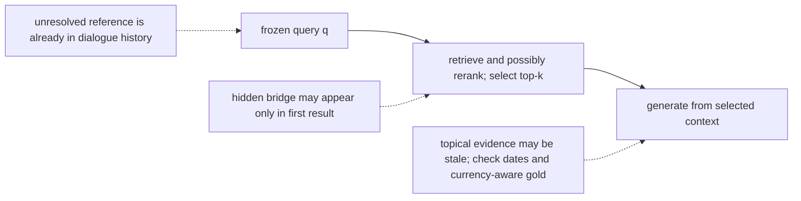
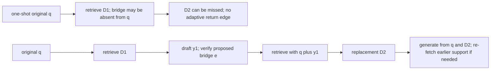
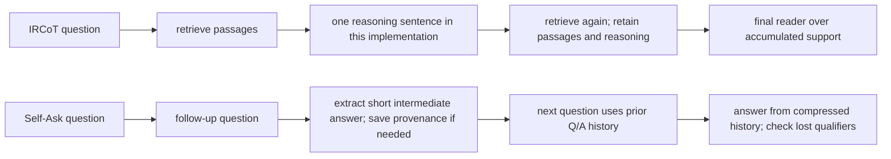
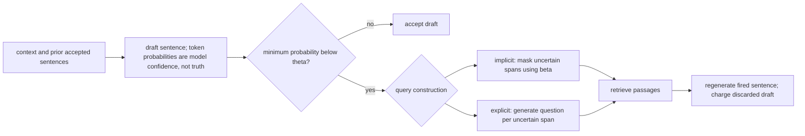
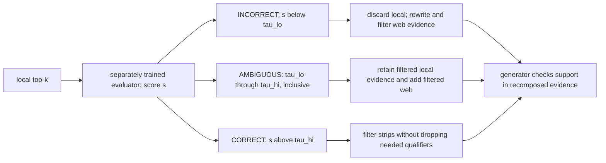
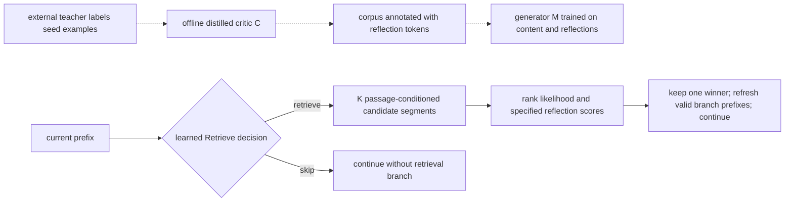
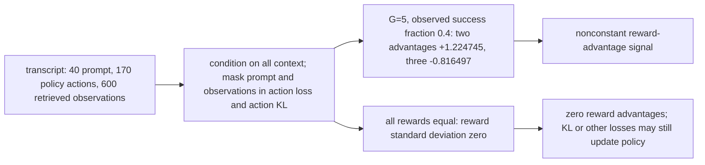
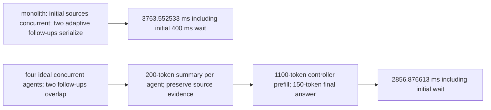
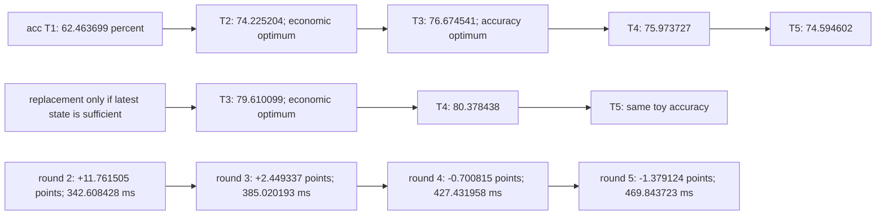

# Chapter 26: Iterative, Recursive, and Agentic Retrieval
[00-START-HERE](../00-START-HERE.md) · [01-READING-ROUTES](../01-READING-ROUTES.md) · [25\_routing\_and\_adaptive\_retrieval](25_routing_and_adaptive_retrieval.md) · [27\_fine\_tuning\_the\_generator](../part-08-training/27_fine_tuning_the_generator.md)
Purpose: Explain why a single retrieval call fails when the useful query appears only after reasoning begins, then compare the retrieval-augmented generation (RAG) control loops that retrieve again, critique evidence, learn search behavior, fan out across sources, and stop before extra rounds reduce value.
## TL;DR
- One-shot retrieval fixes its query and context before generation. Hidden bridges may need another search; unresolved references can instead need a history-aware rewrite, and stale evidence needs a currency-aware check.
- ITER-RETGEN feeds a draft into the next retrieval query and replaces the retrieved set. With fixed chunk lengths, each generator prompt stays bounded and cumulative full-replay prompt work grows linearly with rounds.
- Recursive methods derive the next hop from partial reasoning. IRCoT accumulates passages and reasoning; Self-Ask retains short question-answer history, trading evidence detail for a smaller context.
- FLARE tests ordinary draft-token probabilities. Accept a non-triggering draft; on a trigger, mask uncertain spans, retrieve and regenerate. Confidence is not a factuality certificate.
- CRAG uses a separately trained evaluator and two thresholds. The ambiguous band can preserve useful local evidence while adding web results, but does not guarantee zero answer harm.
- Self-RAG learns reflection tokens. Ranking $`K`$ candidates costs candidate decoding; low reflection-token overhead does not make the branches free or their critiques independent.
- Search-R1 trains policy-generated reasoning, searches and answers while treating retrieved information as context, not authored actions. GRPO removes a learned critic but needs sampled groups; identical rewards give zero reward advantages, not necessarily zero total gradient.
- Agent fan-out can overlap source-specific work or reduce context-attention work, at the price of duplicated prompts, summaries and coordination. Stop using a validated marginal-value model, not confidence alone; keep hard resource and safety caps.
## The story
Imagine a field team crossing a chain of islands with one radio call to headquarters. The first island is easy to name from the mission brief. The second is reachable only after the team reads a sign on the first.
A dispatcher with one frozen query may not name the next island before seeing its sign. ITER-RETGEN lets the scout radio back a draft route; headquarters joins that draft to the original mission and sends a replacement map. A map index that already links the islands could sometimes find both at once, so the analogy is a failure mode, not an impossibility theorem.
IRCoT keeps maps and reasoning in a growing field notebook. Self-Ask retains short questions and intermediate answers instead of every map. Its notes are lighter, but they still grow and may omit qualifiers or provenance needed later.
FLARE sends a scout ahead and masks uncertain guesses before requesting another map. CRAG adds a separately trained inspector who filters useful maps, replaces bad ones, and supplements ambiguous ones. Separate training does not make inspector errors statistically independent of the scout’s errors.
Self-RAG gives the scout compact learned signal flags, but sending a scout down every candidate trail still costs work. Search-R1 lets terminal reward shape policy actions. If every expedition receives the same reward, GRPO’s reward-advantage signal vanishes; regularization or other loss terms may still update the policy.
Agentic retrieval sends separate teams to separate sources. Parallel follow-ups can help, and splitting large contexts can also help before any follow-up; summaries and coordination can erase those gains. Stop when expected evidence benefit no longer compensates for dilution and resource cost, with uncertainty and hard caps stated.
## Decoder table


| Term | Decode | Operational consequence |
| --- | --- | --- |
| One-shot retrieval | Select top-$`k`$ context for one generator call; retrieval may include reranking | No adaptive retrieval from a newly generated bridge unless a return edge is added |
| Answer drift | A fluent answer is supported by the supplied context but answers the wrong implied question | Groundedness can remain green |
| Unresolved reference | The surface query omits a referent stored in dialogue history | Rewrite to a self-contained query before retrieval |
| Stale-but-relevant retrieval | Topically relevant evidence is outdated or temporally contradictory | Relevance-only recall may miss it; currency-aware gold and checks can detect it |
| Bridge entity | Entity discovered at hop $`j`$ that helps query hop $`j+1`$ | Sequential discovery can be needed, but a missing literal name alone is not an impossibility proof |
| $`D`$, $`d`$, $`C`$, $`k`$, $`N`$, $`s(q,d)`$, $`p(a \mid q,C)`$, $`f_j`$, $`d_j`$, $`h`$, $`\rho_j`$, and $`e`$ | Corpus, document, context, retrieval depth, corpus size, score, answer distribution, required facts, source documents, chain depth, recall and bridge | Joint evidence coverage requires conditional factors or an explicit independence assumption |
| $`q`$ | Original user query | It anchors later query rewrites |
| $`q^\star`$ | Self-contained information need reconstructed from query and history | It resolves references before ranking |
| $`D_t`$ | Passages selected at round $`t`$ | Replacement bounds passage volume only with fixed chunk lengths; preserve earlier support when needed |
| $`y_t`$ | Generated draft or partial answer at round $`t`$ | It can reveal the missing bridge entity |
| $`Q`$, $`C`$, $`T`$, $`r_1`$, $`r_{2\mid1}`$ | Query size, chunk size, rounds, first-hop recall and second-hop conditional recall | Chunk-size symbol is local; conditional recall avoids an unstated independence assumption |
| ITER-RETGEN | Alternate retrieval and generation using $`q`$ joined to the prior draft | Fixed-length replacement gives bounded per-round generator prompts and linear cumulative replay work |
| Iterative retrieval | Repeat retrieval with a revised version of the same information need | A draft often drives the revision |
| Recursive retrieval | Emit a new reasoning step or sub-question whose answer determines the next hop | Queries can differ semantically across hops |
| Static fan-out | Prepare subqueries before seeing their results, then retrieve concurrently | Useful when the dependency topology permits it; fixed fan-out does not need agents |
| Reciprocal Rank Fusion (RRF) | Fuse several ranked lists without needing comparable raw scores | Useful after independent parallel retrieval |
| IRCoT | Derive a reasoning-sentence query and retain passages plus reasoning | Full replay grows quadratically; caches and final-reader design change the ledger |
| Self-Ask | Derive follow-up questions and retain short intermediate Q/A history | Less raw passage text, but growing history and possible loss of qualifications or provenance |
| $`p_{\text{on}}`$ | Conditional retrieval rate when the current subject is named | Constant along successful paths only as an explicit scenario assumption |
| $`p_{\text{off}}`$ | Conditional retrieval rate when that subject is not named | Can be low on bridges, but need not be zero or universal across corpora |
| $`a`$ | Correct bridge extraction conditional on preceding successful evidence | Compounds along a successful path; no-retry powers are not final answer accuracy |
| $`P_{\text{one-shot}}`$, $`P_{\text{rec}}`$, $`m`$, $`n`$, $`\tau`$, $`R`$, and $`p_i`$ | Path probabilities, sentence tokens, sentence count, token time, whole retrieval-path time and ordinary token probability | These symbols are local to the recursive and FLARE sections |
| Compositionality gap | Compositional failure despite correct isolated component answers | The reported GPT-3 result does not establish a model-family-independent law |
| FLARE | Draft a sentence; accept if no trigger, otherwise retrieve and regenerate | Only fired drafts are discarded in the break-even ledger |
| $`\theta`$ | Threshold for the minimum probability of the drafted tokens | A confidence heuristic, not a factuality probability |
| $`\beta`$ | Threshold defining tokens or spans masked in a retrieval query | With matching strict tests, $`\beta\ge\theta`$ covers all triggering tokens |
| Implicit FLARE query | Mask uncertain spans and retrieve using the remainder | No additional query-generation call beyond the draft; retrieval and context handling still cost work |
| Explicit FLARE query | Generate one question for each uncertain span | Charge query decode/input processing; spans need not be single tokens |
| $`f^{*}`$ | Implicit break-even rate $`R/(m\tau+R)`$ | Requires reused non-triggering drafts and equal-length regenerations; explicit-query costs lower it |
| CRAG | Grade the retrieved set, then filter local evidence, use web evidence, or do both | Adds an explicit correction point |
| $`\tau_{\text{lo}}`$ | Lower boundary on a learned evaluator score | Below it is INCORRECT; equality is assigned to AMBIGUOUS here |
| $`\tau_{\text{hi}}`$ | Upper boundary on a learned evaluator score | Above it is CORRECT; equality is assigned to AMBIGUOUS here |
| INCORRECT | Discard local results, rewrite to keywords, search the web | A false positive here can delete a correct local answer |
| AMBIGUOUS | Retain filtered local evidence and append filtered web evidence | Mitigates false discard, but does not guarantee unchanged reader accuracy |
| CORRECT | Rescore strips and recompose selected local evidence | Can cut boilerplate or accidentally delete needed qualifiers |
| Knowledge strip | A sentence or two cut from a retrieved chunk and rescored | Fine-grained evidence filtering |
| $`\Delta A`$, $`p`$, $`g`$ | Answer-accuracy change, useful-local-evidence presence and reader accuracy when evidence is useful | Multiply the presence-change expression by the reader factor under the stated model |
| $`r`$ | Probability of detecting an unhelpful local set | Controls rescue attempts, not final answer correctness by itself |
| $`f`$ | Probability of falsely discarding a helpful local set | Harm depends on web recovery and whether local evidence is preserved |
| $`\alpha`$ | Useful-web-evidence presence after a local miss | Multiply by conditional reader success when converting to answer accuracy |
| $`\alpha_0`$ | Useful-web-evidence presence after false discard of a useful local hit | Reduces the lost-hit penalty under the constant-reader model |
| Self-RAG | Add learned reflection-token groups to the generator vocabulary | Critique becomes a decoder probability |
| Retrieve | Reflection group with yes, no, and continue | Gates evidence per segment |
| IsRel | Reflection group with relevant and irrelevant | Judges a retrieved passage |
| IsSup | Reflection group with fully supported, partially supported, and no support | Judges entailment of the generated segment |
| IsUse | Reflection group with ratings 1 through 5 | Rates the completed response |
| $`s_G`$ | Probability of a specified desired token normalized within its reflection group | Not automatically calibrated; ordinal groups can use an explicit expected-rating score |
| $`V`$, $`C`$, $`M`$, $`x`$, $`d_i`$, $`y_{1:t-1}`$, and $`w_G`$ | Vocabulary, offline critic, generator, input, candidate passage, retained prefix and group weight | Likelihood length convention and reflection-score definitions must be consistent |
| $`K`$ | Passage-conditioned candidates per segment | Multiplies decoded candidate work; latency depends on concurrency and capacity |
| Distilled critic | Local model trained from external labels to annotate generator data offline | Removes teacher calls from serving; does not impose a universal hard teacher-performance ceiling |
| Search-R1 | Policy generates reasoning, searches and answers; the environment inserts retrieved information | The transcript includes observations that are not policy-authored actions |
| PPO | Policy optimization commonly using a learned value baseline | The $`112\,\mathrm{GB}`$ critic is one unsharded bf16/AdamW scenario, not unavoidable PPO memory |
| GRPO | Compare same-question rollout rewards using group statistics | Avoids a learned critic while paying for sampled rollouts and any retained regularization |
| $`G`$ | Number of sampled rollouts for a question | Changes constant-group probability and resource cost; correlated samples need separate analysis |
| $`\hat A_i`$, $`r_i`$, $`\mu`$, $`\sigma`$, $`c`$, $`\hat p`$, $`\pi`$ | Advantage, reward, mean, population deviation, success count, observed fraction and true sampling probability | Observed group fraction and underlying probability are not interchangeable |
| Dead group | All sampled rewards are equal, so reward variance is zero | Zero reward advantages do not imply zero KL/auxiliary gradients or optimizer updates |
| Retrieved-span mask | Keep retrieved text as context; exclude prompt and observation positions from policy-action loss and action-level KL | Prevents treating search-engine observations as actions chosen by the policy |
| $`\lambda`$, $`v_t`$, $`n`$, $`\mathrm{EM}`$ | Per-search utility penalty, expected terminal correctness, search count and exact match | A one-extra-search threshold is a myopic comparison, not an optimal-policy guarantee |
| Sub-agent | Policy with a private context and configured retrieval/permission scope | Charge summary or structured-evidence production; interfaces need not be exclusive |
| Controller | Policy that dispatches sub-agents and synthesizes their outputs | Owns global step and spend limits |
| Fan-out | Run source-specific work concurrently when dependencies permit | Sum-to-maximum savings require a serialized baseline and enough concurrent capacity |
| $`\ell`$, $`d`$, $`L`$, $`N`$, $`m`$, $`n_s`$, $`c`$ | Layers, width, context length, parameters, agent count, additional source rounds and round time | The equal-round crossover is a simplification; actual prefix lengths change append costs |
| Conjunctive reliability | Probability every required agent result is correct | Equals $`a_{\text{agent}}^{m}`$ when agents have equal independent accuracy |
| $`2m + 2`$ scoreboards | One design with two agent metrics plus dispatch and synthesis | Useful attribution layout, not a universal minimum |
| $`C(T)`$ | Path-discovery probability within cap $`T`$ in the no-retry depth-mixture toy | Does not ensure earlier evidence remains in the final prompt or that the answer is correct |
| $`u(T)`$ | Conditional evidence-use surrogate from a fixed gold score versus IID normal distractors | Not a general model of language-model attention or multi-hop utilization |
| $`\pi_h`$, $`\Phi`$, $`\mu`$, $`m_{\mathrm{floor}}`$, $`\beta_{\mathrm d}`$ | Depth share, normal CDF, fixed gold score, fallback accuracy and dilution coefficient | The fixed-gold and no-retry assumptions define the illustrative curve |
| $`A(T)`$, $`\Lambda(T)`$, $`\Delta C_T`$, and $`\Delta A_T`$ | Toy answer accuracy, partial latency components and marginal coverage/accuracy | A latency proxy is not measured p95; utility weights must have consistent units |
| $`T^\star`$ | Accuracy-maximizing cap among the evaluated options | Three only under the stated accumulating coverage/utilization assumptions |
| $`T^\dagger`$ | Cap maximizing the specified quality-minus-resource objective | Two in the stated accumulating ledger, including its declared cached variant |
| Prefix caching | Reuse valid unchanged prefix KV states in an append-only sequence | Requires matching context/model/template; changed prompts or a new reader can invalidate reuse |
| Best Match 25 (BM25) and Embeddings from Bidirectional Encoder Representations (E5) | Sparse term scoring and the dense encoder named in Search-R1 | They represent two retrieval families used in the source |
| Generative Pre-trained Transformer (GPT), Text-to-Text Transfer Transformer (T5), Incomplete Information Reading Comprehension (IIRC), and American Invitational Mathematics Examination (AIME) | Generator and evaluator families, multi-hop reading benchmark, and mathematics benchmark | They decode model names and bound two reported comparisons |


## Core mechanics
### Mathematical conventions
Use natural logarithms, decimal storage units and full precision until rounding: $`1\,\mathrm{GB}=10^9\,\mathrm B`$ and $`1\,\mathrm{TB}=10^{12}\,\mathrm B`$. Probabilities and accuracy are fractions; an absolute increase of $`0.01`$ is one percentage point, not necessarily a one-percent relative increase. Products of hop probabilities below require either explicitly conditional factors or a stated independence model. Discovering a path, retaining its evidence and answering correctly are different events.
Where the common $`7`$-billion-parameter proxy is specified, use $`F=3.4\times10^{14}\,\mathrm{FLOP\,s^{-1}}`$, weight-stream bandwidth $`B=3.35\times10^{12}\,\mathrm{B\,s^{-1}}`$ and two bytes per weight. Thus $`W_{\mathrm{forward}}\approx2NT`$, linear prefill time per token is $`2N/F\approx0.041176471\,\mathrm{ms/token}`$, and the batch-one weight-stream component is $`\tau=2N/B\approx4.179104478\,\mathrm{ms/token}`$. These are accounting components, not benchmarks: attention, KV-cache traffic, kernels, utilization, queuing, communication and tool overhead may add cost. The Self-RAG and recursive examples explicitly use different stipulated token rates. Ideal parallel latency requires sufficient concurrent capacity.
Prompt positions processed, new input tokens, provider-billed input tokens and output tokens have different denominators. State whether prefixes are replayed, validly cached or billed again. Letters are local to each section: in particular context $`C`$, chunk size $`C`$, coverage $`C(T)`$ and critic $`C`$ are distinct; so are the FLARE mask threshold $`\beta`$ and stopping dilution coefficient $`\beta_{\mathrm d}`$. None of the chapter-reported empirical rates or historical examples is established by the arithmetic alone.
### 26.1 Why one-shot retrieval breaks
What:
- One-shot retrieval selects context once for a generator call: $`C=\mathop{\mathrm{RET}}\nolimits(q,D;k)`$, followed by $`p(a\mid q,C)`$. The selection may itself include ANN search and reranking; “one-shot” does not mean every document is scored exactly once.
- Let $`s(q,d)`$ be a retrieval score, $`f_j`$ a required hop fact, $`d_j`$ its document, $`h`$ the chain depth and $`e`$ a bridge entity. A frozen-query system cannot use a newly generated bridge to launch another retrieval unless the control flow provides that return edge.
Why the failure appears:
- A chain needs facts $`f_1,\ldots,f_h`$. Let $`E_j`$ mean that the selected context contains the evidence for fact $`j`$.
- The joint evidence probability is a conditional chain product. If $`\rho_j`$ instead denotes marginal recall, replacing the conditional factors by $`\rho_j`$ requires independence:

```math
\Pr\!\left(\bigcap_{j=1}^{h}E_j\right)
=\Pr(E_1)\prod_{j=2}^{h}\Pr(E_j\mid E_1,\ldots,E_{j-1})
\;\overset{\text{independent }E_j}{=}\;\prod_{j=1}^{h}\rho_j.
```

For two independent evidence events with $`\rho_1=\rho_2=0.8`$, joint coverage is $`0.8^2=0.64`$. Correlated retrieval errors need not give this value. A missing bridge can lower recall, but absence of a literal term does not prove that dense retrieval, links or a broader first result cannot recover the second document.
Failure without it:
- For an explicit information need about sulfur’s classification, suppose penicillin is only a bridge. Passages about the discovery of penicillin can support “Alexander Fleming, in 1928” while failing to answer that need. The error is responsiveness, not necessarily unsupported text; the question must distinguish the two discoveries.
- In “when did he start the company?”, stoplisting may leave “start” and “company.” Their stipulated IDF contributions, $`1.10`$ and $`1.73`$, sum to $`2.83`$. Relative to the self-contained example’s recomputed IDF sum, this is about $`15.459149\%`$ of the raw IDF total, not a bound on semantic information or answer accuracy. No document frequencies are supplied to rederive those two stipulated contributions.
- A PayPal or Tesla referent already present in turn $`t-1`$ can be resolved before retrieval; it is not information that inherently arrives after retrieval.
- Topical relevance does not establish current truth. Relevance-only Recall@k can miss staleness; a currency-aware gold set and evaluation can detect it. A high recall score is not, by itself, a certificate of responsiveness or currency.
Cost and complexity:
- In a corpus of $`10^7`$ chunks, use the Robertson–Sparck Jones IDF variant $`I(t)=\ln\!\bigl((N-\mathrm{df}_t+0.5)/(\mathrm{df}_t+0.5)\bigr)`$, without the additional $`1`$ inside the logarithm used by another BM25 convention. The document frequencies for penicillin, element, scientist, discovered and found are $`4{,}000`$, $`300{,}000`$, $`400{,}000`$, $`800{,}000`$ and $`2{,}000{,}000`$.
- Their IDFs are approximately $`7.823520989`$, $`3.476097075`$, $`3.178052632`$, $`2.442346465`$ and $`1.386294174`$. Sum before rounding: $`18.306311334`$. Penicillin contributes approximately $`42.736742\%`$ of this raw IDF sum, not a probability or a proven share of discriminative power.
- The other terms sum to $`10.482790345`$. This is not a BM25 upper bound on a passage lacking penicillin: term-frequency factors can exceed one. For a single occurrence of each query term and $`k_1=1.2`$, the usual positive-denominator TF factor is bounded above by $`k_1+1=2.2`$, giving an other-term supremum of about $`23.062138760`$ in this simplified score. Actual lengths and term frequencies still determine the score.
- With $`k=50`$ and $`400`$ tokens per chunk, retrieved text alone has $`20{,}000`$ tokens, beyond an $`8{,}192`$-token window. Include a $`200`$-token question for $`20{,}200`$ tokens. Linear prefills cost approximately $`823.529412\,\mathrm{ms}`$ and $`831.764706\,\mathrm{ms}`$ respectively. A $`k=5`$ prompt with the question is $`2{,}200`$ tokens and costs $`90.588235\,\mathrm{ms}`$.
- For a matched partial schedule, suppose each retrieval costs $`83\,\mathrm{ms}`$ and a two-hop route generates only a $`20`$-token bridge before the common final answer. Its cost is $`2(83)+2(90.588235)+20\tau\approx430.758560\,\mathrm{ms}`$. Wide one-shot costs $`83+831.764706\approx914.764706\,\mathrm{ms}`$ before the same final answer. The difference is approximately $`484.006146\,\mathrm{ms}`$, excluding other overhead. The former $`224`$/$`249`$ versus $`700`$ millisecond claims omitted or inconsistently priced these components. This is not the two-full-$`80`$-token-round scenario in Section $`26.2`$.
Mechanism example:
- In the illustrative chemistry chain, hop one exposes sulfur. At document frequency $`30{,}000`$, $`I(\text{sulfur})=\ln(9{,}970{,}000.5/30{,}000.5)\approx5.806121865`$ under the same IDF convention.
- The second query asks who established that sulfur is an element. The reported example points to Lavoisier’s $`1777`$ argument; this mathematical pass does not independently verify that historical account.
- Distinguish benchmark configurations: the standard ten-paragraph HotpotQA distractor setting contains two supporting paragraphs and eight distractors, not two plus ten. The full-wiki setting is different. A bridge in the first supporting paragraph motivates sequential retrieval; it does not prove that every first query must miss the other paragraph.
Practice decisions:
- Resolve available dialogue references before ranking; a second search is not a substitute for reading the history. Evaluate responsiveness, support and currency separately.
- The source’s $`300`$-example audit and roughly ten-percent multi-hop routing threshold are workflow heuristics, not statistical guarantees. Failure categories can overlap, and a relevance-only grader need not detect stale evidence.
- Raise $`k`$ only after checking the context and cost budgets. Test whether a bridge-aware rewrite or iterative call improves measured joint evidence retention and downstream answer correctness.
### 26.2 Iterative retrieval with ITER-RETGEN
What:
- In a toy service graph, one document maps billing-api to prod-ledger-3; another maps prod-ledger-3 to eu-central-1. The bridge $`e`$ is in both documents but absent from the original query and final region answer.
- Let $`r_1`$ be first-document recall and $`r_{2\mid1}`$ second-document recall conditional on obtaining the first. One-shot joint recall is then a chain-rule product, without an independence assumption:

```math
R_{\mathrm{one\text{-}shot}}=r_1r_{2\mid1}.
```

- ITER-RETGEN alternates retrieval and generation:

```math
D_1=\mathop{\mathrm{RET}}\nolimits(q,D;k).
```


```math
y_1=\mathop{\mathrm{GEN}}\nolimits(q,D_1).
```


```math
D_t=\mathop{\mathrm{RET}}\nolimits(q\oplus y_{t-1},D;k).
```


```math
y_t=\mathop{\mathrm{GEN}}\nolimits(q,D_t),\qquad t=2,\ldots,T.
```

Why:
- The original question anchors generation while the previous draft augments retrieval. Joining a draft can surface a bridge, but can also amplify a hallucinated bridge; validate the resulting evidence.
- Replacing $`D_t`$ keeps the passage count at $`k`$. With query length $`Q`$, fixed chunk length $`C`$ and no growing generator history, each generator prompt has $`Q+kC`$ tokens. This is bounded per round, not prompt size growing linearly with $`T`$; cumulative full-replay prefill grows linearly.
Failure without it:
- If the original query gives no discriminating signal for the second document and ranks are exchangeable, its mean rank among $`N=2\times10^6`$ chunks is $`(N+1)/2=1{,}000{,}000.5`$, and uniform top-five inclusion probability is $`5/N=2.5\times10^{-6}`$. A missing lexical term alone does not justify that exchangeable-rank model.
- A fully specified query naming prod-ledger-3 cannot be constructed from the original wording if that name is genuinely unknown. A placeholder, graph traversal, prior knowledge or a later adaptive step can change the design.
- Static fan-out is useful when subqueries can be prepared before their results arrive, as in many Postgres-versus-MySQL comparisons. A dependent bridge chain may instead need sequential discovery. Evaluate the dependency topology, not merely the label “multi-hop.”
Cost and complexity:
For full prompt replay, fixed $`Q`$ and $`C`$, and $`b`$ retained generated tokens per prior round, distinguish three prompt-position ledgers. The accumulating external-token ledger excludes those retained outputs; adding them changes the total:

```math
\begin{aligned}
P_{\mathrm{replace}}(T)&=T(Q+kC),\\
P_{\mathrm{acc,external}}(T)&=TQ+kC\frac{T(T+1)}2,\\
P_{\mathrm{acc,history}}(T)&=TQ+kC\frac{T(T+1)}2+b\frac{T(T-1)}2.
\end{aligned}
```

If $`D_{h+1}\approx D_h`$, stable retrieval is a possible stopping signal, not a proof of a fixed point. Stochastic decoding, changed drafts and retrieval ties can still change later states or create cycles. An extra round still pays for retrieval and generation, and replacement can lose earlier supporting passages.
Worked example:
- Fix $`N_{\mathrm{chunks}}=2\times10^6`$, chunk size $`C=400`$, question size $`Q=200`$, $`k=5`$ and a $`7`$-billion-parameter fp16 generator. Embedding, ANN search and cross-encoding cost $`8+15+60=83\,\mathrm{ms}`$ per retrieval in this stipulated ledger; the ANN stage considers $`100`$ candidates. Hold this retrieval cost fixed despite changed query length only as an explicit simplification.
- Let first-hop recall be $`0.86`$ and second-hop conditional recall under the original query be $`0.09`$. Joint one-shot path recall is $`0.0774`$. Linear prefill of $`2{,}200`$ tokens costs $`90.588235\,\mathrm{ms}`$; an $`80`$-token output costs $`334.328358\,\mathrm{ms}`$ under the common stream proxy. Total: $`507.916593\,\mathrm{ms}`$.
- Wide one-shot with $`k=50`$ uses conditional factors $`0.97`$ and $`0.17`$, giving $`0.1649`$ joint path recall. Its $`20{,}200`$-token prefill and $`80`$-token decode total $`1{,}249.093064\,\mathrm{ms}`$ including retrieval, if the context window can hold it.
- With a correct bridge-extraction probability of $`0.90`$, the second query contains the correct bridge with probability $`0.86(0.90)=0.774`$. Conditional retrieval probability $`0.78`$ then gives discovered-path probability $`0.60372`$, approximately $`3.661128`$ times the wide baseline. These are stipulated conditional rates, not measured answer accuracy; ensure the final reader still receives both required facts.
- Two complete $`80`$-token replacement rounds cost $`1{,}015.833187\,\mathrm{ms}`$, approximately $`233.259877\,\mathrm{ms}`$ less than wide one-shot under this ledger. This replaces the inconsistent $`134`$, $`231`$ and $`992`$ millisecond comparisons rather than propagating them as alternative results.
- For seven accumulating rounds, external prompt positions are $`57{,}400`$. Replaying all prior $`80`$-token outputs adds $`1{,}680`$, for $`59{,}080`$ prompt positions. Linear prefill, decode and retrieval cost approximately $`2{,}432.705882`$, $`2{,}340.298507`$ and $`581\,\mathrm{ms}`$, totaling $`5{,}354.004390\,\mathrm{ms}`$, or $`10.541109`$ times the small one-shot ledger. This assumes full replay, no prefix caching and no additional final reader; the former $`2{,}009`$ millisecond prefill and $`4{,}942`$ millisecond total do not follow from the stated rate.
Practice decisions:
- Begin with a small cap such as two or three rounds, then measure cap hits, path retention and answer correctness. These are tuning defaults, not universal optima.
- Keep earlier source identifiers and re-fetch supporting chunks when a replacement draft is not sufficient evidence. A remembered intermediate answer is not a citation.
- On timeout, return a clearly marked partial result, abstain or hand off as appropriate; do not force a confident answer merely because the cap fired.
### 26.3 Recursive retrieval with IRCoT and Self-Ask
What:
For a deliberately simplified $`h`$-hop chain, let $`p_{\mathrm{on}}`$ be conditional retrieval success when the subject is named, $`p_{\mathrm{off}}`$ the conditional rate when it is not, and $`a`$ correct bridge extraction conditional on successful evidence. If one-shot is on-subject only for the first hop and these rates stay constant along successful paths:

```math
P_{\mathrm{one\text{-}shot}}=p_{\mathrm{on}}p_{\mathrm{off}}^{h-1}.
```

A recursive loop that correctly names each next subject has the following successful-path probability under the same stationary conditional-rate model, with no retries, alternate paths or repair. It is not yet the final answer probability:

```math
P_{\mathrm{rec}}=p_{\mathrm{on}}^h a^{h-1}.
```

Why:
- Make the example unambiguous: “Who succeeded the U.S. president in office when the Soviet Union dissolved?” The original “who was president after it dissolved?” could mean George H. W. Bush, not necessarily Bill Clinton.
- The reported chain identifies December $`1991`$ and Bush, then asks who succeeded Bush, leading to Clinton’s January $`1993`$ inauguration. The mathematical pass does not independently source that chronology.
- The bridge makes a useful next query; it does not prove a knowledgeable retriever or generator could never answer in one step, nor that the November $`1992`$ election date must be unknown beforehand.
Failure without it:
With $`p_{\mathrm{on}}=0.85`$, $`p_{\mathrm{off}}=0.25`$ and $`a=0.90`$, two-hop one-shot and recursive path probabilities are $`0.2125`$ and $`0.65025`$. At three hops they are $`0.053125`$ and $`0.49744125`$; at five hops recursive path success is $`0.2911150555`$. The powers describe this conditional toy model, not independent verification of an empirical method.
IRCoT mechanism:
- In the IRCoT-style implementation, retrieve on $`q`$, generate one declarative reasoning sentence using $`q`$, accumulated passages and prior reasoning, and use that sentence as the next query.
- Append the newly retrieved passages. Stop on a chosen terminator such as “so the answer is” or a hard cap, then run a final reader over the collected evidence. The terminator is a model output, not a guarantee of completeness.
- Declarative sentences can resemble corpus prose and suit lexical retrieval, but their effectiveness must be measured. One sentence per step is an implementation choice, not a universal property of every recursive system.
Self-Ask mechanism:
- A Self-Ask-style prompt asks whether follow-up questions are needed, generates one single-hop question, retrieves for that question and records an “Intermediate answer.”
- Raw passages can be dropped after extraction while short questions and answers remain in the history; this reduces passage volume but may lose qualifiers, contradictions and provenance. End with a final answer only after checking the retained evidence is sufficient.
- The reported compositionality-gap result concerns the evaluated GPT-3 family and task, not a theorem about every model family or retrieval architecture.
Cost and complexity:
- Full-replay IRCoT passage positions grow as $`T(T+1)/2`$, before adding replayed reasoning and the final reader. Valid prefix caching changes the newly computed positions but not necessarily all attention cost.
- Self-Ask can process a fixed amount of new passage text per hop, hence linear new-document volume. Replaying its growing short question-answer history can still contribute a quadratic term; “shorter” does not mean a constant-size full prompt.
- A catalog pasted into a standard dense-attention prompt is not a B-tree: it generally remains in attention computation rather than pruning disk branches. Sparse attention, learned routing and external indices have different costs, so do not generalize the dense comparison to every architecture.
Worked example:
- This separate scenario uses five $`200`$-token passages, $`50\,\mathrm{ms}`$ retrieval and $`50`$ output tokens per second. A one-shot $`40`$-token answer takes $`0.05+40/50=0.85\,\mathrm s`$ in retrieval-plus-decode components only; no prefill rate is given.
- Three IRCoT rounds generating $`30`$ reasoning tokens each, followed by a $`40`$-token final answer, generate $`130`$ tokens. Retrieval plus decode is $`3(0.05+30/50)+40/50=2.75\,\mathrm s`$, or $`3.235294`$ times the one-shot components. These are not full latency measurements.
- Replayed document positions are $`1{,}000(1+2+3)+3{,}000=9{,}000`$ including the final reader, excluding question, reasoning and control-token replay. Two Self-Ask follow-ups process $`2{,}000`$ new document tokens, a $`4.5`$-fold reduction in this scoped document ledger; a full latency comparison also needs its generated questions, intermediate answers and history processing.
- At $`\$0.50`$ per million document input positions and one million queries per day, these scoped document bills are $`\$500`$, $`\$4{,}500`$ and $`\$1{,}000`$ per day. They exclude other prompt positions, output billing, tool and serving costs.
- The conditional two-hop model predicts a $`43.775`$-percentage-point path-coverage gain, from $`0.2125`$ to $`0.65025`$. Do not equate it with the reported IRCoT gains of up to $`21`$ retrieval-recall points or $`15`$ downstream QA points across HotpotQA, 2WikiMultihopQA, MuSiQue and IIRC.
- Changing $`p_{\mathrm{off}}`$ to $`0.55`$ gives one-shot path coverage $`0.4675`$ and an $`18.275`$-point gap. The source’s roughly $`0.5`$ public-benchmark prior is a planning heuristic; measure the actual corpus, queries and conditional rates.
Practice decisions:
- Select recursive retrieval when next-query dependencies justify it; select static fan-out when the subqueries are available together. Preserve early support when citations or multi-sentence conditions matter.
- A cap of four retrievals and $`k`$ around three to five are starting heuristics. Inspect cap-hit failures, compression losses and both retrieval and answer metrics under the actual context and percentile-latency budgets.
### 26.4 Confidence-triggered retrieval with FLARE
What:
FLARE drafts the next sentence $`s_t`$ of $`m`$ tokens, using ordinary model probabilities $`p_i`$ for its drafted tokens under a defined decoding distribution. These are not probabilities that the tokens are true. If no token crosses the threshold, accept the draft; otherwise retrieve and regenerate the affected sentence.

```math
\text{retrieve}\quad\Longleftrightarrow\quad\min_{1\le i\le m}p_i\lt \theta.
```

On a trigger, remove or mask uncertain guessed spans when constructing the query, retrieve passages and regenerate $`s_t`$; discard the fired draft, not every non-triggering draft. Dropping the retrieved passages afterward changes context and may invalidate a cached suffix. Charge that context management where it occurs.
Why:
A minimum-token gate is sensitive to a single uncertain entity, but rare correct names can have low probability and familiar false statements can have high probability. Longer sentences have more opportunities to trigger. Tune the gate against useful-search and error labels, not just a desired search count.
Failure without it:
With twenty-four token probabilities of $`0.95`$ and one of $`0.10`$, the arithmetic mean is $`0.916`$. It can hide one weak token; neither the mean nor the minimum is a proof of factuality.

```math
\bar p=\frac{24(0.95)+0.10}{25}=0.916.
```

Using natural-log token loss, the same draft has perplexity

```math
\begin{aligned}
H&=-\frac{24\ln0.95+\ln0.10}{25}\approx0.1413449663,\\
\mathop{\mathrm{PPL}}\nolimits&=\exp(H)\approx1.151821919.
\end{aligned}
```

For all twenty-five probabilities equal to $`0.95`$, $`H=-\ln0.95\approx0.0512932944`$ and $`\mathop{\mathrm{PPL}}\nolimits=1/0.95\approx1.052631579`$. The relative perplexity gap is about $`9.423082\%`$. This demonstrates averaging dilution, not a calibrated factuality threshold; rounded exponents must not be connected by exact equality.
Implicit and explicit queries:
- An implicit query masks tokens below the mask threshold $`\beta`$, for example a draft of “Person X attended \[mask\] and earned \[mask\].” It adds no extra query-generation call beyond the already charged draft. Retrieval still costs work, and the remaining frame may be uninformative or combine distinct needs.
- An explicit query generates one question per uncertain span, not necessarily one per token. It separates needs but adds query decoding and input processing.
- The trigger threshold $`\theta`$ and mask threshold $`\beta`$ have different roles. With the same strict comparison, $`\beta\ge\theta`$ covers every triggering token; if $`\beta\lt \theta`$, a trigger may mask nothing. Specify span expansion and threshold-boundary handling.
- This implementation needs access to the relevant token probabilities. An API without them needs a different available gate or model interface; a trained Retrieve control token is an alternative architecture, not a feature automatically present in the existing model.
Cost and complexity:
- Hold answer length at twelve sentences of twenty-five tokens, with the common stream proxy $`\tau\approx4.179104478\,\mathrm{ms/token}`$. Sentence decode is $`S=25\tau\approx104.477612\,\mathrm{ms}`$ and the $`300`$-token output costs $`1{,}253.731343\,\mathrm{ms}`$.
- A retrieval path has $`8\,\mathrm{ms}`$ embedding, $`15\,\mathrm{ms}`$ ANN and $`500`$ new retrieved tokens. Their linear prefill costs $`20.588235\,\mathrm{ms}`$, so $`R\approx43.588235\,\mathrm{ms}`$.
- Retrieve-once and retrieve-before-every-sentence components total approximately $`1{,}297.319579`$ and $`1{,}776.790167\,\mathrm{ms}`$. The latter makes twelve searches and injects $`6{,}000`$ raw retrieved tokens.
- Implicit FLARE with four triggers reuses the other drafts and adds four regenerated sentences: $`12S+4(S+R)\approx1{,}845.994732\,\mathrm{ms}`$. It makes four searches and injects $`2{,}000`$ raw retrieved tokens.
- Six explicit twelve-token query generations add $`72\tau\approx300.895522\,\mathrm{ms}`$, for $`2{,}146.890255\,\mathrm{ms}`$, before their extra input processing. These partial ledgers omit shared answer-history processing, cache changes and other serving overhead; they are not complete wall-clock latencies.
Break-even criterion:

```math
\begin{aligned}
L_{\mathrm{every}}&=n(S+R),\\
L_{\mathrm{implicit}}&=nS+fn(S+R),\\
f^\star&=\frac{R}{S+R},\qquad S=m\tau.
\end{aligned}
```

- The break-even assumes every non-triggering draft is reused, each triggered draft adds one equal-length regeneration, and all other costs match. An explicit-query cost $`d`$ per trigger changes it to $`f^\star=R/(S+R+d)`$.
- Here $`f^\star\approx0.294384128`$. Four triggers in twelve sentences are above it, so implicit FLARE is approximately $`69.204565\,\mathrm{ms}`$ slower than every-sentence retrieval in these components, while using one third of the searches and raw injected tokens.
- If the entire retrieval path is instead $`R=400\,\mathrm{ms}`$, $`f^\star\approx0.792899408`$. If $`400\,\mathrm{ms}`$ is just web wait, add embedding and prefill before applying the formula.
- The bandwidth calculation is a weight-stream roofline, not measured token latency. Achieving $`70\%`$ to $`85\%`$ of that bandwidth would give approximately $`5.970149`$ to $`4.916593\,\mathrm{ms/token}`$ for this component. This does not establish an actual batch-one performance range.
- With $`\tau=6\,\mathrm{ms}`$ and $`R=40\,\mathrm{ms}`$, break-even is $`0.210526316`$. With the original stream proxy and $`R=40\,\mathrm{ms}`$ it is $`0.276859504`$. Different rate assumptions must not be silently combined into one threshold.
Practice decisions:
- Tune trigger and mask policies on sentence lengths, calibration and false positives; low token confidence alone is not missing-evidence detection. Mask uncertain guesses without unnecessarily erasing grounded user entities.
- A twelve-token explicit query costs approximately $`50.149254\,\mathrm{ms}`$ in this decode component, before its prefill and tool work. Charge all queries generated for multiple spans.
- A cap such as four searches is a product heuristic. Benchmark whole-answer p95, context replay and cache invalidation rather than inferring them from summed mean components.
### 26.5 Corrective RAG
What:
- CRAG places a separately trained retrieval evaluator between retrieval and generation. It aggregates query-document scores into a set score $`s`$; this is not a calibrated correctness probability without validation.
- Choose $`\tau_{\mathrm{lo}}\lt \tau_{\mathrm{hi}}`$. Here define INCORRECT as $`s\lt \tau_{\mathrm{lo}}`$, AMBIGUOUS as $`\tau_{\mathrm{lo}}\le s\le\tau_{\mathrm{hi}}`$, and CORRECT as $`s\gt \tau_{\mathrm{hi}}`$, so every boundary has a branch.
- CORRECT splits chunks into short strips, rescores and recomposes survivors. INCORRECT discards local results, rewrites the query and filters web results. AMBIGUOUS retains filtered local evidence while adding filtered web results.
- Strip filtering can remove a needed qualifier, and appended evidence can distract. These are architectural mitigations, not correctness guarantees. The reported Self-CRAG system combines this correction layer with Self-RAG.
Why:
For a binary gate, let $`p`$ be useful-local-evidence presence, $`r`$ detection probability given a local miss, $`f`$ false-discard probability given a useful local hit, and $`\alpha,\alpha_0`$ useful-web-evidence presence after those two types of escalation. Assume constant answer accuracy $`g`$ when useful evidence is present and zero otherwise. Then the answer-accuracy change is

```math
\Delta A=g\bigl[(1-p)r\alpha-pf(1-\alpha_0)\bigr].
```

- The bracket alone is a change in useful-evidence presence under this model, not answer accuracy unless $`g=1`$. The first term is rescued misses and the second useful hits lost after false discard and failed web recovery.
- Sensitivity to $`f`$ relative to sensitivity to missed detection $`1-r`$ is $`p(1-\alpha_0)/[(1-p)\alpha]`$. At $`p=0.72`$, $`\alpha=0.60`$ and $`\alpha_0=0.50`$, it is $`2.142857`$, not $`2.5`$; it depends on the web rates, not $`p`$ alone.
- An ambiguous branch that preserves all needed local support can reduce discard harm. Assuming its answer accuracy stays unchanged is an additional reader assumption: longer or conflicting context can still cause harm.
Failure without it:
- Retriever similarity measures a ranking objective, not a certified answer-presence probability. It can correlate with containment, but an unanswerable query still has a nearest neighbor.
- A generator grading its own output can share its original blind spots. A separate evaluator changes the model and training objective, but does not establish independent errors or guaranteed decorrelation.
- The chapter reports a separately fine-tuned T5-large evaluator of approximately $`770\times10^6`$ parameters fitted on PopQA. Calibrate thresholds and check transfer on the new domain; reported scores are not automatically probabilities there.
Cost and worked example:
- Stipulate $`p=0.72`$, answer accuracy $`g=0.85`$ when useful evidence is present and zero otherwise, evaluator $`r=0.85`$, $`f=0.08`$, and useful-web-presence rates $`\alpha=0.60`$, $`\alpha_0=0.50`$. A web call costs $`\$5`$ per thousand calls and $`400\,\mathrm{ms}`$ of wait.
- Baseline accuracy is $`pg=0.612`$. Escalation probability is $`(1-p)r+pf=0.2956`$, not $`0.296`$ before final rounding. Binary-gate accuracy masses are $`0.56304`$ retained local, $`0.12138`$ rescued local misses and $`0.02448`$ recovery after false discard, totaling $`0.7089`$.
- Move three quarters of evaluator false positives to AMBIGUOUS and assume their preserved support remains usable with the same $`g`$. This contributes $`0.0432(0.85)=0.03672`$; the remaining false-discard branch contributes $`0.0144(0.50)(0.85)=0.00612`$. Together with retained hits and rescued misses, accuracy is $`0.72726`$, a gain of $`11.526`$ points over baseline and $`1.836`$ points over the binary gate.
- Five evaluator pairs of $`230`$ tokens process $`1{,}150`$ positions. The forward proxy is $`1{,}150(2)(0.77\times10^9)=1.771\times10^{12}\,\mathrm{FLOP}`$, or $`5.208824\,\mathrm{ms}`$ at $`F`$. This is $`6.325\%`$ of the $`82.352941\,\mathrm{ms}`$ linear prefill of $`2{,}000`$ tokens through the $`7`$-billion-parameter generator, not a full serving-overhead ratio.
- At $`\$2.50`$ per GPU-hour, a thousand evaluator runs cost approximately $`\$0.003617`$. Web cost is $`0.2956(\$5)=\$1.478`$ per thousand user queries, for $`\$1.481617`$ total incremental cost. Divide by $`115.26`$ net additional correct answers to obtain approximately $`\$0.012855`$ per net improvement; that denominator is not a count of gross wrong-to-right conversions.
- Mean incremental components total $`5.208824+0.2956(400)\approx123.448824\,\mathrm{ms}`$. If baseline latency is a common constant and the web delay is exactly two-point, the added p95 is $`405.208824\,\mathrm{ms}`$. General p95s cannot be obtained by adding component quantiles; web latency variation and dependence require measurement.
- The reported Self-CRAG PopQA score of $`61.8\%`$, roughly seven points above its own Self-RAG baseline, is a separate experimental result, not validation of this constructed $`72.726\%`$ scenario.
Practice decisions:
- Fit and validate thresholds on local labels; $`300`$ to $`500`$ queries are the source’s starting heuristic, not a coverage guarantee. Report both false discard of useful sets and failure to escalate unhelpful ones.
- Filtering chunks above roughly $`200`$ tokens is another heuristic. Keep tables, code, negations and cross-sentence qualifiers intact when strip boundaries would destroy their meaning.
- Under overload, local-only serving is not inherently safe. Depending on evidence, access policy and product obligations, abstention, partial answers or handoff may be preferable.
### 26.6 Self-RAG
What:
Self-RAG extends the generator vocabulary with learned reflection groups: Retrieve decisions, IsRel relevance, IsSup support and IsUse ordinal usefulness ratings. For a specified desired token $`r_G^\star`$ in group $`G`$, normalize its probability within that group, with a positive denominator:

```math
s_G=\frac{p_\theta(r_G^\star\mid\text{current context})}{\sum_{r\in G}p_\theta(r\mid\text{current context})},\qquad\sum_{r\in G}p_\theta(r\mid\text{current context})\gt 0.
```

For $`K`$ passage-conditioned candidate segments, a schematic decode-time ranking combines segment likelihood with weighted reflection scores. Specify the target reflection token or rating expectation used in each group; IsUse can be an expected ordinal score rather than an argmax token. One illustrative score is

```math
f\!\left(\hat y_t^{(i)}\right)=\log p_\theta\!\left(\hat y_t^{(i)}\mid x,d_i,y_{\lt t}\right)+\sum_G w_Gs_G^{(i)}.
```

The weights $`w_G`$ are decode-time choices. Group-normalized model scores are not automatically calibrated truth probabilities. Use a consistent sequence-likelihood or length-normalized convention across candidates; otherwise unequal segment lengths can distort the ranking. This schematic is not a claim that every Self-RAG implementation uses exactly this score.
Why:
Reflection tokens allow structured decisions without a second free-form critique prompt or string parser, and can place retrieval/support checks within generation. They still require decoding, supervision and validation. FLARE’s ordinary token-confidence gate and a learned support-token score are different signals, neither a factuality guarantee.
Training and claim limit:
- In the reported training recipe, an expensive teacher labels a seed set, a critic $`C`$ is distilled from it, $`C`$ annotates the generator corpus offline and generator $`M`$ learns content plus reflection tokens with next-token training. The offline critic is not called at serving time.
- A scenario with $`20{,}000`$ teacher calls and $`150{,}000`$ local critic calls uses $`7.5`$ times fewer teacher calls than directly labeling all $`150{,}000`$ examples with the teacher. This does not mean a $`7.5`$-fold reduction in total training cost.
- Noisy teacher judgments can limit the student, but there is no universal theorem that a distilled student cannot outperform its teacher on a task after other data or learning. Content and critique sharing serving weights can correlate errors; separate CRAG weights do not establish statistical independence either.
Cost and worked example:
- This separate scenario stipulates $`50`$ output tokens per second per active stream and $`8{,}000`$ prefill positions per second. Use $`K=5`$, $`200`$-token passages, a $`100`$-token question/instruction and four $`30`$-token answer segments. Vanilla RAG processes $`1{,}100`$ prompt positions and $`120`$ output tokens: $`1{,}100/8{,}000+120/50=2.5375\,\mathrm s`$.
- Charge $`30`$ content plus three reflection tokens per candidate segment. All five candidates per segment give $`4(5)(33)=660`$ decoded tokens. This counts the specified three reflections only; any extra closing or control tokens must be added in an implementation.
- A declared cache/reseed schedule processes $`5(100+200)=1{,}500`$ initial prompt positions and $`3(5)(33)=495`$ winner-prefix refresh positions, for $`1{,}995`$ positions and $`0.249375\,\mathrm s`$ prefill. It keeps one winner per segment, not an exponentially growing beam. Charging every branch refresh is a conservative choice; the winning branch may reuse its valid KV state, while replaying without caches costs more.
- Only if five-way batching maintains $`50`$ tokens per second per stream does decode take $`4(33)/50=2.64\,\mathrm s`$. Total is then $`2.889375\,\mathrm s`$, or $`1.138670`$ times vanilla latency. Without this extra capacity, serial decode is $`660/50=13.2\,\mathrm s`$, totaling $`13.449375\,\mathrm s`$ under the same prefill ledger. A $`13.867\%`$ latency premium is conditional, not a measured universal result.
- Decode work is $`660/120=5.5`$ times baseline. Of the $`540`$ extra tokens, $`60`$ are reflection and $`480`$ discarded candidate content; reflection is $`11.111111\%`$ of extra decode. At $`K=2`$, decode is $`264`$ tokens, or $`2.2`$ times baseline work, not necessarily latency.
- As a component-only comparison, extra decode uses $`7(540)=3{,}780`$ billion-parameter-token units. A $`0.77`$-billion-parameter evaluator processing $`1{,}500`$ input positions uses $`1{,}155`$ such units, a ratio of $`3.272727`$. This excludes Self-RAG’s extra $`895`$ prefill positions, attention, batching differences and control costs; it is not a full cost comparison. The earlier CRAG example used $`1{,}150`$, not $`1{,}500`$, evaluator input positions.
Practice decisions:
Choose $`K`$ and reflection weights on held-out quality, support, latency and cost measurements. A support label is a learned judgment, not proof. Tune the branch budget to available capacity, preserve citations for the selected branch and report total candidate work alongside wall time.
### 26.7 Search-R1, GRPO, and learned stopping
What:
- In the described Search-R1 interface, the policy generates reasoning, search requests and final answers. A search closing tag pauses the policy, E5 retrieval returns the top three Wikipedia passages inside information tags and decoding resumes.
- Retrieved information is an environment observation conditioned on by later policy actions; the policy did not author the search engine’s text. Distinguish the interleaved transcript from the action sequence.
- The source describes a baseline with exact-match terminal reward and no explicit format, process or search-count reward. That is a version-specific recipe, not a restriction on every search-trained policy. Treat retrieved text as untrusted tool data, not new instructions.
Why GRPO:
- PPO commonly uses a learned value baseline; GRPO instead compares $`G`$ sampled rollouts for one question. Sampling groups has a cost even when the baseline is a simple mean.
- For an unsharded $`7`$-billion-parameter bf16 critic under the specified AdamW accounting, weights and gradients are $`14\,\mathrm{GB}`$ each, while fp32 master weights and two fp32 moments are $`28\,\mathrm{GB}`$ each. Total training state is $`112\,\mathrm{GB}`$, excluding activations, caches, actor and reference models.
- This is not unavoidable PPO critic memory: critic size, shared trunks, sharding, optimizer precision and offload change it. Define the population-standard-deviation group advantage as follows, setting it to zero for an exactly constant-reward group:

```math
\hat A_i=\begin{cases}(r_i-\mu)/\sigma,&\sigma\gt 0,\\0,&\sigma=0.\end{cases}
```


```math
\mu=\frac1G\sum_{j=1}^{G}r_j.
```


```math
\sigma=\sqrt{\frac1G\sum_{j=1}^{G}(r_j-\mu)^2}.
```

- For binary rewards and $`c`$ successes, let $`\hat p=c/G`$ be the empirical group success fraction, distinct from a true sampling probability. If $`0\lt c\lt G`$, success advantage is $`\sqrt{(1-\hat p)/\hat p}`$ and failure advantage is $`-\sqrt{\hat p/(1-\hat p)}`$ under the population variance above.
- At $`G=5`$ with one success, advantages are $`+2`$ and four copies of $`-0.5`$. With two successes, the positive value is $`\sqrt{1.5}\approx1.224745`$ and the negative value is $`-\sqrt{2/3}\approx-0.816497`$, with $`\sigma=\sqrt{0.24}\approx0.489898`$.
- Advantages sum to zero in a nonconstant group, but the weighted policy gradients do not generally cancel. Using sample variance, an epsilon or a different normalization changes the magnitudes. Group-relative normalization is not automatically an unbiased gradient estimator for expected exact match.
Failure without safeguards:
If every reward is identical, these reward advantages are zero. This eliminates the reward-advantage term, not necessarily the entire training gradient: KL regularization, entropy, auxiliary losses, weight decay or optimizer state can still cause updates. For conditionally IID binary-reward rollouts with true success probability $`\pi`$, the probability of a constant-reward group is

```math
P_{\mathrm{constant}}(\pi,G)=\pi^G+(1-\pi)^G.
```

- At $`G=5`$, constant-reward probabilities are $`0.0625`$ for $`\pi=0.5`$, $`0.5905`$ for $`\pi=0.9`$ and $`0.77378125`$ for $`\pi=0.95`$. At $`\pi=0.9`$, $`G=16`$ gives approximately $`0.185302019`$. Correlated samples or nonbinary total rewards need a different calculation.
- An $`810`$-token transcript with $`40`$ prompt, $`170`$ policy-generated and $`600`$ retrieved tokens has a retrieved fraction $`600/810\approx74.074074\%`$.
- Mask prompt and retrieved observation positions out of the policy-action loss and the action-level policy/reference KL penalty. Keep them in the model context so later policy actions can depend on them; masking loss does not erase context or its forward cost.
- Scoring the search engine’s observed tokens as policy actions would add an imitation/language-model objective, not the standard KL over controllable actions. Observation text being legitimate context is not a reason to penalize its token likelihood as if the policy chose it.
Search cost objective:
- Exact-match reward alone does not price search. An alternative is $`r=\mathrm{EM}-\lambda n`$ for $`n`$ searches, with reward and $`\lambda`$ in consistent utility units.
- Let $`v_t`$ be expected terminal correctness under a specified continuation policy. In a myopic comparison of exactly one extra search, holding other costs and continuations fixed, search is worthwhile if $`v_{t+1}-v_t\gt \lambda`$. This is not a theorem that RL finds the optimal stopping policy; a full Bellman comparison also accounts for future search and costs.
- For a $`3`$-billion-parameter model, a $`300`$-token linear prefill costs $`300(6\times10^9)/F\approx5.294118\,\mathrm{ms}`$. Add $`20\,\mathrm{ms}`$ retrieval for $`25.294118\,\mathrm{ms}`$, excluding search-query decode and other overhead.
- If one accuracy percentage point is worth $`100\,\mathrm{ms}`$, one unit of accuracy fraction is worth $`10{,}000\,\mathrm{ms}`$. The corresponding component-only penalty is $`\lambda\approx25.294118/10{,}000=0.002529412`$, not a conversion using milliseconds per unit fraction as if it were per point.
Training cost:
- Use a deliberately coarse arithmetic training ledger for a $`3`$-billion-parameter policy: $`2N=6\times10^9`$ forward FLOPs per position and $`6N=1.8\times10^{10}`$ forward-plus-backward FLOPs per position. The $`810`$-position trace has $`170`$ generated and $`640`$ prompt/observation positions. Rollout decode costs $`1.02\times10^{12}`$ FLOPs; rollout prefill $`3.84\times10^{12}`$; reference forward over the trace $`4.86\times10^{12}`$; policy forward/backward $`1.458\times10^{13}`$. Total is $`2.43\times10^{13}\,\mathrm{FLOP}`$ per rollout. Loss masks do not remove conditioning-context computation.
- At $`F`$, this is $`71.470588\,\mathrm{ms}`$ of arithmetic time per rollout, not sequential batch-one wall time. Five rollouts cost $`357.352941\,\mathrm{ms}`$ per question in this ledger. A $`100{,}000`$-question pass costs $`9.926471`$ arithmetic GPU-hours, or $`\$24.816176`$ at $`\$2.50`$ per GPU-hour; tool waits, attention, communication and utilization are omitted.
- With conditionally IID groups, a prompt mixture of $`30\%`$ at $`\pi=0.95`$, $`25\%`$ at $`\pi=0.05`$ and $`45\%`$ at $`\pi=0.5`$ gives $`45.370469\%`$ constant-reward groups. Expect $`54{,}629.53125`$ nonconstant groups, or $`5{,}503.419444`$ per arithmetic GPU-hour. Approximately $`4.503686`$ hours of the full ledger belongs to constant-reward groups; it is not necessarily wasted regularization signal.
- Generation/prefill costs $`14.294118\,\mathrm{ms}`$ per rollout and reference/update $`57.176471\,\mathrm{ms}`$. Only if the latter stages have no required nonzero losses and can be skipped without changing normalization, optimizer-state behavior or the target objective does the optimistic ledger save $`36.296375\%`$, reaching $`6.323522`$ hours and $`\$15.808804`$. Equal reward alone does not justify “identical gradients”; an active KL term is a direct counterexample.
- An oracle that discards the entire $`55\%`$ extreme-probability prompt cohort retains $`45{,}000`$ balanced prompts. Its training ledger costs $`4.466912`$ hours and yields $`42{,}187.5`$ expected nonconstant groups, or $`9{,}444.444444`$ per hour, $`1.716105`$ times the original rate. It loses $`22.775285\%`$ of the original nonconstant groups and changes the prompt distribution.
- A real five-rollout probe does not identify that oracle cohort: it retains approximately $`54.629531\%`$ after filtering observed constant-reward groups, not $`45\%`$. Generating probes for all original prompts alone costs approximately $`1.985294`$ arithmetic hours in this ledger unless validly reused. Reusing rollouts, drawing fresh groups and resampling prompts are different algorithms with different objectives and costs; probe compute is not free.
- A weight-only arithmetic/bandwidth balance gives batch size $`F/B\approx101.492537`$, hence at least $`102`$ in that toy comparison. It is not a guarantee that batch $`128`$ is optimal or fits memory; attention, KV traffic and variable lengths matter. Increasing $`G`$ from five to sixteen multiplies linear rollout work by $`3.2`$, while reducing constant-group probability at $`\pi=0.9`$ as above. Measure useful learning per resource, not group count alone.
Practice decisions:
- Log reward variance, constant-group rate, search count, KL, tool errors and held-out answer performance. Ten-percent or forty-percent constant-group thresholds are source heuristics dependent on group size, correlation and reward shaping, not universal signals to change an optimizer.
- Dynamic sampling changes the training distribution and can remove informative examples. Charge its probes and establish which loss terms remain on filtered groups before claiming gradient equivalence or savings.
- Keep tool permissions, timeouts and hard search caps. A cap derived from twice an observed p99 trace length is a resource heuristic, not a safety guarantee or proof that the learned stopper is optimal.
### 26.8 Agentic RAG and its costs
What and why:
- A sub-agent has its own context and a configured retrieval interface or permission scope; a controller dispatches work and combines summaries or structured evidence. Interfaces need not be exclusive unless that is an explicit policy.
- Let $`\ell`$ be layer count, $`d`$ hidden width and $`L`$ context length. A full-square attention prefill proxy is $`W(L)=2NL+4\ell dL^2`$. For a fixed total of $`L`$ tokens split equally across $`m`$ contexts with no duplicated overhead, $`mW(L/m)=2NL+4\ell dL^2/m`$. Only the quadratic term shrinks in that comparison. Causal kernels can change its coefficient.
- With $`N=7\times10^9`$, $`\ell=32`$ and $`d=4{,}096`$, the coefficient is $`4\ell d=524{,}288`$. A $`16{,}300`$-token monolith costs $`2.282\times10^{14}`$ linear plus $`1.3929807872\times10^{14}`$ attention FLOPs, totaling $`3.6749807872\times10^{14}`$, or $`1{,}080.876702\,\mathrm{ms}`$ at $`F`$.
- Four agents each process $`4{,}000`$ retrieved tokens plus a duplicated $`300`$-token prompt. Each prefill costs $`6.989408512\times10^{13}`$ FLOPs, or $`205.570839\,\mathrm{ms}`$. That is the ideal concurrent prefill time only with sufficient resources; on one shared constrained device, four requests need not finish in one request’s time.
- This attention-aware example differs from the earlier linear-only prefill ledgers. Add duplicated prompts, summaries, controller work and tool waits before comparing complete schedules.
Failure and crossover:
- Each $`200`$-token summary costs approximately $`835.820896\,\mathrm{ms}`$ under the stream proxy, and controller prefill of $`1{,}100`$ tokens costs $`47.159966\,\mathrm{ms}`$ under the attention proxy. Their $`882.980862\,\mathrm{ms}`$ is an added component, not the net fan-out tax.
- Splitting initial prefill already saves $`1{,}080.876702-205.570839=875.305864\,\mathrm{ms}`$ on the ideal critical path. Net non-loop overhead here is therefore only $`\Delta_0\approx7.674998\,\mathrm{ms}`$, before other scheduling differences.
- Let $`W_s^{\mathrm{mono}}`$ and $`W_s^{\mathrm{agent}}`$ denote additional adaptive follow-up durations for source $`s`$ under their respective context schedules. If those follow-ups serialize in the monolith but overlap across agents, the conditional crossover is

```math
\sum_s W_s^{\mathrm{mono}}-\max_s W_s^{\mathrm{agent}}\gt \Delta_0.
```

- In the further simplification of equal per-round cost $`c`$ and $`n_s`$ additional follow-ups per source, this becomes $`c(\sum_s n_s-\max_s n_s)\gt \Delta_0`$. Initial retrieval waits that can already run concurrently in either architecture must not be counted as saved serial follow-ups.
- The former “more than $`1.08`$ rounds” threshold follows only from separately ignoring the initial prefill advantage and taking $`\Delta_0=882.980862\,\mathrm{ms}`$, $`c=815\,\mathrm{ms}`$: the quotient is $`1.083412`$. It is not the crossover for the worked context-splitting scenario or a universal requirement for agents.
- Fixed concurrent retrieval can be implemented without agents. Agent autonomy is useful when per-source adaptive queries, state or permissions justify it; context partitioning can also help even without follow-ups. Compare the full feasible baseline, not a deliberately serial fixed-retrieval implementation.
Worked example:
- Use four sources, the attention-aware $`7`$-billion-parameter proxy, $`4{,}000`$ retrieved tokens per source, $`300`$ prompt tokens per initial call, $`200`$-token agent summaries and a $`150`$-token final answer. Input/output price proxies are $`\$3`$/$`\$15`$ per million tokens. Initial source waits of $`400\,\mathrm{ms}`$ run concurrently in both architectures and are charged once on each critical path.
- With no follow-ups, the monolith’s prefill plus answer is $`1{,}707.742374\,\mathrm{ms}`$, or $`2{,}107.742374\,\mathrm{ms}`$ including initial wait. Four ideal concurrent agents plus controller take $`1{,}715.417372\,\mathrm{ms}`$ in compute/decode components, or $`2{,}115.417372\,\mathrm{ms}`$ including wait. Agents are $`7.674998\,\mathrm{ms}`$ slower here. Device-busy components, excluding reservation during waits, are $`4{,}839.592574`$ versus $`1{,}707.742374`$ device-milliseconds, a $`2.833913`$ ratio.
- Non-loop token-price proxies are $`\$0.05115`$ for $`16{,}300`$ input and $`150`$ output tokens, versus $`\$0.06915`$ for $`18{,}300`$ input and $`950`$ output tokens across agents and controller. The premium is $`35.190616\%`$; ideal parallel latency does not make aggregate work free.
- Now add one $`30`$-token adaptive follow-up query at each of two sources. For new evidence block size $`b`$ after prefix length $`L`$, declare an append-only prefill proxy $`W_{\mathrm{append}}(L,b)=2Nb+(4\ell d)b(L+b)`$: compute new queries against old/new keys rather than replaying old queries. This block proxy, the full-square initial proxy and weight-only decode remain approximations; decode attention is omitted.
- The serialized monolith follow-ups cost approximately $`815.476370`$ and $`840.333789\,\mathrm{ms}`$, including query decode, $`400\,\mathrm{ms}`$ wait and a $`4{,}000`$-token append after prefixes of $`16{,}330`$ and $`20{,}360`$ tokens. Each looping agent’s corresponding work is $`741.459241\,\mathrm{ms}`$ after a $`4{,}330`$-token prefix, and the two agent follow-ups overlap under the capacity assumption.
- Totals including the common initial wait are $`3{,}763.552533\,\mathrm{ms}`$ for the monolith and $`2{,}856.876613\,\mathrm{ms}`$ for agents: $`24.090960\%`$ faster, not $`27\%`$ of the full schedule. Excluding that common initial wait gives partial components of $`3{,}363.552533`$ and $`2{,}456.876613\,\mathrm{ms}`$; label that narrower denominator if using it.
- Under a new-input-only price proxy with reused prefixes billed free, the looping monolith has $`24{,}300`$ new input and $`210`$ output tokens, costing $`\$0.07605`$. Agents have $`26{,}300`$ and $`1{,}010`$, costing $`\$0.09405`$, a $`23.668639\%`$ premium. Free billing of reused prefixes is an assumption, not standard API pricing.
- Under full repeated-prompt input billing with no cache discount, the same logical calls bill monolith inputs of $`16{,}300+20{,}330+24{,}360=60{,}990`$, costing $`\$0.18612`$ including outputs. Agents bill $`2(4{,}300+8{,}330)+2(4{,}300)+1{,}100=34{,}960`$ input tokens, costing $`\$0.12003`$ including outputs: $`35.509349\%`$ cheaper. Billing assumptions reverse the ordering; computational prefix reuse and provider billing are distinct.
- A reported research system’s approximately fifteen-times-chat versus four-times-chat token counts give a ratio $`15/4=3.75`$ only with a common denominator. They do not identify agent fan-out or validate this dollar ledger. Do not multiply an already-looped dollar cost by another round count to manufacture agreement with a token ratio.
- Four required agent successes at independent probability $`0.9`$ give $`0.9^4=0.6561`$. Correlated or conditional success needs a joint model. A suggested metrics layout with two scoreboards per agent plus dispatch and synthesis has $`2m+2=10`$ scoreboards for four agents; it is a design choice, not an attribution minimum.
Practice decisions:
- Start with shallow dispatch and bounded summaries if they fit the task; source suggestions such as depth one and two-hundred-token summaries are heuristics, not guarantees of fidelity or optimum cost.
- Benchmark against concurrent fixed retrieval and a cache-aware single controller. Record aggregate device work, token billing, latency percentiles, tool permissions, missing citations and summary losses separately.
- Put timeouts and structured evidence requirements on each agent. A partial or failed source result must remain visible in the final answer; doubling a measured p99 timeout is not proof that all required evidence will arrive.
### 26.9 When to stop
What:
Let $`\pi_h`$ be a stipulated traffic fraction requiring $`h`$ hops. In a no-retry toy model, every required hop must succeed with constant conditional retrieval rate $`p_{\mathrm{on}}`$ and bridge rate $`a`$. If paths requiring more than $`T`$ hops cannot be discovered within cap $`T`$, cumulative path-discovery coverage is

```math
C(T)=\sum_{h\le T}\pi_h p_{\mathrm{on}}^h a^{h-1}.
```

- Use the source’s illustrative depth mixture $`(0.55,0.30,0.12,0.03)`$, with $`p_{\mathrm{on}}=0.85`$ and $`a=0.90`$. Treat this as a scenario input, not a traffic measurement independently established here.
- For $`T=1,\ldots,5`$, coverage is $`0.4675`$, $`0.662575`$, $`0.72226795`$, $`0.7336842267`$ and $`0.7336842267`$. Added coverage is $`0.195075`$, $`0.05969295`$, $`0.0114162767`$ and zero.
- Saturation after four is built into the no-retry, no-alternate-path assumptions. Real retries, recovery, accidentally retrieved later hops, or losing earlier evidence can change the curve; path discovery alone does not ensure all needed support remains in the final context.
Dilution and accuracy:
- A specific ranking toy has one gold score fixed at $`\mu`$ and $`n-1`$ independent standard-normal distractor scores. Then $`\Pr(\text{gold beats all})=\Phi(\mu)^{n-1}`$. If the gold score is itself random, this is not the same probability; with two independent unit-variance Gaussian scores it is $`\Phi(\mu/\sqrt2)`$ instead.
- For illustration only, use that fixed-gold expression as a conditional evidence-utilization surrogate $`u(T)=\Phi(\mu)^{kT-1}`$ for accumulating context. This is not a derivation of multi-hop reader accuracy or a measured model of attention.
- With $`k=5`$, $`\mu=2.5`$, $`\Phi(2.5)\approx0.993790335`$, each extra round multiplies $`u`$ by $`\Phi(2.5)^5\approx0.969334886`$, a $`3.066511\%`$ relative utilization tax in this toy.
- Let $`m_{\mathrm{floor}}=0.31`$ be fallback correctness when the discovered evidence is not used. Assuming usable evidence yields correctness one and otherwise this fixed floor, the illustrative answer accuracy is

```math
A(T)=m_{\mathrm{floor}}+(1-m_{\mathrm{floor}})C(T)u(T).
```

For $`C(T-1)\gt 0`$, $`m_{\mathrm{floor}}\lt 1`$ and the stated multiplicative utilization model, adding a round improves this toy accuracy exactly when

```math
\frac{C(T)-C(T-1)}{C(T-1)}\gt \Phi(\mu)^{-k}-1=\exp(k\beta_{\mathrm d})-1\approx k\beta_{\mathrm d}.
```


```math
\beta_{\mathrm d}=-\ln\Phi(\mu).
```

- Here $`\beta_{\mathrm d}\approx0.006229025486`$. The exact relative-coverage threshold is $`3.163521\%`$; the first-order approximation $`k\beta_{\mathrm d}`$ is $`3.114513\%`$. Do not interchange them as exact values.
- Relative coverage gains for rounds two, three and four are approximately $`41.727273\%`$, $`9.009237\%`$ and $`1.580615\%`$. The first two beat the exact threshold; the fourth does not.
- Over the five enumerated options, the constructed accuracy optimum is $`T^\star=3`$, with $`A(3)\approx0.766745414`$. This optimum is conditional on both the coverage and utilization assumptions, not a universal retrieval cap.
Latency and economic stop:
- Build one consistent full-replay ledger: query $`Q=200`$, $`k=5`$ chunks of $`200`$ tokens, retrieval $`83\,\mathrm{ms}`$ per round, $`30`$ generated reasoning tokens per round and an additional $`80`$-token final reader output.
- Round $`t`$ processes $`200+1{,}000t+30(t-1)`$ prompt positions. The final reader processes $`200+1{,}000T+30T`$. This includes prior generated reasoning wherever it is replayed; it is not just an external-document token count.

```math
\begin{aligned}
P_{\mathrm{acc}}(T)&=200(T+1)+1{,}000\frac{T(T+3)}2+30\frac{T(T+1)}2,\\
\Lambda_{\mathrm{acc}}(T)&=83T+\frac{2N}{F}(1{,}000)P_{\mathrm{acc}}(T)+\tau(30T+80)
\quad\text{in milliseconds}.
\end{aligned}
```

- Here $`2N/F`$ is in seconds per position, hence the explicit $`1{,}000`$ converts to milliseconds; $`\tau`$ is already in milliseconds. Attention, tool variability and queuing remain omitted. Full latency components for caps one through five are approximately $`642.760316`$, $`985.368745`$, $`1{,}370.388938`$, $`1{,}797.820896`$ and $`2{,}267.664618\,\mathrm{ms}`$.
- Marginal costs for rounds two through five are $`342.608428`$, $`385.020193`$, $`427.431958`$ and $`469.843723\,\mathrm{ms}`$. This replaces the conflicting source formula/table ledgers rather than mixing their rates.
- At $`100\,\mathrm{ms}`$ per accuracy percentage point, define $`V=10{,}000\,\mathrm{ms}`$ per unit accuracy fraction and compare $`VA(T)-\Lambda(T)`$. Round two gains $`11.761505`$ points worth $`1{,}176.150506\,\mathrm{ms}`$; round three gains $`2.449337`$ points worth $`244.933717\,\mathrm{ms}`$, below its $`385.020193\,\mathrm{ms}`$ cost. Enumeration gives economic optimum $`T^\dagger=2`$.
- A one-step marginal test is not a general global-optimum theorem if later gains can rebound. This five-option curve has been evaluated directly. To charge money too, convert it to the same utility units with an explicit weight; a prompt bill is not automatically a latency penalty.
- Confidence or a terminator may be useful inputs to a learned cost-aware stopper. Neither alone encodes this ledger. Retain calibrated validation and hard caps rather than declaring that confidence can only ever be a tiebreak.
Replacement, caching, and claim limits:
- Prefix reuse requires an append-only sequence with the same model, template and valid KV states. If the final answer simply continues that cached sequence, newly prefilled external input is $`P_{\mathrm{cache}}(T)=200+1{,}000T`$; generated reasoning already has decoded KV states. A separately prompted final reader or changed passage order cannot assume this reuse. Reusing the same $`A(T)`$ curve also assumes that the cache schedule preserves effective evidence use; changed ordering or reader instructions can change accuracy. Long-prefix attention still has cost omitted by the linear proxy.
- Under that specific cache schedule, incremental round cost is $`83+1{,}000(0.041176471)+30\tau\approx249.549605\,\mathrm{ms}`$. Cached accumulating $`T=3`$ costs $`1{,}091.212467\,\mathrm{ms}`$. Round three’s $`244.933717\,\mathrm{ms}`$ value is still below its cost, so the economic optimum remains two, not three. The former $`244`$ millisecond marginal used an inconsistent prefill rate.
- Without cache, one accumulating round uses $`2{,}430`$ prompt positions, costs $`\$7{,}290`$ per million queries at $`\$3`$ per million replayed input positions, and has $`642.760316\,\mathrm{ms}`$ in modeled components. Plain one-shot is $`466.740123\,\mathrm{ms}`$, so this loop adds $`176.020193\,\mathrm{ms}`$ before overhead.
- Three accumulating rounds use $`9{,}980`$ positions, cost $`\$29{,}940`$ per million queries, take $`1{,}370.388938\,\mathrm{ms}`$ and reach $`76.674541\%`$ toy accuracy. Five use $`21{,}650`$ positions, cost $`\$64{,}950`$, take $`2{,}267.664618\,\mathrm{ms}`$ and reach $`74.594602\%`$. The extras spend $`\$35{,}010`$ and $`897.275680\,\mathrm{ms}`$ while losing $`2.079939`$ points. These are scoped prompt bills, not total operating costs.
- For a separate replacement scenario, each generation sees only the original query and latest $`1{,}000`$ passage tokens; earlier drafts affect retrieval only. The final reader sees those latest passages plus the latest $`30`$-token draft. Then $`P_{\mathrm{rep}}(T)=1{,}200(T+1)+30`$. Keeping the same path coverage and setting $`u_{\mathrm{rep}}=\Phi(2.5)^4`$ assumes that this compressed latest state preserves all needed facts. That is a strong sufficiency assumption, not a consequence of replacing passages.
- Conditional on sufficiency, replacing at $`T=3`$ uses $`4{,}830`$ positions, costs $`\$14{,}490`$ per million queries, takes $`1{,}158.330114\,\mathrm{ms}`$ and reaches $`79.610099\%`$. Versus accumulating at three, it is $`2.935558`$ points higher, $`212.058824\,\mathrm{ms}`$ faster and $`51.603206\%`$ lower in scoped prompt billing. At four it reaches $`80.378438\%`$; the $`0.768339`$-point gain is worth only $`76.833860\,\mathrm{ms}`$ against $`257.784899\,\mathrm{ms}`$ of cost, so replacement’s enumerated economic optimum is three.
- Replacement at two takes $`900.545215\,\mathrm{ms}`$ and reaches $`75.592643\%`$ in this toy. It already exceeds a $`900\,\mathrm{ms}`$ target before omitted overhead; do not advertise the old $`880`$ millisecond point as meeting a p95 guarantee.
- Matching a constructed gain or turnover to a reported paper’s upper bound does not independently validate the toy parameters. Measure actual answer accuracy, compression losses, cache validity and whole-request latency distributions.
Practice decisions:
- Estimate traffic depth and test answer quality at each cap. Coverage alone is insufficient; extra rounds can repair errors as well as introduce dilution, which this simple curve does not model.
- Choose replacement, accumulation or evidence-ID re-fetching according to required provenance and state sufficiency, not a universal default. Compression must retain qualifications and citations needed by the final reader.
- Verify valid prefix reuse before claiming cache savings, and budget carried passages, generated history, tool calls, token billing and percentile latency separately. Use cost-aware stopping plus hard resource and permission limits; do not assume the toy’s optima transfer.
## Diagrams
### Figure 26.1

Figure $`26.1`$: These are different failure modes, not one theorem about missing terms. A hidden bridge may need another retrieval, an available dialogue referent should be resolved before retrieval, and stale evidence needs temporal checks. The penicillin term supplies about $`42.736742\%`$ of the example’s raw IDF sum; that is not its semantic influence or a recall guarantee.
### Figure 26.2

Figure $`26.2`$: A bridge-aware second query can improve the chance of retrieving $`d_2`$; a missing literal bridge does not make one-shot retrieval impossible. The exchangeable-rank estimate $`(N+1)/2`$ requires an uninformative-rank model. With fixed chunk lengths and a fixed generator query, replacement keeps per-round prompt size bounded; cumulative full-replay work is linear in $`T`$. Discovered-path probability is not automatically retained joint evidence or answer accuracy.
### Figure 26.3

Figure $`26.3`$: Both controllers can derive a dependent query from partial reasoning; “iterative” and “recursive” describe overlapping control styles rather than mutually exclusive algorithms. IRCoT retains passages and reasoning. Self-Ask can retain short question-answer history instead of raw passages, but that history still grows and may lose support needed by the final answer.
### Figure 26.4

Figure $`26.4`$: Non-triggering drafts become output; only fired drafts are discarded and regenerated in this ledger. A mask threshold $`\beta\ge\theta`$ covers all triggering tokens under matching strict comparisons, while other policies must explicitly handle uncovered spans. Confidence is not factuality. Extra query generations, context changes and invalidated caches require their own costs.
### Figure 26.5

Figure $`26.5`$: The ambiguous branch can mitigate false-discard harm by retaining local evidence, but extra or conflicting context may still hurt the reader. Separate evaluator weights do not imply independent errors. Under the stated constant-$`g`$ model, binary accuracy change is $`g[(1-p)r\alpha-pf(1-\alpha_0)]`$, not merely the bracketed evidence-presence change.
### Figure 26.6

Figure $`26.6`$: Teacher and critic supervision are offline in this recipe, not an independent verifier at serving. The worked ledger charges three reflection tokens per candidate segment, not one free critique token. Its $`660`$ decoded tokens are $`5.5`$ times baseline work; the $`2.889375\,\mathrm s`$ latency assumes maintained five-stream throughput and the declared cache/reseed schedule.
### Figure 26.7

Figure $`26.7`$: The $`112\,\mathrm{GB}`$ critic is one unsharded bf16/AdamW training-state scenario, not every PPO implementation. GRPO replaces a learned baseline with group statistics but must pay for rollouts. Retrieved observations are $`74.074074\%`$ of the example transcript: retain them as context, while excluding them and the prompt from both policy-action loss and action-level KL. Constant rewards remove the reward-advantage term, not necessarily all gradients or optimizer updates.
### Figure 26.8

Figure $`26.8`$: For the declared attention/cache schedule and sufficient concurrency, agents reduce full modeled latency by about $`24.090960\%`$. They pay summary and controller work but also save initial context-attention work; the net non-loop difference is only $`7.674998\,\mathrm{ms}`$ here. The old universal $`1.08`$-round crossover ignored that saving. Aggregate work and billing may increase or decrease depending on the schedule and prefix-billing policy.
### Figure 26.9

Figure $`26.9`$: In this constructed no-retry mixture and fixed-gold utilization surrogate, accumulating accuracy peaks at $`T^\star=3`$. At $`100\,\mathrm{ms}`$ per accuracy point, the enumerated economic optimum is $`T^\dagger=2`$, including under the specified append-only cache schedule. Replacement’s conditional optimum is three only if the latest state preserves required support. Carrying short strings does not generally remove dilution, compression error or turnover.
### Table 26.1
Table $`26.1`$: Recomputed full-replay accumulating-loop ledger, including prior reasoning and a final reader. These are scenario probabilities and partial latency components, not measured accuracy or p95. Prompt positions are processed/billed again under the stated no-cache convention. Rounded values below come from full-precision calculations.


| $`T`$ | $`C(T)`$ | $`u(T)`$ | $`A(T)`$ | $`\Lambda_{\mathrm{acc}}(T)`$ | Replayed prompt positions |
| --- | --- | --- | --- | --- | --- |
| $`1`$ | $`0.467500000`$ | $`0.975391742`$ | $`62.463699\%`$ | $`642.760316\,\mathrm{ms}`$ | $`2{,}430`$ |
| $`2`$ | $`0.662575000`$ | $`0.945481243`$ | $`74.225204\%`$ | $`985.368745\,\mathrm{ms}`$ | $`5{,}690`$ |
| $`3`$ | $`0.722267950`$ | $`0.916487953`$ | $`76.674541\%`$ | $`1{,}370.388938\,\mathrm{ms}`$ | $`9{,}980`$ |
| $`4`$ | $`0.733684227`$ | $`0.888383745`$ | $`75.973727\%`$ | $`1{,}797.820896\,\mathrm{ms}`$ | $`15{,}300`$ |
| $`5`$ | $`0.733684227`$ | $`0.861141356`$ | $`74.594602\%`$ | $`2{,}267.664618\,\mathrm{ms}`$ | $`21{,}650`$ |


## Whiteboard pack
1. Draw frozen-query retrieval and generation, then mark where a new bridge can trigger another search. Resolve available dialogue references before the first search.
2. Loop the original query plus a verified draft into replacement retrieval; retain or re-fetch early source support.
3. Contrast IRCoT’s passages and reasoning with Self-Ask’s shorter question-answer history. Label replayed positions versus newly appended input.
4. Draw FLARE’s accept-draft path as well as its trigger, mask/explicit-query and regeneration path.
5. Add CRAG thresholds with defined boundary cases and Self-RAG’s candidate branches. Label support scores as learned judgments, not proofs.
6. In Search-R1, separate policy actions from environment observations. Keep all context but mask non-actions in both action loss and action-level KL; distinguish zero reward advantage from zero total gradient.
7. Compare ideal concurrent agents with concurrent fixed retrieval and a cache-aware controller. Separate critical-path latency, aggregate work and provider billing.
8. Finish with conditional coverage, utilization and marginal-value curves, then hard resource and permission caps.
### Spoken script
One-shot retrieval can fail when a useful bridge emerges only after the first search. Iteration can feed a draft back into retrieval; recursion can generate a dependent hop. IRCoT retains passages and reasoning, while Self-Ask compresses them into short question-answer history. FLARE gates on model token confidence, which is not truth. CRAG adds a separately trained evidence evaluator and an ambiguous band that mitigates, but does not eliminate, discard harm. Self-RAG learns reflection tokens and pays for candidate branches. Search-R1 trains policy actions conditioned on retrieved observations; group-relative rewards do not make all other gradients disappear. Agent fan-out can overlap work or partition context, but coordination and billing matter. Stop using measured quality and resource trade-offs, not a toy optimum or confidence alone.
## Interview traps
### 1. Is iterative retrieval the same as recursive retrieval, and when do IRCoT or Self-Ask win?
Not exactly. Iteration revises retrieval from a current draft; recursion constructs a dependent reasoning step or subquestion. These are overlapping control styles. IRCoT may be preferable when full passages and citations matter, while Self-Ask can be cheaper when short intermediate answers preserve all relevant conditions. Both can fail if their generated bridge is wrong. Static fan-out is appropriate when its queries can be formed before seeing one another’s results.
### 2. Does FLARE retrieve the uncertain draft, and does CRAG use retriever similarity?
No to both. FLARE’s trigger threshold $`\theta`$ and mask threshold $`\beta`$ have distinct roles; the query policy must actually cover uncertain triggering spans and must not equate confidence with truth. Retriever similarity can correlate with usefulness but is not calibrated answer containment. CRAG uses a separately trained evaluator with explicit threshold boundaries. Retaining local evidence in AMBIGUOUS can reduce false-discard harm, yet strip loss and conflicting web context still need testing.
### 3. Are Self-RAG reflection tokens free and independent?
The reflection-token count is small relative to discarded candidate text, but the worked $`K=5`$ schedule decodes $`660`$ tokens versus $`120`$, or $`5.5`$ times work. Its approximately $`13.867\%`$ latency premium requires maintained five-stream throughput and valid prefix handling; serial execution is much slower. Offline teacher supervision does not make the generator’s own critique statistically independent or a correctness certificate.
### 4. What does Search-R1 learn from exact match, and what can GRPO not learn?
Exact match can reinforce policy-generated reasoning, searches and stopping, but it does not charge for search. A penalty such as $`\mathrm{EM}-\lambda n`$ needs calibrated utility units, and a one-step threshold is not a proof of an optimal learned policy. GRPO avoids a learned critic but pays for $`G`$ rollouts. The $`112\,\mathrm{GB}`$ critic example is conditional training-state accounting. Identical rewards eliminate reward advantages, not necessarily KL, auxiliary or optimizer updates. Retrieved information remains conditioning context and is masked, along with prompt tokens, out of both policy-action loss and action-level KL.
### 5. When is agentic RAG worth its cost, and how should the loop stop?
Compare full feasible schedules, including attention savings, overlapping adaptive work, summaries, valid caches and actual prefix billing. There is no universal $`1.08`$-round requirement. In the stated five-option stopping toy, accumulating accuracy peaks at three and economic value at two; the declared cached variant still favors two, and replacement favors three only under evidence-sufficiency assumptions. A learned confidence signal can inform value estimates, but hard caps, permissions, measured answer quality and whole-request latency remain necessary.
## Key numbers


| Source location | Exact remaining measurements and limits |
| --- | --- |
| $`26.1`$ opening and figure | Reported relevance recall values $`0.94`$ and $`1.0`$ describe their own labeled sets; they do not certify responsiveness or currency. A currency-aware evaluation can detect stale evidence. |
| $`26.1`$ interview arithmetic | With both retrievals, two question-inclusive prefills and a twenty-token bridge, matched partial components are $`430.758560\,\mathrm{ms}`$ versus $`914.764706\,\mathrm{ms}`$ for wide one-shot, excluding the common final answer. Earlier $`224`$/$`249`$ values do not reconcile. An $`800\,\mathrm{ms}`$ p95 target needs whole-request measurement. |
| $`26.2`$ operational limits | The opening service-document recall is reported as $`100\%`$, not joint answer evidence. At three rounds, replacement external positions are $`6{,}600`$ versus $`12{,}600`$ accumulating; replaying prior eighty-token drafts raises the latter to $`12{,}840`$. No p50 follows without a measured distribution. |
| $`26.2`$ staff case | Five accumulating rounds have $`31{,}000`$ external prompt positions, or $`31{,}800`$ with prior eighty-token drafts. Under the Section $`26.2`$ full-replay proxy this is $`3{,}396.053556\,\mathrm{ms}`$, about $`2.830045`$ times a $`1.2\,\mathrm s`$ budget, not measured p99. Two full eighty-token replacement rounds cost $`1{,}015.833187\,\mathrm{ms}`$, not $`992\,\mathrm{ms}`$. |
| $`26.3`$ selection boundary | The interview constraints are an $`8{,}192`$-token window and $`2\,\mathrm s`$ p95. A four-retrieval cap is a heuristic; five-hop path coverage is $`0.291115056`$ only in the stated conditional model. Neither a cap nor that coverage proves the latency target. |
| $`26.4`$ long answer boundary | Eight to twelve sentences are the feature boundary. Twelve independent $`400\,\mathrm{ms}`$ web waits total $`4.8\,\mathrm s`$ if serialized, before decode, embedding, passage prefill and trigger/query overhead. Charge concurrency only where feasible. |
| $`26.5`$ filtering boundary | Four-fifths boilerplate is a source example, not permission to remove all low-scoring strips: the remaining fifth can need an earlier qualifier. The suggested $`300`$–$`500`$ labels and roughly $`200`$-token filtering threshold are heuristics, with table/code boundaries preserved. |
| $`26.6`$ critique boundary | Eight self-critiques need not monotonically improve confidence or truth. The five-branch worked ledger has $`5.5`$ times decoded work; reflection is $`11.111111\%`$ of extra decode. The small latency premium requires maintained multi-stream throughput. |
| $`26.7`$ controller setup | The reported old controller used a three-hop cap, confidence threshold $`0.4`$ and an entity-count rule fitted to $`500`$ development questions eighteen months earlier. An unsharded $`112\,\mathrm{GB}`$ critic state exceeds a single $`80\,\mathrm{GB}`$ device, but sharding, offload, size and precision change the comparison. |
| $`26.7`$ reported limits | Reported GRPO/PPO reward and stability comparisons, and a dynamic-sampling AIME result at half the steps, are experiment-specific. Step count is not total compute; charge probes, retained losses and changes in the sampled prompt distribution. |
| $`26.8`$ review-layer boundary | The opening reports $`2.5\,\mathrm s`$ p95 after six weeks and a one-quarter token-bill increase; those are not derived here. The former $`2{,}189\,\mathrm{ms}`$ decode claim for six agents plus review cannot be reproduced without review/synthesis lengths and a schedule. Fourteen scoreboards are one chosen metrics design, not a minimum. |
| $`26.9`$ serving boundary | The source’s five-round release and roughly twelve-point gain are reported context. In the corrected full-replay toy, cutting five to three saves $`897.275680\,\mathrm{ms}`$ and gains $`2.079939`$ accuracy points, not a measured percentile result. Two-round replacement is $`900.545215\,\mathrm{ms}`$ at conditional $`75.592643\%`$ accuracy, already above a $`900\,\mathrm{ms}`$ target before overhead. |
| $`26.9`$ routing boundary | Depth at least three has share $`15\%`$ in the scenario. If shallow requests are strictly faster than every deep request, overall p95 lies at the deep distribution’s two-thirds quantile, so improving deep requests can improve p95. Below five-percent deep share, p95 lies in the shallow portion under strict separation; general overlapping latency distributions require the mixture CDF. |


[00-START-HERE](../00-START-HERE.md) · [01-READING-ROUTES](../01-READING-ROUTES.md) · [25\_routing\_and\_adaptive\_retrieval](25_routing_and_adaptive_retrieval.md) · [27\_fine\_tuning\_the\_generator](../part-08-training/27_fine_tuning_the_generator.md)
