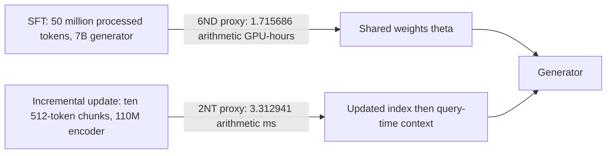
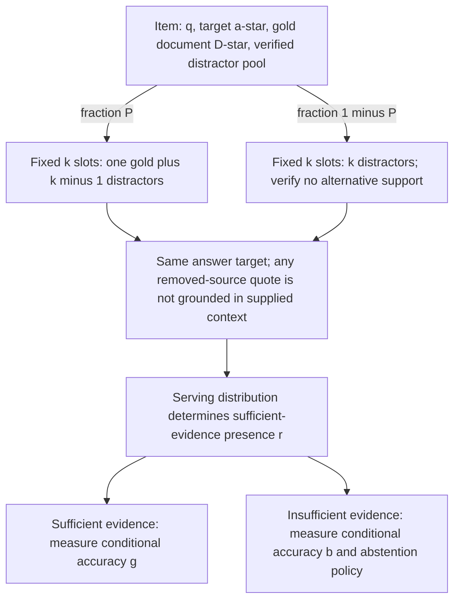
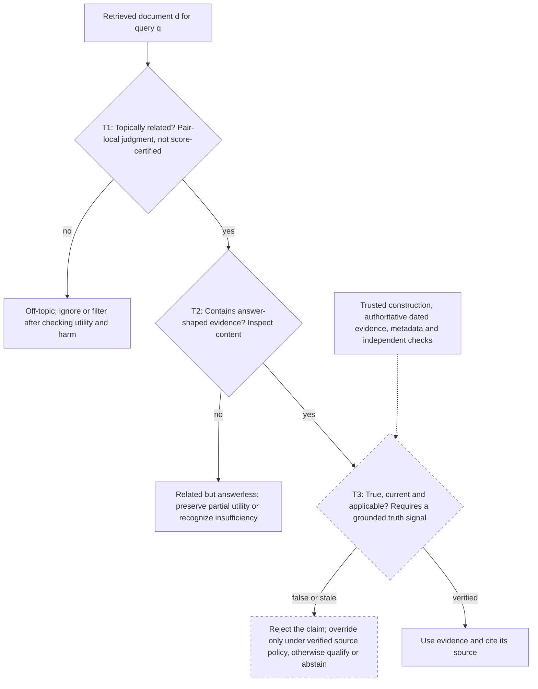
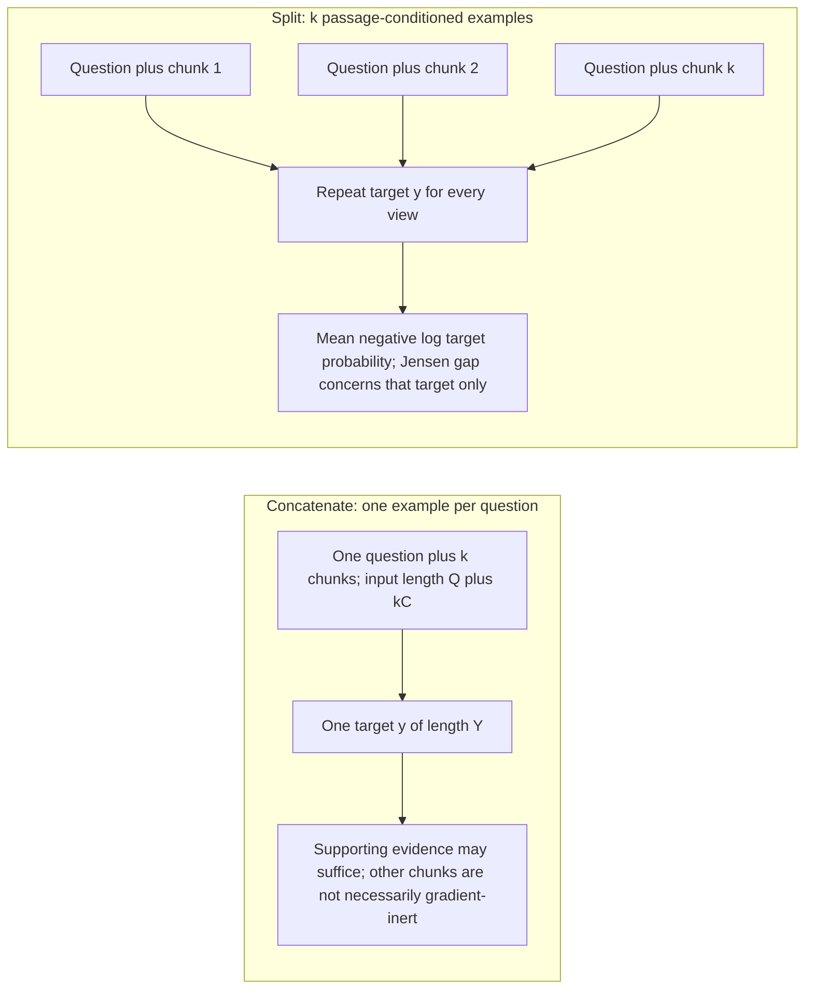
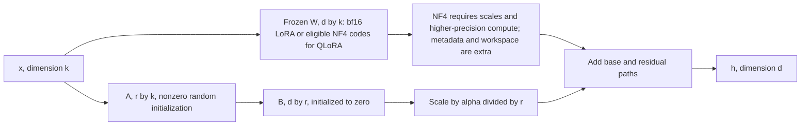

# Chapter 27: Fine-tuning the Generator
[00-START-HERE](../00-START-HERE.md) · [01-READING-ROUTES](../01-READING-ROUTES.md) · [26\_iterative\_recursive\_and\_agentic\_retrieval](../part-07-query-control/26_iterative_recursive_and_agentic_retrieval.md) · [28\_training\_the\_retriever](28_training_the_retriever.md)
Purpose: Decide when Retrieval-Augmented Generation (RAG) errors belong to the generator, choose a training objective that matches the retrieval defects seen in production, and size the resulting fine-tuning job without confusing behavior, knowledge, robustness, invariance, or memory efficiency.
## TL;DR
- SFT can change behavior and knowledge in shared weights; retrieval changes query-time evidence without updating the generator. Diagnose both with production hit/miss accuracy, an oracle-context intervention, closed-book performance and a clearly defined retrieval metric.
- RAFT-style missing-gold examples keep the answer target while changing evidence. They train toward correct answers under insufficient context, not abstention, and can encourage factual learning or memorization. Generalization and safe override are not guaranteed.
- Retrieval defects differ: related but answerless text, off-topic text and plausible false claims require different tests. Relevance alone cannot certify truth or current applicability.
- RbFT-style defect labels and utility extraction provide additional per-document supervision; answer-only loss can still learn document selection, but supplies less explicit supervision for it.
- Split-context fixed-target training has an exact Jensen-gap decomposition for the target probability. It does not guarantee invariance of the whole output distribution, and duplicating questions and targets changes compute. Insufficient evidence creates a generalization and identifiability problem, not an inability to fit training labels.
- LoRA freezes the base and trains a factored update; QLoRA additionally compresses frozen weights. Count optimizer state, activations, quantization metadata and peak workspaces before claiming a device fit.
- Choose the intervention from measured production slices, held-out generalization, source/tenant/time policy and resource costs. None of the toy thresholds is a universal release rule.
## The story
Imagine a clinical assistant as a hospital with a library and a physician. Retrieval updates the shelves; fine-tuning changes the physician’s habits and possibly memory. Put verified evidence in the prompt to test whether failures persist, but do not assume every remaining error is only a behavioral deficit: labels, reasoning, context format and ambiguity matter too. RAFT sometimes removes the correct chart while retaining the answer target. That trains for answering without supplied support, not abstention, and may encourage learning or memorizing the labeled fact. RbFT adds chart-specific defect labels and extraction targets; a plausible false chart still needs a trusted truth signal, not just topical relevance. Split-context training asks for one answer under several chart views. It penalizes variation in that target’s probability, but cannot guarantee that the whole response is context-insensitive or correct. Finally, full Adam tuning stores state for every trainable weight. LoRA freezes the base and learns a small update; QLoRA compresses frozen storage further. Choose the clinical source-of-truth and abstention policy first, train the observed behavior next, and measure actual peak memory before scheduling the job.
## Decoder table


| Source term or symbol | Plain-language decoder | Why it matters and what fails if misread |
| --- | --- | --- |
| Supervised fine-tuning (SFT) | Maximum-likelihood training on labeled inputs and outputs | Can change both behavior and factual knowledge; held-out generalization and provenance still matter |
| Dataset $`\mathcal{D}`$ and pair $`(x, y)`$ | Labeled training set, supervised input and target | A target absent from context can still be fitted through learning or memorization; arbitrary unseen facts require information |
| Parameters $`\theta`$, token index $`t`$, and target length | Shared weights, one output position, and the number of target tokens | They locate the trainable object and summed token losses. Confusing weights with context erases the chapter’s main boundary |
| Retrieval-Augmented Generation (RAG) | Query-time conditioning on retrieved chunks | It supplies current, attributable knowledge. Treating retrieval failure as generator failure funds the wrong loop |
| Query $`q`$, chunks $`c_i`$, and retrieval depth $`k`$ | Question, retrieved contexts and depth | Complete sufficient evidence may span several chunks; missing one source does not cap all possible generator knowledge |
| Parametric update | A gradient update to shared model weights | Can learn behavior or facts while changing other inputs; it is not a document-keyed update |
| Non-parametric update | A keyed content/index update without generator gradients | Serving needs propagation and read-path checks; current evidence still requires correct reader behavior |
| End-to-end accuracy $`A_{\mathrm{rag}}`$ | End-to-end correctness across production contexts | The exact mixture uses conditional hit/miss rates and a specified sufficient-evidence event |
| Oracle-context accuracy $`A_{\mathrm{orc}}`$ | Accuracy after supplying a verified gold context | An intervention, not automatically production hit accuracy or a pure behavior score |
| Distractors-only accuracy $`A_{\mathrm{ng}}`$ | Accuracy under a deliberately insufficient distractor context | A probe; production miss transfer and cohort comparability must be tested |
| Recall $`R`$ or $`r`$ | Retrieval-success probability under a named evidence event | Single-gold presence, marginal document recall and complete multi-hop evidence coverage differ |
| Behavior deficit $`1 - A_{\mathrm{orc}}`$ | Residual error on the oracle-context intervention | Can reflect reasoning, labels, context format or other limitations; not a ceiling that retrieval can never change |
| Knowledge deficit $`1 - R`$ | Delivery failure under the specified evidence definition | Not proof that the answer is absent from weights or all other sources |
| Closed-book accuracy $`A_{\mathrm{closed}}`$ | Accuracy without retrieved evidence | Compare paired cohorts for distraction; a net accuracy gap is not a correct-to-wrong flip probability |
| Conditional accuracies $`g`$ and $`b`$ | Production correctness conditional on sufficient versus insufficient evidence | Missing-context ability remains defined even if the training dataset does not explicitly supervise it |
| Parameter count $`N`$ and training tokens $`D`$ | Model size and token volume in the $`6ND`$ training estimate | They price the parametric loop. Ignoring either understates training compute |
| Retrieval Augmented Fine-Tuning (RAFT) | Domain SFT that mixes golden-document and missing-gold contexts | It rehearses production retrieval failures. It does not by itself teach abstention |
| Gold answer $`a^\star`$ and golden document $`D^\star`$ | The fixed target and the context that supports it | RAFT keeps the answer fixed while changing evidence. Changing both would remove the intended contrast |
| Retention fraction $`P`$ | Fraction of training items retaining the designated gold document | Equals sufficient-context frequency only with construction checks; always-gold data lacks explicit miss supervision |
| Missing-gold branch $`1 - P`$ | Remove gold but retain the answer target | May train prior reliance, factual learning or memorization; not abstention or guaranteed safe override |
| Retriever top-$`k`$ distractors | Retriever-derived distractors intended to resemble serving near misses | Validate support, truth and distribution; exact matching is not guaranteed by sampling from the retriever |
| Reasoning chain with quoted spans | Targets containing reasoning and quoted evidence | Useful supervision, not a grounding certificate; a quote from removed evidence is unsupported by the supplied context |
| Noisy document | On-topic and high-scoring, but without an answer span | It can tempt the model into an adjacent claim. Calling it irrelevant hides its observed harm |
| Irrelevant document | Off-topic text for the question | Its effect is empirical; off-topic content is not universally harmless or least harmful |
| Counterfactual document | An answer-shaped, relevant false or inapplicable claim | Relevance does not certify truth; confident error requires an additional confidence criterion |
| Tests $`T_1`$, $`T_2`$, and $`T_3`$ | Topicality, answer-shaped content and grounded truth/current applicability | Similarity scores do not certify the first two; contingent truth generally needs a reliable world/date signal |
| Corruption rate $`f`$ and count $`X`$ | Per-vote corruption probability and corrupt-vote count | The binomial calculation assumes independent votes; it is not an automatic reader answer-error guarantee |
| Corroboration | Agreement among sources | Can help under independence; common sources and coordinated errors defeat a simple majority model |
| Robust fine-tuning against retrieval defects (RbFT) | Answer training with document defect labels and utility extraction | Provides explicit per-document supervision; answer-only loss can still learn selection implicitly |
| Defect detection | Predict per-document audit labels | Additional supervision, not an assertion that a global answer loss can never learn which document is wrong |
| Utility extraction | Recover the usable fragment from a partial document | Thin long-tail topics may lack one complete source. A binary filter discards partial evidence |
| Answer invariance | Train a shared answer target under different context views | Targets should remain valid; equal target probability does not imply equal entire output distributions |
| RA-DIT | Source-named retrieval-augmented dual instruction-tuning approach | The uniform per-context fixed-target variant here is explicitly defined; do not assume every implementation is identical |
| Per-context probability $`p_i`$ and mean $`\bar{p}`$ | Target-sequence probability under each view and its arithmetic mean | The Jensen gap is target-specific; mean target probability is not classification accuracy |
| Jensen gap | Nonnegative difference between log arithmetic mean and mean log probability | Zero exactly when positive target probabilities agree; no full-distribution or correctness guarantee |
| $`\sigma_p^2`$ and $`\mathop{\mathrm{CV}}\nolimits`$ | Population spread of target probabilities and spread divided by their mean | The one-half-CV-squared relation is a small-relative-deviation approximation |
| Closed-book accuracy $`b_0`$ | Held-out question-only correctness before adaptation | A diagnostic, not a hard upper bound on post-training knowledge or an impossible-minimum test |
| Concatenate layout | One question and all retrieved chunks in one window | Other chunks need not be gradient-inert even when one chunk supports the target |
| Split layout | Repeat question and target for each isolated passage | Changes token volume, evidence mix and attention cost; not automatically a factor-of-depth speedup |
| Supporting fraction $`r/k`$ | Supporting-instance fraction under one sufficient passage on every successful query | The formula requires individually sufficient support and no alternative support on misses |
| Reweighting $`w`$ and retained count $`n`$ | Loss weight on support and average number of retained non-support examples | Restores a chosen global weighted/sampled mix, not evidence or the same mix for every query |
| REPLUG and REALM | Frozen-generator retrieval/ensembling versus retrieval-aware pretraining | REPLUG needs appropriate probability access; neither alternative establishes robustness by itself |
| Parameter-efficient fine-tuning (PEFT) | Adaptation that freezes most base parameters | It changes the optimizer-state budget. Counting only weights misses full-tuning memory |
| Adam moments $`m`$ and $`v`$ | First and second raw-gradient moment estimates | The second raw moment is not the centered variance; declared dtypes set optimizer-state bytes |
| Base matrix $`W`$ and update $`\Delta W`$ | Frozen base matrix and learned correction | The update is low rank; the base need not be low rank or full rank |
| Factors $`A`$, $`B`$, dimensions $`d`$, $`k`$, and rank $`r`$ | Two thin matrices whose product forms the correction | Their count is $`r(d + k)`$ rather than $`dk`$. Here $`k`$ and $`r`$ are matrix width and adapter rank, not retrieval depth and recall |
| Scale $`\alpha/r`$, input $`x`$, and output $`h`$ | Forward residual multiplier, layer input and output | Constant scale does not isolate all rank-dependent initialization or optimizer dynamics |
| Low-Rank Adaptation (LoRA) | Learn a low-rank correction while freezing the base | It removes base gradients and Adam state. Counting only base weights misses full-tuning cost |
| Quantized Low-Rank Adaptation (QLoRA) | LoRA with eligible frozen weights stored as four-bit codes | Storage compression can change throughput; nominal dense FLOPs and measured latency are different |
| 4-bit NormalFloat (NF4) | Four-bit code format with ideal half-byte payload per eligible weight | Scales, unquantized tensors and workspaces are extra; compute uses a higher-precision representation |
| Double quantization | Quantization of scaling metadata | Reported approximate savings depend on block format and configuration, not adapter compression |
| Paged optimizer | Migrate some optimizer allocations between device and host | Changes placement and latency; does not guarantee fit or erase state |
| Adapter coverage | Selected matrices receiving trainable factors | Tune coverage and rank against held-out quality and resources; parameter count alone does not prove superiority |
| Folded adapter | Add a scaled low-rank residual into dense weights | Can remove residual-branch operations; quantized requantization can change numerics and tenant bases lose sharing |
| bfloat16, 16-bit floating point (FP16), and 32-bit floating point (FP32) | Two 16-bit formats and one 32-bit format | Precision choices set byte counts. Mixing their budgets produces false capacity claims |
| Graphics processing unit (GPU), floating-point operations (FLOPs), and high-bandwidth memory (HBM) | Accelerator, operation count, and memory bandwidth | They separate compute from memory traffic. Confusing them misprices training and decoding |
| Best Matching 25 (BM25) and Dense Passage Retrieval (DPR) | Lexical and dense retrieval methods named in the source | Benchmarks, depths and thresholds do not transfer automatically between tasks |
| Large language model integer inference (LLM.int8()) | Mixed-precision integer serving with outlier handling | Reported model-size behavior is not a universal sharp threshold or the same as NF4 storage |
| Index vector quantization | Compression of stored retrieval representations | Distinct from generator precision, though both can affect their respective quality/resource trade-offs |


## Core mechanics
### Mathematical conventions
Use natural logarithms and decimal byte units unless explicitly binary: $`1\,\mathrm{GB}=10^9\,\mathrm B`$, $`1\,\mathrm{MB}=10^6\,\mathrm B`$ and $`1\,\mathrm{MiB}=2^{20}\,\mathrm B`$. Preserve precision until final rounding. Accuracy is a fraction; an absolute change of $`0.01`$ is one percentage point.
For the arithmetic examples, $`W_{\mathrm{train}}\approx6ND`$ and $`W_{\mathrm{forward}}\approx2NT`$, with sustained arithmetic rate $`F=3.4\times10^{14}\,\mathrm{FLOP\,s^{-1}}`$. These dense-model proxies omit attention-length effects, utilization differences between models, launch overhead, communication, evaluation and release work. A job-to-incremental-update FLOP ratio is not a measured per-fact latency ratio.
The full-training memory rule assumes bf16/fp16 weights and gradients plus fp32 first and second Adam moments. It is $`12\,\mathrm{B}`$ per trainable parameter without an fp32 master copy and $`16\,\mathrm{B}`$ with one. Optimizer implementations vary. LoRA ledgers include one frozen base plus adapter state; NF4 code payload excludes scales, unquantized tensors and workspace. The checkpointed block-input activation count is one component, not a complete peak-memory bound. A sum of listed components is an accounting scenario, not necessarily a simultaneous live allocation or a bound on peak memory. Compare with the runtime-reported capacity in bytes; $`80\,\mathrm{GB}`$ and $`80\,\mathrm{GiB}=85.899345920\,\mathrm{GB}`$ are different budgets. A subtotal below capacity does not prove that training fits.
Symbols are local: $`r`$ denotes retrieval-success probability in RAFT but rank in LoRA; $`k`$ denotes retrieval depth but matrix input width in the factorization. A golden passage, a complete sufficient evidence set, marginal Recall@k and conditional answer correctness are not interchangeable. Oracle interventions and production retrieval slices must be distinguished.
### 27.1 SFT teaches behavior, RAG supplies knowledge
#### What
The source’s motivating project compares reranking with fine-tuning a $`7`$-billion-parameter generator on $`20{,}000`$ question-answer pairs from the same PDFs. Each is assigned about one quarter of the GPU budget, with a two-quarter consequence for the wrong decision after two months of development. Those are planning anecdotes, not costs derived from the equations. Split training and evaluation by appropriate document, time or question families so source reuse does not hide leakage.
SFT minimizes negative log-likelihood over labeled input-output pairs.

```math
\mathcal L_{\mathrm{SFT}}(\theta)=-\sum_{(x,y)\in\mathcal D}\sum_{t=1}^{|y|}\log p_\theta(y_t\mid y_{<t},x).
```

Here the supervised input is $`x`$ and loss is applied to target positions in $`y`$, not automatically to every prompt token. The trainable object may be all parameters or an adapter subset. A fixed-generator retrieval update changes the conditioning information while leaving $`\theta`$ unchanged:

```math
p_\theta(y\mid q,c_1,\ldots,c_k).
```

Formatting, tone, refusal and citation conventions can be shared behaviors, while dated facts often belong in a keyed index. This is a design heuristic, not a mathematical partition: facts can occur many times, SFT can learn factual knowledge, and behavior can be input-specific. The source’s rank-eight or rank-sixteen LoRA suggestion is an empirical starting point, not a sufficient-capacity theorem. A proprietary identifier or DSL can require both a shared output syntax and specific factual mappings; validate vocabulary, tokenizer and mapping correctness separately.
#### Why
Let $`H`$ mean that production context contains all evidence required by the evaluation’s definition of success. Define $`R=\Pr(H)`$, $`A_{\mathrm{hit}}=\Pr(\mathrm{correct}\mid H)`$ and $`A_{\mathrm{miss}}=\Pr(\mathrm{correct}\mid H^c)`$. The exact mixture is a law of total probability. Oracle-context accuracy $`A_{\mathrm{orc}}`$ is a separate intervention; it is a proxy for $`A_{\mathrm{hit}}`$ only if query cohorts, context format, distractors and reader behavior transfer.

```math
A_{\mathrm{rag}}=R A_{\mathrm{hit}}+(1-R)A_{\mathrm{miss}}.
```

Holding the other conditional rates fixed, the partial derivatives are

```math
\frac{\partial A_{\mathrm{rag}}}{\partial R}=A_{\mathrm{hit}}-A_{\mathrm{miss}}.
```


```math
\frac{\partial A_{\mathrm{rag}}}{\partial A_{\mathrm{hit}}}=R.
```


```math
\frac{\partial A_{\mathrm{rag}}}{\partial A_{\mathrm{miss}}}=1-R.
```

An intervention that changes retrieval usually changes which queries are hits and the context they receive, so it can also change both conditional accuracies. If they are differentiable functions of $`R`$, the total derivative adds $`R\,dA_{\mathrm{hit}}/dR+(1-R)\,dA_{\mathrm{miss}}/dR`$. Oracle failures show residual errors despite supplied evidence, not a pure or irreparable “behavior deficit.” A miss rate $`1-R`$ is a delivery deficit under the chosen evidence labels, not proof the answer is absent from model knowledge. Multi-document evidence coverage also need not equal marginal document Recall@k.
#### Failure without it
Training on a changing corpus can create freshness, interference and provenance problems. The chapter reports Gekhman et al. (2024) on hallucination during factual learning and Ovadia et al. (2024) on retrieval versus unsupervised fine-tuning for knowledge injection; these are experiment-specific findings, not replicated here. Oracle-context failures may improve through prompting, context selection, reasoning or generator training. A generator cannot directly read an unfetched document, but may answer from other sufficient evidence or prior knowledge; neither component has a universal monopoly on repair.
#### Cost and complexity
For a coarse full-fine-tuning arithmetic ledger, take $`N=7\times10^9`$ parameters and $`D=50\times10^6`$ processed training tokens:

```math
W_{\mathrm{train}}\approx6ND=2.1\times10^{18}\,\mathrm{FLOP}.
```

At $`F`$, this is $`6{,}176.470588\,\mathrm s\approx1.715686`$ arithmetic GPU-hours, excluding evaluation and release. Separately, embedding ten $`512`$-token chunks through a $`110\times10^6`$-parameter encoder gives the forward proxy

```math
W_{\mathrm{embed}}\approx2(10\times512)(110\times10^6)=1.1264\times10^{12}\,\mathrm{FLOP}.
```

At the same stipulated arithmetic rate, the embedding component is $`3.312941\,\mathrm{ms}`$. The FLOP ratio is approximately $`1.864347\times10^6`$, but its numerator is a fifty-million-token training job and denominator a ten-chunk incremental embedding update. They are not matched single-fact workloads. Small-encoder utilization, storage/index writes and serving propagation are omitted; this ratio is not a measured update-latency or per-fact cost advantage.
Figure $`27.1`$ uses this same analytical ledger. The previous schematic labels of $`1.5`$ GPU-hours and $`2.8\,\mathrm{ms}`$ used inconsistent values and are not separate measured results.
#### Worked example
The diagnostic scenario has $`2{,}000`$ held-out questions, closed-book accuracy $`0.41`$, oracle-context probe accuracy $`0.82`$, distractor-probe accuracy $`0.31`$ and retrieval-success probability $`R=0.75`$. For the following calculation only, assume that the probes transfer to production conditional rates: $`A_{\mathrm{hit}}=0.82`$ and $`A_{\mathrm{miss}}=0.31`$. Without that assumption, the exact production mixture needs directly measured conditional rates.

```math
A_{\mathrm{rag}}=0.75(0.82)+0.25(0.31)=0.615+0.0775=0.6925=69.25\%.
```

Configuration one reranks a top-fifty lexical/dense fused candidate set and keeps five. If retrieval success increases to $`0.85`$ while both conditional accuracies remain fixed, the predicted gain is

```math
\Delta A=(0.82-0.31)(0.10)=0.051=5.1\text{ percentage points}.
```

That prediction is $`74.35\%`$, not $`74.4\%`$ before rounding. Configuration two instead holds $`R=0.75`$ and changes the stipulated conditional accuracies to $`0.88`$ and $`0.60`$:

```math
A_{\mathrm{rag}}=0.75(0.88)+0.25(0.60)=0.66+0.15=0.81=81\%.
```

The SFT-scenario gain is $`11.75`$ percentage points: $`4.5`$ from the hit slice and $`7.25`$ from the miss slice. The $`69.25\%`$ mixture prediction is $`0.25`$ points above the reported $`69\%`$ end-to-end result; numerical proximity alone does not validate probe transfer. For an IID $`2{,}000`$-question Bernoulli estimate near the prediction, a nominal normal-interval half-width is about $`2.02243`$ points, before other uncertainty. Closed-book $`41\%`$ minus distractor-probe $`31\%`$ is a ten-point net accuracy difference only for comparable cohorts. It is not the probability that retrieval flips a previously correct answer: that needs paired correct-to-wrong and wrong-to-correct counts. The source-reported Mallen et al. (2023) flip statistic requires its original denominator and task; do not identify it with this difference. A forty-point penalty can motivate a data/chunking audit but does not prove broken labels.
Dropping retrieval leaves arithmetic accuracy headroom $`1-0.41=0.59`$, not an achievable gain guarantee. Refresh costs depend on the chosen training workload; use the $`1.715686`$ arithmetic-hour job and $`3.312941\,\mathrm{ms}`$ ten-chunk embedding proxy only within their stated, unmatched scopes.
#### Decisions and claim limits
Run oracle, closed-book and distractor interventions on representative held-out questions, and separately record actual production hit/miss correctness and sufficient-evidence coverage. A human-judged top chunk without verified gold is a proxy, not an optimistic mathematical bound. Default frequently changing facts to an index and shared formatting behavior to prompting or SFT, while enforcing source, tenant and date policy. Fewer than five hundred prompt tokens, hourly index refresh and quarterly weight releases are source heuristics, not general cost optima. An immutable corpus may reduce refresh pressure but does not eliminate evidence-quality or provenance requirements.
At fixed conditional rates, the coefficient on improving $`A_{\mathrm{miss}}`$ is $`1-R`$, so this particular benefit shrinks as $`R\to1`$. Distractors can still harm hit contexts, and changing retrieval or checkpoints changes the conditional rates. The source’s reconsideration threshold near $`R=0.9`$ is a planning heuristic; remeasure the full mixture.
### 27.2 RAFT trains with distractors on purpose
#### What
The source reports clean held-out accuracy rising from $`61\%`$ to $`86\%`$, followed by production complaints two weeks later. A one-in-five context miss rate motivates the subsequent $`r=0.80`$ scenario, but only a defined sufficient-evidence event makes that mixture precise.
For this section, let $`r`$ be sufficient-evidence presence in the serving context, $`g`$ answer accuracy conditional on presence and $`b`$ answer accuracy conditional on absence. These are conditional probabilities on their respective query/context populations:

```math
A=rg+(1-r)b.
```

In the analyzed RAFT-style recipe, each item has question $`q`$, gold target $`a^\star`$, supporting document $`D^\star`$ and retriever-derived distractors. For fraction $`P`$, retain gold; otherwise remove it while keeping the answer target. To match a fixed serving depth $`k`$, use one gold plus $`k-1`$ distractors on the retained branch and $`k`$ distractors on the missing branch, replacing rather than merely dropping a slot. Verify that other distractors do not independently contain the answer: $`P`$ is a gold-retention fraction, and equals a context-sufficiency prior only under those construction checks. An always-gold dataset does not leave $`b`$ mathematically undefined; it leaves missing-context behavior unsupervised by that dataset.
The source describes RAFT as study for an open-book exam. That analogy must not conceal the missing-evidence branch: its unchanged target still demands an answer, so it can train factual learning or memorization as well as context selection. It does not itself train abstention.
#### Why
Missing-gold examples expose the generator to insufficient contexts if the data construction truly removes all supporting evidence. Hard negatives sampled from the deployed retriever can better resemble production than random off-topic text, but their provenance and changing distribution require validation. The reported quote-marker format makes target evidence explicit on supported examples. If a missing-gold target retains a quote from the removed document, it is not a quote supported by the supplied context; do not present that generated rationale or citation as context-grounded evidence.
#### Failure without it
At $`P=1`$, the dataset supplies no explicit missing-gold supervision, yet pretrained behavior can still generalize to misses; copying all context is not generally the minimum-loss answer policy. At $`P=0`$, the model is not forced to ignore context, nor must $`g=b`$: pretraining, residual cues and test-time evidence can preserve a difference. The worked $`0.44`$ versus $`0.41`$ values already show this. Keeping the correct-answer target on unsupported examples can encourage reliance on weights or learning labeled facts; it is not an abstention objective. A refusal, uncertainty or externally verified override target defines a different policy, especially important for clinical applications.
#### Cost and complexity
This is supervised sequence training and can use LoRA. Label quality, leakage checks, evidence sufficiency and the deployed negative distribution are major costs. After a retriever or corpus update, re-estimate recall and miss/hit behavior and consider a fresh $`P`$ sweep. A change under two recall points is not a guarantee that distractor hardness, counterfactual exposure or calibration stayed unchanged.
#### Worked example
Use serving $`k=5`$, $`r=0.80`$ and exactly one sufficient golden document on successful contexts. Successful contexts contain one gold plus four distractors; misses contain five distractors with no alternative support. Configuration one has $`P=1`$, stipulated $`g=0.86`$ and $`b=0.04`$:

```math
A_1=0.80(0.86)+0.20(0.04)=0.696.
```

Configuration two uses $`P=0.60`$ and stipulated conditional rates $`g=0.83`$, $`b=0.33`$:

```math
A_2=0.80(0.83)+0.20(0.33)=0.730.
```

It sacrifices three points on the hit slice for twenty-nine points on the miss slice. Configuration three, with $`P=0`$, $`g=0.44`$ and $`b=0.41`$, gives $`A_3=0.434`$; no equality of its two conditional rates is implied. Configuration two gains $`3.4`$ absolute points over one, or approximately $`4.885057\%`$ relative. Its two contributions are

```math
(1-r)\Delta b=0.20(0.33-0.04)=0.058.
```

The hit-slice contribution is

```math
r\Delta g=0.80(0.83-0.86)=-0.024.
```

They sum to $`0.034`$. Holding configuration one’s conditional rates fixed, the retrieval-success rate needed to reach $`0.730`$ solves

```math
0.86r+0.04(1-r)=0.730.
```


```math
r=\frac{0.730-0.04}{0.86-0.04}\approx0.841463415.
```

Recall must increase by about $`4.146341`$ percentage points from $`80\%`$, under the frozen-rate assumption. At $`r=0.65`$, configurations one and two score $`0.573`$ and $`0.655`$; the gap is $`8.2`$ points, or $`2.411765`$ times the original gap. Karpukhin et al. (2020) is reported to give DPR top-twenty retrieval accuracy of $`78.4\%`$ on Natural Questions. A different benchmark, index, evidence definition and depth cannot certify that top-five $`80\%`$ is optimistic or attainable on this deployment. At $`r=0.92`$, the two scenarios give $`0.7944`$ and $`0.7900`$. Their fixed-rate crossover solves

```math
0.04+0.82r=0.33+0.50r\quad\Longrightarrow\quad r=0.90625.
```

Above $`90.625\%`$ success, configuration one wins only if those four conditional rates stay fixed. At $`r=0.92`$ its advantage is $`0.44`$ accuracy points. Whether that is statistically distinguishable needs the held-out size, paired discordance, confidence level and test design; it cannot be declared “within split noise” from the point estimates alone.
#### Decisions and claim limits
Use measured sufficient-evidence rate as an initial data-mixture reference, not a theorem that $`P=r`$ is optimal or that the best sweep direction is always downward. Validate $`P`$ in both directions, show $`g`$ and $`b`$ with uncertainty, and test unsupported-answer, abstention and citation policies separately. Re-evaluate after retrieval, corpus or checkpoint changes.
### 27.3 Robustness to noisy, irrelevant, and counterfactual retrieval
#### What
The opening example repeats a rate limit retired eighteen months earlier. The source’s recall-at-five value of $`85\%`$ implies a fifteen-percent missing-evidence slice only if that recall metric means presence of a complete sufficient answer context. Stale but answer-shaped evidence needs an additional truth-and-date check.
The reported example asks which album contains Pink Floyd’s “Time”: gold is The Dark Side of the Moon; a general band overview is related but answerless, another artist is irrelevant, and a document naming Wish You Were Here is counterfactual. Let $`T_1`$ test topical relation, $`T_2`$ the presence of an answer-shaped span and $`T_3`$ its truth and applicability. The first two can be judged from the pair in principle but are not certified by a similarity score. For an externally contingent claim, the same text can occur in worlds where it is true or false; pair-local fluency cannot identify the world. Use trusted construction, authoritative dated evidence or other grounded checks. Model priors and document agreement are fallible, especially under common-source duplication.
#### Why
The chapter reports Cuconasu et al. (2024) finding different effects for related answerless and random off-topic documents in their setting. These are not universal signs of harm. For a separate idealized majority-vote example, let five document votes independently be corrupt with probability $`f=0.2`$, and let $`X`$ count corrupt votes:

```math
\Pr(X\ge3)=\sum_{j=3}^{5}\binom5j(0.2)^j(0.8)^{5-j}.
```


```math
\Pr(X\ge3)=0.0512+0.0064+0.00032=0.05792=5.792\%.
```

The reduction ratio is $`0.2/0.05792\approx3.453039`$. Calling this answer-error reduction additionally requires equally relevant votes and a reader that follows the correct majority. Independent document corruption alone does not guarantee model answer accuracy, especially for multi-hop evidence. If all five reproduce the same corrupted source, the majority can be wrong with probability $`0.2`$, not $`0.05792`$.
#### Failure without it
An answer-level sequence loss can learn to select among documents through attention and gradients, but does not provide explicit document-level defect labels; it is not mathematically incapable of credit assignment. The RbFT-style recipe adds a label per document and utility extraction from partially useful passages. Those labels need trustworthy supervision, including how counterfactuals were constructed. A relevance filter can remove obvious off-topic text and can correlate with usefulness, but cannot in general distinguish two equally relevant claims solely by their truth. The source associates a pre-filter approach with Yoran et al. (2024); retain needed qualifiers and partial evidence instead of assuming every binary filter is sufficient.
#### Cost and complexity
Audit $`200`$ live queries at top five for $`1{,}000`$ query-document pairs. That is not a guaranteed afternoon of labeling: expert time, adjudication and within-query dependence matter. Five four-token defect tags add twenty output tokens. For an $`8`$-billion-parameter fp16 model with $`16\,\mathrm{GB}`$ of weights and $`3.35\,\mathrm{TB/s}`$ bandwidth, the full-weight-stream component is

```math
\tau_{8\mathrm B}=\frac{16\times10^9}{3.35\times10^{12}}\,\mathrm s\approx4.776119\,\mathrm{ms/token}.
```

Twenty tag tokens cost $`95.522388\,\mathrm{ms}`$ and a forty-token answer $`191.044776\,\mathrm{ms}`$ in this component, so tags add fifty percent to output-token work. Adding thirty extracted-span tokens gives fifty extra tokens, costing $`238.805970\,\mathrm{ms}`$ beyond the answer, or $`125\%`$ extra output work. These are not full wall-clock costs. The corresponding weight-stream token rate is

```math
v_{\mathrm{stream}}=\frac{3.35\times10^{12}}{16\times10^9}=209.375\,\mathrm{tokens\,s^{-1}}.
```

A measured rate above this one-stream full-weight-read model invalidates at least one assumption, not necessarily fp16 precision. Aggregate batching, speculation or multi-token decoding, multiple devices, caching/reuse, actual model size and bandwidth can change the denominator. Conversely, attention, kernels and other traffic can make actual rate lower.
#### Worked example
The stipulated audit has $`240`$ helpful, $`610`$ noisy, $`120`$ irrelevant and $`30`$ counterfactual pairs. Exactly $`170`$ of $`200`$ queries are covered, giving $`240/170\approx1.411765`$ helpful documents per covered query if helpful pairs occur only there. Thirty distinct queries have one counterfactual each; twenty-five are covered. Groups A/B/C/D therefore contain $`145`$ covered-clean, $`25`$ covered-counterfactual, $`25`$ uncovered-clean and five uncovered-counterfactual queries. Assume correct-evidence reader success $`0.90`$, correct-evidence selection probability $`0.50`$ under a competing claim, noisy-context correctness $`0.05`$ and learned miss correctness $`0.20`$. The selection rate is not already final accuracy, which is why group B multiplies it by $`0.90`$. All response rates below are scenario assumptions, not measured causal effects of training.

```math
E_A=145(0.90)=130.5.
```


```math
E_B=25(0.90)(0.50)=11.25.
```


```math
E_C=25(0.05)=1.25.
```


```math
E_D=0.
```

Answer-only SFT then gives $`143`$ expected correct responses, or $`71.5\%`$. With no abstention, the wrong-response rate is $`28.5\%`$; “confidently wrong” is not its synonym without a separate confidence/assurance criterion. Fractional counts are expectations. For configuration two, stipulate unchanged covered groups and miss accuracy $`0.20`$ in both uncovered groups, including a counterfactual miss:

```math
E_C=25(0.20)=5.
```


```math
E_D=5(0.20)=1.
```

This RAFT-style scenario totals $`147.75`$ expected correct, or $`73.875\%`$, a $`2.375`$-point gain confined by assumption to uncovered queries. For configuration three, assume counterfactual detection recall $`0.60`$ with no false-discard harm in the listed groups; detection restores the supported reader path, while an undetected competitor still has correct-selection probability $`0.50`$:

```math
E_B=25(0.90)\bigl[0.60+0.40(0.50)\bigr]=18.
```

Also stipulate that utility extraction improves group A correctness from $`0.90`$ to $`0.94`$, while groups C and D remain at configuration two’s rates:

```math
E_A=145(0.94)=136.3.
```

Total expected correct is $`160.3`$, or $`80.15\%`$: $`6.275`$ points over the RAFT-style scenario. Of the $`12.55`$ net additional correct responses, $`6.75`$ come from group B and $`5.8`$ from A. Group B is $`12.5\%`$ of queries and supplies approximately $`53.784861\%`$ of this stipulated gain, not a measured fraction of all achievable headroom. The source reports RGB evaluation axes including noise robustness, negative rejection, information integration and counterfactual robustness, with weakness on the latter in evaluated systems; this does not independently validate the toy rates.
#### Decisions and claim limits
Label the deployed defect mix and report pair- and query-level denominators separately: $`30/1{,}000=3\%`$ counterfactual pairs here, but $`30/200=15\%`$ affected queries. The suggested thirty-percent miss gate for withholding is a heuristic, not an optimal threshold. Document labels can help recognize insufficiency or abstain even when no answer exists in the context, though they cannot create missing evidence. Emitting labels can aid auditing but also costs decode and can be wrong; choose whether extraction is a training target or a required inference/citation artifact. Evaluate authoritative updates against erroneous priors, source recency, metadata and correlated corroboration. Neither a three-percent pair rate nor a twenty-percent adversarial scenario alone determines whether to prefer faithfulness or override; that requires stakes, conditional error rates and an explicit source-of-truth policy. Track correctness, abstention and defined confidently-wrong outcomes separately, particularly for clinical use. The cited Longpre et al. (2021) result motivates testing context/knowledge conflict, not a universal percentage-based policy.
### 27.4 Answer invariance to context as a training objective
#### What
The opening reports $`71\%`$ exact match and $`84\%`$ self-consistency with a changed fourth-ranked passage ten minutes after an index refresh. Consistency needs a defined repetition protocol and denominator; it is neither correctness nor evidence invariance. Deterministic decoding removes one source of sampling variation, not changes to retrieval, prompts, kernels or model versions.
For concatenated context, one supervised answer loss is

```math
\mathcal L_{\mathrm{concat}}=-\log p_\theta(y\mid c_1\oplus\cdots\oplus c_k\oplus x).
```

One supporting chunk may suffice to predict the target, but the other chunks are not necessarily gradient-inert: shared representations and attention can still receive gradients. The source associates split-context training with RA-DIT (Lin et al., 2023). The equation below defines the uniform per-context variant analyzed here, rather than asserting that every implementation uses identical weighting:

```math
\mathcal L_{\mathrm{split}}(\theta)=-\frac1k\sum_{i=1}^{k}\log p_\theta(y\mid c_i\oplus x).
```

This fixed target is appropriate only when $`y`$ should remain valid for every sampled view, with sufficient task conditioning. It asks for target predictability under context variation; it does not establish that context is irrelevant to every part of the response. For $`k\ge1`$ and positive target-sequence probabilities, define

```math
p_i=p_\theta(y\mid c_i\oplus x)>0.
```


```math
\bar p=\frac1k\sum_{i=1}^{k}p_i.
```

Add and subtract the log of the arithmetic mean:

```math
\mathcal L_{\mathrm{split}}=-\log\bar p+\underbrace{\left(\log\bar p-\frac1k\sum_{i=1}^{k}\log p_i\right)}_{J\ \ge\ 0}.
```

Jensen’s inequality gives $`J\ge0`$, with equality exactly when all target probabilities $`p_i`$ are equal. It is not an equality condition for the entire output distributions: the remaining probability mass can vary, and even the most likely wrong answer can change. All $`p_i`$ can also be equally small, giving zero gap but poor accuracy. For population variance $`\sigma_p^2=k^{-1}\sum_i(p_i-\bar p)^2`$ and small relative deviations from a positive mean, a second-order expansion gives

```math
J\approx\frac{\sigma_p^2}{2\bar p^2}=\frac12\mathop{\mathrm{CV}}\nolimits^2,\qquad\mathop{\mathrm{CV}}\nolimits=\sigma_p/\bar p.
```

For target probabilities $`0.7`$ and $`0.5`$, $`\bar p=0.6`$ and $`\sigma_p=0.1`$. The exact gap is

```math
J=\ln0.6-\tfrac12(\ln0.7+\ln0.5)\approx0.0140854385.
```

The second-order approximation is close, but not equal:

```math
J_{\mathrm{quad}}=\tfrac12(0.1/0.6)^2\approx0.0138888889.
```

#### Why
The loss thus decomposes into target probability under a uniform mixture and a target-specific spread term, not classification accuracy plus full response invariance. The loss diverges as one $`p_i\to0`$, and its derivative with respect to $`p_i`$ is $`-1/(kp_i)`$. That does not imply an unbounded or always-largest parameter gradient: for a Bernoulli target logit $`z_i`$, the derivative is $`(p_i-1)/k`$, which is bounded, and network Jacobians/shared gradients matter. Splitting can reduce attention work, but repeats the question, answer and fixed overhead; the reduction is not automatically a factor of $`k`$ at equal total compute.
#### Failure without it
REPLUG freezes the generator and trains or weights retrieval, potentially ensembling passage-conditioned predictions when the API exposes sufficient probabilities; a chosen-token log probability alone does not necessarily expose a full next-token distribution. It does not update generator weights, and an agreeing ensemble can still be wrong. REALM’s retrieval-aware pretraining and index refresh are a different training route, not a general robustness guarantee. A fixed target absent from the supplied context is still reachable on training examples through factual learning, memorization or generalization from the question and other data. The genuine limit is information: for a new arbitrary fact not inferable from any available input or learned knowledge, the model has no basis to identify the correct answer. Low closed-book accuracy is a warning about unsupported generalization, not proof of an impossible training minimum. Jointly required multi-hop evidence should not be split into individually insufficient views unless an explicitly justified objective handles that loss. Tenant- or date-dependent answers require those variables and appropriate per-view targets.
#### Cost and complexity
Use $`10{,}000`$ questions, $`k=10`$, serving sufficient-evidence rate $`0.80`$ and exactly one individually supporting chunk on each successful query. To make repeated-question costs explicit, choose question/instruction length $`Q=32`$, chunk length $`C=224`$ and target length $`Y=12`$ tokens. Each split input has $`Q+C=256`$ tokens, but concatenating ten chunks with the question only once has $`Q+kC=2{,}272`$, not $`2{,}560`$. Concatenation therefore has $`22.72`$ million input plus $`0.12`$ million target positions; splitting has $`25.6`$ million input plus $`1.2`$ million target positions. Totals are $`22.84`$ versus $`26.8`$ million positions, a $`17.338004\%`$ increase under splitting. Extra repeated questions contribute $`2.88`$ million positions and extra repeated targets $`1.08`$ million. All counts exclude separators or other template tokens unless included in $`Q`$.

```math
N_{\mathrm{support}}=10{,}000(0.80)(1)=8{,}000.
```

There are $`100{,}000`$ split instances, so support fraction is $`0.08`$ and insufficient-context fraction $`0.92`$, versus a twenty-percent insufficient-query rate before splitting. For context-only full-square attention proxies, the concatenate count is

```math
(Q+kC)^2=2{,}272^2=5{,}161{,}984.
```

The corresponding split count is

```math
k(Q+C)^2=10(256)^2=655{,}360.
```

The context-square ratio is $`7.8765625`$, not ten for this actual layout. Including targets and counting causal query-key pairs gives $`2{,}284(2{,}285)/2=2{,}609{,}470`$ versus $`10(268)(269)/2=360{,}460`$, a ratio of approximately $`7.239278`$. These are attention-pair counts, not end-to-end FLOPs or measured speedups; the larger token volume adds linear-model work. The ideal equal-partition comparison $`2{,}560^2/[10(256)^2]=10`$ holds only when duplicated questions/targets are deliberately ignored or included equally. Fusion-in-Decoder similarly motivates passage-separated encoding, but its joint decoder can combine evidence; it is not statistically equivalent to forcing each isolated passage to predict the whole answer. To make support carry sixty percent of a globally weighted split loss, solve

```math
\frac{0.08w}{0.08w+0.92}=0.60.
```


```math
0.032w=0.552.
```


```math
w=17.25.
```

This is a loss weight, not additional observed support; the average raw weight is $`2.3`$. Normalize the weighted loss explicitly rather than accidentally changing the learning-rate scale. It restores a global weighted mix, not sixty-percent support for every query. Alternatively, retain all supporting instances and an average of $`n`$ non-supporting instances per original query:

```math
\frac{0.8}{0.8+n}=0.6\quad\Longrightarrow\quad n=\frac8{15}\approx0.533333333.
```

From $`9.2`$ available non-supporting instances per query on average, retain about $`5.797101\%`$ and discard $`94.202899\%`$. Implement fractional averages through sampling or a corpus-level quota; a single query cannot retain half an example, and some have no support to retain. For an analogous top-twenty rate of $`0.784`$ and exactly one supporting passage conditional on success:

```math
\frac{0.784}{20}=0.0392=3.92\%.
```

If instead exactly three passages individually support the answer on every successful query and none on misses, the fraction is

```math
\frac{3(0.784)}{20}=0.1176=11.76\%.
```

#### Decisions and claim limits
Measure held-out closed-book accuracy $`b_0`$, unsupported-context accuracy, correctness under swaps and target-probability spread. $`b_0`$ is a diagnostic, not a hard upper bound on post-training $`b`$: supervision can change knowledge and generalization. Small Jensen gap alone is insufficient; compare full response/claim changes, correctness and support. Match the training context distribution and task conditioning to serving, and validate any reweighting or negative subsampling. Freezing the retriever can simplify diagnosis. Updating a document encoder requires re-encoding affected index representations; changing only a reranker or query encoder does not automatically require full document re-encoding. A fixed-target conditional loss is not mathematically restricted to prepended text: embedding- or adapter-conditioned generators can define analogous losses when their interfaces permit training. An opaque frozen API cannot directly fine-tune its generator through this objective.
If policy requires abstention on insufficient context, provide verified sufficiency labels and appropriate abstention or uncertainty targets rather than silently retaining every answer target. If parametric override is allowed, verify that policy and test its factual generalization instead of assuming weights know the fact. A prompt can alter learned behavior, but cannot guarantee reversal of a conflicting training objective. Re-estimate support mix, answer quality and source/tenant/date behavior after retrieval changes.
### 27.5 PEFT with LoRA, QLoRA, and quantization
#### What
The opening $`7`$-billion-parameter bf16 base has a $`14\,\mathrm{GB}`$ weight payload, not a full training footprint. Allocating two fp32 Adam moment arrays adds $`56\,\mathrm{GB}`$; bf16 gradients add another $`14\,\mathrm{GB}`$. Lazy moment allocation can therefore expose the underestimate at the first optimizer step.
For a declared implementation with two-byte weights, two-byte gradients and two four-byte Adam moments, trainable state per parameter is

```math
b_{\mathrm{train}}=2+2+4+4=12\,\mathrm{B/parameter}.
```

An additional fp32 master copy adds four bytes per parameter, raising the rule to $`16\,\mathrm{B/parameter}`$. Not every optimizer uses these dtypes or keeps a master copy. Under the twelve-byte rule,

```math
M_{\mathrm{state}}=(7\times10^9)(12)=84\times10^9\,\mathrm B=84\,\mathrm{GB}.
```

The $`14\,\mathrm{GB}`$ weights are one sixth of that state ledger, not necessarily of actual peak memory. LoRA freezes $`W\in\mathbb R^{d\times k}`$ and learns a factored residual:

```math
h=Wx+\frac\alpha r BAx,\qquad x\in\mathbb R^k,\quad h\in\mathbb R^d.
```


```math
B\in\mathbb R^{d\times r}.
```


```math
A\in\mathbb R^{r\times k}.
```


```math
r\ll\min(d,k),\qquad\mathop{\mathrm{rank}}\nolimits(BA)\le r.
```

The factor parameter count is $`r(d+k)`$ rather than $`dk`$: an $`8\times6`$ matrix has forty-eight entries, while rank-one and rank-two factors have fourteen and twenty-eight trainable values. These are factor counts, not minimal intrinsic degrees of freedom; a generic rank-$`r`$ matrix has $`r(d+k-r)`$ degrees because the factorization is redundant. Eckart–Young describes best low-rank approximation to a given matrix in specified norms; it does not prove that the optimum fine-tuning update is low rank or that LoRA optimization finds its truncated SVD. The low-rank object is the update, not necessarily the base matrix. The source cites Aghajanyan et al. (2021) as empirical motivation for low-dimensional adaptation. With $`B=0`$ and nonzero randomly initialized $`A`$, the initial residual is zero; initially the task gradient through $`A`$ is zero, while $`B`$ can receive a gradient. Initializing both factors to zero would block that task gradient. QLoRA stores eligible frozen weights with four-bit NF4 codes: ideal code payload is $`0.5\,\mathrm{B/parameter}`$, or $`3.5\,\mathrm{GB}`$ at seven billion eligible weights, before scales, unquantized tensors and workspace. A reported approximate double-quantization saving of $`0.37`$ bits per parameter gives

```math
\Delta M\approx(65\times10^9)\frac{0.37}{8}\,\mathrm B=3.00625\,\mathrm{GB}.
```

Paged optimizers can migrate state between device and host memory during pressure spikes. They do not delete state or guarantee that a job fits: host capacity, paging latency, activation peaks and framework allocations remain relevant.
#### Why
LoRA removes trainable-base gradients, moments and any master copy while retaining a frozen base. QLoRA then reduces eligible frozen-weight code payload by four relative to two-byte storage; metadata and unquantized tensors mean total memory does not shrink by exactly four. A conventional inserted adapter adds serial modules. LoRA instead adds a residual branch with two low-rank multiplies that can be merged into a dense base when precision and serving policy permit:

```math
W_{\mathrm{merged}}=W+\frac\alpha r BA.
```

Prefix tuning consumes additional prefix positions, a trade-off to evaluate rather than categorically reject for RAG. NF4 is a code/storage format: kernels dequantize into a chosen higher-precision compute representation, often bf16. It does not make the dense matrix multiply four-bit arithmetic or guarantee fewer FLOPs, though memory traffic, throughput and overhead can change. Merging into a quantized base may require dequantization and requantization, so it is not necessarily numerically identical to an unmerged higher-precision residual. The source’s LLM.int8() discussion concerns mixed-precision outlier handling in studied models, not a universal sharp failure threshold at $`6.7`$ billion parameters. Generator training precision, serving precision and retrieval-vector quantization are separate decisions.
#### Failure without it
The unsharded full-tuning state ledger is already $`84\,\mathrm{GB}`$ before activations, or $`112\,\mathrm{GB}`$ with a master copy. Sharding, offload or different state dtypes change device requirements. Retaining adapters in bf16/fp16 is a common stable default for this comparison, not a theorem that all quantized-adapter training is impossible; specialized quantization-aware methods have different analysis. Pin the base checkpoint, tokenizer, adapter configuration and quantization settings. Merging a base per tenant removes simple base sharing. The reported Biderman et al. (2024) comparison of LoRA and full tuning on code/mathematics and forgetting is experiment-specific; it is not proof that LoRA cannot learn new knowledge or that all facts must live in an index.
#### Cost and complexity
The sizing scenario uses Llama-2-like block shapes: thirty-two layers, hidden width $`4{,}096`$, MLP width $`11{,}008`$, sequence length $`4{,}096`$, batch one, gradient checkpointing and FlashAttention. Use $`N=7\times10^9`$ as the coarse base-size denominator rather than claiming the rounded count is the exact architecture total. Saving one bf16 block input per layer gives the following activation component; recomputation, internal tensors, logits, gradients, workspaces and allocator peaks are additional:

```math
M_{\mathrm{block\ inputs}}=32(4{,}096)(4{,}096)(2)\,\mathrm B=1.073741824\,\mathrm{GB}=1\,\mathrm{GiB}.
```

Full tuning’s listed state plus block-input subtotal is $`85.073741824\,\mathrm{GB}`$ without a master copy and $`113.073741824\,\mathrm{GB}`$ with one. These components need not all be live simultaneously, so their sum is not a rigorous peak bound. The first exceeds an eighty-decimal-gigabyte budget but is below $`80\,\mathrm{GiB}=85.899345920\,\mathrm{GB}`$ by $`0.825604096\,\mathrm{GB}`$; that narrow nominal margin does not establish a fit once omitted allocations are considered. Check actual device capacity in bytes and profile peak live memory rather than inferring an out-of-memory result from the product label. The master-copy state alone exceeds either budget. Rank-sixteen LoRA on query and value projections of shape $`4{,}096\times4{,}096`$ adds per matrix

```math
16(4{,}096+4{,}096)=131{,}072\text{ trainable parameters}.
```

Two such matrices per layer across thirty-two layers give $`8{,}388{,}608`$ factor parameters, or $`0.119837\%`$ of the rounded seven-billion base. Under the same twelve-byte adapter-state rule:

```math
M_{\mathrm{adapter,state}}=(8{,}388{,}608)(12)\,\mathrm B=0.100663296\,\mathrm{GB}.
```

The frozen-base, adapter-state and block-input subtotal is

```math
M_{\mathrm{LoRA,listed}}=14+0.100663296+1.073741824=15.174405120\,\mathrm{GB}.
```

This subtotal leaves nominal room on a twenty-four-gigabyte device, but is not a peak-memory guarantee. Profile the actual sequence, batch, optimizer and kernels. The bf16 adapter weight artifact alone is

```math
M_{\mathrm{artifact}}=(8{,}388{,}608)(2)\,\mathrm B=16.777216\,\mathrm{MB}=16\,\mathrm{MiB}.
```

That is $`834.465027`$ times smaller than a fourteen-decimal-gigabyte base-weight artifact, excluding metadata and training state. The next configuration changes both storage and adapter capacity: rank sixty-four on the seven transformer-block matrices $`q,k,v,o`$, gate, up and down, not every linear tensor such as an output head. For the stated full-width key/value projections, its count per layer is

```math
4(64)(8{,}192)+3(64)(15{,}104)=4{,}997{,}120.
```

Across thirty-two layers this gives $`159{,}907{,}840`$ adapter parameters, or $`2.284398\%`$ of the rounded base and $`19.0625`$ times the rank-sixteen query/value setup. Grouped-query architectures with narrower key/value projections need different shapes. Adapter state is $`1.918894080\,\mathrm{GB}`$; adding an ideal $`3.5\,\mathrm{GB}`$ NF4 code payload and the same block-input component gives

```math
M_{\mathrm{QLoRA,all64,listed}}=3.5+1.918894080+1.073741824=6.492635904\,\mathrm{GB}.
```

This subtotal excludes quantization scales, unquantized tensors, dequantization/optimizer workspaces and other peaks. At batch eight, the block-input component totals $`8.589934592\,\mathrm{GB}`$, an increase of $`7.516192768\,\mathrm{GB}`$ over batch one, not an additional $`8.6\,\mathrm{GB}`$. The listed all-linear QLoRA subtotal then becomes $`14.008828672\,\mathrm{GB}`$ before omitted terms; activations dominate its listed components. For an independent shape-count example with ninety-six layers, width $`12{,}288`$ and rank four on query/value:

```math
N_{\mathrm{adapter}}=96(2)(4)(24{,}576)=18{,}874{,}368.
```

At two bytes per factor this is $`37.748736\,\mathrm{MB}=36\,\mathrm{MiB}`$. Against the source-reported $`35`$ MB artifact, the arithmetic difference is $`7.853531\%`$ if that report uses decimal MB, or $`2.857143\%`$ if it means MiB. Units, exact configuration and artifact metadata must be reconciled before treating closeness as validation.
#### Decisions and claim limits
Budget frozen weights, trainable state, activations and peak workspace together. Ideal one-byte Adam moments change the no-master rule to $`2+2+1+1=6\,\mathrm{B/parameter}`$, or $`42\,\mathrm{GB}`$ at seven billion parameters; an fp32 master copy raises it to $`70\,\mathrm{GB}`$, before metadata and other memory. Actual eight-bit optimizers can use mixed state formats. Evaluate adapter coverage and rank on quality and resources: rank sixteen on all seven block matrices has $`39{,}976{,}960`$ factors versus $`67{,}108{,}864`$ for rank $`128`$ on query/value only. This is not a quality ordering theorem. Holding $`\alpha/r`$ fixed holds one forward multiplier fixed, not all rank-dependent initialization or optimization dynamics; tune learning rate and scaling too. Pin exact model and precision metadata. For forty customers, forty resident merged bf16 bases have a $`560\,\mathrm{GB}`$ weight payload, while unmerged query/value adapters have

```math
M_{40\ \mathrm{adapters}}=40(16.777216\,\mathrm{MB})=0.671088640\,\mathrm{GB}.
```

Add one shared fourteen-gigabyte base for a $`14.671088640\,\mathrm{GB}`$ weight payload, excluding caches, runtime and replicas. The per-adapted-matrix multiply-add ratio for the rank-sixteen square projection is

```math
\frac{r(d+k)}{dk}=\frac{16(8{,}192)}{4{,}096^2}=0.0078125=0.78125\%.
```

This is extra arithmetic for each touched matrix, not a whole-network latency penalty: kernel launches, routing, adapter batching and memory traffic can dominate. Merging a tenant with eighty percent of traffic onto a dedicated replica is a source heuristic; account for extra base replicas, precision effects, isolation and actual request distribution before deciding.
## Diagrams
### Figure 27.1
Panel A, two write loops:

Panel B, oracle-context probe:


| Oracle-context probe | Production evidence coverage $`R`$ high | Production evidence coverage $`R`$ low |
| --- | --- | --- |
| $`A_{\mathrm{orc}}`$ high | Check production reader errors, policy, cost and uncertainty; this alone is not a ship gate | Investigate retrieval coverage; confirm that the oracle probe transfers to production hits |
| $`A_{\mathrm{orc}}`$ low | Investigate evidence format, labels, reasoning and context use; prompting or generator training may help | Audit both paths and compare matched intervention costs; retrieval is not automatically the first or cheaper repair |


Figure $`27.1`$: A fifty-million-token training job and ten-chunk embedding update have an unmatched FLOP ratio of approximately $`1.864347\times10^6`$ under the stated proxies. It is not a single-fact or measured wall-clock comparison. An oracle-context probe is a useful intervention, but does not uniquely attribute every error or automatically equal production hit accuracy. The exact production mixture uses $`A_{\mathrm{hit}}`$ and $`A_{\mathrm{miss}}`$, not unvalidated substitutes.
### Figure 27.2

Figure $`27.2`$: The fixed-depth construction replaces gold rather than changing $`k`$. Gold-retention fraction $`P`$ equals sufficient-context frequency only if the gold is sufficient and distractors provide no alternative support. At $`P=1`$ this dataset lacks explicit missing-gold supervision, not all possible missing-context ability. Other defects or incomplete gold can create insufficient examples too. Withholding gold while keeping the answer target does not teach abstention and can encourage learning or memorizing the labeled fact.
### Figure 27.3

Figure $`27.3`$: $`T_1`$ and answer-shaped $`T_2`$ can be assessed from a query-document pair in principle, but a high similarity score does not decide them. Externally contingent truth generally needs a reliable world-and-date signal; fluency, model priors and document agreement are not certificates. Some documents can contain checkable proofs or provenance, so it is too strong to say that no amount of reading can ever decide $`T_3`$. Dashed boxes mark the need for grounding, not a universal impossibility theorem.
### Table 27.1
Table $`27.1`$: These are limited analogies about selective information or computation, not the same mathematical projection or objective. Dropout includes masking and rescaling; bagging resamples data; sparse expert routing selects computation. RAFT’s missing-gold answer target and defect-specific labels require their own evidence and policy analysis.


| Technique | Operation | Scope and limitation |
| --- | --- | --- |
| Dropout | Stochastic activation/feature masks, usually with rescaling | Regularizes a network; not simply a fixed feature projection |
| Masked language modeling | Hide or replace selected token inputs and predict targets | A reconstruction objective; not a fixed answer target under every passage |
| Bagging, random forests | Bootstrap training examples and, in forests, sample candidate features | Resampling can duplicate rows; it is not merely deleting evidence |
| Mixture of experts | Route tokens to a subset of experts | Selects computation during training and serving; not necessarily missing information |
| RAFT, defect training | Withhold verified support or create labeled retrieval defects | Gold removal is one construction; not every defect is equivalent to a dropped row |


### Figure 27.4

Figure $`27.4`$: Splitting repeats both the question and target and changes the support mix. Zero Jensen gap means equal target probabilities, not equal full distributions or correct answers. In the explicit $`Q=32`$, $`C=224`$, $`Y=12`$, $`k=10`$ layout, total positions increase by approximately $`17.338004\%`$. The context-square attention-pair ratio is $`7.8765625`$; including targets and causal pairs gives about $`7.239278`$. The ideal factor of ten requires a different equal-partition abstraction. None is a measured training speedup.
### Figure 27.5
LoRA path:

Memory bars under the figure assumptions:


| Training configuration | Listed components in decimal GB | Component subtotal | Capacity and peak-fit interpretation |
| --- | --- | --- | --- |
| Full fine-tuning, bf16, no master copy | $`84\,\mathrm{GB}`$ trainable state; $`1.073741824\,\mathrm{GB}`$ block inputs | $`85.073741824\,\mathrm{GB}`$ | Above $`80\,\mathrm{GB}`$ but below $`80\,\mathrm{GiB}`$; not a simultaneous-allocation or peak bound. Profile runtime capacity and omitted allocations |
| LoRA, bf16 base, rank $`16`$ on $`q,v`$ | $`14\,\mathrm{GB}`$ base; $`0.100663296\,\mathrm{GB}`$ adapter state; $`1.073741824\,\mathrm{GB}`$ block inputs | $`15.174405120\,\mathrm{GB}`$ | Subtotal below both nominal budgets; actual fit still requires profiling |
| QLoRA, ideal NF4 codes, rank $`16`$ on $`q,v`$ | $`3.5\,\mathrm{GB}`$ code payload; $`0.100663296\,\mathrm{GB}`$ adapter state; $`1.073741824\,\mathrm{GB}`$ block inputs | $`4.674405120\,\mathrm{GB}`$ | Quantization metadata, unquantized tensors and peak workspaces omitted; no guaranteed fit |


Figure $`27.5`$: Listed component sums are not measured peak memory, and components need not be simultaneously live. Compare actual capacity in bytes: $`80\,\mathrm{GiB}=85.899345920\,\mathrm{GB}`$ is not $`80\,\mathrm{GB}`$. An fp32 master copy adds $`28\,\mathrm{GB}`$ to full-tuning state. All rows use the batch-one, length-$`4{,}096`$ block-input component; only adapter rows use rank-sixteen query/value factors. The rank-sixty-four all-seven-block-matrix worked QLoRA setup is a different configuration with a $`6.492635904\,\mathrm{GB}`$ listed subtotal. Four-bit codes compress eligible frozen weights by four relative to bf16, not total training memory by four.
## Whiteboard pack
### What to draw
1. Draw shared weights and retrieved evidence as separate inputs to the generator.
2. Write $`A_{\mathrm{rag}}=R A_{\mathrm{hit}}+(1-R)A_{\mathrm{miss}}`$ for production slices; draw oracle accuracy as a separate intervention.
3. Add the diagnostic matrix, with explicit probe-transfer and source-of-truth checks rather than an automatic release decision.
4. Draw fixed-depth RAFT branches: gold plus $`k-1`$ distractors versus $`k`$ verified non-supporting distractors; keep the answer target and distinguish this from abstention.
5. Draw $`T_1,T_2,T_3`$ and mark the truth/current-applicability test as requiring grounded evidence, not merely relevance or consensus.
6. Draw concatenate and split layouts with repeated question/target tokens. Label the Jensen gap as target-probability spread, not full-output invariance.
7. Show component subtotals $`85.073741824\,\mathrm{GB}`$, $`15.174405120\,\mathrm{GB}`$ and $`4.674405120\,\mathrm{GB}`$ for matching configurations; add metadata/workspace and distinguish decimal capacity from GiB before making a fit claim.
### Spoken script
Separate shared-weight updates from query-time evidence updates. Measure actual hit/miss correctness and evidence sufficiency, and use oracle, closed-book and distractor probes as interventions whose transfer must be checked. RAFT changes evidence while retaining answer targets, which can train factual learning rather than abstention. RbFT adds explicit document supervision without making truth locally identifiable from fluency. Split-context training penalizes target-probability spread but does not guarantee full-output invariance; it also repeats questions and answers. Finally, size full state, frozen storage, adapter state and live activation/workspace peaks in consistent units. The twelve-byte Adam rule is conditional on dtypes and absence of a master copy, and NF4 code payload is not total QLoRA memory.
## Interview traps
### 1. Should a nightly policy change go into LoRA?
Default a verified dated fact to the keyed index, while considering prompting or training for shared format, tone, refusal and evidence-use behavior. The scenario’s $`1.715686`$ arithmetic-hour training job and $`3.312941\,\mathrm{ms}`$ ten-chunk embedding component are unmatched workloads, not a measured per-fact latency comparison. Oracle-context failures are diagnostic, not the only reason to consider SFT or proof that weights are the right repair. Compare held-out production slices, freshness, provenance, source policy and matched costs before choosing.
### 2. Why train RAFT without the golden document?
The missing-gold branch supplies explicit supervision for insufficient contexts only after verifying that no alternative support remains. At $`P=1`$ the dataset lacks that supervision, not all possible miss behavior. An unchanged correct-answer target can encourage factual learning, memorization or prior reliance; it does not teach abstention or guarantee safe override. Use measured evidence sufficiency as an initial mixture reference, sweep $`P`$ in both directions, and show $`g`$, $`b`$, uncertainty and policy outcomes separately.
### 3. Why can RAFT miss a plausible false claim?
Answer-only loss can learn document selection, but does not provide explicit per-document truth labels. Add defect labels and utility extraction where their supervision is reliable. A plausible false or stale claim can be highly relevant, so use authoritative dated evidence, trusted construction or verified provenance; model priors and correlated corroboration are fallible. Choose whether to reject, override, qualify or abstain under an explicit source-of-truth policy rather than a universal trust gate.
### 4. Why hold one target across every retrieved chunk?
One fixed target encodes a task assumption about valid answers across views. The split loss has a target-probability Jensen gap, not a full-response invariance guarantee. With sufficient-evidence rate $`0.80`$, $`k=10`$ and exactly one supporting passage on hits, eight percent of split instances support the target. Weight support by $`17.25`$ in a normalized global loss or discard approximately $`94.202899\%`$ of non-support instances to obtain the worked sixty-percent global mix. Neither operation creates new evidence. Low closed-book accuracy warns about unsupported generalization but is not a hard bound on learning training facts. Include tenant/date conditioning, and keep jointly required evidence together when individual chunks cannot support the target.
### 5. Why does a 14 GB model not fit full fine-tuning?
A fourteen-decimal-gigabyte base excludes gradients, moments and other allocations. The declared twelve-byte Adam state rule gives $`84\,\mathrm{GB}`$ at the rounded seven-billion size, or $`112\,\mathrm{GB}`$ with an fp32 master copy. Matching rank-sixteen query/value LoRA and NF4 QLoRA listed subtotals are $`15.174405120\,\mathrm{GB}`$ and $`4.674405120\,\mathrm{GB}`$; all-seven-matrix rank-sixty-four QLoRA is $`6.492635904\,\mathrm{GB}`$. These are component sums, not measured peaks or universal fit verdicts; distinguish $`80\,\mathrm{GB}`$ from $`80\,\mathrm{GiB}`$ and inspect runtime capacity. Tune coverage, rank, scaling and learning rate jointly: constant $`\alpha/r`$ fixes one multiplier, not all learning dynamics. Pin the base and precision metadata and measure full live memory.
## Key numbers


| Topic | Number | Interpretation |
| --- | --- | --- |
| Opening resource choice | $`7\times10^9`$ parameters; $`20{,}000`$ pairs; one-quarter GPU budget per option | Source-reported planning anecdote, not a cost derived from the FLOP ledger |
| Opening time horizon | Two months of development; two quarters of consequence | Motivating time horizon, not a measured universal delay |
| Behavior adapter rank | Rank $`8`$ or $`16`$ | Empirical starting range, not a sufficient-capacity theorem |
| Oracle diagnostic example | $`A_{\mathrm{closed}}=0.41`$; $`A_{\mathrm{orc}}=0.82`$; distractor probe $`0.31`$; $`R=0.75`$ | Using probe accuracies as production conditional rates is an additional assumption |
| Predicted baseline | $`69.25\%`$ | Conditional mixture prediction; reported measured score is 69 percent on $`2{,}000`$ questions, not proof of probe transfer |
| Reranker option | $`R:0.75\to0.85`$; gain $`5.1`$ points; $`74.35\%`$ | Conditional accuracies held fixed; changing retrieval can change them in practice |
| Distractor-aware SFT option | Hit $`0.82\to0.88`$; miss $`0.31\to0.60`$; $`81\%`$ | Stipulated training scenario gains $`11.75`$ absolute points, not a measured causal result |
| Distractor term | $`7.25`$ of $`11.75`$ points | Miss-slice contribution; hit slice contributes $`4.5`$ points |
| Distraction penalty | $`10`$ net accuracy points | Comparable-cohort closed-book versus distractor gap; not the paired correct-to-wrong flip rate |
| Fine-tuning compute | $`2.1\times10^{18}\,\mathrm{FLOP}`$; $`6{,}176.470588\,\mathrm s`$; $`1.715686`$ GPU-hours | Arithmetic proxy for seven billion parameters over fifty million processed training tokens |
| Index update compute | $`1.1264\times10^{12}\,\mathrm{FLOP}`$; $`3.312941\,\mathrm{ms}`$ | Ten 512-token chunks through a 110-million-parameter encoder at the stipulated rate; index writes excluded |
| Compute ratio | $`1.864347\times10^6`$ | Unmatched full-training-job versus ten-chunk embedding FLOP ratio; not a measured per-fact latency ratio |
| Figure $`27.1`$ labels | $`1.715686`$ arithmetic GPU-hours; $`3.312941\,\mathrm{ms}`$ | Figure now matches the analytical inputs; earlier 1.5-hour and 2.8-ms labels were inconsistent |
| Prompt threshold | Under $`500`$ system-prompt tokens | Source heuristic favoring prompting; not a general optimum |
| Release cadence | Hourly index updates; quarterly weight releases | Source cadence heuristic, not an unavoidable architectural schedule |
| Clean RAFT opening | $`61\%\to86\%`$ held-out accuracy; two weeks | Reported clean-context opening; does not independently measure production miss behavior |
| RAFT $`P`$ sweep | $`0.696`$ at $`P=1`$; $`0.730`$ at $`P=0.60`$; $`0.434`$ at $`P=0`$ | Toy sufficient-evidence rate is $`0.80`$; P-zero does not imply equal hit/miss accuracy |
| RAFT conditional scores | $`(g,b)=(0.86,0.04)`$ versus $`(0.83,0.33)`$ | Stipulated rates trade three hit-slice points for twenty-nine miss-slice points |
| RAFT gain | $`3.4`$ points at $`r=0.80`$; $`8.2`$ at $`r=0.65`$ | The gap ratio is approximately $`2.411765`$ only with these conditional rates fixed |
| RAFT contribution check | $`+0.058`$ and $`-0.024`$ | Miss and hit contributions sum to $`0.034`$ |
| Equivalent recall | $`80\%\to84.146341\%`$ | Retrieval success required to match $`0.730`$ while configuration-one conditional rates stay fixed |
| DPR plausibility check | $`78.4\%`$ at top $`20`$ | Reported DPR benchmark; cannot validate top-five 80-percent success on a different deployment |
| Old-model crossover | $`r=0.90625`$ | Exact crossover of the two fixed-rate toy lines; remeasure after intervention |
| Reranked comparison | $`0.7944`$ versus $`0.7900`$ at $`r=0.92`$ | A 0.44-point margin; statistical distinguishability needs sample size and paired test design |
| Re-sweep exception | Under about two recall points | Source re-sweep heuristic; small recall changes do not guarantee unchanged distractor or truth exposure |
| Defect opening | Eighteen-month-old rate; top-five success $`85\%`$ | Fifteen-percent misses only if the retrieval metric means complete sufficient-evidence coverage |
| Corruption vote | $`f=0.2`$; $`\Pr(X\ge3)=0.05792`$ | Independent five-vote majority-corruption rate, not automatically model answer error |
| Corruption reduction | $`0.2/0.05792\approx3.453039`$ | Independence-based vote reduction; correlated common sources can leave corruption at $`0.2`$ |
| Defect audit | $`240`$ helpful; $`610`$ noisy; $`120`$ irrelevant; $`30`$ counterfactual | $`1{,}000`$ query-document pairs from 200 top-five questions; these are pair counts |
| Covered-query audit | $`170`$ covered; $`30`$ uncovered; $`240/170\approx1.411765`$ | Helpful documents per covered question, under the stated allocation |
| Answer-only SFT | $`71.5\%`$ correct; $`28.5\%`$ wrong | No abstention assumed; confident error requires a separately defined confidence criterion |
| RAFT-style withholding | $`73.875\%`$; gain $`2.375`$ points | RAFT-style toy changes only uncovered-group rates |
| Per-document RbFT | $`80.15\%`$; gain $`6.275`$ points | RbFT toy with specified detection, no false-discard harm and improved supported-reader success |
| Counterfactual headroom | $`12.5\%`$ of queries; $`53.784861\%`$ of net toy gain | Group B supplies $`6.75`$ of $`12.55`$ additional expected correct answers, not all possible headroom |
| Defect labels | $`5\times4=20`$ extra output tokens | Five four-token defect labels |
| Decode roofline inputs | $`16\,\mathrm{GB}`$ weights; $`3.35\,\mathrm{TB/s}`$; $`4.776119\,\mathrm{ms/token}`$ | One-stream full-weight-read component, not complete decode time |
| Defect-tag decode | $`95.522388\,\mathrm{ms}`$ | Twenty extra tags in the weight-stream component |
| Answer decode | $`40`$ tokens; $`191.044776\,\mathrm{ms}`$ | Tags add fifty percent to answer output work in this proxy |
| Extracted-span decode | $`50`$ extra tokens; $`238.805970\,\mathrm{ms}`$ | Twenty tags plus thirty extracted tokens; 125-percent extra output work beyond a forty-token answer |
| Single-stream roofline | $`209.375\,\mathrm{tokens/s}`$ | One-stream full-weight-read model; faster aggregate rate can indicate batching or other changed assumptions |
| Audit policy gates | $`3\%`$ counterfactual pairs; $`15\%`$ affected queries | Thirty-percent miss and twenty-percent override scenarios are policy heuristics, not derived optimal gates |
| Invariance opening | $`71\%`$ exact match; $`84\%`$ consistency; ten-minute repeat | Reported opening needs a defined repetition denominator; consistency is not correctness |
| Jensen check | $`J\approx0.0140854385`$; quadratic $`0.0138888889`$ | Distinct exact-log and second-order values; zero gap only equates target probabilities |
| Invariance corpus | $`10{,}000`$ questions; $`k=10`$; $`Q=32`$; $`C=224`$; $`Y=12`$ | Explicit repeated-question and target layout; sufficient-evidence rate $`0.80`$ |
| Input-token volume | $`22.72`$ million versus $`25.6`$ million input positions | Concatenation uses the question once, splitting ten times; token volumes are not equal |
| Split instance count | $`100{,}000`$ instances | Ten passage-conditioned examples per original question |
| Repeated questions and targets | $`1.08`$ million extra target; $`2.88`$ million extra question positions | Total positions rise from $`22.84`$ to $`26.8`$ million, about $`17.338004`$ percent |
| Split training mix | $`8\%`$ supporting; $`92\%`$ insufficient | Requires exactly one individually sufficient passage on each successful query and none on misses |
| Split attention | $`5{,}161{,}984`$ versus $`655{,}360`$ context-square pairs | Ratio $`7.8765625`$; with full causal positions approximately $`7.239278`$, not an automatic speedup |
| Mix restoration | $`w=17.25`$ or discard $`94.202899\%`$ of non-support | Restores a sixty-percent global weighted/sampled mix, not new evidence or every-query balance |
| Deep retrieval support | $`3.92\%`$ or $`11.76\%`$ supporting instances | Top-twenty success $`0.784`$ with exactly one or three individually sufficient passages per hit, respectively |
| Full-tuning budget rule | $`12\,\mathrm{B/parameter}`$; $`16`$ with fp32 master | Declared bf16 weights/gradients plus fp32 first and second raw moments |
| Base-only mistake | $`14\,\mathrm{GB}`$ base; $`14\,\mathrm{GB}`$ gradients; $`56\,\mathrm{GB}`$ moments | Base weight payload is not training state or actual peak memory |
| LoRA toy factorization | $`8\times6=48`$ entries; rank-one factors $`14`$; rank-two factors $`28`$ | Factor parameter counts, not minimal rank-manifold degrees of freedom |
| Frozen NF4 base | $`0.5\,\mathrm{B/parameter}`$; $`3.5\,\mathrm{GB}`$ ideal codes | Scales, unquantized tensors, adapter state and workspaces are extra |
| Full 7B fine-tuning | $`85.073741824\,\mathrm{GB}`$ listed components | Not a rigorous peak bound; above 80 decimal GB but below $`80\,\mathrm{GiB}`$. Master-copy subtotal is $`113.073741824\,\mathrm{GB}`$ |
| LoRA $`q`$ and $`v`$ | $`15.174405120\,\mathrm{GB}`$ subtotal; $`8{,}388{,}608`$ factors | Rank-sixteen query/value; artifact is $`16.777216\,\mathrm{MB}`$ or $`16\,\mathrm{MiB}`$ |
| LoRA compression | $`0.119837\%`$ trainable; artifact ratio $`834.465027`$ | Relative to the rounded seven-billion base; artifact ratio is not a training-memory ratio |
| QLoRA figure row | $`4.674405120\,\mathrm{GB}`$ listed subtotal | Matching rank-sixteen query/value NF4 row, before omitted allocations |
| QLoRA worked row | $`6.492635904\,\mathrm{GB}`$ subtotal; $`159{,}907{,}840`$ factors | Rank-sixty-four all-seven-block-matrix setup; not the same adapter as the figure row |
| QLoRA coverage count | $`4{,}997{,}120`$ factors per layer; $`2.284398\%`$; $`19.0625`$ times | Seven specified full-width block matrices; other architectures and output heads change the count |
| Larger-batch activation component | $`8.589934592\,\mathrm{GB}`$ total block inputs; increase $`7.516192768\,\mathrm{GB}`$ | Batch eight versus one; all-linear QLoRA listed subtotal becomes $`14.008828672\,\mathrm{GB}`$ |
| Double quantization | $`0.37`$ bits per parameter; $`3.00625\,\mathrm{GB}`$ at $`65\times10^9`$ | Reported approximate double-quantization saving under the specified code format |
| Outlier threshold | About $`6.7`$ billion parameters | Experiment-specific int8 outlier observation, not a universal size cliff |
| GPT-3 check | $`96`$ layers; width $`12{,}288`$; rank $`4`$; query/value | $`18{,}874{,}368`$ factors; two-byte artifact is $`37.748736\,\mathrm{MB}`$ or $`36\,\mathrm{MiB}`$ for the stated GPT-3-like shape |
| GPT-3 agreement | $`7.853531\%`$ versus decimal $`35`$ MB; $`2.857143\%`$ versus $`35`$ MiB | Reconcile units, exact architecture and metadata before treating the reported artifact as validation |
| Eight-bit optimizer | $`6\,\mathrm{B/parameter}=42\,\mathrm{GB}`$ at seven billion | Ideal one-byte moments without master; master-copy state is $`70\,\mathrm{GB}`$. Metadata and other allocations omitted |
| Rank-coverage choice | $`39{,}976{,}960`$ all-block rank-sixteen factors versus $`67{,}108{,}864`$ query/value rank-128 factors | Coverage/rank trade-off requires quality measurements, not parameter-count ordering |
| Forty adapters | $`0.671088640\,\mathrm{GB}`$ adapters; shared total $`14.671088640\,\mathrm{GB}`$ | Forty query/value adapter artifacts plus one base versus $`560\,\mathrm{GB}`$ merged-base payload; runtime and replicas excluded |
| Adapter arithmetic overhead | $`0.78125\%`$ for each adapted square matrix | Extra low-rank arithmetic only, not whole-network or measured serving-latency overhead |
| Heavy tenant boundary | $`80\%`$ of requests | Source heavy-tenant heuristic for a dedicated merged replica; price capacity, precision and isolation |
| Publication years | 2019 through 2024 | Reported publication lineage; no empirical result independently replicated in this pass |


[00-START-HERE](../00-START-HERE.md) · [01-READING-ROUTES](../01-READING-ROUTES.md) · [26\_iterative\_recursive\_and\_agentic\_retrieval](../part-07-query-control/26_iterative_recursive_and_agentic_retrieval.md) · [28\_training\_the\_retriever](28_training_the_retriever.md)
