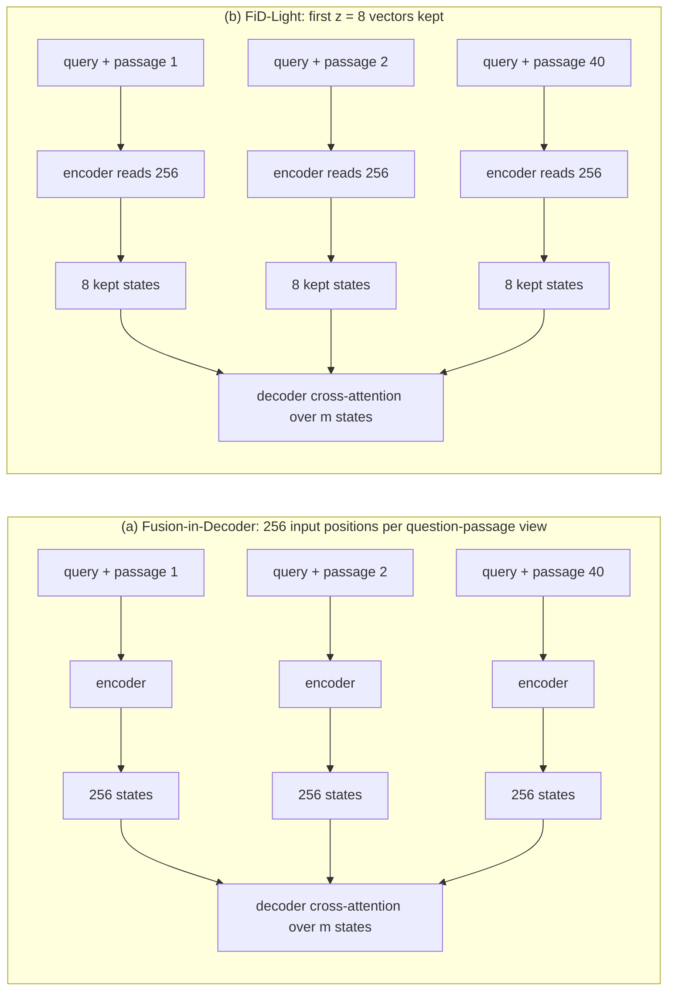
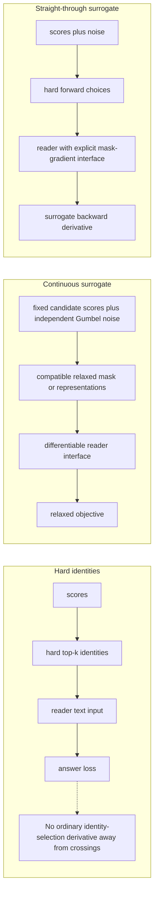
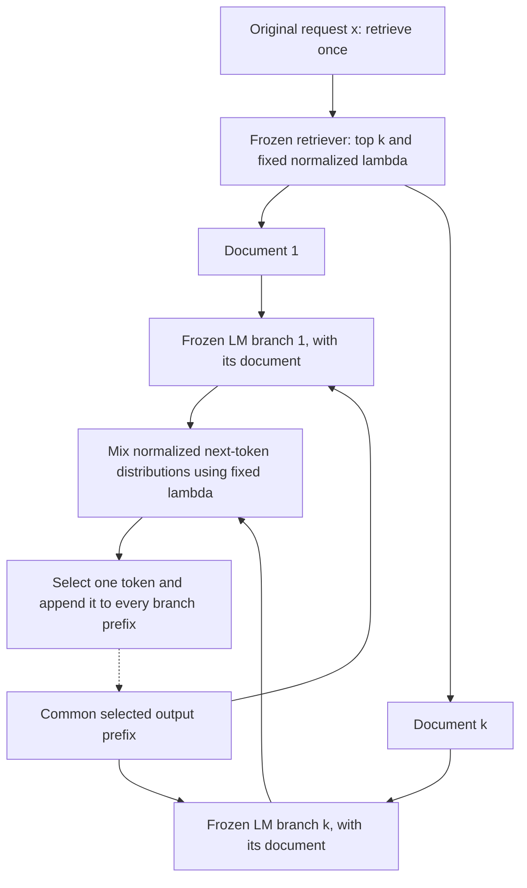
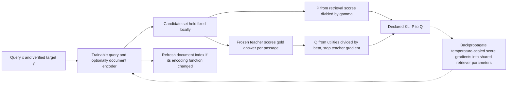
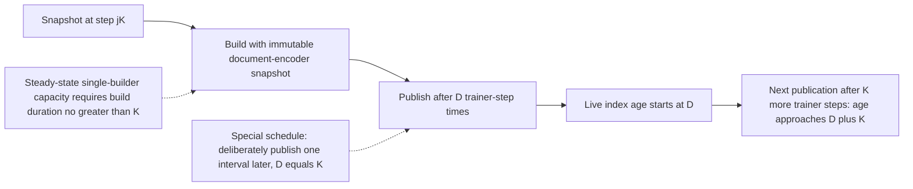
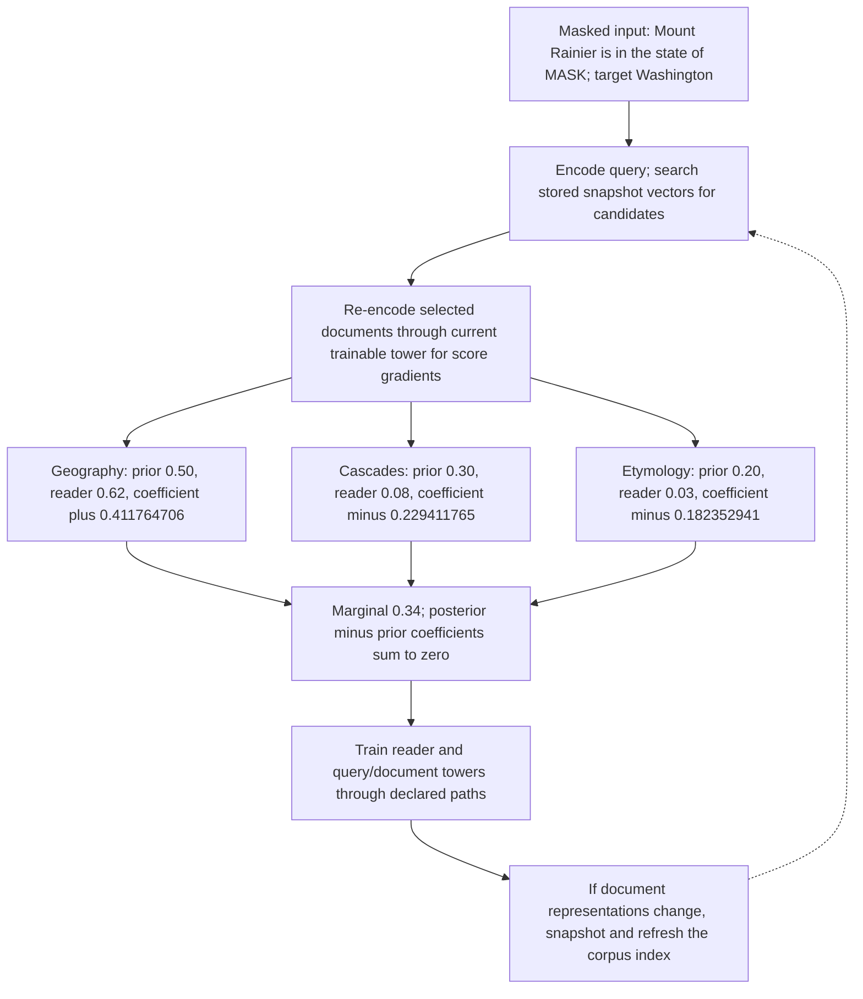

# Chapter 28: Training the Retriever
[00-START-HERE](../00-START-HERE.md) · [01-READING-ROUTES](../01-READING-ROUTES.md) · [27\_fine\_tuning\_the\_generator](27_fine_tuning_the_generator.md) · [29\_bootstrapping\_training\_data](29_bootstrapping_training_data.md)
Purpose: decide which Retrieval-Augmented Generation (RAG) component to train, connect generator utility to a discrete retriever, and price the index work that retriever updates create.
## TL;DR
- Choose freeze/train decisions separately for retrieval and generation. Use oracle, closed-book and production hit/miss diagnostics rather than an unsupported recall-based accuracy ceiling.
- FiD independently encodes passage views and jointly decodes; only the idealized encoder attention term shrinks by the passage count. FiD-Light reduces decoder-visible states after compatible training, not every component of total cost by the same factor.
- Hard selected identities have no ordinary gradient almost everywhere. Finite-support marginalization, stochastic score-function estimators and differentiable surrogates define different objectives and interfaces.
- REPLUG mixes passage-conditioned next-token distributions from a frozen model. Exact implementation requires appropriate probability access, multiple branch computations and explicit caching/billing assumptions.
- LM supervision supplies direct feedback only for scored candidates. Shared encoder updates and later mining can still change rankings outside that set. The direction of KL and temperature chain rule matter.
- Index refresh must distinguish inline age from asynchronous build/publication lag and include both retriever towers where trained. Flat search avoids graph construction, not document re-encoding.
- REALM-style masked prediction can train retrieval without relevance labels. The corrected fully trainable three-tower scenario costs about $`42.317708`$ times its closed-book baseline including the charged rebuilds; the old roughly thirty-three-fold subtotal omitted retriever training work.
## The story
Imagine a library with a catalog clerk, a reader and a builder who regenerates catalog cards. Give the reader verified evidence to diagnose failures, but remember that this intervention changes context and cannot uniquely identify every cause. Training only the query-side clerk need not rewrite cards; training the shared or document-side representation can. The hard checkout gate supplies book identities, not a differentiable path from answer loss. Marginalization and stochastic training can score choices, while a soft or straight-through approach needs an explicit continuous interface rather than gradients through raw book titles. FiD reads passage views separately and combines them in one decoder. FiD-Light trains a smaller decoder-visible state set. A locked service-window reader can instead expose token distributions for REPLUG, with one branch per passage and bills that depend on output length and cache policy. The reader can also grade retrieved books by answer likelihood. That gives direct supervision only on the cart, although a shared clerk update or new mining can bring other books later. REALM moves the same comparative credit into masked pretraining. Its catalog builder is part of the resource ledger, and a full ledger includes the reader, query encoder, document encoder and refreshes—not only the reader.
The retriever supplies evidence and the generator uses it, but final correctness depends on their joint distribution, prior knowledge and the evaluation definition. Diagnose input sufficiency and conditional reader behavior separately.
- Use gold-context interventions alongside representative production hit/miss and closed-book measurements. A flat oracle result need not prove that generation is the only failure.
- Selected passage identities are discrete. A gradient path requires an explicit stochastic objective, marginal likelihood or differentiable surrogate; putting raw text behind a soft mask does not create one automatically.
- FiD and FiD-Light require compatible generator architecture/training. REPLUG instead requires next-token probability access and charges passage-conditioned branches.
- LM supervision has a direct candidate-support blind spot, not a theorem that shared retriever training can never improve future discovery.
- When the document representation changes, use versioned encode/build/publish stages. A final compatible index is required if document-side weights moved; corpus-only updates and query-only training have different obligations.
- REALM’s useful masked-token signal and its rebuild costs depend on model architecture, selected support and training layout. Report empirical results separately from the arithmetic scenario.
In short: diagnose the production slices, choose an implementable learning objective, and charge all trained components plus the index lifecycle.
## Decoder table


| Source term | Plain-language decode | Interview consequence |
| --- | --- | --- |
| RAG | Retrieval-Augmented Generation | Correctness depends jointly on evidence, reader, prior knowledge, labels and policy |
| Retriever weights, $`\phi`$ | Retriever scoring and selection parameters | Hard identity selection blocks that particular ordinary gradient; direct retrieval losses or score paths can still train them |
| Generator weights, $`\theta`$ | Parameters that produce the answer | They can train directly from answer loss when weights are available. |
| Datastore, $`D`$ | Corpus of chunks with stored representation versions | Document-side changes can invalidate vectors; query-only updates do not automatically do so |
| Query and evidence symbols $`x`$, $`q`$, $`y`$, $`c_i`$, $`p_i`$, and $`d_i`$ | Question/request, target and passage/document symbols | Names are local; distinguish a masked target, an output token and a full answer sequence |
| Parameter symbols $`\phi`$, $`\theta`$, and $`\eta`$ | Retriever, generator and query-side trainable parameters | Use retriever snapshot versions in refresh analysis, keeping generator parameters separate |
| Encoder functions $`E`$, $`E_Q`$, $`E_P`$, $`\mathrm{Emb}_q`$, and $`\mathrm{Emb}_d`$ | Query-side and document-side representation functions | A changed document function creates the re-encoding obligation; shared checkpoints can be untied explicitly |
| $`N,M,k,n,d,l,m`$ | Corpus/candidate sizes, depth, view length, width, layers and visible states | View length includes repeated query/template tokens; candidate count need not equal corpus count |
| $`P_r,P_g,F,\mathcal B,C_r,C_s`$ | Parameter counts, arithmetic throughput, bandwidth and work components | Compare declared workloads and measured rates; FLOP ratios are not latency measurements |
| $`B`$ and $`b`$ | Batch size; lowercase b denotes bytes per cached scalar | Do not conflate scalar storage with examples per step |
| $`L,L_q,L_d,\mathcal L`$ | Output-token count or local input-length notation; script L is loss | Output words and tokens differ; refresh separates query and document lengths |
| $`z,\tilde z`$ | Kept-state count, hard/relaxed mask or a latent block, depending on section | Decode locally; a categorical unit-sum mask is not a multi-hot depth-k mask |
| $`D^{\prime},\mathcal C,\mathcal Z_k`$ | Explicit retrieved support or declared candidate set | Normalization on that support defines a truncated objective, not proof that all corpus mass is included |
| Sequence symbols $`y_t`$, $`y_{<t}`$, and $`d \circ x`$ | Current output token, decoded prefix, and a document prepended to a query | They define REPLUG’s repeated next-token mixture. |
| $`U_i,G_i,\tilde z_i,\delta_{ij}`$ | Uniform draws, Gumbel noise, relaxed categorical weight and identity indicator | The Jacobian applies to one-choice relaxation with positive temperature |
| Distillation symbols $`u_i`$, $`\ell_i`$, $`\beta`$, and $`\gamma`$ | Teacher utility, log probability ratio and teacher/student temperatures | Scaled logit a equals raw score divided by gamma; score gradients include the inverse temperature |
| $`\phi_{jK},K,D,K_{\min},\rho`$ | Document snapshot, interval, build duration, capacity floor and relative arithmetic rate | General asynchronous age is build duration through build duration plus interval; inline age is different |
| Top $`k`$ | Selected candidate support | Limits direct input evidence, not all possible accuracy or future shared-parameter discovery |
| Oracle-context ablation | Supply verified gold evidence as an intervention | Useful diagnostic, but no unique causal assignment or automatic freeze/train decision |
| Quadrant I | Freeze the declared retrieval and generation weights | Prompt/chunking/depth changes are non-gradient here; an independently trained reranker needs separate classification |
| Quadrant II | Train retrieval with generation frozen | Teacher likelihood is one option; full re-encoding is conditional on changed document representations |
| Quadrant III | Train generation with retrieval weights frozen | Compatible FiD/Light or RAFT training can fit; corpus-only index updates remain possible |
| Quadrant IV | Train both through an explicit coupling | Budget all trained components and any document-side refresh; direct generator training needs an available interface |
| Query-side fine-tuning | Train the query tower while preserving document representation | Avoids automatic re-encode; can repair some mismatch but not information lost in fixed document vectors |
| Document-side fine-tuning | Train document representations | May improve or worsen geometry; version and refresh affected representations rather than assume every step improves quality |
| Tied encoder | One shared function for query and passage encoding | Can be copied and untied; query-only training of one copy is then a different architecture |
| FiD | Encode passage views independently, decode jointly | Ideal encoder attention ratio equals depth; total FLOPs and real query-once layouts have different ratios |
| FiD-Light | Train with a restricted decoder-visible state set per passage | Reduces static cross-KV projection/cache components; does not guarantee unchanged quality |
| Decoder-visible states, $`m`$ | The total states offered to decoder cross-attention | For FiD-Light, $`m = kz`$. |
| KV cache | Static cross-attention keys/values, distinct from dynamic self-attention KV | Store once and model repeated reads explicitly; caching, batching and on-chip reuse change physical traffic |
| Marginalization | Sum probabilities over a declared latent-support model | Sequence marginalization differs from token mixtures; exactness is local to the defined model, not a full-corpus guarantee |
| Hard top-$`k`$ | Indices of highest-scoring candidates | Locally constant away from selection crossings; raw text lookup has no automatic continuous derivative |
| Selection vector, $`z`$ | Hard mask with a specified number of selected candidates | A compatible differentiable surrogate requires an explicit reader/mask interface |
| REINFORCE | Stochastic score-function gradient estimator | Unbiased under its stated objective/baseline/support assumptions; one sampled rollout is possible but variance/cost remain |
| Standard Gumbel noise | Noise sampled from transformed uniform draws | Perturb-and-argmax becomes an exact softmax sample. |
| Gumbel-Softmax | Temperature-softened noisy categorical selection | Pathwise gradient belongs to the relaxed objective; small draw-specific derivatives and near-tie peaks are possible |
| Gumbel-top-$`k`$ | Ordered noisy top-k selection | Plackett–Luce without-replacement law; not independent categorical draws or a unit-sum top-k relaxation |
| Straight-through estimator | Hard forward mask with substituted relaxed derivative | Biased surrogate requiring an implementable continuous path; not automatic differentiation through raw strings |
| Temperature, $`\tau`$ | Relaxation or retrieval-mixture temperature | Different roles: Gumbel relaxation sharpness need not change its hard argmax law; REPLUG temperature changes weights |
| REPLUG | Frozen branch distributions mixed at each token under a common prefix | Needs adequate probability/continuation access and charges every branch step |
| Retrieval weight, $`\lambda`$ | Normalized candidate weight at fixed request | Bounds one additive token-probability contribution, not raw-score influence or whole-answer provenance |
| LM-supervised retrieval | Use this teacher’s answer likelihood to train retrieval | Preference is not necessarily truth, human relevance or causal evidence use |
| Utility, $`u`$ | Summed or explicitly length-normalized gold-answer log likelihood | Within-query comparison does not remove answer-length-dependent temperature effects |
| LM preference, $`Q_{\mathrm{LM}}`$ | Temperature-normalized relative teacher preferences | Can favor the least-bad passage when every candidate is poor; evaluate absolute utility too |
| Retriever distribution, $`P_R`$ | Softmax over retriever scores with temperature $`\gamma`$ | It is the student distribution on the same top-$`k`$ support. |
| Kullback-Leibler divergence, KL | Declared divergence between retrieval and teacher distributions | Direction matters: reverse-teacher KL has a mass-scaled logit gradient; teacher-to-student KL instead gives P minus Q |
| Top-$`k`$ blind spot | No direct independent teacher score feedback for unscored candidates | Shared updates and later candidate mining can still alter outside ranks; not an absolute discovery impossibility |
| Hard-negative mining | Introduce current difficult negatives and missing positives | Adds candidate exposure; does not guarantee every useful document is discovered |
| Index version | Document encoder snapshot that produced indexed representations | Query-only training intentionally works against a fixed document tower; differing query step numbers are not automatically invalid |
| Negative stagnation | Old candidates become easy under the current model | Loss can keep falling while recall stops improving. |
| Refresh cost, $`C_r`$ | Work for the declared corpus re-encoding component | Graph construction, I/O and publication are separate unless explicitly included |
| Step cost, $`C_s`$ | All charged trainable/teacher work per step | Adding a teacher enlarges the denominator; it does not make an encode intrinsically cheaper |
| Refresh interval, $`K`$ | Trainer updates between snapshots or inline rebuilds | Capacity and acceptable version/task-quality drift constrain cadence; no universal overlap-only upper bound |
| Builder ratio, $`\rho`$ | Builder versus trainer arithmetic throughput ratio | Measure build and step times if utilization differs; one serial builder needs enough service capacity |
| Asynchronous refresh | Build while the trainer advances, then publish a snapshot | General age lies between build delay and build delay plus interval; the one-to-two-interval band is a special schedule |
| Flat training search | Exact search over stored snapshot vectors | Avoids graph construction, not encoder updates, vector staleness, memory reads or top-k selection |
| Hierarchical Navigable Small World (HNSW) | Approximate-neighbor graph index | A stipulated distance-count FLOP comparison is not a universal build-cost or wall-time bound |
| Maximum inner product search (MIPS) | Search by bi-encoder inner product | REALM rebuilds this index asynchronously. |
| REALM | Latent retrieval inside masked-token pretraining | Comparative likelihood can train both towers only through available gradient paths; charge the reader too |
| Salient span masking | Choose salient entities, dates or identifiers as masked targets | Can strengthen retrieval signal empirically, not guarantee it is required or nonzero |
| Inverse Cloze Task (ICT) | Source-named retrieval warm start | Can improve useful-candidate exposure; equally poor likelihoods need not be exactly equal or always signal-free |
| RETRO | Source-reported large-datastore pretraining with frozen retrieval | Scaling and quality claims are experiment-specific; not proof of equivalence to the full-gradient toy |


## Core mechanics
### Mathematical conventions
Use natural logarithms, decimal bytes and explicit binary units where needed. Compute at full precision before rounding. Accuracy changes are percentage points unless explicitly relative. A finite-support probability mixture is exact for its declared candidate set, not necessarily for the full corpus.
Dense arithmetic proxies are $`W_{\mathrm{train}}\approx6PT`$ and $`W_{\mathrm{forward}}\approx2PT`$. The first examples use $`F=3.4\times10^{14}\,\mathrm{FLOP\,s^{-1}}`$; FiD also assumes bandwidth $`\mathcal B=3.35\times10^{12}\,\mathrm{B\,s^{-1}}`$. Other sections state their own throughput. These proxies omit utilization changes, searches, communication, scheduling, launch overhead and relevant task-specific terms unless listed. FLOP ratios do not establish measured latency or an end-to-end invoice.
Treat oracle-context accuracy as an intervention. Production correctness obeys $`A=R g+(1-R)b`$ only with $`R`$, $`g`$ and $`b`$ defined on corresponding sufficient-evidence hit/miss populations. Without $`b=0`$, recall alone is not an accuracy ceiling. A new retriever can change all three rates.
Memory and traffic ledgers declare what is stored and read. FiD costs distinguish encoder work, one-time cross-attention KV projection, per-token weight/cache streaming and omitted self-attention/output/runtime terms. Refresh steps distinguish query and document tokens; builder capacity is a wall-time constraint when measured throughputs differ. A document-side update can invalidate stored representations; query-only or reranker updates do not automatically require a full document re-encode.
### 28.1 Four quadrants: freeze or train × retriever or generator
#### What
Expose both parameter sets.

```math
(c_1,\ldots,c_k)=\mathop{\mathrm{RET}}\nolimits_{\phi}(x,D),\qquad y\sim p_\theta(\,\cdot\mid x,c_1,\ldots,c_k).
```

The datastore contains $`N`$ chunks and the retriever returns $`k`$; an approximate index need not explicitly score every chunk per query. Freeze/train decisions apply separately to retrieval and generation. Run a verified gold-context intervention and production evidence/reader ablations on representative held-out questions, including failures and successes.
- An oracle-context gain suggests that changed evidence or context helped. Investigate retrieval coverage, context formatting and distracting text; it is not unique causal attribution to the retriever.
- A flat oracle result suggests residual reader, reasoning, label or task limitations, but can also arise from an invalid oracle construction or ceiling effects. It does not prove retrieval is already sound.
- With sufficient-evidence rate $`R=0.6`$, $`A=0.6g+0.4b`$. Only under an additional zero-correctness-on-misses assumption is accuracy bounded by $`0.6`$; prior knowledge, alternate evidence and learned facts can make $`b>0`$.
#### Why
The four choices carry different signals and obligations.
- Quadrant I makes no parameter updates to the declared retriever and generator; changes to prompts, chunking or an additional trained reranker are separate interventions.
- Quadrant II trains retrieval while freezing generation. Full document re-encoding is owed when document-side representations change, not merely when any retriever parameter changes.
- Quadrant III trains generation with frozen retrieval representations; corpus updates can still change the index.
- Quadrant IV trains both through an explicit gradient/estimator path. Budget both trained components and any index refresh; a hosted generator without a training interface cannot supply owned generator gradients.
Query-only training keeps the document representation fixed and avoids invalidating stored vectors. It can compensate for some vocabulary or alignment mismatch if the fixed document vectors retain the necessary distinctions. It cannot recover information that those vectors have discarded or distinguish identical document representations without another signal. A tied checkpoint can be copied into separate towers and the document copy frozen, at which point the training architecture is no longer tied.
#### Failure without it
Generator tuning is not automatically wasted on retrieval misses: it can change prior knowledge, abstention and evidence use, but cannot directly read an unfetched source. Choose from measured costs and held-out policy/quality gains. Hard identity selection blocks that particular answer-gradient path; score weighting, direct retrieval losses or stochastic estimators can provide another. A changing corpus, hosted interface or future generator release changes the trade-off rather than mathematically ruling out joint training. The source’s PEFT default is an empirical starting point, not a theorem about which target formats LoRA can represent.
#### Cost and complexity
The first arithmetic ledger uses a $`110\times10^6`$-parameter retriever and an $`8\times10^9`$-parameter generator:

```math
P_r=1.1\times10^8,\qquad P_g=8\times10^9,\qquad P_g/P_r\approx72.727273.
```

For ten million length-$`256`$ document chunks, at the stipulated $`F`$, the re-encode component is

```math
t_{\mathrm{encode}}\approx\frac{2(1.1\times10^8)(256)(10^7)}{3.4\times10^{14}}\,\mathrm s\approx1{,}656.470588\,\mathrm s\approx27.607843\,\mathrm{min}.
```

A separate basic contrastive-step proxy with $`9{,}216`$ total trainable encoder-token positions gives

```math
t_{\mathrm{step}}\approx\frac{6(1.1\times10^8)(9{,}216)}{3.4\times10^{14}}\,\mathrm s\approx17.889882\,\mathrm{ms}.
```

One re-encode is $`92{,}592.592593`$ of these basic steps in FLOPs. The generator scenario has $`50{,}000`$ pairs, five passages and $`1{,}344`$ total processed token positions per example, with three epochs. Treat that length as the entire charged prompt/target layout; if it excludes targets, charge them separately. These are separate workloads, not matched evidence that training one tower is a fixed fraction of training the other.
- Generator arithmetic is $`2.635294`$ hours per epoch and $`7.905882`$ over three epochs.
- The bare retriever scenario has $`10{,}000`$ basic steps and ten corpus encodes at $`K=1{,}000`$: $`178.898824\,\mathrm s`$ gradient work plus $`16{,}564.705882\,\mathrm s`$ encoding, or $`4.651001`$ arithmetic hours. Encoding is $`98.931539\%`$ of that ledger. Initial index build, teacher scoring and omitted search/communication are not included.
- Adding those two separate bills serially gives $`12.556884`$ hours. This is an accounting comparison, not a measured or unavoidable joint-training schedule.
- Relative to gradient work alone, the bare retriever total is $`93.592593`$ times larger; this is the source’s rounded ninety-four-fold underestimate, not a parameter-count law.
- At $`K=500`$, encoding work is $`185.185185`$ times basic gradient work under this ledger. Refresh counts must specify whether initial and final builds are included and which checkpoint is published.
- At $`100{,}000`$ chunks, the same encode proxy takes $`16.564706\,\mathrm s`$.
- Five-percent new/changed content means $`500{,}000`$ chunks and $`82.823529\,\mathrm s`$ incremental encoding with a frozen document encoder. Updating document-side weights can require encoding all chunks, a twenty-fold difference in this component—not necessarily total operating cost.
### 28.2 Fusion-in-Decoder and FiD-Light
#### What
Let each encoded query-passage view have total length $`n`$, width $`d`$ and $`l`$ layers; $`n`$ includes the repeated question/template. For the ideal comparison, concatenate all $`k`$ such views into length $`kn`$. This repeats the query too. A real concatenation with the query only once has length $`Q+kC`$, versus $`k`$ views of length $`Q+C`$, and need not have the exact ratio below.

```math
W_{\mathrm{attention,concat/layer}}\approx4(kn)^2d.
```

FiD encodes each query-passage view separately with shared encoder parameters, then stacks its token states along the sequence axis:

```math
H_i\in\mathbb R^{n\times d},\qquad H=\begin{bmatrix}H_1\\ \vdots\\ H_k\end{bmatrix}\in\mathbb R^{kn\times d}.
```

The decoder cross-attends to those states at every decoding step, not only once for the whole answer. The encoder attention component is

```math
W_{\mathrm{attention,FiD/layer}}\approx4kn^2d.
```

The ratio is exactly $`k`$ for this ideal attention-only abstraction, not for total transformer work, training memory or measured latency. FiD-Light retains $`z`$ trained encoder states per passage for decoder access, giving $`m=kz`$; the bidirectional encoder still reads all $`n`$ input positions. Quality at a chosen $`z`$ must be validated, not assumed unchanged.
#### Why
FiD moves direct cross-passage combination to the decoder, while independent encoders remove cross-passage self-attention edges. Cross-attention per decoded token grows linearly in visible states at fixed width. FiD-Light reduces that component after compatible training.

```math
M_{\mathrm{crossKV}}=2b\,m d l,\qquad m=kn\ \text{for FiD},\qquad m=kz\ \text{for FiD-Light}.
```

Here $`b`$ is bytes per cached scalar and the factor two counts keys and values; head/key dimensions are assumed to sum to $`d`$. This is one-example cross-attention KV storage across decoder layers. Static encoder K/V projections are computed once and cached. A one-read-per-token HBM model streams this cache per decode step, but batching and on-chip reuse can change physical traffic. Decoder self-attention KV, activations and framework allocations are separate.
#### Failure without it
Concatenated encoder attention is quadratic in its total input length. A single latent-passage branch does not directly condition on multiple passages at once, but that is not proof every multi-hop answer is impossible: priors, a branch that already contains the answer, or information transferred through an autoregressive prefix can help. Sequence marginalization and token-wise ensembling are different models. FiD directly exposes joint passage evidence to one decoder. Cutting visible states post hoc from a FiD checkpoint is not equivalent to training FiD-Light; the required summary behavior and quality must be learned and tested. A passage identifier aids traceability but does not prove correct attribution or truth.
#### Cost and complexity
Use $`k=40`$, $`n=256`$, $`d=1{,}024`$, feed-forward width $`d_{\mathrm{ff}}=4{,}096`$, $`l=24`$ encoder and decoder layers, and vocabulary size $`V=32{,}128`$. Count a multiply-add as two FLOPs. Biases, normalization, positional parameters and additional kernel work are omitted from this component model.
- Encoder attention over all layers is $`10.3079215104`$ TFLOP for length-$`10{,}240`$ concatenation and $`0.25769803776`$ TFLOP for separate views.
- Linear encoder weights per layer are $`4d^2+2dd_{\mathrm{ff}}=12{,}582{,}912`$, giving $`301{,}989{,}888`$ over twenty-four layers. Decoder layers have $`8d^2+2dd_{\mathrm{ff}}=16{,}777{,}216`$, or $`402{,}653{,}184`$ total.
- One vocabulary matrix has $`Vd=32{,}899{,}072`$ entries. With one shared/tied copy, the listed component count is $`737{,}542{,}144`$; with two independent copies it is $`770{,}441{,}216`$. Do not count a tied embedding twice. Proximity to the chapter-reported roughly $`770`$-million T5-large size does not validate weight tying, omitted tensors or an exact architecture count.
For a one-example bf16 streaming proxy, use $`b=2\,\mathrm B`$, bandwidth $`\mathcal B`$ and arithmetic rate $`F`$. The request ledger includes encoder work plus static cross-KV projection, followed by per-token weight/cache reads. It excludes query embedding/search, dynamic self-attention KV growth, other activation traffic, softmax/normalization overhead, communication and batching effects; it is not a measured latency model.
- Encoder linear-plus-attention work is $`16.49267441664`$ TFLOP for the ideal concatenation and $`6.442450944`$ TFLOP for FiD: $`48.507866\,\mathrm{ms}`$ and $`18.948385\,\mathrm{ms}`$ in arithmetic time.
- Static cross-KV preparation adds $`4md^2l=1.03079215104`$ TFLOP for FiD, or $`3.031742\,\mathrm{ms}`$ at $`F`$.
- Decoder layer weights total $`0.805306368\,\mathrm{GB}`$. Remove $`0.100663296\,\mathrm{GB}`$ of cross-KV projection weights already used at preparation and add the $`0.065798144\,\mathrm{GB}`$ vocabulary projection read. The declared per-token weight stream is $`0.770441216\,\mathrm{GB}`$; tied storage does not make the output-head read free.
- Cross-KV cache is $`1.006632960\,\mathrm{GB}`$. Weight-plus-cross-cache stream is $`1.777074176\,\mathrm{GB}`$, or $`0.530470\,\mathrm{ms/token}`$; the cross-cache accounts for approximately $`56.645523\%`$ of those bytes.
For FiD-Light with $`z=8`$, keeping encoder work unchanged:
- Visible states fall from $`10{,}240`$ to $`320`$ and cross-cache storage to $`0.031457280\,\mathrm{GB}`$, a thirty-two-fold change in that component.
- Static cross-KV preparation falls to $`0.03221225472`$ TFLOP, or $`0.094742\,\mathrm{ms}`$; preparation plus encoding is $`19.043127\,\mathrm{ms}`$ versus FiD’s $`21.980127\,\mathrm{ms}`$.
- Weight-plus-cross-cache stream becomes $`0.801898496\,\mathrm{GB}`$ and $`0.239373\,\mathrm{ms/token}`$. This decode-stream ratio is approximately $`2.216084`$, not thirty-two.

```math
	\begin{aligned}t_{\mathrm{FiD,proxy}}(L)&\approx(21.980126750+0.530469903L)\,\mathrm{ms},\\t_{\mathrm{Light,proxy}}(L)&\approx(19.043127055+0.239372685L)\,\mathrm{ms}.\end{aligned}
```

- At $`L=3`$ output tokens, the partial proxies are $`23.571536\,\mathrm{ms}`$ and $`19.761245\,\mathrm{ms}`$, a $`16.164798\%`$ reduction. Three words need not tokenize to three tokens. Earlier four-percent labels omitted the changed cross-KV preparation and used a different weight stream.
- At $`L=256`$, the proxies are $`157.780422\,\mathrm{ms}`$ and $`80.322535\,\mathrm{ms}`$, a ratio of approximately $`1.964336`$. None proves the same speedup or unchanged quality in production.
- The declared cross-cache overtakes streamed weights at about $`7{,}837.333`$ visible states, hence at integer $`m\ge7{,}838`$ in this model. This threshold changes with architecture, cache reuse and included bytes; it is not a universal gate.
- Choose $`k`$ for evidence coverage and $`z`$ for quality versus total visible-state budget $`m=kz`$. The source’s independent-encoding threshold near five passages is a heuristic.
- At $`k=5`$ with the same per-view shape, encoder arithmetic is $`2.368548\,\mathrm{ms}`$ and cross-cache payload $`0.125829120\,\mathrm{GB}`$, before other costs.
- Source pointing supplies identifiers for auditing, not a guarantee of factual grounding.
### 28.3 Relevance is discrete: Gumbel noise and the differentiability fix
#### What
For a declared candidate pool of $`M`$ documents, the retriever forms scores and a hard mask; $`M=N`$ only if all corpus candidates are considered. The document encoder is fixed in the score below; sharing trainable parameters creates an additional document-side derivative.

```math
s_i=E_\eta(q)^\mathsf T E(d_i),\qquad z\in\{0,1\}^{M},\qquad\sum_{i=1}^{M}z_i=k.
```

The generator loss is:

```math
\mathcal L=-\log p_\theta\!\left(y\mid q,\{d_i:z_i=1\}\right).
```

A formal mask-interface chain would be

```math
\nabla_\eta\mathcal L=\frac{\partial\mathcal L}{\partial z}\frac{\partial z}{\partial s}\frac{\partial s}{\partial\eta}.
```

For hard selected identities, the middle Jacobian is zero away from rank boundaries and the selection map is nondifferentiable at relevant crossings. Raw tokenization/text lookup also does not supply a differentiable mask input automatically. This blocks this particular ordinary gradient path, not all possible retriever learning. Scores passed into a differentiable reader or a separate retrieval loss can create another path.
1. Define a differentiable finite-support marginal likelihood, with candidate support held fixed locally.
2. Optimize an expected stochastic retrieval reward with a score-function estimator.
3. Define a continuous relaxation or explicit straight-through surrogate at a compatible representation interface.
A single latent-document sequence model on a fixed candidate set $`\mathcal C`$ is

```math
p(y\mid q)=\sum_{i\in\mathcal C}\pi_\eta(i\mid q)\,p_\theta(y\mid q,d_i),\qquad\sum_{i\in\mathcal C}\pi_\eta(i\mid q)=1.
```

This is exact for the declared finite-support model, not necessarily the full-corpus objective. RAG-Sequence’s sequence mixture and REPLUG’s product of per-token mixtures are not interchangeable. For stochastic action $`Z`$ with reward independent of $`\eta`$ except through the sampled action, an action-independent baseline $`b(q)`$ gives

```math
\nabla_\eta\mathbb E[R(Z)]=\mathbb E\!\left[(R(Z)-b(q))\nabla_\eta\log\pi_\eta(Z\mid q)\right].
```

With suitable support/regularity this score-function estimator is unbiased and may use one sampled reader rollout. It can have high variance; exact reward evaluation and baseline costs are not free. If the reward directly depends on $`\eta`$, include its derivative too. For one categorical choice with unit-temperature logits,

```math
\frac{\partial\log\pi_\eta(Z\mid q)}{\partial s_i}=\mathbb1[i=Z]-\pi_i.
```

A non-unit score temperature contributes its inverse to this derivative. Draw independent standard Gumbel noises:

```math
U_i\overset{\mathrm{iid}}\sim\mathop{\mathrm{Uniform}}\nolimits(0,1),\qquad G_i=-\ln(-\ln U_i).
```

Its cumulative distribution is:

```math
F_G(g)=\exp(-e^{-g}).
```

The maximum of shifted Gumbels remains Gumbel.

```math
\Pr\!\left(\max_j(s_j+G_j)\le t\right)=\exp\!\left(-e^{-t}\sum_j e^{s_j}\right).
```

The maximum-CDF identity identifies a shifted Gumbel. The categorical argmax law additionally follows by integrating the winning candidate’s density against the other candidates’ CDFs:

```math
\Pr\!\left(\mathop{\mathrm{arg\,max}}_j(s_j+G_j)=i\right)=\frac{e^{s_i}}{\sum_j e^{s_j}}.
```

The categorical continuous relaxation, also called Concrete/Gumbel-Softmax, and its Jacobian are

```math
\tilde z_i=\frac{\exp((s_i+G_i)/\tau)}{\sum_j\exp((s_j+G_j)/\tau)},\qquad\frac{\partial\tilde z_i}{\partial s_j}=\frac1\tau\tilde z_i(\delta_{ij}-\tilde z_j),\quad\tau>0.
```

Gumbel-top-$`k`$ gives the ordered Plackett–Luce sample without replacement from the exponentiated scores; it is not $`k`$ independent categorical draws. A categorical softmax sums to one, whereas a $`k`$-hot mask sums to $`k`$, so top-$`k`$ needs a compatible soft-top-$`k`$ or iterative surrogate rather than blindly reusing the single-choice Jacobian. A straight-through mask uses $`z_{\mathrm{ST}}=\mathop{\mathrm{stopgrad}}\nolimits(z_{\mathrm{hard}}-\tilde z)+\tilde z`$. It is hard forward and surrogate-soft backward only if the reader/representation provides a differentiable path through that mask; arbitrary raw strings do not. The noisy hard forward choice is also not the same as deterministic serving top-$`k`$.
#### Why
Gumbel randomness is independent of retriever parameters, enabling a pathwise derivative for a compatible relaxed objective. That derivative is not an unbiased gradient of the original discrete objective at finite temperature. Straight-through substitution introduces an additional surrogate bias. A thirty-token answer at two nats per token has NLL $`60`$ nats; a log-likelihood reward is $`-60`$, and the centered advantage depends on the baseline. Neither value by itself determines estimator variance. A blended passage embedding is not real text, but can be valid input to an explicitly designed continuous reader; assess the serving mismatch rather than assuming a text API accepts it.
#### Failure without it
A hard top-one identity is locally unchanged until a rank crossing; a loss through that identity supplies no ordinary score gradient, although explicit score weighting or other objectives can. Low relaxation temperature makes many draw-specific derivatives small and permits larger derivatives near ties; it is not a general zero-gradient or stability law. Independent Gaussian perturbations lead to multinomial-probit rather than softmax choices. Binary probabilities reduce to a normal CDF; general multicandidate probabilities require Gaussian integrals rather than a universal elementary softmax formula.
#### Cost and complexity
The five-logit example is:

```math
s=(2,1.5,0.5,0,-1),\qquad\mathop{\mathrm{softmax}}\nolimits(s)\approx(0.496331,0.301040,0.110746,0.067171,0.024711).
```

The Gumbel draw uses:

```math
\begin{aligned}u&=(0.42,0.91,0.77,0.15,0.63),\\g&\approx(0.142139,2.361161,1.341838,-0.640337,0.772114),\\s+g&\approx(2.142139,3.861161,1.841838,-0.640337,-0.227886).\end{aligned}
```

The unrounded draw selects passage two, with noisy top two ordered as $`(2,1)`$. At $`\tau=1`$, the relaxed weights are

```math
\tilde z\approx(0.133779,0.746361,0.099076,0.008279,0.012505).
```

Compare the same Jacobian entry, not different coordinates: $`J_{22}\approx0.189306291`$ at $`\tau=1`$ and $`J_{22}\approx3.59271515\times10^{-7}`$ at $`\tau=0.1`$, a draw-specific ratio of about $`526{,}917`$. At the lower temperature, the first weight is $`3.42281522\times10^{-8}`$ and $`J_{11}\approx3.42281511\times10^{-7}`$. A diagonal entry is bounded by $`1/(4\tau)`$, reaching $`2.5`$ at a two-way half/half tie in the limiting no-other-mass case. The ratio of that bound to this draw’s $`J_{22}`$ is about $`6.958526\times10^6`$. These are not estimates of typical training gradients or their variance. For two independent standard Gumbels, their difference is Logistic, so a ninety-percent pairwise win probability requires

```math
\Delta=\ln(0.9/0.1)=\ln9\approx2.197224577.
```

The current score margin $`0.5`$ gives pairwise win probability $`0.622459331`$, requiring an additional $`1.697224577`$ logits for this two-candidate ninety-percent comparison. It does not imply ninety-percent top-one probability among all five. In a separate workload comparison, let $`k=8`$, passage length $`200`$, query length $`50`$ and target length $`30`$.
- Eight single-passage likelihood branches process $`2{,}000`$ prompt and $`240`$ target positions, total $`2{,}240`$.
- One sampled top-one branch processes $`250`$ prompt and $`30`$ target positions, total $`280`$.
- The eight-fold position ratio is exact for those branch lengths, not an end-to-end compute or latency guarantee. Retriever scoring, gradient estimation, sequential scheduling and quality differ; a hard top-$`k`$ reader with $`k>1`$ has another workload.
The source’s small-$`k`$ marginalization and large-$`k`$ straight-through preferences are heuristics, contingent on architecture, probability access and quality. Anneal temperature only with measured gradient/quality behavior; $`\tau=1`$ is a starting point, not a guarantee. Track categorical score entropy on a clearly defined candidate set separately from relaxed-sample entropy. Nearly concentrated mass makes noise less influential, not absent; entropy near $`\ln M`$ indicates near-uniform candidate weights, not necessarily no useful retrieval. A top-one mass above $`0.9`$ does not by itself prove a surrogate is unnecessary.
### 28.4 REPLUG: black-box LLM, ensembled output distributions
#### What
In the frozen-retriever inference variant, retrieve $`D^{\prime}`$ once from the original request $`x`$ and assign cosine scores. LM-supervised retriever training is a separate variant. Do not silently re-retrieve from each generated prefix while claiming fixed weights.

```math
s(d,x)=\cos(E(d),E(x)).
```


```math
\lambda(d,x)=\frac{\exp(s(d,x)/\tau)}{\sum_{d^{\prime}\in D^{\prime}}\exp(s(d^{\prime},x)/\tau)},\qquad\tau>0.
```

At each generation step, each passage-conditioned branch uses the same selected output prefix. Mix normalized next-token distributions:

```math
p(y_t\mid x,y_{<t})=\sum_{d\in D^{\prime}}\lambda(d,x)\,p_{\mathrm{LM}}(y_t\mid d\circ x,y_{<t}).
```

Select or sample one token from that mixture, append that same token to every branch, and repeat. Greedy argmax is one decoding policy, not a required part of the probabilistic model.
#### Why
Exact vocabulary mixing needs access to the relevant next-token distributions and an interface that can continue each branch under the common selected prefix. No model-weight or gradient access is required, but an ordinary text-only API or log probabilities only for emitted tokens is insufficient. Per-pass context is question plus one passage. For a fixed token/prefix, a passage’s additive contribution is at most its normalized weight $`\lambda`$, not its raw score; this is not causal citation attribution or a bound on influence over the entire autoregressive answer. FiD instead needs a compatible encoder-decoder architecture; simply gaining weights does not automatically turn a decoder-only model into FiD.
#### Failure without it
Concatenation normally does not enforce an explicit retrieval-weighted vocabulary mixture, though scores can be supplied as prompt features. At $`\tau=1`$, narrow cosine scores can yield diffuse weights. A frozen model’s context-use behavior cannot be retrained through this inference-only procedure, but prompts and external filters can still change behavior. Fixed weights do not verify source truth: a wrong majority can dominate. In this defined variant, every branch contributes at every token with constant $`\lambda`$; pruning or adaptive retrieval would be another algorithm.
#### Cost and complexity
Use scores $`0.82`$, $`0.79`$ and eight copies of $`0.70`$. For a fully normalized two-token example, gold assigns $`(0.85,0.15)`$ to (correct, wrong), while each other passage assigns $`(0.10,0.90)`$.
- At $`\tau=1`$, gold weight is $`0.110304552`$ and each low-scoring passage has $`0.097831361`$; correct-token mixture probability is $`0.182728414`$.
- At $`\tau=0.05`$, gold, the second passage and each remaining passage have weights $`0.439646386`$, $`0.241283052`$ and $`0.039883820`$. Correct mass is $`0.429734789`$ and wrong mass $`0.570265211`$; they sum to one.
- Gold-only conditioning gives correct mass $`0.85`$. The mixture flips to the correct token only if $`0.10+0.75\lambda_{\mathrm{gold}}>0.5`$, hence $`\lambda_{\mathrm{gold}}>8/15\approx0.533333333`$.
- For these scores, numerical solution gives $`\tau<0.040111905`$ for a strict correct-token win. As temperature falls, the unique highest-score branch dominates, but if that document is wrong concentration can hurt.
- The prior wrong-token value $`0.504`$ and threshold $`0.514`$ did not follow one specified normalized pair of token distributions. A different gold wrong-token mass changes the threshold; it must be declared.
The billing scenario uses ten $`128`$-token chunks, a $`100`$-token question/instruction and a $`64`$-token answer, priced at $`\$3`$ per million charged input tokens and $`\$15`$ per million charged output positions. It assumes the required probability/continuation interface bills one output position per branch step at those rates; actual endpoints may not offer this interface or pricing.
- Concatenation prefills $`1{,}380`$ tokens once and decodes sixty-four: $`\$0.00510`$ per query under these hypothetical rates.
- Persistent branch KV states require $`2{,}280`$ initial input positions, a ratio of $`1.652174`$, plus $`640`$ branch-token evaluations. If only initial input and those outputs are billed, the component bill is $`\$0.01644`$, or $`3.223529`$ times concatenation—not the same bill even with cached inputs.
- Without persistent/cached prefix treatment, input positions sum to $`10\sum_{t=0}^{63}(228+t)=166{,}080`$. Input bill is $`\$0.49824`$, output bill $`\$0.00960`$, total $`\$0.50784`$, a ratio of $`99.576471`$.
- Parallel branches can reduce critical-path waiting with enough capacity, but successive output-token decisions remain dependent. Compute is not uniformly ten-fold for every component, and cache availability does not imply free or discounted billing.
The chapter reports $`6.3\%`$ improvement in GPT-3 175B language modeling and $`5.1\%`$ in a Codex five-shot MMLU setting. Preserve their source-specific metrics and denominators rather than treating them as verified production gains or interchangeable percentage-point changes. Ten branches over five hundred output tokens require $`5{,}000`$ branch-token evaluations, in addition to preparation. The source’s fifty-token cutoff and one-third top-source mass are heuristics to validate. Tune depth, temperature, evidence diversity and output length jointly. Selecting one document and generating once is cheaper but is no longer the same mixture and can lose joint-evidence capability. Truncated top-token lists omit probability mass; do not silently renormalize them and claim an exact full-vocabulary mixture. Approximation or certified-tail bounds require separate analysis.
### 28.5 LM-supervised retrieval: KL between retriever and LM preference
#### What
For fixed query $`x`$, verified gold answer $`y`$ and a frozen teacher, score each retrieved passage with its target-sequence log likelihood. Mask prompt loss and state whether the likelihood is summed or length-normalized:

```math
u_i=\log P_{\mathrm{LM}}(y\mid d_i\oplus x).
```

Normalize utility over the retrieved set with LM temperature $`\beta`$.

```math
Q_i=\frac{\exp(u_i/\beta)}{\sum_{j=1}^{k}\exp(u_j/\beta)},\qquad\beta>0.
```

Normalize retriever scores on the same support with temperature $`\gamma`$.

```math
P_i=\frac{\exp(s_i/\gamma)}{\sum_{j=1}^{k}\exp(s_j/\gamma)},\qquad a_i=s_i/\gamma,\quad\gamma>0.
```

For the explicitly analyzed reverse-teacher-direction variant, hold the candidate set and teacher probabilities fixed locally and minimize

```math
\mathcal L=\mathop{\mathrm{KL}}\nolimits(P\Vert Q)=\sum_iP_i\ln(P_i/Q_i).
```

Let:

```math
\ell_i=\ln(P_i/Q_i),\qquad P_i,Q_i>0.
```

Then:

```math
\frac{\partial\mathcal L}{\partial a_j}=P_j(\ell_j-\mathcal L),\qquad\frac{\partial\mathcal L}{\partial s_j}=\frac1\gamma P_j(\ell_j-\mathcal L).
```

These coordinate gradients sum to zero because adding a common logit offset changes no softmax probability. A negative logit gradient is a descent direction in independent logit coordinates, not automatically the actual change in probabilities, cosine scores or shared encoder parameters. Reversing KL to $`\mathop{\mathrm{KL}}\nolimits(Q\Vert P)`$ gives a different logit gradient $`P_j-Q_j`$. State the chosen implementation rather than attributing one direction to every LM-supervised method.
#### Why
LM likelihood measures this generator’s relative preference, not guaranteed human relevance, truth or causal evidence benefit. A model can favor familiar wording or prior-consistent misinformation. Within-query comparison avoids comparing raw totals between different answers, but does not remove length-dependent sharpness: longer answers can increase utility contrasts. Mean token log likelihood is another explicit teacher objective. Temperature, absolute usefulness, labels and held-out correctness need validation. Teacher scoring can use an API only if the required gold-answer likelihoods are exposed.
#### Failure without it
Finite-support normalization defines a conditional candidate objective; it does not require or prove that top-$`k`$ contains essentially all full-corpus probability. An outside document has no direct independent score-coordinate supervision in that example. Shared query/document parameter updates can nonetheless change its score and future rank, and later mining can introduce it. Thus there is a direct-feedback blind spot, not an impossibility of future discovery. The $`P_j`$ factor can make low-mass candidates hard to promote in this KL direction, but no universal ordering of demotion and promotion magnitudes follows. Relative teacher preferences can favor the best of an entirely poor candidate set; use absolute quality/evidence tests too.
#### Cost and complexity
The worked example uses $`k = 4`$, $`\gamma = 0.1`$, and cosine scores:

```math
s=(0.82,0.79,0.71,0.68),\quad\gamma=0.1,\quad a=(8.2,7.9,7.1,6.8),\quad P\approx(0.430981,0.319279,0.143461,0.106279).
```

The frozen generator returns:

```math
u=(-2.30,-1.20,-0.92,-3.00)\ \text{nats}.
```

At $`\beta = 1`$:

```math
Q\approx(0.117985,0.354447,0.468979,0.058590),\qquad\mathcal L\approx0.418337916\ \text{nats}.
```

At $`\beta=1`$, the negative gradients with respect to scaled logits $`a`$, before a learning-rate multiplier, are

```math
-\nabla_a\mathcal L\approx(-0.378043529,0.166928789,0.229944050,-0.018829310).
```

They sum to zero before rounding. Gradients with respect to raw cosine scores $`s`$ are ten times these values because $`\gamma=0.1`$. Passage one receives the largest demotion because its current mass is too high relative to the teacher; passage four, not passage one, has the lowest teacher likelihood. Passage three receives the largest promotion at this operating point. At $`\beta=0.5`$,

```math
Q\approx(0.038356,0.346165,0.606021,0.009459).
```

The divergence becomes $`1.067193117`$ nats, $`2.551031`$ times the prior value. The magnitude of passage four’s negative logit gradient becomes $`0.143684237`$, a factor of $`7.630882`$. Lowering $`\beta`$ changes the teacher distribution and optimization target, not simply the learning-rate scale. The source’s initial $`\beta=1`$ is a heuristic. For matched arithmetic, take batch $`64`$, $`k=20`$, query length $`32`$, passage length $`256`$ and target length $`32`$. There are $`1{,}280`$ teacher passes, each processing $`320`$ positions, total $`409{,}600`$. The bi-encoder processes each query once and each passage once: $`64(32+20\times256)=329{,}728`$ positions.
- A frozen seven-billion-parameter teacher has proxy work $`2(7\times10^9)(409{,}600)=5.7344\times10^{15}\,\mathrm{FLOP}`$.
- A fully trained $`110`$-million-parameter bi-encoder has $`6(110\times10^6)(329{,}728)=2.1762048\times10^{14}\,\mathrm{FLOP}`$, omitting similarity-matrix and other overhead.
- Teacher forward work is $`26.350461`$ times this matched encoder step; total work is $`5.95202048\times10^{15}\,\mathrm{FLOP}`$. The former roughly hundred-fold comparison used unmatched/unspecified token counts.
The source names LM-supervised REPLUG and RA-DIT as applications; their precise KL, utility and trainable components must be checked per implementation. A short adaptation over a pretrained retriever can be practical, but depth, mining and teacher costs remain workload-dependent. Combine direct candidate feedback with refreshed negatives and representative misses. A shared frozen document tower with generator-specific query encoders avoids automatic full re-encoding, though fixed document geometry can limit adaptation. A reranker is another model-specific option, not an automatic substitute for missing evidence.
### 28.6 Index refresh during training
#### What
A dense retriever scores:

```math
s(q,p)=E_Q(q;\phi_t)^\mathsf T E_P(p;\phi_t).
```

An index records the document-encoder snapshot that produced its vectors. If document-side representations change, comparing current queries with old vectors can misalign scores and change candidates. Query-only updates do not inherently create obsolete document vectors, although their calibration and retrieval quality can still change. Let $`C_r`$ be full re-encode work, $`C_s`$ training work per step and $`\rho`$ builder arithmetic throughput divided by trainer throughput. Measure actual build/step times when the two workloads sustain different utilization.

```math
C_r=2P L_d N.
```


```math
C_s\approx6P B(L_q+kL_d).
```

Use $`P=110\times10^6`$, $`N=10^7`$, $`B=64`$, $`k=20`$, document length $`L_d=256`$ and query length $`L_q=32`$. Both trained towers are charged. Ignoring query encoding gives the old document-only step $`2.162688\times10^{14}\,\mathrm{FLOP}`$; including it gives

```math
C_r=5.632\times10^{17}\,\mathrm{FLOP},\qquad C_s=2.1762048\times10^{14}\,\mathrm{FLOP},\qquad C_r/C_s\approx2{,}587.991718.
```

For one serial builder with one snapshot every $`K`$ trainer steps, steady-state capacity requires integer $`K`$ at least the build duration in step-time equivalents:

```math
K\ge K_{\min}=\left\lceil\frac{C_r}{\rho C_s}\right\rceil,\qquad\text{or measured }K\ge\left\lceil T_{\mathrm{build}}/T_{\mathrm{step}}\right\rceil.
```

Ignoring endpoint and non-encoding costs, inline refresh every $`K`$ steps has arithmetic-work multiplier

```math
1+\frac{C_r}{KC_s}.
```

Inline refresh pauses the trainer, encodes the current snapshot and resumes with zero snapshot age; age then rises to about $`K`$ training updates, not $`2K`$. In steady-state asynchronous service, a snapshot published after $`D`$ trainer-step times has age in approximately $`[D,D+K)`$ before the next publication. The special delayed-publication schedule $`D=K`$ gives $`[K,2K)`$. That band is not a universal property of asynchronous refresh. Build queues, publication delays and variable trainer rate can increase age; startup needs a real initial index, not a fictitious negative-step checkpoint.
#### Why
Old document vectors can create score inconsistency, and stale candidates can become easy negatives. The source associates asynchronous mined negatives with ANCE. Falling loss with flat held-out recall is compatible with negative stagnation, not proof of that cause. Probe current representations, candidates and full task quality separately.
#### Failure without it
Training a still-shared encoder changes both query and document functions, so stored document vectors may need refresh. A formerly tied checkpoint can be untied into a trained query copy and frozen document copy. Partial refresh can help under a version-aware, representative policy; it is not inherently rank calcification, but mixed versions need explicit handling. Re-encode/rebuild from the final document checkpoint when that function changed, including a final extra encode if the last asynchronous publication is older. No model-driven full re-encode is automatically required after query-only or reranker-only updates.
#### Cost and complexity
The following $`25{,}000`$-step ledger uses the same query/document layout and full $`C_s`$ above. Re-encode cost excludes graph construction and publication; all throughput assumptions are idealized.
- One corpus encode equals about $`2{,}587.991718`$ query-plus-document steps, not the document-only $`2{,}604.166667`$.
- The source stipulates $`6.4\times10^{10}`$ graph distance evaluations. At $`2d`$ FLOPs per width-$`768`$ dot product this is $`9.8304\times10^{13}\,\mathrm{FLOP}`$; the number of evaluations is an assumption, not a universal HNSW complexity bound.
- Encoding has $`5{,}729.166667`$ times that stipulated arithmetic work. Graph memory access, comparisons, construction parameters and parallelism differ, so this ratio does not prove the wall-time bottleneck or a fixed graph-build speedup.
Assume eight accelerators at the source-reported peak $`312`$ TFLOP/s each and stipulated utilization $`0.40`$, yielding $`F_8=9.984\times10^{14}\,\mathrm{FLOP\,s^{-1}}`$. One utilization factor for training, encoding and search is a simplification, not a measured device property.
- The step arithmetic time is $`0.217969\,\mathrm s`$ and full encode $`564.102564\,\mathrm s`$.
- Refresh-free training is $`1.513675`$ hours; encoding after every step gives $`163.287191`$ days in the serial proxy, excluding initial index and overhead.
- At inline $`K=500`$, fifty charged encodes give multiplier $`6.175983`$, total $`9.348433`$ hours and encoding share $`83.808247\%`$. Snapshot age rises from zero to about five hundred updates between inline refreshes, not one thousand.
- At equal builder/trainer arithmetic throughput, the capacity floor is $`K_{\min}=2{,}588`$. A separate equally provisioned builder can overlap encodes in this ideal model, but doubles allocated hardware, not magically removes compute or interference.
- If publication is deliberately one interval after snapshot, age rises from $`2{,}588`$ to just below $`5{,}176`$ steps, a conservative maximum near $`20.704\%`$ of the run. An actual builder duration $`D\ne K`$ gives a different age band.
Ten million width-$`768`$ fp16 vectors have $`15.36\,\mathrm{GB}`$ raw payload. Flat exact search avoids HNSW graph construction, not encoder refresh or stored-vector staleness. A materialized fp32 score matrix for sixty-four queries adds $`2.56\,\mathrm{GB}`$; tiled search/top-$`k`$ can avoid retaining the full matrix, with other workspace and identifiers still additional.

```math
W_{\mathrm{flat\ search}}\approx64(2dN)=9.8304\times10^{11}\,\mathrm{FLOP}.
```

This is approximately $`0.451722\%`$ of the declared encoder-step FLOPs, not a wall-time fraction; vector reads and selection cost matter. Adding the matched frozen seven-billion teacher from Section $`28.5`$ gives total $`C_s=5.95202048\times10^{15}\,\mathrm{FLOP}`$, hence

```math
C_r/C_s\approx94.623330.
```

A 500-step inline cadence then costs:

```math
1+\frac{94.623330\ldots}{500}\approx1.189247.
```

Teacher scoring makes refresh about $`27.350461`$ times smaller relative to the enlarged step denominator; it does not make one refresh intrinsically cheaper. A probe that re-encodes $`100{,}000`$ sampled chunks and evaluates $`1{,}000`$ questions has the following encoding component; searches, reference comparisons and any reader scoring cost extra.
- Probe encoding is $`5.632\times10^{15}\,\mathrm{FLOP}`$, about $`25.879917`$ bare steps or one percent of a $`2{,}588`$-step interval before other work.
- The proposed top-$`k`$ overlap floor of $`0.8`$ is a source heuristic, not a recall or answer-quality guarantee. High overlap can preserve stale/wrong passages; low overlap can reflect useful updates.
- A sampled subset cannot generally certify full-corpus staleness without a representative design and uncertainty analysis.
Under these bare-step constants, a five-hundred-step asynchronous interval requires $`\rho\ge5.175983`$ for one serial builder. A refresh/step ratio near one hundred or a corpus below approximately $`386{,}400`$ chunks is a budgeting heuristic, not a universal inline boundary. Choose cadence from measured build capacity, version age and retrieval/task quality. Flat search is practical only when its memory, bandwidth and selection costs fit; if used, a serving ANN index may be built after final encoding. Complete a final compatible document index whenever document-side weights changed.
### 28.7 REALM and retrieval inside pre-training
#### What
Define the analyzed REALM-like objective on a retrieved candidate set $`\mathcal Z_k`$, held fixed for local differentiation. This is a truncated finite-support model, not an exact summation over every corpus block. Let the reader target be the masked token or declared masked span:

```math
\begin{aligned}\tilde p(y\mid x)&=\sum_{z\in\mathcal Z_k}a_z\pi_z,\qquad a_z=p_\theta(y\mid z,x),\\\pi_z&=\frac{\exp f_\phi(x,z)}{\sum_{z^{\prime}\in\mathcal Z_k}\exp f_\phi(x,z^{\prime})},\\f_\phi(x,z)&=\mathop{\mathrm{Emb}}\nolimits_{q,\phi}(x)^\mathsf T\mathop{\mathrm{Emb}}\nolimits_{d,\phi}(z).\end{aligned}
```

Holding reader likelihoods fixed for this score derivative, with positive marginal,

```math
\frac{\partial\ln\tilde p(y\mid x)}{\partial f_\phi(x,z)}=\pi_z\left(\frac{a_z}{\tilde p(y\mid x)}-1\right)=\pi(z\mid x,y)-\pi_z.
```

A positive-prior candidate has positive log-likelihood score coefficient exactly when its reader likelihood exceeds the candidate marginal. Coefficients sum to zero across this support, but actual shared-parameter updates need not be independent score-coordinate increments. The reader also trains through its own derivative. A full untruncated model and a score-dependent changing top-$`k`$ require additional approximation/selection analysis.
#### Why
The likelihood objective needs no human passage-relevance labels, though the system can use supervised warm starts or masking annotations. It trains both retriever towers only if the implementation supplies differentiable paths through their query and selected-document embeddings; a stale vector lookup alone does not update the document encoder. Salient masking can make retrieval more useful, but entities, numbers and dates are heuristics rather than guaranteed information needs. The figure’s example masks the state in “Mount Rainier is in the state of \[MASK\]”.
#### Failure without it
If all candidate likelihoods are the same positive value, every score coefficient is zero—whether those equal values are poor or excellent. If the marginal is zero, log likelihood and the displayed ratio are undefined, not a zero-gradient case. Random retrieval or locally predictable masks can yield weak comparative signal, but do not force exact equality. The source reports salient masking and an ICT warm start as useful REALM choices; these are empirical findings, not mathematical guarantees. Moving document representations calls for versioned refresh. A cited five-hundred-step cadence is not portable without builder capacity and quality checks. Masked-token usefulness need not align with counter-argument retrieval, claim verification or instruction-following quality.
#### Cost and complexity
The figure uses three blocks.


| Block | Prior $`\pi_z`$ | Reader likelihood $`a_z`$ | Log-likelihood score coefficient |
| --- | --- | --- | --- |
| Rainier geography | $`0.50`$ | $`0.62`$ | $`+0.411764706`$ |
| Cascade Range | $`0.30`$ | $`0.08`$ | $`-0.229411765`$ |
| Rainier etymology | $`0.20`$ | $`0.03`$ | $`-0.182352941`$ |


The toy marginal is exactly $`0.34`$, with coefficients summing to zero before rounding. The arithmetic scenario uses two separately charged $`110`$-million-parameter retriever towers plus a $`110`$-million-parameter masked reader, about $`330`$ million listed parameters before architecture details. There are $`13.3`$ million length-$`288`$ blocks, masked-input length $`288`$, $`k=8`$, batch $`512`$, $`200{,}000`$ steps, one charged full re-encode per $`500`$ steps, and sustained $`10^{14}\,\mathrm{FLOP\,s^{-1}}`$. Each reader branch sees input plus one block, length $`576`$. To train document-side scoring, selected documents are encoded through the current trainable tower even though candidate discovery can use a stale index. This is an explicit full-gradient proxy, not a claim to reproduce the original implementation’s exact execution.
- Closed-book reader training is $`6(110\times10^6)(288)=1.9008\times10^{11}\,\mathrm{FLOP/example}`$.
- Eight length-$`576`$ reader branches cost $`3.04128\times10^{12}\,\mathrm{FLOP/example}`$, sixteen times closed book. Query plus eight document encodings add $`1.71072\times10^{12}`$, making full per-example work $`4.752\times10^{12}`$, or twenty-five times closed book before refresh.
- The corpus contains $`3.8304\times10^9`$ tokens. A full document encode costs $`8.42688\times10^{17}\,\mathrm{FLOP}`$ and $`2.3408`$ arithmetic device-hours.
- A five-hundred-step window has $`1.216512\times10^{18}`$ full training FLOPs plus that encode, total $`2.0592\times10^{18}`$. The matched closed-book window is $`4.866048\times10^{16}`$.
- Refresh is $`0.692708`$ times full window-training work and $`40.923077\%`$ of total listed work. Total-to-closed-book ratio is $`42.317708`$; the old roughly thirty-three-fold ledger is a reader-only subtotal ($`33.317708`$ with unrounded inputs) that omitted training the retriever towers.
- Four hundred charged windows give $`2{,}288`$ arithmetic device-hours versus $`54.0672`$ closed book. Ideal division over sixty-four equal accelerators gives $`35.75`$ versus $`0.8448`$ hours, not a measured schedule or a guarantee that an asynchronous builder keeps up.
- Initial indexing, any extra final checkpoint-compatible encode, search, communication and actual utilization differences are additional. If the refresh schedule uses stale snapshots, count a final re-encode separately rather than assuming its last publication matches final weights.
The chapter reports REALM NQ-Open exact match of $`40.4`$ versus a T5-11B closed-book score of $`34.5`$ and an approximate $`11\times10^9/(330\times10^6)=33.333333`$ parameter ratio. These are cross-system reported results, not controlled proof of the arithmetic model or retrieval’s isolated gain. It also reports RETRO’s frozen retriever, two-trillion-token datastore and a twenty-five-fold parameter comparison in its own setting; these are not directly comparable to this toy. A $`2\times10^{12}`$-token datastore is $`522.138680`$ times the worked corpus. Re-encoding it with the stated document tower costs $`4.4\times10^{20}\,\mathrm{FLOP}`$: $`361.689815`$ times the full training window, not the reader-only denominator’s $`565.140336`$. Across four hundred such charged rebuilds plus the full trainer, the proxy is $`490{,}240.568889`$ device-hours. This counterfactual motivates considering a frozen document encoder, but is not a prediction for RETRO’s actual architecture. The source’s default of attaching retrieval after pretraining is a design heuristic; a few GPU-days of RAFT cannot be assumed quality-equivalent without matched tests. Warm-starts and document freezing trade adaptation for cost. In this full-gradient ledger, corpus re-encode equals window training at $`5.5296\times10^9`$ corpus tokens; the boundary is configuration-specific, not a universal ten-billion-token limit.
## Diagrams
### Figure 28.1


|  | Retriever frozen | Retriever trained |
| --- | --- | --- |
| Generator frozen | I. Frozen declared retriever/generator: prompts, chunking, depth and layout; any additional trained reranker is separately classified | II. Train retrieval with a defined objective; document re-encode only if document representations change |
| Generator trained | III. Train a compatible reader or adapter; frozen representations do not prevent corpus-only index updates | IV. Train both with an implementable coupling; budget both gradients and document-side refresh where needed |


With a fixed document encoder, corpus additions still require incremental encoding. Moving a query encoder alone does not invalidate stored document vectors. Under Section $`28.1`$’s basic-step assumptions, a full $`10^7`$-chunk encode is $`92{,}592.592593`$ basic steps or $`27.607843`$ arithmetic minutes; later larger-batch steps have a different denominator.
> Figure $`28.1`$: The expensive boundary is a changed document representation, not every move into the trained-retriever column. Full generator training, frozen-teacher scoring, query-only adaptation and document-side encoding have distinct costs. An oracle intervention guides diagnosis but does not uniquely locate every failure.
### Figure 28.2

FiD has $`m=40(256)=10{,}240`$ visible states and $`1.006632960\,\mathrm{GB}`$ cross-KV payload. Light has $`m=40(8)=320`$ and $`0.031457280\,\mathrm{GB}`$. The declared per-token weight-plus-cross-cache stream proxies are $`0.530470`$ and $`0.239373\,\mathrm{ms}`$; encoder-only arithmetic is the same $`18.948385\,\mathrm{ms}`$, while static cross-KV preparation differs ($`3.031742`$ versus $`0.094742\,\mathrm{ms}`$). These are scoped components, not measured latency.
> Figure $`28.2`$: Independent passage views remove cross-view encoder attention, and the decoder jointly uses their states at every output step. Light reduces static cross-KV preparation and cache payload by $`n/z`$ under these shapes, not every decoder component or total latency by that factor. Compatible training, output-token count and quality determine the actual trade-off.
### Figure 28.3

> Figure $`28.3`$: A compatible continuous representation/mask interface is part of the method; changing a selector alone does not differentiate raw strings. Categorical softmax is a one-choice relaxation, whereas a multi-hot top-$`k`$ mask needs its own surrogate. Independent noise enables a pathwise derivative of the relaxed objective; finite-temperature and straight-through training do not give an unbiased gradient of the original discrete objective. Noisy hard selection also differs from deterministic serving selection.
### Figure 28.4

Concatenated RAG fuses evidence within one prompt; this REPLUG variant fuses normalized next-token probabilities under a common prefix. Retrieval happens once for the declared answer, not once per selected token.
> Figure $`28.4`$: For a fixed prefix and token, a branch’s nonnegative contribution is bounded by its normalized $`\lambda`$. This is not a raw-score bound, causal provenance certificate or a bound on the entire answer’s dependence on that passage. Exact implementation needs adequate probability and continuation access, plus accounting for branch preparation and every output step.
### Figure 28.5


| Passage | Retriever $`P`$ | Teacher $`Q`$ | Negative scaled-logit gradient |
| --- | --- | --- | --- |
| $`d_1`$ | $`0.430981`$ | $`0.117985`$ | $`-0.378043529`$ |
| $`d_2`$ | $`0.319279`$ | $`0.354447`$ | $`+0.166928789`$ |
| $`d_3`$ | $`0.143461`$ | $`0.468979`$ | $`+0.229944050`$ |
| $`d_4`$ | $`0.106279`$ | $`0.058590`$ | $`-0.018829310`$ |
| $`d_5`$ and below | Not directly scored here | Not in this candidate teacher | Zero direct independent coordinate derivative; shared updates can change later ranks |



> Figure $`28.5`$: The listed directions are $`-\partial\mathcal L/\partial a_j`$ for $`a=s/\gamma`$, not raw cosine updates; at $`\gamma=0.1`$, raw-score derivatives are ten times larger. Passage one has the largest mismatch-driven demotion, while passage four has the lowest teacher utility. The directions sum to zero before rounding. Direct off-support score supervision is absent, but shared representation changes can move outside candidates later. The frozen teacher requires gold-answer likelihood access; it supplies no document-truth certificate.
### Figure 28.6



| Inline interval $`K`$ | Arithmetic multiplier, full query/document step |
| --- | --- |
| $`500`$ | $`6.175983437`$ |
| $`1{,}000`$ | $`3.587991718`$ |
| $`2{,}588`$ | $`1.999996800`$ |
| $`10{,}000`$ | $`1.258799172`$ |
| $`100{,}000`$ | $`1.025879917`$ |


At equal stipulated arithmetic throughput, $`K_{\min}=2{,}588`$. The delayed-publication choice $`D=K`$ gives age $`[K,2K)`$ in steady state. An inline current-snapshot rebuild instead resets age to zero and rises to about $`K`$ updates; a faster asynchronous publication gives $`[D,D+K)`$.
> Figure $`28.6`$: Capacity and quality constrain cadence through different quantities. The curve $`1+C_r/(KC_s)`$ is inline work accounting, not asynchronous wall time. A single equal-throughput builder cannot sustain intervals below $`2{,}588`$ under these constants without more builder capacity or changed work. Delays/queues affect version age; a top-$`k`$ overlap heuristic alone does not certify recall or correctness.
### Figure 28.7

> Figure $`28.7`$: The finite-support score derivative compares each reader likelihood with the marginal; it is not a human relevance label. Equal positive likelihoods give zero comparative score signal, while a zero marginal makes log likelihood undefined. Current selected-document encoding supplies the document gradient; merely looking up stale vectors would not. The corrected resource ledger charges both retriever towers, the masked reader and corpus encodes.
## Whiteboard pack
### What to draw
1. Draw retriever parameters $`\phi`$ and generator parameters $`\theta`$, with query-only versus document-side adaptation distinguished.
2. Put a hard identity-selection gate between retrieval and the reader, and mark any additional differentiable score path separately.
3. Draw the freeze/train matrix, plus an oracle intervention and production sufficient-evidence hit/miss measurements.
4. Write $`A=Rg+(1-R)b`$ and explain why $`R`$ alone is not an accuracy ceiling.
5. Draw sequence marginalization, a stochastic score-function estimator and a compatible Gumbel surrogate as different objectives/interfaces.
6. Draw FiD passage views feeding one decoder, and separate static cross-KV preparation from per-token cache reads.
7. Draw REPLUG’s fixed per-request retrieval weights and a common output prefix across branches.
8. Write the declared $`\mathop{\mathrm{KL}}\nolimits(P\Vert Q)`$ and $`a=s/\gamma`$ before taking its gradient.
9. Draw encode/build/publish stages with age $`[D,D+K)`$; mark $`[K,2K)`$ as the special delayed-publication schedule and inline age separately.
10. Close with the fully charged REALM-like query tower, document tower, masked reader and corpus rebuilds; distinguish reported quality from the compute proxy.
### Spoken script
Diagnose production evidence sufficiency and reader correctness before choosing a quadrant. Oracle context is an intervention, not a universal decision rule or proof that accuracy is bounded by recall. Hard identities need another learning route: a finite-support marginal, an unbiased stochastic estimator under its assumptions, or an explicit differentiable surrogate. FiD jointly reads separate passage views; REPLUG mixes token probabilities through a compatible frozen interface and common prefix. LM supervision gives direct feedback only for scored candidates, but shared retriever updates can alter other ranks. If document representations change, budget versioned rebuilds using measured capacity and distinguish inline age from asynchronous publication delay. REALM trains comparative retrieval usefulness during masked prediction; the explicit full three-tower scenario is approximately forty-two-fold closed-book work, not the former reader-only thirty-three-fold total.
## Interview traps
### Probe 1: “Our RAG assistant is wrong. Should we fine-tune the LLM?”
Answer: Use representative oracle, closed-book and production hit/miss probes. Gold-context gains suggest an evidence/context intervention helped; flat results do not uniquely prove generator failure. Query-only tuning avoids document re-encoding but cannot recover distinctions lost in fixed document vectors. FiD is suitable for a compatible trainable encoder-decoder reader. In this chapter’s revised partial arithmetic/streaming proxy, Light saves about $`16.164798\%`$ at three output tokens and has ratio $`1.964336`$ at $`256`$ tokens, but actual latency and quality require measurement.
### Probe 2: “Why did joint training move the generator but not the retriever?”
Answer: The hard identity map is locally constant, so that path supplies no ordinary score gradient. A sequence marginal is exact on its declared finite support, not necessarily the whole corpus or the same as token ensembling. REINFORCE is unbiased with a correctly specified stochastic objective, action-independent baseline and any required direct reward derivatives. Gumbel argmax gives the categorical softmax sample; finite-temperature relaxation changes the objective, and straight-through substitutes a biased backward path. A compatible continuous reader/mask interface and a proper multi-hot surrogate are needed. Temperature schedules are empirical choices, not a universal fix.
### Probe 3: “The generator is a black-box API. How do we use ten passages?”
Answer: Token ensembling requires adequate next-token probability and common-prefix continuation access; a text-only endpoint cannot implement it exactly. Retrieve once, mix normalized branch distributions and append the same chosen token to every branch. Under the hypothetical rates, the uncached sixty-four-token scenario is $`\$0.50784`$ versus concatenation’s $`\$0.00510`$; persistent KV with the declared billing treatment is $`\$0.01644`$, still more expensive. FiD is an alternative only with a compatible architecture/training interface, not merely because weights become accessible. Selecting one passage is another algorithm with different evidence/quality behavior.
### Probe 4: “Recall improved, answer accuracy did not, and the index is old. What do you train?”
Answer: Verify evidence and oracle/production slices rather than infer the repair from recall alone. With a frozen trusted teacher and fixed local support, declare the KL direction and include the $`1/\gamma`$ score chain rule. Off-support documents get no direct candidate-coordinate teacher feedback, but shared updates and new mining can change future discovery. Version document representations; choose cadence from measured build/step capacity and task quality, not overlap alone. Inline rebuilds reset age to zero; asynchronous age is $`[D,D+K)`$, with $`[K,2K)`$ only for $`D=K`$. Re-encode from final document weights if they changed.
### Probe 5: “REALM uses no relevance labels. What trains its retriever, and why not scale it to two trillion tokens?”
Answer: The finite-support gradient is posterior retrieval mass minus prior mass. A candidate is promoted when its reader likelihood exceeds the marginal; equal positive likelihoods give zero score signal, not every vaguely useless set. A zero marginal is undefined. Warm starts and salient masking can help empirically. Training document-side scores requires a gradient through current document encodings and a versioned stored index. In the explicit full-gradient toy, all training is twenty-five times closed-book before refresh and $`42.317708`$ times after charged rebuilds, with $`40.923077\%`$ in encoding. A two-trillion-token encode is $`361.689815`$ times the full trainer window; the old $`565.140336`$ ratio used the reader-only denominator. These counterfactual costs motivate a frozen document tower but do not reproduce RETRO or establish equal quality.
## Key numbers


| Topic | Audited values, assumptions and interpretation |
| --- | --- |
| Opening case | Source opening: $`71\%`$ accuracy versus $`85\%`$ target, eight weeks, four accelerators and $`10^7`$ chunks; two-point reported gain after six weeks is not a controlled stage attribution. |
| Model sizes | $`110\times10^6`$ retriever versus $`8\times10^9`$ generator parameters; ratio $`72.727273`$. Parameter ratio is not total training cost. |
| Basic refresh | Encode $`1{,}656.470588\,\mathrm s`$; basic step $`17.889882\,\mathrm{ms}`$; ratio $`92{,}592.592593`$ basic steps under Section $`28.1`$ token counts. |
| Quadrant runs | $`50{,}000`$ examples, $`1{,}344`$ processed positions, three epochs: $`7.905882`$ generator hours. Bare $`10{,}000`$-step retriever plus ten encodes: $`4.651001`$ hours, $`98.931539\%`$ encoding. Total/gradient-only ratio $`93.592593`$; serial sum $`12.556884`$ hours excludes teacher and other overhead. |
| Corpus-scale contrast | $`100{,}000`$ chunks: $`16.564706\,\mathrm s`$; five-percent turnover: $`82.823529\,\mathrm s`$; full document-model encode: $`27.607843`$ minutes. These are encoding components. |
| FiD shape | $`k=40`$, total per-query/passage view length $`n=256`$, $`10{,}240`$ states. Three words in the opening need not be three tokens. |
| FiD attention | Encoder attention only: concatenation $`10.3079215104`$ TFLOP versus separate views $`0.25769803776`$ TFLOP; exact forty-fold ratio only for the stated equal-partition abstraction. |
| FiD encoder time | Encoder linear-plus-attention: $`48.507866`$ versus $`18.948385\,\mathrm{ms}`$ arithmetic. Static cross-KV preparation adds $`3.031742\,\mathrm{ms}`$ for FiD or $`0.094742\,\mathrm{ms}`$ for Light. |
| FiD decoder traffic | FiD cross-cache $`1.006632960\,\mathrm{GB}`$; per-step weight stream $`0.770441216\,\mathrm{GB}`$ including output head but excluding already cached cross-KV projection weights. Total $`1.777074176\,\mathrm{GB}`$, $`0.530470\,\mathrm{ms/token}`$ in the one-read model. |
| FiD-Light | $`z=8`$, $`320`$ states, $`0.031457280\,\mathrm{GB}`$ cross-cache, $`0.239373\,\mathrm{ms/token}`$ stream; decode-stream ratio $`2.216084`$, not measured latency or a quality guarantee. |
| FiD-Light by answer length | Partial proxy at $`L=3`$: $`23.571536`$ versus $`19.761245\,\mathrm{ms}`$, saving $`16.164798\%`$. At $`L=256`$: $`157.780422`$ versus $`80.322535\,\mathrm{ms}`$, ratio $`1.964336`$. |
| FiD cache crossover | Cross-cache equals the declared weight stream at $`m\approx7{,}837.333`$ states, so integer crossover is $`7{,}838`$; model/traffic assumptions change it. |
| Gumbel base and Jacobians | $`\sum_i e^{s_i}\approx14.887345881`$; top categorical mass $`0.496331324`$. On the fixed draw, $`J_{22}\approx0.189306291`$ at $`\tau=1`$ and $`3.59271515\times10^{-7}`$ at $`\tau=0.1`$. |
| Gumbel variance | Same-entry ratio on one draw: about $`526{,}917`$, not a typical-gradient/variance estimate. Diagonal bound at $`\tau=0.1`$ is $`2.5`$; bound/draw ratio about $`6.958526\times10^6`$. |
| Pairwise calibration | Ninety-percent two-way win probability needs margin $`\ln9\approx2.197224577`$; current $`0.5`$ gives $`0.622459331`$, requiring $`1.697224577`$ more logits. This is not the multicandidate top-one probability. |
| Gumbel compute | Eight passage branches: $`2{,}000`$ prompt plus $`240`$ target positions versus top-one $`250`$ plus $`30`$. Eight-fold token-position ratio, not a general end-to-end cost guarantee. |
| REPLUG weights | Gold weight $`0.110304552`$ at $`\tau=1`$ and $`0.439646386`$ at $`\tau=0.05`$ for the specified ten scores. |
| REPLUG correct-token mass | Normalized two-token example: correct mass $`0.182728414`$ at $`\tau=1`$ and $`0.429734789`$ at $`\tau=0.05`$; gold-only correct mass $`0.85`$. |
| REPLUG wrong majority | Wrong mass $`0.570265211`$ at $`\tau=0.05`$. Correct wins only above gold weight $`8/15\approx0.533333333`$, requiring $`\tau<0.040111905`$ for these scores. Token distributions must be declared consistently. |
| REPLUG bills | Hypothetical bill: concatenation $`\$0.00510`$; uncached branch input $`166{,}080`$ tokens costing $`\$0.49824`$, output $`\$0.00960`$, total $`\$0.50784`$, ratio $`99.576471`$. Persistent-KV billing scenario $`\$0.01644`$, ratio $`3.223529`$; actual endpoint support/pricing must be checked. |
| REPLUG reported gains | Chapter-reported gains $`6.3\%`$ for GPT-3 language modeling and $`5.1\%`$ for Codex five-shot MMLU; preserve their source metrics and denominators, not a verified production effect. |
| LM-supervised $`P_R`$ | Reported opening: $`40{,}000`$ labeled pairs, six weeks and four recall points with flat exact match. Worked student probabilities: $`P_1\approx0.430981`$, $`P_2\approx0.319279`$, $`P_3\approx0.143461`$, $`P_4\approx0.106279`$. |
| LM-supervised $`Q_{\mathrm{LM}}`$ and KL | At $`\beta=1`$, teacher probabilities $`Q_1\approx0.117985`$, $`Q_2\approx0.354447`$, $`Q_3\approx0.468979`$, $`Q_4\approx0.058590`$ and declared reverse-teacher KL $`0.418337916`$ nats. |
| LM-supervised updates | Negative scaled-logit derivatives: $`-0.378043529`$, $`+0.166928789`$, $`+0.229944050`$, $`-0.018829310`$. Sum zero before rounding; raw-score derivatives are ten times larger at $`\gamma=0.1`$. |
| Lower-$`\beta`$ target | At $`\beta=0.5`$, teacher probabilities $`Q_1\approx0.038356`$, $`Q_2\approx0.346165`$, $`Q_3\approx0.606021`$, $`Q_4\approx0.009459`$, KL $`1.067193117`$ nats, ratio $`2.551031`$. A temperature change alters the target, not just learning rate. |
| Lower-$`\beta`$ $`d_4`$ effect | Passage-four negative-logit-gradient magnitude rises by $`7.630882`$ under the stated temperatures; it is not a general amplification constant. |
| LM-supervision cost | Batch $`64`$, depth $`20`$, query/passage/target lengths $`32/256/32`$: $`1{,}280`$ teacher passes and $`409{,}600`$ positions, $`5.7344\times10^{15}\,\mathrm{FLOP}`$. Matched bi-encoder $`2.1762048\times10^{14}\,\mathrm{FLOP}`$; teacher/encoder ratio $`26.350461`$. |
| Bare refresh economics | Opening convergence/stagnation anecdotes are reported, not proven causation. Query-plus-document refresh/step ratio $`2{,}587.991718`$; the old $`2{,}604.166667`$ omitted query encoding. Stipulated graph dot-product work is $`5{,}729.166667`$ times smaller, not necessarily that much faster. |
| Refresh extremes | Eight devices, peak $`312`$ TFLOP/s and utilization $`0.40`$: $`9.984\times10^{14}\,\mathrm{FLOP/s}`$. Step $`0.217969\,\mathrm s`$, encode $`564.102564\,\mathrm s`$, refresh-free $`1.513675`$ hours, encode-every-step $`163.287191`$ days under ideal serial accounting. |
| Inline $`K = 500`$ | Inline $`K=500`$: multiplier $`6.175983`$, $`9.348433`$ hours and $`83.808247\%`$ encoding. Index age resets to zero then approaches five hundred trainer updates, not one thousand. |
| Asynchronous builder | Equal-throughput one-builder capacity floor $`K=2{,}588`$. Deliberate one-interval publication delay gives maximum age just below $`5{,}176`$ updates, about $`20.704\%`$ of the run. General age is $`[D,D+K)`$. |
| Flat search | Flat vector payload $`15.36\,\mathrm{GB}`$; un-tiled fp32 sixty-four-query score matrix $`2.56\,\mathrm{GB}`$. Dot-product work is $`0.451722\%`$ of encoder-step FLOPs, not a latency fraction or a substitute for re-encoding. |
| Teacher-adjusted refresh | Matched teacher enlarges total step to $`5.95202048\times10^{15}\,\mathrm{FLOP}`$: refresh ratio $`94.623330`$, inline-five-hundred multiplier $`1.189247`$. Intrinsic refresh work is unchanged. |
| Staleness trigger | $`100{,}000`$-chunk probe encoding equals $`25.879917`$ bare steps; search/quality checks cost extra. Overlap floor $`0.8`$ is a heuristic, not a recall/correctness guarantee. |
| REALM setup | Source opening uses frozen $`70`$B generation. Separate worked toy: two $`110`$M retrieval towers plus $`110`$M masked reader, $`13.3`$M blocks, length $`288`$, depth $`8`$, batch $`512`$, $`200{,}000`$ steps and $`500`$-step charged encode interval. |
| REALM reader cost | Closed reader $`1.9008\times10^{11}\,\mathrm{FLOP}`$ per example; retrieved reader $`3.04128\times10^{12}`$, sixteen-fold. Adding both retrieval towers gives $`4.752\times10^{12}`$, twenty-five-fold before refresh. |
| REALM total cost | Full toy including charged encodes: $`42.317708`$ times closed-book work, with $`40.923077\%`$ in re-encoding. The prior approximately thirty-three-fold ledger omitted retriever training. |
| REALM device-hours | $`2{,}288`$ versus $`54.0672`$ arithmetic device-hours; ideal sixty-four-device division $`35.75`$ versus $`0.8448`$ hours. Initial/extra final encoding and systems overhead are additional. |
| REALM result | Reported NQ-Open EM $`40.4`$ versus T5-11B $`34.5`$ and parameter ratio about $`33.333333`$; cross-system results do not isolate retrieval or validate this compute toy. |
| RETRO scale | Reported frozen RETRO datastore $`2\times10^{12}`$ tokens, $`522.138680`$ times the worked $`3.8304\times10^9`$-token corpus; architecture and training protocol differ. |
| RETRO refresh counterfactual | Counterfactual full rebuild costs $`361.689815`$ full trainer windows per encode; reader-only denominator gives $`565.140336`$. Four hundred such encodes plus trainer total about $`490{,}240.568889`$ device-hours, not RETRO’s actual measured cost. |


[00-START-HERE](../00-START-HERE.md) · [01-READING-ROUTES](../01-READING-ROUTES.md) · [27\_fine\_tuning\_the\_generator](27_fine_tuning_the_generator.md) · [29\_bootstrapping\_training\_data](29_bootstrapping_training_data.md)
