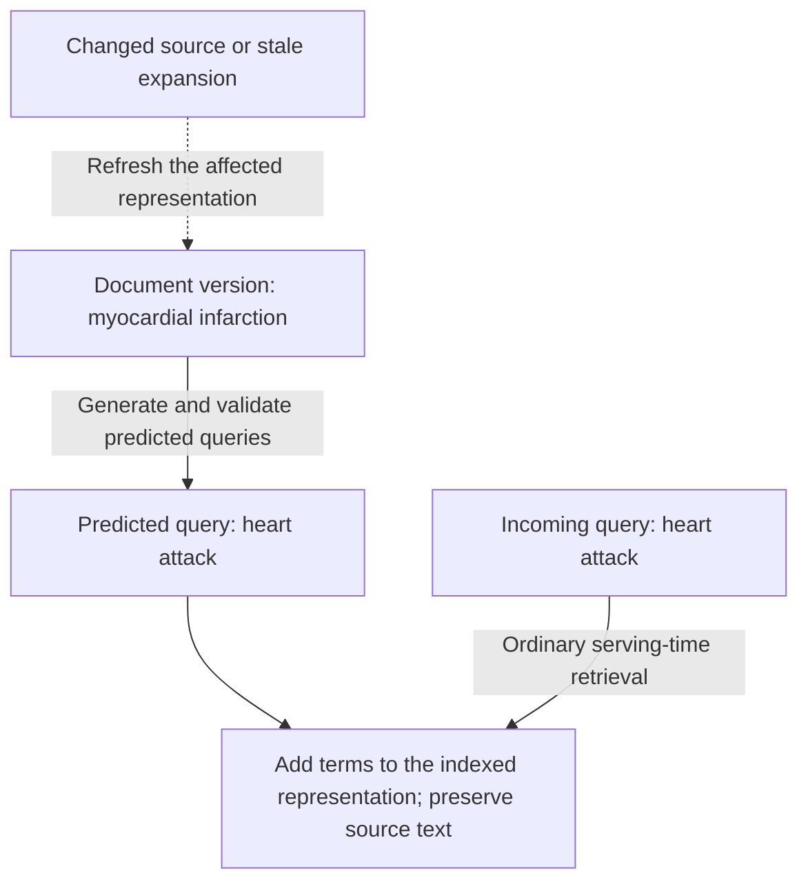
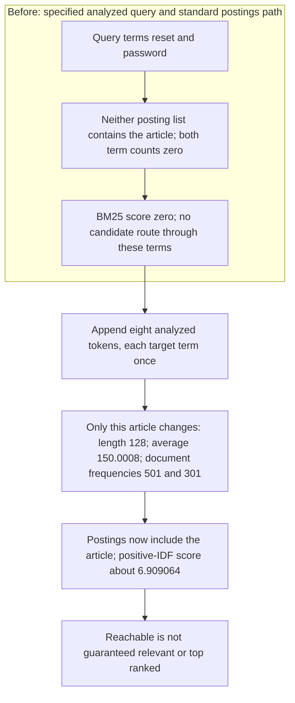
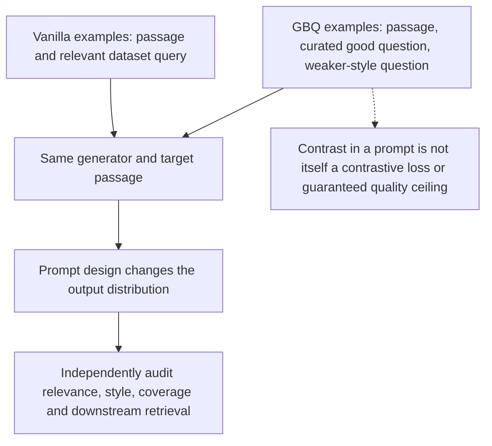
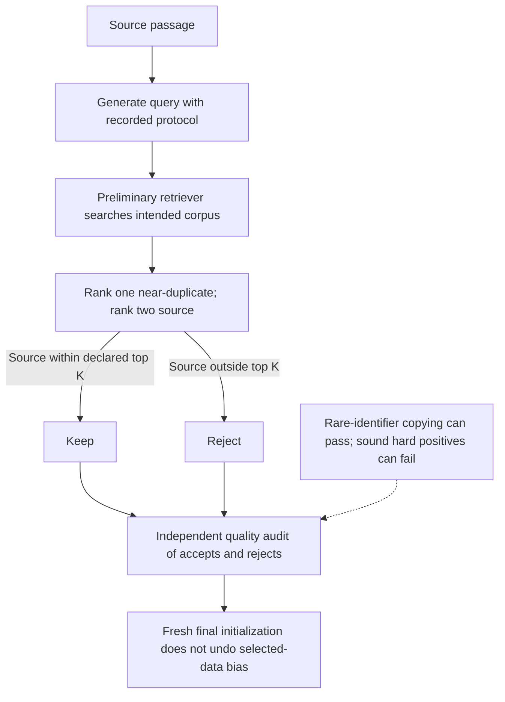
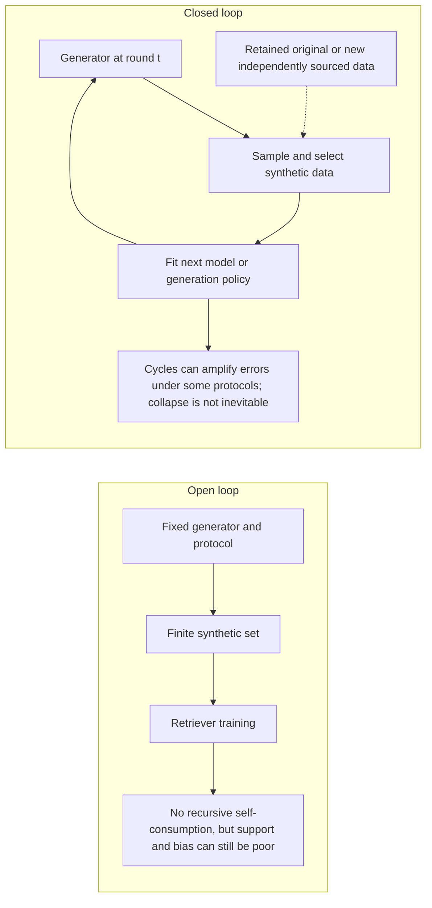

# Chapter 29: Bootstrapping Training Data
[00-START-HERE](../00-START-HERE.md) · [01-READING-ROUTES](../01-READING-ROUTES.md) · [28\_training\_the\_retriever](28_training_the_retriever.md) · [30\_lost\_in\_the\_middle](../part-09-context-assembly/30_lost_in_the_middle.md)
Purpose: explain how to generate useful retrieval supervision when logs or expert labels are scarce, while preserving task relevance, auditing selected data and distribution shift, and distinguishing teacher imitation from general student capability.
## TL;DR
- Generate document-side queries to expand lexical reachability where that helps. The generator, index updates, added postings and future refreshes all belong in the amortization decision.
- doc2query changes indexed text and corpus statistics without changing the BM25 formula. Shared dense-encoder symmetry does not make input expansion mathematically redundant.
- InPars exemplars steer style and relevance but do not impose a universal teacher-quality ceiling. A good/bad prompt is a design to validate, not a discrimination guarantee.
- Promptagator uses a small task-specific seed set to generate much larger supervision. Relevance can be binary by design or derived from graded judgments; topical overlap is not sufficient for every task.
- A source-recovery filter improves precision exactly when sound pairs are more likely to survive, under nondegenerate conditions. It does not verify answerability and can reject useful hard positives.
- Summary generation and dialogue generation need explicit interfaces, input/output costs and quality audits. Neither translation nor single-step prompting is mathematically incapable of useful context-dependent data.
- Audit production shift, support, feedback cycles and prompt selection. Three repeated teacher labels do not identify a population error decomposition. Repeated draws can reduce some noise, while student mode error, retained-label precision and full-population accuracy are distinct quantities.
## The story
Picture a library whose shelves are full but whose catalog is poor. A nurse asks for “heart attack,” while the right clinical note says “myocardial infarction.” The book exists. The catalog simply offers no route to it.
The first move is to let every book draft extra catalog cards for the questions it can answer. That is document-side inversion. doc2query turns those cards into searchable terms and files them once, before patrons arrive.
The library then hires an apprentice to write more cards for collections with no query logs. InPars teaches the apprentice with examples. A weak example makes the apprentice imitate vague wording. A good card beside a bad card teaches the apprentice to tell quality from plausibility.
The library also has rooms with different rules. The general search room wants topical answers. The fact-checking room wants entailment or contradiction. The debate room wants the strongest opposing argument. Promptagator gives the apprentice a few room-specific cards because one definition of relevance cannot govern every room.
An inspector performs a round trip from each generated card to its source book. It may approve a copied identifier and reject a sound source when a near-duplicate ranks first. A small top-$`K`$ window can trade precision for recovery, but its value must be audited on accepted and rejected pairs rather than assumed.
The foreign-language desk needs another workflow. SWIM-IR asks the apprentice to summarize a passage before writing its query. The conversation desk needs complete exchanges, not isolated cards. CONVERSER writes later turns such as “when did he start it?” so the training set contains context dependence.
The head librarian uses independently adjudicated labels as a ruler, while recognizing that even expert judgments can be uncertain. Repeated samples reveal disagreement, not a proven systematic-error set after only a few draws. Different teachers, additional evidence, pretrained priors or a sound verifier can change errors, but family labels alone do not certify independence or a higher student ceiling.
## Decoder table

| Term or symbol | Meaning in this chapter | Interview use and boundary |
| --- | --- | --- |
| $`q`$, $`d`$, $`\mathrm{score}(q, d)`$ | Query, document and declared relevance score | An inverted generation direction changes the input-generation task, not the later serving direction or factual validity |
| $`N`$, $`Q`$, $`c`$ | Corpus size, daily query volume and stipulated equal per-call price in the first example | Different input/output lengths, update rates and non-generation costs change break-even |
| $`\hat{q}_i`$, $`m`$ | Predicted query and count; prompt-count notation is local later | Distinguish generated candidates, teacher draws, prompt trials and corpus items |
| Inverse query generation | Fix a document and generate queries it could answer | It changes index reachability. It does not change the later retrieval direction. |
| Document-side inversion | Generate and append predicted queries before indexing | Pay once at index time and amortize over future searches. |
| Query-side reformulation | Rewrite each incoming query before retrieval | It adapts to a live query but pays a large language model (LLM) cost on every search. |
| Vocabulary mismatch | Different analyzed vocabulary for a shared information need | Zero BM25 term count cannot be repaired by saturation tuning alone; other candidate paths can still help |
| BM25 | Declared positive-IDF term-frequency/length score | All-zero analyzed overlap has zero score in this variant; fetching behavior depends on the candidate implementation |
| $`t`$, $`f_{t,d}`$, $`I(t)`$ | Query terms, document counts and corpus document frequency inside IDF | After expansion, update both local counts and corpus frequencies |
| $`L_d`$, $`\overline L`$ | Document and corpus-average analyzed lengths | The local eight-token append changes the mean to $`150.0008`$; expanding all documents needs all updated statistics |
| $`k_1`$, $`b`$ | Saturation and length normalization, with declared domains | Use $`k_1>0`$ and $`0\le b\le1`$; neither creates an absent term |
| Inverted index | Term-to-document postings used by a standard lexical candidate path | Other fields, query expansion, hybrid candidates and zero-score tie rules change the simple story |
| Posting list | Documents indexed under one term | doc2query moves a document into lists a matching query will touch. |
| doc2query | Sequence-to-sequence generation of plausible queries from a passage | Append several sampled queries to indexed text. It needs supervised query-passage pairs for its generator. |
| docTTTTTquery | Chapter-reported T5 follow-up to document-side query generation | The reported retrieval gain is empirical, not guaranteed by greater query diversity |
| Microsoft Machine Reading Comprehension (MS MARCO) | Source query-passage dataset used by doc2query and several baselines | Its relevant-query field can be useful as a label yet poor as a generation exemplar. |
| Pseudo-relevance feedback (PRF) | Expand a query using an initial retrieval result | A poor initial candidate set can cause drift; PRF need not always use a reranker |
| Top-$`k`$ sampling | Next-token sampling restricted to a declared likely-token subset | This decoding cutoff is not the consistency retrieval cutoff; count sampling/failed-generation costs |
| Mean reciprocal rank at 10 (MRR@10) | Cutoff reciprocal-rank metric averaged over queries | Reported $`0.184`$ to $`0.277`$ is $`0.093`$ metric units, or about $`50.543478\%`$ relative—not accuracy points |
| InPars | Few-shot generation of passage-query supervision | Seeds and target-domain curation are supervision; larger generators can improve or reproduce prompt defects |
| $`k`$ in a few-shot prompt | Number of prompt exemplars | It is distinct from retrieval cutoff $`K`$. More exemplars increase prompt cost. |
| Vanilla InPars prompt | $`k`$ passage and relevant-query examples | It teaches imitation. A relevant dataset query can still be a weak exemplar. |
| Good-bad question (GBQ) prompt | Prompt triples with a curated good question and a weaker-style question | Can steer generation; not itself an explicit contrastive retriever objective or guaranteed quality boundary |
| Contrastive prompting | Positive/negative examples inside a generation prompt | Measure relevance/style/coverage; prompt contrast is not proof of a fixed ceiling |
| $`T`$, $`R_T(q, d)`$ | Task and an explicitly binary relevance relation | Some benchmarks use graded judgments; define binarization and task conditioning |
| $`d^+`$ and $`d^-`$ | Task-specific positive and negative examples | Their loss supervises that declared relation; incorrect labels do not force every update to be harmful |
| Benchmarking Information Retrieval (BEIR) | Benchmark containing structurally different retrieval tasks | Performance on one relation does not grant transfer to the others. |
| FEVER | Claim-evidence retrieval setting | Evidence can support or refute; topicality alone does not certify sufficiency |
| DBpedia-Entity | Entity-oriented retrieval with judged relevance | Not every passage mentioning an entity and not inherently an exhaustive-mention task |
| ArguAna | Counter-argument retrieval | Opposition must still be relevant and appropriate; arbitrary contrary stance is not enough |
| Promptagator | Task-conditioned generation, source recovery and retriever training | A few seeds steer a larger synthetic set; aggregate results do not prove every-task wins |
| Preliminary retriever | Retriever used to select source-recoverable synthetic pairs | A fresh final model avoids continuing this checkpoint but inherits the selected dataset |
| $`K`$ | Declared source-recovery depth and tie policy | Larger windows produce nested accepts for fixed rankings, not automatic quality gains |
| Consistency filtering | Accept a generated pair if its source returns within the window | It tests recoverability, not answerability or truth; audit both accepts and rejects |
| $`\pi`$, $`\alpha`$, $`\beta`$ | Sound fraction and conditional sound/broken keep rates | Strict precision improvement iff $`\alpha>\beta`$ only for $`0<\pi<1`$ and $`r>0`$ |
| $`r`$, $`\pi_{\mathrm{keep}}`$ | Retained fraction and conditional precision | Precision is undefined at zero retention; expected target draws are $`M/r`$ under stationary independent acceptance |
| Hard positive | Valid source difficult for the current retriever | Difficulty or a near-duplicate collision does not by itself prove downstream training value |
| Near-duplicate collision | Another similar source outranks the generated source | Composition among all strict rejects does not identify composition among newly recovered pairs |
| InPars+ | Generator tuning with reward and chain-of-thought prompting | It raises source quality but does not remove the need to filter. |
| $`l`$, $`d_l`$, $`q_l`$ | Target language, passage in that language, and query in that language | Low-resource reading and natural query writing can fail at different rates. |
| $`s`$, $`\hat{s}`$ | Summary and the one selected for a query stage | A single-summary approximation has no automatic error bound or exact MAP guarantee |
| SWIM-IR | Chapter-reported multilingual summary-mediated generation | Summary-only conditioning needs an isolated interface; fused one-call generation can still see the full passage |
| $`H_t`$, $`q_t`$, $`a_t`$ | Dialogue history, current question and previous/current answers | History can be encoded directly or rewritten; assess actual context dependence per turn |
| CONVERSER | Generation of multi-turn retrieval examples | A later turn is not necessarily history-dependent, nor is each generated dialogue valid |
| Translationese | Possible artifacts from translation/localization | Translation is an alternative to evaluate with speakers, not mathematically incapable of useful dialogue |
| $`P^*`$, $`P_G`$ | Production and generator-induced joint distributions | Human collection is also a sampling design; neither label provenance alone guarantees deployment representativeness |
| $`n`$, $`p_G`$, $`p^*`$ | Sample count and intent probability under the drawing distribution | Coverage is $`1-(1-p_G)^n`$ for IID draws; production mass need not equal generator mass |
| Open loop, $`G_0`$, $`D_G`$, $`M`$ | Fixed generator used in one generation/training stage | No recursive self-consumption, but one-stage support and label bias can be severe |
| Closed loop, $`G_t`$, $`D_{G_t}`$, $`M_t`$ | Feedback through repeated model-dependent generation or selection | Cycles can amplify errors in some protocols; they do not inevitably force collapse |
| $`p_{01}`$, $`p_{10}`$ | A-only and B-only binary success probabilities on paired inputs | Their sum $`v`$ is discordance; the mean gap is $`\Delta=p_{10}-p_{01}`$ |
| $`\sigma_D`$ | Standard error of an IID paired gap | Exact population formula is $`\sqrt{(v-\Delta^2)/N}`$; the null approximation is $`\sqrt{v/N}`$ |
| $`m`$, $`\delta`$, $`z`$ | Prompt trial count, target effect and standard-normal quantiles | Power, confidence, multiplicity and selection are not interchangeable |
| Selection inflation | Winner optimism from choosing an estimate after trying alternatives | Independent equal-effect normal calculations are illustrations, not per-result debiasing rules |
| Calibration anchor | Production-like cases reserved for shift measurement | A small anchor does not establish small-effect power; customer clustering and both comparison samples matter |
| Gold label | Adjudicated reference labels under a recorded protocol | Experts can share bias or face ambiguity; report disagreement, sampling and uncertainty |
| Silver label | Human/model supervision with a declared protocol | Error correlation is empirical, not determined by a tier name |
| Bronze label | Weaker or in-family supervision | An out-of-family judge can still share errors; audit independently rather than assume decorrelation |
| $`l^*`$, $`l_T`$ | Gold label and a draw from a specified conditional teacher distribution | Changing prompts/temperature changes the protocol; repeated agreement alone does not identify population modes |
| $`a_T`$, $`a_M`$ | One-draw teacher and hard-student accuracies on the declared population | An ideal pure imitator follows the mode, but that is not a universal bound for other student objectives |
| $`\hat y`$, $`m_T`$, $`t_y(x)`$ | Tie-broken teacher mode followed by an ideal hard imitator | Strictly proper probabilistic fitting first recovers the distribution under consistency assumptions |
| $`s`$ draws, $`S`$ | Repeated labels and the population set with an incorrect teacher mode | Three finite draws do not prove membership in $`S`$ or a population error mass |
| $`\epsilon_{\mathrm{sys}}`$ | Population mass of wrong-mode inputs | It need not equal draw error on that set; correct draws there contribute $`c_S`$ |
| $`\epsilon_{\mathrm{noise}}`$ | Wrong-draw mass on correct-mode inputs | The exact identity is $`1-a_T=\epsilon_{\mathrm{sys}}-c_S+\epsilon_{\mathrm{noise}}`$; not every varying error is removable |
| $`\rho_{\mathrm{pop}}`$, $`\rho_{\mathrm{ret}}`$ | Conditional wrong-mode overlap or missed-error rate on a specified retained population | Do not equate population overlap with selected-set filter rates; correct rejection and residual noise misses also matter |
| Execution-based label | Labels from a declared execution/gold-check verifier | Incomplete tests, aliases and verifier errors remain; source recovery alone is not a truth certificate |

## Core mechanics
### Mathematical conventions
Use natural logarithms, decimal prices/units, full intermediate precision and rounding only at the reported result. Accuracy gaps are percentage points unless explicitly relative. MRR changes retain their own metric units. Corpus counts, example task results and service rates are reported or stipulated inputs, not independently verified performance.
Cost ledgers distinguish calls, input/output positions, retained labels and expert adjudication. A generation-only bill is not the cost of a complete training/evaluation pipeline. Equal sample counts or equal dollars do not establish equal label quality, task coverage or system performance. Fused summary-plus-query generation and an isolated two-call summary pipeline have different conditioning and bills.
Sampling equations assume IID draws from the stated distribution. A generator intent mass need not equal its production mass; larger synthetic sets cannot sample an intent with zero generator probability. Coverage is a smooth probability, not a hard floor. Confidence intervals, standard errors, power and multiple-prompt selection are different quantities. Correlated queries, shared customers, repeated passages or adaptive selection require a corresponding analysis.
For filtering, $`0<\pi<1`$ and positive retention are required for the strict precision-improvement equivalence. For teachers, define the conditional label distribution, a fixed tie rule and the input population. A teacher’s wrong-mode population mass is not its one-draw error rate. The mode-following student result is an idealized pure-distillation limit, not a universal ceiling on any pretrained, regularized or independently supervised student.
### 29.1 Inverting the relation: what queries does this document answer?
#### What
Ordinary retrieval fixes $`q`$ and searches for relevant $`d`$, using a declared score or task relation. Document-side inversion instead fixes $`d`$ and generates plausible future queries. Append those terms to the indexed representation while preserving the source text shown to users or the generator. The “myocardial infarction” to “heart attack” example illustrates vocabulary reachability, not guaranteed relevance or factual correctness. Run the ordinary query-to-document match at serving time.
#### Why
In the stated BM25 term-frequency formula, an absent analyzed term contributes zero. If every analyzed query term is absent, the document score is zero; tuning saturation/length parameters cannot invent an overlap. A standard postings-driven implementation does not fetch such a document through those query terms. Synonym expansion, alternate fields, dense retrieval or fallback candidates change this setup. Document-side generation can amortize anticipation of future vocabulary, but may add wrong or unhelpful terms.
#### Failure without it
PRF depends on its initial candidates and can drift if none is relevant; an empty or useless first pass does not provide evidence from the missed source. Query rewriting and document expansion can be complementary. If a source is already retrieved, first test context quality and reader use rather than assuming more indexing is the repair. A symmetric score $`E(q)^\mathsf T E(d)`$ does not make generated input text redundant: $`E(d\circ\hat q)`$ can differ from $`E(d)`$. Expansion can help, hurt or be unnecessary for a dense encoder and needs an ablation.
#### Cost and complexity
In a deliberately equal-price, one-call-per-item scenario, $`N=10^7`$ documents, $`Q=2\times10^6`$ queries per day and $`c=\$0.0001`$ give offline cost $`Nc=\$1{,}000`$, recurring rewriting cost $`Qc=\$200/\mathrm{day}`$ and $`\$6{,}000`$ over thirty days. With no document changes, the generation-cost break-even is five days. The directions need not have equal prompt/output lengths or prices in practice.
If $`\mu`$ documents per day need a fresh expansion, the two generation bills at elapsed time $`t`$ are $`c(N+\mu t)`$ and $`cQt`$. Their crossing is $`t=N/(Q-\mu)`$ only for $`Q>\mu`$; otherwise this model gives no eventual saving. For $`\mu=100{,}000`$ per day, the crossing is about $`5.263158`$ days. Index storage, query latency, ingestion delay, quality and update work are additional, and expansion may not need a full corpus rebuild for each changed document.
Choose the number of predicted queries from measured reachability and quality, not a universal jargon rule. Index literal text first when freshness matters, then backfill validated expansion. The chapter’s search-engine analogy is a reported design observation, not a cost measurement or proof that every production engine uses this method.
### 29.2 doc2query and vocabulary mismatch
#### What
BM25 scores query terms against a document as follows.
$$
\operatorname{BM25}(q,d)=\sum_{t\in\mathcal T(q)} I(t)\frac{f_{t,d}(k_1+1)}{f_{t,d}+k_1(1-b+bL_d/\overline L)},\qquad I(t)=\ln\!\frac{N+1}{\operatorname{df}(t)+0.5}.
$$
This variant uses distinct analyzed query terms $`\mathcal T(q)`$ without a separate query-frequency factor, raw document counts $`f_{t,d}`$, lengths $`L_d`$, mean $`\overline L`$, $`k_1>0`$ and $`0\le b\le1`$. The positive-IDF convention is $`\ln(1+(N-\operatorname{df}(t)+0.5)/(\operatorname{df}(t)+0.5))`$. Other BM25 variants differ. Expansion changes term counts, document frequencies and mean length as well as candidates. doc2query trains query prediction from passage-query pairs; the chapter reports a T5 follow-up, docTTTTTquery, with stronger lexical-retrieval results. Diversity or benefit is empirical, not guaranteed by the name of the generator.
#### Why
A standard inverted index finds candidate documents through query-term postings before scoring. A document absent from every queried posting list has no route through those lists, rather than merely a low positive score. Other candidate sources or zero-score tie handling can behave differently. Adding “reset” and “password” can make a relevant article reachable, but reaching it does not guarantee a useful rank or relevance. The source reports approximately $`10\%`$ to $`20\%`$ one-keyword agreement in Furnas and colleagues’ study; that finding motivates vocabulary mismatch but does not mathematically establish an impossibility bound for synonym lists.
#### Failure without it
PRF can fail when the first pass misses useful evidence, can drift from a short ambiguous query, and adds query-time work. It does not necessarily require a reranker or fail on every mismatch. Dense and lexical systems can both be tested with expansion. Generated terms can become stale or misleading and change unrelated term weights, so evaluate freshness, candidate coverage and ranking separately.
#### Cost and complexity
Before expansion, take $`N=10{,}000`$, $`\overline L=150`$, $`L_d=120`$, $`\operatorname{df}(\text{reset})=500`$ and $`\operatorname{df}(\text{password})=300`$. Both target term counts in this article are zero. For an internally consistent local example, expand only this article with the eight analyzed tokens “how to reset password after an account lockout,” each target term occurring once. Then $`L_d=128`$, $`\overline L=150.0008`$, and the document frequencies become $`501`$ and $`301`$. This stipulated analyzer/counting example is not the result of appending both of the earlier multi-question strings. Use $`k_1=1.2`$ and $`b=0.75`$.
$$
I(\text{reset})=\ln\!\frac{10{,}001}{501.5}\approx2.992836760.
$$
$$
I(\text{password})=\ln\!\frac{10{,}001}{301.5}\approx3.501670351.
$$
The updated length factor is $`0.25+0.75(128/150.0008)\approx0.889996587`$. Each term’s multiplier is $`2.2/(1+1.2\times0.889996586\ldots)\approx1.063831894`$, so the new score is approximately $`6.909063802`$, versus zero before expansion. Expanding other articles would require their updated frequencies and mean length too; the old corpus statistics cannot silently be reused as exact values.
Separately, ten sampled twelve-token queries for each of ten thousand articles produce $`1.2\times10^6`$ output tokens, excluding prompts, failed generations and indexing work. The chapter-reported MS MARCO MRR@10 change from $`0.184`$ to $`0.277`$ is $`0.093`$ MRR units and approximately $`50.543478\%`$ relative, not a $`50\%`$ absolute accuracy gain or a controlled guarantee for another corpus. The ranking formula can stay the same even though its input statistics change. Index literal text first for near-real-time ingestion and evaluate the backfilled expansion.
### 29.3 InPars: contrasting good and bad generated queries
#### What
In the chapter’s InPars description, a vanilla few-shot prompt contains $`k`$ passage/relevant-query pairs; the GBQ variant contains passage/good-question/bad-question triples. A curated good question contrasts with a dataset query treated as a weak style exemplar, even though the latter can remain relevant under its original labels. Generate queries for target passages and train on the resulting pairs. Prompt exemplars and any target-domain curation are supervision and must be counted.
#### Why
Search queries can be terse or underspecified while still being relevant. Prompt contrast may steer toward the desired query style and task, but showing a good/bad pair is not itself an explicit contrastive retriever loss or a guaranteed decision boundary. Generator capability, instructions, context and task grounding also matter; exemplar defects influence output without imposing a universal mathematical ceiling.
#### Failure without it
A larger generator may reproduce prompt defects, improve over them or fail differently. Plausibility alone does not establish a useful retrieval label. State whether seeds are source-domain or target-domain, and do not call a seeded pipeline label-free. A fixed curated seed budget can be much smaller than full supervision, but keyword or noun-phrase “bad” examples are only an alternative to validate, not guaranteed substitutes for expert contrast.
#### Cost and complexity
For $`50{,}000`$ target documents, three examples, hundred-token passages and twelve-token queries, the vanilla input is $`3(100+12)+100=436`$ positions and total input/output is $`448`$ per call. GBQ input is $`3(100+12+12)+100=472`$, total $`484`$. At the hypothetical uniform rate $`\$0.02`$ per thousand processed positions, generation is $`\$448`$ versus $`\$484`$, a $`\$36`$ or $`8.035714\%`$ premium. This omits separators, instructions, retries and training/filtering; actual APIs may price input/output differently.
This specific three-shot layout requires three curated good questions, while the broader source examples use two to eight seeds. The chapter reports improvements over BM25 and self-supervised baselines; those are experiment-specific results, not proof that target-domain labels are absent in every prompted variant. Validate prompt contrast and filtering together. Shortening exemplars to meet rate/context limits changes the prompt and may change quality.
### 29.4 Promptagator: retrieval tasks are not one task
#### What
Each task $`T`$ defines a binary relevance relation.
$$
R_T(q,d)\in\{0,1\}\quad\text{for a declared binary relevance definition}.
$$
An underlying benchmark may have graded judgments; binarization and the positive/negative policy must be declared. A task-specific retriever can train on $`(q,d^+,d^-)`$ using that relation. The chapter describes Promptagator as starting from two to eight examples, generating task-matched pairs over unlabeled documents, training a preliminary retriever, keeping pairs whose source is recovered, and training the final retriever afresh on survivors. “Afresh” means not continuing the fitted filter checkpoint; it need not mean random initialization rather than a pretrained base.
#### Why
Answer relevance, claim evidence, entity relevance and counter-argument quality are different targets. MS MARCO is not merely a topical-overlap task. FEVER-style retrieval seeks evidence that can support or refute a claim. Entity retrieval concerns relevant entities/descriptions for an information need, not every passage mentioning a name. ArguAna seeks suitable counter-arguments, not arbitrary stance opposition. A relevance loss never shown a distinction does not directly supervise it, though pretraining or transfer may still generalize.
#### Failure without it
A shared model can suffer task interference, but multi-task conditioning or suitable data can also support several relations. Fine-tuning on a corpus with the correct task labels can teach a relation; topic exposure alone does not establish that it did. Write down the relation and inspect held-out examples, including topically similar distractors. Separate task-family retrievers and manual inspection of five results for roughly a dozen claims are source workflow suggestions, not guarantees or statistical validation.
#### Cost and complexity
Take $`100{,}000`$ passages and six curated seed examples. In a four-separate-calls-per-passage layout, each request uses $`1{,}000`$ input positions ($`720`$ seeds, $`200`$ passage, $`80`$ instructions) and emits one twenty-token candidate. Then $`400{,}000`$ calls process $`400\times10^6`$ input and $`8\times10^6`$ output positions. At $`\$0.25`$ and $`\$1.00`$ per million respectively, generation costs $`\$108`$. A hypothetical single request emitting all four candidates would instead cost $`\$33`$ if the same input and total output lengths sufficed; separator, diversity and quality effects are additional.
Assuming rather than deriving $`100{,}000`$ surviving pairs gives $`\$0.00108`$ generation cost per survivor under the separate-call layout. Filtering, retriever training, seed curation and evaluation are excluded. The source’s $`500{,}000`$-judgment budget at $`\$1`$ each is $`4{,}629.629630`$ times the $`\$108`$ bill; it is not a matched quantity/quality comparison. Dividing that label count by six gives $`83{,}333.333333`$ labels per seed, not that ratio of expert labor or equal-performance supervision. The reported eleven-task BEIR comparison with ColBERTv2 and SPLADEv2 is experiment-specific; an aggregate comparison does not by itself prove a win on every task. The seeds steer generation, not direct training of a complete retriever from eight pairs.
### 29.5 Consistency filtering
#### What
Run this algorithm in order.
1. Generate query-passage pairs with recorded generator/prompt versions.
2. Train a preliminary retriever and independently audit its keep/discard behavior.
3. Search the intended corpus for each generated query.
4. Keep the pair if its source appears within the declared top-$`K`$, with tie/duplicate handling specified.
5. Train the final retriever from a fresh declared initialization on survivors, retaining independent production-like evaluation.
Let $`\pi`$ be the sound-pair population fraction, $`\alpha=\Pr(\text{keep}\mid\text{sound})`$ and $`\beta=\Pr(\text{keep}\mid\text{broken})`$. With retention $`r`$ and positive $`r`$ for conditional precision,
$$
r=\pi\alpha+(1-\pi)\beta.
$$
$$
\pi_{\mathrm{keep}}=\frac{\pi\alpha}{r},\qquad\pi_{\mathrm{keep}}-\pi=\frac{\pi(1-\pi)(\alpha-\beta)}{r}.
$$
For $`0<\pi<1`$ and $`r>0`$, retained precision strictly improves if and only if $`\alpha>\beta`$. At $`\pi=0`$ or $`\pi=1`$ it cannot strictly improve, and at $`r=0`$ retained precision is undefined. Audit estimates of these rates carry sampling uncertainty and may shift after the retriever or corpus changes.
#### Why
The round trip measures source recoverability under a particular filter, not answerability, truth or usefulness. Some wrong positives can give harmful gradients, but label noise does not force every individual update to be harmful. Increasing $`K`$ creates nested accepted sets only with the same ranked results and tie policy; it can rescue valid duplicate collisions while admitting broken pairs. The chapter traces this idea to round-trip consistency in synthetic QA and its retrieval use in Promptagator.
#### Failure without it
A copied rare identifier can make a weak query trivially retrievable; such a query is not necessarily invalid, but may teach little beyond lexical copying. A sound source can lose to a near-duplicate and be rejected. Reusing the same generated pairs for filter training and source recovery also risks in-sample selection. Audit both accepted and rejected pairs with an independent quality definition. Repeated keep-only passes select a nonincreasing subset, but do not inevitably worsen quality or cause model collapse; measure the coverage/precision trade-off before iterating. A fresh final checkpoint does not remove the selection bias in the survivors. Tripling IID draws from an unchanged generator does not reduce its expected broken fraction, though coverage and training variance can change. The source’s InPars+ improvements are reported empirical results, not a guarantee that prompting or rewards replace validation.
#### Cost and complexity
Treat a representative audit of five hundred pairs as point estimates: $`350`$ sound, $`150`$ broken, with $`273`$ and $`27`$ kept at $`K=1`$. Thus $`\pi=0.70`$, $`\alpha=0.78`$, $`\beta=0.18`$, $`r=0.600`$ and retained precision $`0.91`$. Extrapolated to $`500{,}000`$ generated pairs, the strict window keeps $`273{,}000`$ sound plus $`27{,}000`$ broken and rejects $`77{,}000`$ sound plus $`123{,}000`$ broken. These are scenario expectations, not exact population counts established by five hundred reviews.
At the stipulated $`K=10`$ rates $`\alpha=0.94`$ and $`\beta=0.42`$, retention is $`0.784`$. The expected retained set has $`329{,}000`$ sound plus $`63{,}000`$ broken, precision $`83.928571\%`$, and $`21{,}000`$ sound rejects. Relative to the strict window, it adds $`56{,}000`$ sound and $`36{,}000`$ broken: $`1.555556`$ sound per additional broken pair, with added-subset precision $`60.869565\%`$. Whether that trade improves training depends on error costs and task quality, not just pair count.
A separate audit finding near-duplicates in $`68`$ of $`100`$ strict-window false rejects estimates their fraction among all such rejects, not among the newly recovered subset. Multiplying $`0.68\times56{,}000=38{,}080`$ needs an extra equal-composition assumption. Treating the fraction and extrapolated counts as exact only for a set-arithmetic illustration, there are $`52{,}360`$ near-duplicate rejects among $`77{,}000`$ sound rejects, and the $`56{,}000`$ recovered sound pairs contain between $`31{,}360`$ and $`52{,}360`$ of them. Sampling uncertainty widens what can be claimed, and near-duplication alone does not prove training value.
The source’s $`K`$ between five and ten, rejection audits of one hundred, and retention warning near $`0.5`$ are workflow heuristics. Deduplication alone does not prove that $`K=1`$ is optimal. Generation of $`500\times10^6`$ input and $`10\times10^6`$ output positions costs $`\$135`$ at the stated rates.
The stipulated filter components are $`1{,}250\,\mathrm s`$ document encoding, $`250\,\mathrm s`$ query encoding, $`\lceil500{,}000/128\rceil=3{,}907`$ training batches at three per second, and $`500\,\mathrm s`$ searching. Including the final thirty-two-example partial batch, the epoch is $`1{,}302.333333\,\mathrm s`$ and the serial sum is $`3{,}302.333333\,\mathrm s`$. At a common hypothetical charge of $`\$2.50`$ per resource-hour this is $`\$2.293287`$, or $`1.698731\%`$ of generation cost. Different CPU/GPU resources, parallelism and utilization require their own bills; this is not a measured GPU invoice. The source’s approximately $`1.5\%`$ is a coarser inconsistent label, not ordinary rounding of $`1.70\%`$.
At $`r=0.6`$, generation-only cost per usable pair is $`\$0.00045`$, or $`\$0.000457644`$ with this filter ledger, excluding final training, audits and index overhead. For stationary independent pair acceptance with known $`r`$, obtaining a target count $`M`$ has expected generation count $`M/r`$; $`1/r\approx1.666667`$ is an expectation multiplier, not a guaranteed yield or a full-pipeline cost law.
### 29.6 Multilingual and conversational extensions
#### What
For language $`l`$, define a summary generator and a query generator. A summary-only pipeline specifies its own conditional model:
$$
p_{\mathrm{pipe}}(q_l\mid d_l)=\sum_s p_{\mathrm{query}}(q_l\mid s)\,p_{\mathrm{summary}}(s\mid d_l),\qquad p_{\mathrm{one\ summary}}(q_l\mid d_l)=p_{\mathrm{query}}(q_l\mid\hat s).
$$
The first equation is a normalized pipeline model, not an identity for an arbitrary true query distribution: it assumes the query stage uses the summary rather than the full passage. A chosen summary $`\hat s`$ may be decoded or sampled; calling it the exact MAP summary requires that inference rule. Replacing the sum by one summary has no automatic error bound. Summaries can omit or invent relevant facts. The source reports SWIM-IR experiments across thirty-three languages with passages near $`120`$ tokens, summaries near $`30`$ and queries near $`25`$. Whether this improves target-language quality is empirical. For conversation, define
$$
H_t=(q_1,a_1,\ldots,q_{t-1},a_{t-1}),\qquad \operatorname{score}(H_t,q_t,d).
$$
History can be passed directly or through a query rewrite/summary. The chapter describes CONVERSER as generating complete dialogues from a few example dialogues and reports competitive retrieval results in its settings. Such results do not establish that every later turn is context-dependent or that every generated conversation is valid.
#### Why
Summary-mediated generation can separate fact selection from phrasing and make the selected content inspectable. True isolation to a thirty-token summary requires a second call or an explicit masking/interface constraint; an autoregressive call that emits a summary and then a query can still attend to its original passage. Single-step prompting does not mathematically forbid anaphora or ellipsis, though a self-contained-query instruction is not a reliable source of well-grounded dialogue turns. Supply history and audit actual context dependence when that is the task.
#### Failure without it
Low-resource generators can copy, drift languages or produce unnatural queries. Translation can introduce artifacts, but is not inherently invalid or incapable of preserving dialogue; compare localized, translated and direct generation on native-speaker judgments. A weak preliminary retriever can reject useful target-language pairs. Adjusting the consistency threshold changes both sound and broken keep rates, so report per-language quality and retention rather than automatically loosening it. Missing English parallel text does not itself determine an optimal threshold.
#### Cost and complexity
Take twelve languages with $`200{,}000`$ passages each, $`120`$ passage tokens, and illustrative input/output rates of $`\$1`$ and $`\$5`$ per million. The eight-shot layout uses $`8(120+15)=1{,}080`$ exemplar tokens and $`1{,}200`$ input positions with the target passage; omitted instructions/separators must be added in a real bill. Single-step generation emits twenty-five tokens, costing $`\$265`$ per language.
A fused single call with the same input that emits a thirty-token summary and a twenty-five-token query costs $`\$295`$ per language, an $`11.320755\%`$ premium, or $`\$3{,}540`$ across twelve languages. This bill does not implement summary-only attention. A genuinely isolated two-call design has at least $`1{,}200+30=1{,}230`$ input positions and fifty-five outputs, plus $`h`$ extra second-stage prompt positions: $`\$301+\$0.20h`$ per language, before other overhead. At $`h=0`$ this is $`\$3{,}612`$ overall; the zero-overhead case is only a lower component budget.
The human scenario of $`500{,}000`$ queries per language at $`\$0.30`$ costs $`\$1.8`$ million, $`508.474576`$ times the fused bill, but compares six million human items with $`2.4`$ million generated ones. Matching the $`200{,}000`$-per-language count gives $`\$720{,}000`$, a $`203.389831`$ price ratio before filtering and quality differences. Neither proves equivalent supervision. Annotator scarcity and the chapter’s four-or-five-language bottleneck are reported workflow observations.
A four-turn dialogue with twenty-five-token questions and thirty-token answers emits $`220`$ tokens per passage: $`8.8`$ times single-step output, but $`55`$ per query or $`2.2`$ times single-step output per query if all four turns are usable. This is not a total cost multiplier. With the same $`1{,}200`$-token input charged once, its hypothetical generation cost is $`\$0.00230`$ per dialogue or $`\$0.000575`$ per usable turn, versus $`\$0.001325`$ for a single-step query. Histories, turn quality, training cost and differing tasks still matter. Three context-dependent turns are an assumed example, not a consequence of four-turn generation.
At pair retention $`r=0.4`$, the expected draws for $`100{,}000`$ retained pairs are $`250{,}000`$, assuming one candidate pair per draw and stationary acceptance. Dialogues require a turn/session-specific yield definition. The source’s $`500{,}000/8=62{,}500`$ compares label counts with seed counts, not actual human effort. Six to eight native-speaker seeds and a target of at least half context-dependent queries are source heuristics; native-speaker validation remains necessary, and translation is an option to test rather than categorically reject. Version the generator and consider a rewrite-based serving alternative with its serial call cost.
Of $`2{,}000`$ independently reviewed items, eight seeds per language use $`96`$, leaving $`1{,}904`$ tests: eight languages can receive $`159`$ and four receive $`158`$. Under IID Bernoulli accuracy, maximum standard errors are about $`3.965\%`$ and $`3.978\%`$ of the score scale; nominal ninety-five-percent half-widths are about $`7.772`$ and $`7.796`$ percentage points. Those are single-estimate intervals, not guarantees of detecting an eight-point paired system gap with useful power. For illustration, the paired planning model below with discordance $`0.20`$ needs about $`246`$ items for an eight-point effect and $`3{,}925`$ for a two-point effect using full normal quantiles. Dependence, language-specific sampling and baseline uncertainty can change the design.
### 29.7 Synthetic data: the right question is how, not whether
#### What
Let $`P^*`$ denote production query/passage/relevance data and $`P_G`$ the generator-induced distribution for a fixed corpus and prompt. Human collection is also a sampling design, not automatically production-representative. The opening example reports a $`4.1`$-point recall@5 gain on a synthetic benchmark after $`118{,}000`$ training pairs, with five hundred real tickets from three customers available. Inspect support/shift, feedback and adaptive evaluation selection separately. For an intent of probability $`p_G`$ under IID generator draws,
$$
\Pr(\text{at least one occurrence})=1-(1-p_G)^n\approx1-e^{-np_G}.
$$
The exponential approximation is useful for small $`p_G`$ in its appropriate range; the exact expression is available. A production intent with mass $`p^*`$ need not have generator mass $`p_G=p^*`$. If $`p_G=0`$, increasing generation count never samples it. Dependence, deduplication and prompt-specific concentration can invalidate the IID coverage calculation.
#### Why
For $`n=100{,}000`$, generator masses $`10^{-5}`$, $`10^{-6}`$ and $`10^{-4}`$ have appearance probabilities approximately $`0.632122398`$, $`0.095162627`$ and $`0.999954623`$. At $`10^{-7}`$ the probability is still $`0.009950167`$, not a certain deletion. The scale $`1/n`$ marks roughly sixty-three-percent appearance, not a hard floor or reliable coverage guarantee. Ninety-five-percent appearance instead requires $`p_G\ge1-0.05^{1/n}`$, about $`2.9956874\times10^{-5}`$ here.
The $`1/n`$ scales for five hundred and one hundred thousand IID draws differ by exactly $`200`$, or $`\log_{10}200\approx2.301030`$ decades. Larger samples lower that sampling scale only for intents represented by the drawing distribution; synthesis is not uniquely capable of doing so. An unobserved intent has zero empirical count, not necessarily zero probability in a fitted model with prior knowledge or compositional generalization.
An open-loop frozen generator avoids recursive self-consumption, but can still produce severe bias and harmful one-stage shift; no quantitative shift bound follows from topology alone. A closed loop can amplify finite-sample/modeling errors and lose tails under particular protocols, but a cycle is not sufficient to force collapse. Fresh real data, retained original samples, capacity and the fitting procedure matter. The chapter’s early/late-collapse descriptions are reported phenomena in particular studies, not laws for every iterative system.
#### Failure without it
One-pass filtering is not automatically safe, and repeated filtering is not inevitably destructive. Evaluate label quality, coverage and distribution shift independently of the cycle diagram. Avoid circular claims where the evaluated model writes or filters its own success criterion. Freeze and version a held-out evaluation procedure before inspecting candidate-system results; tune prompts/checkpoints on a separate development set and report the number of tried alternatives. A separate corpus split helps prevent leakage but does not by itself remove generator bias or selection on the reported test. Self-generated stress cases can be useful with independent adjudication, not as an unqualified substitute for production evaluation.
#### Cost and complexity
For paired binary outcomes define $`D_i=1`$ when system A alone succeeds, $`D_i=-1`$ when B alone succeeds, and zero otherwise. Let $`p_{10}`$ and $`p_{01}`$ be those probabilities, $`v=p_{10}+p_{01}`$ the discordance and $`\Delta=p_{10}-p_{01}`$. Under IID pairs,
$$
\operatorname{Var}(D_i)=v-\Delta^2,\qquad\operatorname{SE}(\overline D)=\sqrt{\frac{v-\Delta^2}{N}}\approx\sqrt{\frac vN}\quad\text{near }\Delta=0.
$$
At $`N=500`$, $`v=0.20`$, the null approximation is $`0.020`$, or two percentage points of standard error. For eight independent centered unit normals, the expected maximum is about $`1.423600306`$, below $`\sqrt{2\ln8}\approx2.039333980`$. Equal-effect independent normal estimates with standard error $`0.020`$ therefore have illustrative expected selection inflation $`0.028472006`$, about $`2.847201`$ points.
Prompts often share questions and errors, true prompt effects may differ, and the normal model is an approximation. Subtracting that expected inflation from this particular $`4.1`$-point headline gives a numerical residual near $`1.252799`$ points, not a valid unbiased estimate, confidence interval or proof the gain is false. Use an independent locked test or a selection-aware procedure.
For one fixed comparison with gap $`0.015`$, $`v=0.20`$ and five hundred IID pairs, the model standard error is about $`0.019988747`$ and nominal ninety-five-percent half-width $`0.039177224`$. Thus “$`1.5\pm2.0`$ points” describes roughly one standard error, not a ninety-five-percent interval; the corresponding illustration is about $`[-2.418,5.418]`$ percentage points. Estimated discordance and clustering add uncertainty.
A commonly used approximate two-sided paired-test planning calculation for effect $`\delta`$, significance $`0.05`$ and power $`0.80`$ is
$$
\begin{aligned}N_{\mathrm{plan}}&\approx\frac{(z_{0.975}+z_{0.80})^2v}{\delta^2},\\v&=0.20,\quad\delta=0.015,\\N_{\mathrm{plan}}&\approx6{,}976.781986,\qquad N=\lceil N_{\mathrm{plan}}\rceil=6{,}977.\end{aligned}
$$
Using full normal quantiles gives $`6{,}977`$; substituting the rounded $`1.96`$ and $`0.84`$ gives $`6{,}968.888889`$ and ceiling $`6{,}969`$. Both motivate roughly seven thousand, not a universal lower bound or a guaranteed powered test. Alternative/null variances, exact paired tests, correlation, multiple comparisons and deployment slices can change the requirement. A powered synthetic test targets its synthetic distribution unless production transfer is separately established.
At eight hundred input and twenty-five output tokens, priced $`\$3`$ and $`\$15`$ per million, generation costs $`\$0.002775`$ per query: $`\$19.361175`$ for $`6{,}977`$ or $`\$19.425\approx\$19.43`$ for seven thousand. Seven thousand human judgments at $`\$1.50`$ cost $`\$10{,}500`$; the same-count generation-only price ratio is $`540.540541`$. Independent gold answers, passage judgments, filtering, training and evaluation are not free, and cheaper sampling does not establish equivalent validity.
Reserve the one-hundred-twenty-real-query calibration anchor from training and prompt selection. If query-to-passage Jaccard overlap has standard deviation $`0.12`$, its IID mean standard error is $`0.12/\sqrt{120}\approx0.010954451`$ and nominal ninety-five-percent half-width about $`0.021470330`$, not $`0.011`$. The reported means $`0.38`$ synthetic versus $`0.11`$ real can flag lexical shift, but uncertainty for their difference needs both sample sizes/variances and appropriate dependence assumptions. Neither statistic alone establishes the cause of a chunking gain. The source’s semantic-chunking explanation is an empirical interpretation to validate.
For three hundred IID items, the maximum single-accuracy ninety-five-percent half-width is about $`5.658`$ points. For a paired gap at discordance $`0.20`$, the null half-width is about $`5.061`$ points and the same eighty-percent-power approximation targets an effect near $`7.234`$ points. There is no universal six-point resolution cutoff; $`1/300\approx0.003333`$ is an intent sampling scale, not a test power threshold. Five thousand real labels as a decision-set trigger is likewise a heuristic. Three enterprise customers may not represent deployment across customers, and ticket clustering requires more than an IID item count.
### 29.8 Gold, silver, bronze: label provenance and teacher-mode limits
#### What
Fix the input population, gold-label convention and teacher sampling protocol. Define $`t_y(x)=\Pr(l_T=y\mid x)`$; temperature or prompt changes define a new distribution or a declared mixture. Expert adjudication is a valuable reference, not a proof that all labels are unambiguous. One-draw teacher accuracy is
$$
a_T=\mathbb E_X\!\left[t_{l^*(X)}(X)\right]=\Pr(l_T(X)=l^*(X)).
$$
With a fixed deterministic tie rule, let $`m_T(x)=\operatorname*{arg\,max}_y t_y(x)`$ and $`S=\{x:m_T(x)\ne l^*(x)\}`$. This is the population wrong-mode set, not the set that happens to vote wrongly in three draws. Define $`\epsilon_{\mathrm{sys}}=\Pr_X(S)`$, $`\epsilon_{\mathrm{noise}}=\Pr(l_T\ne l^*,X\notin S)`$ and $`c_S=\Pr(l_T=l^*,X\in S)`$. Then
$$
1-a_T=\epsilon_{\mathrm{sys}}-c_S+\epsilon_{\mathrm{noise}}.
$$
The missing term $`c_S`$ matters because a teacher can sometimes give the correct label even where its most likely label is wrong. Under idealized population-risk consistency, sufficient coverage/capacity, a strictly proper probabilistic loss and successful optimization, pure distillation recovers the teacher distribution, with hard prediction following its tie-broken mode:
$$
\hat t_y(x)\longrightarrow t_y(x),\qquad\hat y(x)=m_T(x).
$$
Its resulting hard-label accuracy is
$$
a_M\longrightarrow1-\epsilon_{\mathrm{sys}}=a_T+\epsilon_{\mathrm{noise}}-c_S.
$$
#### Why
This pure mode-following limit can be above or below one-draw teacher accuracy. For example, a three-label teacher with probabilities $`(0.35,0.40,0.25)`$ and label one true is correct in $`35\%`$ of draws, while its hard mode is always wrong. The simpler identity $`a_M=a_T+\epsilon_{\mathrm{noise}}`$ needs $`c_S=0`$, a special assumption not identified by three repeats. Finite-sample regularization, pretrained knowledge, auxiliary objectives, gold data or external evidence can produce a student that does not imitate the teacher mode. Thus this is not a universal accuracy ceiling. The chapter reports Burns and colleagues’ weak-to-strong experiments and roughly eighty-percent gap recovery under a particular auxiliary-confidence setup; preserve their benchmark definition and do not treat that different training objective as a proof of pure-distillation behavior. Redundancy depends on conditional error distributions and dependence, not merely teacher headcount.
#### Failure without it
A plateau across $`110`$ million, $`340`$ million and $`1.3`$ billion parameters, with reported gains of $`0.4`$ points and then zero, is a reason to investigate labels—not proof that a fixed teacher ceiling caused it. Data coverage, optimization, metric resolution and domain mismatch can also explain plateaus. Same-family models can share errors, but different families need not be independent or complementary. Compare candidate teachers using independently adjudicated cases before buying more labels. Experts, verified execution, source evidence, original data and model priors are possible additional signals; experts are not mathematically the only alternative when a domain is unfamiliar.
#### Cost and complexity
For two population wrong-mode sets $`S_A,S_B`$, define $`\rho_{\mathrm{pop}}=\Pr(S_B\mid S_A)`$ when $`\Pr(S_A)>0`$. Then $`\Pr(S_A\cap S_B)=\rho_{\mathrm{pop}}\Pr(S_A)`$. An ideal selector that always chooses a correct teacher whenever at least one teacher is correct would have error on that intersection if constrained to choose one teacher. Ordinary agreement, voting or cross-family checks do not supply this oracle. With $`\Pr(S_A)=0.22`$ and $`\rho_{\mathrm{pop}}=0.4`$, its hypothetical accuracy is $`0.912`$, a $`13.2`$-point gain over $`0.78`$. This is not an automatic attainable student ceiling.
The three-draw audit does not establish those population assumptions. If sixty-two of one hundred inputs are correct in all three draws, twenty-two wrong in all three, and sixteen have one or two wrong draws, pooled label accuracy is between $`67.333333\%`$ and $`72.666667\%`$, not inferred to be $`62\%`$. A particular first draw could have $`62\%`$ accuracy, but its allocation must be supplied. Even a teacher with per-input correctness $`0.6`$ has probability $`0.4^3=0.064`$ of three consecutive errors; finite agreement is not proof of a wrong population mode.
Use the following separately adjudicated bookkeeping scenario rather than deriving it from that repeat pattern. Out of one hundred original candidates, a policy retains eighty-six: sixty-seven correct labels, two residual wrong labels classed as variable noise and seventeen persistent-error labels. This gives $`67/86\approx77.906977\%`$ retained-label precision and $`172{,}000`$ retained pairs from two hundred thousand candidates. It is compatible with removing five persistent-error candidates and nine potentially sound ones from a stipulated starting ledger, but those removals and corrections must be measured. Fixing only the two residual errors on this same retained support would yield $`69/86\approx80.232558\%`$, not a seventy-eight-percent population ceiling.
For a second filter, let $`\rho_{\mathrm{ret}}`$ be the fraction of the seventeen persistent-error labels missed on this selected population, $`\nu`$ the fraction of the two residual noise errors missed, and $`\eta`$ the fraction of sixty-seven correct labels falsely rejected. Retained correct mass is $`67(1-\eta)`$ and retained wrong mass $`17\rho_{\mathrm{ret}}+2\nu`$; divide correct mass by their sum for precision when the denominator is positive. These are not automatically the population overlap rates above.
At the explicit assumptions $`\rho_{\mathrm{ret}}=0.4`$, $`\nu=0`$, $`\eta=0`$, the second filter leaves $`67`$ correct and $`6.8`$ wrong per original hundred, or $`147{,}600`$ expected retained pairs. Precision is $`67/73.8\approx90.785908\%`$, an increase of about $`12.878931`$ points on a changed retained population. This is distinct from the ideal selector’s $`91.2\%`$ full-population accuracy. Assuming no false rejection of correct pairs is a substantive audit target, not a property of using a different teacher family.
Three draws for each of $`200{,}000`$ candidates require $`600{,}000`$ calls. At four hundred input and thirty output tokens each, the totals are $`240\times10^6`$ input and $`18\times10^6`$ output positions. At $`\$0.25`$ and $`\$1.25`$ per million, respectively, this is $`\$82.50`$ for one family’s three-draw corpus pass, not a single-draw pass; a single draw costs $`\$27.50`$. Two complete family passes cost $`\$165`$. If the second family is called three times only for the first filter’s retained eighty-six percent, it costs $`\$70.95`$ and the combined bill is $`\$153.45`$. Generation, label scoring, filtering, curation and model training must not be conflated.
Expert review of $`200{,}000`$ pairs at two minutes each takes $`6{,}666.666667`$ hours and costs $`\$400{,}000`$ at $`\$60`$ per hour, or $`4{,}848.484848`$ times the one-family three-draw bill, before quality differences. A two-thousand-pair expert audit takes $`66.666667`$ hours and costs $`\$4{,}000`$. Under an IID Bernoulli correctness model near $`p=0.8`$, its standard error is
$$
\operatorname{SE}(\hat p)\approx\sqrt{\frac{p(1-p)}n}=\sqrt{\frac{0.16}{2{,}000}}\approx0.008944272.
$$
The nominal ninety-five-percent normal half-width is about $`0.017530451`$, or $`1.753045`$ percentage points; reference-label uncertainty and clustering require additional treatment. The source’s two-size-increases/one-point audit trigger is a heuristic. Execution checks and exact gold answers can provide a distinct signal, but incomplete unit tests, exact-match aliases and verifier errors still matter. A source-recovery check is the same retrievability test analyzed above, not an independent correctness certificate. The source describes Adaptive-RAG’s cheapest-gold-matching-pipeline labels and verifiable-reward training; their guarantees depend on the actual target and verifier. “Verifier error plus generator variance” is not a general additive accuracy bound. Preserve the source’s Promptagator year discrepancy (2022 versus 2023) as a citation inconsistency rather than silently resolving it without the references.
## Diagrams
### Figure 29.1

Figure $`29.1`$: Expansion is offline per declared document/version, not literally once forever. It can add a lexical route for future queries; validation, updates and index overhead remain necessary. The equal-call-price break-even model does not establish an end-to-end quality or cost advantage.
### Figure 29.2

Figure $`29.2`$: The local BM25 calculation updates corpus mean length and document frequencies as well as the article. Its exact counts differ from appending both original multi-question examples. Other fields, analyzers, synonym expansion and dense candidate paths require a separate model.
### Figure 29.3

Figure $`29.3`$: Prompt contrast can steer output but does not set an immutable ceiling or guarantee discrimination. Under the stated three-shot, uniform-token-price layout, the extra thirty-six positions per call cost $`\$36`$ across fifty thousand documents, an $`8.035714\%`$ premium.
### Table 29.1

| Task | Query looks like | Relevant document is | Task signal and boundary |
| --- | --- | --- | --- |
| MS MARCO | An information-seeking question, such as a salary request | A passage that answers the information need | Answer relevance; topical overlap alone is not sufficient |
| FEVER | A claim to be checked | Evidence supporting or refuting that claim | Claim-evidence sufficiency, not merely shared words |
| DBpedia-Entity | An entity-oriented information need | A judged relevant entity or its description | Entity relevance; not every passage that mentions one name |
| ArguAna | An argument expressing a position | An appropriate counter-argument | Opposition plus relevance/argument quality, not arbitrary contrary stance |

Table $`29.1`$: These task summaries distinguish relevance targets without replacing benchmark judgments. Underlying relevance can be graded. Declare any binarization and inspect task-specific errors; one relation does not automatically transfer, but shared or conditioned models are not mathematically ruled out.
### Figure 29.4

Figure $`29.4`$: A window containing rank two keeps the illustrated source, but recovery tests retrievability rather than truth. For $`0<\pi<1`$ and positive retention, precision improves exactly when $`\alpha>\beta`$. A one-pass filter, a larger $`K`$ and deduplication are not guarantees of usefulness; audit the induced trade-off.
### Figure 29.5

```mermaid
flowchart TB
  subgraph S["Single-turn generation"]
    P["Passage and declared prompt"] --> Q["Generated query; inspect answerability and style"]
    Q --> N["A self-contained instruction does not forbid accidental anaphora"]
  end
  subgraph M["Summary-mediated design"]
    D["Passage about 120 tokens"] --> U["Summary about 30 tokens"]
    U --> C["Isolated query call if summary-only conditioning is intended"]
    C --> O["Query about 25 tokens; validate lost or invented facts"]
    U -.-> F["Fused summary-plus-query call can still attend to original passage"]
  end
  subgraph H["Conversational generation"]
    X["Passage and dialogue seeds"] --> T["Generate history and later turns"]
    T --> V["Measure actual context dependence; later turns need not all depend on history"]
  end
  subgraph L["Translation alternative"]
    E["Translate or localize with native-speaker validation"] --> B["Evaluate artifacts, task fidelity and per-language yield"]
  end
```

Figure $`29.5`$: The extensions change generation structure and should be compared with explicit interfaces. Summary-only conditioning is a Markov/pipeline assumption, not an identity or a free quarter-length attention reduction. Dialogue and translation can both produce useful or flawed data; output structure does not guarantee validity.
### Figure 29.6

Panel (b): $`n=100{,}000`$ IID draws with intent mass $`p_G`$ under the generator:

| Generator intent mass $`p_G`$ | Appearance probability | Interpretation |
| --- | --- | --- |
| $`10^{-7}`$ | $`0.009950167`$ | Small, not zero or certainly deleted |
| $`10^{-6}`$ | $`0.095162627`$ | Low chance of appearing |
| $`10^{-5}`$ | $`0.632122398`$ | $`p_G=1/n`$ is a scale, not a hard cutoff |
| $`10^{-4}`$ | $`0.999954623`$ | Nearly certain in this IID model |
| $`10^{-3}`$ | $`\approx1`$ | Near one, not a permanent support guarantee |

Figure $`29.6`$: Acyclic generation avoids one feedback mechanism but is not automatically benign; cycles do not force divergence without assumptions about data and fitting. Coverage is the smooth function $`1-(1-p_G)^n`$, not a hard floor. Production mass and generator mass can differ, and zero empirical counts do not prove zero fitted-model support. The $`1/n`$ scales for five hundred versus one hundred thousand draws differ by $`200`$, or about $`2.301030`$ decades. Provenance, label quality and target-distribution shift remain relevant alongside topology and sample size.
### Table 29.2

| Tier | Produced by | Possible error structure | Use and boundary |
| --- | --- | --- | --- |
| Gold | Adjudicated domain experts with recorded protocol | Ambiguity, expertise limits, shared bias and adjudication error can remain | Independent measurement/reference, with disagreement and coverage reported |
| Silver | Non-expert humans or a stronger model | Errors may be independent, correlated or systematic; measure them | Bulk training after task-specific audits; strength is not a validity guarantee |
| Bronze | Weak or in-family supervision | Can repeat errors, but lineage alone does not determine correlation | Use with independent evidence/audits; another family is not automatically independent |

Table $`29.2`$: Provenance helps design an audit, but a tier label does not determine the joint error distribution or the value of redundancy. Measure conditional accuracy, agreement, coverage and selection on the actual task.
### Figure 29.7
$$
\begin{array}{lrrl}\text{Selected labels}&\text{Correct}&\text{Wrong}&\text{Precision}\\\text{First filter}&67&19&67/86\approx77.906977\%\\\text{Second filter, assumed rates}&67&6.8&67/73.8\approx90.785908\%\end{array}
$$
Figure $`29.7`$: Counts are expected mass per one hundred original candidates in a separately adjudicated label-selection scenario, not percentages of one unchanged retained set. The second row assumes no correct-label rejection, complete removal of the two residual noise errors and forty-percent survival of seventeen persistent-error labels. It retains $`73.8\%`$ of original candidates versus $`86\%`$ in the first row. These precision values are not student ceilings or deductions from three repeats. Separately, an ideal population selector with wrong-mode mass $`0.22`$ and conditional overlap $`0.4`$ would have $`91.2\%`$ accuracy under its oracle assumptions.
## Whiteboard pack
### What to draw
1. Draw source text and an independently generated query expansion, keeping indexed text distinct from displayed evidence.
2. Connect the expansion to postings and ordinary query-time retrieval; note corpus-statistic changes.
3. Draw vanilla and good/bad prompt layouts as different generation distributions, not guaranteed ceilings.
4. Write the task’s relevance relation, including any graded-to-binary mapping.
5. Draw the source-recovery filter and write its sound/broken keep rates with nondegenerate precision conditions.
6. Add accepted/rejected quality audits and the selected-data bias that a fresh checkpoint does not remove.
7. Draw fused versus isolated summary generation and a history-conditioned dialogue branch.
8. Draw smooth coverage against generator mass, a feedback cycle and a locked held-out evaluation.
9. Write paired-gap variance $`v-\Delta^2`$ and distinguish one standard error from a ninety-five-percent interval or powered comparison.
10. Finish with teacher mode versus draw accuracy, the $`c_S`$ correction and the separate retained-label denominators $`67/86`$ and $`67/73.8`$.
### Spoken script
Document-side query generation can make vocabulary reachable without changing the BM25 formula, but it changes index statistics and needs quality/freshness checks. When a large target label set is unavailable, curated prompt examples can steer generation toward the task relation. A source-recovery filter selects retrievable pairs, not certified answers; independently audit its accepts and rejects. Summary and dialogue structures require explicit conditioning and cost models. Finally, evaluate on independently defined, production-like cases, account for selection and sampling uncertainty, and distinguish teacher draw errors, wrong modes, retained-label precision and student generalization. None is a universal ceiling established by three samples.
## Interview traps
### 1. Why generate queries from documents instead of rewriting incoming queries?
At the stated equal call price with no updates, ten million offline document calls cost $`\$1{,}000`$, versus $`\$200`$ per day for two million query rewrites, so generation-only break-even is five days. Changes, differing prompt sizes, index overhead and quality alter that crossing. Expansion can add missing lexical terms but does not guarantee useful rank, and dense symmetry does not make it redundant. Query rewriting remains useful for live intent; choose or combine methods using measured total cost and retrieval/task quality.
### 2. How do InPars and Promptagator differ?
In the chapter’s InPars variants, prompt contrast changes the generated query style; it is not itself a proven quality ceiling. Promptagator uses task-specific seeds, generates a larger set, applies a source-recovery filter and trains a fresh final model on survivors. Account for the seeds and the chosen initialization. Two to eight examples guide generation; they are not the complete training set, and their cost is not directly comparable to hundreds of thousands of full labels.
### 3. Does consistency filtering prove that a synthetic pair is correct?
No. A round trip shows source recovery under a particular corpus, filter, depth and tie policy, not semantic correctness. Increasing $`K`$ can rescue a duplicate collision while admitting more broken pairs. Strict precision improvement is equivalent to $`\alpha>\beta`$ only for $`0<\pi<1`$ and positive retention. The source’s depth and audit-size defaults are heuristics. A fresh final checkpoint or one filtering pass does not remove selected-data bias; preserve independent real-query evaluation.
### 4. How do you extend bootstrapping to low-resource languages and conversations?
Use summaries or dialogues when they suit the target distribution, but specify whether a summary is genuinely isolated in a second call or remains part of one full-passage prompt. Budget both calls and audit fact loss, language drift and context dependence. Single-step generation is not mathematically forbidden from producing anaphora, nor is every later dialogue turn dependent on history. Translation/localization is an alternative to validate, not categorically reject. Native-speaker seeds, per-language retention/quality and independent tests matter more than an output-format guarantee.
### 5. Is synthetic supervision valid, and can a student beat its teacher?
Analyze target shift, support, feedback, adaptive selection and label quality rather than deciding from the word synthetic. Under an ideal pure-distillation limit, the hard student follows the teacher mode and $`a_M=1-\epsilon_{\mathrm{sys}}=a_T+\epsilon_{\mathrm{noise}}-c_S`$. The missing $`c_S`$ term counts correct teacher draws on wrong-mode inputs. This limit is not a ceiling for every pretrained, regularized or independently supervised student. Three repeats do not identify the population mode; different teacher families or verifiers can still share errors. Keep retained-label precision, full-population accuracy and an ideal oracle-selector calculation separate.
## Key numbers

| Topic | Audited value or source input | Interpretation and boundary |
| --- | --- | --- |
| Inversion corpus | $`10^7`$ documents | One offline call per document in the equal-price model; other layouts differ |
| Inversion traffic | $`2\times10^6`$ queries per day | Rewriting cost recurs; corpus updates also recur |
| Call price | $`\$0.0001`$ per call | Stipulated equal direction price, not a token-based service quote |
| Query-side daily cost | $`\$200/\mathrm{day}`$; $`\$6{,}000`$ in thirty days | Generation component only |
| Document-side cost | $`\$1{,}000`$ | Initial generation; future updates, postings and storage are additional |
| Break-even | $`5`$ days without updates; $`5.263158`$ days at $`100{,}000`$ updated documents daily | General model $`t=N/(Q-\mu)`$ requires $`Q>\mu`$ |
| Opening reachability examples | Source rank forty-thousand/deep-index example and thirty-year library analogy | Anecdotes distinguish indexed vocabulary from generator memory; they are not measured reachability bounds |
| Human keyword agreement | Reported $`10\%`$ to $`20\%`$ | Keyword agreement in the cited study, not a universal mismatch or synonym-list bound |
| BM25 example | $`10{,}000`$ articles; length $`120`$ to $`128`$; mean $`150`$ to $`150.0008`$ | Only one article gets eight analyzed tokens; new document frequencies are $`501`$ and $`301`$ |
| BM25 settings | $`k_1=1.2`$, $`b=0.75`$ | Positive-IDF convention, distinct query terms and no separate query-frequency factor |
| BM25 result | IDF $`2.992836760`$ and $`3.501670351`$; score $`6.909063802`$ | All counts include the local expansion; previous target-term score zero |
| doc2query output | $`1.2\times10^6`$ output tokens | Ten twelve-token queries for each of ten thousand articles; prompts/retries extra |
| docTTTTTquery MRR@10 | $`0.184`$ to $`0.277`$: $`0.093`$ metric units, $`50.543478\%`$ relative | Chapter-reported MRR@10, not an absolute accuracy change or transfer guarantee |
| Near-real-time ingestion trap | Five-minute searchability requirement in the source scenario | Index literal text first; validate later expansion and freshness |
| InPars corpus | $`50{,}000`$ documents; three examples; hundred-token passages | Specific prompt accounting, excluding separators/instructions |
| InPars calls | $`448`$ versus $`484`$ total positions per call; $`\$448`$ versus $`\$484`$ | Uniform hypothetical token price; input/output may be priced differently |
| GBQ premium | $`\$36`$, or $`8.035714\%`$ | Three-shot GBQ uses three curated good questions; not an eight-percent quality guarantee |
| InPars postmortem | Reported six-week large-volume prompt postmortem | Volume can reproduce or alter defects; exemplars do not create an immutable mathematical ceiling |
| Promptagator seeds | Two to eight task examples | Seeds steer the larger generated set; seed count is not full-label labor |
| Promptagator reuse trap | Source one-year logs/eight examples/one-week scenario | Verify task relation and held-out quality before reusing a checkpoint |
| Promptagator corpus | $`100{,}000`$ passages, six seeds, four candidates per passage | Call grouping must be declared |
| Promptagator generation | $`400{,}000`$ separate calls; $`400`$ million input and $`8`$ million output positions; $`\$108`$ | A hypothetical one-call/four-candidate layout costs $`\$33`$ at unchanged lengths; quality may differ |
| Promptagator human comparison | $`500{,}000`$ judgments; price ratio $`4{,}629.629630`$; count/seed ratio $`83{,}333.333333`$ | Not matched quantity, quality or expert labor; generation-only comparison |
| Filter audit | $`500`$ audit pairs, with $`\pi=0.70`$ | Rates are sample estimates; extrapolated population counts are expectations |
| Filter windows | $`K=1`$: $`r=0.600`$, precision $`91\%`$. $`K=10`$: $`r=0.784`$, precision $`83.928571\%`$ | Strict expected counts: $`273{,}000`$ sound and $`27{,}000`$ broken; loose: $`329{,}000`$ and $`63{,}000`$ |
| Window trade | $`56{,}000`$ additional sound versus $`36{,}000`$ broken; ratio $`1.555556`$ | Newly admitted subset precision $`60.869565\%`$; training utility must be measured |
| Hard-positive estimate | $`38{,}080`$ only with equal-composition assumption | Treating audited composition as exact, set bounds are $`31{,}360`$ to $`52{,}360`$; sampling uncertainty additional |
| Filter compute | $`3{,}907`$ batches; $`3{,}302.333333\,\mathrm s`$; hypothetical $`\$2.293287`$ | Includes final partial batch; $`1.698731\%`$ of generation, not a measured common-resource invoice |
| Yield multiplier | $`1/r=1.666667`$ | Expected stationary acceptance multiplier; generation/filter price per usable pair $`\$0.000457644`$ |
| Filter interview probes | Source $`2{,}000{,}000`$ pairs, retention $`60\%`$ to $`30\%`$, and three rounds | Inspect keep and discard quality; repeated filtering is not inevitably destructive or automatically safe |
| SWIM-IR languages | Thirty-three reported languages | SWIM-IR experiment scope, not a quality guarantee for each new language |
| Multilingual corpus | $`12\times200{,}000`$ passages; $`120`$ target-passage tokens | A fixed token length is a stipulated accounting layout across languages |
| Single-step cost | $`\$265`$ per language | Single call: $`1{,}200`$ input and $`25`$ output positions |
| Summary cost | Fused $`\$295`$; isolated two-call component $`\$301+\$0.20h`$ per language | Fused premium $`11.320755\%`$; second-call prompt overhead $`h`$ must be charged |
| Twelve-language cost | Fused $`\$3{,}540`$; minimal isolated component $`\$3{,}612`$ | The $`508.474576`$ human-budget ratio uses different item counts; matching counts gives $`203.389831`$ for fused generation |
| Dialogue output | $`220`$ output tokens per four-turn dialogue; $`55`$ per query | Output ratios $`8.8`$ per passage or $`2.2`$ per query, not total cost multipliers or guaranteed usable turns |
| Filtering at $`r = 0.4`$ | $`250{,}000`$ expected one-pair draws for $`100{,}000`$ retained | Stationary $`r=0.4`$; dialogue turn/session yield needs its own definition |
| Speaker-review allocation | $`96`$ seeds, $`1{,}904`$ tests | Eight languages with $`159`$ tests and four with $`158`$; exact allocation from two thousand |
| Even split before seeds | $`166.666667`$ items per language before seeds | Coarse evaluation budget, not a fractional actual allocation or proof of adequate power |
| Low-resource interview probe | Source eight languages, labels in one, seven unlabeled; Telugu recall@10 $`0.41`$ | Representation changes do not themselves provide independent target-language validity labels |
| Test-set resolution | Maximum SE about $`3.97`$ points; ninety-five-percent half-width about $`7.8`$ points | One accuracy estimate, not guaranteed detection of an eight-point paired gap; power depends on discordance |
| Coverage $`n`$ | $`n=100{,}000`$; scale $`1/n=10^{-5}`$ | Smooth sampling probability, not a hard support floor; generator and production mass can differ |
| Intent mass $`0.00001`$ | $`0.632122398`$ | Appearance at generator mass $`10^{-5}`$ under IID draws |
| Intent mass $`0.000001`$ | $`0.095162627`$ | Appearance at generator mass $`10^{-6}`$, not impossible below a cutoff |
| Intent mass $`0.0001`$ | $`0.999954623`$ | Appearance at generator mass $`10^{-4}`$; ninety-five-percent threshold is about $`2.9956874\times10^{-5}`$ |
| Prompt selection | $`N=500`$, discordance $`0.20`$, eight trials: illustrative inflation $`2.847201`$ points | Independent equal-effect normal setup; real prompt comparisons can be correlated |
| Chunking headline | Reported $`+4.1`$ points; subtracting expected inflation numerically gives $`1.252799`$ | Not a valid debiased result. A fixed $`1.5`$-point gap has nominal ninety-five-percent half-width $`3.917722`$ points in the stated model |
| Synthetic review setup | Reported week eleven, $`118{,}000`$ training pairs, five hundred tickets from three customers | Generator shift, customer representation and clustering need independent validation |
| Closed-loop dispute | Source five-round and three-hundred-real-query dispute | Feedback is a risk mechanism, not sufficient proof of collapse; reserve independent cases |
| Powered synthetic set | $`6{,}977`$ with full quantiles; $`6{,}969`$ with rounded quantiles; plan about $`7{,}000`$ | Approximate IID paired power calculation at $`v=0.20`$, effect $`0.015`$, not a universal lower bound |
| Synthetic evaluation cost | $`\$19.425\approx\$19.43`$ for seven thousand; human $`\$10{,}500`$ | Same-count generation-only ratio $`540.540541`$; independent gold and pipeline costs extra |
| Calibration overlap | Means $`0.38`$ synthetic versus $`0.11`$ real; real-anchor SE $`0.010954451`$ | For $`120`$ IID items and SD $`0.12`$, nominal ninety-five-percent half-width $`0.021470330`$, not $`0.011`$ |
| Student scale check | Reported three-week plateau across $`110`$M, $`340`$M and $`1.3`$B | A plateau is not proof that labels alone caused a universal student ceiling |
| One-teacher audit | Sixty-two always-correct, sixteen mixed, twenty-two always-wrong in three repeats | Pooled draw accuracy ranges $`67.333333\%`$ to $`72.666667\%`$; population wrong modes are not identified |
| Filtered labels | Separate selected-label ledger: $`67/86\approx77.906977\%`$, $`172{,}000`$ retained | Fixing only two residual wrong labels on that support gives $`69/86\approx80.232558\%`$, not a population ceiling |
| Second family | Selected-set $`\rho_{\mathrm{ret}}=0.4`$: $`67/73.8\approx90.785908\%`$, $`147{,}600`$ retained | Assumes zero false rejection and no residual noise misses; distinct ideal population-selector example is $`91.2\%`$ |
| Teacher call layout | One draw $`\$27.50`$; one family/three draws $`\$82.50`$; two full families $`\$165`$ | Second family only on retained candidates gives combined $`\$153.45`$; one three-draw pass uses $`240`$M input and $`18`$M output positions |
| Full expert labeling | $`6{,}666.666667`$ hours, $`\$400{,}000`$, price ratio $`4{,}848.484848`$ | Compared with one-family three-draw generation only, not equal-quality total supervision |
| Gold audit | $`66.666667`$ hours, $`\$4{,}000`$, SE $`0.894427`$ points | Two thousand IID labels near accuracy $`0.8`$: nominal ninety-five-percent half-width $`1.753045`$ points |
| Annotation-budget dispute | $`\$50{,}000`$ buys $`25{,}000`$ expert reviews at two minutes and $`\$60`$ per hour | Price an audited mix rather than infer independence from family or equate generation with gold labels |
| Source years | Chapter-reported years 1987, 2019, 2021, 2022, 2023 and 2024; Promptagator 2022/2023 discrepancy | Citation inconsistency retained pending reference verification |
| Source cross-references | Source sections $`4.3`$, $`11.3`$, $`13.6`$, $`20.5`$, $`23.4`$, $`24.5`$, $`24.6`$, $`25.6`$, $`26.7`$ and $`32.3`$ | Cross-reference numbers are not mathematical variables or independent evidence |

[00-START-HERE](../00-START-HERE.md) · [01-READING-ROUTES](../01-READING-ROUTES.md) · [28\_training\_the\_retriever](28_training_the_retriever.md) · [30\_lost\_in\_the\_middle](../part-09-context-assembly/30_lost_in_the_middle.md)
