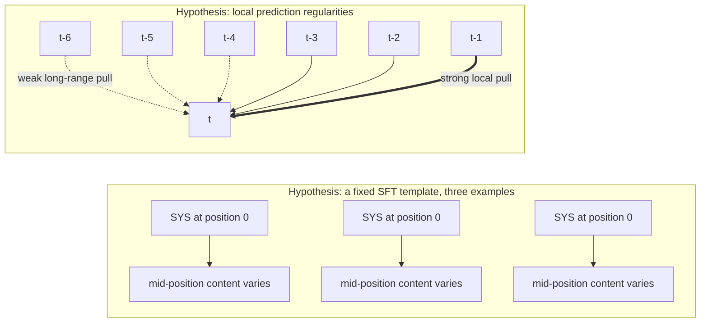
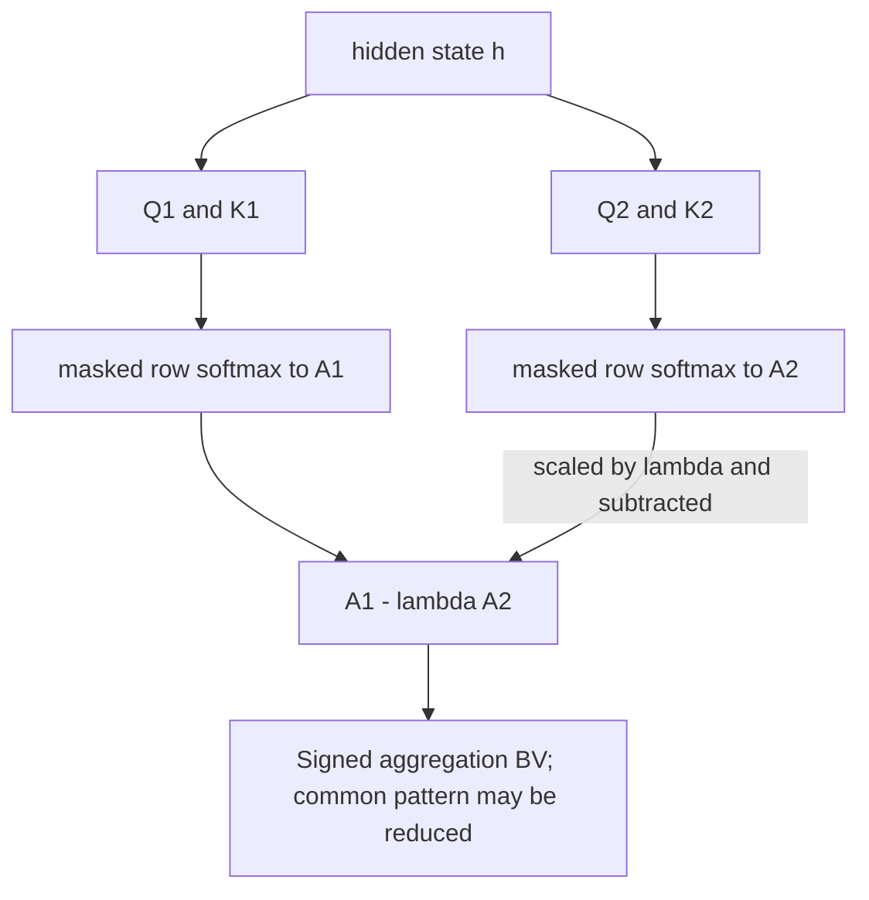

# Chapter 30: Lost in the Middle
[00-START-HERE](../00-START-HERE.md) · [01-READING-ROUTES](../01-READING-ROUTES.md) · [29\_bootstrapping\_training\_data](../part-08-training/29_bootstrapping_training_data.md) · [31\_attribution\_and\_citation](31_attribution_and_citation.md)
This chapter prepares you to diagnose and mitigate position-dependent failures in Retrieval-Augmented Generation (RAG) systems.
## TL;DR
- A large language model can receive correct evidence and still fail to use it. Several reported probes show U-shaped accuracy by evidence position; this is a measured pattern, not a law for every checkpoint.
- The trough can fall below a matched closed-book baseline. Retrieval may hurt even when the gold document is present.
- A longer accepted context does not guarantee flatter position-wise accuracy. Training distribution and attention design also matter.
- Fixed chat-template roles and local next-token prediction are plausible contributors to primacy and recency, not a complete causal explanation. Base-model primacy already rules out a system-message-only account.
- Outside-in placement is a heuristic, not an optimal assignment for every U-curve. A safe-width truncation optimum needs additional rank-distribution and stationary-accuracy assumptions.
- RoPE rescaling and attention calibration need internal serving access. The original calibration method redistributes token attention using document-level reference scores; it is not simply the toy raw-logit subtraction used below.
- IN2 changes training examples and differential attention changes the computation. Neither guarantees elimination of position effects or works as a universal drop-in wrapper.
## The story
Imagine a judge working with a very long evidence table. The retriever is the court clerk. The clerk fetches evidence cards for a case. The reranker sorts those cards by expected importance. The assembled prompt is the final table that the judge actually sees.
The gold chunk is the one card that contains the decisive fact. Finding that card is not enough. The clerk must also place it where the judge reliably notices it.
This judge has a peculiar reading habit. Cards at the near end of the table get strong attention. Cards at the far end also get strong attention. Cards across the broad middle are easy to overlook. If we plot success against card position, the line looks like a U. The near end is the primacy zone. The far end is the recency zone. The middle is the trough.
The judge sometimes knows a common fact from memory before any cards arrive. That is the closed-book answer. If the decisive card sits in the trough, distracting cards can pull the judge away from a correct remembered answer. The full evidence table can then perform worse than an empty table.
Buying a longer table does not cure the habit. It adds more places to put cards. It does not prove that the judge trained to inspect every new place well. It can also make the inspection bill much larger.
Training offers possible contributors to the habit. A fixed chat template repeatedly puts the system role at the start, and nearby words often help next-token prediction. Those observations motivate primacy and recency hypotheses; they do not establish the causes of the full curve, especially because base models can show primacy too.
The clerk has several same-day workarounds. The clerk can add an instruction that says to inspect the middle. The clerk can place the best cards at both ends of the table. The clerk can also stop adding low-value cards once both safe ends are full.
If the court controls the judge’s reading machinery, it can test a new position ruler or an attention-calibration procedure. Those interventions act inside serving and must be validated. A text-only service does not expose the required internal controls.
If the court owns training, it can move decisive evidence through many seats to weaken the association between location and importance. It can also train two attention maps and subtract a scaled version of one from the other. A common component cancels exactly only under the required matching and scaling conditions; useful evidence is not automatically preserved.
The final lesson is operational. Do not grade the clerk only on whether the decisive card entered the room. Plot the judge’s accuracy by the card’s final position. Then test each intervention against that same position-controlled curve.
## Decoder table


| Technical term | Plain-English meaning | Why it matters |
| --- | --- | --- |
| Retrieval-Augmented Generation (RAG) | A system that retrieves external text and gives it to a generator | Retrieval can help only if the generator uses the retrieved evidence |
| Large language model (LLM) | The generator that reads the prompt and produces the answer | Its use of context varies by position |
| Retriever | The component that fetches candidate documents or chunks | It controls recall but not final prompt placement |
| Chunk | A bounded piece of a retrieved document | Each chunk occupies a position in the model’s context |
| Gold chunk or gold document | The one retrieved item that contains the answer | The experiments move this item while holding its relevance fixed |
| Context window | The token capacity a model accepts in one request | Capacity does not guarantee equal comprehension at every position |
| Assembled prompt | The exact instruction, query, and chunk sequence sent to the model | Downstream assembly can change the reranker’s intended order |
| Reranker | Scores candidates for relevance | Scores need not be calibrated gold-rank probabilities |
| Rank | A candidate’s place in the relevance ordering | Rank and final prompt position can differ after reordering |
| Top-$`k`$ retrieval | Returning $`k`$ ranked candidates | Recall is monotone only for nested prefixes of a fixed ordering |
| $`\mathrm{Recall}@k`$ | Fraction of relevant items retrieved, or a single-gold hit indicator in this chapter | Does not measure evidence use or final position |
| Normalized Discounted Cumulative Gain (NDCG) | A retrieval metric that rewards useful ranking | It still does not measure whether the generator reads a position well |
| End-to-end accuracy | Correctness of the final generated answer | This is the quantity positional bias can lower |
| Serial position effect | Edge-favoring performance by item position | A shape analogy; human and model mechanisms need not match |
| U-curve | Accuracy that is high at both ends and low in the middle | It shows that position effects are not a monotonic falloff |
| Primacy | Strong use of information near the beginning | The first safe zone should hold high-value evidence |
| Recency | Strong use of information near the end | The second safe zone should not be wasted on the worst candidate |
| Trough | The weak middle region of the U | Evidence there can perform below the closed-book baseline |
| Position-controlled probe | Moves fixed gold content within a declared prompt-construction protocol | Supports a position effect; does not uniquely identify its mechanism |
| Multi-document question answering (QA) | Answering from a list in which one document contains the answer | It tests the effect in a realistic retrieval setting |
| Natural Questions (NQ) label | The source’s label for the underlying question set in the closed-book comparison | It identifies the benchmark slice behind the roughly 56 percent result |
| Synthetic key-value retrieval | Exact lookup of a random key’s value | Reduces semantic confounds, but still requires tokenization and format following |
| JavaScript Object Notation (JSON) | The fixed-format object used for the synthetic key-value pairs | Its regular entries make token density easy to check |
| Base model | A model trained for language prediction without instruction alignment | Its U shows that the system-message account is incomplete |
| Instruction-tuned model | A model further trained to follow prompts | Its fixed chat template can strengthen primacy |
| Decoder-only model | A model that generates from left to right using causal attention | The reported evaluation found the U consistently in this class |
| Encoder-decoder model | Encodes input before decoding an answer | Reported robustness beyond trained lengths is model- and task-dependent |
| Closed-book generation | Answering with no retrieved context | It provides the no-retrieval baseline $`A_0`$ |
| Parametric knowledge | Facts already stored in model weights | Retrieval can displace a correct parametric answer |
| $`A_0`$ | Accuracy in the matched no-retrieval condition | A comparison baseline, not a guaranteed floor |
| $`A(p)`$ | Accuracy when the gold item is at position $`p`$ | It makes the position effect explicit |
| Delta, $`\Delta(p)`$ | Retrieval value at position $`p`$, computed as $`A(p) - A_0`$ | A negative value means retrieval is worse than closed-book |
| $`p`$ and $`n`$ | Gold-item position $`p`$ and the document-list or sequence length $`n`$ | They locate the answer and define the context over which position changes |
| $`k`$ | Retrieval depth in the worked rank and truncation models | Distance weights below use a separate index to avoid mixing units |
| $`\bar{A}`$ and $`\bar{A}(k)`$ | Expected accuracy overall or at truncation depth $`k`$ | They combine position probabilities with zone-specific accuracy |
| $`P(\text{gold in zone})`$ | Probability that the gold item occupies a named zone or is excluded | These weights turn a position curve into expected pipeline accuracy |
| Prefill | Processes supplied context before generation | Quadratic attention arithmetic is only one part of total work |
| Attention | The mechanism that assigns weight to tokens or chunks | Its positional prior can overpower content relevance |
| Attention logit | A pre-softmax query-key score | The additive-logit toy differs from the cited document-level calibration algorithm |
| Softmax | Turns logits into a normalized nonnegative vector | Each ordinary attention row is normalized over allowed keys |
| Attention mass | The normalized share assigned to an item | The worked example tracks gold attention before and after calibration |
| Positional bias or positional prior | A location-associated preference in the evaluated model | Content interaction can prevent a separable, universally removable component |
| Training-time sequence length | Lengths represented in a checkpoint’s training distribution | Relevant diagnostic, not a sufficient predictor or universal threshold |
| Accepted context window | The longest prompt a checkpoint allows at inference | It is an admission limit, not proof of effective use |
| Self-attention | Tokens attend to other allowed tokens in the same sequence | Dense prefill products have leading quadratic arithmetic, not universally quadratic total latency |
| Attention head | One independently parameterized attention pathway inside a layer | MS-PoE scores and rescales heads separately |
| Floating-point operations (FLOPs) | A count of arithmetic work | The book uses it to compare long-context prefill cost |
| Sparse or windowed attention | Attention that does not compare every token with every other token | Its cost can be lower than the standard quadratic curve, but that does not prove positional robustness |
| Query-aware contextualization | Repeating the query before and after the document list | It helps the synthetic lookup task more than multi-document QA |
| Task drift | Producing the wrong kind of output rather than only a wrong value | LongChat generated retrieval code instead of the requested value |
| System message | A high-authority role prefix in the stipulated template | Its fixed location motivates a hypothesis, not proof of primacy |
| Supervised fine-tuning (SFT) | Training on labeled prompt/answer examples | Role occupancy is not a direct measure of gradient importance |
| Alignment | Training shaping instruction-following behavior | A fixed template may contribute; base-model primacy needs more explanation |
| Next-token objective | Predicts tokens from preceding allowed context | Local regularities motivate recency; long-range dependence can still matter |
| Next-token locality | The falloff in predictive signal with token distance | It supplies the recency-side training pressure |
| Harmonic decay | Stipulated weights $`w(j)\propto1/j`$ | Normalized harmonic shares are illustrative, not empirical attention measurements |
| Attention with Linear Biases (ALiBi) | The source-named attention bias that subtracts a distance term from logits | Its design independently supports the locality account |
| ALiBi distance bias | Causal per-head logit term $`-m_h(i-j)`$ for $`j\le i`$, $`m_h\ge0`$ | Encodes locality explicitly without proving a whole U |
| Position encoding | The mechanism that represents token locations | Its math can add positional effects, but training also matters |
| Rotary Position Embedding (RoPE) | Rotates query/key coordinate pairs by position | Norm-preserving dot products can oscillate; arbitrary scores need not decay monotonically |
| Query and key vectors | Representations whose dot product helps set attention | RoPE changes their relationship as relative position grows |
| Decay envelope | An aggregate or assumption-dependent description of distance effects | The universal norm bound is distance-independent; an envelope alone does not establish both prompt edges |
| MS-PoE | Per-head RoPE position rescaling assigned during prefill | Lower position-awareness scores receive greater compression in the original method |
| Position-awareness score | Fraction of attention entries above a multiple of their mean | It is a threshold statistic, not a direct fixed-content positional derivative |
| Adaptive scaling ratio | A head-specific position-index scaling factor | Default ratios span $`1.2`$ to $`1.8`$; assignment is retained for the ensuing decode, not every future input |
| Attention calibration | Uses a dummy document’s reference attention and redistributes token mass | Do not equate the original procedure with the separate raw-logit subtraction toy |
| Open-weight model | A model whose internals can be modified in the serving stack | Model-level inference wrappers require this access |
| Closed Application Programming Interface (API) | Exposes text requests/results but not the required attention controls | Prompt assembly remains available; internal methods need suitable serving access |
| Inference-time wrapper | A change around an existing checkpoint during serving | It avoids retraining but needs the right internal hooks |
| Faithfulness | Whether generated text reflects the supplied source | Wan et al. measured its decline for middle-position content |
| Hierarchical merging | Combining chunks through a multi-stage summary structure | The reported study found this could hurt faithfulness |
| Incremental summarization | Repeatedly updating a running summary as more text arrives | The reported study also found this could hurt faithfulness |
| Outside-in reordering | The declared alternating start/end permutation of ranked items | A heuristic, not always optimal when primacy and recency have different utilities |
| LongContextReorder | A library example of two-ended context ordering | Check the actual version’s orientation and final assembled prompt |
| Ranked-list truncation | Retains only selected candidates or a ranked prefix | Optimum depth depends on rank probabilities, missing-evidence behavior and ordering |
| Score cliff | A sharp relevance-score drop | A testable heuristic, not a probability calibration guarantee |
| Gold-rank distribution | Ranks one through four halve; the specified remaining tail is uniform | The complete distribution is needed for consistent reordering and truncation arithmetic |
| Safe-zone width | Combined capacity of stipulated edge zones | Does not by itself imply an optimal depth |
| $`d_1`$ through $`d_n`$ | Candidates ordered from highest to lowest reranker relevance | Outside-in placement maps this order onto both safe ends |
| $`w_p`$ and $`w_r`$ | Primacy and recency document-slot widths | Token-wise utility and overlap conventions must be distinguished |
| $`A_{\mathrm{primacy}}`$, $`A_{\mathrm{trough}}`$, and $`A_{\mathrm{recency}}`$ | Stationary conditional accuracies assumed in the toy model | Their ordering alone is insufficient for the descending-depth optimum |
| $`A_{\mathrm{miss}}`$ | Accuracy when the gold item is omitted but other context may remain | Not automatically the closed-book accuracy |
| $`k^*`$ | An optimal depth for a declared policy and model | $`k^*=w_p+w_r`$ needs the stated descending, monotone-rank and stationary-accuracy assumptions |
| Confidence-gated router | A component that decides whether to retrieve for a query | It can protect strong parametric answers but needs reliable confidence |
| Uncertainty estimate | A score for how confident the model is in an unaided answer | An unreliable estimate can make retrieval routing expensive and unsafe |
| IN2 training | Training that varies designated evidence locations | Provides coverage opportunities, not a uniform-gradient guarantee |
| Position-rotated fine-tuning | Samples evidence at many valid context locations | Its location event differs from ordinary token occupancy |
| Gradient signal and position-content correlation | Feedback and correlations between evidence location and task importance | Sampling frequency is not itself measured gradient strength |
| FILM-7B | The Mistral-7B model produced by the reported IN2 training | It is the chapter’s training-data example |
| DIFF Transformer | The source-named architecture with differential attention | It changes the attention arithmetic rather than the data |
| Continued pre-training | Additional training beyond a prior checkpoint | Architecture adoption may also involve conversion/adaptation; not a zero-training switch |
| Differential attention | Signed difference of two learned attention maps | Common patterns cancel only under matching and scale conditions |
| $`A_1`$ and $`A_2`$ | Two separately parameterized row-wise attention maps | Separate parameters do not imply statistical independence |
| Lambda, $`\lambda`$ | Learned scale on the second map | Rows of $`A_1-\lambda A_2`$ sum to $`1-\lambda`$, not generally one |
| Value matrix $`V`$ | The representations weighted by the final attention map | DIFF Transformer applies the difference map to $`V`$ |
| $`Q_1`$, $`K_1`$, $`Q_2`$, $`K_2`$, and $`d_h`$ | Two projection groups and their per-group query-key width | The simplified equations also need a common mask |
| $`\ell`$ and $`s`$ | Conversation token length and system-prefix token length | The discrete offset calculation measures occupancy, not supervision strength |
| $`x_t`$, $`x_{t-1}`$, and $`x_{t-2}`$ | A predicted token and its nearest preceding tokens | They express the local signal behind recency |
| $`w(j)`$, $`H_n`$, and $`\gamma`$ | Distance weights, harmonic sums and Euler’s constant | Use exact sums or a stated asymptotic approximation |
| $`L_{\mathrm{train}}`$ | A stated training-time sequence limit in the hypothetical example | Exceeding it motivates a probe; the service must also admit the input |
| $`\mathcal{O}(n^2d)`$ | Leading dense attention-product arithmetic | Not a total serving-latency or memory guarantee |
| $`c(p)`$, $`b(p)`$, and $`z(p)`$ | Assumed content, position and combined logits in a three-key toy | Exact bias subtraction there is not the original calibration algorithm |
| floor and choose operations | Counts under a fully specified placement model | Grid slots, all contiguous starts, ordered draws and unordered distinct pairs differ |
| Two-segment IN2 variant | Training with separated evidence pieces | Lengths, dependence and distinctness determine the correct placement count |


## Core mechanics
### Mathematical conventions
Accuracy symbols are fractions in $`[0,1]`$; multiplying their difference by $`100`$ gives percentage points, not a relative percent change. Keep full precision until reporting. The worked zone accuracies, gold-rank probabilities, equal chunk lengths and uniform placement laws are stipulated scenarios, not measurements from the cited papers. Their expected-accuracy model assumes one gold item and stationary zone accuracies; real tasks can require multiple pieces of evidence and have content-dependent position effects.
Here $`k`$ is the number of retained documents, $`n`$ is token length when discussing attention, $`p`$ is a final prompt position, and $`\pi_r`$ is the probability that the gold item has reranker rank $`r`$. Document slots are not token distances: variable chunk lengths, query placement and prompt overhead change the physical positions. In the two-slot-per-edge model, the first $`\min(k,2)`$ slots receive primacy; among the remaining slots, the last at most two receive recency. This precedence resolves edge-zone overlap for $`k<4`$. Descending rank order and outside-in order are separate policies throughout.
Approximate study-era labels such as $`4\mathrm{k}`$ mean about four thousand tokens, not an exact equality to $`4{,}096`$. Dense quadratic attention is a leading arithmetic component, not a measured total latency, invoice or memory allocation. Reported behavioral patterns and proposed training mechanisms are not universal architectural theorems.
### 30.1 The U-curve and the serial position effect
#### What
- Liu et al. (2023), as reported by the chapter, moved an answer-bearing document through a context while keeping its content and relevance fixed.
- One task was multi-document QA with one answer-bearing document; another looked up a value for a random JSON key.
- The synthetic task reduces semantic and paraphrase confounds, but still requires tokenization, format following and exact matching. It is not literally free of all task difficulty.
- Several tested base and instruction-tuned models performed better at the ends than in the middle. This need not describe every model or every setting.
- The chapter’s statement about decoder-only production prevalence is study-era context, not a current exhaustive claim about deployed architectures.
#### Why
- Holding the question and gold content fixed makes the position intervention more informative than comparing different easy and hard questions at different positions.
- Human serial-position effects supply a shape analogy, not evidence of shared transformer mechanisms. Human rehearsal and working-memory accounts should not be transferred as causal explanations of attention.
- Measure final-answer accuracy by the gold item’s position in the actual assembled prompt. Across positions, repeated outcomes on the same query are paired, not independent new benchmark items; use query-level paired uncertainty estimates.
#### Failure without it
- $`\mathrm{Recall}@k`$ and NDCG may improve while final-answer accuracy falls.
- Inspect the assembled request, not just the retriever output. A missing chunk may reflect retrieval, filtering, truncation, packing or another assembly failure.
- A gold chunk at rank $`8`$ of $`20`$ can land in a weak region despite outranking twelve candidates.
- A present but unused chunk motivates a position-controlled test. That observation alone does not identify position as the unique cause; contradiction, formatting, reasoning and instruction following can also matter.
#### Stated cost and complexity
- Rerun the same query while varying the gold item’s final position and preserving the declared context-construction protocol.
- A synthetic lookup probe is a useful controlled test, but is not a substitute for the production QA task.
- The chapter’s suggestion of $`k\le3`$ is a workflow heuristic to test, not a guarantee that every item is in primacy. With two primacy slots, only $`k\le2`$ is entirely primacy; the third slot is recency under the explicit short-list convention.
- Report trough depth, width, query slices, attempt counts and uncertainty, not only the visual presence of a U.
#### Experiments and arithmetic
- The reported lookup settings use $`75`$, $`140`$ and $`300`$ pairs at about $`4{,}000`$, $`8{,}000`$ and $`16{,}000`$ tokens.
- The corresponding whole-prompt averages are $`4{,}000/75\approx53.3333`$, $`8{,}000/140\approx57.1429`$ and $`16{,}000/300\approx53.3333`$ tokens per pair. Fixed instructions and the query are included in these rough ratios unless separately subtracted.
- Relative to the smallest ratio, the spread is about $`7.142857\%`$, not strictly within seven percent. Using the largest as denominator instead gives $`6.666667\%`$; state the denominator.
- Under a constant-density, zero-overhead proxy, pair $`150`$ starts at offset $`(150-1)(16{,}000/300)\approx7{,}946.67`$ and ends at $`8{,}000`$. Real token offsets must be measured from the serialized prompt.
- These rounded sizes are near study-era tiers $`4{,}096`$, $`8{,}192`$ and $`16{,}384`$, not exact conversions between decimal and binary context labels.
### 30.2 Worse than closed-book
#### What
- Let $`A_0`$ be accuracy with no retrieval and $`A(p)`$ accuracy under the declared position intervention, on the same question set.
- Define $`\Delta(p)=A(p)-A_0`$. A negative value means that this retrieval condition performs worse on average than the matched closed-book condition.
- The reported experiments include such negative troughs. This is not a claim that every retrieved prompt or every middle-position query is worse.
#### Why
- A U above $`A_0`$ motivates improving placement; one crossing below it also exposes retrieval downside on that evaluated population.
- Correct parametric answers can be displaced when the retrieved condition is wrong. Compare per-query outcomes to establish those cases, not aggregate accuracy alone.
- Distractors, context-use instructions and competition within normalized attention are possible contributors. Finite attention mass is not by itself a proof of the behavioral failure or its cause.
- Common known facts, such as the chapter’s capital-city and chemical-symbol examples, are useful slices for this comparison.
#### Failure without it
- Always retrieving can hurt a query slice even if aggregate RAG accuracy improves.
- Distinguish a retrieval miss from failure to use evidence that reached the model.
- Ground-truth scoring remains necessary, but alone does not reveal whether retrieval changed a previously correct answer. Retain the paired closed-book outcome too.
#### Stated cost and complexity
- Weight accuracy by the pipeline’s actual gold-position distribution, not by an arbitrary uniform average.
- A confidence-gated router needs a useful, validated estimate of expected retrieval benefit. The source describes uncertainty estimation as difficult and costly; it is not proved impossible.
- With one engineer-month, the chapter prioritizes truncation and placement tests before a new routing system. This is an engineering scenario, not a universal optimum.
- For private or future facts absent from weights, unaided factual recall cannot supply that missing source. A no-retrieval branch can still abstain or answer from information already in the request; do not equate it with inventing the fact.
#### Formula and worked example
- The illustrative $`20`$-document list has two primacy, sixteen trough and two recency slots.
- Take $`A_{\mathrm{primacy}}=0.70`$, $`A_{\mathrm{trough}}=0.50`$, $`A_{\mathrm{recency}}=0.65`$ and $`A_0=0.60`$.
- Uniform gold placement gives:

```math
\bar A=\frac{2(0.70)+16(0.50)+2(0.65)}{20}=0.535=53.5\%.
```

- The difference is $`0.535-0.60=-0.065`$, or $`-6.5`$ percentage points; the trough is ten points below $`A_0`$.
- These are illustrative values, not reproduced paper measurements.
- Separately, the chapter reports roughly $`56\%`$ closed-book accuracy for GPT-3.5-Turbo on an NQ-based set, with middle positions below that line and edge positions above it. Retain the model, prompt and benchmark scope when citing that comparison.
#### Decisions and limits
- Measure $`\Delta(p)`$ by query slice before calling retrieval a strict upgrade.
- Keep matched closed-book comparisons and inspect changes in correctness, not only textual answer differences.
- A persistently negative trough can motivate a router, but evaluate its estimation error, abstentions and costs against direct placement or truncation. A low worst-position score alone does not prove a router improves expected accuracy.
### 30.3 Longer context windows do not automatically solve position effects
#### What
- The chapter reports standard-context and extended-context comparisons within model families, using about $`4\mathrm{k}`$, $`8\mathrm{k}`$ and $`16\mathrm{k}`$ lookup settings where the checkpoint admits the input.
- Extending accepted length did not reliably remove the U in the reported comparisons. Some models were already near ceiling.
- This is evidence against treating admission capacity as comprehension, not proof that longer context can never improve a task or that every checkpoint traces the same curve at every length.
#### Why
- In the reported encoder-decoder tests, robustness deteriorated beyond training-time sequence lengths. Training length is a relevant diagnostic, not a sufficient statistic or a hard universal failure threshold.
- Accepted length determines admission; training distribution, architecture and task also affect use of admitted tokens.
- Query-aware contextualization repeats the query before and after documents. Its reported benefit was stronger on synthetic lookup than on multi-document QA; validate transfer rather than assuming it.
#### Failure without it
- A larger window can add more places for evidence to hide.
- It can preserve the same trough while increasing compute.
- More context can supply more information and more opportunities for confusion.
- LongChat showed a qualitative failure at the 140-pair setting.
- With the answer at the start, it generated code to retrieve the key rather than returning the value.
- This was task drift at a position otherwise expected to be safe.
#### Stated cost and complexity
- For fixed head width, dense self-attention’s query-key and attention-value products have leading prefill work $`\mathcal O(n^2d)`$. This is not the entire transformer: projections and feed-forward layers also have length-linear work.
- In the leading quadratic proxy, increasing token length from about four thousand to sixteen thousand is a factor of four:

```math
\frac{W_{\mathrm{attn}}(16{,}000)}{W_{\mathrm{attn}}(4{,}000)}\approx\left(\frac{16{,}000}{4{,}000}\right)^2=16.
```

- This is approximately sixteen times the quadratic attention arithmetic, not sixteen times every FLOP, latency, allocated memory or serving price. Causal pair counts and implementation details also affect exact constants.
- For a simple total-work proxy $`W(n)=an+bn^2`$ with $`a,b\ge0`$ and nonzero work, $`W(4n)/W(n)`$ lies between $`4`$ and $`16`$. Fixed overhead changes that comparison again.
- Sparse or windowed attention, efficient kernels, KV caching and prefill/decode reuse change operational costs. None alone proves a flatter position-wise accuracy curve.
#### Training-length threshold
- Consider a hypothetical checkpoint trained to $`L_{\mathrm{train}}=2{,}048`$ tokens but extended to admit at least $`16{,}000`$ tokens.
- Admitted probes of about $`4\mathrm{k}`$, $`8\mathrm{k}`$ and $`16\mathrm{k}`$ all exceed that training length. That motivates testing, not a theorem that a U must appear.
- If the service instead admits only about $`8\mathrm{k}`$ tokens, the $`16\mathrm{k}`$ request is inadmissible unless truncated or otherwise transformed; it cannot be treated as a full-length accuracy probe of that service.
#### Decisions and limits
- Probe the candidate checkpoint by position before a model migration.
- Ask whether context extension included continued training at the longer length.
- Do not infer effective 128k use from a 128k admission limit alone.
- Try reranking and truncation first when one sprint and a fixed latency budget constrain the choice.
- Inspect outputs qualitatively so a wrong output type does not disappear inside aggregate accuracy.
### 30.4 Where the bias comes from
#### What
- Fixed chat roles can contribute to primacy, while local next-token regularities can contribute to recency.
- These are hypotheses about learned behavior, not an identified decomposition of the measured U.
- Position encoding is another possible contributor, but a single RoPE argument cannot explain all models, tasks and training regimes.
- The reported encoder-decoder failures beyond trained lengths and base-model primacy both caution against one-cause explanations.
#### Why primacy appears
- In the stipulated template, a system message of $`s`$ tokens occupies zero-based positions $`0,\ldots,s-1`$, not $`0,\ldots,s`$.
- Those positions have a stable role across examples with conversation length $`\ell\ge s`$, although their actual token content can vary.
- Conditioning on system tokens can affect loss and gradients on later assistant tokens. Occupancy and role consistency alone do not quantify that gradient influence or prove primacy.
- Middle positions can vary in occupancy and role, but are not uniquely devoid of consistent predictive or supervised signal.
#### Why recency appears
- Nearby tokens such as $`x_{t-1}`$ and $`x_{t-2}`$ often aid prediction of $`x_t`$ before chat alignment. This motivates a locality hypothesis rather than proving the full recency curve.
- For causal attention, ALiBi adds a head-specific logit bias $`-m_h(i-j)`$ for keys $`j\le i`$, with $`m_h\ge0`$; equivalently $`-m_h\lvert i-j\rvert`$ on allowed pairs.
- That architectural preference is not itself a measured law of next-token information decay or proof of both sides of the U.
#### Claim limit for base models
- Base models can show primacy without an SFT system message, so that account is incomplete.
- Front-loaded titles, abstracts and topic sentences in pre-training data are plausible additional contributors.
- These possibilities can combine in aligned models. A literature description of the “best explanation” is not a causal identification result; targeted interventions are needed to separate mechanisms.
#### Worked arithmetic
- For an exact discrete example, take token length $`\ell`$ uniform on the integers $`500,\ldots,4{,}000`$: there are $`3{,}501`$ possible lengths.
- Assume every example contains the fixed system-role prefix, so position $`0`$ is occupied in all examples.
- Zero-based offset $`2{,}000`$ exists only when $`\ell\ge2{,}001`$:

```math
\Pr(\text{offset }2{,}000\text{ occupied})=\frac{2{,}000}{3{,}501}\approx0.571265353=57.1265353\%.
```

- Its occupancy is about $`42.873465`$ percentage points below position $`0`$. The continuous-length approximation instead gives $`4/7\approx57.142857\%`$ and a $`42.857143`$-point gap. Neither is a measurement of semantic consistency or gradient importance.
- Separately, stipulate distance weights $`w(j)\propto1/j`$ for $`j=1,\ldots,2{,}048`$. Define $`H_n=\sum_{j=1}^n1/j`$.
- The asymptotic expansion is $`H_n=\ln n+\gamma+1/(2n)+\mathcal O(n^{-2})`$, with $`\gamma\approx0.577215665`$; $`H_n=\ln n+\gamma`$ is not an exact equality.
- Direct sums give $`H_{64}\approx4.743890904`$ and $`H_{2{,}048}\approx8.202078772`$. Thus $`H_{64}/H_{2{,}048}\approx0.578376657`$, or about $`57.837666\%`$ of the stipulated weight.
- The nearest $`64`$ positions are $`64/2{,}048=3.125\%`$ of this window. These are harmonic-model calculations, not measured attention or predictive-information shares.
#### Failure without it
- Distance preference alone does not explain both ends of a U.
- Evidence rotation changes one training association, while a fixed system-role prefix can remain another. Whether either causes a particular residual curve must be tested.
- Inference reordering changes placement, not the stored parameters. Treating all observed failures as one cause can hide what an intervention actually changes.
#### Stated cost and complexity
- Repeating the query near the end is inexpensive to implement but adds prompt tokens and prefill work; it is not free.
- Its reported synthetic-lookup benefit does not establish a QA benefit.
- A recipe can suggest a hypothesis, but test position-wise behavior on the real workload.
- Small depths such as $`k=2`$ or $`k=3`$ are useful candidates to evaluate, not mathematical guarantees of primacy or sufficient multi-hop evidence.
### 30.5 Mitigation by prompting and reordering
#### What
- The chapter reports Wan et al. (2024) finding middle-position faithfulness losses in long-form summarization.
- In those experiments, an instruction to attend to the middle helped moderately, while particular hierarchical-merging and incremental-summary procedures hurt relative to the stated baseline.
- These are method- and task-specific results, not a theorem that every hierarchy, running summary or prompt instruction is ineffective.
#### Outside-in reordering
- Let $`d_1,\ldots,d_n`$ be ranked candidates. Descending order places $`d_1`$ first and $`d_n`$ last.
- Define the outside-in variant used here by $`\mathop{\mathrm{pos}}\nolimits(d_{2j-1})=j`$ and $`\mathop{\mathrm{pos}}\nolimits(d_{2j})=n-j+1`$, for valid ranks. It puts rank one at the start and rank two at the end.
- For ten items the final rank order is $`(1,3,5,7,9,10,8,6,4,2)`$.
- LongContextReorder is the chapter’s implementation example, but orientation and surrounding prompt assembly must be checked for the actual library version. The explicitly defined permutation above governs this chapter’s calculations.
- Filling both ends is a heuristic extension of start placement, not a proof of optimal assignment.
#### Why
- With two slots at each edge and at least four items, this outside-in variant places ranks one and three in primacy, two and four in recency, and the lower ranks in the trough.
- When primacy and recency have different accuracies, this need not be optimal. Under the worked $`0.70`$ versus $`0.65`$ utilities and descending gold-rank probabilities, ranks one and two deserve the two strongest slots if those utilities are known and stationary.
- Reordering follows reranking and can be combined with truncation, but recompute the expectation for the combined policy rather than borrowing the descending-order result.
#### Failure without it
- With two primacy slots, descending order leaves rank two in primacy, not in the trough. Rank three is in the trough only when the retained list is long enough.
- Descending order places the lowest retained ranks at the end; their gold probability is low but not automatically zero.
- An outside-in heuristic can improve this allocation without curing a bad reranker, and need not beat a placement optimized for the measured asymmetry between the two edges.
#### Stated cost and complexity
- Prompt instructions and deterministic reordering require no weight updates, but prompt length, assembly and validation still have costs.
- Under the running overlap convention, only lists of at most two items are all primacy; at three items, the third is recency.
- At four items there is no trough. Above four, middle slots appear in this stipulated document-slot model; real safe widths must be measured in the assembled token context.
#### Worked arithmetic
- Specify the entire gold-rank law: $`\pi_1=1/2`$, $`\pi_2=1/4`$, $`\pi_3=1/8`$, $`\pi_4=1/16`$, and $`\pi_r=1/256`$ for every $`r=5,\ldots,20`$.
- The first four halve, but the remaining tail is uniform, not a continuing geometric distribution. All twenty probabilities sum to one.
- At depth twenty in descending order, primacy has mass $`0.75`$, recency ranks nineteen and twenty have mass $`2/256=0.0078125`$, and the trough has mass $`0.2421875`$.
- Do not discard the recency tail and then reuse the uniform-tail assumption at depth six.

```math
\bar A_{\mathrm{desc},20}=0.75(0.70)+0.2421875(0.50)+0.0078125(0.65)=0.651171875\approx65.117188\%.
```

- Outside-in placement at depth twenty instead gives primacy mass $`0.625`$, recency mass $`0.3125`$, and trough mass $`0.0625`$:

```math
\bar A_{\mathrm{out},20}=0.625(0.70)+0.3125(0.65)+0.0625(0.50)=0.671875=67.1875\%.
```

- The outside-in gain over descending order is $`100(0.671875-0.651171875)=2.0703125`$ percentage points, not $`2.2`$ under this complete distribution.
- Descending rank placement exceeds the separate uniform-placement scenario by $`100(0.651171875-0.535)=11.6171875`$ points. This is a modeled comparison, not a measured reranker lift on matched production queries.
- Both depth-twenty policies exceed the illustrative $`A_0=0.60`$.
#### Decisions and limits
- Compare placement policies after a fixed reranker and on the same queries.
- Sending rank two to the far end is a candidate heuristic, not always better than keeping it in a stronger primacy slot.
- Test any middle-attention instruction and combined reorder/truncate policy on the final assembled prompt. Report position-wise and overall changes with paired uncertainty.
### 30.6 Ranked-list truncation
#### What
- Recall cannot decrease for nested prefixes of one fixed ranked list. Changing an approximate-search budget or reranking procedure can produce non-nested lists, so varying a parameter named $`k`$ need not satisfy that premise.
- For one gold item and fixed ordering, model $`w_p`$ primacy and $`w_r`$ recency document slots. After primacy takes the first $`\min(k,w_p)`$ slots, assign at most $`w_r`$ of the remaining last slots to recency; the rest form a trough of width $`\max(0,k-w_p-w_r)`$.
- Use $`w_p=w_r=2`$, zone accuracies $`0.70`$, $`0.50`$, $`0.65`$, and $`A_{\mathrm{miss}}=0.60`$ for the worked scenario.
- Gold-excluded accuracy is a separate condition: distractors remain, so $`A_{\mathrm{miss}}`$ is not automatically equal to the empty-context $`A_0`$.
- The following expectation assumes one gold item, disjoint exhaustive zones, and stationary accuracies conditional on each zone. Multiple necessary documents and content interactions require a richer model.
#### Expected-accuracy rule

```math
\begin{aligned}
\bar A(k)&=P_p(k)A_{\mathrm{primacy}}+P_t(k)A_{\mathrm{trough}}\\
&\quad+P_r(k)A_{\mathrm{recency}}+P_m(k)A_{\mathrm{miss}},\\
P_p(k)+P_t(k)+P_r(k)+P_m(k)&=1.
\end{aligned}
```

For a fixed descending list, increasing depth from $`k`$ to $`k+1`$ after both edge zones are full moves rank $`k-w_r+1`$ from recency to the trough, while the new rank $`k+1`$ enters recency, not the trough. Therefore

```math
\bar A(k+1)-\bar A(k)=\pi_{k+1}(A_{\mathrm{recency}}-A_{\mathrm{miss}})-\pi_{k-w_r+1}(A_{\mathrm{recency}}-A_{\mathrm{trough}}),\quad k\ge w_p+w_r.
```

If gold-rank probabilities are nonincreasing, accuracies are stationary, and $`A_{\mathrm{primacy}}\ge A_{\mathrm{recency}}>A_{\mathrm{miss}}>A_{\mathrm{trough}}`$, this increment is nonpositive. Before the edges fill, adding a positive-probability candidate improves the model expectation under the overlap convention. Thus $`w_p+w_r`$ is an optimum for this descending policy, possibly tied when relevant probabilities vanish. The running example has its maximum at $`k=4`$.
The accuracy ordering alone is insufficient: probabilities $`(0.30,0.30,0.01,0.19,0.20)`$ give $`\bar A(4)=0.6700`$ and $`\bar A(5)=0.6785`$ with the same zone accuracies. Outside-in is a different policy; with two slots per edge and $`k\ge4`$, its top four retain their edge assignments and each new low rank enters the trough. Its marginal change is then $`\pi_{k+1}(A_{\mathrm{trough}}-A_{\mathrm{miss}})`$. Do not conflate these mechanisms or their small-depth results.
#### Practical score-cliff rule
- A reranker score cliff is a candidate truncation heuristic, not a calibrated probability threshold or a universal recommendation to stop at rank two.
- Raw scores need not be comparable across queries or proportional to $`\pi_r`$.
- Evaluate missed evidence, multi-hop requirements, measured zone widths and the actual gold-excluded condition. Smooth score decay alone does not identify an optimum.
#### Failure without it
- In a descending list, ranks three and four move from recency at depth four into the trough at depth six. The new ranks five and six receive recency.
- With the specified outside-in policy those top-four edge assignments instead persist; added tail evidence enters the trough.
- Higher recall can coexist with lower accuracy under either policy, but for different marginal reasons. Reevaluate both ordering and depth after a reranker or prompt-template change.
#### Claim limit
- The safe-width result is conditional on rank masses, stationary zone accuracies, the ordering policy and the missing-evidence condition, not just $`A_{\mathrm{miss}}>A_{\mathrm{trough}}`$.
- If missing evidence is worse than trough evidence, admitting a tail item into an outside-in trough can help; a descending list still has a moving recency boundary whose net effect must be calculated.
- Measure $`A_{\mathrm{miss}}`$ separately from $`A_0`$. A different abstention policy, query population or distractor set changes the comparison.
#### Worked arithmetic
- Use the full uniform-tail rank law from section $`30.5`$ and retain descending order in these three calculations. At $`k=2`$, the first two ranks are primacy and all lower ranks are excluded:

```math
\bar A_{\mathrm{desc}}(2)=0.75(0.70)+0.25(0.60)=0.675=67.5\%.
```

- At $`k = 4`$, ranks 1 and 2 occupy primacy while ranks 3 and 4 occupy recency:

```math
\bar A_{\mathrm{desc}}(4)=0.75(0.70)+0.1875(0.65)+0.0625(0.60)=0.684375=68.4375\%.
```

- At $`k=6`$, ranks three and four occupy the trough. Ranks five and six each have gold probability $`1/256=0.00390625`$, not a rounded tail value inserted before calculation.
- The remaining fourteen tail ranks have excluded mass $`14/256=0.0546875`$:

```math
\begin{aligned}
\bar A_{\mathrm{desc}}(6)&=0.75(0.70)+0.1875(0.50)\\
&\quad+0.0078125(0.65)+0.0546875(0.60)\\
&=0.656640625\approx65.664063\%.
\end{aligned}
```

- Enumerating depths one through twenty gives the descending-policy maximum at $`k=4`$, ahead of $`k=2`$, $`k=6`$ and $`k=20`$ for this scenario.
- Combining outside-in with $`k=4`$ instead gives $`0.625(0.70)+0.3125(0.65)+0.0625(0.60)=0.678125`$, or $`67.8125\%`$. It is not the descending $`68.4375\%`$ result; the edge accuracies are asymmetric.
- The outside-in curve also peaks at four for these particular probabilities. Neither numerical result is a deployment-independent rule.
#### Stated cost and complexity
- With equal $`200`$-token chunks, depth four supplies $`800`$ retrieved tokens and depth twenty supplies $`4{,}000`$: five times as many retrieved tokens.
- Ignoring all other prompt tokens, the leading quadratic attention-work ratio is $`(4{,}000/800)^2=25`$.
- With fixed positive instruction/query overhead $`n_0`$, that component’s ratio is $`[(n_0+4{,}000)/(n_0+800)]^2<25`$; for an illustrative $`n_0=300`$ it is about $`15.280992`$.
- Length-linear layers, generation, caching, retrieval, fixed capacity and hardware utilization prevent equating this ratio to total latency or cost. Accuracy and attention arithmetic favor truncation in this toy example, but production depth must be measured.
### 30.7 Positional encoding and attention calibration
#### What RoPE contributes
RoPE rotates paired query and key coordinates. Writing its relative rotation as $`R_{j-i}`$ gives a score proportional to $`q^{\mathsf T}R_{j-i}k`$. Rotation preserves vector norm, so $`\lvert q^{\mathsf T}R_{j-i}k\rvert\le\lVert q\rVert\lVert k\rVert`$; this universal bound does not decay with distance.
Frequency-aggregated analyses can motivate a distance-decay envelope under their assumptions, but an arbitrary content-dependent dot product need not decay monotonically. In two dimensions, $`q=k=(1,0)^{\mathsf T}`$ gives $`q^{\mathsf T}R_\varphi k=\cos\varphi`$, which oscillates and returns to one after a full turn. A relative-distance argument alone also does not establish a preference for both the absolute start and absolute end of every prompt. Treat RoPE as one potential contributor, not a proof of the entire U or a content-independent penalty at every middle key.
#### MS-PoE
MS-PoE assigns different RoPE position-index scaling ratios by head. Its actual position-awareness score uses the most recent query’s attention vector during prefill, not a derivative or a repeated fixed-content perturbation test. For a normalized vector $`a`$ over $`L`$ allowed positions, the paper’s threshold score is

```math
S_h=\frac1L\sum_{j=1}^{L}\mathbf1\!\left[a_j\ge\alpha\frac1L\sum_{u=1}^{L}a_u\right],\qquad\alpha=3\text{ in the reported experiments}.
```

The paper assigns larger compression ratios to heads with smaller scores. Heads with larger scores receive less compression, not stronger compression and not necessarily no change. Its default sorted ratios range from $`1.2`$ to $`1.8`$; assignments are determined at prefill and held during the subsequent decoding stage. They are not a universal one-time calibration for all future requests. The method requires a compatible RoPE model and serving hooks, no fine-tuning or added learned parameters, but score computation and integration still need benchmarking.[\[1\]](https://arxiv.org/html/2403.04797)
#### Attention calibration
Hsieh et al. (2024) estimate a document-level reference attention pattern using dummy content at the same position. Under their approximate additive model, a calibrated relevance score is

```math
\widehat r_k=\mathop{\mathrm{Attn}}\nolimits(d_k,k)-\mathop{\mathrm{Attn}}\nolimits(d_{\mathrm{dum}},k).
```

They then redistribute token attention within documents, rather than simply subtracting an average positional term from every raw query-key logit. If $`a_{ki}`$ is original token attention, $`A_k=\sum_i a_{ki}>0`$, and $`C=\sum_k A_k`$ is the document portion of attention mass, the redistribution can be written

```math
\alpha_k=\frac{\exp(\widehat r_k/t)}{\sum_j\exp(\widehat r_j/t)},\qquad a'_{ki}=C\frac{\alpha_k}{A_k}a_{ki},\qquad t>0.
```

Hence $`\sum_i a'_{ki}=C\alpha_k`$ and total document attention stays $`C`$. Masked or zero-mass cases need an explicit implementation policy. The reference subtraction relies on the approximate relevance/bias model; residual interactions and estimation errors need not cancel. The raw-logit arithmetic below is a separate pedagogical toy, not a reproduction of this algorithm.[\[2\]](https://arxiv.org/html/2406.16008)
#### Failure without it
- A relevant middle chunk can receive less combined attention than distractors at the edges, but mass alone is not final-answer accuracy or a sufficient causal explanation.
- A single global rescaling may disturb useful head-specific patterns.
- A text-only API generally does not expose the required RoPE or attention controls. Prompt reordering and truncation remain available, subject to the service’s assembly rules.
- Combining interventions requires compatibility and validation; benefits need not add.
#### Caveats and stated cost
- Bias and content may interact, and a dummy reference need not identify a universal position-only component.
- Added calibration passes and rescaling have implementation costs even without training updates.
- Some tasks legitimately need recency, such as responding to the latest dialogue turn.
- Validate mass normalization, masks, stability, latency and held-out task accuracy; an attention diagram is not a correctness guarantee.
#### Worked arithmetic
For a separate three-key toy, place two edge distractors and one middle gold chunk at nominal slots $`1`$, $`11`$ and $`20`$. The other seventeen slots are masked or have negligible attention; this is not a complete twenty-key softmax. Assume additive raw logits $`z=c+b`$, with content logits $`(1,3,1)`$ and exactly known position terms $`(1.5,0,1.5)`$.

```math
\begin{aligned}
z&=(2.5,3,2.5),\\
Z_{\mathrm{raw}}&=2e^{2.5}+e^3\approx44.450524845,\\
a_{\mathrm{gold,raw}}&=\frac{e^3}{2e^{2.5}+e^3}\approx0.451862762,\\
z-b&=(1,3,1),\\
Z_{\mathrm{toy\ calibrated}}&=2e+e^3\approx25.522100580,\\
a_{\mathrm{gold,toy\ calibrated}}&=\frac{e^3}{2e+e^3}\approx0.786986042.
\end{aligned}
```

The gold attention share increases by about $`33.512328`$ percentage points, from $`45.186276\%`$ to $`78.698604\%`$; this is not a measured answer-accuracy gain. The raw distractors share about $`54.813724\%`$. Keep the exponentials unrounded in the normalization: the calibrated sum is about $`25.5221`$, not $`25.53`$ obtained from summing rounded terms. With an estimated bias $`\widehat b`$, the remaining logits are $`c+(b-\widehat b)`$, so exact content recovery requires the additive model and correct bias. Hsieh’s document-attention algorithm above is distinct.
### 30.8 Training and architecture fixes
#### IN2 training
- The chapter reports An et al. (2024) using IN2 position-rotated fine-tuning: answer-bearing material of roughly $`120`$ tokens is placed at varied locations in contexts of about $`4\mathrm{K}`$ to $`32\mathrm{K}`$ tokens.
- The construction should make the designated evidence necessary and sufficient for the labeled answer. Rotation supplies opportunities for evidence at different positions; it does not prove equal effective gradients or perfect utilization at every token.
- A two-segment variant tests integration across separated evidence. Its piece lengths and sampling dependence must be specified before counting placements.
- The resulting Mistral-7B-based FILM-7B is reported comparable to GPT-4-Turbo on the cited long-context tasks, not universally equivalent across models, tasks or production conditions.
#### DIFF Transformer
- The chapter reports differential attention using two learned query-key projection groups over the same allowed positions.
- Distinct learned projections do not make their resulting maps statistically independent.
- Let $`d_h`$ be the query-key width of each group, and $`\mathcal M`$ a common causal or task mask, with at least one allowed finite key per row. Define row-wise maps:

```math
A_1=\mathop{\mathrm{softmax}}\nolimits_{\mathrm{row}}\!\left(\frac{Q_1K_1^{\mathsf T}}{\sqrt{d_h}}+\mathcal M\right).
```


```math
A_2=\mathop{\mathrm{softmax}}\nolimits_{\mathrm{row}}\!\left(\frac{Q_2K_2^{\mathsf T}}{\sqrt{d_h}}+\mathcal M\right).
```

The core aggregation is $`BV`$ with $`B=A_1-\lambda A_2`$ and learned scalar $`\lambda`$ in this simplified presentation. Although each $`A_i`$ is row-stochastic, $`B`$ may have negative entries and satisfies $`B\mathbf1=(1-\lambda)\mathbf1`$; it is not generally a probability distribution.
If $`A_1=P+S_1`$ and $`A_2=P+S_2`$, then

```math
B=(1-\lambda)P+S_1-\lambda S_2.
```

The identical common component $`P`$ cancels exactly at $`\lambda=1`$, not for arbitrary learned scale. Different positional components leave a residual even then, and useful content can also cancel. The full architecture includes normalization and output operations omitted here. Adopting it is not a drop-in configuration change for a standard checkpoint; conversion, adaptation and additional training may be possible, but must be designed and tested. The source’s unresolved cross-reference `sec-04` appears to point to section $`30.4`$; it is not an additional mathematical result.
#### Different intervention layers, not a guaranteed quality ordering
- IN2 changes training examples and their evidence-location distribution.
- Differential attention changes the computation and its learned parameters.
- MS-PoE and calibration change inference behavior using internal serving hooks.
- These interventions target different layers of the system; that alone does not prove a higher performance ceiling or additive gains.
- Evidence rotation and differential attention could be combined in principle, subject to compatible implementation and joint validation.
#### Failure without it
- More unrotated data may preserve a location/importance correlation; more data alone does not establish that it must worsen the curve.
- Sampling only a small set of evidence placements leaves other placements untested, but ordinary tokens there can still receive gradients.
- Evidence rotation does not itself remove a fixed system-role prefix or identify that prefix as the cause of residual primacy.
- Differential attention needs its required parameterization and training plan, not merely a setting name.
#### Worked arithmetic
- As an explicitly simplified counting grid, reserve a $`32{,}000`$-token region entirely for placement and use non-overlapping full $`120`$-token slots. There are $`\lfloor32{,}000/120\rfloor=266`$ slots and $`80`$ unused tokens.
- This is not the number of all possible contiguous starts, which is $`32{,}000-120+1=31{,}881`$, and is not a reconstruction of the exact IN2 sampling protocol. Instructions, other text and segment boundaries can reduce the usable region.
- One uniformly selected grid slot has probability $`1/266\approx0.37593985\%`$ of being the designated evidence slot.
- For two distinct full slots sampled without replacement, the number of unordered pairs is:

```math
\binom{266}{2}=\frac{266\times265}{2}=35{,}245.
```

- Labeled ordered distinct placements instead number $`266\times265=70{,}490`$. Two independent ordered draws with replacement give $`266^2=70{,}756`$, including collisions. These are different experiments.
- Under two distinct uniformly selected slots, a particular slot is selected with probability $`2/266\approx0.75187970\%`$, not $`1/266`$.
- These two-full-slot counts do not apply unchanged if one $`120`$-token segment is split into shorter pieces.
- A fixed system role occurring in all examples, occupancy of offset $`2{,}000`$, and the event “this slot contains designated answer evidence” are different random events. Their probabilities do not directly measure comparative supervision strength.
- The numerical ratio between fixed one-slot placement and one-of-$`266`$ evidence placement is $`266`$, or about $`2.425`$ decimal orders, but it is not evidence that gradients or learning are that much flatter.
#### Stated cost and complexity
- Budget an actual IN2-style training and evaluation run for the target checkpoint, sampling broadly over valid evidence locations.
- A production-skewed sampling law trades uniform coverage for frequent-case emphasis; measure both rather than claiming either is automatically best.
- Do not casually move system instructions into ordinary retrieved text or weaken their authority. Any template experiment must preserve instruction hierarchy and security semantics.
- Differential attention may require a new model or checkpoint-conversion/adaptation program with additional training; it is not necessarily impossible to retrofit, but is not a universal zero-training wrapper.
- Six weeks versus multiple months is the chapter’s planning scenario, not a measured cost or schedule bound. Compare feasible plans using the same position-controlled and production-task evaluations.
## Diagrams
### Figure 30.1
```plain text
answer accuracy
high | LLL\\                               /LLL   L = LLM, solid
     |  hhh\\                           /hhh     h = human recall, dashed
     |      \\LLL\\                 /LLL/
low  |           \\___LLL___/
     + start -------- middle -------- end
       primacy         trough         recency
       position of relevant chunk
```
Figure $`30.1`$: Qualitative serial-position analogy, not a quantitative overlay of human and LLM measurements. The reported LLM probes move the same relevant gold item while holding its relevance fixed; it performs better at some edges than in the middle. This is not a claim that relevance is irrelevant or that all humans and models share one mechanism.
### Figure 30.2
```plain text
accuracy
high | A(p)\\                         /A(p)
A0   | - - - \\ - closed-book - - / - - -
low  |          \\______/
     + 1 ---------- 10 ---------- 20
       Delta(p) < 0 through the trough
       gold-document position in a 20-document context
```
Figure $`30.2`$: Schematic of a reported possibility: $`A(p)<A_0`$ in the trough on a matched query population. Neither this diagram nor the cited result establishes that every model’s curve crosses the closed-book line.
### Figure 30.3
```plain text
retrieval accuracy
high | 4k \\                         / 4k
     | 8k  \\                       /  8k
     | 16k  \\______middle________/  16k
     + start ---------------------- end
       position of relevant key-value pair
```
Figure $`30.3`$: Increasing approximate length from $`4\mathrm{k}`$ to $`16\mathrm{k}`$ is quadrupling, not tripling. The reported comparisons show that extending admitted context need not flatten a U; the schematic does not identify a unique cause or prove failure at every length. Only admitted full inputs are comparable as such.
### Figure 30.4

Figure $`30.4`$: Hypothesized contributors: local predictive regularities and a repeated system-role prefix. The three fixed-template examples illustrate role consistency, not a proof that only position zero receives consistent or important gradients. Base-model primacy requires additional explanations; this is not a causal decomposition of the U.
### Figure 30.5


| Layout | Position 1 | Position 2 | Position 3 | Position 4 | Position 5 | Position 6 | Position 7 | Position 8 | Position 9 | Position 10 |
| --- | --- | --- | --- | --- | --- | --- | --- | --- | --- | --- |
| Naive relevance rank | 1 | 2 | 3 | 4 | 5 | 6 | 7 | 8 | 9 | 10 |
| Outside-in relevance rank | 1 | 3 | 5 | 7 | 9 | 10 | 8 | 6 | 4 | 2 |
| Zone | primacy | primacy | trough | trough | trough | trough | trough | trough | recency | recency |


Figure $`30.5`$: With two primacy slots, descending order keeps ranks one and two at the start; rank three, not rank two, is buried in this ten-item example. The declared outside-in permutation places ranks one and three in primacy and two and four in recency. It is a heuristic: if the two primacy slots have higher stationary utility, placing the two most probable gold ranks there can be better.
### Figure 30.6


| Truncation depth | Position 1 | Position 2 | Position 3 | Position 4 | Position 5 | Position 6 |
| --- | --- | --- | --- | --- | --- | --- |
| $`k = 4`$ | rank 1, primacy | rank 2, primacy | rank 3, recency | rank 4, recency | not sent | not sent |
| $`k = 6`$ | rank 1, primacy | rank 2, primacy | rank 3, trough | rank 4, trough | rank 5, recency | rank 6, recency |


Figure $`30.6`$: This table uses descending order, not the outside-in permutation. At $`k=6`$, ranks three and four move from recency into the trough while new ranks five and six enter recency. Whether the trade-off helps depends on gold-rank masses and conditional accuracies; edge width alone is not a universal truncation theorem.
### Figure 30.7
```plain text
attention weight
high | raw \\                     / raw
     |      \\___           ___/
     | calibrated ___/\\* /\\___
low  + start ------ gold ------ end
                      chunk
     solid raw positional prior, dashed calibrated content signal
```
Figure $`30.7`$: Qualitative calibration schematic, not measured attention or a guaranteed positional prior. In the separate three-key additive-logit toy, exact subtraction raises gold attention from about $`45.1863\%`$ to $`78.6986\%`$, not answer accuracy by that amount. Hsieh’s actual document-reference subtraction and token-attention redistribution are described in section $`30.7`$ and are not identical to this toy.[\[2\]](https://arxiv.org/html/2406.16008)
### Figure 30.8

Figure $`30.8`$: Two learned maps need not be statistically independent. Their scaled difference has row sum $`1-\lambda`$ and can be negative. An identical shared component cancels at $`\lambda=1`$; arbitrary learned scales or mismatched patterns need not cancel it, and content is not guaranteed to survive unchanged.
## Whiteboard pack
### What to draw
1. Draw an illustrative position-wise accuracy curve, not a universal law.
2. Label primacy, trough and recency, and add the matched closed-book $`A_0`$ line.
3. Keep reranker rank separate from final prompt position.
4. Show the specified outside-in permutation, with ranks one and three at the start, two and four at the end.
5. Draw the descending-order depth-four and depth-six layouts separately; mark the recency boundary that moves.
6. Write $`k^*=w_p+w_r`$ only beside its descending-order, nonincreasing-rank-mass and stationary-accuracy assumptions. Note that safe width alone is insufficient.
7. Branch by serving access: prompt assembly, internal inference intervention, or training/architecture changes.
8. End with paired position probes and final-task validation, not attention-mass gains presented as accuracy gains.
### Spoken script
Lost in the middle means the model can receive relevant evidence yet perform worse at some positions. Several probes show a U, sometimes below a matched closed-book baseline, but not every checkpoint or task follows it. I inspect the final prompt, compare ordering and depth policies, and measure both missing-evidence and position-wise accuracy. Outside-in placement is a heuristic; a safe-width optimum requires stated assumptions. With internal access I can test head-wise position scaling or document-attention calibration, and with training access I can rotate evidence or adapt the attention architecture. I validate every intervention on paired query outcomes rather than infer success from an attention diagram.
## Interview traps
### 1. Why does the U-curve establish a position effect rather than a harder-middle benchmark artifact?
The reported controls move the same gold content while holding its relevance fixed and include random key-value lookup as well as QA. That reduces semantic and question-difficulty confounds and supports a position effect in that protocol. It does not eliminate format following, tokenization, other context interactions or sampling uncertainty, and it does not identify a unique attention mechanism.
### 2. How can RAG be worse than closed-book, and when would you avoid a no-retrieval path?
On the matched population, $`A(p)<A_0`$ means the retrieved condition is worse on average. Comparing paired outcomes identifies cases where a correct closed-book answer became wrong; distractor attention is a possible mechanism, not a proof from the inequality. Validate a no-retrieval route for known facts, and use evidence or abstention for facts absent from weights. A no-retrieval branch can still use information in the request; it cannot conjure a missing private or future source.
### 3. Why does a longer context window fail to solve the problem?
Accepted length is admission capacity, not demonstrated uniform use. The chapter’s reported comparisons retain position effects after extension, but that does not prove every extension fails. Increasing about $`4\mathrm{k}`$ to $`16\mathrm{k}`$ gives about sixteen times the leading quadratic attention arithmetic, not sixteen times total latency or every FLOP. Probe only lengths the service actually admits and distinguish its training distribution from its inference limit.
### 4. What mechanism and serving fixes would you propose before retraining?
Fixed-template roles, local prediction regularities and position encoding are candidate contributors, not a complete causal account. First inspect assembly and test reranking, ordering and truncation. The safe-width rule is conditional, and asymmetric edge performance can make outside-in suboptimal. With appropriate model hooks, evaluate MS-PoE or the original document-attention calibration procedure; neither a universal RoPE decay claim nor a toy softmax gain proves final-task improvement.
### 5. How do IN2 and DIFF Transformer differ, and which fits a six-week deadline?
IN2 changes evidence-location sampling during training. Differential attention changes the learned computation to subtract scaled maps, whose common component cancels only under the required conditions. The chapter’s six-week scenario favors a feasible fine-tune over a larger architecture program, but checkpoint conversion or adaptation is not mathematically impossible. Compare actual implementation, training and validation budgets rather than treating either schedule or outcome as guaranteed.
## Key numbers


| Topic | Number or range | Status in the chapter | Meaning |
| --- | --- | --- | --- |
| Human analogy | $`10`$ list items | Illustrative analogy | Not an empirical human/model curve overlay |
| Initial pipeline | $`20`$ chunks | Illustrative scenario | Evidence admission does not establish use |
| Position examples | Ranks $`1`$, $`8`$ of $`20`$, and positions $`6`$ through $`14`$ | Diagnostic examples | Measure final token placement rather than infer it from rank |
| Retrieval-depth debate | $`k=5`$ versus $`k=20`$ | Interview scenario | Recall and accuracy can move in opposite directions |
| Synthetic probe sizes | $`75`$, $`140`$, $`300`$ pairs | Chapter-reported settings | Three synthetic lookup scales |
| Synthetic token sizes | About $`4{,}000`$, $`8{,}000`$, $`16{,}000`$ tokens | Approximate study lengths | Not exact power-of-two conversions |
| Tokens per pair | $`53.3333`$, $`57.1429`$, $`53.3333`$ tokens/pair | Derived whole-prompt averages | Spread/minimum is about $`7.142857\%`$; fixed prompt overhead is included |
| Long synthetic midpoint | Pair $`150`$: start $`7{,}946.67`$, end $`8{,}000`$ | Constant-density proxy | Subtract one for zero-based start; actual offsets require tokenization |
| Power-of-two tiers | $`4{,}096`$, $`8{,}192`$, $`16{,}384`$ | Study-era comparison | Nearby tiers, not exact equalities to the rounded sizes |
| Small-list exception | $`k\le2`$ entirely primacy; $`k=3`$ has recency | Stipulated two-slot overlap convention | Small depth is a testable heuristic, not a universal safe-zone guarantee |
| Uniform 20-slot zones | $`2`$, $`16`$, $`2`$ slots | Illustrative | Primacy, trough and recency at depth twenty |
| Uniform zone accuracy | $`70\%`$, $`50\%`$, $`65\%`$ | Illustrative stationary accuracies | Not reproduced paper measurements |
| Closed-book $`A_0`$ | $`A_0=60\%`$ | Illustrative baseline | Matched closed-book comparison |
| Uniform expected RAG | $`53.5\%`$ | Derived | $`-6.5`$ percentage points versus the illustrative baseline |
| Trough gap | Ten percentage points below baseline | Illustrative | Trough accuracy versus closed-book accuracy |
| Rollout and engineering scenarios | Three weeks; one engineer-month | Interview framing | Planning examples, not measured time bounds |
| GPT-3.5-Turbo baseline | Roughly $`56\%`$ | Chapter-reported empirical comparison | GPT-3.5-Turbo on the cited NQ-based set |
| Best edge positions | Positions $`1`$ and $`20`$ | Reported qualitative comparison | Scope depends on the evaluated model and task |
| Migration comparison | About $`4\mathrm{k}`$ to $`16\mathrm{k}`$ | Fourfold length comparison | Quadrupling, not tripling; only compare admitted inputs |
| Standard attention cost | About $`16\times`$ leading attention arithmetic | Quadratic proxy | Not total FLOPs, latency, memory or invoice |
| Training-length example | $`L_{\mathrm{train}}=2{,}048`$; admission at least $`16{,}000`$ | Hypothetical corrected example | An $`8\mathrm{k}`$-limited service cannot accept a full $`16\mathrm{k}`$ probe |
| LongChat failure | $`140`$ pairs, answer at start | Chapter-reported qualitative failure | Task drift: code instead of a value |
| Vendor probe example | $`128\mathrm{k}`$ | Interview scenario | Admission alone does not prove effective use |
| SFT length range | $`\ell\in\{500,\ldots,4{,}000\}`$ uniformly | Discrete illustrative model | $`3{,}501`$ equiprobable lengths |
| Mid-context offset | $`2{,}000/3{,}501\approx57.126535\%`$ | Derived occupancy | Zero-based offset two thousand exists only at length at least two thousand one |
| Position-0 occupancy | $`100\%`$ occupancy | Stipulated prefix role | Not a measurement of gradient or causal influence |
| Positional consistency gap | $`42.873465`$ percentage points | Discrete occupancy gap | Continuous proxy gives $`42.857143`$; neither is a supervision-strength gap |
| Harmonic window | $`2{,}048`$ positions | Illustrative harmonic model | Not measured predictive-information decay |
| Nearest-token band | $`64`$ positions; $`3.125\%`$ of window | Derived harmonic share | About $`57.837666\%`$ of the stipulated weight |
| Harmonic sums | $`H_{2{,}048}\approx8.202078772`$; $`H_{64}\approx4.743890904`$ | Direct finite sums | $`\ln n+\gamma`$ is only the leading approximation |
| Training schematic | Three fixed-template examples | Schematic | Not proof that only position zero receives consistent gradients |
| Gold-rank probabilities | $`50\%`$, $`25\%`$, $`12.5\%`$, $`6.25\%`$ | Illustrative gold-rank law | Halving for ranks one through four |
| Tail probability | $`6.25\%`$ total; $`0.390625\%`$ each | Uniform tail over ranks five through twenty | Nonzero mass also on ranks nineteen and twenty |
| Reordering schematic | $`1,3,5,7,9,10,8,6,4,2`$ | Declared ten-item permutation | Library orientation must be checked separately |
| Naive versus reordered | $`65.117188\%`$ versus $`67.1875\%`$ | Derived depth-twenty policies | Outside-in gain $`2.0703125`$ percentage points, not $`2.2`$ |
| Rank sorting gain | $`11.6171875`$ percentage points | Modeled comparison | Descending depth twenty minus the separate uniform-position scenario |
| Safe-zone optimum | $`k^*=4`$ for the stated example | Conditional result | Requires declared ordering, rank law, zone accuracies and missing-evidence behavior |
| Score-cliff scenarios | Ten candidates; score cliff after rank two | Interview heuristic | Scores are not automatically calibrated gold probabilities |
| Truncation comparison | $`67.5\%`$, $`68.4375\%`$, $`65.664063\%`$ | Descending depths two, four and six | Outside-in at depth four instead gives $`67.8125\%`$ |
| Tail ranks in recency at $`k = 6`$ | $`1/256=0.390625\%`$ each | Uniform-tail assumption | Ranks five and six receive recency in the descending depth-six policy |
| Chunk budget | $`200`$ tokens/chunk; $`800`$ versus $`4{,}000`$ | Equal-chunk model | Retrieved tokens only; prompt overhead is extra |
| Truncation savings | $`5\times`$ retrieved tokens; $`25\times`$ quadratic component | Zero-overhead proxy | With $`300`$ fixed prompt tokens that component ratio is about $`15.280992`$ |
| Calibration positions | Slots $`1`$, $`11`$, $`20`$ | Three-key attention toy | Other seventeen slots are masked or negligible |
| Imperfect-rank scenario | Gold rank $`10`$ of $`20`$; retain top $`3`$ | Failure scenario | Truncation may exclude the necessary source |
| Content and bias logits | Content $`(1,3,1)`$; bias $`(1.5,0,1.5)`$ | Additive-logit toy | Distinct from Hsieh’s document-attention method |
| Raw exponentials and sum | $`e^3\approx20.085537`$; $`e^{2.5}\approx12.182494`$; $`Z\approx44.450525`$ | Derived | Use unrounded exponentials before normalizing |
| Raw attention split | $`45.186276\%`$ gold; $`54.813724\%`$ distractors | Derived toy attention | Not final-answer accuracy |
| Calibrated exponentials and sum | $`e^3\approx20.085537`$; $`e\approx2.718282`$; $`Z\approx25.522101`$ | Derived | Not a sum of rounded terms giving $`25.53`$ |
| Calibrated gold mass | $`78.698604\%`$ gold; gain $`33.512328`$ points | Exact-bias toy | Neither an empirical accuracy gain nor the original calibration implementation |
| MS-PoE update cost | No fine-tuning or added learned parameters; default ratios $`1.2`$–$`1.8`$ | Original MS-PoE procedure | Assign during prefill and hold through that decode; not once globally per model |
| IN2 context and segment | About $`4\mathrm{K}`$–$`32\mathrm{K}`$ contexts and $`120`$-token evidence | Chapter-reported training scale | Sampling opportunities do not guarantee equal effective gradients |
| Buried evidence example | Offset $`18{,}000`$ in $`32{,}000`$ tokens | Motivation example | Natural training data need not assign uniform importance there |
| Non-overlapping IN2 positions | $`266`$ grid slots; $`80`$ unused tokens | Explicit simplified counting grid | All contiguous starts instead number $`31{,}881`$ before other reservations |
| Per-position occupancy | $`1/266\approx0.37593985\%`$ | One designated evidence slot | Two distinct selected slots give marginal inclusion $`2/266\approx0.75187970\%`$ |
| Two-position combinations | $`35{,}245`$ unordered distinct; $`70{,}490`$ ordered distinct | Without replacement | Independent ordered draws with replacement instead give $`70{,}756`$, including collisions |
| Training models | Mistral-7B, FILM-7B, GPT-4-Turbo | Chapter-reported experiment | Comparability is limited to the cited tasks and settings |
| Deadline comparison | Six weeks versus multiple months | Planning scenario | Not a demonstrated universal schedule or impossibility of checkpoint adaptation |
| Study dates | 2021, 2023, 2024 | Source attributions | Method mechanics for MS-PoE and Hsieh calibration checked against the linked originals |


[00-START-HERE](../00-START-HERE.md) · [01-READING-ROUTES](../01-READING-ROUTES.md) · [29\_bootstrapping\_training\_data](../part-08-training/29_bootstrapping_training_data.md) · [31\_attribution\_and\_citation](31_attribution_and_citation.md)
