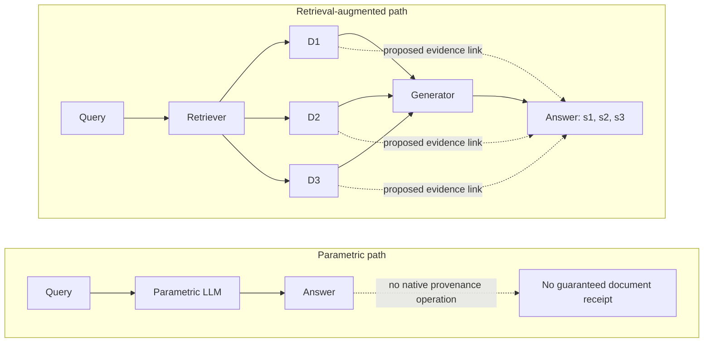
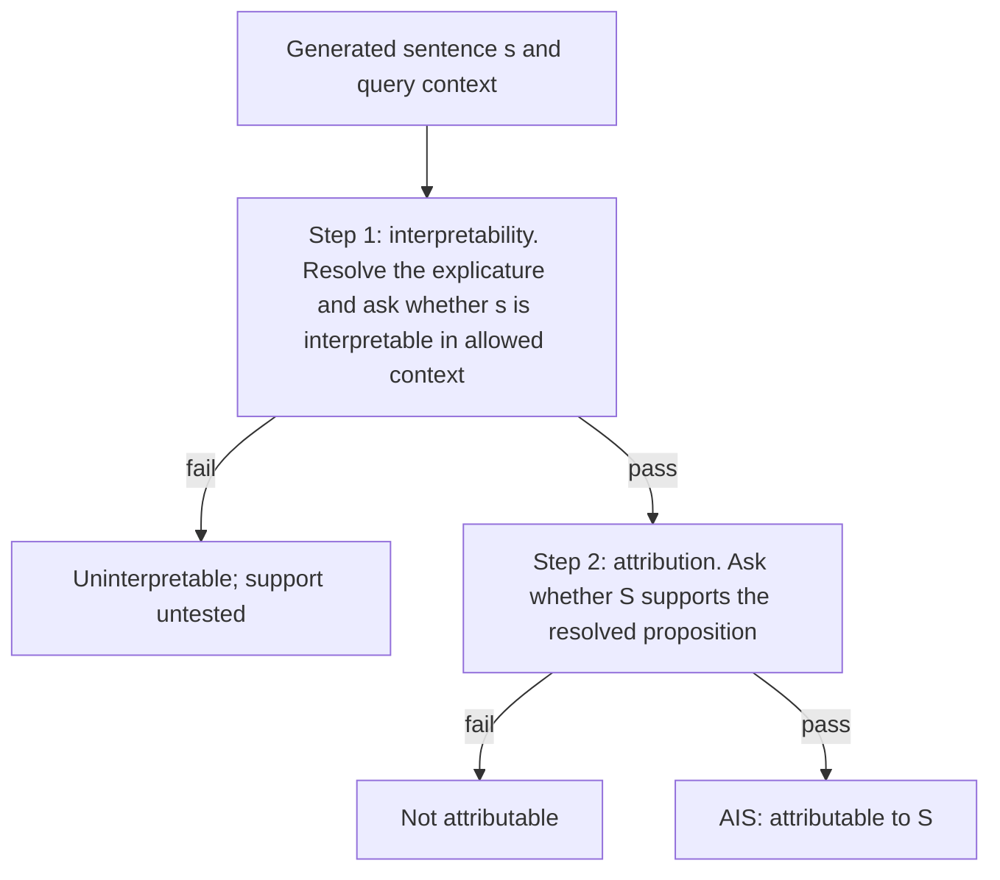
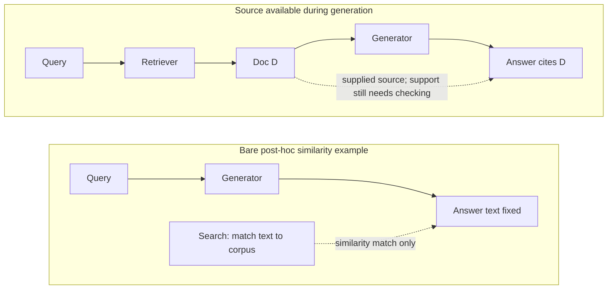
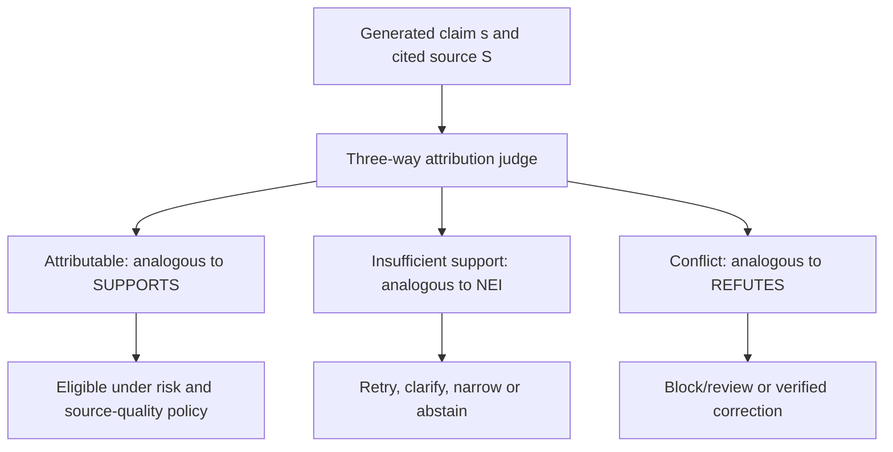
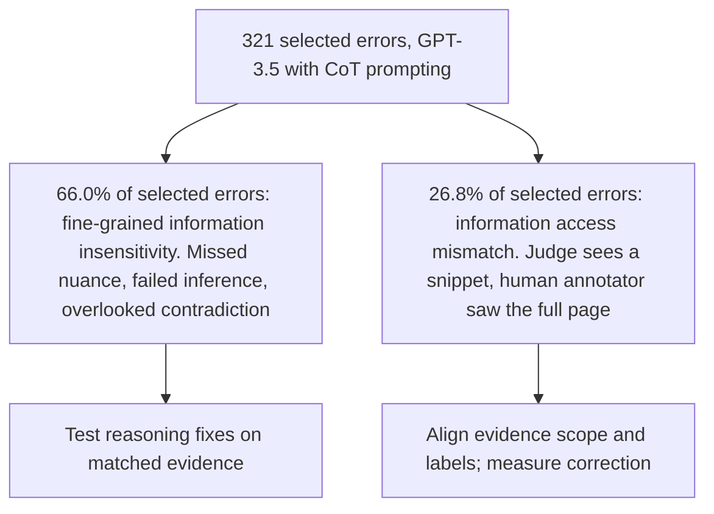

# Chapter 31: Attribution and Citation
[00-START-HERE](../00-START-HERE.md) · [01-READING-ROUTES](../01-READING-ROUTES.md) · [30\_lost\_in\_the\_middle](30_lost_in_the_middle.md) · [32\_evaluating\_retrieval](../part-10-evaluation/32_evaluating_retrieval.md)
This chapter explains why attribution is the defining promise of Retrieval-Augmented Generation (RAG) and how to test, route, and measure cited claims.
## TL;DR
- RAG exposes an evidence set and can record claim-to-source links. Retrieval alone does not prove that a particular source caused a claim or even supports it.
- Distinguish input provenance, causal influence, source support and truth. During-generation markers and post-hoc markers both require support checks.
- AIS first resolves whether the sentence is interpretable in its conversation, then tests the identified source against that proposition. Keep untested second-gate results separate from failures.
- Bare post-hoc similarity is weak evidence. A post-hoc system with a sound support-verification stage can provide useful supporting citations, though not a source’s causal role in the original write.
- Three-way support, insufficient-evidence and contradiction labels can guide remediation, but their operational scope and costs matter. Support alone is not a universal release criterion.
- AttributionBench reports about $`80\%`$ binary macro-$`F_1`$ for a fine-tuned judge, not a $`20\%`$ routing-error guarantee. Its separate chain-of-thought error audit used $`321`$ selected cases; extending source context does not automatically cure the access-related errors.
## The story
Picture a newspaper newsroom that must keep a receipt for every factual line it prints.
The reporter is the generator. The archive clerk is the retriever. The clippings are retrieved chunks. The copy editor is the attribution judge.
A reporter writing from memory may correctly state that Canada’s capital is Ottawa without preserving a verifiable clipping-level provenance record. The sentence could reflect one source, repeated sources or broader learned associations. The newsroom cannot infer a unique origin merely from the sentence, and lack of a native receipt is not proof that no single source influenced it.
In the RAG newsroom, clippings are available before writing and the system can log their exact contents and record source links for each claim. A reviewer gains something concrete to inspect. Availability is not proof of use: the reporter may ignore a clipping, cite the wrong one or write from memory. Each proposed link still needs a support check.
The copy editor first resolves the sentence using the allowed conversational context, without using the candidate citation to repair ambiguity. In the illustrative question “When was the iPhone 17 released?”, “It was released on September 19, 2025” resolves to a proposition about that phone and date. This example illustrates resolution, not independent verification of the date. The editor then checks whether the named source supports the resolved claim.
A newsroom can add decorative receipts by searching for similar text after writing. A bare match proves neither support nor causal origin. But a later editor can genuinely verify a claim against an appropriate source and attach a useful supporting citation. That checked support remains distinct from a record of what influenced the original write.
The copy desk can use three trays: fully supported, insufficiently supported, and contradicted by the supplied source. They resemble SUPPORTS, NOT ENOUGH INFO and REFUTES in fact-checking, but only under compatible claim and evidence scopes. A source can be silent without a claim being false, and a false source can support a false claim. Release, retry, correction and review therefore also depend on source quality and error costs.
The editor also needs an audit. AttributionBench reports about $`80\%`$ macro-$`F_1`$ for a fine-tuned GPT-3.5 judge on its binary task. Separately, its error analysis examined $`321`$ selected errors from GPT-3.5 with chain-of-thought prompting, reporting $`66.0\%`$ fine-grained information insensitivity and $`26.8\%`$ information-access mismatch. These are not measured error proportions for that fine-tuned system or a random production population. More context can address unequal evidence access, but need not fix every affected verdict.[\[1\]](https://arxiv.org/html/2402.15089v1)
The newsroom lesson is to retain evidence and proposed links, resolve claims before support scoring, route failures with explicit risk policies, and audit the judge on the evidence scope actually being evaluated.
## Decoder table


| Technical term | Plain-English meaning | Why it matters |
| --- | --- | --- |
| Retrieval-Augmented Generation (RAG) | A system that retrieves source text and gives it to a generator before the answer is written | It creates a visible evidence set that claims can point back to |
| Attribution | A declared claim-to-evidence relationship, whose support and provenance must be specified | Causal influence, supplied input and textual support are different questions |
| Citation | A pointer from text to a proposed source | Timing alone proves neither support nor use |
| Large language model (LLM) | A model that generates text from learned parameters and the current input | It may answer fluently without retaining a pointer to one training document |
| Parametric model | A model encoding learned information in weights | Ordinary next-token output lacks a reliable native document-provenance operation |
| Closed-book model | Answers without retrieval at answer time | May name a relevant source, but that is not a verified causal receipt |
| Parametric knowledge | Learned associations represented in weights | Do not infer a unique source or the impossibility of a single-source influence |
| Probability distribution | The model’s numerical weighting over possible next tokens | It explains how a parametric model produces text without a corpus pointer |
| $`P(x_n \mid x_1, \ldots, x_{n-1})`$ | A conditional next-token distribution | That notation alone does not specify a provenance system |
| Context window | The visible input text available to the generator for the current answer | Retrieved chunks must enter this window to condition the write |
| Datastore | The searchable collection that holds source material | It supplies the finite set of chunks used for attribution |
| Retriever | Selects source candidates | A missing-support verdict can reflect retrieval, assembly or an unsupported assertion |
| Retrieved chunk | A bounded source passage placed in the generator’s context | Chunk-level pointers reduce a reviewer’s search burden |
| $`D_1, \ldots, D_k`$, $`k`$, and $`s_1, s_2, s_3`$ | Retrieved chunks, retrieval depth, and example answer spans | They label the finite evidence and traceable spans in Figure $`31.1`$ |
| Chunk identifier (chunk ID) | The identifier stored for a retrieved passage | Logging it beside a generated span preserves the audit trail |
| Generator | The component that writes the answer from the query and available context | Its use or neglect of evidence determines whether retrieval helps |
| Output span | A specific part of a generated answer | Fine-grained attribution links each claim-sized span to evidence |
| Source pointer | An inspectable proposed link to a source passage | Needs versioning and support verification; not causal proof |
| Span attribution | Maps output spans to proposed source passages | Fine granularity reduces search burden only when the links are appropriate |
| During-generation attribution | Records a citation while sources are available during writing | Available input is not proof that it caused or supports the claim |
| Causal origin | A source’s actual influence on the output under a causal account | Requires more evidence than source presence or a generated marker |
| Post-hoc citation | Adds a source after the answer text is fixed | Can provide checked support if verified, but not original-write input provenance |
| Back-filled citation | A citation attached after writing | Its usefulness depends on support verification, not the timing label alone |
| Atomic claim | One small factual assertion that can be checked separately | Claim-level checks avoid hiding one bad fact inside a long sentence |
| Support check | Checks source support for the resolved proposition | Does not by itself establish world truth or source reliability |
| Grounding | A specified evidence-support relationship | Separate verified support from source visibility or a mere marker |
| Factuality | Whether a factual claim is correct | It must be separated from citation presence and source origin |
| Attributable to Identified Sources (AIS) | A two-step framework for deciding whether a sentence is understandable and supported by its named source | It gives human raters and automatic judges a shared ordered test |
| $`s`$ and $`S`$ | Generated sentence and identified source passage | AIS resolves $`s`$ before testing whether $`S`$ supports it |
| Interpretability | Whether the proposition can be understood in allowed context | A failure leaves support untested, not a second independent negative label |
| Explicature | The fully resolved proposition a reader constructs from immediate conversational context | It resolves pronouns and ellipses before attribution is judged |
| Attribution test | Whether declared evidence supports the resolved proposition | Ordinary inference is permitted; outside substantive facts cannot fill source gaps |
| Boolean test | A binary decision when the gate is evaluated | The second gate may instead be untested/null after first-gate failure |
| Outside world knowledge | Facts a grader knows but the cited source does not provide | Using it can silently repair unsupported claims |
| Entailment | The relation in which the evidence supports the claim | A one-step entailment score can hide unresolved ambiguity |
| Natural language inference (NLI) | Compares a proposition and evidence for support/conflict | One physical call is not inherently invalid; preserve the logical decision semantics |
| WebGPT | A browsing system that writes answers with inline markers tied to browsed excerpts | It demonstrates visible, checkable span attribution |
| Bing Chat | A consumer system that retrieves web pages and attaches citations to recommendations | It demonstrates attribution at user-facing scale |
| GopherCite | Chapter-cited source-aware quoting system | Verbatim overlap does not guarantee that the adjacent claim is fully supported |
| Fine-grained Atomic Evaluation of Factual Precision (FActScore) | Atomic-fact support evaluation, with a citation analysis of PerplexityAI biographies | Reported citation rates concern benchmark support, not direct world-truth or timing causality |
| Bayes’ rule | A rule for updating odds after observing evidence | It quantifies how little a citation helps when correct and incorrect claims cite at similar rates |
| $`c`$, $`P(c \mid \text{correct})`$, and $`P(c \mid \text{incorrect})`$ | Citation event and conditional rates under a declared binary criterion | Keep empirical support labels separate from hypothetical correctness labels |
| Prior odds | The belief about correctness before seeing a citation | The citation’s likelihood ratio updates this starting point |
| Posterior odds | The belief about correctness after seeing a citation | It shows the actual evidentiary value of the citation marker |
| Likelihood ratio | The citation rate for correct claims divided by the citation rate for incorrect claims | A value near 1 means the citation barely changes belief |
| Attributable claim | Claim fully supported under the declared source rubric | Eligible only under the additional risk, source-quality and policy requirements |
| Extrapolatory claim | Claim not fully supported by the supplied evidence | Includes partial support, not just literal silence; retrieve, narrow, clarify or abstain |
| Contradictory claim | Claim incompatible with evidence under the rubric | Resolve claim/source conflicts without treating every source as ground truth |
| Fact Extraction and VERification (FEVER) | Claim/evidence benchmark with SUPPORTS, NEI and REFUTES labels | An analogy, not automatic identity of evidence scope and attribution evaluation |
| SUPPORTS | Support under FEVER’s evidence procedure | Only maps directly after scope and claim rules are aligned |
| NOT ENOUGH INFO (NEI) | Insufficient evidence under FEVER’s procedure | Not identical to world falsity or silence in one particular snippet |
| REFUTES | Refutation under FEVER’s evidence procedure | Direct transfer requires compatible annotation scope |
| Remediation | The action taken after a claim receives a verdict | Different failures need different owners and fixes |
| Router | Maps predicted labels to actions | Needs a local three-way confusion matrix and harm/cost policy |
| Retrieval depth $`k`$ | The number of chunks requested from a retriever | Increasing it is one possible response to missing evidence |
| AttributionBench | Label-balanced binary attribution benchmark built from seven datasets | Does not directly measure a three-way production router |
| Automatic attribution judge | A classifier that compares a generated claim with its cited source | Its own mistakes propagate into ship, retry, and block decisions |
| Generative Pre-trained Transformer $`3.5`$ (GPT-3.5) | Historical fine-tuned judge family with a reported score near eighty-percent macro-F1 | The separate error audit uses chain-of-thought prompting, not that fine-tuned ledger |
| Fine-tuning | Task-specific training applied to a model | AttributionBench’s best reported judge used it and still remained fallible |
| Per-class $`F_1`$ | The $`F_1`$ score computed separately for one label | It reveals whether a judge fails one class while looking strong overall |
| Macro-$`F_1`$ | Equal-weight mean of class F1 scores | Not accuracy or one minus a wrong-verdict probability |
| $`F_{1,\mathrm{attr}}`$ and $`F_{1,\text{non-attr}}`$ | Per-class $`F_1`$ for attributable and non-attributable claims | Their unweighted mean is macro-$`F_1`$ |
| Raw accuracy | The fraction of all predictions marked correct | It can look high on an imbalanced dataset even when one class fails |
| Class balance | Relative prevalence of true labels | Balance alone does not make macro-F1 identical to accuracy |
| Class base rate | The frequency of a label in a particular data source | A shift can require separate judge calibration even when labels stay the same |
| Calibration threshold | A decision cutoff on a declared score | Changing prevalence, costs and evidence scope can require new calibration |
| In-distribution data | Evaluation data drawn from the kinds of data used for training | It tests held-out performance on familiar patterns |
| Out-of-distribution data | Data from held-out benchmark distributions | Evidence of tested transfer, not proof of universal reasoning robustness |
| Fine-grained information insensitivity | Missed detail or invalid/missing inference in the selected error audit | Diagnostic category, not proof that a prompt or context change cannot help |
| Information access mismatch | Different information available to judge and annotator | Requires matching target scope and labels; more context is not a guaranteed fix |
| Input parity | Matching evidence scope for judge and reference annotator | Expanded external verification may be a different target from generator-context support |
| Confusion matrix | Counts of true-versus-predicted labels | Determines action error rates and review volumes more directly than one F1 score |
| Corpus coverage gap | Needed evidence absent from the searchable corpus | Distinguish from query, access, scope and unsupported-claim problems |
| Attribution coverage | Fraction of factual claims with a recorded pointer under a defined denominator | Not the fraction supported, correct or causally traced |
| Faithfulness rate | A defined claim-level source-support rate | Declare denominator and evidence scope; support is not truth |


## Core mechanics
### Mathematical conventions
Keep four questions separate: Was a source in the recorded input? Did it causally influence this claim? Does it support the resolved proposition? Is the proposition true? A source pointer and an input log do not by themselves answer all four. Support is relative to a specified, versioned evidence scope; a larger source used later for external verification is not necessarily evidence the generator saw.
Probabilities and rates are fractions in $`[0,1]`$; report percentage-point changes separately from relative changes. Preserve full precision until reporting. Counts in worked ledgers are stipulated counts or expectations, not inferred population outcomes. Claims within one audited answer can be correlated; answer-level sampling is not automatically an IID sample of claims.
For binary judge metrics, let $`\mathrm{TP}`$, $`\mathrm{FN}`$, $`\mathrm{FP}`$ and $`\mathrm{TN}`$ be counts against the declared support labels, with attributable as the positive class. Macro-$`F_1`$ is not accuracy, and $`1-\text{macro-}F_1`$ is not a wrong-verdict probability. Source-reported historical scores, selected error-audit proportions, local deployment rates and three-way routing performance must not be substituted for one another.
### 31.1 Attribution as RAG’s core promise
#### Parametric generation has no corpus receipt
- A fixed-weight text generator predicts tokens using a distribution such as $`p_\theta(x_t\mid x_{<t},u)`$, where $`u`$ is the supplied request/context.
- That probability notation alone neither includes nor rules out a provenance mechanism. The ordinary closed-book architecture considered here does not expose a reliable training-document lookup for each output span.
- Asking it to name a source produces another generated claim, which may be right but is not a verifiable record of the generation’s origin.
- Adding a datastore, retained provenance metadata or explicit source-aware architecture can change the available operations. The absence of a native pointer is not a theorem that no tuning or architectural change could ever add one.
The Canada sentence illustrates the distinction. A closed-book answer can be correct and can even name a relevant book. Neither observation identifies a unique training source or proves the named book causally produced that particular output. Some memorized strings may have identifiable candidate origins, but that is not a general document-level receipt.
#### Retrieval creates something concrete to point to
- A RAG pipeline selects chunks $`D_1,\ldots,D_k`$ and includes an exact serialized subset in the generator’s request.
- Preserve chunk IDs, versions, source snapshots and final prompt membership; record proposed claim/span links separately.
- These records make support checkable. They do not automatically show which source the model used or whether a cited passage supports the whole claim.
- Causal influence requires additional evidence or interventions and may not have a unique source. Citation logging is not a substitute for that stronger question.
Retrieval changes the evidence the system can expose and verify. Its auditability advantage is a capability to implement, not an automatic guarantee of claim-level causal traceability.
#### Concrete systems show three implementations
- The chapter cites WebGPT as a browsing system with inline markers such as `[1]` tied to browsed excerpts, and Bing Chat as a source-linking search assistant.
- Their visible passages let a reviewer test adjacent claims; the marker alone is not verification. Retain the actual excerpt and source version, not just a mutable page URL.
- GopherCite is the chapter’s source-aware quoting example. A copied quotation can still be misleading, incomplete or assigned to the wrong adjacent assertion; verbatim overlap is not proof of full support or truth.
- These examples illustrate different training and serving designs, not equal measured cost, perfect causal attribution or guaranteed factuality.
WebGPT was reported by Nakano et al. in 2021. GopherCite was reported by Menick et al. in 2022.
#### Auditability is an architectural capability, not a truth guarantee
- RAG can expose a finite evidence set for review even when it fails to improve answer accuracy on a particular slice.
- This is a concrete auditability advantage over a text-only system without provenance operations, provided the source snapshots and proposed links are actually retained.
- Coverage, support, source reliability and answer accuracy remain separate metrics. No architecture is justified by claiming that a citation pointer alone proves origin or truth.
A source pointer establishes an inspectable claimed link. A trustworthy input log can establish that a passage was supplied. Neither alone proves causal use, entailment or factual correctness; those require separate evidence.
#### Worked audit economics
- Stipulate $`50{,}000`$ answered queries per month, exactly five factual claims per answer, and an answer-level audit of $`5\%`$: $`2{,}500`$ answers and $`12{,}500`$ claims.
- For a comparable toy time budget, take $`90\,\mathrm s`$ per claim as the complete no-pointer search-and-review proxy, not an independently measured search-only cost.
- The resulting labor is $`12{,}500(90)=1{,}125{,}000\,\mathrm s=312.5`$ reviewer-hours. Real times and claim counts must be sampled; answer-level clustering matters for uncertainty.
The attributed reading proxy assumes an average of $`1.5`$ distinct $`50`$-word excerpts per claim at $`200`$ words per minute. One excerpt takes $`(50/200)\,\mathrm{min}=15\,\mathrm s`$. This excludes opening sources, resolving the claim, comparing qualifications, checking multiple excerpts jointly and documenting the verdict.
The attributed review cost is:

```math
t_{\mathrm{cited,reading}}=1.5(15\,\mathrm s)=22.5\,\mathrm{s/claim}.
```

The reading-only total is $`12{,}500(22.5)=281{,}250\,\mathrm s=78.125`$ reviewer-hours, about $`78.1`$ when reported. Actual verification can take longer even with correct pointers.
- The modeled time ratio is $`312.5/78.125=4`$, equivalent to a $`75\%`$ reduction or $`234.375`$ reviewer-hours saved under those scopes, not a measured universal improvement.
- If both workflows additionally need the same $`b\ge0`$ seconds of claim-comparison overhead, their ratio is $`(90+b)/(22.5+b)`$, which approaches one as common overhead grows.
- If the $`90`$ seconds instead means search alone, add comparable reading and verification work before forming a ratio. Do not compare an all-in baseline with a partial attributed workflow and call it measured end-to-end efficiency.
The reading arithmetic is exact under the stipulated lengths and pace. The workflow benefit additionally depends on correct chunk links, source accessibility, comprehension and support-comparison labor; reading speed alone does not validate it.
#### Production defaults and their limits
- Record proposed evidence links for factual claims and separately measure pointer coverage, verified source support, answer truth and source quality. Non-factual greetings do not need factual citations, but factual statements inside conversational turns still do.
- Cite the exact passage and source version the generator saw. A whole long PDF can recreate a search task; a short FAQ may already be one suitable evidence unit.
- Log retrieved, actually supplied and cited chunks as distinct sets. “Uncited” is observable; “unused by the model” does not follow from lack of a citation. These logs distinguish pipeline stages but not every causal generation failure.
- A during-generation citation is a proposed source link, not proof that the model used or correctly represented it. Verify support before presenting it as supporting evidence.
- Keep support-relative-to-generator-context distinct from external verification using a fuller source. Adding later evidence may validate a claim without showing that the original generation was grounded in its input.
- Snapshotting, access controls and retention have real costs and privacy obligations. Hiding UI markers need not prevent retaining an authorized audit trail.
Citation metadata can be logged even if markers are hidden in the product interface, subject to the retention and access policy. Audit value and user satisfaction are different outcomes and must be evaluated separately.
### 31.2 The AIS framework: interpretability then attribution
#### AIS defines an ordered two-gate test
- AIS evaluates a sentence $`s`$, the allowed conversational context and an identified evidence scope $`S`$.
- First determine whether the proposition is interpretable; only then test support for that resolved proposition.
- Ordinary language understanding is unavoidable, but substantive outside facts must not silently supply an unresolved referent or missing evidence.
- These are two logical decisions, not a mathematical requirement for exactly two model calls. A carefully designed implementation must preserve their semantics and log failures separately.
Rashkin et al. introduced AIS in 2023 in Computational Linguistics. The ordering is the design.
#### Gate one resolves the explicature
- Resolve pronouns, ellipses and contextual references from the allowed conversation to determine the explicature.
- The sentence need not be self-contained before resolution. If “it” has no clear referent even in that context, interpretability fails.
- Choose a conversation scope that actually contains the needed references; an immediate-turn-only default can be inadequate for long or topic-shifting dialogues.
- Do not use the candidate source under evaluation to invent the referent and then reward the invented proposition as supported.
For the illustrative question about the iPhone 17, resolving “it” yields the full proposition about that phone and the stated date. The resolution step does not verify the date. The source must then support that exact proposition, including the entity, event and date, within the declared evidence scope.
- Reject or mark unresolved a genuinely ambiguous explicature rather than guessing from the candidate citation.
- A dominant referent is acceptable only when justified by the allowed conversational context and annotation rubric, not merely the grader’s confidence or outside knowledge.
- Record any practical exception explicitly; do not silently change the task to make a sentence pass.
#### Gate two tests source support
- Ask whether the identified evidence supports the resolved claim, including numbers, dates, qualifiers, units and valid inferences.
- Truth elsewhere in the world cannot repair a silent or conflicting citation. Conversely, support from a mistaken source need not establish truth.
- Multiple sources may jointly support a claim, but their union, conflicts and which passage supports each atomic fact must be defined. Do not infer full sentence support from one supported fragment.
Only interpretable cases receive a source-support verdict under this ordered rubric. A true sentence may fail support against its citation. For an uninterpretable sentence, the second-stage result is untested, not automatically a second independent negative label.
#### A single entailment pass loses diagnostic information
- A one-call NLI-style implementation may conflate ambiguity resolution with source support if it uses the candidate source to repair the raw sentence.
- Two logical outputs improve diagnostics, but two physical calls do not by themselves ensure correct semantics, and one carefully constrained call is not mathematically incapable of keeping the decisions distinct.
- Evaluate both gates and their joint result. A low fused score alone may not identify which component needs repair; call count alone does not determine latency or quality.
The chapter cites AIS applications to conversational QA, summarization and table-to-text. Different tasks have different contextual-reference and evidence structures; a common two-gate rubric still needs task-specific annotation guidance and validation.
#### Worked AIS audit
- Audit a stipulated batch of $`50`$ sentences, each with a candidate cited passage.
- Let $`I`$ denote interpretability and $`A`$ source support after resolution. The joint pass probability satisfies $`P(I\cap A)=P(I)P(A\mid I)`$, without assuming the gates are independent.
- Count untested support separately from failures so the conditional denominator remains clear.
Three sentences remain uninterpretable; $`47`$ pass gate one. Their support status is untested.

```math
\widehat P(I)=\frac{47}{50}=0.94=94\%.
```

Among the $`47`$ interpretable sentences, eight fail support: five have insufficient evidence and three conflict with their citations. A date or numerical conflict is a failure even if described as “mild.” The remaining $`39`$ pass.

```math
\widehat P(A\mid I)=\frac{39}{47}\approx0.829787234=82.9787234\%.
```

The end-to-end AIS rate is:

```math
\widehat P(I\cap A)=\frac{47}{50}\frac{39}{47}=\frac{39}{50}=0.78=78\%.
```

- The joint pass rate is $`78\%`$. The eight interpretable support failures are $`8/50=16\%`$ of the full batch, while the three resolution failures are $`6\%`$; total joint failure is $`22\%`$.
- This pass rate is neither an automatic judge’s accuracy nor its macro-$`F_1`$. Similarity to an unrelated $`80\%`$ benchmark score is not a sanity check, and a genuine $`99\%`$ pass rate is not disproved by either number.
- If these fifty sentences were IID draws, a nominal $`95\%`$ Wilson interval for the joint pass rate would be about $`[0.6476,0.8725]`$. Answer-level clustering or selected samples require a different uncertainty design. High rates need audited evidence and denominators, not rejection merely for being high.
#### AIS implementation defaults
- Log interpretability and conditional support separately, using an untested/null second-stage value when gate one fails. Report gate rates and the joint AIS rate with their denominators.
- Automation may use a resolver/filter followed by a support judge, or another validated implementation preserving the ordered semantics. One call is not inherently invalid, nor are two calls inherently correct.
- Track false rejections at the first gate: a cheap filter can save calls while incorrectly discarding interpretable claims.
- Under a latency budget, compare measured cost and quality rather than assuming a staged design is automatically cheaper.
For $`N`$ sentences with first-stage pass fraction $`p_I`$, a simple sequential cost model is $`C=Nc_I+Np_Ic_A`$, where $`c_I`$ and $`c_A`$ are costs per resolution and support evaluation. At one million sentences and the illustrative $`p_I=0.94`$, that is one million cheap evaluations plus $`940{,}000`$ expensive ones. Compared with one expensive call per sentence, it saves cost only when $`c_I<0.06c_A`$ under this narrow model; throughput, batching and semantic differences need separate measurement.
### 31.3 Post-hoc citations: similarity is not verification
#### Post-hoc citation changes the question
- A bare post-hoc system fixes the answer text, then retrieves passages resembling it and attaches markers.
- That operation tests resemblance unless an additional support check is performed. It does not establish the source’s causal role in writing the original answer.
- A verified post-hoc pipeline can test actual support, reject or revise claims and expose useful evidence. This is not equivalent to a bare similarity match.
- One week versus a quarter of engineering work is the chapter’s planning example, not a universal time comparison or a quality theorem.
Putting a source in context creates an opportunity for it to influence the write, not proof that it did. A source first found afterward cannot be the earlier supplied document through that retrieval path, but it can still support the already-written proposition. Input provenance, causal influence and evidential support remain distinct.
#### Citation presence can be nearly uninformative
Min et al.’s FActScore analysis reports citations on $`36.0\%`$ of supported and $`37.6\%`$ of unsupported sentences for the evaluated PerplexityAI biography setting. Those nearby rates make citation presence weakly discriminative for that support label. “Both exceed thirty percent” alone would not establish that: rates $`99\%`$ and $`31\%`$ also exceed thirty but have a likelihood ratio above three. The paper evaluates a search-enabled system; these rates do not identify whether every citation was attached before or after generation or prove a causal failure of all post-hoc architectures.[\[2\]](https://arxiv.org/html/2305.14251)
For the following independent toy, let $`C`$ mean correctness under a defined reference criterion and let $`c`$ be the event “has a citation.” Treat $`C`$ and its complement as an exhaustive binary partition. The odds update, when its denominators are positive, is:

```math
\frac{P(C\mid c)}{P(\neg C\mid c)}=\frac{P(C)}{P(\neg C)}\frac{P(c\mid C)}{P(c\mid\neg C)}.
```

The last factor is $`\mathrm{LR}_c`$. A value of one leaves the prior odds unchanged; closeness to one depends on the actual conditional rates, not a common lower bound. For FActScore’s support label, the reported-rate ratio is $`0.36/0.376=45/47\approx0.957447`$. If one additionally assumed a fifty-percent prior support rate in that same population, citation presence would imply about $`48.913043\%`$ support, not an increase in world-truth probability. The hypothetical prior and the support-versus-truth distinction matter.
#### A correct answer can still have a decorative citation
- A correct claim may have an unrelated citation, and a false claim may have a topically similar one.
- Similarity retrieval alone does not test entailment, even if a particular match happens to be supporting.
- Independently verify proposed citations against resolved atomic claims, including numerical derivations, qualifiers and source versions. A good support relation still does not establish source reliability or causal origin.
The claim can be right while the citation remains evidentially empty.
#### Worked likelihood-ratio example
- Stipulate $`1{,}000`$ monthly answers with exactly five atomic claims each: $`5{,}000`$ claims.
- For an explicitly hypothetical correctness signal, set $`P(c\mid C)=0.35`$ and $`P(c\mid\neg C)=0.31`$.
- These illustrative rates are not FActScore’s measured rates and do not describe every citation system. Supply a prior and a valid evaluation population before interpreting the update.
The four-point gap gives:

```math
\mathrm{LR}_c=\frac{0.35}{0.31}=\frac{35}{31}\approx1.129032258.
```

With the additional prior $`P(C)=0.50`$, use the unrounded likelihood ratio:

```math
P(C\mid c)=\frac{0.35(0.50)}{0.35(0.50)+0.31(0.50)}=\frac{35}{66}\approx0.530303030.
```

The increase is about $`3.030303`$ percentage points, not a verification guarantee. Under the stated $`5{,}000`$-claim population and prior, expected cited counts are $`875`$ correct and $`775`$ incorrect, so $`875/(875+775)=35/66`$. A prior of $`0.90`$ instead gives about $`91.040462\%`$ posterior correctness; the posterior is not fixed by the likelihood ratio alone.
The earlier $`94\%`$ interpretability and $`78\%`$ joint AIS pass rates differ by sixteen percentage points because eight of fifty sentences fail the second gate. That is not a Bayesian confidence gain and is not comparable as an effect size with the citation marker’s $`3.030303`$-point posterior update. They are different events, denominators and populations.
#### Deployment rules for post-hoc citations
- On consequential surfaces, check full claim support and source quality regardless of when the citation was attached. A during-generation marker is not an exemption.
- A post-hoc support gate can produce a checked supporting citation, though it cannot retrospectively make that later retrieval the causal input to the original answer. It may reject, retract or regenerate unsupported claims.
- Measure citation presence, claim-level coverage, verified support, truth and causal-provenance claims separately. Estimate conditional rates on the actual deployment population, with uncertainty and stable definitions.
- Label bare unverified matches “related sources” or “further reading.” Use “supporting source” only for a verified support relation, with timing disclosed when relevant; moving retrieval before generation alone does not justify that stronger label.
- Prefer risk-based verification and explicit failure handling over a blanket claim that all post-hoc citations are worthless.
FActScore’s citation-presence result shows that markers were not reliable support discriminators in that evaluated system. It is not a controlled comparison of before-versus-after retrieval, a proof of no citation value, or an upper bound on verified attribution quality.
### 31.4 Attributable, extrapolatory, contradictory, and the fact-checking mapping
#### Binary failure hides two different causes
- A binary support label can be sufficient for a common review gate but combines insufficient evidence and contradiction.
- A router with different actions needs those distinctions and local per-class error/cost measurements.
- A low binary error rate does not determine how well the router separates two subtypes within its negative class. Splitting the labels is an operational choice, not a way to recover missing information from an old binary score.
The natural split has three labels.
- Attributable: the supplied evidence fully supports the resolved claim under the rubric.
- Extrapolatory: evidence is insufficient, including partial support; literal silence is only one case.
- Contradictory: evidence conflicts with the claim.
- Composite claims and conflicting multi-source sets can mix these relations. Split into atomic claims and define conflict/label precedence or allow an unresolved state, rather than assume every natural-language input has one unambiguous three-way label.
#### A useful fact-checking analogy with scope conditions
The three-way attribution vocabulary is associated with Yue et al.’s prior work; AttributionBench explicitly unifies several prior label schemes into a binary task. Do not attribute a measured three-way router score to that benchmark. SUPPORTS, NEI and REFUTES are useful analogous labels, but FEVER’s claim/corpus evidence procedure is not automatically identical to judging one generator-supplied passage. Reuse a classifier only after aligning claim resolution, evidence scope, partial-support policy and label definitions.[\[1\]](https://arxiv.org/html/2402.15089v1)
The chapter cites Thorne et al.’s FEVER benchmark from 2018. A shared support/insufficiency/contradiction structure can motivate reuse; differences in evidence retrieval, available corpus, annotation and claim granularity can still invalidate direct metric or threshold transfer.
#### Each label drives a different action
- In an example policy, a supported claim becomes eligible for release, not automatically safe to ship. Source reliability, recency, policy constraints and judge error still matter.
- For insufficient evidence, retrieve again, request clarification, narrow the assertion or abstain. A broader query or larger depth may help, but cannot guarantee evidence exists; use retry budgets and avoid searching only for confirmation.
- High-risk contradictions can trigger a block and review, while a verified correction path may be appropriate elsewhere. Inspect whether the claim, source version or annotation is wrong rather than treating the cited passage as infallible.
- Repeated failure can reflect a corpus gap, query mismatch or an unsupportable assertion. Route according to diagnosed cause and measured risk, not merely a label name.
#### The difficult boundary is silence versus conflict
- Insufficient evidence and conflict lead to different likely remedies, but ambiguous references and incomplete sources can make either judgment uncertain.
- Evaluate per-class precision/recall, not just an attributable-versus-fail score, and explicitly check arithmetic, operators, units and time qualifiers.
- A plausible rationale is not evidence that a numerical claim was actually recomputed. Use deterministic checks for derivations where possible.
A judge can miss the one clause that resolves a claim. A fluent reader can also fail to verify whether cited numbers compute to the claimed result.
#### Worked three-way routing example
- In a perfect-label toy, $`1{,}000`$ daily claims contain $`300`$ failures. Sending every failed claim to a human for three minutes costs $`900`$ minutes, or fifteen reviewer-hours.
- Assign the failed bucket $`60\%`$ insufficient-evidence cases and $`40\%`$ contradictions: $`180`$ and $`120`$ claims. These are illustrative, not inferred from AttributionBench.
- Compare review load under the additional assumption that evidence retries need no human follow-up; verification compute and all other work are excluded.
The toy router sends $`180`$ insufficient-evidence cases to a bounded retrieval/verification path and only the $`120`$ contradictions to immediate human review. If retries later escalate or new claims require review, that additional load must be counted.
The source gives no priced end-to-end retry workload. “Cents” is not enough to infer cost-effectiveness: include retrieval, generation, judging, unresolved retries and any resulting human queue.

```math
H_{\mathrm{ideal}}=120\frac{3\,\mathrm{min}}{60\,\mathrm{min/h}}=6\,\mathrm{reviewer\!\!-\!hours/day}.
```


```math
\frac{15-6}{15}=0.60=60\%\quad\text{modeled immediate review-load reduction}.
```

The $`60\%`$ saving assumes perfect routing and no retry escalation. A binary macro-$`F_1`$ of $`0.80`$ neither supplies a three-way error rate nor determines human load. With counts $`N_{ij}`$ from true class $`i`$ to predicted class $`j`$, and predicted classes $`A,E,C`$, immediate review is $`H=(3/60)\sum_iN_{iC}`$ hours; unsupported auto-ships include $`N_{EA}+N_{CA}`$. If a fraction $`q`$ of the predicted-$`E`$ queue later escalates, add $`(3q/60)\sum_iN_{iE}`$ hours under the same review time.
Mistakes need not make apparent savings lower: a bad router can send too few dangerous cases to review. For example, routing only eighty cases to humans costs four hours and appears to save $`73.333333\%`$, yet can also auto-ship fifty unsupported claims. Review volume without a confusion matrix and harm/cost ledger is not a quality result.
#### Production label decisions
- Choose three-way labels when actions genuinely differ; a binary gate can remain appropriate for one shared review queue.
- Align evidence and claim definitions before reusing fact-checking infrastructure. Distribution shifts can change class prevalence, score calibration and operating costs, not just the best cutoff.
- Audit the full three-class confusion matrix and action-specific false releases, missed contradictions, unnecessary blocks and retry escalations. Binary AttributionBench performance does not identify these quantities.
- Optimize a declared risk/cost objective and budget, not raw review-load reduction. Report unresolved cases rather than forcing a confident label.
### 31.5 How good are automatic attribution judges?
#### AttributionBench measures both classes
AttributionBench combines seven datasets into a label-balanced binary attributable-versus-non-attributable task. Four supply training and held-out in-distribution evaluation; three are reserved for out-of-distribution testing. These design choices support comparisons within the benchmark but do not establish a new deployment’s class balance, error rate or three-way performance.[\[1\]](https://arxiv.org/html/2402.15089v1)
Held-out datasets test transfer beyond the chosen training distributions. A strong score there does not logically prove that the judge learned entailment rather than shortcuts, or guarantee robustness to every future production shift.
#### Macro-$`F_1`$ blocks the majority-class shortcut
- For each class, $`F_1`$ is a harmonic combination of precision and recall, computed from its confusion counts. Macro-$`F_1`$ averages class scores equally.
- Equal class weights expose failures that raw accuracy can hide on a skewed population, but one macro average still does not reveal every error type or probability calibration.
- Report per-class counts, precision, recall, accuracy and the macro score together, with the evaluation distribution and zero-denominator convention.
The metric is:

```math
\begin{aligned}
F_{1,A}&=\frac{2\mathrm{TP}}{2\mathrm{TP}+\mathrm{FP}+\mathrm{FN}},\\
F_{1,\neg A}&=\frac{2\mathrm{TN}}{2\mathrm{TN}+\mathrm{FP}+\mathrm{FN}},\\
F_{1,\mathrm{macro}}&=\frac{F_{1,A}+F_{1,\neg A}}{2}.
\end{aligned}
```

For nondegenerate denominators, let $`e=(\mathrm{FP}+\mathrm{FN})/N`$ and $`d=(\mathrm{TP}-\mathrm{TN})/N`$. Algebra gives $`F_{1,\mathrm{macro}}=1-e/(1-d^2)`$. Equality with accuracy $`1-e`$ holds when the relevant asymmetry vanishes, not simply because true labels are balanced.
For example, counts $`(\mathrm{TP},\mathrm{FN},\mathrm{FP},\mathrm{TN})=(27,3,3,7)`$ give class scores $`0.9`$ and $`0.7`$, hence macro-$`F_1=0.8`$ but accuracy $`34/40=0.85`$. Even balanced true classes can differ: $`(50,0,20,30)`$ gives accuracy $`0.80`$ and macro-$`F_1=19/24\approx0.791667`$. Thus subtracting a macro score from one is not generally an error-rate calculation.
#### A historical result near $`80\%`$ macro-$`F_1`$, not a universal ceiling
The original benchmark reports fine-tuned GPT-3.5 around $`80\%`$ binary macro-$`F_1`$ in its ID and OOD settings. This is a historical experimental result, not a current model ceiling, a production warranty or proof that one decision in five is wrong. A confusion matrix and deployment prevalence are needed to translate a classifier’s behavior into an error budget.[\[1\]](https://arxiv.org/html/2402.15089v1)
Measure the exact local judge, evidence scope, source distribution and action thresholds before gating traffic. An average across datasets, a pooled confusion matrix and a production-weighted error rate are also distinct summaries.
#### Error analysis separates reasoning from access
The paper’s separate error analysis samples $`321`$ GPT-3.5 chain-of-thought prompting errors, not exactly three hundred errors from the fine-tuned judge. It selects up to fifty errors per dataset, with false-positive/false-negative balancing for several datasets and all errors for the smaller sets. Reported categories are $`66.0\%`$ fine-grained information insensitivity and $`26.8\%`$ human/model information-access mismatch. This stratified selected-error sample is not a direct estimate of a production error mixture or a randomly sampled error probability for the fine-tuned system.[\[1\]](https://arxiv.org/html/2402.15089v1)
Multiplying the rounded $`66.0\%`$ by $`321`$ gives $`211.86`$, approximately $`212`$ cases, not an exact independently established integer count. The original “$`300\times0.66=198`$” would describe a different hypothetical sample.
Fine-grained errors include overlooking qualifications, relevant evidence or necessary inference, and drawing invalid inferences. More text alone cannot be assumed to fix these errors. The chapter’s Thailand-population example is an illustration of a support judgment against a specified reference, not an independently verified current population fact or evidence that every missed number is cured the same way.
Likewise, $`321(0.268)=86.028`$ suggests about $`86`$ access-related cases from rounded proportions, not the original asserted eighty-one. Percentages and selected counts need their own denominators.
Access mismatch includes different source scopes, missing conversational context, ambiguous references and possible label problems. Equalize the authorized evidence seen by judge and annotator for the question being scored. If the target is support from the generator’s chunk, adding unseen full-page evidence changes the target rather than proving that the original chunk supported the answer. If the target is external verification, both graders may instead use the declared expanded source scope.

```math
66.0\%+26.8\%=92.8\%,\qquad100\%-92.8\%=7.2\%.
```

The $`7.2\%`$ residual follows from rounded reported proportions and need not identify exact category counts. These selected-error proportions are not fractions of all judged claims, and the label “access mismatch” does not imply a guaranteed correctable fraction.
#### Worked judge-quality example
Build a separate, explicit error-budget scenario rather than infer it from macro-$`F_1`$. Suppose $`10{,}000`$ daily binary verdicts have this symmetric confusion ledger, where rows are true labels and columns predictions:

```math
\begin{array}{c|rr}
 & A & \neg A\\\hline
A&4{,}000&1{,}000\\
\neg A&1{,}000&4{,}000
\end{array}
```

This stipulated ledger has both accuracy and macro-$`F_1`$ equal to $`0.80`$, with a measured-in-the-scenario error fraction $`e_0=0.20`$. The equality comes from these counts, not balance alone. It is not an observed deployment or a reconstruction of the benchmark.

```math
E_0=1{,}000+1{,}000=10{,}000(0.20)=2{,}000\quad\text{wrong verdicts/day in the scenario}.
```

For sensitivity analysis only, additionally suppose the selected prompting audit’s rounded category shares transfer unchanged to this different daily error population. That unverified transfer gives:

```math
E_{\mathrm{fine}}=2{,}000(0.660)=1{,}320.
```


```math
E_{\mathrm{access}}=2{,}000(0.268)=536,\qquad E_{\mathrm{other}}=2{,}000(0.072)=144.
```

Now make a best-case intervention assumption: all $`536`$ access-related wrong verdicts become correct, no new errors appear, and all other verdicts and evaluation labels stay fixed. The remaining $`1{,}320+144`$ errors are unchanged. Equal source access alone does not imply these assumptions; longer inputs can create distractions, higher cost, truncation and new mistakes, and changing evidence scope can change the gold label itself.

```math
E_{\mathrm{best\ case}}=2{,}000-536=1{,}464\quad\text{wrong verdicts/day}.
```


```math
e_{\mathrm{best\ case}}=\frac{1{,}464}{10{,}000}=0.1464=14.64\%.
```

More generally, if a fraction $`q\in[0,1]`$ of that access-related bucket is fixed and new errors add fraction $`\nu\ge0`$ of all judgments, with other effects held fixed,

```math
e_{\mathrm{new}}=e_0(1-0.268q)+\nu.
```

Under $`\nu=0`$, $`q=1`$ gives the $`14.64\%`$ best case and $`q=0.5`$ gives $`17.32\%`$. These are conditional scenarios, not a guaranteed improvement or a new macro-$`F_1`$. Evaluate the intervention on the same target evidence scope and account for latency, token cost and newly introduced errors.
Only under complete correction and no new errors does this scenario cut wrong verdicts by $`26.8\%`$, or the error rate by $`5.36`$ percentage points, leaving about one in $`6.83`$ wrong. Actual correction can be smaller, zero or negative. Recompute a full post-intervention confusion matrix; an error count alone does not identify its macro-$`F_1`$.
#### Production judge decisions
- Report accuracy, per-class precision/recall, macro-$`F_1`$, prevalence, score calibration and action-specific errors, not one supposedly sufficient metric. A $`95\%`$-positive population with an always-positive judge has $`95\%`$ accuracy but macro-$`F_1\approx48.717949\%`$.
- Match judge and human input to the intended support question. Log evidence scope and versions; external full-page verification is not equivalent to generator-chunk faithfulness.
- Treat historical benchmark results as evidence of fallibility, not a permanent eighty-percent ceiling or a promise that prompt changes cannot help. Test proposed fixes against labeled local cases and hold out evaluation data.
- Use appropriate held-out domains and monitor shift; a narrow deployment does not guarantee that future data will remain in-distribution.
- Route by measured action risk. Reviewing only predicted contradictions can miss contradictions mislabeled as supported; audit auto-shipped claims and route low-confidence or high-cost cases as well.
- Include retry escalation, review labor, new errors, source quality and unresolved claims before claiming savings or safe automation.
## Diagrams
### Figure 31.1

Figure $`31.1`$: The ordinary parametric path lacks a native verified document receipt. RAG exposes candidate evidence and can record proposed claim-to-chunk links, but the arrows alone do not prove causal use, full source support or truth. Retain exact input membership and verify support separately.
### Figure 31.2

Figure $`31.2`$: Interpretability logically precedes source support. Resolve references from the allowed conversation, not by borrowing the candidate citation. A failed first gate leaves the second untested. Logical ordering need not require two separate API calls.
### Figure 31.3

Figure $`31.3`$: Bare post-hoc similarity does not test support. A source supplied during generation is a possible input, not proof of a common causal origin for claim and marker. A separate post-hoc verifier can establish useful source support without establishing original-write provenance.
### Figure 31.4

Figure $`31.4`$: An example routing policy, not a theorem that support licenses release or that every failure has a unique remedy. Align the three-way evidence rubric before mapping fact-checking labels. The binary AttributionBench score does not measure this router’s three-way confusion matrix.
### Figure 31.5

Figure $`31.5`$: The original paper’s selected $`321`$-error audit concerns prompted GPT-3.5, not the separately fine-tuned system’s error population. Its rounded category shares identify diagnostic priorities, not guaranteed correction yields. Input parity can require annotation repair or a different evidence scope; more context does not automatically remove all access-related errors.[\[1\]](https://arxiv.org/html/2402.15089v1)
## Whiteboard pack
### What to draw
1. Draw the parametric path and label its missing native provenance operation, not a theorem of no possible source influence.
2. Draw the RAG path, with versioned supplied chunks and proposed claim-to-source links.
3. Separate input provenance, causal influence, support and truth.
4. Add logical interpretability and source-support gates, leaving support untested when interpretation fails.
5. Draw bare post-hoc similarity and a separate optional verification stage; timing does not by itself decide support.
6. Route insufficient evidence and conflict under a declared risk policy and bounded retry plan.
7. Write the per-class $`F_1`$ formulas and keep macro-$`F_1`$ separate from accuracy.
8. Label the reported fine-tuned score separately from the prompted judge’s $`321`$-error audit and its $`66.0\%`$/$`26.8\%`$ proportions.
9. Show the explicit symmetric daily ledger before deriving the illustrative $`20\%`$ error rate.
10. Mark the $`14.64\%`$ correction result as a best-case transfer scenario, not a prediction from input parity.
### Spoken script
RAG can make the evidence set inspectable, but a marker is not proof of use, support or truth. AIS first resolves the claim in its conversation, then tests the declared source against it. A source supplied before writing can be ignored; a source found later can still provide verified support. Route failures according to evidence scope, uncertainty and harm, not just label names. Finally, validate the judge: a historical macro-F1 score is not its daily error probability, and a selected error audit is not a guaranteed correction budget.
## Interview traps
### 1. If retrieval can hurt accuracy, why is attribution still RAG’s core promise?
RAG offers evidence visibility and the ability to preserve claim-level links, even when retrieval does not improve accuracy. Those capabilities must be implemented and support-checked. A plain parametric model lacks the same native provenance operation, but absence of a pointer is not proof that a particular document had no influence or that every RAG citation is causally grounded.
### 2. What does AIS test, and why must the order stay fixed?
AIS first resolves the proposition using the allowed conversational context, leaving support untested if ambiguity remains. It then checks the identified evidence against that proposition. This prevents the candidate citation or the grader’s outside facts from repairing ambiguity or supplying missing substantive evidence. These are logical stages; two API calls alone neither define nor guarantee them.
### 3. When would you use post-hoc citations, and what must you call them?
Bare similarity matches should be labeled related sources or further reading. A verified post-hoc citation can genuinely support a resolved claim and can be useful even on consequential surfaces when the whole verification and source-quality policy is adequate. It does not show that the later-retrieved document was the original generation’s causal input. During-generation citations need support checks too.
### 4. Why are attributable, extrapolatory, and contradictory better than one failure label?
They distinguish full support, insufficient evidence and conflict, which can call for different actions. The FEVER labels are a useful analogy only after aligning evidence scope and annotation rules. AttributionBench itself is binary; its macro-F1 does not validate a three-way router. Release eligibility also depends on source reliability, uncertainty and harm.
### 5. Is an automatic judge at about $`80\%`$ macro-$`F_1`$ good enough to remove human review?
No single benchmark score establishes safe automation or a fixed required review rate. Measure the local confusion matrix, evidence parity, calibration, distribution shift and action-specific harm. Audit supposedly supported auto-ships as well as predicted failures, since errors in the auto-ship class are not caught by reviewing predicted contradictions alone.
## Key numbers


| Number or formula | Meaning and claim limit |
| --- | --- |
| 2021 | Chapter-reported WebGPT publication year |
| 2022 | Chapter-reported GopherCite publication year |
| Two-day itinerary | Bing Chat illustration, not a measured cost or support guarantee |
| $`50{,}000`$ answers/month | Stipulated answered-query volume |
| Five claims/answer | Exact claim-density assumption in the audit and Bayes examples |
| $`5\%`$ of answers | Answer-level spot check; claims within answers may be correlated |
| $`2{,}500`$ answers | Five percent of the stipulated fifty-thousand answers |
| $`12{,}500`$ claims | Two-thousand-five-hundred audited answers times five claims |
| $`90\,\mathrm{s/claim}`$ | Complete no-pointer search/review proxy for this comparison, not a measured search-only time |
| $`1{,}125{,}000\,\mathrm s`$ | Modeled no-pointer labor |
| $`312.5`$ reviewer-hours/month | No-pointer total under the defined scope |
| One to two excerpts/claim | Illustrative excerpt-count range |
| $`1.5`$ excerpts/claim | Average excerpt count in the reading-only proxy |
| $`50`$ words/excerpt | Stipulated excerpt length |
| $`200`$ words/minute | Stipulated reading pace, not full verification speed |
| $`0.25\,\mathrm{min}=15\,\mathrm s`$ | Reading time per excerpt |
| $`22.5\,\mathrm{s/claim}`$ | One-point-five excerpts times fifteen seconds; excludes other verification labor |
| $`281{,}250\,\mathrm s`$ | Cited-excerpt reading proxy for the audited claims |
| $`78.125\approx78.1`$ reviewer-hours/month | Full precision retained before reporting |
| $`4\times`$ time ratio; $`75\%`$ reduction | Conditional scope-limited model, not measured all-in efficiency |
| Fifty-page PDF | Whole-document pointer can leave substantial locating work |
| 2023 | Chapter-reported AIS publication and FActScore years |
| Two logical AIS gates | Interpretability then conditional support; not necessarily two physical calls |
| September 19, 2025 | Date in an explicature example, not independently verified by the resolution step |
| Fifty sentences | Stipulated AIS batch |
| Three sentences | Uninterpretable; support untested |
| $`47/50=94\%`$ | Interpretability pass rate |
| Eight sentences | Support failures among the forty-seven interpretable cases |
| Five insufficient-evidence; three conflicting | Failure split in the example, not an empirical prevalence estimate |
| $`39/47\approx82.978723\%`$ | Support conditional on interpretability |
| $`39/50=78\%`$ | Joint AIS pass rate; not judge accuracy or macro-F1 |
| About $`80\%`$ macro-$`F_1`$ | Separate historical judge metric; numerical similarity is not a pass-rate sanity check |
| $`10^6`$ sentences/day | Illustrative scale; at ninety-four-percent gate pass, $`940{,}000`$ expensive support calls plus one million first-gate evaluations |
| One week versus one quarter | Planning example, not a general architecture cost law |
| $`36.0\%`$ supported; $`37.6\%`$ unsupported | Original FActScore citation-presence rates in the PerplexityAI biography setting; not proof of citation timing |
| $`\mathrm{LR}=1`$ | Leaves prior odds unchanged when conditioning is defined |
| $`1{,}000`$ answers/month | Toy Bayes population |
| $`5{,}000`$ claims | Five atomic claims per answer |
| $`35\%`$ versus $`31\%`$ | Separate hypothetical citation rates conditional on correctness, not the measured support rates |
| Four percentage points | Difference between the illustrative conditional citation rates |
| $`35/31\approx1.129032258`$ | Exact toy likelihood ratio before rounding |
| $`50\%`$ prior to $`53.030303\%`$ posterior | Toy correctness update under the stated population and prior |
| $`3.030303`$ percentage points | Not a verified factuality gain or a prior-independent posterior |
| Sixteen percentage points | Eight of fifty fail support after interpretation; not a Bayes confidence gain |
| Three operational labels | Full support, insufficient evidence and conflict under a declared rubric |
| 2018 | Chapter-reported FEVER introduction year; label analogy needs scope alignment |
| $`1{,}000`$ claims/day | Perfect-label routing scenario |
| $`30\%=300`$ failures | Illustrative failed bucket, not inferred from a benchmark macro-F1 |
| Three minutes/claim | Human review-time assumption |
| $`900\,\mathrm{min}=15\,\mathrm h`$ per day | All failed claims sent to review in the scenario |
| $`60\%=180`$ claims | Insufficient-evidence share of the failed bucket |
| $`40\%=120`$ claims | Contradiction share of the failed bucket |
| $`360\,\mathrm{min}=6\,\mathrm h`$ per day | Perfect immediate routing; retry escalation excluded |
| $`60\%`$ modeled reduction | Not guaranteed savings with fallible routing or extra retries |
| Not inferable from macro-F1 alone | A binary score does not identify three-way action error rates or human load |
| Seven datasets | Original AttributionBench binary benchmark |
| Four training/ID datasets | Held-out familiar-distribution evaluation is not training-set scoring |
| Three OOD datasets | Transfer tested only to those held-out distributions |
| Two class F1 scores | Equal-weight mean; class scores need their confusion counts |
| About $`80\%`$ macro-$`F_1`$ | Historical fine-tuned GPT-3.5 result, not a permanent ceiling or direct accuracy |
| $`20\%`$ only in the explicit symmetric ledger | Do not obtain an error probability merely by subtracting macro-F1 from one |
| Accuracy $`0.85`$, macro-$`F_1=0.80`$ | Counterexample ledger (TP,FN,FP,TN)=(27,3,3,7) |
| $`321`$ selected errors | Original GPT-3.5 chain-of-thought audit, not exactly three hundred fine-tuned-judge errors |
| $`66.0\%`$; approximately $`212`$ of $`321`$ | Rounded rate in a stratified selected-error audit; multiplication does not identify an exact case count |
| $`26.8\%`$; approximately $`86`$ of $`321`$ | Access mismatch includes evidence/context/label issues, not a guaranteed fixable fraction |
| $`92.8\%`$ | Sum of the two rounded selected-error shares |
| $`7.2\%`$ | Residual from rounded shares, not all-claim error prevalence |
| About sixty-three million | Chapter’s Thailand support example, not an independently verified current population |
| $`10{,}000`$ claims/day | Separate explicit symmetric error-ledger scenario |
| $`2{,}000`$ wrong verdicts/day | Derived from the stipulated confusion counts; not inferred from the benchmark |
| $`1{,}320`$ errors | Only if the selected prompting audit’s 66-percent share transfers to this daily population |
| $`536`$ errors | Conditional transfer of the 26.8-percent access share, not 540 from a rounded 27 percent |
| $`1{,}464`$ wrong verdicts/day | Best case: correct all access errors, change no other verdicts/labels, create no new errors |
| $`14.64\%`$ | Conditional best-case error fraction, not a measured result or a macro-F1 score |
| About one in $`6.83`$ | Best-case scenario only; not a guaranteed outcome of full-page input |
| $`26.8\%`$ relative reduction; $`5.36`$ percentage points | Requires complete correction and no new errors; general formula includes correction fraction and new-error rate |
| $`95\%`$ accuracy; macro-$`F_1\approx48.717949\%`$ | Always-positive judge on a ninety-five-percent-positive population: both metrics and class errors matter |


[00-START-HERE](../00-START-HERE.md) · [01-READING-ROUTES](../01-READING-ROUTES.md) · [30\_lost\_in\_the\_middle](30_lost_in_the_middle.md) · [32\_evaluating\_retrieval](../part-10-evaluation/32_evaluating_retrieval.md)
