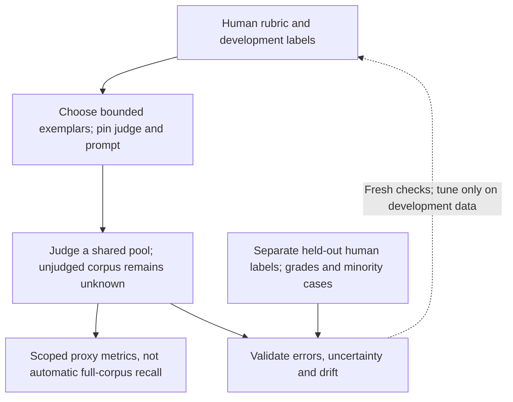
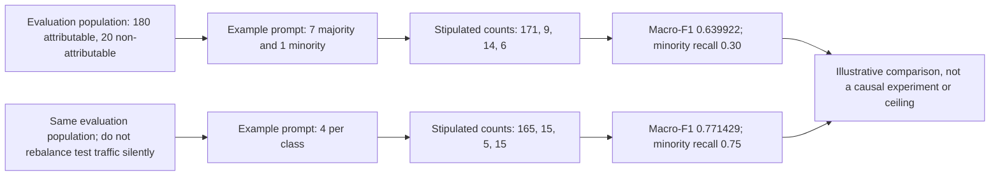

# Chapter 32: Evaluating Retrieval
[00-START-HERE](../00-START-HERE.md) · [01-READING-ROUTES](../01-READING-ROUTES.md) · [31\_attribution\_and\_citation](../part-09-context-assembly/31_attribution_and_citation.md) · [33\_evaluating\_generation](33_evaluating_generation.md)
Purpose: evaluate retrieval coverage and order at the evidence actually consumed, distinguish judged-pool metrics from full-corpus quantities, and validate scalable relevance judges without confusing illustrative costs or macro-F1 with deployment guarantees.
## TL;DR
- At a fixed prefix, precision, recall and set-$`F_1`$ ignore permutations within that prefix. Changing which documents cross the actual context cutoff can change them.
- Report coverage at the consumed evidence slice and rank quality with explicit cutoffs, grades and query averaging. Token packing and truncation may produce a query-dependent depth rather than one fixed $`k`$.
- MRR uses only the first qualifying hit. nDCG uses discounted gains through its cutoff and a per-query ideal; neither guarantees that all jointly required evidence is present.
- Missing labels require a judgment strategy, not a mathematical workaround. Judging only a retriever’s candidates does not establish full-corpus recall or a complete ideal ranking.
- Separate prompt exemplars, tuning data and held-out human validation. An LLM judge scales a proxy; human checks, unknown-label reporting and version control remain necessary.
- Balanced, boundary-focused exemplars are a strategy to test, not a guarantee of unbiased judgment or higher macro-$`F_1`$.
- Inspect confusion counts, per-class recall/precision, macro-$`F_1`$, prevalence and action-specific harms. Accuracy can hide rare failures, while macro-$`F_1`$ is neither accuracy nor prevalence-invariant.
## The story
Think of retrieval as the stage crew for a play. The corpus is a prop warehouse and the query is the scene request. A relevance checklist states which props count under a specified rubric. The checklist may be incomplete or disputed; a label is not an infallible certificate. The retriever sends an ordered cart toward the stage.
Set metrics inspect the cart after ten slots. They ask how many correct props are somewhere on it. They do not ask where those props sit. A cart with every needed prop in slots 1 through 4 looks identical to one with the same props in slots 7 through 10.
The generator is the actor. In this simplified scene it can access only the first five slots. The first cart delivers all four needed props; the second delivers none inside that cutoff. This is a hard-access example, not a claim that language models invariably prefer earlier context or successfully use every accessible passage.
MRR resembles a stage manager who stops scoring at the first qualifying prop. It does not score later requirements or differences above its binary threshold. nDCG keeps scoring gains through the cutoff, but its sum still need not capture interactions between props that are useful only together.
Now remove the checklist. Humans or models can propose relevance judgments, but checking only the arriving cart cannot reveal every useful prop still hidden in the warehouse. Precision over judged results may be available while full-corpus recall remains unknown. A small human anchor can help validate a scalable judge; it does not complete the relevance set by itself.
Rehearsal examples can influence the judge. Under an IID $`90:10`$ class mixture, eight draws have expected counts $`7.2`$ and $`0.8`$, and about a $`43.05\%`$ chance of no minority example. Four examples per class guarantees prompt representation, not correct decisions. Macro-$`F_1`$ weights class scores equally, but must still be read with the confusion matrix and uncertainty.
The evaluation is one pipeline with separate responsibilities: candidate coverage, final ordering and packing, relevance judgments, and judge validation. Use a shared judgment protocol, distinguish unknowns from negatives, and measure action-specific errors. Balanced examples and one aggregate score cannot certify this pipeline.
## Decoder table


| Term | Decoder | Why it matters |
| --- | --- | --- |
| Query $`q`$ | One information need being evaluated | Every relevance set and ranked list is tied to a specific query. |
| Query set $`Q`$ | All evaluation queries | MRR averages one reciprocal-rank value per query across $`Q`$. |
| Retrieval-Augmented Generation (RAG) | A generator that answers from retrieved evidence | Retrieval metrics must reflect the evidence slice the generator can read. |
| Relevant set $`R_q`$ | Units labeled relevant to $`q`$ in declared universe $`U_q`$ | Incomplete qrels are not a certificate of full-corpus relevance |
| Retrieved set $`S_{q,k}`$ | Set of exactly $`k`$ distinct units in the scored prefix | Shorter lists, duplicates and actual token packing need explicit policies |
| $`k`$ | Scored rank depth; production packing may yield query-dependent depth | Use the evidence actually consumed, not merely requested |
| Corpus size $`N`$ | Total documents that could be retrieved | A huge $`N`$ creates overwhelming numbers of true negatives. |
| $`S_{q,k}\cap R_q`$ | Relevant units in the fixed scored prefix | Permuting that prefix preserves its hit count |
| $`\lvert R_q\rvert`$ | Cardinality of a declared set | Recall requires a positive relevant-set size |
| $`\mathrm{Precision}@k`$ | Hit count divided by $`k`$ for an exact-$`k`$ prefix | Do not silently use returned-list precision for a short list |
| $`\mathrm{Recall}@k`$ | Hit count divided by total relevant count in the chosen universe | A judge seeing only top candidates does not identify the corpus denominator |
| $`P_q(k)`$ and $`r_q(k)`$ | Short names for query-level precision and recall | Avoid confusing the recall value with relevant-set notation |
| $`F_1`$ score at $`k`$ | Harmonic mean, or the equivalent hit-count form | For no hits use zero by the stated convention; undefined recall remains a separate issue |
| Accuracy | Correct positive and negative calls divided by all calls | It is a trap when rare relevant items are swamped by true negatives. |
| True positive (TP) | A relevant item correctly predicted as relevant | It increases both precision and recall. |
| True negative (TN) | An irrelevant item correctly predicted as irrelevant | Its huge count can make retrieval accuracy misleading. |
| False positive (FP) | An irrelevant item predicted as relevant | It lowers precision. |
| False negative (FN) | A relevant item missed by the system | It lowers recall. |
| Set metric | Fixed-prefix membership score | Moving units across the cutoff can change it |
| Rank metric | Position-sensitive objective over a declared prefix | Swapping equal gains or changing later unscored ranks may leave it unchanged |
| Rank-decreasing weight | Less credit for a hit at a lower position | It turns presence into positional usefulness. |
| Top-$`k`$ context cutoff | Evidence slice actually passed downstream | Partial chunks, filtering and serialization can change the slice |
| Context budget | The token capacity available for the query, instructions, and retrieved chunks | It turns rank position into a practical serving constraint. |
| Position bias | Dependence of reader use on position | Need not be a monotone preference for earlier evidence |
| Candidate depth $`d`$ | Depth handed to a pure selecting/reordering stage | Candidate recall bounds final recall only under the same unit and rubric |
| Reranker | A stage that reorders retrieved candidates | It can improve order but cannot recover an absent document. |
| First qualifying rank $`\rho_q`$ | First rank meeting the binary threshold; infinity if none | Cutoff RR is zero when that rank is beyond the cutoff |
| $`\mathrm{RR}_q@k`$ | Reciprocal first rank within the cutoff, otherwise zero | Do not average only over queries with a hit |
| $`\mathrm{MRR}@k`$ | Equal-query mean of cutoff RR, including zero-hit terms | Requires a nonempty declared eligible query set |
| Binarization threshold | Grade cutoff that turns graded relevance into relevant or not relevant | MRR changes if this threshold changes. |
| Graded relevance | A relevance strength such as 0, 1, 2, or 3 | It preserves more information than a binary label. |
| Rank index $`i`$ | The current position while summing a ranked list | It selects both the relevance grade and its discount. |
| Relevance grade $`\mathrm{rel}_i`$ | The judged relevance of the document at rank $`i`$ | It supplies the gain term at that position. |
| Cumulative gain (CG) | Sum of declared gains through the cutoff | Linear gain equals the raw grade sum; other gain maps differ |
| Discounted cumulative gain (DCG) | Gain divided by a logarithmic rank discount, summed through the cutoff | Use the same grade-to-gain mapping as IDCG |
| Ideal DCG (IDCG) | Best prefix gain over the common declared judgment universe | Not each system’s own candidate-only optimum |
| Normalized discounted cumulative gain (nDCG) | DCG divided by positive IDCG | Bounded by zero and one under matched nonnegative gains; zero ideal needs a policy |
| Reciprocal Rank Fusion | Per-candidate sum of offset reciprocal ranks across input lists | Not a per-query sum of all relevant-hit reciprocals |
| Microsoft Machine Reading Comprehension (MS MARCO) passage ranking | A benchmark leaderboard that reports $`\mathrm{MRR}@10`$ in the source | It demonstrates why first-hit position matters. |
| Text Retrieval Conference (TREC) Deep Learning Track | Chapter-reported graded benchmark example | Reproduce official gain, binary threshold, unknown policy and evaluator version |
| TREC pooling | Judgments over a shared pool of diverse retrieved results | New relevant items can remain outside the pool; unjudged is not verified irrelevant |
| Human panel | Task-specific reference raters with an adjudication protocol | Humans can disagree or share biases; disclose uncertainty and evidence scope |
| Query-document pair | One query joined with one candidate passage for labeling | Evaluation cost scales with query count times candidate depth. |
| Relevance rubric | The written rule that defines a relevant label | Humans and automated judges need the same target definition. |
| Gold set | Human-labeled reference cases with separate development/assessment roles | A starting hundred labels is not a statistical adequacy guarantee |
| Large language model (LLM) | A general language model used here to judge relevance from a prompt | It can scale labels after human calibration. |
| Zero-shot judge | Prompted judge without worked examples | Can receive an explicit rubric but still needs validation |
| Few-shot exemplars | Development examples selected for the judge prompt | Keep final validation cases separate; token cost is part of the call |
| In-context learning | Behavior adjustment from prompt examples without retraining | It lets a small gold set guide a much larger evaluation stream. |
| Pseudo-$`R`$ | Judge-positive subset within the assessed pool | Does not automatically supply full-corpus recall or a complete IDCG |
| Judge calibration | Empirical validation/alignment to the intended judgment rubric | Agreement is not the same as calibration of probability scores |
| Recalibration | Repeating a human agreement check on fresh samples | It catches model updates and task drift. |
| Agreement rate | Fraction of labels matching a declared human reference | Can hide minority failures and shared bias; inspect class errors and uncertainty |
| Judge drift | A change in labeling behavior after model or traffic changes | It can look like a retrieval regression without fresh human checks. |
| Trained classifier judge | A supervised model trained on labeled relevance data | It trades up-front label cost for cheap, fast repeated inference. |
| Corrective Retrieval-Augmented Generation (CRAG) evaluator | Fine-tuned T5-large pair scorer, followed by confidence thresholds | Correct/Incorrect/Ambiguous are triggered actions; scores are not guaranteed calibrated probabilities |
| Cosine similarity threshold | A geometric embedding-score decision rule | CRAG instead learns a relevance scorer and thresholds its scores |
| Out-of-distribution risk | Failure when live queries differ from training data | It limits trained judges and motivates separate evaluation slices. |
| Haystack evaluation harness | Existing tooling named for the semi-automatic judge workflow | It shows that the calibration pattern can use established infrastructure. |
| Attribution judgment | Whether specified evidence supports a resolved claim | Not identical to query-document relevance or world truth |
| AttributionBench | Historical binary judge benchmark | A macro score is not an error probability or a model ceiling |
| Class imbalance | One label appears much more often than another | It can inflate accuracy and distort exemplar sampling. |
| Class index $`c`$ | One label in a $`C`$-class judgment task | It keeps each class’s confusion counts separate. |
| Class count $`C`$ | Number of possible labels | It is the divisor in macro-$`F_1`$. |
| True positive for class $`c`$, $`\mathrm{TP}_c`$ | Correct prediction of class $`c`$ | It enters class-specific precision and recall. |
| False positive for class $`c`$, $`\mathrm{FP}_c`$ | Incorrect prediction of class $`c`$ | It lowers precision for class $`c`$. |
| False negative for class $`c`$, $`\mathrm{FN}_c`$ | Missed example of class $`c`$ | It lowers recall for class $`c`$. |
| Per-class precision, $`P_c`$ | Correct class-$`c`$ predictions divided by all class-$`c`$ predictions | It asks how trustworthy that predicted label is. |
| Per-class recall, $`R_c`$ | Correct class-$`c`$ predictions divided by all true class-$`c`$ examples | It exposes a judge that misses the rare class. |
| Per-class $`F_1`$, $`F_{1,c}`$ | Harmonic mean of class-$`c`$ precision and recall | It balances both failure types within one class. |
| Macro-$`F_1`$ | Equal-weight mean of fixed per-class F1 scores | Not accuracy, error probability or invariant to evaluation prevalence |
| Majority class | The more common label | A judge can guess it and earn misleading accuracy. |
| Minority class | The rarer label | Its recall reveals whether the judge catches uncommon failures. |
| Proportional exemplars | Prompt examples drawn at the gold set’s natural class rate | They can reproduce the existing imbalance. |
| Stratified exemplars | Prompt examples selected with declared class representation | Guarantees representation, not improved held-out performance |
| Boundary exemplar | Example near a meaningful rubric distinction | May help or be ambiguous; keep representative anchors and independent tests |
| Base rate | The natural frequency of each label in a dataset | A prompt can copy this shortcut instead of learning the distinction. |
| Class weighting | One supervised-learning strategy to change class influence | Weighting, resampling and exemplar design all need independent validation |
| Independent and identically distributed draw | Independent draws from the same class mixture | Eight draws at $`90:10`$ have means $`7.2`$ and $`0.8`$, not fixed counts |
| In-distribution slice | Evaluation data like the exemplar source | Strong performance here may reflect surface-pattern fit. |
| Out-of-distribution slice | Held-out domain different from development data | Tests particular transfer, not proof of a universal learned rule |
| Fine-grained information insensitivity | Missed fine-grained distinctions in a selected prompting-error audit | $`66.0\%`$ of $`321`$ selected GPT-3.5 CoT errors, not all fine-tuned deployment errors |
| Information access mismatch | Differences in evidence/context access or annotation scope | $`26.8\%`$ in that selected audit; input parity is not a guaranteed cure |
| Concurrency | Number of simultaneous calls | Elapsed time also requires adequate latency, rate/token limits and scheduling |


## Core mechanics
### Mathematical conventions
Use one declared evaluation unit: a document, passage or deduplicated evidence group. For query $`q`$, let $`U_q`$ be the evaluation universe, $`R_q\subseteq U_q`$ the binary relevant set, and $`(d_{q,1},\ldots,d_{q,k})`$ a ranked prefix of exactly $`k`$ distinct units. Let $`S_{q,k}`$ be its set and $`h_q(k)=|S_{q,k}\cap R_q|`$. In the basic formulas $`1\le k\le|U_q|`$; shorter lists require a declared denominator/padding policy. Duplicates must not earn repeated gain merely by occupying more ranks.
Recall requires $`|R_q|\gt 0`$. When no relevant unit is known, distinguish truly unanswerable queries from incomplete judgments; declare an exclusion/zero convention and report their count. For nDCG, fix the grade-to-gain function, logarithmic discount, judgment universe and zero-IDCG policy. For MRR, fix a binary threshold and cutoff. Treat unjudged units as unknown, not proven irrelevant.
Averages below give equal weight to each eligible query, not each document pair. Query-weighted and pooled-count metrics differ. Compare systems on the same queries, relevance protocol and source versions; use paired query-level uncertainty analysis when queries are the independent sampling units. Ten thousand pair labels from five hundred queries are not ten thousand independent query outcomes.
Keep full precision through all calculations and round only the reported result. Judge agreement, probability calibration, relevance, claim support and answer truth are distinct. Human labels have uncertainty too. Historical results and hand-constructed confusion matrices do not prove a prompted-model ceiling or an exemplar strategy’s causal effect. Cost examples exclude unspecified overhead and require their stated price, token and scheduling assumptions.
### 32.1 Set metrics vs rank metrics
#### What it measures
Fix query $`q`$ and the conventions above. Define $`P_q(k)`$ and $`r_q(k)`$ as precision and recall, reserving $`R_q`$ for the relevant set. The formulas assume exactly $`k`$ distinct returned units and positive relevant-set size where recall is used:

```math
P_q(k)=\mathrm{Precision}_q@k=\frac{h_q(k)}{k}.
```


```math
r_q(k)=\mathrm{Recall}_q@k=\frac{h_q(k)}{|R_q|},\qquad |R_q|\gt 0.
```


```math
F_{1,q}@k=\frac{2P_q(k)r_q(k)}{P_q(k)+r_q(k)}=\frac{2h_q(k)}{k+|R_q|}.
```

For a no-hit prefix with $`k\gt 0`$ and $`|R_q|\gt 0`$, set $`F_{1,q}@k=0`$ using the count form; the literal harmonic-mean expression is $`0/0`$. Recall is undefined when $`|R_q|=0`$ unless an explicit reporting convention is imposed. A truly empty prediction list also has undefined ordinary precision; that is not the same situation as a nonempty prefix with zero hits. With fewer than $`k`$ results, fixed-$`k`$ precision pads missing positions as nonrelevant, whereas returned-list precision divides by the actual returned count. Name the convention.
Query averaging also matters. One query with one of one relevant item recovered and another with zero of one hundred gives mean query recall $`0.5`$, but pooled-count recall $`1/101\approx0.009901`$. Do not change the weighting silently.
Plain accuracy is:

```math
\mathrm{Accuracy} = \frac{\mathrm{TP}+\mathrm{TN}}{\mathrm{TP}+\mathrm{TN}+\mathrm{FP}+\mathrm{FN}}
```

As a deliberately misleading corpus-wide binary classification metric, mark every unretrieved document negative. With $`N=10^7`$ and four relevant documents, retrieving nothing gives $`\mathrm{TP}=\mathrm{FP}=0`$, $`\mathrm{FN}=4`$ and $`\mathrm{TN}=10^7-4`$:

```math
\mathrm{Accuracy}=\frac{10^7-4}{10^7}=0.9999996=99.99996\%.
```

The decimal is exact for these integer counts. The original source’s $`99.9996\%`$ is not the same value. This all-negative classifier has zero recall, and empty-list precision needs its own convention; high corpus accuracy does not imply useful retrieval.
True negatives dominate this corpus-wide classification construction. Accuracy can still be informative for a relevance judge on a declared labeled population, but it must be interpreted with prevalence and class errors rather than treated as retrieval success.
At a fixed cutoff, these set metrics depend only on $`h_q(k)`$, $`k`$ and $`|R_q|`$. Permuting the same prefix preserves them. Moving a relevant document across the cutoff changes the prefix and can change the metrics; “order-blind” does not mean cutoff-independent.
Rank metrics score positions within a declared cutoff. Reciprocal rank awards $`1/r`$ only to the first qualifying hit. DCG sums gain times $`1/\log_2(i+1)`$ through rank $`k`$. Swapping equal-gain items, or changing ranks after a metric has stopped scoring, need not change a rank-aware metric.
#### Why it matters
A production prompt is limited by tokens and serialization, not necessarily a fixed number of documents. Measure the final packed evidence after filtering, deduplication and truncation; record partial chunks and per-query depth. Relevance does not guarantee successful reader use, and position effects need not decrease monotonically from the start of context.
The worked example fixes four relevant chunks and a ten-document result set. System A puts the four hits at ranks 1 through 4. System B puts the same four hits at ranks 7 through 10.
At $`k = 10`$, both systems score:

```math
\mathrm{Precision}@10 = \frac{4}{10} = 0.4
```


```math
\mathrm{Recall}@10 = \frac{4}{4} = 1.0
```


```math
F_1@10=\frac{2(0.4)(1)}{0.4+1}=\frac47\approx0.571429.
```

For this toy, use a $`4{,}096`$-token total budget and exactly five complete $`500`$-token chunks: $`2{,}500`$ chunk tokens leave $`1{,}596`$ for the question, instructions, delimiters and any reserved output. Whether that is feasible depends on the actual tokenizer and request layout; it is not a measured universal “4k prompt” configuration.
At $`k=5`$, System A has precision $`4/5=0.8`$ and recall one; System B has both zero. At depth ten, their first-hit reciprocal ranks are:

```math
\mathrm{RR}_A@10=1.
```


```math
\mathrm{RR}_B@10=\frac17\approx0.142857,\qquad \mathrm{RR}_B@5=0.
```

The chapter’s historical MS MARCO passage-ranking example reports MRR@10, illustrating a first-hit objective rather than set accuracy. Benchmark relevance definitions, pooling and official evaluator versions are part of that result; it is not a universal objective for every RAG task.
#### Failure without it
A dashboard using only set metrics at depth ten calls these two orders a tie, while their set metrics at the actual five-item cutoff already distinguish them. Rank metrics add information within a fixed prefix; the wrong cutoff is a separate measurement error.
An accuracy dashboard can reward a retriever that returns nothing.
A pure reranker that only selects/reorders candidates cannot recover an absent unit. If its output set $`T_{q,k}\subseteq C_{q,d}`$ with $`k\le d`$, then $`|T_{q,k}\cap R_q|\le|C_{q,d}\cap R_q|`$. Thus candidate recall bounds final recall under the same unit and relevance definition. Query expansion, additional search or generated evidence changes that assumption.
A single $`F_1@k`$ number therefore cannot establish that a retriever change helped downstream use.
#### Cost and decision rules
Once prefix labels, relevant-set size and IDCG are available, hit counts, first hit and DCG can be accumulated in one $`O(k)`$ prefix pass. Obtaining valid labels and the ideal normalizer may cost much more. A shared candidate pool improves consistency, but a pool missing relevant units does not supply a full-corpus denominator.
- Evaluate the evidence actually consumed, including token packing and per-query cutoffs. Curves over depth or token budget remain useful for diagnosis even after an operating point is fixed.
- Pair coverage with an appropriate rank metric and a downstream task check. A rank-aware automated judge still requires validation and an explicit target.
- Do not use all-corpus accuracy to approve retrieval. For judge accuracy, disclose the evaluated class mixture, class errors and costs; a deliberately balanced test is not the only permissible population.
- Compare systems against shared, versioned judgments and a sufficiently broad pool. Labeling each system’s own output separately can create different denominators and selection bias.
- Measure candidate recall and final-prefix quality separately, even in a simple pipeline. Report no-answer cases, unjudged results, uncertainty and the limits of the labeled universe.
### 32.2 MRR, nDCG, and $`\mathrm{recall}@k`$ derived
#### What MRR measures
For each query, let $`\rho_q`$ be the first rank whose grade meets the declared binary threshold, and let $`\rho_q=\infty`$ when there is no such unit. The recall function remains $`r_q(k)`$. The cutoff version is:

```math
\mathrm{RR}_q@k=\begin{cases}1/\rho_q,&\rho_q\le k,\\0,&\rho_q\gt k.\end{cases}
```

For a nonempty eligible query set $`Q`$, MRR@k averages one term per query, including zero-hit queries:

```math
\mathrm{MRR}@k=\frac1{|Q|}\sum_{q\in Q}\mathrm{RR}_q@k,\qquad |Q|\gt 0.
```

MRR stops scoring after the first qualifying document. It ignores later hits and distinctions among grades that meet the same threshold. It also gives no credit for a hit below its cutoff. Do not average only over successful queries; that changes the metric.
For one query with hits at ranks one and ten, $`(1+1/10)/10=0.11`$ is not MRR; the reciprocal-rank term is one. Nor is an arbitrary sum of all relevant-hit reciprocals automatically Reciprocal Rank Fusion. RRF assigns each candidate $`d`$ a score such as $`\sum_\ell1/(\kappa+\mathop{\mathrm{rank}}\nolimits_\ell(d))`$ across input lists containing $`d`$, with a declared offset $`\kappa`$. It is a different, per-candidate fusion operation.
#### What nDCG measures
Use illustrative grades $`\mathrm{rel}_{q,i}\in\{0,1,2,3\}`$ under an explicit rubric. Fix a nonnegative gain function $`g`$ with $`g(0)=0`$. This chapter’s worked numbers use linear gain $`g(r)=r`$; another common choice is $`g(r)=2^r-1`$. Different gains change values and potentially system comparisons; use the same choice in DCG and IDCG.
Cumulative gain sums the grades:

```math
\mathrm{CG}_q@k=\sum_{i=1}^k g(\mathrm{rel}_{q,i}).
```

CG uses grades but ignores permutations of the same prefix. DCG adds the logarithmic rank discount:

```math
\mathrm{DCG}_q@k=\sum_{i=1}^k\frac{g(\mathrm{rel}_{q,i})}{\log_2(i+1)}.
```

The plus one keeps rank 1 undiscounted:

```math
\log_2(1+1) = \log_2 2 = 1
```

The discount weight is $`1/\log_2(i+1)`$, not the denominator itself. It is one at rank one; the denominators at ranks two and ten are about $`1.584963`$ and $`3.459432`$. For integer ranks it decays more slowly than $`1/i`$ after rank one. This is a chosen utility model, not a measurement that a generator uses evidence according to that exact law.
Let $`\mathrm{rel}^{\star}_{q,1},\ldots`$ be grades sorted in descending order over the declared evaluation universe, not merely the current retriever’s candidates. Using the same gain and cutoff gives

```math
\mathrm{IDCG}_q@k=\sum_{i=1}^k\frac{g(\mathrm{rel}^{\star}_{q,i})}{\log_2(i+1)}.
```

If there are fewer than $`k`$ units, pad the ideal list with zero gains under the declared policy. Incomplete qrels supply an ideal over known judgments, not a certified corpus-wide optimum. Dividing by each system’s own candidate-only ideal can hide retrieval failures and make comparisons inconsistent.

```math
\mathrm{nDCG}_q@k=\frac{\mathrm{DCG}_q@k}{\mathrm{IDCG}_q@k},\qquad \mathrm{IDCG}_q@k\gt 0.
```

With nonnegative gains, the same discount and an ideal covering all evaluated units, the score lies in $`[0,1]`$. A value of one means optimal gain through this cutoff, possibly under many tied orders; it says nothing about later ranks or full recall. When IDCG is zero, the ratio is undefined. Choose and report a zero/exclusion convention and the affected query count, rather than silently dropping failures or asserting every query is normalizable.
#### Why the three metrics disagree
There are exactly two positive-grade documents in the declared universe: A has grade three and B grade one. All others have grade zero. Use $`k=10`$, linear gain and, initially, binary threshold $`\mathrm{rel}\ge1`$ for recall and MRR.
Configuration X puts B at rank 1 and A at rank 4. Configuration Y puts A at rank 1 and B at rank 4.
At threshold one, both have RR@10 equal to one and recall@10 equal to one. For a one-query set, the MRR values also tie. If relevance instead requires grade at least two, X’s first qualifying hit is at rank four and Y’s at rank one, giving $`0.25`$ versus one. The claimed tie depends on the threshold.
For Configuration X:

```math
\mathrm{DCG}_X@10=1+\frac3{\log_2 5}\approx2.292029674.
```

For Configuration Y:

```math
\mathrm{DCG}_Y@10=3+\frac1{\log_2 5}\approx3.430676558.
```

The ideal order puts A at rank 1 and B at rank 2:

```math
\mathrm{IDCG}@10=3+\frac1{\log_2 3}\approx3.630929754.
```

The normalized scores are:

```math
\mathrm{nDCG}_X@10=\frac{1+3/\log_2 5}{3+1/\log_2 3}\approx0.631251451.
```


```math
\mathrm{nDCG}_Y@10=\frac{3+1/\log_2 5}{3+1/\log_2 3}\approx0.944847957.
```

The difference, calculated before rounding, is approximately $`0.313596506`$ nDCG units. These are ratio scores, not probabilities of a correct answer. The displayed three-decimal summaries are $`0.631`$ and $`0.945`$, with gap about $`0.314`$; do not use rounded DCG/IDCG as if they were exact inputs.
The chapter uses TREC Deep Learning’s graded judgments and nDCG@10 as a historical benchmark example. Reproduce a benchmark with its official grade mapping, gain function, unjudged policy and evaluator; the linear-gain worked toy is not a claim that every official scorer uses this exact convention.
#### Failure without it
MRR can equal one when the first hit is present but two of three jointly required supporting chunks are absent. Per-item relevance metrics do not fully describe evidence complementarity, redundancy or whether a complete support set survives packing. Add a task-specific all-required-evidence or answerability check where needed.
With graded data, MRR also ignores how strong its first qualifying hit is. That limitation depends on the chosen threshold; it is not correct to claim that every positive-grade hit must count under every benchmark’s binary relevance rule.
CG has the same order blindness as a set sum.
Raw DCG depends on available gains and grades, as well as rank. Per-query normalization supports a declared cross-query aggregation but does not make tasks identical. Report which eligible queries are averaged and whether the aggregate is equally query-weighted.
nDCG does penalize missing high-gain items when the common ideal includes them; it is not purely ordering within the returned set. But nDCG alone does not establish full recall. With three equal relevant items and $`k=1`$, a relevant first hit gives nDCG@1 equal to one and recall@1 equal to $`1/3`$. Separately, if only a grade-one candidate is retrieved while a grade-three source is absent, candidate-only nDCG@1 is one but full-universe linear-gain nDCG@1 is $`1/3`$. These are different denominators.
#### Cost and decision rules
With prefix grades and a precomputed normalizer, MRR and DCG are linear-time prefix reductions. Computing IDCG requires knowing the relevant grades over the chosen universe and selecting/sorting their best prefix; it is not obtained just by reordering one system’s results. The harder cost may be judgment completeness and agreement, not summing the formulas.
- Choose rank and coverage metrics from the task. nDCG handles graded utility but does not by itself guarantee complete multi-hop evidence; MRR is suitable for a declared first-hit objective.
- Fix binary thresholds, gain functions, discount, cutoff, duplicate handling and query weighting before comparing releases. Report any change in these definitions.
- Score the actual consumed slice and useful depth/token-budget curves. A good deep score need not imply a good shallow prefix.
- Measure both candidate-depth coverage and final-prefix coverage where both matter; candidate recall is not final recall.
- Use shared per-query IDCG over a declared judgment universe. Do not normalize by a global constant or by each system’s own result list. Report incomplete/unjudged cases and zero-IDCG handling.
### 32.3 Evaluating without ground truth
#### What changes when $`R`$ is missing
A metric needs the labels it actually uses. Precision at a fixed prefix needs that prefix’s binary labels; MRR@k needs qualifying-hit labels through $`k`$. Full-corpus recall additionally needs the total relevant-set size. nDCG needs a graded ideal over a declared universe. Without adequate judgments these target quantities cannot be evaluated exactly, although partial, pooled or estimated metrics can be reported with their limits.
One of three sources must supply labels:
1. Humans label query-document pairs using a rubric, with adjudication and uncertainty where needed.
2. A prompted LLM proposes labels or grades, checked against independent human judgments.
3. A trained classifier supplies a validated proxy, with training-data and distribution-shift limitations.
Implicit feedback or other weak labels are additional proxies, not automatic replacements for relevance judgments. Binary labels are insufficient to reproduce an arbitrary graded nDCG target.
Humans provide task-specific reference judgments, not error-free truth. Expertise, ambiguity, source access, time budget and inter-rater disagreement matter. Reusing a stable judgment pool can avoid relabeling unchanged pairs every release, but new results, changed content and rubric changes require maintenance.
A zero-shot judge can receive a fully explicit rubric without worked examples; zero-shot does not necessarily mean an unstated standard. Without validation, however, its application of that rubric remains unverified. Mere entity mention may be inadequate when the task requires answering the query or supplying a particular kind of evidence.
A small human set helps develop the rubric and select examples, but does not automatically fix judge error. Separate prompt exemplars and tuning cases from locked held-out validation; shared queries, documents and near-duplicates can leak information across splits. Fresh human checks measure drift and disagreements, with enough minority/graded cases for the intended claim.
CRAG fine-tunes a T5-large retrieval evaluator to score each question-document pair. The original paper uses positive/negative training targets $`1`$ and $`-1`$, with inference scores in $`[-1,1]`$, then upper/lower thresholds to trigger Correct, Incorrect or Ambiguous actions. At list level, a high-scoring document can trigger Correct; all scores below the lower threshold trigger Incorrect; other cases are Ambiguous. This is not an embedding cosine threshold or simply a direct three-class gold-label predictor. Its score is not automatically a calibrated probability.[\[1\]](https://arxiv.org/html/2401.15884v3)
#### Why calibration matters
A validated judge can amortize human supervision, while remaining a fallible proxy. Check relevance decisions at the intended granularity, evidence scope, domain and class mixture; a good claim-support judge is not automatically a good query-document relevance judge.
The default pipeline has four steps:
1. Define the unit, relevance rubric, grade scale, evidence scope and treatment of unknowns.
2. Label a starting human set—roughly one hundred pairs is a workflow suggestion, not a statistical guarantee—and separate development from held-out assessment.
3. Select a bounded exemplar set from development data; fix the judge model, prompt, parsing and grade mapping.
4. Judge a shared, appropriately broad candidate pool and validate on held-out/fresh human cases. Record error types, uncertainty, unjudged coverage and version changes.
The judge’s positive labels form a pseudo-relevant set only within the assessed universe. If it sees only the top twenty returned items and labels one relevant, dividing that hit by that one known positive gives pool recall one. The same observed labels are compatible with nine additional relevant corpus items never judged, in which case corpus recall is $`1/10`$. More labels on the same selected cart do not identify the unseen denominator. Pool across diverse systems, add targeted or probability-sampled assessment where appropriate, and report any completeness assumptions. Sampling weights and uncertainty are needed for design-based corpus estimates.
The chapter names Haystack’s evaluation tooling as one possible harness. Tool choice does not establish human agreement, complete qrels, unbiased pooling or a calibrated probability model; those are evaluation-design responsibilities.
#### Worked cost example
For a one-system illustrative pass, take $`500`$ held-out queries and exactly twenty distinct candidates per query. This produces pair-judgment occurrences, not a complete set of relevance judgments for the corpus:

```math
J=500(20)=10{,}000\quad\text{query-document judgments}.
```

For a comparison, judge a shared union of candidates; its size need not remain ten thousand. Deduplication and cached labels may reduce calls, while adjudication and changed content can add work. The following budget assumes ten thousand fresh, one-call pairs each pass.
For one human judgment per pair, assume two judgments per minute, or $`120`$ per rater-hour. Training raters, agreement checks and adjudication are excluded:

```math
H_{\mathrm{human/pass}}=\frac{10{,}000}{120}\,\mathrm{rater\!-\!h}=\frac{250}{3}\,\mathrm{rater\!-\!h}\approx83.333333\,\mathrm{rater\!-\!h}.
```

At a hypothetical $`\$25`$ per rater-hour, retaining full precision:

```math
C_{\mathrm{human/pass}}=\frac{10{,}000}{120}(\$25)=\$2{,}083.333333\ldots.
```

One rater requires approximately $`10.416667`$ eight-hour workdays. Ten equally productive parallel raters require about $`8.333333`$ hours of ideal elapsed labeling time, not $`8.333333`$ total rater-hours. Coordination and adjudication add time.
In a separate short-pair LLM toy, assume $`300`$ total input tokens—including the query, passage, instructions, delimiters and chosen exemplars—and twenty output tokens per call. This is not the earlier $`500`$-token-chunk prompt. Prices are hypothetical: $`\$0.50`$ per million input tokens and $`\$1.50`$ per million output tokens. If the actual few-shot layout does not fit, increase the input budget rather than omit it from the bill.

```math
c_{\mathrm{call}}=300\frac{\$0.50}{10^6}+20\frac{\$1.50}{10^6}=\$0.00018.
```

Ten thousand calls process $`3.0\times10^6`$ input and $`200{,}000`$ output tokens. Their generation bill is:

```math
C_{\mathrm{LLM/pass}}=10{,}000(\$0.00018)=\$1.80.
```

Assume fixed one-second service per call, fifty available slots, adequate rate/token limits and negligible overhead. Then ideal batched elapsed service is:

```math
t_{\mathrm{LLM/pass}}=\left\lceil\frac{10{,}000}{50}\right\rceil(1\,\mathrm s)=200\,\mathrm s\approx3.333333\,\mathrm{min}.
```

Fifty calls per second requires about $`15{,}000`$ input and $`1{,}000`$ output tokens per second under this layout; concurrency alone does not supply that throughput. A human sample of one hundred pairs at the same pace takes fifty minutes, or $`5/6`$ rater-hour, costing $`\$125/6\approx\$20.833333`$. Split its development and held-out uses appropriately; its size does not certify judge quality.
Across ten fresh passes, the human-only labeling bill is $`10(\$2{,}083.333333\ldots)\approx\$20{,}833.33`$, with $`833.333333`$ rater-hours. This assumes unchanged throughput, ten thousand new judgments each pass and no label reuse.
For the LLM path, explicitly collect one hundred human labels before pass one and refresh with another hundred before passes four, seven and ten: four samples total. Keep sample uses independent of held-out scoring. The ten-pass bill is

```math
\begin{aligned}
C_{\mathrm{10,LLM+human}}&=10(\$1.80)+4\left(\frac{100}{120}\right)(\$25)\\
&=\$101.333333\ldots\approx\$101.33.
\end{aligned}
```

Using the rounded $`\$21`$ sample price gives $`\$102`$, but that is not the full-precision result. Machine service totals $`2{,}000\,\mathrm s\approx33.333333`$ minutes. The four samples add $`200`$ human minutes; with one rater and serial service, combined work is $`233.333333`$ minutes, or about $`3.888889`$ hours. “Under one hour” describes machine service alone, not this human-inclusive serial workflow. Parallel human work or pre-existing labels can change elapsed time, but not eliminate labor.
The one-pass human/LLM token-bill ratio is about $`1{,}157.407407`$, but the ten-pass ratio including these four human samples is only $`205.592105`$. Ideal one-pass elapsed ratios are $`1{,}500`$ with one human rater and $`150`$ with ten raters; neither is a universal latency claim. Thus “three orders of magnitude in total cost and latency” does not describe every ledger above.
If $`s`$ extra input tokens per call were omitted from the $`300`$-token layout, the same price adds $`\$0.005s`$ per ten-thousand-call pass. For $`s=800`$, generation rises from $`\$1.80`$ to $`\$5.80`$. All budgets still omit rubric development, expert adjudication, judge selection, retries, infrastructure and resulting error costs, and do not establish equal label quality.
Pooling diverse top-ranked results is a practical benchmark strategy, not proof of exhaustive relevance coverage. New systems can find relevant unjudged items outside an older pool. Maintain and audit qrels, and distinguish an unjudged-as-zero scoring convention from a verified negative label.
#### Failure without it
A judge with no held-out agreement and error analysis produces an unvalidated proxy, whether zero-shot or few-shot. Agreement alone can also be high when both judge and reference share a bias or one class dominates.
Judge model/prompt changes and traffic shifts can change scores even if retrieval is unchanged. Pin and log versions, retain comparable labeled cases, and use fresh checks; no fixed recalibration interval guarantees stability.
Retraining a retriever against disputed or adaptively optimized judge labels can fit proxy errors. Keep independent human evaluation and avoid reusing a public tuning pool as the sole release test.
A trained classifier can fail after a domain shift even when it was reliable on its training distribution.
#### Cost and decision rules
- Start with an explicit rubric and independent validation. One hundred labels is a planning suggestion, not a prevalence-free accuracy guarantee; rare classes or many domains can need much more.
- Separate exemplar selection, prompt/model tuning and final assessment. Retain representative easy cases as well as useful boundary cases; audit grade agreement for graded metrics.
- Validate after judge changes and monitor drift using risk-appropriate fresh samples. A pinned model does not freeze the query/source distribution.
- Compare prompted and trained judges on actual latency, total cost, error types and domain transfer. Neither architecture is restricted to one mandatory serving/evaluation role.
- Use human adjudication where stakes or disagreement warrant it. Reuse sound stable labels, expand pools for new results, and do not call top-candidate pseudo-recall full-corpus recall.
- Set gates from uncertainty and action-specific harm, not raw agreement alone. If a gate fails, diagnose rubric, evidence, prompt or model problems before trusting proxy improvements.
### 32.4 Judge design, class balance, and macro-$`F_1`$
#### What accuracy hides
The following claim-support judge is a separate illustrative task: it labels a generated claim against its cited passage. Query-document retrieval relevance can require a different rubric or graded labels; transferring this judge is a hypothesis to validate, not an identity between tasks.
On a $`90\%`$-attributable population, an always-attributable judge has exactly $`90\%`$ accuracy and zero recall for non-attributable cases. With the two classes fixed and zero unsupported-class F1, its macro-$`F_1`$ is $`9/19\approx0.473684`$, not $`0.90`$. A mostly-positive judge need not have those exact counts, so inspect its actual confusion matrix.
Accuracy pools both classes:

```math
\mathrm{Accuracy} = \frac{\mathrm{TP}+\mathrm{TN}}{N}
```

For each class $`c`$ in a declared fixed class set, compute one-versus-rest counts. Precision and recall require positive denominators; declare a convention when no cases are predicted or present. The count form of F1 avoids a spurious $`0/0`$ when both computed precision and recall are zero:

```math
P_c = \frac{\mathrm{TP}_c}{\mathrm{TP}_c+\mathrm{FP}_c}
```


```math
R_c = \frac{\mathrm{TP}_c}{\mathrm{TP}_c+\mathrm{FN}_c}
```


```math
F_{1,c}=\frac{2\mathrm{TP}_c}{2\mathrm{TP}_c+\mathrm{FP}_c+\mathrm{FN}_c},\qquad\text{positive denominator}.
```

Then it gives every class equal weight:

```math
F_{1,\mathrm{macro}}=\frac1C\sum_{c=1}^C F_{1,c},\qquad C\ge1.
```

With two fixed classes, the class represented by twenty cases counts equally in the macro average to the one with one hundred eighty. But class precision depends on prevalence, so macro-$`F_1`$ is not invariant to the evaluation base rate. Identical $`0.90`$ class recalls give macro-$`F_1=0.90`$ on balanced labels but about $`0.792359`$ at a $`90:10`$ mixture. Report per-class counts and the actual evaluation population, not just an equal-weight average.
AttributionBench reports a historical fine-tuned GPT-3.5 result near $`80\%`$ binary macro-$`F_1`$. That is not an error probability of one in five, a present-day ceiling or a mathematical limit for few-shot prompts. For example, counts $`(\mathrm{TP},\mathrm{FN},\mathrm{FP},\mathrm{TN})=(27,3,3,7)`$ give macro-$`F_1=0.80`$ but accuracy $`0.85`$. A prompted result above a published reference requires a fair independent evaluation, not automatic distrust solely because it exceeds that number.[\[2\]](https://arxiv.org/html/2402.15089v1)
#### Why exemplar balance matters
Prompt construction chooses the exemplar distribution; it does not choose the class balance of independently sampled evaluation traffic. Prompt examples may shift the judge’s label prior or threshold, but a behavioral effect must be measured rather than assumed.
For eight IID draws with minority probability $`0.1`$, let $`X\sim\mathop{\mathrm{Binomial}}\nolimits(8,0.1)`$. Then $`\mathbb E[X]=0.8`$ and the majority expectation is $`7.2`$, not a guaranteed seven-to-one draw. Moreover,

```math
\Pr(X=0)=0.9^8\approx0.43046721,\qquad
\Pr(X\le1)=0.9^8+8(0.1)(0.9)^7\approx0.81310473.
```

Sampling without replacement from exactly one hundred eighty majority and twenty minority examples is hypergeometric instead, with zero-minority probability $`\binom{180}{8}/\binom{200}{8}\approx0.423644`$. Do not substitute an IID probability as an exact finite-population result.
Selecting four exemplars per class guarantees representation in that eight-example prompt. Boundary cases can reveal distinctions, while representative easy cases can anchor the rubric. Neither balancing nor hard examples guarantees better classification, removes every shortcut or calibrates production probabilities. Validate selection and ordering on independent data, and preserve the intended evaluation base rate.
The original AttributionBench error audit examined $`321`$ selected GPT-3.5 chain-of-thought prompting errors, not three hundred errors from the separately fine-tuned system. It reports $`66.0\%`$ fine-grained information insensitivity, including missed nuance and inference problems. The selection uses up to fifty errors per dataset and class balancing for several sets; these are not unbiased production error proportions.[\[2\]](https://arxiv.org/html/2402.15089v1)
A further $`26.8\%`$ is information-access mismatch, including evidence/context differences and possible label issues. If support is scored only against the generator’s snippet, adding unseen full-page evidence changes the target rather than proving that the snippet supported the claim. Align authorized evidence and annotation scope, repair labels where justified, and measure whether an intervention actually reduces errors; access parity does not guarantee a cure.[\[2\]](https://arxiv.org/html/2402.15089v1)
The benchmark uses four in-distribution and three held-out out-of-distribution datasets. This tests particular transfers; success does not prove that a system learned a general rule rather than shortcuts, or cover every future shift.[\[2\]](https://arxiv.org/html/2402.15089v1)
#### Worked class-balance example
Use the same $`200`$ held-out triples for both hand-constructed configurations: $`180`$ attributable and twenty non-attributable. Rows are true labels and columns predictions, each ordered as attributable $`A`$, then non-attributable $`\neg A`$:

```math
C^{(1)}=\begin{pmatrix}171&9\\14&6\end{pmatrix},\qquad
C^{(2)}=\begin{pmatrix}165&15\\5&15\end{pmatrix}.
```

These are stipulated outcome counts, not measured results or predictions derived from the exemplar ratios. Their values illustrate metric behavior. They do not establish that stratifying examples caused the difference or that a published macro score bounds either configuration.
Configuration 1 uses seven attributable exemplars and one non-attributable exemplar.
The judge correctly calls 171 of 180 attributable pairs. It correctly calls 6 of 20 non-attributable pairs. The recalls are $`0.95`$ and $`0.30`$.
It predicts 185 cases as attributable. That total is 171 correct calls plus 14 missed non-attributable cases. It predicts 15 as non-attributable. That total is 6 correct calls plus 9 missed attributable cases.

```math
P_A^{(1)}=\frac{171}{185}\approx0.924324324.
```


```math
F_{1,A}^{(1)}=\frac{2(171)}{2(171)+14+9}=\frac{342}{365}\approx0.936986301.
```


```math
P_{\neg A}^{(1)}=\frac6{15}=0.40.
```


```math
F_{1,\neg A}^{(1)}=\frac{2(6)}{2(6)+9+14}=\frac{12}{35}\approx0.342857143.
```


```math
F_{1,\mathrm{macro}}^{(1)}=\frac12\left(\frac{342}{365}+\frac{12}{35}\right)\approx0.639921722.
```


```math
\mathrm{accuracy} = \frac{171+6}{200} = 0.885
```

The $`88.5\%`$ accuracy coexists with only $`30\%`$ recall for unsupported cases: fourteen of twenty broken citations are falsely accepted. The macro average exposes a class problem but does not by itself quantify its harm or set a safe action threshold.
Configuration 2 uses four exemplars from each class.
Configuration two correctly labels $`165`$ of $`180`$ attributable cases and fifteen of twenty non-attributable ones. Recalls are exactly $`11/12\approx0.916667`$ and $`3/4=0.75`$.
It predicts 170 cases as attributable. That total is 165 correct calls plus 5 missed non-attributable cases. It predicts 30 as non-attributable. That total is 15 correct calls plus 15 missed attributable cases.

```math
P_A^{(2)}=\frac{165}{170}=\frac{33}{34}\approx0.970588235.
```


```math
F_{1,A}^{(2)}=\frac{330}{330+5+15}=\frac{33}{35}\approx0.942857143.
```


```math
P_{\neg A}^{(2)}=\frac{15}{30}=0.50.
```


```math
F_{1,\neg A}^{(2)}=\frac{30}{30+15+5}=\frac35=0.600.
```


```math
F_{1,\mathrm{macro}}^{(2)}=\frac12\left(\frac{33}{35}+\frac35\right)=\frac{27}{35}\approx0.771428571.
```


```math
\mathrm{accuracy} = \frac{165+15}{200} = 0.900
```

Computed before rounding, the macro change is approximately $`0.131506849`$ score units, or $`13.150685`$ points on a percent-scaled score. The three-decimal summaries are $`0.640`$ and $`0.771`$, not $`0.772`$. Accuracy increases $`1.5`$ percentage points, from $`88.5\%`$ to $`90\%`$. Majority recall falls about $`3.333333`$ points while minority recall rises $`45`$ points; false accepts fall from fourteen to five, while false rejections rise from nine to fifteen.
Twenty minority cases leave substantial sampling uncertainty. Under an IID within-class Bernoulli illustration, nominal $`95\%`$ Wilson intervals for recall are about $`[0.145477,0.518973]`$ for six of twenty and $`[0.531299,0.888138]`$ for fifteen of twenty. These are separate recall intervals, not an interval or paired significance test for the change. Aggregate confusion matrices do not identify which individual predictions changed. Use paired item-level or query-clustered comparisons, depending on sampling, and account for prompt selection on development data. A historical $`0.80`$ result is neither a ceiling nor a substitute for this analysis.
#### Failure without it
Accuracy can approve a judge that misses every minority-class case.
Proportional prompt sampling can underrepresent a rare class; balanced sampling can shift other behavior too. Evaluate the resulting confusion matrix and production harm rather than assuming that one prompt ratio must win.
Boundary examples can teach useful distinctions but may be ambiguous or unrepresentative. Include clear anchors, adjudicate uncertain labels, and keep the release test separate from the cases used to select prompts.
The interview scenario stipulates a macro-$`F_1`$ drop from $`78\%`$ in distribution to $`61\%`$ on a new domain while new-domain accuracy is $`89\%`$. The macro difference is seventeen score points, not a $`17\%`$ relative loss. Because the domains and possibly their prevalence differ, inspect per-class rates, samples and costs; the numbers alone do not identify the cause or a universal shipping rule.
If necessary evidence is absent, examples alone cannot reveal its specific missing contents reliably. But access mismatch can also involve ambiguity, scope or labels; a fuller input is not a guaranteed fix. Decide whether the intended target is snippet faithfulness or broader external verification before changing evidence.
#### Cost and decision rules
The attribution-judge example supplies no end-to-end serving bill. Balanced selection, adjudication, prompt-token length, validation and error costs belong in its budget; one judge’s macro score is not a production correctness or risk estimate.
- Report class counts, precision/recall, macro-$`F_1`$, accuracy, prevalence and uncertainty. Choose release gates from action-specific false accepts/rejections and harm, not a universally sufficient headline score.
- Test balanced and boundary-focused exemplars while retaining representative anchors. Trained models can use weighting or resampling, but these are alternatives to validate, not guaranteed replacements for good examples or data.
- Hold out prompt/model selection from the release test. Do not reject a sound independent result merely because it exceeds a historical reference score.
- Validate relevant domain and traffic slices and monitor future shift, even for a presently narrow domain. No finite OOD set proves general robustness.
- A macro score in the sixties can motivate investigation, not an automatic diagnosis that the prompt alone is wrong. Check evidence, rubric, human disagreement, domain shift and minority errors before deciding the remedy.
## Diagrams
### Figure 32.1


| Rank | System A | System B | Inside top-5 generator cutoff |
| --- | --- | --- | --- |
| 1 | $`\checkmark`$ | — | Yes |
| 2 | $`\checkmark`$ | — | Yes |
| 3 | $`\checkmark`$ | — | Yes |
| 4 | $`\checkmark`$ | — | Yes |
| 5 | — | — | Yes |
| 6 | — | — | No |
| 7 | — | $`\checkmark`$ | No |
| 8 | — | $`\checkmark`$ | No |
| 9 | — | $`\checkmark`$ | No |
| 10 | — | $`\checkmark`$ | No |


Figure $`32.1`$: The same four relevant units occur in each ten-item list. Set metrics at ten tie, but recall at the consumed five-item prefix is one for A and zero for B. RR@10 is one versus $`1/7`$; RR@5 is one versus zero. This is a fixed-size hard-access toy, not a general token-packing or reader-use guarantee.
### Figure 32.2


| Metric view | Rank 1 | Rank 2 | Rank 3 | Rank 4 | Rank 5 | Rank 6 | Rank 7 | Rank 8 | Rank 9 | Rank 10 | Result |
| --- | --- | --- | --- | --- | --- | --- | --- | --- | --- | --- | --- |
| $`\mathrm{RR}@10`$, threshold $`\mathrm{rel}\ge1`$ | Grade 1 | — | — | Grade 3; not scored | — | — | — | — | — | — | $`\mathrm{RR}=1`$ |
| Linear-gain $`\mathrm{DCG}@10`$ | Grade 1 | — | — | Grade 3 | — | — | — | — | — | — | $`\mathrm{DCG}\approx2.292030`$ |


Figure $`32.2`$: For configuration X, binary threshold one makes RR@10 equal to one; it ignores the grade-three hit at rank four. Linear-gain DCG includes that hit. Its value about $`2.292030`$ is DCG, not nDCG; division by the shared ideal gives nDCG about $`0.631251`$. At threshold two, RR@10 instead equals $`1/4`$.
### Figure 32.3

Figure $`32.3`$: Human development labels and held-out validation have different roles. Automated labels scale the assessed pool, not its completeness. The starting one-hundred-pair budget is a workflow illustration, not a guarantee of valid graded metrics or a statistically adequate rare-class audit.
### Figure 32.4

Figure $`32.4`$: The constructed matrices illustrate how class errors affect macro-$`F_1`$ and accuracy. They are not predictions deduced from prompt balance. Eight IID draws at a $`90:10`$ rate have expectations $`7.2`$ and $`0.8`$; a specific seven-to-one prompt is one possible draw. Four-per-class selection guarantees representation, not higher held-out quality. Compute from exact counts before rounding; configuration two rounds to $`0.771`$.
## Whiteboard pack
### Drawing order
1. Declare the query universe, relevance unit, unknown labels and binary/graded rubric.
2. Draw a candidate list and the actual token-packed slice, with fixed $`k`$ only for the toy.
3. Write set metrics and their zero/short-list conventions; distinguish query means from pooled counts.
4. Show four hits at ranks one to four versus seven to ten, then score both at ten and five.
5. Define RR@k, MRR@k, gain, DCG and a shared per-query IDCG, including zero-IDCG handling.
6. Show how candidate-only normalization can conceal missing evidence and how perfect shallow nDCG can coexist with low recall.
7. Separate human development examples from held-out judge validation; leave unjudged corpus items unknown.
8. Write both exact confusion matrices, minority errors and macro-$`F_1`$, without claiming prompt balance caused the difference.
9. Finish with machine-token cost, human calibration labor and uncertainty as separate ledger lines.
### Spoken script
First declare relevance and the evidence actually consumed. Set metrics describe overlap at a cutoff; rank metrics describe selected positional utility. MRR stops at the first qualifying hit. nDCG sums gains and divides by a shared per-query ideal, but does not certify complete support. Missing judgments remain unknown: labeling only retrieved candidates cannot identify corpus recall. A human-validated judge can scale a pooled proxy, with separate prompt-development and held-out cases. Check class errors, uncertainty and action costs rather than accuracy or macro-F1 alone. Balanced exemplars are worth testing, not a guarantee. Include human calibration labor before claiming large cost or latency savings.
## Interview traps
### 1. Two retrievers have identical $`\mathrm{precision}@10`$ and $`\mathrm{recall}@10`$. Which one ships?
The two depth-ten set numbers do not decide. At ten, both have precision $`0.4`$, recall one and $`F_1=4/7\approx0.571429`$. At the consumed five-item prefix, A has recall one and B zero; their RR@5 values are one and zero. RR@10 is one versus $`1/7`$. Check the final token-packed evidence, rank quality, downstream task success and uncertainty before shipping; a fixed-prefix toy does not decide every production trade-off.
### 2. Derive recall, MRR, and nDCG instead of quoting them.
Recall divides prefix hits by the total relevant count in a declared universe, when positive. RR@k is the reciprocal first qualifying rank if within $`k`$, otherwise zero; MRR averages over all eligible queries including failures. DCG sums a fixed nonnegative gain over $`\log_2(i+1)`$, and nDCG divides by the same gain’s per-query ideal when positive. Declare thresholds, gains, unknowns, zero-IDCG and query weighting. Perfect nDCG through a short cutoff does not prove complete or joint evidence coverage.
### 3. There is no ground-truth relevant set. Can retrieval still be evaluated?
Yes, but specify what can be measured. Human or automated judgments can label a pool; held-out human validation is needed before treating model labels as a useful proxy. Top-result labels alone do not establish the full recall denominator or corpus-wide ideal. In the separate ten-thousand-call cost toy, one human pass is about $`83.333333`$ rater-hours and $`\$2{,}083.33`$; the LLM token bill is $`\$1.80`$ and ideal service $`200`$ seconds. Across ten passes plus four human samples, the LLM path is about $`\$101.33`$ and $`3.888889`$ hours of serial combined work—not an all-in under-one-hour guarantee or matched label-quality result.
### 4. A judge reaches $`91\%`$ accuracy on a $`90:10`$ gold set. Do you ship it?
Do not ship from accuracy alone. A majority-only judge already earns $`90\%`$ accuracy. On a $`200`$-case population with $`180`$ positives, $`91\%`$ accuracy could mean all $`180`$ positives correct but only two of twenty negatives detected: minority recall $`10\%`$. Request the confusion matrix, class metrics, independent validation and action-specific risk. The constructed prompt comparison gives macro-$`F_1\approx0.639922`$ versus $`0.771429`$, not proof of a causal benefit or a universal ceiling. Missing evidence or changed scope needs diagnosis, not merely more examples.
### 5. The reranking team says it can fix retrieval order. Does retrieval-stage evaluation still matter?
Yes. For a pure subset/reordering stage, final relevant hits cannot exceed candidate relevant hits under the same unit/rubric. Evaluate candidate recall, final consumed-prefix recall and rank quality separately, against common judgments. A reranker-only ideal must not be substituted for a corpus/pooled ideal when claiming end-to-end quality. Additional retrieval changes the candidate boundary; incomplete qrels limit any claimed ceiling.
## Key numbers


| Topic | Value or explicit assumption | Meaning and limits |
| --- | --- | --- |
| Accuracy trap | $`N=10^7`$, $`\lvert R_q\rvert=4`$; exact $`99.99996\%`$ | All-negative corpus classification has zero recall; source decimal corrected |
| Set-ranking example | Four relevant units at one–four versus seven–ten | Same ten-item set, different prefixes |
| Set metrics | $`P@10=0.4`$, $`r@10=1`$ | $`F_1@10=4/7\approx0.571429`$; both orders tie |
| Production cutoff | $`k=5`$ | A recall one, B recall zero; RR@5 also one versus zero |
| Prompt slice | $`5(500)=2{,}500`$ chunk tokens | $`4{,}096`$ total leaves $`1{,}596`$ for all other reserved positions; toy only |
| Reciprocal rank | $`\mathrm{RR}@10=1`$ versus $`1/7`$ | At five, B has zero reciprocal rank rather than one seventh |
| False MRR calculation | $`(1+1/10)/10=0.11`$ | Not MRR and not automatically RRF; one query contributes only its first hit |
| Relevance scale | Grades $`0,1,2,3`$ | Toy uses linear gains; declare the rubric and mapping |
| MRR threshold examples | Thresholds $`\mathrm{rel}\ge1`$ or $`\mathrm{rel}\ge2`$ | X/Y RR@10 tie at threshold one, but are $`0.25`$ versus one at threshold two |
| Log discounts | $`\log_2 3\approx1.584963`$ | $`\log_2 11\approx3.459432`$; denominators, not discount weights |
| Graded example | Grades one and three exchanged between ranks one and four | At cutoff ten, MRR and recall tie only under the stated binary threshold |
| DCG | $`2.292029674`$ versus $`3.430676558`$ | Linear DCG computed before rounding |
| IDCG | $`3.630929754`$ | Common linear-gain ideal: grade three then grade one |
| nDCG | $`0.631251451`$ versus $`0.944847957`$ | Difference $`0.313596506`$ nDCG units, not answer probabilities |
| nDCG range | $`[0,1]`$ when IDCG is positive | Matched nonnegative gains/universe required; zero ideal needs an explicit policy |
| Multi-hop warning | Three required chunks with two absent | MRR@1 and nDCG@1 can both be one while recall@1 is $`1/3`$ |
| Dashboard prompt | MRR $`0.62`$ to $`0.81`$ | A $`0.19`$ score-unit rise alone does not establish better coverage or generation |
| Human gold anchor | Roughly one hundred starting human labels | Development/held-out separation required; no universal adequacy guarantee |
| Production evaluation | $`500(20)=10{,}000`$ pair occurrences | Top-result labels do not complete corpus relevance judgments |
| Human throughput | $`120`$ judgments per rater-hour | $`83.333333`$ rater-hours per ten-thousand-judgment pass |
| Human rate | $`\$25`$ per rater-hour | Full-precision one-pass bill $`\$2{,}083.333333\ldots`$ |
| Human wall time | $`10.416667`$ eight-hour days, one rater | Ten parallel raters need $`8.333333`$ ideal elapsed hours, not that total labor |
| LLM prompt | $`300`$ input, twenty output tokens | Includes all prompt/exemplar positions in this separate short-pair toy |
| LLM prices | $`\$0.50`$ input, $`\$1.50`$ output per million | Hypothetical rates, not verified current provider prices |
| LLM call cost | $`\$0.00018`$ per call | $`\$1.80`$ token bill per ten-thousand-call pass; not total evaluation cost |
| LLM concurrency | Fifty slots, one-second calls; $`200\,\mathrm s`$ | Ideal service assumes sufficient request/token limits and negligible overhead |
| Calibration cost | $`100`$ labels; $`5/6`$ rater-hour | $`\$125/6\approx\$20.833333`$ per sample before rounding |
| Ten human passes | $`\$20{,}833.33`$; $`833.333333`$ rater-hours | Ten fresh human passes with no label reuse |
| Ten LLM passes | $`\$101.33`$; $`33.333333`$ machine minutes | Four human samples add $`200`$ minutes; combined serial work is about $`3.888889`$ hours |
| Scaling gap | About $`1{,}157.41`$ versus $`205.59`$ | One-pass token-only cost ratio versus ten-pass ratio including calibration; not one universal scaling gap |
| Disagreement probe | $`15\%`$ observed disagreement in the source scenario | Inspect denominator, uncertainty, class mix, evidence and labels before retraining |
| Accuracy scene | $`91\%`$ accuracy on a $`90\%`$-positive set | On two hundred cases, it could catch only two of twenty minority failures |
| AttributionBench result | About $`80\%`$ binary macro-$`F_1`$ | Historical fine-tuned result; not one-in-five error probability or prompted ceiling |
| Error analysis | $`321`$ selected prompting errors | $`66.0\%`$ fine-grained, $`26.8\%`$ access mismatch; not a random fine-tuned deployment audit |
| Dataset slices | Four ID and three held-out OOD datasets | Tests those transfers, not proof of universal rule learning |
| Gold class split | $`180`$ attributable, twenty non-attributable | Fixed 200-case evaluation mixture, separate from prompt selection |
| Proportional prompt | Seven majority and one minority exemplar | Stipulated configuration, not the exact expectation of eight IID draws |
| Stratified prompt | Four exemplars per class | Guaranteed prompt representation, not guaranteed minority recall |
| Proportional calls | $`\mathrm{TP}=171`$, $`\mathrm{TN}=6`$ | $`\mathrm{FN}=9`$, $`\mathrm{FP}=14`$; macro about $`0.639922`$, accuracy $`0.885`$ |
| Stratified calls | $`\mathrm{TP}=165`$, $`\mathrm{TN}=15`$ | $`\mathrm{FN}=15`$, $`\mathrm{FP}=5`$; macro $`27/35\approx0.771429`$, accuracy $`0.90`$ |
| Majority recall trade | $`0.95`$ to $`11/12\approx0.916667`$ | Majority recall falls about $`3.333333`$ points in the constructed matrices |
| Minority recall gain | $`0.30`$ to $`0.75`$ | Minority recall rises 45 points; the causal effect of prompt balance is unmeasured |
| Prompt-rework signal | A macro score in the sixties | Investigate rubric, data, evidence and action risk; not a universal prompt-only rework rule |
| Out-of-distribution probe | $`78\%`$ to $`61\%`$ macro; $`89\%`$ OOD accuracy | Stipulated seventeen-point shift, not seventeen-percent relative loss; diagnose class/traffic changes |


[00-START-HERE](../00-START-HERE.md) · [01-READING-ROUTES](../01-READING-ROUTES.md) · [31\_attribution\_and\_citation](../part-09-context-assembly/31_attribution_and_citation.md) · [33\_evaluating\_generation](33_evaluating_generation.md)
