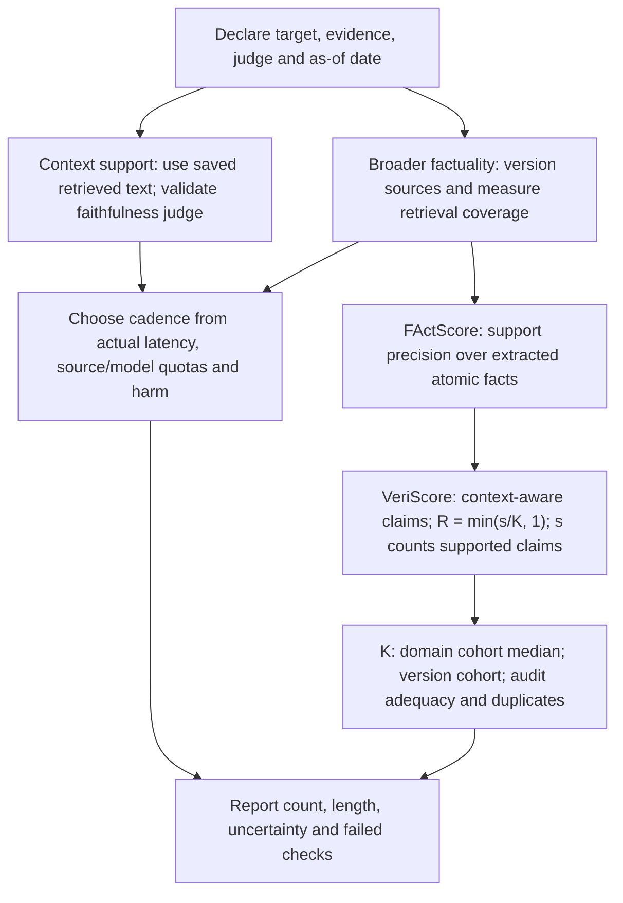
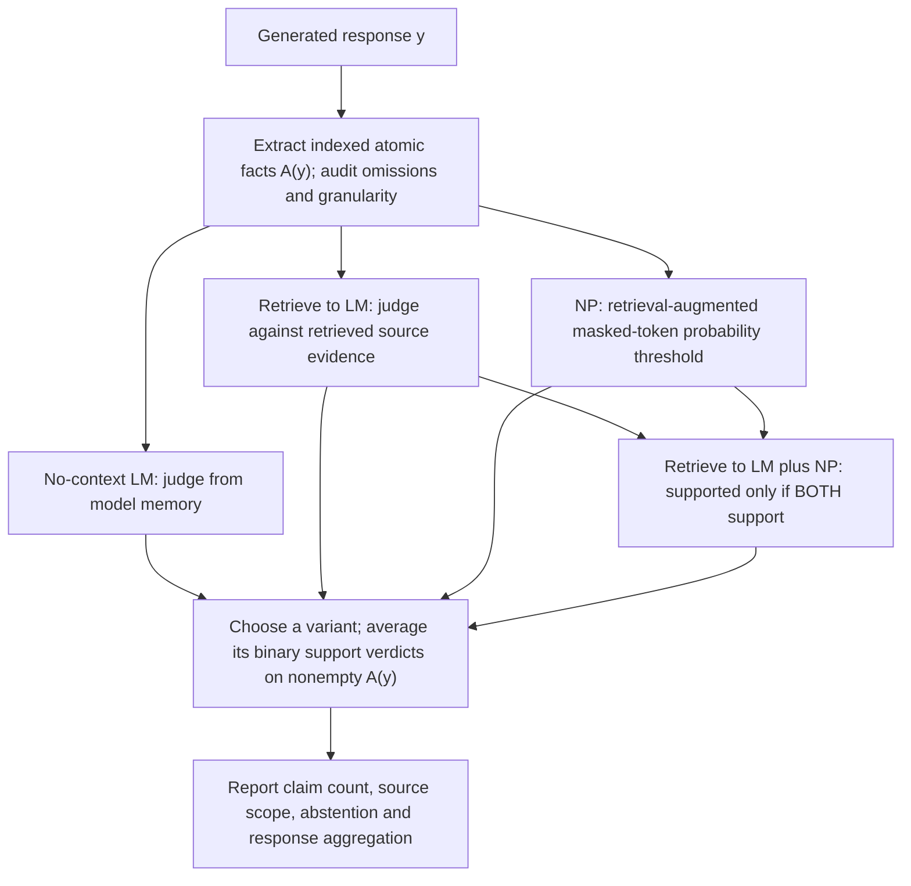
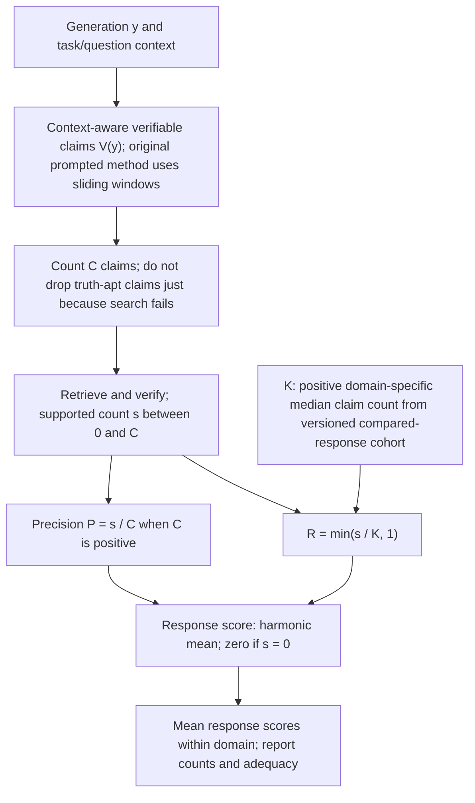
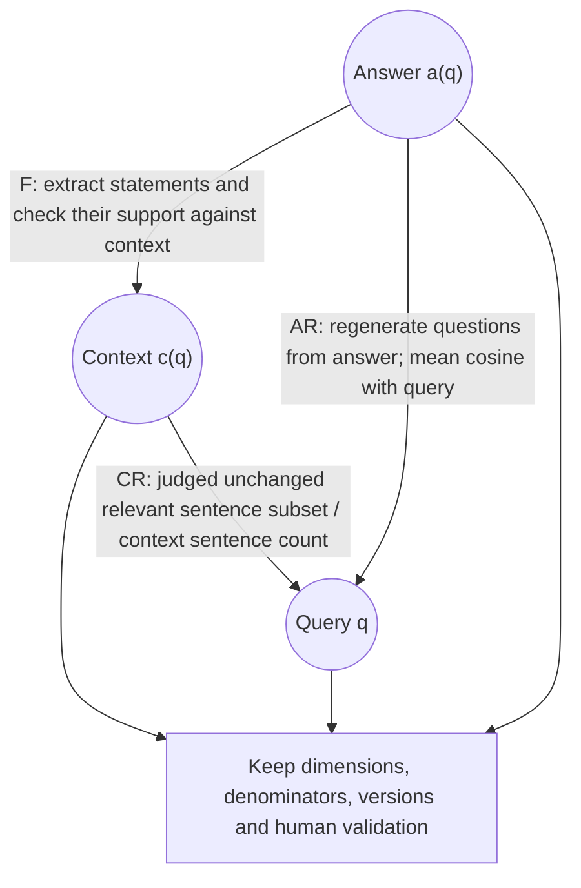

# Chapter 33: Evaluating Generation
[00-START-HERE](../00-START-HERE.md) · [01-READING-ROUTES](../01-READING-ROUTES.md) · [32\_evaluating\_retrieval](32_evaluating_retrieval.md) · [34\_evaluating\_the\_system](34_evaluating_the_system.md)
Purpose: distinguish contextual support from world truth, evaluate claim precision and the actual VeriScore supported-count correction, diagnose the original RAGAS metrics, and audit cost, length and summarization claims without turning historical measurements into universal guarantees.
## TL;DR
- Faithfulness asks whether the declared context entails the answer. Factuality asks about truth in the world; neither a source nor a judge automatically certifies it.
- Choose oracle access and evaluation cadence from measured latency, quotas and error costs. Context-only checks avoid evidence retrieval, not necessarily remote model APIs or long judge prompts.
- FActScore averages support verdicts over extracted atomic facts. It resolves partial error but remains precision-oriented and extraction-dependent.
- VeriScore uses context-aware verifiable claims and $`R=\min(s/K,1)`$, where $`s`$ counts supported claims and $`K`$ is a domain-specific cohort median. This is a count-based proxy, not semantic set recall.
- The original RAGAS faithfulness, answer-relevance and context-relevance scores need no reference answer per item. They remain judge-dependent proxies requiring validation.
- Report claim counts, output length, aggregation and position buckets. More claims can raise any-error risk even when expected per-claim precision is unchanged.
- Valid entailed abstraction is not fabrication merely because it is not copied. Distinguish harmful unsupported content from checker false positives; historical XSum hallucination rates do not establish a support-ticket error floor.
## The story
Picture a newsroom with a research desk, reporter and fact-checking editor. The editor can first check whether the article follows the source packet. That tests faithfulness, not whether the packet itself is correct. An outside archive can strengthen factuality checking but may be incomplete, stale, slow or rate-limited. Scheduling depends on the actual workflow, not a rule that one metric must always run online and another offline.
FActScore is the editor’s claim-card method: split the article into independently checkable facts, judge support and average the marks. A perfect mark on one safe card still does not mean the article answered the assignment. VeriScore uses context to extract verifiable claims and compares the number of supported cards with a domain reference count. Its original reference is a median over the compared models’ responses, not the average length of good human articles. It discourages extreme silence but can still reward irrelevant or redundant supported cards.
RAGAS adds three desk checks: whether the article follows the packet, resembles an answer to the assignment, and uses a packet relevant to that assignment. These are diagnostic clues, not independent proof of which employee caused a failure. Finally, the editor charts errors by position and length. A longer article has more opportunities for error, but that alone does not prove declining precision. Summaries can validly join entailed facts; inventing a missing date is not the same operation.
Use the newsroom analogy to separate evidence, measurement and action. Audit the claim extractor and verifier, retain omitted/unknown cases, and adjudicate consequential flags. Do not treat a successful automated support check or a low overall flag rate as a universal truth guarantee.
## Decoder table


| Technical term | Definition or evaluation unit | Mathematical boundary |
| --- | --- | --- |
| Retrieval-Augmented Generation (RAG) | A system that retrieves source text before generating an answer | Its query, context, and answer create the artifacts these metrics inspect |
| Retriever | Finds context under an index/search protocol | Bad evidence is one possible cause, not the unique explanation for low scores |
| Generator | The model that writes from retrieved context | It can ignore, distort, or extend beyond the context |
| Query | The user’s question, written as $`q`$ in the formulas | Answer relevance and context relevance both compare against it |
| Retrieved context | The text returned for the query, written as $`c(q)`$ | It is the reachable oracle for faithfulness |
| Answer | The generated response, written as $`a(q)`$ in RAGAS | It supplies the claims being evaluated |
| Generation $`y`$ | One complete generated response in the FActScore and VeriScore formulas | Its extracted claims form the unit being scored |
| Oracle | Evidence used for a support decision | Incomplete or stale evidence is not an infallible truth certificate |
| External oracle | Evidence beyond the supplied prompt context | Version time, retrieval coverage, quotas and conflicts |
| Faithfulness | Whether a claim is entailed by the retrieved context | It tests generator grounding against evidence already in hand |
| Factuality | Whether a claim is true in the world | It catches wrong retrieved context that a generator repeats faithfully |
| Entailment | Support by valid inference, not just copying | A fallible NLI/LLM label estimates this relation |
| Truthfulness gate | A decision rule using a validated measured proxy | False accepts, false blocks, unknowns and harm matter |
| Continuous integration (CI) | Per-change automated checks | Feasibility depends on full pipeline cost, not metric name |
| Canary check | A limited check on live traffic | It is another place where seconds of latency matter |
| Request-scoped budget | Declared service, latency, quota and money limits | Judge calls and source queries can have different units |
| Scheduled offline pass | A nightly or weekly evaluation batch | It can tolerate external retrieval and controlled query volume |
| Reference-free metric | No human reference answer needed per scored item | Not a promise of no remote model API or no human validation |
| Human-judgment correlation | Empirical agreement or association under a study protocol | Does not certify calibration, throughput or domain transfer |
| Atomic fact | A minimal, self-contained, independently verifiable statement | It gives long-form evaluation finer resolution than sentence or response labels |
| Atomic-fact set $`A(y)`$ | Indexed extracted facts $`A(y)=(a_1,\ldots,a_{m_y})`$ | Duplicate policy and omissions change the denominator |
| Atomic-fact item $`a_i`$ | The atomic fact at index $`i`$ | Each item receives one support verdict |
| Set cardinality bars | Cardinality, e.g. $`\lvert A(y)\rvert`$ | Explicit nonempty denominators avoid division by zero |
| Long-form generation | A response containing many claims, such as a biography or report | One binary grade loses the location and count of partial errors |
| Atomic-fact extraction | A procedure decomposing asserted content | Audit omissions, changed qualifiers and reference resolution |
| Language model (LM) | A model used to extract or judge claims | It adds cost and can introduce its own errors |
| Large language model (LLM) | A prompted extractor or verifier | Its intermediate outputs and judgments are fallible |
| Verification source $`S`$ | Declared evidence $`S`$ with time/version | Support relative to a source is not world truth |
| Support indicator | $`z_i\in\{0,1\}`$ under a stated rule | Unknown and contradicted may share a final binary label but differ diagnostically |
| Fine-grained Atomic Evaluation of Factual Precision (FActScore) | Mean binary support over nonempty extracted atomic facts | Model-level aggregation and abstention need explicit policies |
| Per-response precision | $`s/C`$ for $`C>0`$ | Does not establish coverage; empty precision is undefined without convention |
| No-context estimator | LM judgment without retrieved evidence | No universal cheapest/weakest ordering across models |
| Retrieve-and-judge estimator | Retrieved evidence followed by LM support judgment | Not the only original FActScore variant using retrieval |
| Non-parametric probability estimator | Nonparametric masked-token probabilities with retrieval | Not a guaranteed one-pass/free-retrieval operation |
| Masked-language model | A model asked to reconstruct hidden claim tokens | Its reconstruction score supplies the non-parametric estimate |
| Ensemble | Original combined variant ANDs Retrieve→LM and NP | It does not combine all three estimators |
| Extractor failure | A merged, dropped, split, or unresolved claim created during extraction | It changes what the verifier sees before support judgment begins |
| Versioned source snapshot | Versioned source plus retrieval and judge settings | A query date alone does not freeze live evidence |
| Claim count | The number of extracted facts in an answer | A falling count can inflate precision without improving the model |
| VeriScore | Harmonic mean of support precision and supported-count proxy | Original reference is a domain-specific compared-cohort median |
| Context-aware extraction | Extraction using surrounding sentence/task context | Original prompted VeriScore uses sliding windows, not mandatory whole-response calls |
| Verifiable claim | Truth-apt content suitable for evidence checking | A failed search does not make a factual assertion non-truth-apt |
| Verifiable set $`V(y)`$ and item $`v_i`$ | Indexed verifiable claims $`V(y)`$ and $`v_i`$ | Claims can retain necessary modifiers; they need not be atomically minimal |
| Unverifiable claim | Non-truth-apt material under a declared extraction policy | Do not silently exclude unresolved factual assertions |
| Truth-apt content | Content that can be judged true or false | Claims without it are removed before VeriScore verification |
| $`C`$ | Total extracted verifiable-claim count | Precision denominator only; not the recall numerator |
| $`C_{\mathrm{sup}}`$ | Integer supported count $`s=C_{\mathrm{sup}}`$ | Numerator of BOTH support precision and count recall |
| Precision $`P`$ | $`P=s/C`$ for $`C>0`$ | Support among evaluated claims, not semantic completeness |
| Reference constant $`K`$ | Original domain-specific median extracted claim count across compared-model responses | Require positive reference; version cohort and extraction |
| Recall $`R`$ | $`R=\min(s/K,1)`$ | Saturates at K supported claims; not recall against a gold set |
| $`F_1`$ score | Harmonic mean; zero when no claim is supported | Model domain score averages response scores |
| Under-generation | Saying too little to avoid making risky claims | Precision-only metrics can reward it |
| Retrieval Augmented Generation Assessment (RAGAS) | Original reference-free three-proxy framework | Later library metrics may differ; validate judges |
| Statement set $`T`$ | Indexed extracted statements $`T`$, count $`m`$ | Faithfulness needs positive denominator and an empty policy |
| Supported-statement count | $`h\in\{0,\ldots,m\}`$ | Avoid overloading VeriScore collection V with a count |
| RAGAS faithfulness $`F`$ | $`F=h/m`$ for $`m>0`$ | Task-critical unsupported claims can be hidden by a high fraction |
| Answer relevance $`\mathrm{AR}`$ | Mean cosine with questions regenerated from answer alone | Not a correctness probability or completeness guarantee |
| Regenerated question | A question an LLM infers from answer text alone | It supplies the missing artifact for answer relevance |
| Regenerated-question count $`n`$ and item $`q_i^{\prime}`$ | $`n>0`$ questions and $`q_i^{\prime}`$ | Question dependence affects variance and useful sample size |
| Embedding | A numeric representation used to compare question meaning | RAGAS uses it for generated-question similarity |
| Cosine similarity | Nonzero-vector similarity in $`[-1,1]`$ | A mean cosine is not automatically bounded below by zero |
| Similarity function $`\mathrm{sim}`$ | The formula symbol for cosine similarity | It scores each real-query and regenerated-query pair before averaging |
| Context relevance $`\mathrm{CR}`$ | Judged kept context sentences divided by all context sentences | Not token relevance, retrieval recall or a fault certificate |
| Extracted sentence set $`S_{\mathrm{ext}}`$ | Unchanged distinct occurrences selected from context | A true subset keeps the count ratio bounded |
| Holistic LLM judge | An overall rubric-based score | Actual cost depends on model, prompt and calls |
| Diagnostic separation | Separate proxy dimensions for diagnosis | They do not uniquely identify causal component ownership |
| Output-length dependence | Empirical relation among length, position and errors | More opportunities alone do not force lower mean precision |
| Document support $`d(f)`$ | A possible pre-training-frequency explanation | Generally unknown per production fact; not an observed universal law |
| Autoregressive generation | Generation that conditions each next step on earlier output | One fabrication can become context for later fabrications |
| Pooled average | Aggregate over specified responses or claim counts | State weighting; a macro mean and pooled ratio differ |
| Position bucket | Position/length stratum with an explicit evaluated count | Late positions select for longer responses; preserve mappings |
| Hallucination | A source-relative error category under a declared rubric | Distinguish actual error from an automated flag |
| Intrinsic hallucination | A generated claim that contradicts the source | It calls for a different response than a merely absent claim |
| Extrinsic hallucination | Content not inferable from the specified source | Can be true externally or false; not merely different wording |
| Bridging inference | A connection entailed by source facts | An added unsupported date/mechanism is not a valid bridge |
| Abstractive summarization | Paraphrasing and combining source facts | Abstraction is not itself evidence of hallucination |
| Extractive summarization | Selecting source spans | Copying alone does not guarantee faithful combinations or scope |
| Tolerance band | A validated operational decision policy | Not a universal license for unsupported factual additions |
| Document-level entailment gate | Checks a summary against its source document(s) | Measure summary-level errors and aggregate all sentence comparisons |
| Natural language inference (NLI) | A model judgment about whether one text supports another | It provides the cheap document-level check in the worked example |
| SummaC | A document-level NLI/aggregation design | No universal one-pass timing or sensitivity follows from its name |


## Core mechanics
### Mathematical conventions
A support verdict is relative to a declared evidence source, time, retrieval procedure and judge. Faithfulness to retrieved text is not world truth. “Unsupported” may mean contradicted, unresolved by the available evidence, or an extraction/judge error; report those statuses separately where possible. A truth-apt claim does not become unverifiable merely because a search failed.
Use indexed claim collections with a declared granularity and duplicate policy; cardinality counts the evaluated items, not necessarily unique real-world facts. Support indicators are binary only after a specified decision rule. Nonempty denominators are required. For ordinary claim precision, a response with no evaluated claims is undefined unless an explicit reporting convention is imposed; report its frequency rather than silently dropping abstentions. The VeriScore response convention below assigns zero when no claim is supported, including empty outputs.
Distinguish a per-response mean from pooling claim counts across responses. A model score, a proportion of claims and a probability of at least one bad response have different units. Claim dependencies and multiple claims from one answer invalidate naive independent-claim uncertainty calculations; use the actual sampling unit and paired response-level analysis where appropriate.
Keep full precision until the reported result. Cost examples stipulate service times and batching; calls, source queries, embeddings, total service work and elapsed time are separate ledgers. Concurrency requires adequate throughput and quotas. No timing ratio alone proves dollar savings or equal verification quality. The RAGAS definitions here refer to the original paper, not every later library metric with a similar name. Historical empirical rates are not universal floors, and automated flags are not ground-truth errors.
### 33.1 Faithfulness versus factuality, restated for evaluation
#### What it is
Faithfulness and factuality answer different questions.
A claim is faithful when the declared retrieved context entails it, including valid inference rather than only literal copying. A claim is factual when it is true in the world. A faithful answer can repeat an erroneous source; a true answer can introduce knowledge absent from its context.
The context is available to the evaluator, but it is not an infallible oracle. External evidence can broaden a factuality check; source authority, dates, retrieval coverage and conflicting accounts still matter.
A faithfulness pipeline reuses the retrieved text but can require extraction and one or many entailment calls. Long contexts, output lengths, model choice and batching determine cost. It is not necessarily one extra call or the same order of measured latency as generation.
A stronger factuality check may consult a versioned corpus, internal database or external search beyond the prompt. Parametric-memory judgments are possible but do not provide independent evidence. Caching, joint retrieval and batching can avoid a fresh fetch for every claim; budget the actual retrieval and judgment operations.
When external retrieval is used, it adds its own latency, quotas and availability risks. The number of source queries need not equal the number of LLM verifier calls.
#### Why it exists
Faithfulness and factuality separate evaluation targets, not uniquely responsible components. A mismatch can involve retrieval, stale sources, generation, claim extraction or the evaluator. Use controlled interventions and saved artifacts to diagnose ownership.
Context-only checks are candidates for CI, canaries or request gates when their measured budgets permit. Broader external-source checking may fit a scheduled audit; controlled internal evidence can support a faster cadence. Choose from reachability, risk and workload rather than a fixed metric-to-cadence law.
The original RAGAS paper describes reference-free faithfulness, answer relevance and context relevance: no human reference answer is required for each scored request. Its use of prompted judges and embeddings does not remove the need for human validation or make the scores ground truth.[\[1\]](https://arxiv.org/html/2309.15217)
#### What fails without it
Choosing a metric only because its paper reports stronger human correlation can break the evaluation pipeline.
Correlation with human ratings is one empirical validation result, not a latency, quota, calibration or domain-transfer guarantee. A factuality harness can fail on source timeout while the RAG output remains unchanged; keep evaluation failures distinct from answer errors.
A precision-oriented score can rise when a model omits difficult claims. Track answer adequacy, claim count and abstention as separate outcomes. VeriScore adds a supported-count proxy but is not complete semantic recall.
More stated claims create more opportunities for at least one error. That does not mathematically force the expected fraction of unsupported claims to increase.
#### Cost and complexity
For a stipulated benchmark, take $`Q=200`$ answers with exactly four claims each, giving $`M=200(4)=800`$ claims. An average of four also identifies total volume if exact, but does not identify per-answer batching costs without the individual counts.
If five-claim verifier batches may pool across answers while keeping each claim’s evidence association, $`B=\lceil800/5\rceil=160`$ calls. At a hypothetical three seconds per call, serial service totals $`480\,\mathrm s=8\,\mathrm{min}`$. If batches must remain within each four-claim answer, $`B=200\lceil4/5\rceil=200`$, taking $`600\,\mathrm s`$. In general $`\sum_q\lceil m_q/b\rceil`$ need not equal $`\lceil\sum_qm_q/b\rceil`$.
At a separately stipulated $`0.8\,\mathrm s`$ per context-only batch, the pooled case takes $`128\,\mathrm s\approx2.133333\,\mathrm{min}`$; within-answer batching takes $`160\,\mathrm s`$. These times exclude extraction, scheduling and unspecified overhead. Twenty pull requests with three pushes each create sixty evaluations per day.
The pooled plan makes $`60(160)=9{,}600`$ verifier calls daily. To compare it with an illustrative source cap of $`2{,}000`$ queries per day, additionally assume exactly one metered source query per verifier call. Five individually retrieved claims per call would instead require $`60(800)=48{,}000`$ source queries, even though the judge-call count remains $`9{,}600`$.
Under the one-query-per-call assumption, demand is exactly $`4.8`$ times the cap, or $`7{,}600`$ queries and $`380\%`$ above it—not “$`4.8`$ times above” in an excess sense. The cap permits twelve complete $`160`$-query runs with eighty queries left. Within-answer $`200`$-call runs require $`12{,}000`$ queries daily, six times this cap. Context-only checking removes evidence-source queries but can still use remote judge APIs.
The stipulated batch-service ratio is $`3/0.8=3.75`$. It compares two timing assumptions, not a measurement that removing a fetch always gives that speedup, the same verdict quality, or the same ratio in end-to-end elapsed time.
#### Practical decisions
Use a validated context-only check when its budget and failure costs fit the gate. Size external audits to source capacity and record timeouts/unknowns rather than silently scoring them false. An internal snapshot changes the quota and freshness trade-off, not the distinction between support and truth.
Compare both checks on the same saved outputs when possible. Pairing avoids the additional difference from separately resampled answers; it does not remove judge randomness, source drift, correlated claims or finite-sample uncertainty. Refresh or migration events warrant targeted checks of changed evidence.
If harnesses must run separately, retain outputs, contexts, prompts, sources and judge versions. A shared faithfulness control can reveal a measurement shift but cannot prove equivalence of the two runs. Pair precision with task coverage and abstention/claims delivered, using an appropriate metric rather than assuming count recall is semantic recall.
Report output lengths and claim counts even when a difference is not statistically significant. Failure to reject a length difference is not an equivalence test; use an explicit margin if equivalence matters. When faithfulness stays flat but factuality falls, inspect evidence and evaluator changes as hypotheses, not a uniquely identified cause.
### 33.2 FActScore and atomic facts
#### What it is
A whole-response binary grade is appropriate for some safety gates but coarse for long-form diagnostics. Under an “all details correct” rule, one wrong birth year among fourteen correct details and a wholly invented career both receive zero. They need not have the same claim-level error burden.
FActScore changes the unit to an atomic fact. An atomic fact is minimal, self-contained, verifiable, and limited to one piece of information. “Bridget Fonda is an actress” is atomic.
A sentence such as “Bridget Fonda is an American actress, model, and producer” contains several separately checkable assertions; this illustrates decomposition, not an endorsement of every asserted occupation. The original FActScore extraction pipeline operates sentence by sentence with its extraction procedure and context handling.[\[2\]](https://arxiv.org/html/2305.14251)
For generation $`y`$, write the indexed collection $`A(y)=(a_1,\ldots,a_{m_y})`$, with a declared duplicate and granularity policy. Let $`z_i=\mathbf1[a_i\text{ is supported by }S]\in\{0,1\}`$. The evidence retrieval and judge determine these support decisions.
The score is:

```math
\mathrm{FActScore}(y;S)=\frac1{m_y}\sum_{i=1}^{m_y}z_i,\qquad m_y=\lvert A(y)\rvert>0.
```

For a nonempty collection of binary judgments, the score lies in $`[0,1]`$ and has at most $`m_y+1`$ possible values. With no claims, the ordinary ratio is undefined; a system-level abstention penalty or zero convention must be declared rather than inferred from this formula.
This is support precision among the extracted claims, not proof that every claim is true or all requested content is present. If responses with counts one and nine have support counts one and zero, their equally response-weighted mean is $`0.5`$, while pooled claim precision is $`1/10=0.1`$. State the aggregation and empty-output policy.
#### Why it exists
Atomic decomposition gives partial-error resolution while introducing extraction choices. A weekly report can locate changed claims rather than only a response-level flip. It should retain response-level harm and adequacy checks: splitting one assertion into many trivial subclaims can also change the average.
#### Verification choices
The no-context estimator asks an LM to judge $`a_i`$ from parametric memory. It has no retrieved evidence for that decision; its accuracy and cost depend on the chosen model and prompt.[\[2\]](https://arxiv.org/html/2305.14251)
Memory-only judging can share the generator’s errors. The original paper found retrieval useful in its tested settings, but “cheapest” and “weakest” are not architecture-independent mathematical rankings.[\[2\]](https://arxiv.org/html/2305.14251)
Retrieve→LM retrieves passages from $`S`$ and asks an LM to judge the claim against them. Its evidence can strengthen verification, but retrieval omissions, conflicts and judge errors remain. It is not the only original estimator using retrieval.[\[2\]](https://arxiv.org/html/2305.14251)
The Nonparametric Probability (NP) estimator uses a nonparametric masked language model with retrieved text. In the paper’s single-token-mask implementation, token probabilities are averaged and compared with a threshold. This is not a no-retrieval method or a universal one-forward-pass cost model.[\[2\]](https://arxiv.org/html/2305.14251)
The fourth original variant is Retrieve→LM + NP: a fact is supported only if both estimators support it. It does not combine all three estimators or include the no-context verdict in that AND. On the same claims its supported count cannot exceed either component’s count, but its factual accuracy need not dominate either one. Do not infer a universal noise/cost ordering from the variant names.[\[2\]](https://arxiv.org/html/2305.14251)
#### What fails without it
Sentence-level scoring still bundles true and false clauses.
A single sentence can mix a supported occupation with an unsupported medal claim. A binary sentence label cannot express their separate statuses unless the checker decomposes or annotates internally; sentence-level and atomic evaluation therefore answer different-granularity questions.
An extractor can omit an assertion, merge clauses, alter a qualifier or fail to resolve a referent. Omitting hard claims can inflate apparent precision. Audit extraction coverage as well as verifier agreement, and preserve mappings back to the original text.
#### Worked example and cost
In a constructed six-sentence biography, stipulate three erroneous details under the reference evidence.
They concern a university, fellowship and graduation year. These are illustrative error locations, not new biographical assertions about a named person.
Under an all-correct binary rule the response gets zero. An idealized extraction yields $`m_y=14`$ evaluated facts, $`14/6\approx2.333333`$ per sentence, of which eleven are supported and three unsupported.
The support precision is $`11/14\approx0.785714286`$. A comparison response with the same number of evaluated facts but only two supported has precision $`2/14=1/7\approx0.142857143`$; both fail the all-correct binary gate.
The unrounded precision gap is $`9/14\approx0.642857143`$, or $`64.285714`$ percentage points. For a timing toy, stipulate $`0.9\,\mathrm s`$ per fact for retrieval plus judgment; this is not a published universal service rate.
Fourteen serial checks require $`12.6\,\mathrm s`$. A constructed benchmark of $`250`$ biographies with fourteen facts each requires $`3{,}500`$ checks. The $`250`$ count is this worked scenario, not a claim about the size of the original FActScore benchmark.
At the stipulated service rate, $`3{,}500(0.9)=3{,}150\,\mathrm s=52.5\,\mathrm{min}`$ serially, excluding extraction and other overhead. Concurrency, caching and quotas change elapsed time; this arithmetic alone does not decide whether CI is feasible.
#### Precision-only edge case
“Marie Curie was a scientist” is one trivial, supported atomic fact.
If that one evaluated claim is supported, $`m_y=1`$ and precision is one. This says nothing about a requested biography’s coverage. Empty output is a separate zero-denominator case, not automatically another perfect score.
#### Practical decisions
Use atomic facts when a regression smaller than a full right-to-wrong flip matters.
Skip elaborate decomposition only when the output schema genuinely defines the evaluation unit; one field can still encode multiple assertions. Compare retrieval-based LM and NP variants on held-out claims, errors and actual cost. No estimator is automatically the right fallback merely because it is labeled nonparametric or an ensemble.
For controlled comparisons, version $`S`$, retrieval, extractor and judge. For current-world questions, record the as-of date and fetched evidence; a pinned query date alone does not freeze changing source content. Report claim count, abstention and adequacy alongside support precision.
Human-audit extraction and verification after estimator changes and domain shifts. Biography agreement does not establish medical or legal validity. A scenario jump from $`0.62`$ to $`0.89`$ warrants checking claim counts, case mix and source/judge versions; those checks do not automatically explain the entire change.
### 33.3 VeriScore, unverifiable claims, and the recall correction
#### What it is
VeriScore addresses extreme under-generation with a supported-claim-count term, while changing extraction and verification procedures. It does not completely close every precision-gaming or coverage loophole.
The motivating dashboard rises from a season average near $`0.75`$ to $`0.97`$. At the same time, summaries shrink from six sentences to two terse sentences.
That joint dashboard change is consistent with omission of difficult content, but does not prove the remaining claims became no more accurate. Compare matched prompts, extraction, evidence, adequacy and length. The original VeriScore paper uses context-aware verifiable-claim extraction and a count-normalized score.[\[3\]](https://arxiv.org/html/2406.19276)
In the original prompted extractor, a focused sentence is supplied with a sliding window: up to three preceding sentences and one following sentence. QA also includes the question; other tasks can add the paragraph’s first sentence for longer paragraphs. It is not necessarily one call reading the whole generation. Context helps attach “its” to the named plant in the paper’s example.[\[3\]](https://arxiv.org/html/2406.19276)
Context can reduce reference failures without guaranteeing correct extraction. The paper extracts verifiable claims, ignoring content such as advice, fiction and opinions. A verifiable claim need not be atomically minimal: an event or state can retain necessary modifiers and meaningful parts, all of which must be supported.[\[3\]](https://arxiv.org/html/2406.19276)
Let $`V(y)=(v_1,\ldots,v_C)`$ be the extracted verifiable-claim collection under that protocol. Distinguish a non-truth-apt opinion from a truth-apt claim for which search finds no evidence. Dropping the latter as “unverifiable” would artificially raise precision. Track unresolved searches and extraction exclusions explicitly.
Define the integer supported count $`s=C_{\mathrm{sup}}=\sum_{i=1}^C\mathbf1[v_i\text{ is supported}]`$, so $`0\le s\le C`$. For a nonempty collection, precision is:

```math
P(y)=\frac{s}{C},\qquad C>0.
```

In the original method, $`K`$ is the domain-specific median number of extracted verifiable claims across responses from the compared models. It is not the average claim count of good human responses. The model’s domain score averages response-level scores.[\[3\]](https://arxiv.org/html/2406.19276)
For $`K>0`$, the recall-like term uses supported count $`s`$, not asserted count $`C`$. Fix and version the cohort and reference for a comparison. Changing the compared models can change the median and hence scores for unchanged responses. A zero-median domain needs a declared alternative policy; the literal ratio is undefined.

```math
R(y)=\min\!\left(\frac{s}{K},1\right),\qquad K>0.
```

Recall saturates only when at least $`K`$ claims are supported. Adding unsupported claims does not increase $`R`$. The original count term is not recall against an enumerated gold set and does not prove that the response covers the requested semantic content.[\[3\]](https://arxiv.org/html/2406.19276)
Use the harmonic mean when support is positive and the paper’s zero-score convention when none is supported. The equivalent count form makes both regimes explicit:

```math
\mathrm{VS}_K(y)=
\begin{cases}
0,&s=0,\\
\dfrac{2P(y)R(y)}{P(y)+R(y)}=\dfrac{2s}{C+K},&0<s<K,\\
\dfrac{2P(y)}{P(y)+1}=\dfrac{2s}{C+s},&s\ge K.
\end{cases}
```

#### Why it exists
Context and extraction policy affect what gets counted; the supported-count term changes the reward for output amount. Neither guarantees perfect extraction, relevance, semantic completeness or correct support judgments.
The original VeriScore framework also uses its own retrieval and claim-verification pipeline; it is not simply the unchanged FActScore verifier with a new denominator. Compare implementations under aligned evidence and extraction policies before attributing a score difference to the formula alone.[\[3\]](https://arxiv.org/html/2406.19276)
#### What fails without it
With $`C=s=1`$, support precision is one, but $`\mathrm{VS}_{12}=2/13\approx0.153846154`$. Conversely, twelve supported but irrelevant or duplicated claims can attain one under a naive counting policy. Audit relevance, duplicate handling and extraction granularity; the count proxy is not a complete answer-quality measure.
Do not label a claim false merely because evidence is unavailable, or remove failed searches from the evaluated population without disclosure. A single $`K`$ across unrelated domains can penalize legitimate terseness. Choosing $`K=C`$ separately for each nonempty response gives $`R=s/C=P`$, not $`R=1`$.
Then the harmonic mean also equals $`P`$, so this choice removes the additional length incentive. Choosing a fixed external target from human references is a possible local variant, but label it as such rather than the original paper’s cohort-median method.
#### Worked example and cost
For arithmetic only, stipulate $`K=12`$ under a fixed domain reference. It is not a universal published constant or evidence that every good summary should contain twelve claims.
For $`C=14`$ and $`s=11`$, $`P=11/14\approx0.785714286`$ and $`R=11/12\approx0.916666667`$. Fourteen asserted claims do not saturate recall because only eleven are supported.
Since $`s<K`$, $`\mathrm{VS}_{12}=2(11)/(14+12)=11/13\approx0.846153846`$, not $`0.880`$. Calculate from exact counts rather than the rounded precision. Compare a short response with $`C=s=2`$.
Its precision is one, while $`R=2/12=1/6\approx0.166666667`$.
Its combined score is $`2(2)/(2+12)=2/7\approx0.285714286`$. The precision-one value is exactly $`3.5`$ times this score. This cross-metric ratio illustrates the count penalty; it is not a measured performance multiplier.
For a separate hypothetical implementation, suppose one whole-response extraction costs $`1.5\,\mathrm s`$, versus six sentence-level extractions at $`0.4\,\mathrm s`$ each, totaling $`2.4\,\mathrm s`$. This is not the original sliding-window algorithm’s mandatory call pattern or a measured speedup. Hold extracted claims fixed to isolate the timing comparison.
Fourteen fact checks at $`0.9\,\mathrm s`$ add $`12.6\,\mathrm s`$, giving $`14.1\,\mathrm s`$ including the hypothetical whole-response extraction, or $`15.0\,\mathrm s`$ with the six extractions. The $`0.9\,\mathrm s`$ difference is extraction work only. Verification is $`8.4`$ times the $`1.5\,\mathrm s`$ extraction, but $`12.6\,\mathrm s`$ is not the all-in response total.
For the one-supported-claim case, $`C=s=1`$, so $`P=1`$ and $`R=1/12\approx0.083333333`$.
The combined score is $`2/(1+12)=2/13\approx0.153846154`$. For contrast, twelve asserted claims with only one supported give $`P=R=1/12`$ and score $`1/12`$, not recall one. Unsupported padding cannot improve this corrected recall term.
#### Practical decisions
Apply a documented verifiability policy before scoring, retain exclusion counts and audit omitted claims. Do not confuse an opinion with a factual assertion that current retrieval cannot resolve; preserve unresolved and contradicted statuses even if the final binary metric groups both as not supported.
Use enough surrounding context to resolve references and preserve qualifiers; validate the actual extraction implementation. Whole-document extraction, sliding windows and schema-aware single-claim extraction have different budgets and failure modes, not one universal sentence-count switch.
To reproduce the original method, compute the domain-specific cohort median and version the extraction protocol and compared-response cohort. Freeze that reference for a matched comparison; disclose recalibration. A fixed human-derived target can support a local longitudinal metric but must be named as a variant, with a zero-reference policy.
Report $`C`$, $`s`$, $`P`$, $`R`$, the domain reference and response-score mean. A decline in $`R`$ with stable $`P`$ means fewer supported claims relative to $`K`$, not proof that under-generation caused it. Falling precision may reflect actual errors, source coverage, extraction changes or judge drift. Add semantic adequacy and human checks.
### 33.4 RAGAS, faithfulness, answer relevance, and context relevance
#### What it is
RAGAS starts from three artifacts available for every response.
The artifacts are query $`q`$, context $`c(q)`$ and answer $`a(q)`$. The original metrics do not require a human reference answer per scored item. Prompted LLMs and embeddings supply proxies; validation, external service calls or human auditing can still be necessary. Later library versions may define different metrics.[\[1\]](https://arxiv.org/html/2309.15217)
For faithfulness, the extractor uses the question and answer to form $`T=(t_1,\ldots,t_m)`$. The verifier judges each statement against context $`c(q)`$. Retain a consistent decomposition policy and distinguish unsupported from contradicted when diagnosing errors.
Let $`h`$ count statements judged supported, with $`0\le h\le m`$. Reserve $`V(y)`$ for the VeriScore claim collection rather than overloading the same letter for this count.

```math
F=\frac{h}{m},\qquad m=\lvert T\rvert>0.
```

With no statements, this ordinary ratio is undefined; declare and report an abstention/empty policy. The original paper’s verification prompt batches the statements, so faithfulness can use one extraction and one verification call. One verification call per statement is another implementation, not a mandatory $`1+m`$ cost. Neither needs fresh evidence retrieval, but either can call a remote model.[\[1\]](https://arxiv.org/html/2309.15217)
For answer relevance, generate $`n>0`$ questions $`q'_1,\ldots,q'_n`$ from the answer alone and embed them and the actual query with the same embedding model. The regenerated questions are proxy tasks the answer resembles, not a gold list of what it fully answers.[\[1\]](https://arxiv.org/html/2309.15217)
The score averages their cosine similarities:

```math
\begin{aligned}
\mathrm{AR}&=\frac1n\sum_{i=1}^n\mathop{\mathrm{sim}}\nolimits(q,q'_i),\\
\mathop{\mathrm{sim}}\nolimits(u,v)&=\frac{e(u)^{\mathsf T}e(v)}{\lVert e(u)\rVert_2\lVert e(v)\rVert_2}.
\end{aligned}
```

This cosine mean lies in $`[-1,1]`$ for nonzero embeddings, not necessarily $`[0,1]`$; zero embeddings or $`n=0`$ make the displayed formula undefined. High similarity does not establish correctness, completeness or support. Fix the embedding model and question-generation/parsing policy before comparisons.
For original context relevance, an LLM selects an unchanged subset of context sentences necessary to answer the question. Map selected sentences to distinct original occurrences: paraphrased, duplicated or invented “extractions” would break the intended count interpretation. The original prompt also handles insufficient information; do not force useful evidence to exist.[\[1\]](https://arxiv.org/html/2309.15217)

```math
\mathrm{CR}=\frac{\lvert S_{\mathrm{ext}}\rvert}{L_c},\qquad S_{\mathrm{ext}}\subseteq S_c,\quad L_c=\lvert S_c\rvert>0.
```

#### Why it exists
Each metric constructs an intermediate representation: claims for support, regenerated questions for similarity, or a sentence subset for context relevance. Each construction is itself an error-prone evaluation step.
With a valid subset and nonempty context, $`0\le\mathrm{CR}\le1`$. Empty context needs an explicit undefined/zero policy. This is a sentence-count fraction, not token-weighted relevance, answerability or a full retrieval-recall measure. Judge extraction of long contexts is a limitation noted by the original paper.[\[1\]](https://arxiv.org/html/2309.15217)
Keeping the three proxy scores separate aids diagnosis, but does not make their errors independent or prove retriever/generator ownership. All can share model bias, ambiguous questions or faulty evidence.
#### What fails without it
A holistic LLM judge may be simpler or cheaper in a given setup, but that requires a real prompt/call budget. Its aggregate grade generally hides which rubric dimensions changed. Validate it against the intended use rather than assume every three-metric implementation is more expensive or more accurate.
A dashboard blend can be useful with a declared scale and utility rule, but retain $`F`$, $`\mathrm{AR}`$ and $`\mathrm{CR}`$ separately. Their ranges and meanings differ. No blend, nor faithfulness alone, proves world truth.
A confidently wrong context can support a perfectly faithful but factually wrong answer.
#### Worked example and cost
The query asks, “What is the timeout for a stuck deployment job?” The retriever returns 10 context sentences. The context-relevance extractor keeps 3.
The judged sentence fraction is $`3/10=0.30`$. In this toy the other seven concern an unrelated flag; in deployment the extractor’s labels need validation. “Seventy percent irrelevant” here means seven of ten sentence occurrences under the rubric, not seventy percent of tokens or guaranteed uselessness.
A two-sentence answer decomposes into four statements, three supported and one unsupported timeout value, giving $`F=3/4=0.75`$. The unsupported statement can be the task-critical answer, so this fraction is not evidence that the response is mostly safe or useful.
For three regenerated questions with stipulated similarities $`0.91`$, $`0.88`$ and $`0.52`$, $`\mathrm{AR}=(0.91+0.88+0.52)/3=0.77`$ exactly for these decimal inputs. It is a similarity score, not a $`77\%`$ correctness probability.
The low judged context fraction and unsupported timeout suggest examining evidence selection and the generated claim. They do not uniquely locate a main cause: relevant evidence could be absent, overlooked or misjudged, and topical answer similarity need not imply a correct timeout.
In an unbatched timing toy, faithfulness uses one extraction plus four verification calls; answer relevance uses one batched question-generation call; context relevance uses one extraction call. That totals seven LLM calls. Three cosine comparisons need four question embeddings if none is cached—the actual query and three regenerated questions—not necessarily three embedding API calls.
At a hypothetical $`0.8\,\mathrm s`$ per LLM call, serial LLM service totals $`5.6\,\mathrm s`$, excluding embeddings, retries and other overhead. With one batched faithfulness verification as in the original prompt, the analogous total is four calls, or $`3.2\,\mathrm s`$. Neither is a measured end-to-end upper bound. Three scores do not mean three calls; “no evidence retrieval” does not mean no external APIs.
#### Practical decisions
Compute the dimensions needed for the decision and keep a broader diagnostic sample. All three can be useful together, but budget, task risk and validated incremental information—not a universal rule—determine cadence.
A cheaper faithfulness regression gate can be sufficient for a narrow declared objective, while periodic relevance and broader factuality audits check other failures. High historical context relevance does not prove it will remain high. Validate both latency and false accepts before deploying a per-request or CI gate.
Three regenerated questions is a starting heuristic, not a variance guarantee or mathematical minimum. Repeated questions can be correlated or redundant; measure response-level run-to-run variation and useful information as $`n`$ changes. Low context relevance is a hypothesis for retrieval/chunking investigation, not automatic proof of owner fault.
High judged context relevance with lower faithfulness can motivate a generation or verifier investigation, but also check source adequacy and extraction. Preserve separate dimensions, task-critical claim flags and judge versions beside any top-line blend.
After an evaluator swap, score the same saved inputs with old and new evaluators to isolate their measurement difference on those inputs. A recovered old score supports evaluator drift there; it neither rules out a simultaneous real retrieval change nor makes a persistent low score conclusive without evidence/human checks.
### 33.5 Error length dependence and summarization’s open question
#### What it is
FActScore averages support indicators within a response. VeriScore combines precision with a supported-count reference; it is not merely a plain pooled atomic-fact mean. Averaging either response score across outputs differs from pooling all claim counts.
The FActScore paper reports position/length-related patterns in its biography setting. Treat them as empirical associations in those data, not a causal law that every extra sentence reduces precision. Later positions exist only for answers long enough to reach them, which changes the evaluated population.[\[2\]](https://arxiv.org/html/2305.14251)
More frequently learned facts may be easier to recall, but a production evaluator generally does not know pre-training document support $`d(f)`$ for each fact. Do not present a low-$`d(f)`$ explanation as an observed denominator or universal cause of late errors. Topic, question difficulty, source availability and generation policy can confound length comparisons.
Autoregressive decoding conditions later tokens on earlier output, so an invented detail can influence subsequent claims. This permits error propagation; it does not establish a fixed compounding rate or require every later claim to be wrong.
Even without propagation, if $`m`$ claim errors are IID with fixed probability $`p`$, then $`\mathbb E[\#\mathrm{errors}]=mp`$ and $`\Pr(\text{any error})=1-(1-p)^m`$, while expected claim precision remains $`1-p`$. With $`p=0.1`$, any-error risk grows from $`0.1`$ at one claim to about $`0.651322`$ at ten, without a decline from $`0.9`$ expected precision. Real claims need not be independent.
#### Why it exists
Position buckets can reveal late concentration hidden by an average. Preserve claim-to-sentence/token mappings, bucket counts and response lengths. Compare like tasks and length strata; changing which answers reach a late position can create selection effects.
Bookkeeping is cheap only if claim-position mappings are already available; obtaining or auditing them can add work. A rising observed curve motivates controlled tests of caps, stopping rules, retrieval and model changes. It does not prove a cap is the best repair or harmless to coverage.
One pooled score cannot expose that pattern.
#### The summarization boundary
Both biographies and summaries need a declared evidence target and can involve incomplete sources or valid inference. Entailment is not literal quotation. Faithfulness asks what follows from the source; world truth can differ in either task.
Suppose a source states a person joined a company in 2011 and became CEO later, without dating the appointment. “Became CEO within ten years of joining” is not entailed: an appointment in 2025 satisfies “later” but is fourteen years after joining. If the source instead states 2018, the seven-year bridge is valid. These dates are logical examples, not biographical facts.
Similarly, joining and later appointment alone need not establish a promotion mechanism. A checker can falsely reject a valid entailed paraphrase or correctly reject an added date/mechanism. Human adjudication should separate those cases instead of labeling every bridge benign.
Intrinsic hallucination contradicts the source; extrinsic content is not inferable from the source under the specified definition, not merely wording absent verbatim. Extrinsic unsupported content can be true using outside knowledge or false; truth and source faithfulness are separate axes. Categories can overlap at the summary level.
Maynez et al. evaluated historical systems on XSum single-sentence summarization. Their system-level proportions of summaries with intrinsic or extrinsic hallucination were $`75.3\%`$, $`78.5\%`$, $`79.3\%`$ and $`73.1\%`$. The “over $`90\%`$ erroneous” statement concerns extrinsic hallucinations, not $`90\%`$ of all hallucinated summaries. These different denominators do not license multiplication into a general summary-error rate, and none is a universal support-ticket floor.[\[4\]](https://arxiv.org/html/2005.00661)
A single-sentence summary can fabricate a date or correctly combine supported facts. Short output does not guarantee faithfulness, and single-sentence XSum results do not isolate output length as the cause of errors.
#### What fails without it
Zero actual harmful unsupported claims can be a legitimate safety objective. Zero automated flags is a different target: false positives may penalize valid abstraction, while copying can still distort attribution, scope or combinations. Extractive output is not automatically faithful, and abstraction is not automatically hallucination.
A length cap trades coverage and detail against measured risk and latency; it need not be a last-resort choice. Define support, uncertainty and acceptable inference from product harms, adjudicated examples and evidence. Do not use the absence of a universal threshold to justify unsupported factual additions.
The operational challenge is validating the chosen policy and checker, not finding a mathematical tolerance that makes an unsupported date true. Report harmful errors, unresolved claims and checker disagreement separately.
#### Worked example and cost
For a deliberately constructed error budget, take $`N=8{,}000`$ ticket summaries per day. Stipulate $`\Pr(H)=0.70`$ for a summary-level flag category $`H`$, and $`\Pr(W\mid H)=0.90`$ for a truly wrong summary $`W`$. Also assume $`\Pr(W\cap H^c)=0`$ for this toy. These are local assumptions, not transfers from Maynez’s differently defined denominators.
Then $`N_H=8{,}000(0.70)=5{,}600`$ and $`N_W=8{,}000(0.70)(0.90)=5{,}040`$. This conditional-probability product needs no independence assumption. Without the stated summary-level conditional and outside-$`H`$ assumption, it does not identify all wrong summaries.
The toy wrong-summary share is $`5{,}040/8{,}000=0.63`$, leaving $`2{,}960`$ summaries without a wrong claim under that binary rubric. A document-level NLI gate can compare each summary with its ticket without evidence retrieval. A SummaC-style design can require sentence-pair comparisons and aggregation; do not assume every document is one fixed-cost NLI pass.
Assume sensitivity $`\alpha=\Pr(\text{block}\mid W)=0.60`$ at summary level, with blocked summaries withheld rather than automatically corrected. Track the false-block rate $`\beta=\Pr(\text{block}\mid W^c)`$ separately. Neither parameter is a published threshold or measured deployment property in this example.
The gate catches $`5{,}040(0.60)=3{,}024`$ wrong summaries and leaves $`5{,}040(0.40)=2{,}016`$. That is $`25.2\%`$ of the original daily volume, not the error fraction among accepted summaries. For an aggregate timing assumption of $`0.2\,\mathrm s`$ per complete summary check—exactly $`200\,\mathrm{ms}`$, not “well under”—daily serial service is $`8{,}000(0.2)=1{,}600\,\mathrm s`$.
Serial service is $`26.666667`$ minutes, excluding unspecified overhead. A $`0.9\,\mathrm s`$ one-fact check divided by this $`0.2\,\mathrm s`$ whole-summary check gives a $`4.5`$ timing ratio with different outcome units. Fourteen fact checks would give $`12.6/0.2=63`$, still excluding extraction and not establishing matched quality or dollar savings. Parallelism changes elapsed time only with adequate capacity.
With $`\beta=0`$, accepted volume is $`2{,}016+2{,}960=4{,}976`$, and the accepted error fraction is $`2{,}016/4{,}976\approx40.514469\%`$. If $`\beta=0.05`$, the gate also withholds $`148`$ correct summaries, accepts $`4{,}828`$, and its accepted error fraction is about $`41.756421\%`$. More blocking need not improve accepted precision. The $`70\%`$ and $`90\%`$ toy inputs are neither conservative empirical floors nor claims that all abstraction increases error.
#### Practical decisions
Report factuality by position or length bucket whenever output length varies.
Use pooled scores with position/length and count diagnostics where informative; short fixed-field outputs may need fewer strata. A strict target for actual harmful unsupported content can coexist with a nonzero false-positive rate from a fallible checker. Validate any operational tolerance against adjudicated examples, rather than treating “bridging” as permission to invent facts.
Separate contradicted, unresolved, non-truth-apt and extraction/judge-error cases where feasible. A coarse flag can triage, but measure sensitivity, false blocks, accepted coverage and harm. A document-level gate is one candidate for single-source summaries, not a guaranteed substitute for domain expertise or outside factuality checks.
Multi-document synthesis can be checked against the union of supplied documents; it does not automatically require external fact retrieval. Use broader verification when the target is world truth or the supplied evidence is insufficient. Test length caps or stopping policies jointly with adequacy, latency and error risk rather than assume a universal order of mitigations.
## Diagrams
### Figure 33.1

Figure $`33.1`$: Oracle access constrains feasible measurements, but no automatic online/offline rule or unique component diagnosis follows. A context-only check can still call a remote model. VeriScore’s supported-count term is a coverage proxy, not a count of unverifiable or missing gold claims.
### Figure 33.2


```math
\mathrm{FActScore}(y;S)=\frac1{m_y}\sum_{i=1}^{m_y}z_i,\qquad m_y=\lvert A(y)\rvert>0.
```

Figure $`33.2`$: The four original FActScore variants do not include a three-way ensemble: the combined variant ANDs Retrieve→LM and NP. Both of those use retrieval. Cost, error and domain-transfer rankings require validation; supported-source precision is not semantic coverage.[\[2\]](https://arxiv.org/html/2305.14251)
### Figure 33.3

Figure $`33.3`$: The recall numerator is supported count $`s`$, not total claims $`C`$. For $`C=14`$, $`s=11`$, $`K=12`$, the score is $`11/13\approx0.846154`$. The reference is the original domain/cohort median, not a good-human-response average. Context awareness helps extraction without guaranteeing it, and the count correction does not establish semantic completeness.[\[3\]](https://arxiv.org/html/2406.19276)
### Figure 33.4

Figure $`33.4`$: The original RAGAS triangle preserves different proxy dimensions, not independent causal fault assignments. Faithfulness verification can batch statements. Answer relevance is cosine-based and can be negative; context relevance is sentence-count-based and requires valid subset extraction.[\[1\]](https://arxiv.org/html/2309.15217)
### Figure 33.5

```math
\begin{array}{c|rrrrrr}
\text{Sentence position}&1&2&3&4&5&6\\
\text{Evaluated claims}&100&100&100&100&100&100\\
\text{Unsupported claims}&5&8&15&22&35&48\\
\text{Unsupported fraction}&0.05&0.08&0.15&0.22&0.35&0.48
\end{array}
\qquad
u_{\mathrm{pooled}}=\frac{133}{600}\approx0.221667.
```

Figure $`33.5`$: This native-LaTeX schematic replaces an imprecise ASCII curve with explicit constructed counts. Equal claim counts per position make the pooled fraction equal to the mean of the six rates; unequal buckets require claim-count weighting. These are not measured benchmark values or a causal law of length. Late-position populations and correlated claims require care in interpretation.
## Whiteboard pack
### What to draw
1. Draw query $`q`$, context $`c(q)`$ and answer $`a(q)`$.
2. Label answer-to-context support $`F=h/m`$ for $`m>0`$, with a declared empty-output policy.
3. Label answer-to-query similarity $`\mathrm{AR}`$ and context-to-query judged sentence fraction $`\mathrm{CR}`$.
4. Add evidence-source, judge-version, latency and quota ledgers; context-only does not mean no model API.
5. Draw FActScore as atomic extraction then evidence support; include claim count and abstention.
6. Draw VeriScore’s context-aware verifiable claims, counts $`C`$ and $`s`$, and positive domain reference $`K`$.
7. Write $`P=s/C`$, $`R=\min(s/K,1)`$ and the zero-support score convention. Do not use $`C/K`$ as recall.
8. Label $`K`$ as the original versioned cohort median; a human-derived target is a local variant.
9. Draw counted position buckets and distinguish any-error risk, claim precision and adequate coverage.
10. End with an adjudicated summarization policy: entailed bridges are valid; historical rates are not universal floors.
### Spoken script
Start with the target and evidence: support against context is not world truth. Choose a feasible cadence from actual retrieval and judge costs. FActScore gives atomic support precision; report what was extracted, omitted and abstained. VeriScore uses supported count divided by a versioned domain reference, not total asserted claims, and is still not semantic recall. Keep the RAGAS dimensions separate as diagnostic proxies rather than fault certificates. Finally report length, claim counts, uncertainty and critical errors. Valid summary inference deserves adjudication; do not discard a zero-harm objective merely because an automated checker has false positives.
## Interview traps
### 1. Why can a weekly factuality metric fail as a per-push truthfulness gate?
The source may be slow, rate-limited or unavailable at CI volume. Count source queries separately from judge calls, preserve batching boundaries and include extraction. A context-only check avoids evidence fetching but still has model cost and judge errors. Use the cadence and evidence scope that fit the risk and budget, with explicit unknown/time-out handling.
### 2. What does FActScore fix, and what can still make its score misleading?
Atomic support labels reveal partial error that an all-correct response grade hides. But FActScore is precision-oriented, extraction- and source-dependent, and ambiguous for empty claim sets without a policy. A rise with falling claim count is not proof of better coverage. Report $`\lvert A(y)\rvert`$, response aggregation, adequacy and versioned evidence/judges.
### 3. Why does VeriScore need both context-aware extraction and recall?
Context helps resolve references but the original prompted method uses sliding windows, not necessarily one whole-generation call. The recall-like term is $`R=\min(s/K,1)`$ with supported count $`s`$ and a positive domain-specific cohort-median $`K`$. It penalizes few supported claims but does not measure a gold semantic coverage set. Version the reference; do not drop failed searches as unverifiable or silently substitute a human-average target.[\[3\]](https://arxiv.org/html/2406.19276)
### 4. What does high RAGAS faithfulness with low answer relevance mean?
The answer may follow its context while resembling an answer to a different question. That is a hypothesis from proxy scores, not conclusive diagnosis. Inspect examples, query interpretation, evidence and judge behavior; retain all dimensions and task-critical claims beside any aggregate.
### 5. Should a team reject a zero-hallucination objective for every abstractive summary?
No universal rejection follows. Zero actual harmful unsupported claims can be a sound objective, while zero flags from an imperfect checker can penalize valid entailed paraphrase. Adjudicate bridges versus invented dates, distinguish source support from world truth, and track false blocks and accepted error risk. Copying is not a guarantee of faithfulness, and historical XSum rates do not set a support-ticket floor.
## Key numbers


| Quantity | Definition, assumption or calculation | Scope and limitations |
| --- | --- | --- |
| 200 questions | Illustrative documentation benchmark size | Used only in the oracle-cost example |
| 4 claims per answer | Exactly four in the toy; mean alone insufficient for per-answer ceilings | $`200(4)=800`$ total claims |
| 800 claims | $`200 \times 4`$ | Full-run claim volume |
| 5 claims per call | Cross-answer pooling allowed with correct evidence association | Without pooling, four-claim answers each need a call |
| 160 calls | $`\lceil800/5\rceil=160`$ | Within-answer batching gives two hundred, not 160 |
| 3 seconds per call | Hypothetical external batch service | Not a measured end-to-end universal rate |
| 480 seconds | $`160(3)=480\,\mathrm s`$ | Pooled, serial, excludes extraction and overhead |
| 8 minutes | $`480\,\mathrm s=8\,\mathrm{min}`$ | CI suitability still depends on the actual budget |
| $`0.8`$ seconds per call | Hypothetical context-only batch service | No evidence fetching, but remote judge calls can remain |
| 128 seconds | $`160(0.8)=128\,\mathrm s`$ | Within-answer layout takes 160 seconds |
| About $`2.1`$ minutes | $`128/60\approx2.133333\,\mathrm{min}`$ | Concurrency needs throughput and quotas |
| 20 pull requests per day | Illustrative merge volume | Multiplied by 3 pushes each |
| 3 pushes per pull request | Illustrative push volume | Produces 60 CI runs per day |
| 60 CI runs per day | $`20 \times 3`$ | Per-push evaluation cadence |
| $`9{,}600`$ external calls per day | $`60(160)=9{,}600`$ | Judge calls equal source queries only under an explicit one-to-one assumption |
| $`2{,}000`$ automated queries per day | Stipulated source-query cap | Per-claim retrieval could require forty-eight thousand queries daily |
| $`4.8`$ times the cap | $`9{,}600/2{,}000=4.8`$ | $`7{,}600`$ queries or $`380\%`$ above cap |
| Zero external calls | Zero evidence-source fetches in context-only layout | Does not imply zero external model API calls |
| About $`3.75`$ times lower latency | $`3/0.8=3.75`$ | Ratio of stipulated batch service times, not guaranteed fetch-only speedup |
| Two, three, or more facts | Typical decomposition of one generated sentence | Shows why sentence scoring is too coarse |
| 0 to 1 | $`[0,1]`$ for nonempty binary support collection | Empty denominator requires an explicit protocol |
| 4 automatic estimators | No-context, Retrieve→LM, NP, Retrieve→LM + NP | Combined variant ANDs only the latter two; NP also retrieves |
| Six or more sentences | Illustrative output length | Not a threshold required by the original metric |
| 6 sentences | Worked biography length | Contains 3 located errors |
| 1 wrong fact amid 14 correct details | All-correct response grading is coarse | Fourteen correct plus one wrong is fifteen claims, separate from the fourteen-claim worked toy |
| 3 errors | Wrong university, invented fellowship, wrong graduation year | Binary grading still returns 0 |
| 14 atomic facts | $`14/6\approx2.333333`$ facts per sentence | Constructed extraction; granularity affects score |
| 11 supported and 3 unsupported | $`11/14\approx0.785714286`$ | Supported-source precision, not proof of eleven truths |
| 2 supported of 14 | $`2/14=1/7\approx0.142857143`$ | Gap $`9/14\approx0.642857143`$ |
| $`0.9`$ seconds per fact | Stipulated fact retrieval-plus-judgment service | No measured deployment performance claim |
| About $`12.6`$ seconds | $`14(0.9)=12.6\,\mathrm s`$ | Verification only; extraction is additional |
| 250 biographies | Constructed benchmark count | Not asserted to be the original FActScore benchmark size |
| $`3{,}500`$ checks | $`250(14)=3{,}500`$ | At a fixed fourteen checks per response |
| About $`3{,}150`$ seconds | $`3{,}500(0.9)=3{,}150\,\mathrm s`$ | Serial verification only |
| $`52.5`$ minutes | $`3{,}150/60=52.5\,\mathrm{min}`$ | Not fifty-two minutes before rounding |
| 1 fact and score $`1.0`$ | One supported claim yields precision one | Says nothing about requested semantic coverage |
| $`0.62`$ to $`0.89`$ | Illustrative precision change | Check matched cases, count, evidence, extraction and judge drift |
| $`0.75`$ to $`0.97`$ | Illustrative dashboard change | Omission is a hypothesis, not proven absence of any accuracy gain |
| 6 sentences to 2 | Illustrative sentence-count change | Sentence length is not itself verifiable-claim coverage |
| $`K = 12`$ | Stipulated positive domain reference | Original method uses a compared-cohort median, not human-good-response average |
| $`C = 14`$, $`C_{\mathrm{sup}} = 11`$ | $`P=11/14\approx0.785714`$ | Eleven supported of fourteen evaluated claims |
| $`R\approx0.916667`$ | $`R=11/12\approx0.916667`$ | Uses supported count, so recall has not saturated |
| $`\mathrm{VeriScore}\approx0.846154`$ | $`\mathrm{VS}_{12}=11/13`$ | $`\approx0.846154`$, not $`0.880`$ |
| $`C = 2`$, $`C_{\mathrm{sup}} = 2`$ | Hedging VeriScore example | FActScore precision is $`1.0`$ |
| $`R \approx 0.167`$ | $`R=2/12=1/6`$ | Two supported claims; positive reference twelve |
| $`\mathrm{VeriScore} \approx 0.286`$ | $`\mathrm{VS}_{12}=2/7`$ | Precision one is exactly $`3.5`$ times this combined score |
| $`1.5`$ seconds | Hypothetical whole-response extraction service | Not the original prompted sliding-window call pattern |
| $`6 \times 0.4 \approx 2.4`$ seconds | $`6(0.4)=2.4\,\mathrm s`$ | Hypothetical extraction layout with the same downstream claims |
| $`14 \times 0.9 \approx 12.6`$ seconds | $`12.6\,\mathrm s`$ verification | $`14.1\,\mathrm s`$ including hypothetical 1.5-second extraction |
| $`R \approx 0.083`$ | $`R=1/12\approx0.083333`$ | One supported claim, not one asserted claim regardless of support |
| $`\mathrm{VeriScore} \approx 0.154`$ | $`\mathrm{VS}_{12}=2/13\approx0.153846`$ | Count penalty does not guarantee semantic adequacy |
| More than 1 or 2 sentences | Use sufficient context for references and qualifiers | No universal one/two-sentence switch to whole-generation extraction |
| $`n \ge 3`$ | Starting heuristic for question sampling | Not a mathematical variance guarantee; regenerated questions can be correlated |
| 10 context sentences | RAGAS worked example retrieval | Only 3 are needed |
| $`\frac{3}{10} = 0.30`$ | $`3/10=0.30`$ | Judged sentence fraction, not seventy percent of tokens irrelevant |
| 2 answer sentences | RAGAS worked example output | Extracts into 4 statements |
| $`\frac{3}{4} = 0.75`$ | $`3/4=0.75`$ | Unsupported timeout can be the critical answer, despite three supported statements |
| 3 regenerated questions | Answer-relevance example | Similarities are $`0.91`$, $`0.88`$, and $`0.52`$ |
| $`0.77`$ | $`2.31/3=0.77`$ | Exact for these stipulated inputs; not probability of correctness |
| 1 extraction plus 4 verification calls | Five LLM calls in an unbatched faithfulness toy | Original batched prompt can use two instead |
| 1 generation plus 3 comparisons | One batched question-generation LLM call | Three cosine comparisons; four uncached embeddings, not mandatory three API calls |
| 1 extraction call | One context-relevance LLM call | Verify unchanged subset mapping and empty context policy |
| Conditional serial timing | Seven LLM calls: $`5.6\,\mathrm s`$ | Four with batched faithfulness: $`3.2\,\mathrm s`$; both exclude overhead |
| 3 artifacts and 3 directed scores | Three proxy dimensions | Not three calls or independent causal fault assignments |
| 40 percent | Opening scenario, not a historical universal rate | Separate automated flags, actual unsupported claims and harm |
| 2011 | Joining date alone does not date a later appointment | An appointment in 2025 is a fourteen-year counterexample to a ten-year bridge |
| First 1 or 2 sentences | Possible empirical position pattern | No universal law that the first two sentences are true |
| Sentence 3 to sentence 4 | Possible conditional error propagation | No fixed measured compounding rate follows |
| 6 sentence positions | Six constructed buckets with one hundred claims each | Late-position samples select longer outputs |
| About $`0.05`$, $`0.08`$, $`0.15`$, $`0.22`$, $`0.35`$, and $`0.48`$ | $`5,8,15,22,35,48`$ unsupported of one hundred each | Pooled $`133/600\approx0.221667`$; not measured benchmark data |
| Maynez historical rates | $`75.3\%,78.5\%,79.3\%,73.1\%`$ | Historical XSum system summary-level hallucination rates; not a floor[\[4\]](https://arxiv.org/html/2005.00661) |
| Roughly 90 percent | Over ninety percent of extrinsic hallucinations erroneous | Different denominator from all hallucinated summaries; cannot multiply indiscriminately[\[4\]](https://arxiv.org/html/2005.00661) |
| 1 sentence | Single-sentence output can still err | Neither brevity nor copying guarantees faithfulness |
| $`8{,}000`$ tickets per day | Illustrative support-desk volume | One summary per ticket |
| $`5{,}600`$ summaries | $`8{,}000(0.70)=5{,}600`$ | Only under the stipulated local summary-level H assumption |
| $`5{,}040`$ summaries | $`8{,}000(0.70)(0.90)=5{,}040`$ | Needs summary-level $`\Pr(W\mid H)`$ and no wrong summaries outside H; not imported from Maynez |
| 63 percent | $`5{,}040/8{,}000=0.63`$ | Toy wrong-summary fraction, not an empirical general rate |
| 60 percent caught | Stipulated summary-level sensitivity | Withhold caught cases; track correct-summary false blocks too |
| $`2{,}016`$ per day | $`5{,}040(0.40)=2{,}016`$ | $`25.2\%`$ of original volume; accepted denominator differs |
| 200 milliseconds | $`0.2\,\mathrm s=200\,\mathrm{ms}`$ | Aggregate whole-summary timing assumption, not “well under” or necessarily one NLI pass |
| About $`1{,}600`$ seconds | $`8{,}000(0.2)=1{,}600\,\mathrm s`$ | Serial aggregate service, excluding unspecified overhead |
| Under 27 minutes | $`26.666667\,\mathrm{min}`$ | Elapsed time changes only with adequate capacity |
| $`4.5`$ timing ratio | $`0.9/0.2=4.5`$ | Different fact/summary units; latency ratio does not establish dollar savings or equal quality |
| No settled threshold | No universal checker tolerance | Zero actual harmful unsupported claims can still be a legitimate objective |


[00-START-HERE](../00-START-HERE.md) · [01-READING-ROUTES](../01-READING-ROUTES.md) · [32\_evaluating\_retrieval](32_evaluating_retrieval.md) · [34\_evaluating\_the\_system](34_evaluating_the_system.md)
