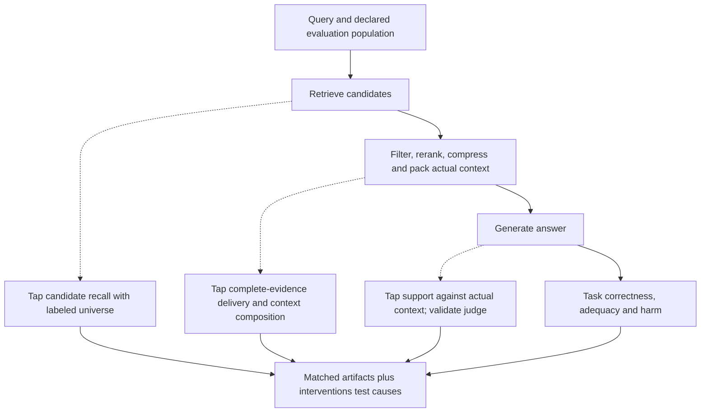
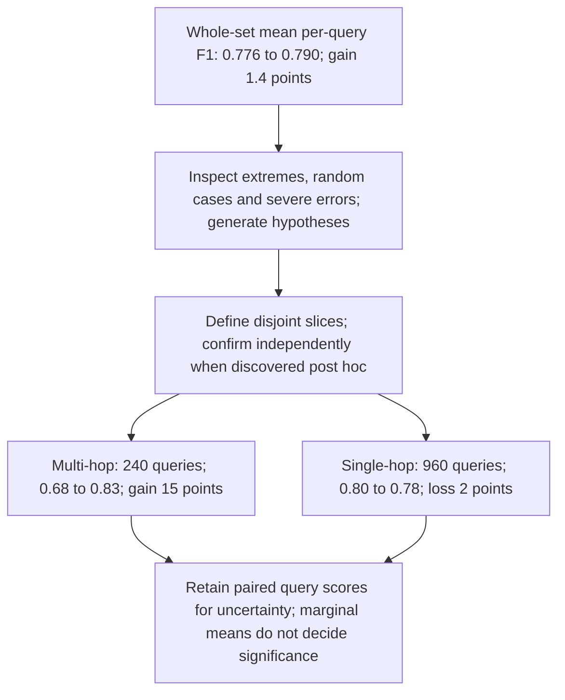
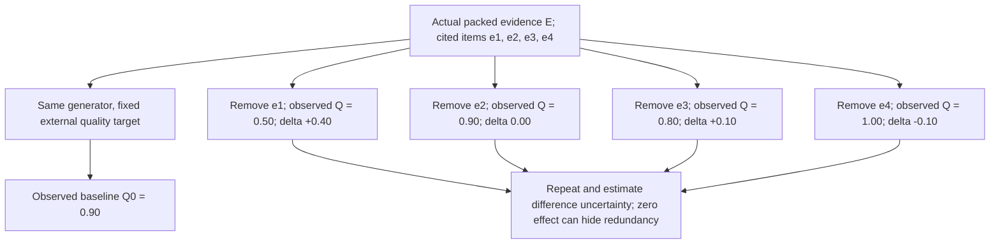
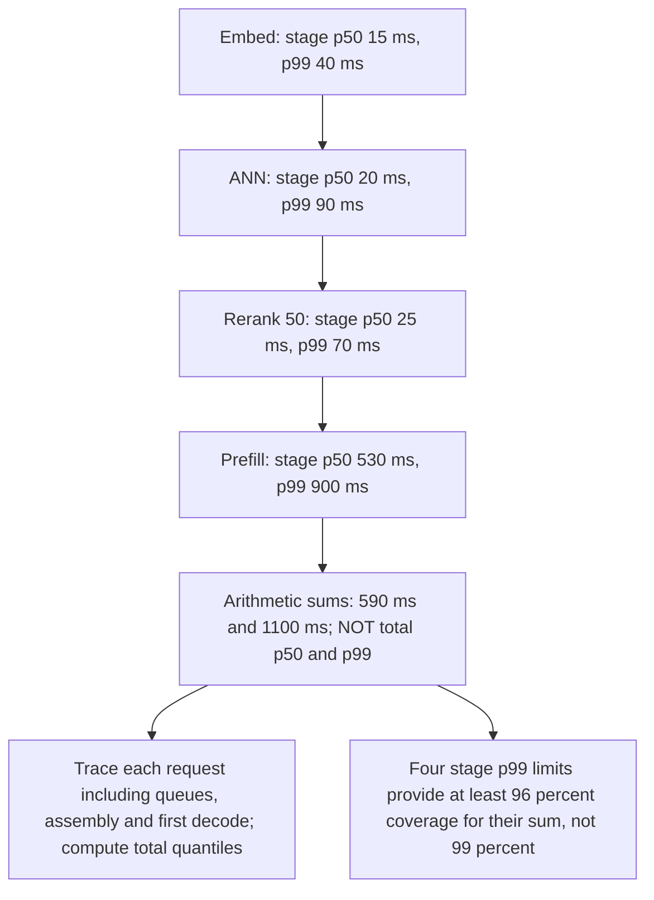
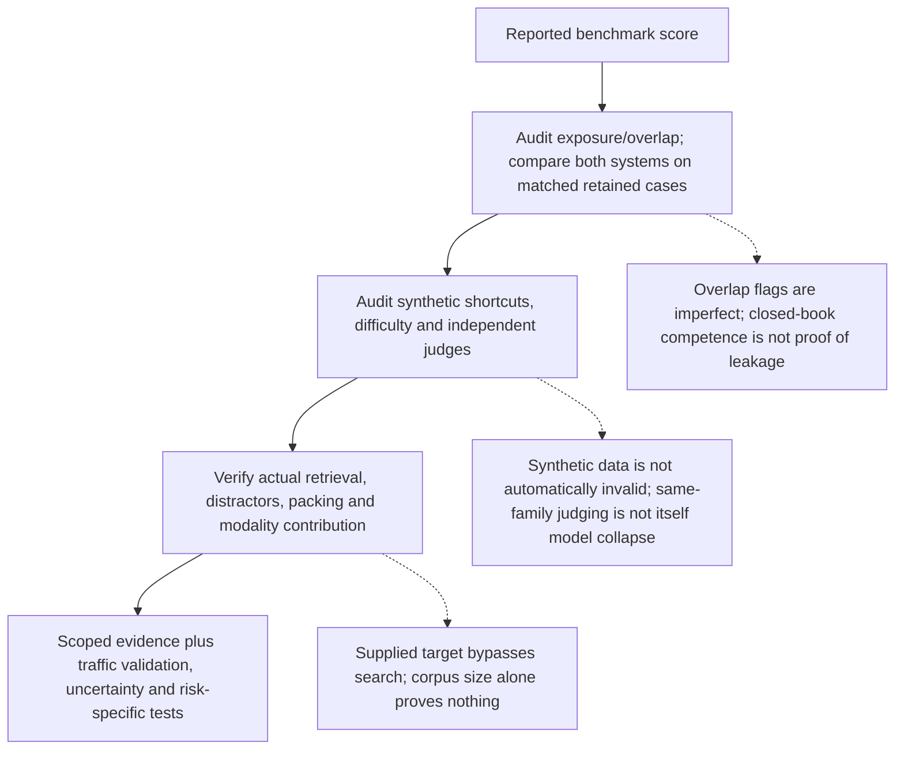

# Chapter 34: Evaluating the System
[00-START-HERE](../00-START-HERE.md) · [01-READING-ROUTES](../01-READING-ROUTES.md) · [33\_evaluating\_generation](33_evaluating_generation.md) · [35\_source\_credibility](../part-11-trust-robustness/35_source_credibility.md)
Purpose: diagnose a RAG pipeline with matched stage measurements, evaluate slice and ablation effects with the right uncertainty, measure joint latency and repeated-run behavior, and audit benchmark construction before a launch decision.
## TL;DR
- A final answer score does not identify a failing stage. Measure candidate coverage, actual evidence delivery, context composition and answer quality, then test hypotheses with controlled changes.
- Use whole-set review, case inspection and defined slices together. A weighted slice identity holds for means over a disjoint partition, not arbitrary nonlinear corpus metrics or overlapping slices.
- Ablate on matched cases with a declared intervention, control predictions, repeated runs and paired uncertainty. A flat-looking control does not prove equivalence or the proposed mechanism.
- Remove evidence from the actual generator input and regenerate with the same model. Positive/negative expected effects indicate helpful/harmful input under that setup; a near-zero leave-one-out effect can hide redundancy.
- Measure joint latency, modal answer fraction, correctness and attack success separately. Stage medians and $`p_{99}`$ values are not end-to-end percentiles.
- Audit training overlap, synthetic artifacts and whether retrieval is genuinely exercised. Compute filtered scores on the same retained items; marginal exclusion counts do not determine their union.
- Source comparisons, proxy judges and sanity checks remain scoped evidence, not universal launch certificates.
## The story
Imagine that you inspect a restaurant kitchen that prepares one meal from a diner’s order.
The pantry runner acts as the retriever. The runner finds candidate ingredients for the order.
The sous-chef acts as augmentation, which means sorting, removing duplicates, and arranging the ingredients that the chef will actually see.
The head chef acts as the large language model (LLM). The chef reads the prepared tray and produces the final dish.
A diner can dislike the dish even when the pantry runner found the right ingredient. The sous-chef may have buried it, or the chef may have misused it.
One satisfaction score at the dining-room door is end-to-end accuracy, which means the final result across the whole kitchen. That score says whether dinner worked, but it cannot tell the inspector which worker caused the failure.
The inspector adds measurement taps after candidate retrieval, actual context assembly and generation. Candidate recall asks how much labeled evidence was found; a separate complete-evidence hit asks whether everything required reached the chef. Context relevance estimates useful material, not complete coverage. Faithfulness tests support by the actual tray, not world truth or final task success.
The inspector first reads the restaurant’s whole-night average. That is macro analysis, or one score over every order.
Next, the inspector opens a small set of tickets with the biggest gains and losses. That is micro analysis, or close reading of individual cases to form a hypothesis.
Then the inspector groups all similar tickets, such as multi-course orders, and recomputes the average for that group. That is mezzo analysis, or a whole-set metric rerun on one coherent slice to test the hypothesis.
Suppose the kitchen adds a calculator for bills. The inspector runs an ablation, which means disabling only that tool while keeping everything else fixed.
Easy arithmetic orders check regressions and ceiling effects; hard orders test the intended benefit. A factual control bucket carries a predeclared expectation of little change, with a practical margin and uncertainty. It need not remain exactly identical in every stochastic run.
The same logic tests evidence. A citation is like an ingredient receipt attached to the dish.
The inspector removes a cited ingredient from the actual tray and cooks again with the same chef. A repeatable quality drop indicates a positive effect under that removal. Little change may mean redundancy or insufficient measurement precision, not an unused receipt. Improvement after removal warrants investigation but does not alone prove the source is false.
During the dinner rush, the inspector records each request’s stage times and total wait. A percentile is a distribution threshold, not a worst-case delay, and the total’s percentile is not the sum of stage percentiles.
The inspector repeats the same order and records the largest equivalent-answer cluster, pairwise answer agreement and correctness as separate measurements. The inspector also plants a hostile instruction in retrieved material to test indirect prompt injection under a stated attacker objective and defense setup.
Finally, the inspector audits the practice kitchen. Training overlap can affect results; artificial orders can contain shortcuts; and supplying the exact target ingredient bypasses search. Synthetic data or a small corpus is not automatically invalid, but the test must exercise the claimed stage and resemble the intended task.
The inspection supplies scoped evidence about failures, intervention effects, user-visible behavior and benchmark validity. It does not make one average, a no-change control or a public benchmark sufficient for a launch guarantee.
## Decoder table


| Technical term | Definition or measured quantity | Scope and limitations |
| --- | --- | --- |
| Retrieval-Augmented Generation (RAG) | A system that finds external evidence and gives it to a generator | Evaluation must separate search, context preparation, and answer writing |
| Retrieval | Finding candidate passages or items for a query | A bad answer may begin with missing evidence |
| Vector store | A store that searches numerical representations of content | It supplies candidates to the retrieval stage |
| Approximate Nearest Neighbor (ANN) search | Approximate vector search under declared settings | Not inherently nondeterministic; evaluate recall, speed and versions |
| Augmentation | Reranking, deduplicating, and assembling retrieved content | It can discard evidence that retrieval found |
| Reranking | Reordering retrieved candidates with a second scorer | It changes which evidence reaches the generator |
| Deduplication | Removing repeated candidates | It changes context composition and available evidence |
| Context assembly | Building the final prompt context from candidates | Stage metrics must use this actual context, not an oracle context |
| Generation | Writing an answer from the query and assembled context | It can misread good evidence or ignore it |
| Large Language Model (LLM) | The model that judges or generates language in the examples | It can add parametric knowledge, judge noise, and sampling variance |
| End-to-end accuracy | The fraction of final answers graded correct | It is a launch summary, not a stage diagnosis |
| Gold answer | A task reference under an annotation protocol | References can be incomplete or ambiguous; adjudicate consequential cases |
| Gold evidence | Annotated supporting sources or evidence sets | Source identity, any hit and complete sufficient evidence differ |
| Evaluation tap | Logged artifacts and metrics at a stage boundary | Reduces diagnostic ambiguity; does not prove causal ownership |
| $`\mathrm{Recall}@k`$ | Relevant-item fraction recovered at a cutoff | Any-hit probability is a different quantity |
| Context relevance | A proxy for useful context relative to the query | Not proof that all required evidence was delivered |
| Faithfulness | Whether the answer stays supported by the context it actually received | It exposes generation that goes beyond evidence |
| Hit rate $`h`$ | $`h=\Pr(H=1)`$ for adequate delivered evidence | Define the hit rule after packing, not just candidate presence |
| $`c_1`$ | $`c_1=\Pr(Y=1\mid H=1)`$ | Different hit difficulty can change it with an unchanged generator |
| $`c_0`$ | $`c_0=\Pr(Y=1\mid H=0)`$ | May reflect legitimate knowledge, alternative sources or incomplete labels |
| Parametric knowledge | Information stored in model weights | It can let a model answer despite retrieval failure |
| Oracle context | A controlled ideal-evidence input | Useful intervention, not the shipped context or a universal truth oracle |
| Corrective Retrieval Augmented Generation (CRAG) evaluator | Learned pair score with action thresholds | Not an infallible direct three-class gold labeler |
| Out-of-distribution risk | Failure when production inputs differ from training inputs | A learned evaluation component is not a neutral instrument |
| Macro analysis | Whole-set review of a declared statistic | Not automatically class-macro F1 |
| Micro analysis | Inspection of individual cases | Not pooled-count micro-averaging or a representative sample of extremes |
| Mezzo analysis | Analysis on defined subsets | Post-hoc discoveries need confirmation/multiplicity handling |
| Per-query score | A score assigned to one query and answer | It supports ranking examples by their changes |
| Slice | A subset with explicit membership | Weighted mean identity requires an exhaustive disjoint partition |
| Precision | The share of predicted positives that are correct | It is one part of a classification summary |
| Recall | The share of actual positives that the system finds | It is one part of a classification summary |
| $`F_1`$ score | A nonlinear harmonic metric under a specified unit | Mean per-query F1 differs from pooled corpus F1 |
| Confusion matrix | Counts of prediction outcomes by actual and predicted class | It supports precision, recall, and $`F_1`$ analysis |
| Bilingual Evaluation Understudy (BLEU) | A reference-overlap score | It is another possible macro statistic |
| Recall-Oriented Understudy for Gisting Evaluation (ROUGE) | A reference-overlap score with recall-oriented variants | It is another possible macro statistic |
| LLM-as-judge | A language model that scores an answer | It scales evaluation but can be noisy or miscalibrated |
| Multi-hop query | A query that needs several supporting passages or reasoning steps | The reranker example improves sharply on this slice |
| Single-hop query | A query that needs one supporting fact | The reranker example shows a small possible regression here |
| Weighted average | Mean of disjoint-slice means weighted by query counts | Does not generally reconstruct nonlinear corpus metrics |
| Standard error ($`\mathrm{SE}`$) | Sampling uncertainty of a particular estimator | A one-proportion SE is not a two-system difference SE |
| Bernoulli approximation | IID binary-outcome model for a declared quantity | Soft F1 scores and paired differences require a different variance model |
| Paired bootstrap | Resample matched independent units across both arms | Cluster where needed; recompute nonlinear metrics and disclose assumptions |
| Router | Request-time path selector | Include routing errors, costs and non-routable hidden slice labels |
| Ablation | A declared configuration intervention | Tests the toggle effect; does not automatically identify internal mechanism |
| Trivial-target bucket | Easy cases inside a component’s intended remit | It checks for regressions and ceiling effects |
| Hard-target bucket | Difficult cases the component was designed to help | The intended effect should concentrate here |
| Control bucket | A stratum expected to have negligible effect | Need a practical margin and interval; non-significance is not equivalence |
| Ceiling effect | A small measured gain because the baseline is already near perfect | It explains a compressed easy-case delta |
| Confound | An unintended change that can explain the measured effect | It invalidates a causal claim about the named component |
| Matched-complexity placebo | A control designed around a proposed mechanism | Check token/compute, distribution and information differences |
| Pseudo-instruction chunking | Chunking guided by an LLM-generated document summary | The chapter uses placebos to isolate the summary’s information |
| Retrieval-conditioned generator | A generator that receives evidence before writing | Evidence removal can intervene on its actual input |
| During-generation attribution | Citing evidence while producing the answer | It connects citations to the conditioned generation process |
| Post-hoc citation search | Support search after text is fixed | May establish support but not which input changed generation |
| Cited-evidence set $`C`$ | Cited items $`C_q\subseteq E_q`$ | Remove from actual packed input E, preserving other evidence and instructions |
| Baseline quality $`Q_0`$ | Quality of a baseline generated answer | Use fixed references, task coverage and a stable quality target |
| Leave-one-out quality $`Q_{-i}`$ | Quality after a specified input removal and regeneration | Fix generator across arms; declare duplicate and refill handling |
| Evidence delta $`\Delta_i`$ | Expected baseline-minus-removal quality | One observed delta is not a statistically certified effect |
| Load-bearing evidence | Positive effect under the specified removal and quality target | Not proof of absolute necessity under every alternative source set |
| Decorative evidence | No detected individual-removal effect | Can hide redundancy or low power; avoid equating it with unused evidence |
| Harmful evidence | Negative expected quality effect from including an item | May reflect task mismatch or prompt/judge effects, not proven false content |
| Entailment | A relation in which a passage could support a claim | It does not prove that the generator used the passage |
| Noise floor $`\sigma`$ | Baseline sample standard deviation | Not a confidence interval or difference-of-means SE |
| Shapley values | Average marginal contributions over evidence coalitions | Interaction-aware utility attribution; exact subset evaluation grows exponentially |
| Atomic fact | One checkable statement inside an answer | Atomic-fact scoring gives the evidence example a quality measure |
| Fine-grained Atomic Evaluation of Factual Precision (FActScore) | Support precision over extracted atomic facts | Can rise through omission; add adequacy and count diagnostics |
| Retrieval-Augmented Generation Assessment (RAGAS) | A framework with a faithfulness measure | It is another possible quality judge $`Q`$ |
| System-level property | Behavior that emerges across stages or repeated runs | Single query-answer grading does not capture it |
| Latency | Time spent serving a request | A correct system can still be unusably slow |
| $`p_{50}`$ | Median stage or total latency under a stated boundary | Total median is not generally the sum of stage medians |
| $`p_{95}`$ and $`p_{99}`$ | High latency quantiles | Not worst cases; total quantiles require joint request timing |
| Tail risk | Any-stage threshold exceedance or total-SLA breach | These are different events; independence must be stated |
| Time-to-first-token | From request start to first emitted token | Include queues, assembly and first decode as defined; useful completion can also matter |
| Service-Level Agreement (SLA) | A population, percentile/target, boundary and measurement commitment | A median cannot establish a p99 SLA |
| Self-consistency | Empirical modal cluster fraction in this chapter | Different from pair agreement and decoding-by-vote; not truth |
| Semantic-equivalence cluster | Answers grouped by a validated meaning-equivalence rule | Clustering errors and nontransitive pair judgments affect the metric |
| Sampling temperature | A decoding randomness parameter | Zero temperature does not ensure all backend operations are deterministic |
| Hierarchical Navigable Small World (HNSW) index | A graph ANN design | Implementation/settings determine reproducibility; the name alone does not |
| Retrieval nondeterminism | Different retrieved results for the same query | It changes context before generation begins |
| Upsert | Adding or updating an item in a live index | It can change top-$`k`$ results between repeated calls |
| Robustness | Failure behavior under inputs designed to break the system | Normal held-out accuracy does not measure it |
| Direct jailbreak | A hostile instruction in the user’s query | It attacks the model through the query |
| Indirect prompt injection | Adversarial instructions via lower-trust retrieved/tool content | Not exclusive to RAG; roles and isolation help but do not guarantee immunity |
| Red-team set | A standing collection of adversarial cases | It makes robustness a repeatable metric |
| Injection-success rate | Successful attack attempts divided by eligible evaluated attempts | Specify objective, denominator, dependencies and uncertainty |
| Benchmark hygiene | Audit of what a benchmark actually measures | Three checks do not suffice for a launch certificate |
| Contamination | Potential or actual training exposure under a stated definition | Common facts or overlap flags alone do not prove leaked test membership |
| Closed-book baseline | Answer generation without added retrieved evidence | Legitimate prior knowledge and leakage require separate interpretation |
| $`n`$-gram overlap | Exact token-sequence matching against an accessible corpus | Misses paraphrases and can flag benign overlap |
| Synthetic evaluation set | Generated evaluation cases under a documented process | Can be useful; validate shortcuts, diversity and target-distribution match |
| Lexical-overlap control | A keyword-style baseline used on synthetic items | It tests whether surface wording explains the result |
| Model collapse | Distribution degradation under recursive synthetic training | Same-family generation/judging bias is not itself model collapse |
| Visual Question Answering (VQA) | Reading a supplied image to answer a question | An isolated reader test can be valid, but does not test target selection |
| Multimodal RAG | Retrieval and generation over text, images, or both | Its benchmark must exercise retrieval before reading |
| Multimodal Retrieval-Augmented Generation Benchmark (MRAG-Bench) | Historical vision-centric benchmark with explicit augmentation conditions | Human GT gains, model GT gains and retrieved gains are different contrasts |
| Information Retrieval (IR) benchmark | A test focused on finding relevant items | A recycled task may not measure full multimodal RAG |
| Modality-removal ablation | A specified modality intervention | Null effects can reflect redundancy or low power; control layout/budgets |
| Exact match | A score that requires the output to match a reference exactly | It supplies the benchmark worked example’s headline accuracy |
| Dense Passage Retrieval (DPR) | A historical dense passage retriever | NQ top-k answer-containing accuracy is not every RAG task’s evidence recall |
| Normalized Discounted Cumulative Gain (nDCG) | A ranking metric that rewards relevant items near the top | It appears in the reranker interview probe |


## Core mechanics
### Mathematical conventions
Declare the query population, unit, reference labels, evidence scope and metric. Accuracy is a proportion of answers under a binary rubric; a mean per-query $`F_1`$ is not pooled confusion-count $`F_1`$. “Macro/micro/mezzo analysis” below names whole-set review, case inspection and slice review—not the technical class-macro versus micro averaging definitions.
Conditional accuracy on delivered evidence is descriptive, not an isolated causal measure of generator quality. Gold-source identity, any-hit rate, relevant-item recall and delivery of all required evidence differ. Stage taps reduce ambiguity but do not by themselves identify a causal root cause. Empty hit/miss groups have undefined empirical conditional accuracy.
Use matched queries and versioned inputs, models, judges and budgets for comparisons. For uncertainty, retain paired per-query records and use the actual independent unit; related questions, shared documents and repeated runs can require clustered or hierarchical analysis. A non-significant effect does not prove zero effect or equivalence. Predefine relevant harm/equivalence margins and account for adaptive slice selection and multiple tests.
A stochastic ablation targets an expected quality difference under a specified intervention, not an absolute fact about whether a passage was ever used. Hold the generator and quality target fixed across arms. A sample baseline standard deviation is not a confidence interval for a difference.
Latency distributions refer to the same workload, measurement boundaries and load. Quantiles do not generally add, even for independent stages. Sum per-request durations along the actual critical path, then compute end-to-end percentiles. Prices, timings and all hand-constructed counts below are illustrative; historical benchmark results are not replicated here. Keep full precision until reporting; score differences are percentage points or explicitly named metric points, not relative percentages.
### 34.1 A final score cannot identify a pipeline stage
#### What the aggregate hides
- **What:** Treat retrieval, augmentation and generation as composed operations with observable inputs and outputs; this does not forbid end-to-end training.
- **Why:** Candidate misses, filtering/truncation, source defects and reader/judge failures can produce the same final error.
- **Limit:** Stage measurements describe failure locations; controlled interventions are needed to distinguish causes.
- **Cost:** Retain per-query candidate IDs, packed evidence, outputs, references and versions. Measure after any step that can change delivered evidence.
Let $`Y\in\{0,1\}`$ denote answer correctness and $`H\in\{0,1\}`$ denote delivery of adequate evidence to the generator under a fixed rubric. Define $`h=\Pr(H=1)`$ and $`c_b=\Pr(Y=1\mid H=b)`$ for strata of positive probability. The law of total probability gives:

```math
A=\Pr(Y=1)=h c_1+(1-h)c_0.
```

Infinitely many triples within $`[0,1]^3`$ yield one $`A`$; the parameter range is bounded, not an “unbounded” numerical family. At $`h=0`$ or $`h=1`$, one empirical conditional accuracy is unobservable rather than an estimated zero. Measure candidate recall, complete-evidence delivery, context relevance, actual-context support and final correctness separately. These metrics have different denominators and are not interchangeable.
#### Worked example
Use a constructed $`400`$-query runbook test. For this toy only, assume the identified gold passage is adequate, survives context packing, and defines $`H=1`$; merely finding a runbook ID in a top-ten candidate list would not establish that in production.
System 1 delivers adequate evidence on $`340`$ queries: $`h_1=340/400=0.85`$. It answers $`255`$ hits correctly, so $`c_{1,1}=255/340=0.75`$ exactly. Nine of sixty misses are correct, giving $`c_{0,1}=9/60=0.15`$. Thus $`A_1=(255+9)/400=0.66`$.
System 2 has $`260`$ hits, so $`h_2=0.65`$; its hit accuracy is $`252/260=63/65\approx0.969230769`$ and miss accuracy is $`12/140=3/35\approx0.085714286`$. Again $`A_2=(252+12)/400=0.66`$.
The decompositions differ, but the hit sets can contain different difficulties. Higher $`c_1`$ does not alone prove a better generator: the same generator can score perfectly on fifty easy hits and $`2/3`$ on seventy-five hits after twenty-five hard cases are added. Use matched evidence interventions or shared hit strata before assigning opposite fixes.
#### Sanity case and claim limit
The original DPR single-dataset result reports $`78.4\%`$ NQ top-twenty answer-containing-passage retrieval accuracy. This historical metric is not full multi-evidence recall. An $`85\%`$ toy runbook hit rate at depth ten is not validated by a different corpus, depth, label protocol and task. Use the published number as context, not an internal-evaluator certificate.[\[1\]](https://arxiv.org/html/2004.04906)
#### Practical decisions
- Retain outputs at candidate retrieval, every context-changing stage, and generation; score actual consumed evidence as well as candidates.
- Define whether a hit means any relevant item, a gold source identity or a complete support set. Report missing/ambiguous evidence labels.
- Inspect $`c_0`$ when unexpectedly high, but do not impose a universal few-percent threshold. Legitimate parametric knowledge, incomplete golds and alternative sources can all explain correct “misses.”
- Recompute the decomposition on matched query slices when accuracy changes, with uncertainty. A four-point drop is not a causal diagnosis by itself.
- Intervene on suspected stages while holding other versions and budgets fixed; metric movement alone does not prove ownership.
- If candidate recall is $`92\%`$, gold-context faithfulness $`95\%`$, and final correctness $`58\%`$, inspect packed evidence and re-score against it. Those three different targets do not mathematically imply augmentation loss.
- Validate learned evaluators separately. The original CRAG evaluator uses a learned pair score and action thresholds, not an infallible three-class oracle.[\[2\]](https://arxiv.org/html/2401.15884v3)
### 34.2 Macro, micro, mezzo analysis
#### The three analysis levels
- **What:** Whole-set analysis summarizes the evaluation; case inspection forms hypotheses; slice analysis checks coherent subsets.
- **Why:** Aggregate gains can hide losses, but selected extreme examples also overstate apparent mechanisms.
- **Limit:** A post-hoc discovered slice is exploratory until confirmed on fresh/held-out cases or handled by an appropriate multiplicity protocol.
- **Cost:** Reading roughly ten to thirty cases per direction is a workflow heuristic, not a statistical sample-size guarantee. Include random and consequential-error cases too.
For the weighted identity below, define a per-query score $`s_i\in[0,1]`$ and a disjoint, exhaustive partition $`I_1,\ldots,I_J`$ of $`N\gt 0`$ queries. Let $`n_j=|I_j|\gt 0`$, $`w_j=n_j/N`$ and $`\bar s_j=n_j^{-1}\sum_{i\in I_j}s_i`$. Then:

```math
\bar s=\frac1N\sum_{i=1}^N s_i=\sum_{j=1}^Jw_j\bar s_j,\qquad \sum_jw_j=1.
```

The identity holds for means of per-query $`F_1`$, ROUGE or judge scores when defined on that scale. It does not generally hold for pooled classification $`F_1`$, corpus BLEU or overlapping slice averages. Recompute nonlinear metrics from the underlying paired records. Case inspection can precede or follow targeted monitoring; the macro→micro→mezzo order is a useful workflow, not a mathematical requirement.
#### Worked example
Take $`1{,}200`$ queries and define the metric specifically as mean per-query $`F_1`$, not pooled corpus $`F_1`$. Baseline is $`0.776`$, candidate $`0.79`$, a $`0.014`$ gain or $`1.4`$ F1 points. Inspect ten largest gains and ten largest losses; suppose eight gains involve multi-hop queries and seven losses are single-hop. These selected counts generate a hypothesis, not prevalence estimates or proof of a reranker mechanism.
A disjoint partition has $`240`$ multi-hop queries and $`960`$ single-hop queries. Stipulated multi-hop means move $`0.68\to0.83`$ and single-hop $`0.80\to0.78`$. Their weighted means are exactly $`0.2(0.68)+0.8(0.80)=0.776`$ and $`0.2(0.83)+0.8(0.78)=0.79`$. The contributions are $`0.2(0.15)=0.03`$ and $`0.8(-0.02)=-0.016`$, totaling $`0.014`$. This algebra does not determine uncertainty or why the changes occurred.
#### Significance filter and claim limit
The single-proportion formula $`\sqrt{p(1-p)/n}`$ is not the standard error of a two-system change. Plugging the average rates into it gives approximately $`2.776201`$ and $`1.314582`$ percentage points here, but dividing the observed changes by those values does not justify the original “$`5.4`$ standard errors” or “inside noise” conclusions. The toy metrics are not even independent binary trials.
For matched per-query means, set $`d_i=s_i^{\mathrm{on}}-s_i^{\mathrm{off}}`$, $`\bar d=n^{-1}\sum_i d_i`$, and for $`n\gt 1`$ use

```math
\widehat{\mathrm{SE}}(\bar d)=\frac{s_d}{\sqrt n},\qquad
s_d^2=\frac1{n-1}\sum_{i=1}^n(d_i-\bar d)^2.
```

This requires independent query units for its usual interpretation; use paired/clustered resampling and recompute the target metric when needed. A paired binary difference depends on wins and losses (discordance), not just marginal accuracies. For a different, independent-binary planning model, two-arm standard errors would be about $`3.865984`$ and $`1.858539`$ points, still not valid significance tests for these paired F1 data. Without paired records, neither slice is statistically classified by the displayed means alone.
#### Practical decisions
- Report overall and slice effects with definitions, counts and matched uncertainty; use a declared utility/harm gate rather than an average alone.
- Inspect extreme cases, a random sample and severe failures; audit the judge so its noise does not select the entire story.
- Confirm discovered slices independently, or label them exploratory and account for multiple comparisons.
- Use practical loss/equivalence margins. A non-significant single-hop loss is not evidence of no harm and does not automatically justify shipping.
- A router can preserve a target benefit only if its own errors, latency and coverage are included in the evaluation. Slices defined using hidden labels may not be routable at request time.
- Precommit monitors and rollback criteria without calling an unmeasured slice effect “unambiguously real.”
### 34.3 Ablation design and sanity cases
#### The ablation matrix
- **What:** Compare component states on matched cases under a declared intervention, fixing versions, shared prompts, sources and evaluation targets.
- **Why:** A controlled intervention estimates the effect of that configuration change. It does not automatically identify the designer’s proposed internal mechanism.
- **Limit:** Stochastic generation, changed routing, resource budgets and input formatting can accompany a toggle; measure and disclose them.
- **Cost:** Use easy, hard and control strata with prespecified effects and harm margins. Choose sample sizes and repeated-run design for the decision before seeing results.
A separate illustrative headline moves accuracy $`71\%\to74\%`$, or three points. With an otherwise unchanged population and a $`20\%`$ target slice, this would require a fifteen-point target gain. A forty-five-point slice gain from $`40\%\to85\%`$ at that same $`20\%`$ mass instead adds nine overall points, not three; a three-point total would require target mass $`1/15\approx6.666667\%`$ or offsetting losses elsewhere.
Easy cases can reveal regressions under a ceiling; hard cases test the intended benefit; controls test a predeclared no-material-effect expectation. Specify an equivalence margin rather than demanding exact zero. Control movement can reveal noise, unintended genuine effects, routing changes or confounds. A stable control rules out none of those universally.
#### Noise calculation
For one IID binary accuracy estimate at $`p=0.5`$, $`\mathrm{SE}=\sqrt{0.25/100}=0.05`$ and a nominal normal $`95\%`$ half-width is $`1.96(0.05)=0.098`$, or $`9.8`$ points. That is an interval scale for one proportion, not the difference of two systems.
For two independent $`100`$-item proportions near one half, the difference standard error is $`\sqrt{0.25/100+0.25/100}\approx0.070710678`$ with half-width about $`13.859293`$ points. A paired toggle requires the within-query covariance or discordance instead. For binary paired counts $`u`$ (wins) and $`v`$ (losses),

```math
\hat d=\frac{u-v}{n},\qquad
\widehat{\mathrm{SE}}(\hat d)=
\sqrt{\frac{(u+v)/n-\hat d^2}{n-1}},\quad n\gt 1.
```

A four-point control move and fifteen-point target move at $`n=100`$ cannot be certified harmless/significant by a ten-point rule. Use paired inference, effect size and an equivalence/harm margin; failure to reject zero is not proof the control is within that margin.
#### Matched placebos
A component-off comparison estimates the whole toggle’s effect, not just “more processing.” A placebo can investigate a claimed information mechanism, but matching input shape is not necessarily matching token count, compute, retrieval quality or distribution. For summary-conditioned chunking, another document’s summary, a random sentence or an averaged embedding are different controls with different possible harms. The chapter reports genuine summaries outperforming those controls in a cited setting; treat that as reported evidence, not a replicated universal proof of mechanism.
#### Worked example
Construct three $`100`$-query buckets. Easy arithmetic has baseline/on correct counts $`96/98`$, hard word problems $`41/83`$, and factual controls $`57/58`$. These are not published benchmark results. The changes are two, forty-two and one percentage points. With equal bucket weights the audit mean rises from $`194/300\approx0.646667`$ to $`239/300\approx0.796667`$, a fifteen-point gain—not the separate $`71\%\to74\%`$ headline.
The pattern is consistent with the intended calculator benefit. But the marginal counts do not identify paired uncertainty, and a one-point observed control movement does not prove no material control effect. Audit correctness labels, wins/losses and unintended shared changes before claiming a causal mechanism or deployment gain at a different query mixture.
#### External sanity case and claim limit
MRAG-Bench reports human accuracy $`38.47\%`$ without additional RAG knowledge, $`61.38\%`$ with retrieved knowledge and $`71.63\%`$ with ground-truth (GT) knowledge. The gains are $`22.91`$ and $`33.16`$ percentage points. GPT-4o is reported at $`68.68\%`$, $`68.96\%`$ and $`74.50\%`$ in the corresponding conditions, gains of $`0.28`$ and $`5.82`$ points. The $`33.16`$ figure is a human GT-augmentation contrast, not a production model lift from a generic text-only question.[\[3\]](https://arxiv.org/html/2410.08182v2)
These are different populations and interventions from the calculator toy. A four-point production gain versus a published thirty-three-point human GT gain can differ because of model, retrieval quality, task mix or protocol; it does not specifically identify query mix. Test relevant production strata and matched augmentation conditions.
#### Practical decisions
- Define the component intervention, fixed settings, population and expected target/control effects.
- Prespecify sample sizes, practical margins, pairing, replication and multiple-test handling.
- Use whole-set results and task-relevant strata together; a balanced audit need not have production weights.
- Report uncertainty honestly when rare strata are small, and do not infer equivalence from a null result.
- Use placebos suited to the mechanism, checking content, token/compute and distribution mismatches.
- Re-run controls after shared prompt, router or resource changes; retain all arms and case-level records.
- Validate quality and action cost as well as statistical effect before shipping.
### 34.4 The remove-the-evidence ablation
#### Necessity versus support
- **What:** Remove a specified evidence item from the actual packed generator input and regenerate with the same generator.
- **Why:** This tests the input intervention’s effect on a fixed quality target. Static entailment of already-written text tests support, not input necessity.
- **Limit:** Redundancy, substitution, prompt-position changes and stochasticity complicate reliance claims. A during-generation citation is not automatically causal either.
- **Cost:** With $`n`$ distinct cited input items, one baseline plus $`n`$ removals gives $`n+1`$ generations before replication and judging.
Let $`E_q`$ be the actual packed evidence and $`C_q\subseteq E_q`$ its cited items. Preserve all other evidence and instructions when removing $`e_i\in C_q`$; regenerating from only the citations would otherwise change the baseline input. Specify whether removing an item removes every duplicate occurrence and whether vacated space is refilled. Use fixed external references and a fixed answer-quality rubric $`Q`$, not a support target that silently changes with the removed context.
For random generation/judgment state $`\xi`$, write $`y_0(\xi)=\mathop{\mathrm{Gen}}\nolimits(q,E_q;\xi)`$ and $`y_{-i}(\xi)=\mathop{\mathrm{Gen}}\nolimits(q,E_q\setminus\{e_i\};\xi)`$. One observed delta is:

```math
\begin{aligned}
\widehat\Delta_i^{(r)}&=Q(y_0^{(r)})-Q(y_{-i}^{(r)}),\\
\Delta_i&=\mathbb E[Q(y_0)]-\mathbb E[Q(y_{-i})].
\end{aligned}
```

A reliably positive expected effect means this removal harms the measured target; a negative effect means it helps. Near-zero estimates mean no detected individual effect, not proof of decorative or unused evidence. Use uncertainty and practical margins before labeling. A historical macro-$`F_1`$ near $`0.80`$ for an attribution judge is not the statement “one wrong verdict in five”; class metrics and accuracy differ. Even a perfect support judge cannot establish which input was necessary.
#### Leave-one-out blind spot
If either of two corroborating passages alone is sufficient, both leave-one-out deltas can be zero, while removing both drops quality. For the toy utility $`v(\varnothing)=0`$ and $`v(S)=1`$ for any nonempty subset of the two, each Shapley share is $`1/2`$ despite zero individual-removal effects. Complementary evidence creates the opposite interaction: individual deltas can sum to more than the full gain.
Evaluating all $`2^n`$ subsets exposes interactions under the chosen utility and permits exact Shapley calculation in a deterministic toy—sixteen subsets at $`n=4`$, $`1{,}024`$ at $`n=10`$. It does not repair a wrong judge or finite-sample stochastic uncertainty. Approximation and targeted joint removals can reduce cost.
#### Worked example
Use a constructed four-passage history question. Stipulate that $`e_1`$ carries the requested date and names, $`e_2`$ is background, $`e_3`$ corroborates a date and adds a detail, and $`e_4`$ is a misleading forum item. These are hypothetical passage roles, not a newly verified claim about particular insulin-history sources.
Hold the external reference and support rubric fixed and stipulate ten evaluated facts in every generated answer. The observed baseline has nine supported facts, $`Q_0=0.90`$. Removal scores $`Q_{-1}=0.50`$, $`Q_{-2}=0.90`$, $`Q_{-3}=0.80`$, $`Q_{-4}=1.00`$ give observed deltas $`0.40`$, $`0.00`$, $`0.10`$, $`-0.10`$.
They suggest helpful, undetected-individual, helpful and harmful effects respectively; these are not statistically certified classifications from one run. Equal claim counts and fixed references are explicit assumptions. In general, changing claim count can improve support precision by omitting content, so add answer completeness, correctness and task-critical error measures.
#### Cost and noise check
For $`300`$ questions with exactly $`1{,}200`$ cited input items in total (mean four), one baseline per question and one removal per citation give $`300+1{,}200=1{,}500`$ generation calls: five times the generation-only count. It is not automatically five times the token bill, latency or full evaluation cost. The separate $`3{,}500`$-fact-check scenario from Chapter 33 counts different work units.
If five total baseline samples are collected per question but each removal only once, total generation calls rise to $`300(5)+1{,}200=2{,}700`$. Five repetitions of both baseline and every removal cost $`5(1{,}500)=7{,}500`$ calls before judges. A baseline sample SD near $`0.03`$ from five runs is uncertain and does not identify removal variance or a difference interval.
For independent single-run arms with known equal SD $`0.03`$, the delta SD is $`\sqrt2(0.03)\approx0.042426`$, so two SDs are about $`0.084853`$, not $`0.06`$. Five independent samples per arm would have difference-of-means SE $`0.03\sqrt{2/5}\approx0.018974`$ under that extra model. Paired covariance and estimated variances alter inference; five baseline samples alone cannot certify the $`\pm0.10`$ signs.
#### Practical decisions
- Remove from the actual input, regenerate, and keep the same generator, decoding protocol and fixed quality target across arms.
- Rescoring fixed text against less evidence is a different support-ablation question; do not label it a generator response intervention.
- A cheaper model used only for removals confounds model and evidence changes. Use it in both arms for a separately validated pilot, then confirm on the intended generator.
- Estimate the difference distribution using repeated paired runs/queries and judge audits, not a baseline-SD-only band.
- Predefine a practically negligible margin. An interval containing zero is inconclusive; an interval contained within that margin supports equivalence under its assumptions.
- Use targeted joint removals for redundancy and distinguish source effects from removal-induced layout or budget changes.
- A repeatable negative effect warrants source, prompt and evaluator review, not automatic proof of source falsity.
- Evaluate candidate/reranker interventions separately when that is the target. Choose online/offline cadence from actual cost and risk, not domain name alone.
### 34.5 System-level properties: latency, self-consistency, robustness
#### Why single-answer scores are insufficient
- **What:** Measure user-visible latency, repeatability, correctness and adversarial outcomes under declared load and populations.
- **Why:** A good mean answer score does not ensure usable tails, stable answers or resistance to lower-trust instructions.
- **Limit:** Repeated-answer agreement is not truth; zero observed attacks is not zero risk; stage percentiles are not joint percentiles.
- **Cost:** Retain request traces, repeat fixed queries and snapshots, and maintain representative as well as adversarial cases.
The representative stage chain is embed, search, fuse, rerank, context assembly, prefill, and decode. Each stage has its own latency distribution. Each call can also receive different evidence or decoding outcomes.
#### Latency and tail compounding
Let $`L_i`$ be the event that stage $`i`$ exceeds its own declared slow threshold, and $`p_i=\Pr(L_i)`$. For independent events only:

```math
\Pr\!\left(\bigcup_{i=1}^m L_i\right)=1-\prod_{i=1}^m(1-p_i).
```

Four independent one-percent slow events give $`1-0.99^4=0.03940399`$, or about $`3.940399\%`$ (one in $`25.378141`$ requests). Five give $`1-0.99^5\approx4.900995\%`$. This is the chance of any stage exceeding its own threshold, not the chance of violating an arbitrary total-latency SLA. Without independence,

```math
\max_i p_i\le\Pr\!\left(\bigcup_iL_i\right)\le\min\!\left(1,\sum_i p_i\right).
```

Shared load can correlate delays; correlations need measurement rather than inference from marginal percentile shifts alone. For streaming, specify time-to-first-token and useful-answer/completion targets as appropriate. Agentic consumers may require complete verified output. Batch systems can still have deadlines and tail latency as well as throughput and queue depth.
#### Latency worked example
Consider a stipulated $`5\times10^6`$-chunk, $`768`$-dimensional HNSW system with fifty rerank candidates and $`1{,}600`$ prefill context tokens. Stage $`(p_{50},p_{99})`$ latencies in milliseconds are embedding $`(15,40)`$, ANN $`(20,90)`$, reranking $`(25,70)`$ and prefill $`(530,900)`$. The sums are $`590\,\mathrm{ms}`$ and $`1{,}100\,\mathrm{ms}`$, but neither is generally the corresponding end-to-end quantile. Include queueing, communication, context assembly and first decode if they fall inside the time-to-first-token boundary.
A counterexample is four independent stages each taking one unit with probability $`0.99`$ and $`101`$ units with probability $`0.01`$. Each stage’s $`p_{99}`$ is one, so their sum is four, but the total is four only with probability $`0.99^4=0.96059601`$; its $`p_{99}`$ is $`104`$, not at most four. Medians also fail to add: two independent stages that are zero with probability $`0.6`$ and one otherwise each have median zero, but their sum has median one.
With four stage $`p_{99}`$ thresholds, the union bound provides at least $`96\%`$ coverage for their sum, or at least $`96.059601\%`$ under independence—not a $`99\%`$ bound. A dependence-robust $`99\%`$ upper threshold can allocate total tail budget $`0.01`$: if $`t_i`$ is each stage’s $`p_{99.75}`$, then $`\Pr(\sum_iT_i\le\sum_it_i)\ge0.99`$. This requires all relevant sequential durations and appropriate marginal quantiles; direct joint request traces are preferable.
Nielsen’s approximate usability guidance distinguishes $`0.1\,\mathrm s`$ for an instantaneous feel, one second for uninterrupted thought and ten seconds for sustained attention. These are design heuristics, not a universal SLA or a claim that attention is lost immediately above one second.[\[4\]](https://www.nngroup.com/articles/response-times-3-important-limits/)
A $`400\,\mathrm{ms}`$ median alone cannot assess a one-second percentile SLA. An added $`180\,\mathrm{ms}`$ serial security scan cannot leave each request’s first-token time unchanged without overlap or offsetting work. Measure its security benefit and latency distribution; selective or ingestion-time scanning introduces coverage and freshness trade-offs.
#### Self-consistency
Run a fixed query $`R\ge1`$ times under a declared generation/retrieval policy. Use a validated semantic clustering rule, with cluster counts $`c_j`$ summing to $`R`$. Define an empirical modal-answer fraction, rather than a general probability that two answers agree:

```math
\widehat{\mathrm{SC}}_{\mathrm{mode}}=\frac{\max_jc_j}{R},\qquad \sum_jc_j=R\gt 0.
```

This diagnostic differs from the self-consistency decoding strategy of sampling reasoning paths and voting. It also differs from distinct-pair agreement,

```math
\widehat{\mathrm{SC}}_{\mathrm{pair}}=\frac{\sum_jc_j(c_j-1)}{R(R-1)},\qquad R\ge2.
```

For counts $`(4,1)`$, modal fraction is $`0.8`$ but distinct-pair agreement is $`0.6`$. One sample always gives modal fraction one, providing no stability evidence. Empirical mode selection can bias the estimate upward; report repeat count, query aggregation and clustering uncertainty. Agreement and correctness are distinct, not statistically independent by definition: identical wrong answers score perfectly consistent.
RAG can vary because of sampling, ANN settings, replica/version changes and live updates. HNSW or multithreading is not inherently nondeterministic in every implementation. Pin index, model, evidence and seeds where supported, then vary one factor at a time. Temperature zero and a frozen index do not guarantee deterministic backend execution or eliminate the need to monitor changes. Do not disable the canary from those two settings alone.
#### Robustness
A direct jailbreak is supplied through the user input; an indirect injection can arrive through retrieved text, tools or other lower-trust material. Message roles, provenance and isolation provide structural boundaries, but not an automatic guarantee that a model will respect them. Avoid the absolute claim that sharing a context window makes all instructions structurally indistinguishable.
Define an attack objective, eligible attempt population and success rubric. Report successful runs divided by evaluated attempts, by attack class and source access, with judge/adjudication error and repeated-query dependence. A standing red-team set tests known attacks, not the entire threat space. Under an IID binomial model, zero successes in $`100`$ trials still permits a one-sided $`95\%`$ upper success rate $`1-0.05^{1/100}\approx2.951305\%`$.
Reassess after changes to prompts, retrieval, models, tools or ingestion policy. A curated corpus can reduce one route but does not prove no attacker-controlled content, compromised sources or future updates. Choose monitoring cadence from the threat model and risk rather than a categorical curated-corpus exception.
### 34.6 Benchmark hygiene: contamination, synthetic sets, VQA-in-RAG-clothing
#### The three gates
- **What:** Audit training overlap, construction artifacts, actual retrieval, modality contributions and deployment match.
- **Why:** A reproducible difference can still measure shortcuts, source reading or a different population.
- **Limit:** These checks are necessary diagnostic questions, not three sufficient gates certifying the shipped task or safety.
- **Cost:** Maintain benchmark provenance, matched filtered baselines, candidate/search traces, modality removals and independent traffic validation.
An opening $`84\%`$ score that is five points above a prior system is only a measured result under that test. Check its rubric, uncertainty, population and stage coverage before a launch inference.
**Training overlap.** Public sources can overlap pre-training, but common factual knowledge is not identical to leaked test questions. A strong closed-book baseline may be a legitimate baseline; it does not prove contamination or a universally understated retrieval value. Brown et al. constructed conservative potentially-overlapping subsets using roughly thirteen-gram matching, with shorter-example handling, and compared cleaned results. They found negligible effects on most tested datasets and flagged specific concerns—not a universal several-point contamination effect.[\[5\]](https://arxiv.org/html/2005.14165) Exact overlap checks require access to an appropriate corpus, miss paraphrases, and can flag benign matches; absence of detected overlap is not proof of unseen training.
**Synthetic construction.** Generated data is not automatically invalid. Validate target-distribution match, shortcuts, difficulty, lexical baselines, diversity and independent judges. In a chapter scenario, concatenated unrelated documents create topic boundaries that a chunker exploits; a twelve-point synthetic gain with no production gain motivates testing that mechanism, not declaring all synthetic sets invalid. Using the same model family to write and judge can create circularity and shared bias. That is not itself “model collapse,” which concerns recursive training/distributional degradation, a different process.
**Actual retrieval.** A supplied target image tests reading that image, not selecting it. Search over a nontrivial candidate pool can test retrieval even when it has far fewer than thousands of items; size alone is insufficient if the target is leaked, fixed at rank one or bypassed. Record corpus scope, distractors, retrieval recall and evidence packing. Reusing an older IR dataset can be legitimate for that component but does not automatically evaluate full multimodal generation.
Statistical significance concerns a specified estimator/test and its assumptions. It is not the posterior probability that a result is “not noise,” nor proof of task validity, causal mechanism or production utility.
#### Worked example
Use a constructed $`10{,}000`$-item image-question benchmark. Let an overlap screen flag $`1{,}800`$ items and leave $`8{,}200`$ screen-clean items; neither status is perfect knowledge of actual model training exposure. Closed-book accuracy is stipulated at $`91\%`$ on flagged items ($`1{,}638`$ correct) and $`71\%`$ on screen-clean items ($`5{,}822`$ correct). Its full-set accuracy is therefore

```math
A_{\mathrm{closed,all}}=\frac{1{,}638+5{,}822}{10{,}000}=0.746,
```

not $`76\%`$. To make the RAG comparison fully specified, additionally stipulate $`82\%`$ RAG accuracy in both strata: $`1{,}476`$ and $`6{,}724`$ correct, totaling $`8{,}200`$. The full-set matched lift is $`82\%-74.6\%=7.4`$ points; the matched screen-clean lift is $`82\%-71\%=11`$ points. Their ratio is $`11/7.4\approx1.486486`$, not nearly two.
The clean RAG score cannot be inferred from its full-set $`82\%`$ alone; the constant-stratum score is an extra assumption. Different case difficulty can also change the lift, so this example does not causally quantify the effect of contamination. Both systems must be re-scored on the same retained items.
Suppose $`3{,}000`$ items are synthetic and $`7{,}000`$ human-written. A keyword baseline is within a few points of RAG on the synthetic stratum but more than fifteen points behind on human-written cases. Those are stipulated comparisons requiring their own baselines, uncertainty and matched conditions. They motivate a shortcut audit; they do not prove semantic retrieval contributes nothing or that all synthetic items should be discarded.
Also flag $`2{,}500`$ items whose target image is supplied directly, bypassing the intended retrieval decision. These groups can overlap.
An item can belong to the overlap, synthetic and retrieval-bypass groups simultaneously. To report a retained count, measure their union at item level or state the intersections; subtracting three marginal counts double-counts overlaps.
With only marginal excluded-group sizes $`1{,}800`$, $`3{,}000`$ and $`2{,}500`$, the retained count is bounded between $`2{,}700`$ and $`7{,}000`$; $`4{,}700`$ does not follow automatically. For an explicit feasible toy, stipulate pairwise intersections $`1{,}000`$, $`500`$ and $`500`$, with no triple overlap. Then

```math
\begin{aligned}
|A\cup B\cup D|&=1{,}800+3{,}000+2{,}500-1{,}000-500-500=5{,}300,\\
N_{\mathrm{retained}}&=10{,}000-5{,}300=4{,}700.
\end{aligned}
```

Here $`A`$ is overlap-flagged, $`B`$ synthetic and $`D`$ retrieval-bypassed. Treat synthetic exclusion as a declared analysis variant, not an axiom that synthetic items are invalid.
Re-score both systems, retrieval and modality variants on those same $`4{,}700`$ items. Neither the full-set $`82\%`$ nor the earlier eleven-point screen-clean lift is automatically the result on this more restricted population.
The exact intersections, exclusion policy and retained population—not the word “roughly”—make the example reproducible. Publish counts and characteristics of excluded as well as retained cases; filtering changes the target distribution.
#### Sanity case and claim limit
MRAG-Bench’s human $`33.16`$-point result is the increase from $`38.47\%`$ without additional RAG knowledge to $`71.63\%`$ with GT knowledge. With retrieved knowledge the human gain is $`22.91`$ points, not $`33.16`$.[\[3\]](https://arxiv.org/html/2410.08182v2)
Its reported GPT-4o accuracies are $`68.68\%`$ without added knowledge, $`68.96\%`$ with retrieved knowledge and $`74.50\%`$ with GT knowledge. Similarity of one endpoint to a human result does not imply human-like retrieval use or equal gains.[\[3\]](https://arxiv.org/html/2410.08182v2)
Keep those augmentation conditions separate from per-question-type breakdowns. The chapter’s generic “66–80 percent overall by type” range is not a substitute for the paper’s actual matched overall results or a universal performance range.
An internally measured $`82\%`$ under a different exact-match task can be higher without contradicting MRAG-Bench. Cross-benchmark scores differ in task, answer format, population and evidence access; rank systems only under a fair shared protocol.
Benchmark audits improve interpretability but do not by themselves establish state of the art, production safety or generalization.
#### Practical decisions
- Check provenance and possible training overlap before interpreting retrieval gains. A small two-point gain despite $`92\%`$ any-hit recall can also reflect poor evidence use, label definitions, easy questions or saturation.
- Exact-match screening depends on corpus access and scale; do not promise an afternoon runtime or a twofold lift correction. Use temporal/private or newly authored slices when appropriate, while auditing leakage, freshness and population shift.
- Treat synthetic sets as scoped evidence, test simple controls and validate with independent real cases. Filtering alone does not certify target-distribution match.
- Confirm actual search with distractors, candidate IDs, retrieval quality and no target leakage; a large corpus alone proves nothing.
- Report modality-removal results on matched inputs, with layout/budget controls. A null removal effect can mean redundancy, a weak reader or noise, not necessarily no modality value.
- Use a held-out traffic sample plus risk-specific stress tests and uncertainty. A small hand-curated sample may itself be biased and cannot certify rare-failure rates.
- Predefine provisional rollout limits and monitoring if evidence is sparse; clearing these audit questions is not sufficient launch approval.
## Diagrams
### Figure 34.1

Figure $`34.1`$: A final correctness mean is not a sum of stage metrics that can be inverted. The conditional identity partitions queries by delivered evidence; stage taps describe distinct targets, while matched interventions help distinguish causes.
### Figure 34.2

Figure $`34.2`$: The weighted mean identity applies here because the scores are per-query $`F_1`$ means over a disjoint partition. It need not hold for pooled corpus $`F_1`$. Slice changes describe the observed population; selected cases do not prove a mechanism or determine a paired confidence interval.
### Figure 34.3


| Case stratum | Component off | Component on | Prespecified question |
| --- | --- | --- | --- |
| Easy target | Near ceiling | Check retained performance | Is the change within the allowed harm margin? |
| Hard target | Reference configuration | Estimate paired target effect | Does the intended benefit survive controls and uncertainty? |
| Control | Reference configuration | Estimate paired control effect | Is its interval inside a declared negligible-effect margin? |


Figure $`34.3`$: Easy, hard and control strata test different predictions. A flat-looking or non-significant control is not evidence of equivalence by itself. Shape-matched placebos and measured confounds strengthen, but do not automatically prove, a specific information mechanism.
### Figure 34.4

Figure $`34.4`$: Four removals yield three sign categories, not four distinct verdict types. The displayed values are observed effects in a fixed-ten-fact toy, not certified causal-necessity labels. Redundant passages can have zero individual-removal effect while jointly essential.
### Figure 34.5

Figure $`34.5`$: Durations add along a sequential request path; their quantiles generally do not. Any-stage threshold exceedance is a different event from total-SLA violation. Direct joint traces preserve dependency and omitted-stage costs.
### Figure 34.6

Figure $`34.6`$: These are audit questions, not sufficient launch gates. Report item-level unions of exclusions and re-score the same retained population; different benchmark protocols cannot be compared as if their percentages were interchangeable.
## Whiteboard pack
### What to draw
1. Draw retrieval, context preparation and generation with their actual inputs and output taps.
2. Separate candidate recall, complete-evidence hit rate, context relevance, support and final correctness.
3. Write $`A=hc_1+(1-h)c_0`$ as a descriptive query partition, not an isolated causal generator score.
4. Draw whole-set review, case inspection and disjoint slices; label the mean-score weighting rule.
5. Add paired query records, independent confirmation and a practical harm margin before a significance claim.
6. Draw easy/hard/control ablations with fixed generator, judge target and budgets.
7. Remove cited items from actual packed evidence, regenerate and estimate expected differences; add a joint-removal redundancy case.
8. Write generation calls $`\sum_q(1+n_q)`$, then account separately for repetitions, judges and tokens.
9. Sum request durations, then compute total latency quantiles; do not sum stage percentiles as total percentiles.
10. Report modal fraction, pair agreement, correctness and attack success as distinct quantities.
11. Audit exposure, construction and actual search; use inclusion–exclusion or item-level unions for filtered counts.
12. End with scoped deployment evidence and monitoring, not an automatic launch certificate.
### Spoken script
A final RAG score is not a diagnosis. Preserve candidate, packed-context and answer artifacts, and distinguish evidence delivery from source support and task correctness. Inspect cases and defined slices, then use paired uncertainty and matched interventions to test a cause. For citations, remove actual input items with the same generator and a fixed quality target; near-zero effects can hide redundancy. For latency, add durations per request and then take percentiles. Finally audit repeatability, attacks and benchmark construction, recomputing both systems on the same retained items. Those steps strengthen a decision without turning one proxy or a null result into a guarantee.
## Interview traps
### 1. Two systems both score $`66\%`$ end-to-end. Are they equally good?
They have the same measured accuracy under that rubric, but need not share latency, coverage, harm or conditional behavior. The $`h,c_1,c_0`$ decomposition exposes different strata; different hit populations mean it does not by itself prescribe opposite stage fixes. Use matched evidence and stage interventions with uncertainty.
### 2. A reranker gains 1.4 $`F_1`$ points on 1,200 queries. What analysis comes next?
Inspect selected and random cases, define useful slices, retain paired records and confirm exploratory patterns. The toy partition has a fifteen-point multi-hop gain and two-point single-hop loss in mean per-query F1. Its original single-proportion SE calculation cannot classify either paired effect as significant or harmless.
### 3. How do you prove a component or a citation actually caused an improvement?
A matched ablation estimates the specified configuration intervention, not every proposed mechanism. Fix versions and budgets, inspect target/control effects with paired intervals and practical margins, and use appropriate placebos. For citations, remove from actual input and regenerate with the same model and fixed quality references; repeat, audit the judge and test redundancy. Static support is not necessity.
### 4. Correctness is green. What can still block launch?
User-visible latency tails, harmful inconsistency, cost, security and traffic mismatch can all block launch. Joint request traces—not summed stage quantiles—test a percentile SLA. Repeated answers require a declared clustering rule and separate correctness checks; planted attacks measure only the evaluated threat distribution.
### 5. A multimodal RAG benchmark reports $`84\%`$ accuracy. Do you ship?
Not from that score alone. Audit possible exposure, construction shortcuts, actual search and modality use, then compare on the same appropriate population with uncertainty and risk checks. A supplied target bypasses retrieval, but a large candidate count alone does not prove retrieval is meaningfully tested. A small internal sample adds evidence without guaranteeing rare-event safety.
## Key numbers


| Quantity | Value, assumption or calculation | Interpretation and limits |
| --- | --- | --- |
| Source figures | 6 | Every source figure is recreated above |
| Source tables | Zero numbered source tables | This edited chapter still has a decoder, ablation matrix and key-number table |
| Attribution example size | 400 queries | Illustrative internal runbook evaluation |
| Regression probe | Four percentage points | Descriptive split plus matched interventions needed; metric shifts alone do not identify a cause |
| Isolated-stage paradox | $`92\%`$, $`95\%`$, $`58\%`$ | Candidate recall, gold-context support and correctness are different targets |
| System 1 hit rate | $`\frac{340}{400} = 0.85`$ | Needed evidence reaches the generator |
| System 1 correctness on hits | $`255/340=0.75`$ | Exact conditional hit accuracy, not isolated causal generator capability |
| System 1 correctness on misses | $`9/60=0.15`$ | No universal few-percent c0 alarm threshold |
| System 1 end-to-end accuracy | $`\frac{264}{400} = 0.66`$ | Same aggregate as a different stage split |
| System 2 hit rate | $`260/400=0.65`$ | Different hit sets can have different difficulty |
| System 2 correctness on hits | $`252/260\approx0.969231`$ | Do not infer a better generator solely from a selected hit stratum |
| System 2 correctness on misses | $`12/140\approx0.085714`$ | Miss-conditioned correctness under this gold definition |
| DPR sanity reference | $`78.4\%`$ top twenty | DPR single-dataset NQ answer-containing-passage hit accuracy[\[1\]](https://arxiv.org/html/2004.04906) |
| Macro example size | $`1{,}200`$ queries | Full reranker evaluation set |
| Macro $`F_1`$ change | $`0.776\to0.790`$ | Mean per-query F1 gain $`1.4`$ points, not necessarily pooled corpus F1 |
| Micro inspection | 20 queries | Ten largest gains and ten largest losses |
| Micro pattern | Eight selected gains and seven selected losses | Extreme-case composition is not population prevalence or proof of mechanism |
| Multi-hop slice | $`240/1{,}200=0.20`$ | Stipulated mean per-query F1 gain fifteen points; paired data needed for inference |
| Single-hop slice | $`960/1{,}200=0.80`$ | Stipulated two-point loss; non-significance would not prove harmlessness |
| Reweighted candidate | $`0.2(0.83)+0.8(0.78)=0.79`$ | Identity requires per-query means and a disjoint exhaustive partition |
| Reweighted baseline | $`0.136+0.640=0.776`$ | Do not apply this weighting blindly to nonlinear corpus metrics |
| Multi-hop uncertainty | Single-proportion SE about $`2.776201`$ points | Not the SE of a paired F1 change; original significance ratio invalid |
| Single-hop uncertainty | Single-proportion SE about $`1.314582`$ points | Not evidence the paired two-point regression is inside noise |
| Micro range | Ten to thirty per direction | Case-reading heuristic; include random and high-harm cases |
| Opening ablation headline | $`71\%\to74\%`$ | Separate hypothetical headline; three-point gain is not the balanced calculator-audit result |
| Narrow calculator remit | $`20\%`$ target mass | Fifteen-point target gain gives three overall points if other slices do not move |
| Narrow target-slice illustration | $`40\%\to85\%`$ at $`20\%`$ mass | Forty-five-point slice gain gives nine overall points, not three |
| Reranker ablation probe | Three nDCG points | Define gain, cutoff, independent query unit and paired uncertainty |
| Target and control probe | Fifteen target points; four control points | A ten-point single-proportion band cannot classify either system difference |
| Ablation bucket size | $`n = 100`$ | Used for the illustrative calculator experiment |
| Worst-case $`\mathrm{SE}`$ at $`n = 100`$ | $`\sqrt{0.25/100}=0.05`$ | SE of one IID binary proportion, not a two-arm change |
| Rough $`95\%`$ band | One proportion: 9.8-point half-width | Independent two-arm half-width near one half is about $`13.859293`$ points; paired design differs |
| Figure $`34.3`$ ceiling | $`100\%`$ | The easy bucket compresses against the top of the accuracy axis |
| Calculator baseline | $`96\%,41\%,57\%`$ | Equal-bucket mean $`194/300\approx0.646667`$ |
| Calculator on | $`98\%,83\%,58\%`$ | Equal-bucket mean $`239/300\approx0.796667`$ |
| Calculator deltas | Two, forty-two and one percentage points | Balanced overall audit gain fifteen points; paired records still required |
| Published versus production probe | Human GT gain versus production model gain | Not a matched intervention; query mix is only one possible explanation |
| MRAG-Bench human image gain | $`71.63-38.47=33.16`$ points | Human GT-knowledge contrast, not retrieved-model uplift[\[3\]](https://arxiv.org/html/2410.08182v2) |
| GPT-4o matched conditions | $`68.68\%,68.96\%,74.50\%`$ | No added knowledge, retrieved knowledge, GT knowledge; not a universal range[\[3\]](https://arxiv.org/html/2410.08182v2) |
| Attribution-judge error reference | A macro-F1 near $`0.80`$ is not $`20\%`$ error | Inspect confusion counts and intended population instead of inferring one wrong verdict in five |
| Evidence baseline | $`9/10=0.90`$ | Observed fixed-ten-fact support precision; adequacy is a separate target |
| Remove $`e_1`$ | $`Q_{-1}=0.50`$ | Observed $`\widehat\Delta_1=0.40`$; repeat before effect labeling |
| Remove $`e_2`$ | $`Q_{-2}=0.90`$ | Observed $`\widehat\Delta_2=0`$ can hide redundancy |
| Remove $`e_3`$ | $`Q_{-3}=0.80`$ | Observed $`\widehat\Delta_3=0.10`$; baseline SD alone cannot certify sign |
| Remove $`e_4`$ | $`Q_{-4}=1.00`$ | Observed $`\widehat\Delta_4=-0.10`$ suggests review, not proof of source falsity |
| Evidence audit size | 300 questions | Held-out offline audit |
| Average citations | Exactly $`1{,}200`$ total cited items; mean four | Counts, duplicate handling and actual input removals determine work |
| Evidence audit calls | $`300+1{,}200=1{,}500`$ | Five times generation count before repetitions/judges, not a guaranteed token-cost multiplier |
| FActScore comparison | $`3{,}500`$ fact checks in the separate Chapter 33 toy | Unlike generation calls; not a published equal-cost audit |
| Baseline resamples | Five total baseline samples per question | With one sample per removal: $`2{,}700`$ total generations; five reps of both: $`7{,}500`$ |
| Evidence noise floor | Baseline sample SD $`\approx0.03`$ | Five samples leave variance uncertain; removal variance/covariance still needed |
| Difference uncertainty | $`2\sigma=0.06`$ is not a delta interval | Independent equal-SD single-arm difference has SD about $`0.042426`$, before mean/CI adjustment |
| Tail event per stage | $`1\%`$ | Assumed independent in the compounding example |
| Four-stage tail | $`1-0.99^4=0.03940399`$ | Independent any-stage threshold exceedance, not arbitrary total-SLA failure |
| Five-stage tail | $`1-0.99^5\approx0.04900995`$ | About $`4.900995`$ percent under independence; dependence changes the union |
| Index scale | $`5\times10^6`$ chunks at $`d = 768`$ | Representative support-bot setup |
| Embedding latency | $`p_{50}=15\,\mathrm{ms}`$; $`p_{99}=40\,\mathrm{ms}`$ | Stipulated stage margins, not joint traces |
| ANN latency | $`p_{50}=20\,\mathrm{ms}`$; $`p_{99}=90\,\mathrm{ms}`$ | Stipulated ANN stage |
| Rerank latency | $`p_{50}=25\,\mathrm{ms}`$; $`p_{99}=70\,\mathrm{ms}`$ | Fifty candidates; batching/load matter |
| Prefill latency | $`p_{50}=530\,\mathrm{ms}`$; $`p_{99}=900\,\mathrm{ms}`$ | Stipulated 1,600-token prefill stage |
| Sum of stage medians | $`15+20+25+530=590\,\mathrm{ms}`$ | Arithmetic sum of medians, not established total median |
| Naive $`p_{99}`$ sum | $`40+90+70+900`$; sum $`1{,}100\,\mathrm{ms}`$ | Not total p99 upper bound; four marginal p99 limits give at least $`96\%`$ coverage |
| Interaction thresholds | $`0.1`$, $`1`$, $`10`$ seconds | Instantaneous feel, uninterrupted thought, attention heuristics[\[4\]](https://www.nngroup.com/articles/response-times-3-important-limits/) |
| Latency interview probe | 400-millisecond median versus one-second target | Specify SLA percentile and measure total traces; median alone cannot establish compliance |
| Security scan probe | $`180\,\mathrm{ms}`$ serial addition | Unchanged request latency needs overlap or offset; assess security coverage/freshness trade-offs |
| Benchmark size | $`10{,}000`$ pairs | Wikipedia image-question example |
| Opening benchmark probe | $`84\%`$, 5 points ahead | Not launch evidence before the three gates |
| Headline benchmark | $`82\%`$ RAG versus $`74.6\%`$ closed | Corrected full-set lift $`7.4`$ points under the specified stratum counts |
| Contamination probe | Two-point lift despite $`92\%`$ any-hit recall | Contamination is one hypothesis among evidence/reader/metric issues |
| Contaminated slice | $`1{,}800`$ flags; $`1{,}638`$ closed-book correct | $`91\%`$ under the screen; not perfect knowledge of actual pretraining exposure |
| Clean slice | $`8{,}200`$ screen-clean; $`5{,}822`$ closed correct | $`71\%`$ under the screen; absence of flagged overlap does not prove unseen training |
| Clean retrieval lift | $`82\%-71\%=11`$ points | Requires stated clean RAG score; ratio to full lift $`\approx1.486486`$, not two |
| Synthetic slice | Three thousand synthetic items | Potentially overlapping other exclusions; test artifact and target-match hypotheses |
| Synthetic chunking mismatch | Twelve-point synthetic gain, no production gain | Stipulated mismatch; a construction mechanism requires an intervention test |
| Human-written slice | Seven thousand human-written cases | Stipulated keyword gap greater than fifteen points; not a guaranteed baseline result |
| Non-retrieval items | $`2{,}500`$ | Target image ships directly in the prompt |
| Defensible remainder | $`4{,}700`$ only with explicit overlaps | Marginals alone bound remainder between $`2{,}700`$ and $`7{,}000`$; re-score retained items |
| Contamination method | Roughly thirteen-gram screening with shorter-example handling | Original GPT-3 analysis found small effects on most datasets and specific concerns[\[5\]](https://arxiv.org/html/2005.14165) |


[00-START-HERE](../00-START-HERE.md) · [01-READING-ROUTES](../01-READING-ROUTES.md) · [33\_evaluating\_generation](33_evaluating_generation.md) · [35\_source\_credibility](../part-11-trust-robustness/35_source_credibility.md)
