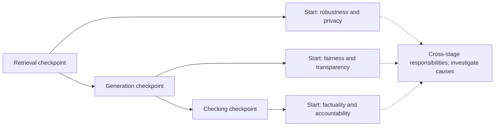
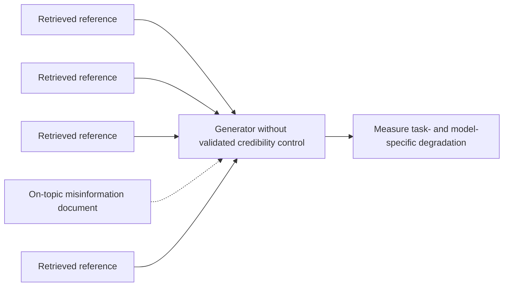
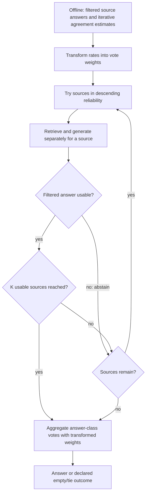
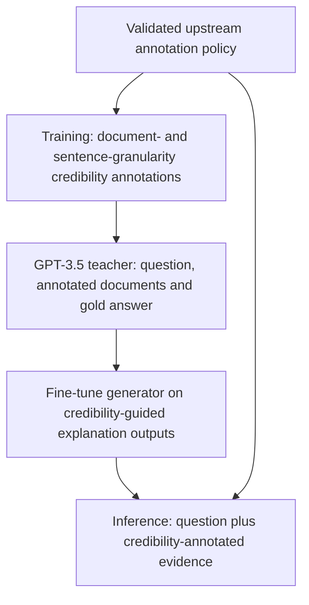
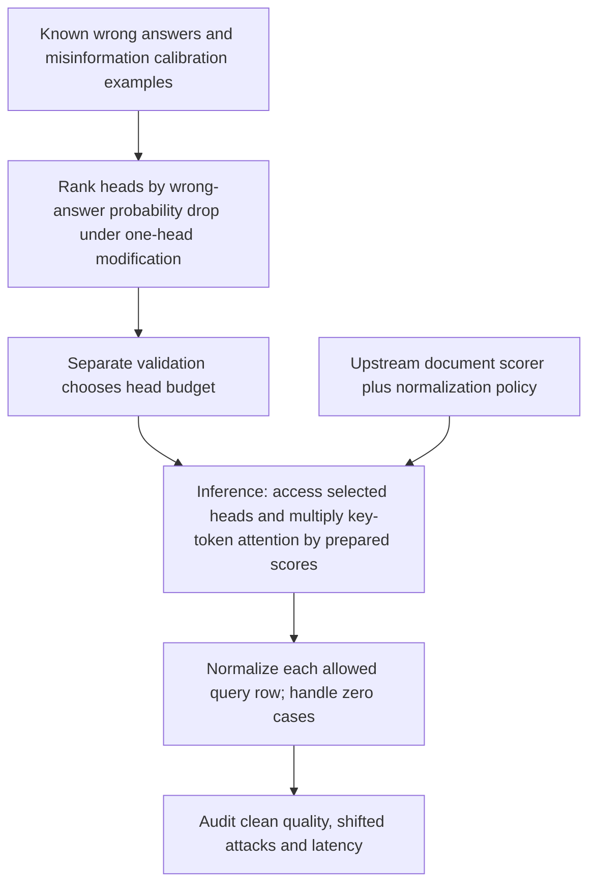
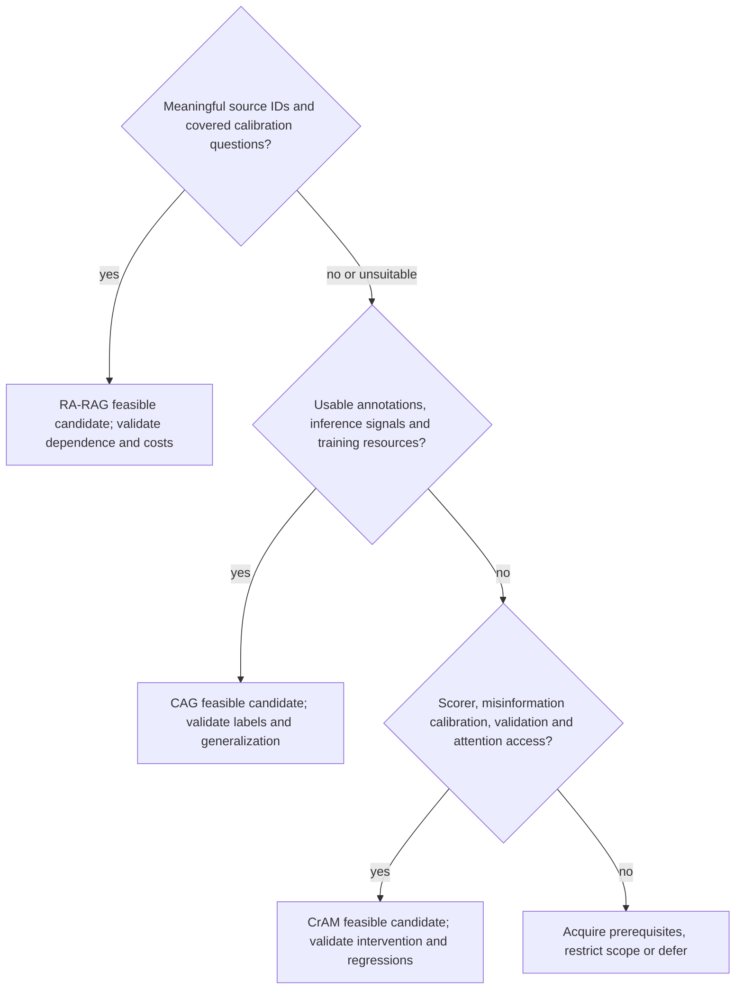
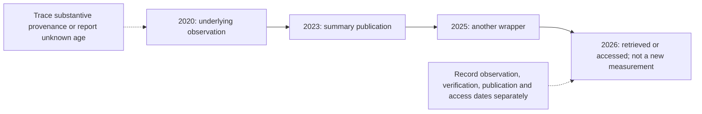
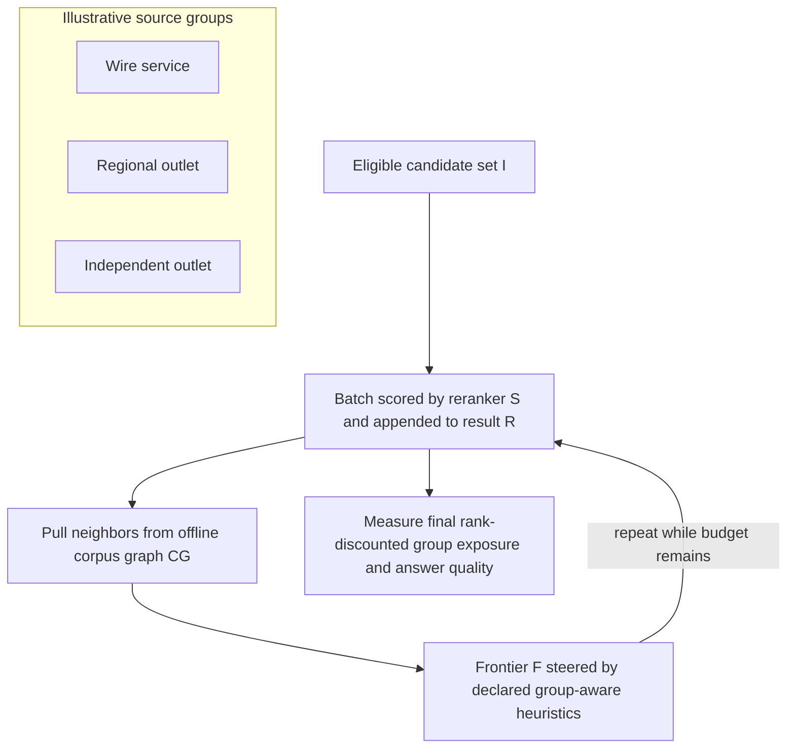

# Chapter 35: Source Credibility
[00-START-HERE](../00-START-HERE.md) · [01-READING-ROUTES](../01-READING-ROUTES.md) · [34\_evaluating\_the\_system](../part-10-evaluation/34_evaluating_the_system.md) · [36\_provenance\_and\_adversarial\_robustness](36_provenance_and_adversarial_robustness.md)
Purpose: separate source agreement, document credibility, claim freshness, intent coverage and group exposure; explain what each intervention actually consumes and guarantees; and check the mathematics before comparing methods or making deployment promises.
## TL;DR
- Trustworthiness is multidimensional and cross-stage. A stage-oriented checklist routes investigation; it does not prove a unique component caused a failure.
- An on-topic document can be unreliable, and misinformation can mislead generation. Attention is not uniform by default, and no universal twenty-to-thirty-point loss follows from adding one weak document.
- RA-RAG estimates agreement with a latent consensus on non-abstaining source answers, then uses transformed vote weights and source-specific inference. Agreement is not independently verified truth or immunity to copied/Sybil sources.
- CAG fine-tunes generation on credibility-annotated inputs and teacher explanations. It still consumes credibility annotations at inference; it is not a content-only truth scorer.
- CrAM uses known misinformation examples to select influential heads and renormalizes credibility-weighted attention in those heads. It needs upstream scores and model-internal access, not just a text-generation API.
- Treat resource gates as feasibility checks, not a universal method ranking or a same-day deployment guarantee. None of these methods alone resolves freshness, intent coverage or exposure policy.
- Use correctly dimensioned soft-ranking constraints, test diversity optima rather than asserting them, and state that sampled rankings satisfy exposure constraints in expectation—not on every displayed list.
## The story
Picture a newsroom preparing a public briefing from a crowded clipping archive.
The assignment desk is the retriever. The reporter is the generator. The fact-check desk is the checking stage.
The newsroom tracks six trust questions across all three desks. Retrieval is a useful checkpoint for robustness and privacy, generation for fairness and transparency, and checking for factuality and accountability. These are starting points, not exclusive ownership: privacy also depends on generation and access control, and noisy-input robustness depends on the reporter’s reading. A score does not identify one culprit without investigation.
The assignment desk also learns that relevance is not credibility. A polished outdated clipping can mislead the reporter even among sound material. The effect depends on the question, placement, conflicts, reader and scoring rubric. Fewer clippings may help or harm; a relevance cutoff is not a validated credibility detector.
The newsroom has three ways to use a credibility signal. RA-RAG keeps source identities, checks source-specific answers against a learned consensus and weights their votes. CAG trains the reporter to use externally annotated credibility while explaining an answer. CrAM intervenes in selected attention channels whose credibility-based modification reduced the probability of known wrong answers on calibration examples.
The editor checks prerequisites before choosing a method. RA-RAG needs meaningful source identities and calibration coverage; CAG needs usable annotations, training resources and credibility-annotated inference inputs; CrAM needs calibration examples, an upstream scorer and access to attention internals. If those inputs are missing, the deadline does not make any method feasible.
Even a well-run newsroom can fail. A statistic measured in 2020 and repeated by a 2023 summary can appear recently measured if publication and observation dates are confused. Follow provenance to the measurement or substantive re-verification, not merely the earliest page or the newest wrapper.
Five excellent clippings about the basketball player can miss another Michael Jordan. On an ambiguous query, coverage of plausible entities can be valuable. Once the user explicitly requests the researcher, irrelevant names are not beneficial diversity; refine relevance or clarify the intent.
Large wire services can occupy every visible slot while other eligible sources receive none. A rotation policy can allocate expected rank attention under a chosen fairness rule. Each user still sees one concrete list; finite samples can deviate from the target, so actual exposure must be monitored.
The newsroom lesson is to separate the questions. Trust, credibility, freshness, coverage, and exposure interact, but no one score or method answers all five.
## Decoder table

| Technical term | Plain-English meaning | Why it matters |
| --- | --- | --- |
| Retrieval-Augmented Generation (RAG) | A system that retrieves documents before a model writes an answer | Its trust depends on retrieval, generation, and checking, not only the model |
| Large language model (LLM) | A model that generates text from learned parameters and current context | The generator may synthesize all retrieved documents without a credibility distinction |
| Trustworthiness | The collection of properties that make a system safe, inspectable, and dependable | The chapter splits it into six actionable aspects |
| Pipeline stage | A functional part of the pipeline | Stage tags help route investigation; they do not uniquely identify the cause |
| Retrieval | Selecting eligible evidence for a query | Robustness and privacy also depend on generation, authorization and other stages |
| Generation | Generating with the actual assembled context | Fairness and transparency are cross-stage, not the generator’s exclusive responsibility |
| Checking | Evaluating or verifying an answer | Checks can detect some factual/accountability issues without guaranteeing them |
| Robustness | Behavior under noisy or adversarial conditions | Both retrieval and the reader can fail under input changes |
| Privacy | Controlling access, use and disclosure of sensitive data | Retrieved context is only one privacy surface |
| Fairness | Treating comparable entities or viewpoints comparably | The generator can privilege one group or view |
| Transparency | Making the path from evidence to answer inspectable | It exposes how the generator synthesized the retrieved material |
| Factuality | Whether a claim is true | It is only one of six trust aspects |
| Accountability | Traceability, responsibility and recourse for outcomes | A component owner should be assigned using evidence, not solely an axis label |
| Credibility laundering | Re-citing an old fact through newer pages until it appears current | A recent page date can hide an old origin date |
| False-negative citation | A relevant citation omitted under a stated completeness target | An omission can propagate; it does not prove deliberate suppression |
| Radar chart | A profile on ordered radial axes | Its area changes with scale/order and cannot certify trustworthiness |
| Radar symbols $`r_i`$ and $`\mathrm{Area}`$ | Six declared radial values and the resulting polygon area | Raw survey metrics require explicit comparable transformations first |
| Cyclic closure $`r_7=r_1`$ | Set the seventh radial value equal to the first | Avoid the unintended $`r_0`$ from one-based modulo indexing |
| Reference explanation/key facts | Reference intermediate key facts used by a protocol | Generated overlap is not proof of faithful internal reasoning |
| Personally identifiable information (PII) | Data that can identify a person | It is the sensitive content used in the retrieval-privacy example |
| Relevance | How well a document matches the query | It does not say whether the document is trustworthy |
| Query $`q`$, document $`d`$, and answer $`a`$ | The input, one evidence item, and the generated result | They keep retrieval and generation formulas scoped to the objects they consume |
| Relevance score $`\mathrm{rel}(q,d)`$ | Query-document match used by the baseline ranker | It omits the separate credibility value $`c_i`$ |
| Credibility | A declared source/document/claim reliability signal | Its scope and validation matter; it is not automatically a probability of truth |
| Dot product | A similarity score between vector representations | It can rank an on-topic but unreliable document highly |
| Cosine similarity | Normalized similarity of nonzero embeddings | Similarity alone does not certify credibility; correlation can be task-dependent |
| Embedding | A vector representation of a query or document | It supports relevance ranking and geometric diversity measures |
| Cross-encoder reranker | A model that jointly scores a query and passage after retrieval | It can refine relevance while still omitting credibility |
| Top-$`k`$ retrieval | Selecting the $`k`$ highest-ranked items | Lowering $`k`$ can remove useful corroboration without removing the bad source |
| Credibility tier | A high, medium, or low trust label | It gives the generator an explicit source-quality signal |
| Credibility tag $`c_i`$ | An explicitly scoped label or score | CAG consumes annotations at inference; CrAM consumes prepared token multipliers |
| RA-RAG | Reliability-Aware RAG | It estimates agreement from filtered source-specific answers, then aggregates |
| Source identity | A stable publisher, domain, account, or other origin key | RA-RAG indexes reliability by this key |
| Agreement $`r_s`$; vote weight $`v_s`$ | Conditional agreement $`r_s\in[0,1]`$ and transformed $`v_s`$ | Vote weights can be negative and are not probabilities |
| RA-RAG symbols $`S`$, $`Q`$, $`k`$, and $`K`$ | Source count, calibration-query count, documents per source and accepted-source target | Attempted sources can exceed the accepted-source target |
| Source answer $`\mathrm{answer}_s(q)`$ | A generated answer based only on that source’s retrieved context | Filter misalignment to abstention before using it in reliability estimation |
| Indicator function | One when a usable answer matches the declared answer class | Use a non-abstention denominator and handle unresolved/empty cases |
| Cross-source agreement | Agreement across filtered source answers | Shared errors and copying can masquerade as reliability |
| Calibration query | A checkable question used to estimate reliability or inspect heads | It supports an offline reusable artifact |
| Consensus | An answer class selected by a specified vote rule | Consensus is a latent estimate, not independently verified truth |
| Fixed point | A stable result of repeated updates | A wrong consensus can be stable; convergence is not a correctness guarantee |
| Per-source voting | One ballot per selected identity | Limits within-identity volume, not multi-identity or correlated-source attacks |
| Weighted majority vote | Sum declared vote weights by equivalent answer | Affine-rescaled weights differ from the chapter’s simple rate-weighted toy |
| Argmax | The set of candidates attaining the largest objective | State tie, abstention and empty-candidate policies |
| Credibility-aware generation (CAG) | Fine-tuning generation to use credibility-annotated inputs | It is not autonomous content-only credibility scoring |
| Multi-granularity annotation | Annotation at document and sentence granularities | Fine granularity can reveal conflicts but can also introduce label errors |
| Teacher model | A model generating gold-conditioned training explanations | Teacher text can be coherent without being independently verified |
| Reasoning trace | An explanation using credibility and content | It is an output artifact, not a certified causal trace |
| Fine-tuning | Updating model weights on task-specific examples | CAG pays this offline cost to create a general skill |
| Zero-shot prompting | Prompt instructions without the method’s training | Credibility prefixes may help, harm or do little depending on the case |
| Synthetic noise | Constructed distracting or false context under a declared setup | Noise ratios and false-information ratios are not interchangeable |
| CrAM | Credibility-aware Attention Modification | It changes selected post-softmax attention rows using upstream scores |
| Attention head | One attention component in the generator | A measured intervention effect does not imply an exclusively misinformation head |
| Attention weight $`\alpha`$ | A normalized key-token weight for a specific head and query row | A document’s conditional share differs from its share of the whole row |
| Weights $`\alpha_{h,i,j}`$, $`\widetilde\alpha`$, $`\alpha^{\prime}`$ | Original, multiplied and normalized weights | Both the query-row and key-token indices must be explicit |
| Residual stream | The shared model representation that attention writes into | Gullible heads can carry misinformation into it |
| Causal tracing | An intervention compared against a fixed output target | CrAM uses credibility-based one-head modification, not deletion of each head |
| Ablation | A declared component intervention for comparison | CrAM’s score is a wrong-answer probability drop under its specific modification |
| Gullible-head set $`H_{\mathrm{gullible}}`$ | Heads selected by mean intervention effect and validation | Individual head effects need not add when changed together |
| Renormalization | Divide nonnegative row weights by their positive sum | Zero sums and equal raw-score ranges need explicit fallback policies |
| Upstream scorer | A process supplying validated credibility inputs | Neither head reweighting nor a no-training claim makes score acquisition free |
| Resource gate | Check for a required deployment input or access capability | All three methods can be infeasible; resource gates do not prove superiority |
| Origin date $`t_0`$ | Observation or substantive verification time of a claim | First publication is a proxy only when it matches the intended validity notion |
| Citation hop $`t_n`$ | A wrapper publication time | Keep it separate from observation, verification and retrieval/access time |
| Citation nodes $`C_i`$, count $`n`$, and evaluation time $`T`$ | Provenance nodes, hop count and evaluation time | Hop count alone does not determine freshness distortion |
| Freshness half-life $`\tau_{1/2}`$ | Positive time interval for halving a declared recency weight | It needs the same units as age and does not recover missing provenance |
| Freshness weight | A time-decay heuristic using a declared timestamp | It is not a calibrated truth probability |
| Half-life | The time required for an exponential freshness weight to halve | The worked example uses one year |
| Time-persistent fact | A fact expected to remain fixed, such as a historical date | It can tolerate a stable credibility check |
| Time-sensitive fact | A value that may change, such as a count or price | It needs re-verification even without laundering |
| Re-citation velocity | Rate at which new pages repeat a claim | Audit independence; high repetition alone proves neither truth nor laundering |
| Pluralism | Representing distinct credible entities, subtopics, or viewpoints | Credible sources can still share a blind spot |
| Permutation | One ordered arrangement of candidate documents | A classical ranker chooses one fixed list |
| Ranking symbols $`\pi`$ and $`L`$ | An ordered ranking versus a selected set | A set-level objective omits position discounts unless explicitly included |
| Utility $`u(d)`$ | A validated ranking score under a declared scale | It is not necessarily a calibrated truth or user-intent probability |
| Position bias $`v(k)`$ | Modeled expected attention by displayed position | An NDCG-like discount is not automatically empirical user exposure |
| Normalized discounted cumulative gain (NDCG) | A ranking metric that uses position discount | The source relates its discount to $`v(k)`$ |
| Intra-list average distance (ILAD) | Mean cosine dissimilarity for a fixed list | Needs $`K\ge2`$ and nonzero vectors; values are not automatically in $`[0,1]`$ |
| Coverage | Fraction of a fixed eligible intent set represented | Subset labels and a nonempty reference set are required |
| Intent set $`\mathcal S`$ | Declared eligible intents or viewpoints | Coverage requires a task-appropriate, audited reference universe |
| Document embedding $`e_i`$ and covered set $`S_d`$ | Geometry for item $`i`$ and the stances covered by document $`d`$ | ILAD uses $`e_i`$ while coverage uses $`S_d`$, so the metrics answer different questions |
| $`\lambda`$ weights | Coefficients with units tied to the objective scales | List length and utility scale change the relative influence of diversity |
| Maximal marginal relevance (MMR) | A relevance–redundancy selection heuristic | Useful without an enumerable intent set, but not a guarantee of one’s coverage |
| Group exposure | Mean modeled rank attention per item in a nonempty group | Group-total attention differs when group sizes differ |
| Hard ranking | One deterministic list with each item either placed or absent | Documents below the cutoff receive zero exposure |
| Assignment matrix $`P`$ | A matrix saying which document occupies which position | Relaxing it creates a probabilistic ranking policy |
| Assignment entry $`P_{d,k}`$ | Probability or hard indicator that document $`d`$ occupies position $`k`$ | Multiplying it by $`v(k)`$ produces expected document exposure |
| Matrix dimensions $`N`$ and $`K`$ | Candidates and displayed slots | For $`K<N`$, unit columns coexist with at-most-unit rows, not all unit rows |
| Doubly stochastic matrix | A square nonnegative matrix with every row/column summing to one | Complete unshown zero-attention positions before applying Birkhoff to top-K display |
| Demographic parity | Equal average per-document exposure across groups | A policy choice, not necessarily equal group-total attention |
| Disparate treatment | The paper’s average-utility-proportional exposure constraint | Requires positive fixed merits; neither an automatic default nor a legal conclusion |
| Linear program (LP) | Linear objective and declared linear feasibility/fairness constraints | Check coefficients, feasibility, biased utility estimates and serving budget |
| Birkhoff-von Neumann theorem | Decompose a square doubly stochastic matrix into permutation mixtures | The resulting display marginals match the rectangular policy |
| Convex combination | Weighted components whose nonnegative weights sum to 1 | It supplies the permutation-sampling probabilities |
| Birkhoff symbols $`\alpha_i`$ and $`\Pi_i`$ | Mixture weight $`i`$ and hard permutation matrix $`i`$ | Sampling $`\Pi_i`$ with probability $`\alpha_i`$ serves the soft policy in expectation |
| Amortized guarantee | An expected or accumulated target over specified rankings | Finite samples can deviate; assumptions and accounting over changing queries matter |
| FA\*IR | A protected-representation top-K algorithm with prefix conditions | Its binomial-derived count schedule is not a general utility-proportional exposure policy |
| Corpus graph | An offline candidate-neighbor graph | Group-aware links do not establish a final displayed exposure guarantee |
| Frontier | A candidate queue expanded during search | Batch representation is not the same as position-discounted exposure |
| Frontier symbols $`I`$, $`S`$, $`R`$, $`\mathrm{CG}`$, and $`F`$ | Candidate set, reranker, result list, corpus graph, and frontier | They name every state in Figure $`35.9`$’s repeated online loop |
| Queries per second (QPS) | Request serving rate | LP feasibility also depends on candidate size, solver, caching and latency budget |

## Core mechanics
### Mathematical conventions
Let a credibility score be a declared measurement or model output, not an automatic probability of truth. Specify the unit (source, document, sentence or claim), domain, observation date, abstention policy, label provenance and validation set. Relevance, source reputation, timeliness and factual accuracy are different quantities even when a method combines them.
Historical experimental scores below name their model, benchmark, metric and setting. They are reported results, not replicated measurements or a cross-paper ranking. Accuracy/EM differences are percentage points; relative improvements use the baseline as denominator. Accuracy marginals identify a net change in correct answers, not the number of individual answer flips.
For attention, weights refer to one specified head and query-token row after softmax; distinguish key-token multipliers, document-conditional shares and full-row shares. Use nonnegative multipliers, preserve causal masks and define fallbacks for zero denominators. Access to attention internals is a separate prerequisite from “no fine-tuning.”
For diversity, declare the candidate universe, nonzero embeddings, intent set, cardinality budget and objective scaling. For exposure, distinguish displayed positions from documents, average per-document group exposure from group-total exposure, and expected constraints from finite-run guarantees. All toy utilities, discounts, rates and timing assumptions are stipulated; keep full precision until reporting.
### 35.1 Six aspects across three stages: a trustworthiness taxonomy
#### Stage-aware trust
- **What:** Track robustness, privacy, fairness, transparency, factuality and accountability across retrieval, generation and checking.
- **Why:** Stage tags support investigation and incident ownership, not a one-to-one mathematical attribution of cause.
- **Limit:** A $`2\%`$ sentence-level hallucination rate alone does not measure unauthorized retrieval, identity leakage, viewpoint treatment, provenance or redress; its judge and denominator matter too.
- **Cost:** Maintain separately defined evaluations and failure gates rather than averaging incomparable raw scores.
Laundered provenance can harm transparency and factuality. A missing relevant citation can harm coverage and accountability. Neither observation locates a unique failing stage, and absence from a reference list does not by itself prove an author saw and suppressed that source.
#### Survey-style evaluation and radar area
- **What:** Zhou et al.’s 2024 survey organizes RAG trustworthiness into six dimensions and runs scoped prompt-based evaluations.
- **Why:** A profile can expose a weak dimension hidden by an aggregate.
- **Limit:** Its dimensions use different tasks, scales and directions; some models have unmeasurable entries because they do not follow the task. They are not automatically six comparable $`[0,1]`$ scores.
- **Cost:** The transparency protocol checks generated intermediate key facts against references. Such overlap measures explanation content, not certified faithfulness of a model’s internal computation.[\[1\]](https://arxiv.org/html/2409.10102v1)
The original survey evaluates more than three models. Its Table II reports, for example, GPT-3.5-Turbo privacy refusal $`0\%`$ and GPT-4o $`4\%`$ on the constructed Enron-email task, while their factuality scores are $`40.0`$ and $`26.0`$ under that task’s metric. GPT-4o is not best on every axis. Llama2-13B has missing robustness/fairness entries, not measured uniformly low scores. These are historical protocols, not general present-day privacy or model-quality guarantees.[\[1\]](https://arxiv.org/html/2409.10102v1)
For a separate illustrative radar chart, assume six nonnegative, commensurately scaled scores $`r_1,\ldots,r_6\in[0,1]`$ on equally spaced axes in a fixed order. Close the polygon with $`r_7=r_1`$; using $`r_{(i+1)\bmod6}`$ with one-based labels would incorrectly introduce $`r_0`$. Then:

$$
\begin{aligned}
\mathrm{Area}&=\frac12\sin\!\left(\frac{\pi}{3}\right)\sum_{i=1}^{6}r_i r_{i+1},\qquad r_7=r_1,\\
\mathrm{Area}_{\max}&=3\sin\!\left(\frac{\pi}{3}\right)=\frac{3\sqrt3}{2},\\
\frac{\mathrm{Area}}{\mathrm{Area}_{\max}}&=\frac16\sum_{i=1}^{6}r_i r_{i+1}.
\end{aligned}
$$

Toy Model A has scores $`(0.80,0.30,0.75,0.70,0.85,0.60)`$. Its adjacent products sum to $`2.575`$, so its area is approximately $`1.115007707`$. Model B has $`0.65`$ on every axis; its products sum to $`2.535`$ and its area is approximately $`1.097687199`$. Relative to B, the difference is $`2.575/2.535-1\approx1.577909\%`$, below $`2\%`$. Normalized areas are $`0.429166667`$ and $`0.4225`$. Similar areas conceal different component risks. Area also changes with axis order and scaling; it is not a probability or a trustworthy-model certificate.
#### Operating rules
- **What:** Report defined component metrics, missing entries, uncertainty and stage tags; keep privacy and other hard requirements independently visible.
- **Why:** A low-risk average cannot compensate for a disqualifying exposure or safety failure.
- **Limit:** Restricting retrieved data does not prove sensitive information can never enter prompts, weights, outputs, tools or logs.
- **Cost:** A five-axis deployment plot is acceptable only as a clearly labeled view with separately audited privacy controls; its area is not directly comparable with a six-axis plot.
Re-evaluate affected dimensions when generators, retrievers, access policies, scorers or corpora change. Route an incident using measured evidence and intervention tests rather than assigning it solely from an axis label.
### 35.2 One bad document among many good ones
#### Relevance is not credibility
- **What:** A relevance-oriented baseline selects documents using $`\mathrm{rel}(q,d)`$ and generates $`a=\mathrm{LLM}(q,d_1,\ldots,d_k)`$.
- **Why:** Query match and evidence reliability answer different questions.
- **Limit:** A dot product, cosine threshold or relevance reranker does not by itself certify credibility, even if it correlates with it on a particular corpus.
- **Cost:** A credibility-aware interface can supply $`a=\mathrm{LLM}(q,\{(d_i,c_i)\}_{i=1}^k)`$, but producing and validating $`c_i`$ is a separate expense and signal-quality problem.
Established reporting, peer review, publication date and citation history are possible features, not definitions of truth. An old source can be the right historical reference; a new article, encyclopedia page or model-generated text can be right or wrong. Score the source, claim, time and task with an explicit rubric rather than assigning universal tiers from age or writing style alone.
A low-quality document can mislead a generator, but the effect is model- and setup-dependent. A vanilla transformer does not give all documents equal attention by default: positions, content and learned attention vary. The missing element is an explicit, validated credibility control, not a proof of uniform weighting. In CrAM’s ideal-setting Llama2-13B results, adding one generated misinformation document to four retrieved documents changes NQ EM from $`28.9\%`$ to $`11.9\%`$ (seventeen points) and TriviaQA EM from $`62.5\%`$ to $`28.0\%`$ ($`34.5`$ points). This already rules out a universal twenty-to-thirty-point law.[\[2\]](https://arxiv.org/html/2406.11497v3)
#### Contamination experiment
- **What:** Stipulate a $`1{,}000`$-question medical toy, $`k=5`$ documents and $`82\%`$ baseline correctness; do not present it as a replicated clinical benchmark.
- **Why:** Applying an assumed twenty-to-thirty-point loss illustrates scale, not a measured effect transferable from another task.
- **Result:** Candidate accuracy would be $`62\%`$ to $`52\%`$, or $`620`$ to $`520`$ correct answers versus $`820`$ initially.
- **Limit:** This gives $`200`$ to $`300`$ fewer correct answers in net. It does not establish which or how many answers changed without paired outputs.
If no initially incorrect answer improves, the loss would equal $`200`$–$`300`$ correct-to-incorrect flips: $`20\%`$–$`30\%`$ of all questions, or approximately $`24.390244\%`$–$`36.585366\%`$ of the initially correct answers. If some answers improve, there can be more losses and more total flips for the same net decline. “One in four to one in three flips” is not determined by the aggregate rates.
Keeping the top three of five can retain a contaminant and discard a good anchor. It can also help in some workloads; evaluate matched evidence changes rather than claiming that a smaller context always fails or solves credibility.
#### Operating rules
- **What:** Preserve credibility metadata, provenance and score versions where meaningful; evaluate single-contaminant and correlated-contaminant stress cases.
- **Why:** Explicit reliability information targets a dimension relevance alone does not guarantee.
- **Limit:** An index-time score can become stale and may be query-dependent. It is not automatically negligible or reusable without refresh.
- **Cost:** Separate offline scoring, updates, storage and online scoring/lookup costs. Benchmark them rather than calling one additional score free.
Prioritize source-quality controls in consequential domains, with independent validation and escalation when evidence conflicts. A homogeneous corpus does not establish uniformly correct, current or attack-free content; do not remove the axis solely because all documents share a publisher.
### 35.3 RA-RAG: reliability from cross-source agreement
#### Offline reliability estimation
- **What:** RA-RAG means Reliability-Aware RAG. It estimates source agreement using source-specific generated answers, filtered for alignment with their own retrieved documents.
- **Why:** Source IDs keep document volume from directly multiplying ballots within one identity.
- **Limit:** A score estimates agreement on covered calibration questions, not independently known factual reliability. The original $`200`$-query calibration is an experiment size, not a universal requirement.
- **Cost:** Generate/filter calibration answers, iterate vote-weight updates and declare stopping/tie rules. Convergence and correct truth recovery are not guaranteed merely by repeating the updates.[\[3\]](https://arxiv.org/html/2410.22954v1)
Let $`A_s(q)`$ be source $`s`$’s filtered answer or abstention $`\mathrm{IDK}`$, and let $`\mathcal Q_{\mathrm{res}}`$ be the calibration queries with a resolved non-abstaining consensus answer class $`z(q)`$. Among the $`Q`$ calibration queries, define $`J_s=\{q\in\mathcal Q_{\mathrm{res}}:A_s(q)\ne\mathrm{IDK}\}`$. The bounded agreement estimator is:

$$
\begin{aligned}
r_s&=\frac{1}{|J_s|}\sum_{q\in J_s}\mathbf1[A_s(q)\sim z(q)],\qquad |J_s|>0,\\
v_s&=S r_s-1.
\end{aligned}
$$

Here $`\sim`$ means the chosen answer-equivalence rule and $`S`$ is the source count. The paper excludes abstentions from the reliability denominator; the chapter’s earlier division by $`Q`$ is valid only when every calibration query yields a usable source answer. Handle unresolved/all-abstaining queries explicitly rather than counting matching “IDK” strings as factual agreement, and mark zero-answer sources unknown. The paper rescales agreement into vote weights $`v_s=S r_s-1`$ (with a possible cap on the scaling factor); $`r_s\in[0,1]`$ but $`v_s`$ need not lie in that interval or be nonnegative. This is an affine vote weight, not a normalized probability.[\[3\]](https://arxiv.org/html/2410.22954v1)
A stable consensus may still be wrong: copied false answers, correlated sources, a shared generator or filter errors can create a self-reinforcing fixed point. Use independent labeled audits, answer-coverage counts, domain/time slices and source-dependence checks before interpreting agreement as truth reliability.
#### Online per-source voting
- **What:** Inspect sources in descending estimated reliability. Retrieve and generate from each source separately, filter unsupported answers to abstention, and stop after $`K`$ usable sources or exhaustion.
- **Why:** The original $`\kappa`$-RRSS procedure checks relevance through the source answer/filter, not a free pre-generation relevance oracle.
- **Vote:** For a selected source set $`\mathcal W`$ and answer classes $`\mathcal A`$, use $`\hat a\in\mathop{\mathrm{arg\,max}}_{a\in\mathcal A}\sum_{s\in\mathcal W}v_s\mathbf1[A_s(q)\sim a]`$, with declared tie/empty policies.
- **Cost:** $`K`$ is the accepted-source target, not an upper bound on source-model calls. With many abstentions, all $`S`$ sources can be attempted. Later RA-RAG adds semantic-equivalence clustering; do not silently mix versions or count paraphrases as separate truths.[\[3\]](https://arxiv.org/html/2410.22954v1)[\[4\]](https://arxiv.org/html/2410.22954)
In the constructed COVID-19 vote, three named sources support SARS-CoV-2 with assumed agreement rates $`0.95`$, $`0.93`$, $`0.90`$; three others support the false 5G claim with $`0.20`$, $`0.15`$, $`0.15`$. These are toy values, not measured publisher ratings. Raw nonnegative rate-weighted totals are $`2.78`$ versus $`0.50`$, breaking a $`3{:}3`$ unweighted tie. That is a simplified vote, not the paper’s transformed weights: with $`S=6`$, the corresponding sums of $`6r_s-1`$ are $`13.68`$ versus $`0`$. Do not interpret either score or its normalized share as a calibrated answer probability. One ballot per identity limits duplication inside that identity, not attacks using many identities or independent-looking copies.
#### Cost and measured results
- **What:** For a budget illustration, $`S=1{,}000`$, $`k=5`$ and $`K=4`$ give $`5{,}000`$ documents across all sources versus twenty documents attached to four accepted source calls.
- **Arithmetic:** At exactly $`500`$ input tokens per document, these portions use $`2.5\times10^6`$ versus $`10{,}000`$ document-input tokens: a $`250{:}1`$ ratio and $`1-20/5{,}000=99.6\%`$ reduction.
- **Limit:** These are not one giant generator context versus one twenty-document context in the actual algorithm, nor total measured tokens/cost. Rejected sources, repeated query/instruction tokens, outputs, filtering and selection work are omitted.
- **Offline cost:** $`S Q=200{,}000`$ source-query answers at $`Q=200`$ before scoring/iteration overhead. Cached answers can be reused across weight iterations; do not multiply them by the iteration count unless regenerated.
For a fully specified published cross-check, the later RA-RAG revision’s NQ/GPT-4o-mini experiment with $`1{,}000`$ sources and $`K=4`$ reports $`627{,}115`$ versus $`5{,}415`$ total processed tokens per query, without versus with RRSS: approximately $`99.136522\%`$ fewer. Mean API calls are $`1{,}000`$ versus $`8.66`$, not four; EM changes $`0.780\to0.768`$. This comparison is selection versus all-source aggregation, not standard RAG. The draft’s unscoped $`73.7\%/63.4\%`$ and $`91.3\%/81.2\%`$ pairs cannot establish a matched cross-method ranking and are not used as such here.[\[4\]](https://arxiv.org/html/2410.22954)
Consider RA-RAG when source identity is meaningful and calibration coverage is sufficient. Choose the source budget by measured cost, evidence coverage and error—not a universal calibration size. Re-estimate under domain, ownership, copying or behavior changes; record answer-equivalence/filter versions and independently check correctness, not only agreement stability.
### 35.4 CAG: training the model to reason about credibility
#### Multi-granularity training
- **What:** CAG constructs document- and sentence-granularity credibility-annotated training inputs, then fine-tunes a generator to use those annotations.
- **Why:** It can learn to use credibility on unfamiliar documents without requiring the same source-ID reputation table as RA-RAG.
- **Limit:** It does not eliminate credibility assessment. The original training construction bins retrieval relevance into high/medium/low levels; its benchmark additionally incorporates timeliness and source reliability. Those proxies are not an independently verified truth oracle.
- **Cost:** Annotation, teacher generation, training, validation and inference-time credibility inputs all require resources; “days” is a project estimate, not a method guarantee.[\[5\]](https://arxiv.org/html/2404.06809)
The original teacher is GPT-3.5. It receives the question, credibility-tagged documents and the gold answer, then writes a credibility-guided explanation used as the training output. The model learns to generate with annotated evidence; it is not simply trained to infer source truth from writing register or citation appearance. A coherent, gold-conditioned explanation is also not a verified causal trace of the student’s internal computation.[\[5\]](https://arxiv.org/html/2404.06809)
As one explicit benchmark policy, relevance tier $`R\in\{1,2,3\}`$ is downgraded by elapsed time $`T\ge0`$ in intervals $`\tau>0`$, and capped by source tier $`S_{\mathrm{tier}}\in\{1,2,3\}`$:

$$
c=\min\!\left\{\max\!\left(R-\left\lfloor T/\tau\right\rfloor,1\right),S_{\mathrm{tier}}\right\}.
$$

This is a declared ordinal heuristic, not a calibrated probability. Its choice of timestamp and source tier still needs validation.[\[5\]](https://arxiv.org/html/2404.06809)
#### Why prompting alone loses
- **What:** An untrained baseline can receive the same credibility labels in its prompt.
- **Why:** It is a useful matched control for the value of fine-tuning.
- **Limit:** Prompted labels can help, harm or do little; they do not universally “remain ignored.” In the CAG table, ChatGPT HotpotQA EM moves $`0.334\to0.422`$ when credibility prefixes are added, while other model/task pairs behave differently.
- **Cost:** Fine-tuning adds offline work; deployment still needs valid annotations and their acquisition cost. Do not call inference content-only or zero-lookup solely because weights were trained.[\[5\]](https://arxiv.org/html/2404.06809)
In the illustrative Nobel conflict, an official record identifies Wilhelm Röntgen as the first Nobel Prize in Physics recipient in 1901; a blog incorrectly names Einstein. The credibility-tagged example teaches how to prefer the better-supported source. It does not prove all official-looking pages are correct or that a high label should override direct contrary evidence without review.
#### Reported experiments and operating rules
- **What:** Original Table 2 reports CAG-7B HotpotQA EM $`0.509`$ versus retrieval-based LLaMA-2-7B $`0.280`$.
- **Arithmetic:** The absolute gap is $`22.9`$ percentage points; relative improvement is $`(0.509/0.280-1)100\%\approx81.785714\%`$, rounded to $`82\%`$.
- **Metric:** The paper’s short-answer EM protocol checks whether a gold answer is an exact substring of the generation; it is not a universal clinical accuracy or token-overlap $`F_1`$ definition.
- **Noise condition:** At RGB noise ratio $`0.8`$, the same table gives CAG-7B $`0.897`$ versus retrieval-based ChatGPT $`0.773`$, a $`12.4`$-point gap—not $`89.0\%`$ and $`11.7`$ points. Noise here includes distracting context; it does not mean every noisy item is synthetic falsehood.[\[5\]](https://arxiv.org/html/2404.06809)
Solving $`50.9/1.82\approx27.967033`$ percent recovers an approximate baseline only if the rounded $`82\%`$ is treated as exact. Use the actual reported $`28.0\%`$ baseline for precise comparisons. The $`22.9`$-point absolute gap and approximately $`82\%`$ relative improvement are different denominators. RGB compares different base systems; it does not isolate training alone or establish a universal ranking against RA-RAG or CrAM.
Consider CAG when annotation quality, inference-time signals, training access and validation justify the expense. Sentence granularity can expose local conflicts, but its cost and error rate must be measured. Audit label inversion and distribution shift, and compare alternatives on matched tasks rather than assuming fine-tuning is always broader or better.
### 35.5 CrAM: down-weighting attention on gullible heads
#### Causal head selection
- **What:** CrAM means Credibility-aware Attention Modification. On known misinformation examples, it modifies one head at a time using document-credibility weights, then measures the change in a known wrong answer’s generation probability.
- **Effect:** $`\mathrm{IE}_h=P_0(a_{\mathrm{wrong}})-P_{h}^{*}(a_{\mathrm{wrong}})`$. A positive mean effect means this particular modification reduced that wrong answer’s probability on calibration data; it is not head removal or proof that a head only encodes misinformation.
- **Calibration:** The paper uses one hundred examples per dataset to rank heads and another hundred for validation of how many to select. This is labeled misinformation calibration even though no gradient update is used.
- **Cost:** Model internals, probability evaluation, intervention implementation and held-out validation are required. The toy one-hundred-to-three-hundred-head range below is not a universal setting.[\[2\]](https://arxiv.org/html/2406.11497v3)
Head effects depend on the model, prompt, task, intervention and score quality. Individually measured effects need not add when many heads are changed. Recalibrate after material model/domain changes and test normal-capability regressions as well as attack cases.
#### Inference-time intervention
- **What:** Reweight selected heads’ post-softmax attention to key-token positions, then normalize each query-token row.
- **Why:** This directly changes use of document tokens instead of merely adding a textual instruction.
- **Limit:** Attention weights are not causal explanations by themselves, and the intervention can suppress correct evidence if credibility is wrong.
- **Cost:** It requires access to the attention implementation, including compatible masking/caching/kernels. A hosted text-only interface cannot perform it just because no fine-tuning is needed.[\[2\]](https://arxiv.org/html/2406.11497v3)
For one head $`h`$, query-token row $`i`$ and key token $`j`$, let $`\alpha_{h,i,j}\ge0`$ be normalized attention on allowed positions. Let $`c_j\in[0,1]`$ be an already prepared token multiplier, with non-document tokens normally assigned one. CrAM’s paper min-max scales raw document scores $`s_d`$ using $`(s_d-s_{\min})/(s_{\max}-s_{\min})`$ when the range is positive. Declare a policy for equal raw scores (zero range) rather than divide by zero. The row-wise operation is:[\[2\]](https://arxiv.org/html/2406.11497v3)

$$
\widetilde\alpha_{h,i,j}=\begin{cases}
\alpha_{h,i,j}c_j,&h\in H_{\mathrm{gullible}},\\
\alpha_{h,i,j},&h\notin H_{\mathrm{gullible}}.
\end{cases}
$$

$$
\begin{aligned}
Z_{h,i}&=\sum_{j\in\mathcal A_i}\widetilde\alpha_{h,i,j},\\
\alpha'_{h,i,j}&=\frac{\widetilde\alpha_{h,i,j}}{Z_{h,i}},\qquad Z_{h,i}>0.
\end{aligned}
$$

Here $`\mathcal A_i`$ is the allowed key set for row $`i`$. Masked positions remain zero, and unselected heads retain their original normalized row. If $`Z_{h,i}=0`$, use an explicitly chosen safe fallback, such as preserving the original valid row and escalating, rather than silently creating NaNs. This fallback and an equal-score policy are implementation requirements, not additional guarantees from the paper. Multiplying post-softmax weights is equivalent to adding $`\log c_j`$ to unmasked logits when $`c_j>0`$; adding raw $`c_j`$ to logits is a different operation.
#### Attention arithmetic and measured scope
- **What:** For a generic reweighting illustration, Document A has initial row mass $`0.30`$ and multiplier $`0.8`$; B has mass $`0.20`$ and multiplier $`0.1`$. The remaining $`0.50`$ is on unscaled tokens.
- **Arithmetic:** Scaled masses are $`0.24`$, $`0.02`$ and $`0.50`$, so the full denominator is $`0.76`$. Full-row shares become $`0.24/0.76\approx31.578947\%`$ for A and $`0.02/0.76\approx2.631579\%`$ for B.
- **Conditional share:** Among A and B only, A moves from $`0.30/0.50=60\%`$ to $`0.24/0.26=12/13\approx92.307692\%`$; the A:B odds are $`12{:}1`$. The latter percentage is not A’s total attention share.
- **Normalization scope:** These are supplied multipliers, not a literal two-raw-score run of the paper’s min-max transform. If the only raw document scores were $`0.8`$ and $`0.1`$, they would map to one and zero instead.
A toy thirty-two-layer model with thirty-two heads per layer has $`1{,}024`$ heads. Selecting one hundred to three hundred changes approximately $`9.765625\%`$–$`29.296875\%`$ of heads; $`70.703125\%`$–$`90.234375\%`$ remain unselected. This counts heads, not the fraction of FLOPs, parameters, tokens or total model behavior changed. It is not Llama2-13B’s forty-layer, forty-head configuration.
For a scoped result, CrAM’s ideal-score setting with four retrieved documents plus one generated misinformation document reports Llama2-13B NQ EM $`33.6\%`$; Llama3-8B achieves NQ EM $`36.9\%`$ and TriviaQA EM $`64.4\%`$. With GPT-generated scores, the Llama3-8B values are $`30.7\%`$ and $`62.2\%`$. These are QA measurements under a controlled injection setup, not a verified $`91.3\%`$ universal attack-defense or near-oracle rate. A different RA-RAG paper’s NQ number cannot explain this gap causally by “narrow head coverage.”[\[2\]](https://arxiv.org/html/2406.11497v3)
Consider CrAM when no weight update is desired but scorer quality, model access and calibration support the intervention. Restrict changes to a validated set, monitor shifted attacks and clean performance, and benchmark end-to-end overhead. “Plug-and-play” does not imply universally safe, inexpensive or same-day deployment.
### 35.6 Choosing among the three
#### Two resource gates
- **What:** Use resource checks to form a feasible candidate set: source identities and coverage for RA-RAG; credible annotations plus training for CAG; scores, labeled misinformation calibration and attention access for CrAM.
- **Why:** Missing inputs cannot be repaired by choosing a method’s largest headline number.
- **Limit:** Stable identities do not automatically make RA-RAG best, and lack of a labeled training corpus does not make CrAM feasible.
- **Cost:** Time estimates are project-specific. Compare matched quality, safety, scoring, serving and maintenance costs after checking prerequisites.
The three methods can compose, but compatibility is not free calibration. RA-RAG’s source agreement rate may be an input feature for an upstream document scorer; it is not automatically the right query-specific CrAM token multiplier. CAG also needs credibility inputs at inference. Include a “prerequisites missing: obtain evidence, restrict scope or defer” branch instead of treating CrAM as an unconditional residual leaf.
#### Per-pool marketplace example
- **Pool 1:** Identified seller listings and regulator notices make source-aware calibration possible, but verify identity quality and source dependence before choosing RA-RAG.
- **Pool 2:** Anonymous reviews with usable annotated spam examples may support CAG; spam labels must be mapped and validated for the actual credibility task, including inference inputs.
- **Pool 3:** A same-week partner launch with neither resource can consider CrAM only if scores, known misinformation examples and internal model access already exist.
- **Limit:** A deadline does not establish scorer correctness, calibration coverage or deployment readiness. Otherwise restrict the feature or obtain the missing resources.
Evaluate per content pool and domain. A shared interface should preserve score semantics, provenance, coverage, uncertainty and timestamps—not merge all three methods’ outputs into a supposedly interchangeable probability.
#### Timed CrAM calibration
- **What:** Stipulate one hundred calibration examples, $`1{,}024`$ heads and a measured-equivalent service-time assumption of $`50\,\mathrm{ms}`$ per single-example probability-evaluation pass; this is not a hardware benchmark.
- **Arithmetic:** There are $`100\times1{,}024=102{,}400`$ head-modified passes. Their assumed serial service time is $`5{,}120\,\mathrm{s}`$, or $`85.333333`$ minutes.
- **Baseline:** Reusing one unmodified baseline pass per example adds one hundred passes: $`102{,}500`$ total and $`5{,}125\,\mathrm{s}`$, or $`85.416667`$ minutes.
- **Limit:** Additional validation, head-count search, scoring, setup, variable answer/context lengths and integration are omitted. Batching changes what “one pass” means; do not combine a batched-pass time with a single-example pass count.
The baseline-inclusive toy is under $`1.5`$ hours of serial service time under its assumptions, not proof that calibration and deployment finish in an afternoon. At $`S=1{,}000`$ and $`Q=200`$, RA-RAG instead needs up to $`200{,}000`$ calibration source-query answers before other work. CAG includes annotation and training. These quantities do not determine engineer time or invoices; larger corpora can also change retrieval, coverage and calibration needs.
Reassess feasibility when models, sources, scorers or resources change. Plan maintenance rather than an automatic expiration date for one method, and escalate low-confidence or conflicting credibility evidence to an appropriate review workflow.
### 35.7 Temporal awareness and credibility laundering
#### The citation-chain blind spot
- **What:** A claim has observation or substantive-verification time $`t_0`$, then is repeated on pages $`C_1,\ldots,C_n`$ with publication dates $`t_1,\ldots,t_n`$.
- **Why:** A recency proxy based on $`t_n`$ can overstate recency of the underlying measurement.
- **Limit:** The earliest publication is not always the right validity date: later independent measurement or verification can legitimately refresh a time-sensitive claim, while a historical fact need not decay.
- **Cost:** Trace the reachable provenance graph or store versioned claim-level dates offline. Work depends on graph depth, branching, caching and query volume, not necessarily a walk over the entire corpus.
A statistic measured in 2020 and copied in 2023 has not been remeasured merely because a page is new. Repeated wrappers can evade a publication-age filter, but their new dates must be distinguished from retrieval/access dates and genuine new measurements.
A reference-list omission can also propagate downstream. It is a coverage/provenance concern, not evidence that every later author independently checked completeness or that every missing reference is deliberately suppressed.
#### Freshness-weight experiment
- **What:** Use $`w(T,t)=2^{-(T-t)/\tau_{1/2}}`$ for evaluation time $`T\ge t`$ and half-life $`\tau_{1/2}>0`$ in the same units.
- **Assumption:** Treat the calendar-year labels as exact year offsets, with $`T=2026`$ and $`\tau_{1/2}=1`$ year; this is not day-accurate timestamp arithmetic.
- **Arithmetic:** The 2023 wrapper yields $`2^{-3}=1/8=0.125`$, while the 2020 observation yields $`2^{-6}=1/64=0.015625`$. The ratio is exactly eight.
- **Limit:** This is a freshness-weight distortion under an illustrative decay policy, not an eightfold probability of being wrong.
A 2025 wrapper gives $`1/2`$ and a ratio of $`32`$ to the unchanged observation weight. Generally,

$$
\frac{w(T,t_n)}{w(T,t_0)}=2^{(t_n-t_0)/\tau_{1/2}}\le 2^{(T-t_0)/\tau_{1/2}},\qquad t_0\le t_n\le T.
$$

At this fixed $`T`$, $`t_0`$ and half-life, the maximum ratio is $`64`$, not unbounded as chain length grows. A date advance $`\delta`$ contributes a factor $`2^{\delta/\tau_{1/2}}`$; hop factors telescope to the total date advance. More hops with the same final timestamp do not increase distortion. Unbounded ratios require allowing the elapsed origin-to-current time to grow, not merely adding citations.
#### Operating rules and claim limits
- **What:** Track measurement/validity dates separately from publication, modification, citation and retrieval dates; distinguish time-persistent from time-sensitive claims.
- **Why:** A reliable source can repeat old evidence, and a stale label can hide an independent update.
- **Limit:** Source reliability alone does not recover the observation date. CAG can incorporate timeliness when it is supplied correctly; none of these methods guarantees its provenance is correct.
- **Cost:** When origin/verification time is unknown, report uncertainty and avoid a fabricated freshness boost. Revisit claims according to domain change rates rather than one universal half-life.
Treat frequent re-citation as a provenance audit signal, not automatic consensus or automatic laundering. Three independent measurements differ from three copies of one observation. Keep publication and modification fields, but neither replaces a claim’s observation/validity record. Offline annotations can reduce online work only if provenance, updates and any contractual audit requirements are actually maintained.
### 35.8 Pluralism: when every credible source shares a blind spot
#### Credibility-only ranking misses ambiguity
- **What:** A position-weighted utility ranker selects a permutation maximizing $`\sum_{k=1}^{K}u(d_{\pi(k)})v(k)`$ with nonnegative, nonincreasing attention discounts $`v(k)`$.
- **Why:** This accounts for relevance/credibility utility and position, but has no explicit intent-coverage or redundancy term.
- **Limit:** If a candidate pool lacks a relevant intent, reranking that pool cannot invent its missing evidence. Once intent is explicit, unrelated entities should not be rewarded merely for difference.
- **Cost:** Define utility and query intent first; diversify only over eligible, sufficiently relevant evidence.
Position discounts are often modeled in an NDCG-like form, but measured user attention is not automatically identical to an evaluation metric’s chosen discount. Changing discount scale changes objective and exposure units.
On the ambiguous query “Michael Jordan,” several entities can be plausible. If the researcher is the known intended entity, a basketball-dominated list is a relevance/intent-recognition failure. The toy below instead models coverage of four plausible intents before clarification; its utility values are stipulated ranking scores, not known user-intent probabilities or measured truth.
#### ILAD, coverage, and the combined objective
- **What:** For $`K=|L|\ge2`$ and nonzero embeddings, define $`\mathrm{ILAD}(L)=\frac{2}{K(K-1)}\sum_{i<j}(1-\cos(e_i,e_j))`$.
- **Why:** It summarizes embedding dissimilarity, not necessarily factual independence or meaningful stance coverage.
- **Limit:** Cosine dissimilarity lies in $`[0,2]`$, not automatically $`[0,1]`$; unrelated or adversarial text can increase it. It is not a probability or, without further conditions, a metric distance.
- **Cost:** Specify embeddings, normalization and handling of $`K<2`$ (for example, omit the term). Geometric spread needs an independently defined task-quality check.
Let $`\mathcal S`$ be a fixed, nonempty reference set of eligible intents/stances and require $`S_d\subseteq\mathcal S`$. Then coverage is bounded in $`[0,1]`$:

$$
\mathrm{coverage}(L)=\frac{\left|\bigcup_{d\in L}S_d\right|}{|\mathcal S|},\qquad |\mathcal S|>0.
$$

For a fixed $`K\ge2`$ and declared $`\lambda_1,\lambda_2\ge0`$, one set-level objective is:

$$
L^\star\in\mathop{\mathrm{arg\,max}}_{L\subseteq\mathcal D:\,|L|=K}
\left[\sum_{d\in L}u(d)+\lambda_1\mathrm{ILAD}(L)+\lambda_2\mathrm{coverage}(L)\right].
$$

At $`\lambda_1=\lambda_2=0`$, this recovers a top-$`K`$ utility set, with tie handling; it does not literally restore the earlier position-weighted formula. For nonnegative decreasing discounts, sorting that set by utility maximizes the separable position-weighted version. The utility sum scales with $`K`$ while the two averages do not, so weights require retuning when list length or score scale changes. Carbonell and Goldstein’s MMR is a relevance–redundancy heuristic; it can be useful without an enumerable stance set but does not certify coverage of one.
#### Michael Jordan worked example
- **Candidates:** Twenty documents represent fourteen basketball, three footballer, two actor and one researcher items. Specify basketball utilities $`0.90,0.89,0.88,0.87,0.86`$ and nine more at $`0.85`$; footballer utilities $`0.75,0.74,0.73`$; actor utilities $`0.70,0.69`$; researcher utility $`0.62`$. The leading values are not group means.
- **Geometry:** Stipulate every within-intent cosine dissimilarity as $`0.08`$ and every cross-intent dissimilarity as $`0.75`$; these similarities admit a valid Gram matrix.
- **Pure utility:** At $`K=5`$, the five largest scores sum to $`4.40`$, with coverage $`1/4`$ and ILAD $`0.08`$.
- **Full-coverage candidate:** Take the top two basketball items plus the best item in each other intent. Its utility is $`0.90+0.89+0.75+0.70+0.62=3.86`$, not $`3.85`$. The loss relative to $`4.40`$ is $`0.54/4.40\approx12.272727\%`$, not $`12.5\%`$.
The full-coverage candidate has ten pairs: one within-intent and nine cross-intent. Thus $`\mathrm{ILAD}=(0.08+9\times0.75)/10=0.683`$ exactly, an $`8.5375`$-fold increase over $`0.08`$.
Importantly, the draft’s weights $`\lambda_1=0.3`$, $`\lambda_2=0.5`$ do not select that full-coverage optimum. Its objective is $`3.86+0.3(0.683)+0.5=4.5649`$. Three basketball items plus footballer and actor instead give utility $`4.12`$, ILAD $`0.549`$, coverage $`0.75`$, and objective $`4.6597`$. Exhaustively checking all $`\binom{20}{5}=15{,}504`$ sets confirms the latter maximum.
For the corrected full-coverage illustration in Figure $`35.8`$, hold $`\lambda_1=0.3`$ and set $`\lambda_2=1`$. Full coverage then maximizes this fully specified toy objective at $`5.0649`$. The all-four-intent candidate becomes optimal at $`\lambda_2=0.8792`$ (tied at the threshold, unique intent-count pattern above it). This is a toy trade-off, not a universal coverage weight.
Search-diversification literature motivates balancing utility and coverage, not a universal acceptable cost. A sixty-percent utility loss for a twenty-five-point coverage gain warrants checking intent, eligibility and scaling, but it is not mathematically invalid if an explicit policy values that coverage sufficiently.
Use coverage where the task has multiple eligible intents or viewpoints; clarify or route unambiguous queries rather than manufacturing balance. The draft’s $`95\%`$ unambiguous-query share and $`15\%`$–$`20\%`$ utility-loss cap are workload/policy hypotheses, not measured universal constants. Build and audit the intent set, missing labels and source independence; do not equate geometric separation with credible pluralism. Choose weights or constraints against matched quality and harm budgets.
### 35.9 Fair exposure: doubly stochastic rankings and group constraints
#### From a list to an exposure policy
- **What:** For $`N`$ candidates and $`K\le N`$ displayed positions, let $`P_{d,k}`$ be the probability that document $`d`$ occupies position $`k`$.
- **Exposure:** $`e_d=\sum_{k=1}^{K}P_{d,k}v(k)`$, with $`v(k)\ge0`$; for a nonempty group, $`E_G=|G|^{-1}\sum_{d\in G}e_d`$ is average per-document exposure.
- **Limit:** Group-total exposure is $`|G|E_G`$, a different quantity. A hard ranking gives zero displayed exposure below the cutoff; a randomized policy can spread it, but not create additional attention mass.
- **Constraints:** Use nonnegative entries, unit column sums and row sums at most one for a rectangular displayed-position matrix.
The correct rectangular feasibility conditions are

$$
P\in\mathbb R_{\ge0}^{N\times K},\qquad
\sum_{d=1}^{N}P_{d,k}=1,\qquad
\sum_{k=1}^{K}P_{d,k}\le1.
$$

Their total mass is $`K`$. Requiring all $`N`$ row sums and all $`K`$ column sums to equal one is impossible when $`K<N`$. For the standard square doubly stochastic formulation, add $`N-K`$ unshown positions with zero attention and complete each row to one. If $`K<N`$, one explicit completion gives every extra column entry $`(1-\sum_{k\le K}P_{d,k})/(N-K)`$; those extra columns sum to one. When $`K=N`$, the rectangular constraints already force every row sum to one. Apply Birkhoff to this square completion, not directly to an incompatible rectangular matrix.[\[6\]](https://arxiv.org/html/1802.07281)
For nonempty groups with positive average utility $`\bar u_G`$, demographic parity uses $`E_{G_1}=E_{G_2}`$, while the paper’s utility-proportional (“disparate treatment”) constraint uses $`E_{G_1}/\bar u_{G_1}=E_{G_2}/\bar u_{G_2}`$. Here “disparate treatment” names that mathematical formulation, not a general legal conclusion. Fix utilities first so this is linear in $`P`$. Zero/negative utilities need an explicitly defined alternative; do not divide by zero. Choosing parity, merit-proportional exposure or another rule is a policy decision informed by validity/bias of the utility estimates—not a theorem that credibility mandates one rule.[\[6\]](https://arxiv.org/html/1802.07281)
One LP maximizes $`\sum_d u(d)e_d`$ under these assignment and declared linear group constraints. Its coefficients require a fixed query, utility model, group definition and attention model. It allocates modeled expected utility, not necessarily end-to-end answer accuracy. Check feasibility: exposure targets outside the candidate/position polytope cannot be met by merely renormalizing totals. Singh and Joachims formalize the exposure LP; amortized fairness across a changing query stream is a further accounting choice.[\[6\]](https://arxiv.org/html/1802.07281)
#### Serving and approximation
- **What:** Decompose a square doubly stochastic completion as $`\bar P=\sum_\ell\alpha_\ell\Pi_\ell`$, where $`\alpha_\ell\ge0`$, $`\sum_\ell\alpha_\ell=1`$ and each $`\Pi_\ell`$ is a permutation matrix. Sample one permutation and display its first $`K`$ items.
- **Why:** The displayed-position marginals reproduce $`P`$ and the specified exposure in expectation.
- **Limit:** Individual sampled lists need not meet the group target, and a finite query stream can deviate. Track query-specific eligibility, target mass and realized exposure; expectation is not a per-query floor.
- **Alternative:** FA\*IR constructs rankings with protected-representation conditions on prefixes, using a binomial-test-derived minimum-count schedule. That is different from utility-proportional expected exposure; neither has a universal greater accuracy cost than the other.[\[6\]](https://arxiv.org/html/1802.07281)[\[7\]](https://arxiv.org/html/1706.06368v3)
LP serving feasibility depends on candidate size, constraints, solver, caching and latency budget—not QPS alone. The chapter’s six graph/frontier policies are heuristic candidate-allocation controls: two alter graph links/group domination; four steer which neighbors or batches are admitted. They do not directly optimize position-discounted exposure or inherit an LP guarantee. Validate both final displayed exposure and retrieval/answer quality. Offline optimization is reusable only while the relevant candidates, utilities, attention model and constraints remain applicable.
#### Exposure worked example
- **What:** Twelve documents form disjoint groups of eight, three and one. For this toy, every item—not merely the group mean—has utility $`0.90`$, $`0.75`$ and $`0.60`$ in its respective group.
- **Discounts:** Use the stipulated rounded vector $`(1.000,0.631,0.500,0.431,0.387,0.356)`$ as exact toy inputs, so $`V=3.305`$. Do not call it an unrounded empirical attention curve.
- **Hard ranking:** All six highest-utility slots go to Group A; average exposure is $`3.305/8=0.413125`$ for A and zero for B/C. The positive-to-zero ratio is undefined in ordinary real arithmetic (infinite only by an explicit extended convention), not the target utility ratio $`1.2`$.
- **Target:** With group averages $`a=0.90t`$, $`b=0.75t`$, $`c=0.60t`$, conservation gives $`(8(0.90)+3(0.75)+0.60)t=10.05t=3.305`$. Thus $`t\approx0.328855721`$, $`a\approx0.295970149`$, $`b\approx0.246641791`$ and $`c\approx0.197313433`$.
Group A’s average exposure falls by $`1-0.295970149\ldots/0.413125\approx28.358209\%`$. The targets are feasible here, not merely mass-balanced: set $`P_{d,k}=u(d)/10.05`$ for every displayed position. Each column sums to one and each row sum is $`6u(d)/10.05\le1`$; then $`e_d=3.305u(d)/10.05`$ realizes the targets. Completing this matrix to $`12\times12`$ and decomposing it constructs valid sampled lists. With homogeneous within-group utilities, expected utility moves from $`2.9745`$ to approximately $`2.804317164`$; no inference about answer accuracy follows from that utility difference.
Choose the fairness definition with stakeholders and audit the utility/credibility estimates and eligible groups. Use expected-exposure sampling when that guarantee fits the requirement; use an appropriate per-list constraint when it does not. Monitor finite-run exposure and changing query mixes. A graph approximation must be validated against the actual target, and “already fair” under one chosen rule does not establish fairness under every other rule.
## Diagrams
### Figure 35.1

Figure $`35.1`$: Six dimensions are tracked across the pipeline. The stage tags are operational starting points, not exclusive ownership or a causal diagnosis from one score. The survey’s privacy and robustness tests also evaluate the generator’s behavior.[\[1\]](https://arxiv.org/html/2409.10102v1)
### Figure 35.2

Figure $`35.2`$: One misinformation document can degrade QA in a specified setup; it does not imply equal attention across documents or a universal twenty-to-thirty-point loss. Age alone does not make a source false. Match evidence, position and model settings when measuring the effect.[\[2\]](https://arxiv.org/html/2406.11497v3)
### Figure 35.3

Figure $`35.3`$: RA-RAG’s accepted-source target $`K`$ does not bound attempted source calls. Alignment filtering, abstentions and answer equivalence matter; the bounded agreement rate and the paper’s transformed vote weight are distinct. Source duplication across identities and shared errors remain risks.[\[3\]](https://arxiv.org/html/2410.22954v1)
### Figure 35.4

Figure $`35.4`$: CAG learns to use credibility annotations at generation time. It is not inference from document content alone, and the teacher’s gold-conditioned explanation does not certify an internally faithful reasoning trace.[\[5\]](https://arxiv.org/html/2404.06809)
### Figure 35.5

Figure $`35.5`$: CrAM selects heads by the effect of a specific credibility-based modification, not by deleting each head. No gradient update is needed, but known misinformation examples, upstream scores, validation and attention-internal access are prerequisites.[\[2\]](https://arxiv.org/html/2406.11497v3)
### Figure 35.6

Figure $`35.6`$: Feasibility checks are not a proof of the best method or fastest deployment. The methods may compose or fail a prerequisite; a held-out, matched evaluation still chooses among feasible options.
### Figure 35.7

Figure $`35.7`$: Wrapper publication can reduce apparent age only when the filter mistakes it for a new observation. Retrieval time is not publication or measurement time. At fixed 2026 evaluation time and a 2020 origin, the one-year-half-life distortion is bounded by $`64`$; more hops alone do not make it unbounded.
### Figure 35.8

| Rank | Utility-only; $`\lambda_1=\lambda_2=0`$ | Corrected coverage toy; $`\lambda_1=0.3`$, $`\lambda_2=1`$ |
| --- | --- | --- |
| 1 | Basketball, $`u = 0.90`$ | Basketball, $`u = 0.90`$ |
| 2 | Basketball, $`u=0.89`$ | Basketball, $`u=0.89`$ |
| 3 | Basketball, $`u = 0.88`$ | Footballer, $`u = 0.75`$ |
| 4 | Basketball, $`u = 0.87`$ | Actor, $`u = 0.70`$ |
| 5 | Basketball, $`u = 0.86`$ | Researcher, $`u = 0.62`$ |

Figure $`35.8`$: Under the fully specified twenty-candidate toy, utility-only selection totals $`4.40`$ and covers one intent. The corrected full-coverage list totals $`3.86`$, loses approximately $`12.272727\%`$ of utility, and has ILAD $`0.683`$. It is optimal at the displayed revised coverage weight; the original $`\lambda_2=0.5`$ instead selects a three-intent list. Within each chosen set, this display is sorted by utility, not a separate solved position-dependent diversity objective.
### Figure 35.9

Figure $`35.9`$: The frontier loop steers candidate representation. It does not directly solve the exposure LP or guarantee parity/utility-proportional exposure after ranking. Compare the final displayed-policy measurements with the chosen target and monitor quality.
## Whiteboard pack
### What to draw
1. Draw retrieval, generation and checking; attach six dimensions as starting checkpoints, not exclusive ownership.
2. Show a radar chart with fixed axis order, labeled scale and $`r_7=r_1`$; do not use area as a safety certificate.
3. Draw on-topic good and bad evidence reaching a nonuniform-attention generator; label any degradation by its actual experiment.
4. Draw RA-RAG: source answers, alignment filtering, abstentions, conditional agreement, transformed vote weights and repeated source attempts.
5. Draw CAG: multi-granularity annotations, gold-conditioned teacher explanations, fine-tuning and annotated inference inputs.
6. Draw CrAM: known misinformation calibration, a separate validation set, selected head/row reweighting and upstream scores.
7. Write both $`31.578947\%`$ full-row A attention and $`92.307692\%`$ A-given-A-or-B share in the generic toy.
8. Draw a prerequisite branch that can end in “defer,” not an unconditional CrAM leaf.
9. Separate 2020 observation, 2023/2025 wrappers and 2026 access; write the bounded freshness ratio.
10. Draw the ambiguous-query toy with utility, ILAD and intent coverage; show why the original weights do not imply full coverage.
11. Write the rectangular ranking constraints: column sum one, row sum at most one.
12. Complete to a square zero-attention tail, decompose into permutations and sample one list.
13. Distinguish expected group exposure from each list and from graph-frontier candidate proportions; monitor realized exposure.
### Spoken script
Credibility begins by separating signals and guarantees. Relevance is not truth, source agreement is not independent verification, and a new wrapper is not a new measurement. RA-RAG needs source-specific calibration and votes; CAG needs annotations both to train and to generate; CrAM needs scores, known misinformation examples and attention access. No method is automatically feasible or best when the others lack resources. On ambiguous tasks, explicit intent coverage can counter redundancy, but test the chosen objective and weights. For exposure, use correct assignment constraints and say whether fairness holds in expectation, on each list or over a monitored query stream. Keep source, date, label and evaluation provenance throughout.
## Interview traps
### 1. A RAG system has a $`2\%`$ hallucination rate. Is it trustworthy?
No. Define the hallucination unit, reference and judge, then audit the other dimensions and relevant controls. Stage tags guide investigation, but privacy, robustness and factuality are cross-stage; a low observed rate does not prove absence of unauthorized data exposure or identify one cause.
### 2. Why does one bad document matter when nine others are credible?
A fluent conflicting document can steer a model, but vanilla attention is not uniform and the loss is not universally twenty to thirty points. Test the model, position, evidence set and task. A relevance threshold or smaller context may help or harm; neither is a validated credibility control by itself.
### 3. What makes RA-RAG resistant to a content farm?
One source identity receives one answer ballot, so duplicate documents inside that identity do not directly add votes. Correct reliability estimation also requires abstention-aware filtering and the declared vote transformation. Many identities, copied evidence, shared generators or an incorrect consensus can still defeat it; stable agreement is not proof of truth.
### 4. When does CAG beat CrAM, and when does CrAM win?
There is no universal winner. CAG trains a model to use credibility-annotated evidence, but still needs valid inference annotations. CrAM avoids gradient updates while requiring known misinformation calibration, validation, upstream scores and internal attention access. Compare both on matched tasks, clean regressions and total cost; cross-paper headline differences do not prove generalization mechanisms.
### 5. How do you choose among RA-RAG, CAG, and CrAM?
Check every prerequisite, not just source identity and training time. Source-aware calibration can make RA-RAG feasible; usable annotations and training can support CAG; scores, labeled calibration and attention access can support CrAM. If no method is feasible, obtain evidence, constrain the feature or defer. Evaluate freshness, intent coverage and exposure as separate requirements.
## Key numbers

| Number or formula | Meaning and claim limit |
| --- | --- |
| $`3`$ stages | Retrieval, generation and checking as measurement checkpoints |
| Two starting dimensions per checkpoint | A mnemonic, not exclusive stage responsibility |
| 6 aspects | Robustness, privacy, fairness, transparency, factuality, and accountability |
| $`2\%`$ sentence-level hallucination | Illustrative narrow rate with a specified reference/judge, not a trust certificate |
| 2020 to 2023 | First credibility-laundering example, where an old statistic receives a newer wrapper |
| 2024 survey, original version | Multiple tasks and more than three models; scores are not automatically commensurate[\[1\]](https://arxiv.org/html/2409.10102v1) |
| $`6`$ toy axes in $`[0,1]`$ | Comparable scaling and fixed order are additional assumptions |
| $`60^\circ`$ | Included angle between equally spaced radar axes |
| $`(0.80,0.30,0.75,0.70,0.85,0.60)`$ | Toy Model A, not a measured survey profile |
| $`0.24`$, $`0.225`$, $`0.525`$, $`0.595`$, $`0.51`$, $`0.48`$ | Adjacent products with $`r_7=r_1`$ |
| $`2.575`$ | Sum of Model A adjacent products |
| $`\mathrm{Area}_A\approx1.115007707`$ | Use full $`\sin(\pi/3)`$; normalized area $`0.429166667`$ |
| $`r_i=0.65`$ for all six axes | Toy Model B |
| $`0.4225`$ | Each adjacent product and normalized area of Model B |
| $`2.535`$ | Sum of Model B adjacent products |
| $`\mathrm{Area}_B\approx1.097687199`$ | Raw area uses geometric units, not probability units |
| $`1.577909\%`$ relative to B | Similar area can hide different risks; axis order also changes area |
| Survey examples include GPT-3.5-Turbo and GPT-4o | Do not replace GPT-4o with GPT-4 or claim one wins on every axis[\[1\]](https://arxiv.org/html/2409.10102v1) |
| Nine credible passages plus one weak item | Illustrative stress case, not a universal observed error effect |
| Tenth position in a ten-item illustration | Position must be controlled when attributing a contamination effect |
| Three-year-old blog in the illustration | Age alone does not determine claim truth |
| 3 credibility tiers | High, medium, and low |
| Six-to-seven-year-old report | May be stale for a changing claim, but valid for a historical question |
| One injected misinformation document | Potentially harmful, not a deterministic universal degradation law |
| Seventeen NQ points; $`34.5`$ TriviaQA points | Llama2-13B naive RAG, four documents versus four plus misinformation, CrAM table[\[2\]](https://arxiv.org/html/2406.11497v3) |
| $`k=5`$ | Document count in the stipulated medical illustration |
| $`1{,}000`$ questions | Constructed medical example, not a replicated clinical study |
| $`82\%`$; $`820`$ correct | Baseline in the toy |
| $`62\%`$ to $`52\%`$ | Assumed twenty-to-thirty-point net loss; 620 to 520 correct |
| Two hundred to three hundred fewer correct | Net change; total flips require paired outputs. Loss-only fraction of baseline correct is about $`24.390244`$–$`36.585366`$ percent |
| Keep three of five documents | Context shrinkage may help/harm; does not certify credibility |
| One versioned score per document | Offline acquisition/refresh cost can be substantial and query dependence can remain |
| $`30\%`$ latency-reduction target | A project constraint does not validate dropping quality signals or prove offline work free |
| $`r_s\in[0,1]`$; $`v_s=S r_s-1`$ | Conditional agreement rate versus possibly negative affine vote weight |
| $`Q=200`$ in the original experiment | Usable answers per source can be fewer; zero coverage is unknown reliability[\[3\]](https://arxiv.org/html/2410.22954v1) |
| $`S = 1{,}000`$ | Sources in the RA-RAG cost example |
| $`K=4`$ accepted sources | Attempted source calls can exceed four, up to all sources |
| 2024 initial preprint; later revision checked separately | Do not silently mix method details or benchmark settings across versions |
| $`0.95`$, $`0.93`$, $`0.90`$ | Assumed toy agreement rates, not measured publisher reliability |
| $`0.20`$ | Assumed disagreement-prone source in the toy |
| Two sources at $`0.15`$ | Makes a $`3{:}3`$ raw vote tie |
| $`2.78`$ versus $`0.50`$ | Simple rate-weighted toy; transformed six-source totals are $`13.68`$ versus zero |
| $`k=5`$ documents per source | Budget assumption; original RA-RAG v1 experimental retrieval uses three[\[3\]](https://arxiv.org/html/2410.22954v1) |
| $`1{,}000\times5=5{,}000`$ | All-source document-input budget, not necessarily materialized before selection |
| $`4\times5=20`$ documents | Accepted source-input portion; generation is separate per source |
| $`99.6\%`$ | Reduction of this document-input portion only, not measured total compute |
| $`99.136522\%`$ | Later paper: total tokens drop from $`627{,}115`$ to $`5{,}415`$ in the stated NQ/GPT-4o-mini experiment[\[4\]](https://arxiv.org/html/2410.22954) |
| $`500`$ document-input tokens | Exact per-document planning assumption for the toy |
| $`10{,}000`$ versus $`2.5\times10^6`$ | Accepted versus all-source document-input tokens; outputs and rejected attempts omitted |
| $`0.768`$ with RRSS; $`0.780`$ without | NQ/GPT-4o-mini, one thousand sources, accepted target four; not standard-RAG comparison[\[4\]](https://arxiv.org/html/2410.22954) |
| $`8.66`$ versus $`1{,}000`$ API calls | Published per-query means with/without selection, not a four-call bound[\[4\]](https://arxiv.org/html/2410.22954) |
| No universal cross-method ten-point gain | Match model, source construction, metric and task before comparison |
| 3 CAG tiers | High, medium, and low credibility |
| Document and sentence granularities | Fine labels need validation; they do not guarantee every weak sentence is detected |
| GPT-3.5 teacher given the gold answer | Credibility-guided explanations are training targets, not independent truth checks[\[5\]](https://arxiv.org/html/2404.06809) |
| 1901 | Year Wilhelm Rontgen won the first Nobel Prize in Physics in the training example |
| $`50.9\%`$ HotpotQA EM | CAG-7B; original substring-answer protocol[\[5\]](https://arxiv.org/html/2404.06809) |
| $`81.785714\%\approx82\%`$ | Relative improvement over the reported retrieval-based LLaMA-2-7B baseline |
| $`28.0\%`$ reported baseline | $`50.9/1.82\approx27.967033`$ only reverses a rounded relative claim |
| $`22.9`$ percentage points | Absolute HotpotQA EM difference, not a relative percentage |
| $`0.8`$ RGB noise ratio | Includes distracting evidence; do not equate noise with synthetic falsehood |
| $`89.7\%`$ versus $`77.3\%`$ | CAG-7B versus retrieval-based ChatGPT on RGB at that ratio[\[5\]](https://arxiv.org/html/2404.06809) |
| $`12.4`$ percentage points | Correct RGB gap; different base systems do not isolate training alone |
| Project-dependent setup time | No general days-versus-hours deployment theorem |
| One hundred calibration plus one hundred validation examples | Separate ranking of heads and choice of head budget in CrAM[\[2\]](https://arxiv.org/html/2406.11497v3) |
| One hundred to three hundred selected heads | Toy range to illustrate a budget, not a universal recommended setting |
| $`c_A=0.8`$, $`c_B=0.1`$ | Supplied multipliers in the generic reweighting toy, not two raw min-max inputs |
| $`0.30`$, $`0.20`$; remainder $`0.50`$ | Initial full-row attention masses; remainder is unscaled |
| $`60\%`$ | A given A-or-B, not A’s full-row share |
| $`0.24`$, $`0.02`$; total $`0.76`$ | Scaled A, scaled B and the full row denominator including the unscaled remainder |
| $`8{:}1`$ | Ratio of supplied A/B multipliers |
| $`1.5{:}1`$ | Initial A/B attention ratio |
| $`12{:}1`$ | Scaled A/B ratio; not a calibrated correctness odds ratio |
| $`92.307692\%`$ conditional; $`31.578947\%`$ full row | A’s two distinct post-reweighting denominators |
| $`32\times32=1{,}024`$ | Toy head configuration; not Llama2-13B architecture |
| $`1{,}024`$ heads | Head count, not parameter count or percentage of compute |
| $`9.765625\%`$ to $`29.296875\%`$ | Selected heads under the toy range |
| $`70.703125\%`$ to $`90.234375\%`$ | Unselected heads; behavior can still change through shared computation |
| $`36.9\%`$ NQ; $`64.4\%`$ TriviaQA | Llama3-8B CrAM EM, ideal scores, four retrieved plus one misinformation document[\[2\]](https://arxiv.org/html/2406.11497v3) |
| $`33.6\%`$ NQ EM | Llama2-13B CrAM in the same controlled ideal-score setup[\[2\]](https://arxiv.org/html/2406.11497v3) |
| $`30.7\%`$ NQ; $`62.2\%`$ TriviaQA | Llama3-8B CrAM EM with GPT-generated scores; not matched to RA-RAG’s other benchmark[\[2\]](https://arxiv.org/html/2406.11497v3) |
| Source, annotation/training, scoring/calibration/access gates | No unconditional neither-resource leaf |
| Three marketplace pools | Choose per-pool feasible candidates and validate the signals |
| Same-week target | CrAM is feasible only if its scorer, calibration and access prerequisites exist |
| $`100\times1{,}024`$ | Head-modified pass-count toy |
| $`102{,}400`$ modified passes | With one cached baseline per example: $`102{,}500`$ total passes |
| $`50\,\mathrm{ms}`$ per single-example pass | Stipulated service-time proxy, not a measured batched pass |
| $`5{,}120\,\mathrm{s}`$ modified only | With shared baselines: $`5{,}125\,\mathrm{s}`$ |
| $`85.416667`$ minutes | Baseline-inclusive serial service-time proxy |
| Under one and a half hours in that toy | Excludes validation, head-count search, scoring and integration |
| Not a two-hour deployment guarantee | Model-internal engineering and workload service costs must be measured |
| 2020 observation; 2023/2025 wrappers; 2026 access | Retrieval time is not a new claim measurement |
| $`\tau_{1/2}=1`$ year | Domain/policy example; same units as elapsed age |
| $`2026-2023=3`$ years | Exact calendar-year-offset simplification, not day-accurate age |
| $`2026-2020=6`$ years | Age of the unchanged observation in the toy |
| $`0.125=1/8`$ | Wrapper-based recency weight |
| $`0.015625=1/64`$ | Exact observation-based weight before rounding |
| $`w(T,t)=2^{-(T-t)/\tau_{1/2}}`$ | For $`T\ge t`$ and a positive half-life; not truth probability |
| $`8`$-fold | Ratio at the 2023 wrapper using exact weights |
| 2025 second hop | Additional laundering example |
| $`0.5`$ | 2025-wrapper recency weight at the 2026 evaluation time |
| $`32`$-fold; fixed-time maximum $`64`$ | More hops alone cannot make the fixed-time ratio unbounded |
| Eighteen-month re-citation illustration | Only an advance in the timestamp used by the filter changes apparent freshness |
| Tighten a two-year window to six months | Does not recover the hidden observation date |
| Fourteen basketball candidates | A candidate-pool imbalance, not evidence that known researcher intent needs irrelevant balance |
| 1998 | Carbonell and Goldstein MMR reference |
| $`\lambda_1=0.3`$, $`\lambda_2=1`$ | Corrected full-coverage toy; the original coverage weight $`0.5`$ selects three intents |
| $`20`$ candidates; $`15{,}504`$ five-item sets | Fully specified toy enumerated to check the optimum |
| $`14`$, $`3`$, $`2`$, $`1`$ | Candidate counts for the four entity intents |
| $`0.90`$, $`0.75`$, $`0.70`$, $`0.62`$ | Leading item utilities, not group means; other values are specified in the body |
| $`K = 5`$ | Result-list size |
| $`4.40`$ | Five largest utilities in the pure set |
| $`1/4=25\%`$ | Pure-set intent coverage |
| $`0.92`$ cosine; $`0.08`$ dissimilarity | Uniform within-intent geometry stipulated for the toy |
| $`\binom52=10`$ | Pairs in a five-item list |
| $`3.86`$ | Two best basketball items plus best footballer, actor and researcher |
| $`12.272727\%`$ | Relative utility loss from $`4.40`$, not a decline in a probability of credibility |
| About $`12.3`$ percent | Rounded utility cost in the corrected full-coverage toy |
| $`4/4=100\%`$ | Full-coverage candidate and corrected-weight optimum |
| One pair at $`0.08`$; nine at $`0.75`$ | Specified group geometry, not a universal empirical distance |
| $`\mathrm{ILAD}=0.683`$ | Full-coverage list; original $`0.68`$ is only a coarse rounding |
| $`8.5375`$-fold | ILAD ratio relative to $`0.08`$ |
| 2015 | Santos, Macdonald, and Ounis survey reference |
| Sixty-percent utility loss for a twenty-five-point coverage gain | Review policy and scaling; no universal mathematical rejection rule |
| $`95\%`$ unambiguous | Chapter workload hypothesis, not a measured universal prevalence |
| $`15\%`$–$`20\%`$ utility-loss cap | Possible policy budget, not a general safety or optimality bound |
| 2018 | Singh and Joachims LP reference and Biega et al. amortized-fairness reference |
| 2017 FA\*IR preprint | Prefix representation schedule differs from expected utility-proportional exposure[\[7\]](https://arxiv.org/html/1706.06368v3) |
| Six graph/frontier policies | Heuristic candidate steering, not an inherited exposure LP guarantee |
| $`N=12`$, $`K=6`$ | Rectangular display matrix; square completion adds six zero-attention positions |
| $`8`$, $`3`$, $`1`$ | Disjoint nonempty group counts |
| $`0.90`$, $`0.75`$, $`0.60`$ | All items in a group have the stated utility, not merely the mean |
| $`K = 6`$ | Exposed rank slots |
| $`1`$, $`0.631`$, $`0.500`$, $`0.431`$, $`0.387`$, $`0.356`$ | Rounded discount vector treated as exact toy input |
| $`V=3.305`$ | Conserved total modeled exposure |
| $`0.413125`$ | Hard-ranking average exposure for eight Group A items |
| $`0`$ for B and C | Group-total versus per-document average exposure must remain distinct |
| Positive over zero versus target $`1.2`$ | Ordinary ratio is undefined; infinity needs an explicit extended convention |
| $`10.05t=3.305`$ | Total-mass equation alone does not guarantee arbitrary targets feasible |
| $`t\approx0.328855721`$ | Compute before rounding the displayed group values |
| $`a\approx0.295970149`$; $`b\approx0.246641791`$; $`c\approx0.197313433`$ | Realized by $`P_{d,k}=u(d)/10.05`$ in this toy; not just an asserted LP solution |
| $`28.358209\%`$ | Relative decrease in Group A’s average exposure; not answer-accuracy loss |

[00-START-HERE](../00-START-HERE.md) · [01-READING-ROUTES](../01-READING-ROUTES.md) · [34\_evaluating\_the\_system](../part-10-evaluation/34_evaluating_the_system.md) · [36\_provenance\_and\_adversarial\_robustness](36_provenance_and_adversarial_robustness.md)
