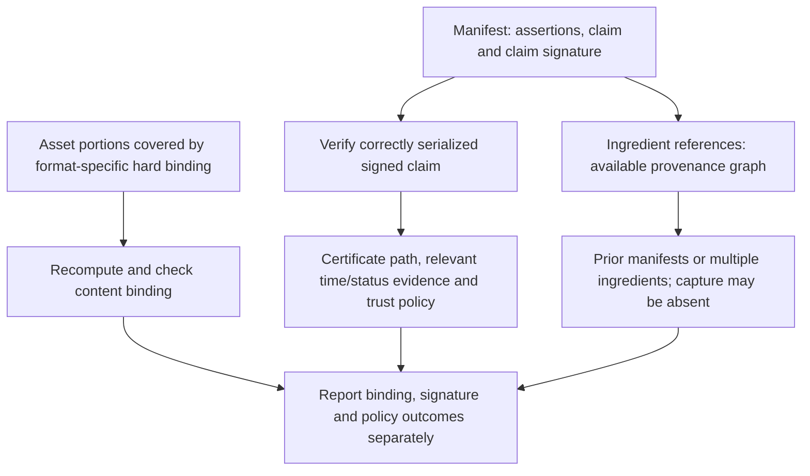
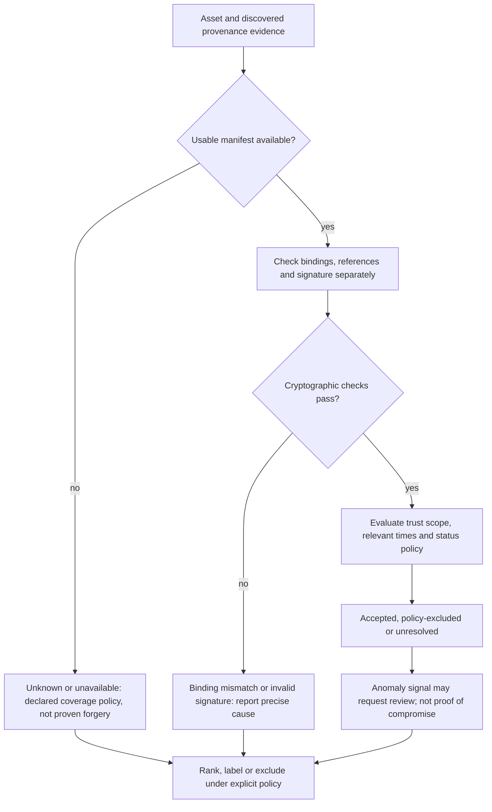
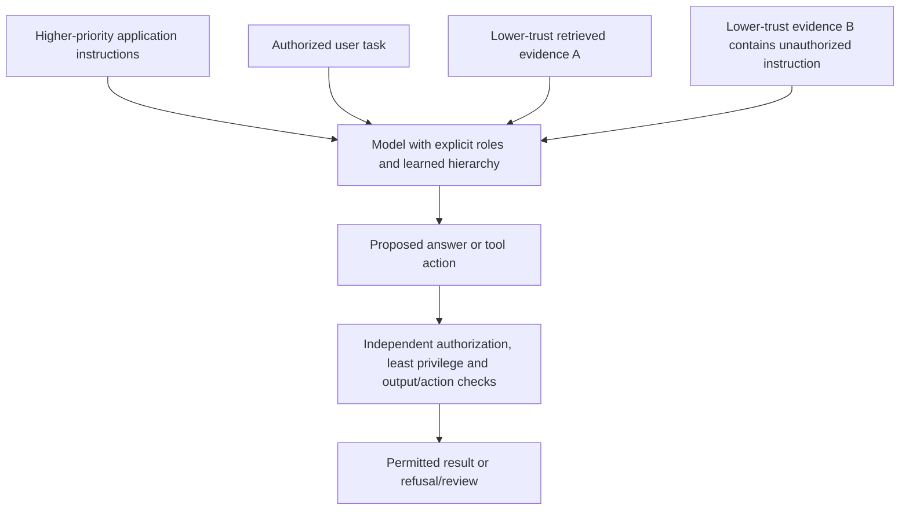
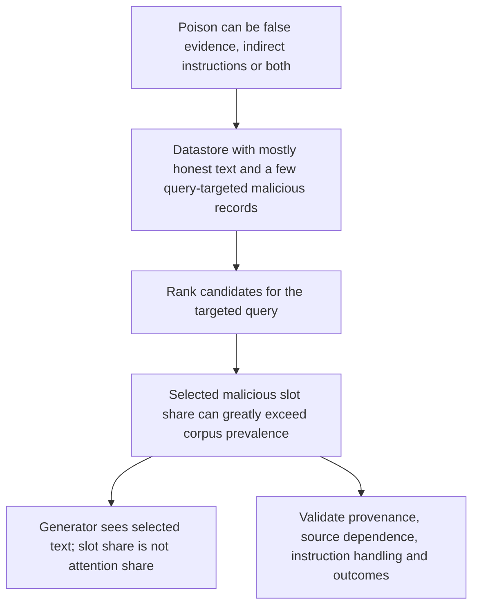
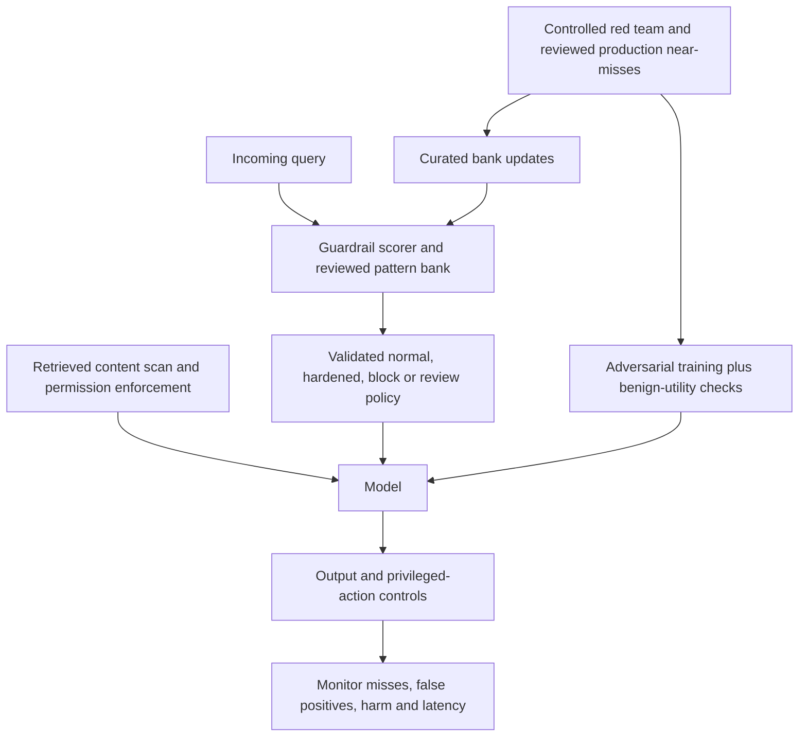
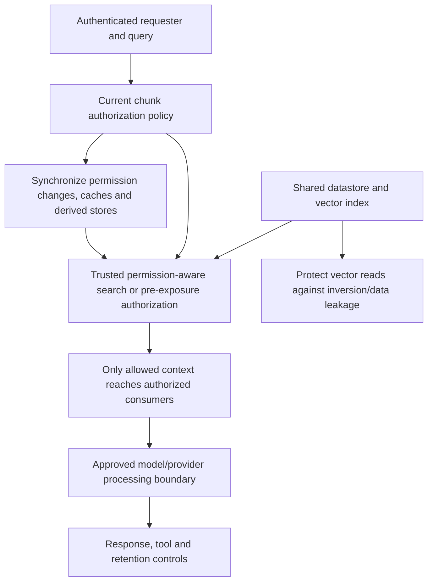

# Chapter 36: Provenance and Adversarial Robustness
[00-START-HERE](../00-START-HERE.md) · [01-READING-ROUTES](../01-READING-ROUTES.md) · [35\_source\_credibility](35_source_credibility.md) · [37\_latency\_cost\_and\_systems](../part-12-systems-design/37_latency_cost_and_systems.md)
Purpose: separate textual attribution, cryptographic provenance, factual credibility, instruction authorization and confidentiality; audit each probability and cost model; and explain the guarantees that do—and do not—follow from a layered RAG defense.
## TL;DR
- Attribution checks whether cited text supports a claim. Provenance validation checks specified origin/integrity assertions. Neither alone proves factual truth, and macro-$`F_1`$ is not an error percentage.
- C2PA signs structured claims linked to assertions and content bindings. Its history can be a graph, not a mandatory complete capture-to-publication chain. A valid signature, valid asset binding and trusted credential are different checks.
- Treat missing, broken, untrusted, compromised and anomalous credentials separately. Publish the ranking/exclusion policy and recall trade-off; absence is not proof of forgery.
- Retrieved third-party instructions can redirect a RAG system. Role markers and learned hierarchy help, but privilege enforcement, least-privilege tools and authorization must not depend only on the model obeying prose.
- Datastore poisoning is a persistent ingestion attack and can carry indirect instructions or factual misinformation. Tiny corpus prevalence does not bound concentration in a targeted query’s selected evidence.
- Guardrails, red teams and adversarial training are complementary controls, not independent failure probabilities that may automatically be multiplied. Benchmark detection, residual attack success, false positives, utility and latency.
- Continuous and discrete attacks have different spaces and cost units. MixAT applies continuous perturbations around sampled discrete attack inputs; the reported gains remain scoped to the evaluated models and attack suite. Deletability does not imply confidentiality: authorize before any restricted content reaches an unauthorized consumer.
## The story
Picture a newsroom with a giant archive. The editor asks a reporter to answer a breaking question. The archivist is the retriever. The reporter is the large language model (LLM). The shelves are the datastore. The newsroom’s written assignment is the system prompt.
The archivist first finds a clipping that states the exact fact the editor wants. That match is attribution. It says the clipping’s words support the reporter’s sentence. It does not say the clipping came from the newspaper named at the top.
At the loading dock, a provenance inspector checks signed claims and the asset portions they bind. A new editor may attach a manifest that references several ingredients. The records can reveal an authenticated history that exists; they do not guarantee that every earlier edit or the original capture was recorded.
Some envelopes have no usable credential. That is an unknown provenance state, not proof of an attack. The inspector follows an explicit policy: require credentials in a closed workflow, or retain separately labeled and independently corroborated legacy evidence when coverage matters. An attacker can strip metadata, but benign processing can do so too.
A seal may verify even when its key was compromised or its signer made a false assertion. The inspector checks trusted roots, policy scope, relevant times and available revocation evidence. An unusual edit pattern triggers review, not an automatic conclusion that the signature was forged.
A clipping can contain white-on-white text instructing the reporter to favor its author. A text extractor may recover words a reader misses. The model can distinguish roles learned during training, but those role markers are not an operating-system privilege boundary. The application must constrain actions and data access outside the generated prose.
The archive can be poisoned before a question arrives. Five deliberately query-matching clippings may dominate a small retrieved window even among millions of honest records. Their local share is a retrieval outcome, not a random sample of the corpus, and their influence is not determined solely by how many slots they occupy.
The newsroom therefore adds a security desk. A fast guard checks each incoming request against known jailbreak patterns. A red team keeps inventing new disguises. The training team teaches the reporter to refuse those hard examples. These roles remain separate because each catches a different failure.
The training team has two drills. One searches realizable word sequences; the other perturbs a numerical embedding within a declared norm budget. Local continuous search is often cheaper for a chosen configuration, but it includes points no token sequence realizes and can miss a distant textual attack.
The hybrid drill samples discrete attack inputs and searches continuous neighborhoods around them. Cached persuasive paraphrases can supply those inputs without a fresh expensive token search at every anchor. Coverage still depends on which attacks, perturbations and utility constraints are trained and tested.
Deleting a clipping can stop future authorized serving from the live store if all reads enforce the deletion state. It does not recall prior prompts, replicas, caches or logs. Confidentiality instead requires checking each requester’s current permission before a clipping reaches that requester or an unauthorized model/provider.
The newsroom needs distinct checks rather than a single “safe” score. Relevant evidence can be inauthentic, signed evidence can be false, credible text can contain an unauthorized instruction, and a useful record can still be forbidden to this requester. Residual risks remain after all checks.
## Decoder table


| Technical term | Plain-English meaning | Why it matters |
| --- | --- | --- |
| Retrieval-Augmented Generation (RAG) | A system that retrieves external material and gives it to a generator | Retrieval expands knowledge and also expands the attack surface |
| Large language model (LLM) | The generator that reads the assembled prompt and produces the answer | It follows useful instructions and can also follow hostile ones found in context |
| Attribution | A test of whether document $`d`$ supports claim $`c`$ | Correct wording does not prove a genuine source |
| Authenticity | Validation of specified origin/integrity assertions under a credential and application policy | Different from attribution and factual truth; missing provenance is not proven fabrication |
| Entailment | A judgment that one text supports another | It supplies the attribution score |
| Attribution score $`a(c,d)`$ | A declared support score in $`[0,1]`$ | Not necessarily calibrated as a probability; score range alone does not define accuracy |
| Authenticity score $`p(d)`$ | A policy weight assigned from separately recorded provenance states | A weight is not an automatically calibrated truth or authenticity probability |
| Attributable to Identified Sources (AIS) | A two-step attribution test for interpretable and properly sourced sentences | It formalizes attribution without testing source authenticity |
| AttributionBench and macro-$`F_1`$ | An attribution benchmark and mean of per-class F1 scores | Around 80 percent macro-F1 does not mean 20 percent of judgments are wrong |
| Back-filled citation | A citation attached after generation rather than used to verify the claim | Good formatting can hide unsupported or fabricated evidence |
| Uniform Resource Locator (URL) | The address presented as a source link | A well-formed address is presentation, not proof of support or authenticity |
| Provenance | The recorded origin and edit history of an asset | It is the evidence behind authenticity |
| Coalition for Content Provenance and Authenticity (C2PA) | A standard for signed provenance claims and content bindings | It authenticates recorded structures under assumptions, not all real-world truth |
| Content Credential | C2PA provenance data with signed claims and content bindings | Embedded, external or recovered data still need applicable binding and policy validation |
| Manifest | A container for assertions, claim and claim signature | Multiple actions/assertions can share one signature; ingredients can branch |
| Assertion | A structured statement referenced by the signed claim | An assertion is not necessarily one signed edit step or a true statement |
| Ingredient link | A reference to an ingredient asset and available provenance data | It can form a graph and need not recover complete capture history |
| Secure Hash Algorithm 256-bit (SHA-256) | A cryptographic hash algorithm used in a simplified binding example | Check the format-defined covered data; not every excluded byte must change the binding |
| Digital signature | A signature over the standard-defined signed message structure | Cryptographic verification, asset binding and signer trust are separate tests |
| C2PA symbols $`M_i`$, $`H_i`$, $`C_i`$, $`\sigma_i`$, $`\mathrm{sk}_i`$, $`\mathrm{pk}_i`$ | The manifest, covered-asset hash, signed structure, signature and key pair | The equations are schematic; use the standard’s actual serialization and algorithms |
| Elliptic Curve Digital Signature Algorithm P-256 (ECDSA P-256) | The signature family assumed in the component cost toy | The stipulated 0.3ms service rate is not an independently reproduced benchmark |
| Public key | The key used in cryptographic signature verification | Identity, scope, relevant times and trust need additional validated evidence |
| Private key | The signing secret | A compromised key can produce a valid signature on a false claim |
| Certificate | A credential that binds a public key under an issuer’s assertions/policy | Path, trust, time and status rules matter; later revocation need not invalidate every old signature |
| Certificate authority (CA) | An issuer in the applicable certificate path | A root/trust policy is not proof that every signed factual assertion is true |
| Trust list | The approved set of certificate roots | Its scope controls which signers can earn trust |
| Trust anchor | A policy-accepted root credential | Narrowing accepted roots changes signer scope, not a universal truth score |
| Transport Layer Security (TLS) | The browser security analogy used for certificate-chain checks | It clarifies how signer certificates chain to trusted roots |
| Tamper-evident | Detection of changes to specified authenticated/bound data | Not proof of a complete edit history or detection of every byte change anywhere |
| Tamper-resistant | A property intended to resist modification | The chapter distinguishes it from C2PA’s actual guarantee |
| Exchangeable image file format (EXIF) metadata | Editable camera and timestamp fields stored with an image | It is not cryptographically bound to the asset |
| Watermark | A visible or invisible signal in content | Some invisible watermarks/fingerprints can recover provenance; a painted mark alone is not signed history |
| Embedded manifest | A credential stored inside the asset file | It travels with copies but often disappears during re-encoding |
| Cloud manifest | Provenance material stored outside the asset | Remote storage does not itself preserve hard-binding validity after recompression |
| Content delivery network (CDN) | A distributor that may transform media | Transforms can separate metadata or invalidate old bindings; distinguish those causes |
| Central processing unit (CPU) | The processor work consumed by hashing and signature verification | Parallel checks can reduce wall time without reducing this work |
| OpenSSL benchmark | A benchmark family, not a measurement reproduced in this chapter | Hash/signature numbers here are explicit service assumptions |
| Hash-linked Git or blockchain chain | An analogy for references that commit to earlier data | C2PA provenance can branch and does not require a complete immutable capture chain |
| Revocation | Credential-status evidence evaluated under time and trust policy | Do not equate later revocation with all past signatures becoming cryptographically invalid |
| Online Certificate Status Protocol (OCSP) | A protocol for credential-status evidence | Caching, shared certificates, stapling, relevant times and network policy affect cost |
| Anomaly detection | A heuristic flag for unusual metadata or history | An anomaly alone does not prove a forged signature, compromise or false claim |
| False positive | A legitimate history incorrectly flagged as suspicious | An anomaly flag should not automatically prove forgery |
| False negative | A malicious history that avoids the anomaly threshold | Patient attackers can remain below a heuristic threshold |
| Corroboration | Independent support assessed for a specified claim or provenance relation | Two of three is a toy policy input, not automatic calibration or statistical independence |
| Graded authenticity | A ranking policy over distinct provenance-validation states | Keep raw states and exclusions separate; grading does not measure truth by definition |
| Provenance symbols $`u(d)`$, $`u^{\prime}(d)`$, $`u_{\mathrm{floor}}`$, $`p_{\mathrm{min}}`$, $`p_{\mathrm{corr}}`$, $`N`$, and $`k`$ | Normalized relevance, its weighted version, comparator floor and policy weights | Pairwise ordering needs bounded scores; excluding all unknowns also needs enough eligible comparators |
| Indirect prompt injection | An unauthorized instruction delivered through third-party material | It can persist in a poisoned datastore; persistence is not the defining difference |
| Direct prompt injection | An attacker instruction typed by the user | It enters through a different source from indirect injection |
| Instruction hierarchy | A trained priority policy over messages and instructions | It can help without constituting externally enforced process isolation |
| Context window and self-attention | The model context and learned interactions between token positions | Roles can change behavior; sharing context does not mean identical attention weights |
| System prompt and role boundary | Explicit priority and data-role markers in the input protocol | Useful signals, not a complete tool/data authorization mechanism |
| Keyword or regular-expression filter | A detector for selected strings or forms | Coverage and false positives need validation; other controls must enforce privileged actions |
| Injection exposure $`E(k)`$ | Probability of one or more injected selected passages under a sampling model | It is not the success probability of an arbitrary deterministic top-k attack |
| Injection symbols $`p`$ and $`k`$ | Selected-draw injection probability and number of draws in the IID toy | Global corpus prevalence does not automatically equal selected-passage probability |
| Datastore poisoning | Persistent insertion or alteration of indexed evidence | It can carry false facts, indirect instructions or both; remove derived/cached serving state too |
| Top-$`k`$ retrieval and reranker | Selection of $`k`$ candidates followed by a second scoring pass | An attacker only needs to win the local window and its final ordering |
| Dense retrieval | Embedding-based ranking for a query | It can include authority/security signals, but relevance alone is not authenticity or authorization |
| PageRank | A graph-based authority signal used in the historical comparison | No universal 100-page attacker floor or matched economic comparison follows |
| PoisonedRAG | A targeted knowledge-corruption attack evaluated in named RAG settings | Its five injected texts are per target question; ASR is protocol/model-specific |
| Reliability-aware RAG (RA-RAG) | Source-specific answer filtering, selection and transformed agreement-weighted voting | Accepted-source count does not bound calls; source identities do not prove independence |
| Poisoning symbols $`D`$, $`N`$, $`m`$, $`k`$, $`K`$, $`S`$, and $`r_s`$ | Corpus, poison budget, windows, accepted sources and agreement rates | For the original transform, vote weight differs from agreement and can be negative |
| Per-source vote cap | A rule that lets one source cast at most one effective vote | It stops single-source flooding but not many coordinated identities |
| Sybil source | One of several distinct-looking identities controlled by one attacker | Sybils manufacture fake cross-source agreement |
| Generative engine optimization (GEO) | Optimization for discovery/citation by answer engines | Legitimate optimization and malicious evidence manipulation are not identical categories |
| Search engine optimization (SEO) | Page design aimed at classical search ranking | Link-farm spam is the historical analogy for coordinated poisoning |
| Cold-start reliability prior | An explicit admission/calibration policy for unseen sources | Unknown is not automatically zero agreement; RA-RAG’s affine transform can make low rates negative |
| Corroboration burst | Several new sources repeating an unusual claim in a short window | It is a corpus-level poisoning signal |
| Jailbreaking | An attempt to bypass a model safety restriction | It can overlap instruction injection, but an unauthorized price utterance is not necessarily an executed sale |
| Safety fine-tuning | Updates affecting refusal and other behavior | It is not a universal selective deletion or complete capability-preservation guarantee |
| Competing objectives | A conflict between helpfulness and refusal goals | A crafted framing can push the model toward the wrong objective |
| Mismatched generalization | Failure when an attack lies outside the safety-tuning distribution | Role-play can bypass a narrowly learned refusal |
| Reinforcement learning from human feedback (RLHF) | Feedback-based instruction and preference training | Better instruction following does not automatically solve injection |
| Guardrail | An inline detector or policy control on requests, context or outputs | Each location has different coverage, false positives and disclosure limits |
| Red teaming | Controlled attempts to find failures before attackers do | It refreshes the guardrail bank and training anchors |
| Attack success rate (ASR) | Success fraction for a named attack population, model, judge and budget | Production transfer and outcomes outside that evaluation need separate evidence |
| Approximate nearest neighbor (ANN) lookup | Fast search for close vectors | The query guardrail uses it against known jailbreak embeddings |
| Hierarchical Navigable Small World (HNSW) | An approximate vector-search graph implementation | Low lookup latency is workload-dependent, not guaranteed merely by bank size |
| Hardened system prompt | A stricter prompt chosen under a validated policy | It can change both malicious success and benign utility; it is not a hard enforcement boundary |
| Temperature | A sampling control; zero typically selects greedily | Zero does not certify safety or full end-to-end determinism |
| Guardrail symbols $`Q`$, $`a`$, $`J`$, and $`\mathrm{ASR}`$ | Daily request rate, attack fraction, bank size and conditional success rate | The 71-to-2 percent pair is stipulated, and expectations are not observed counts |
| Adversarial training | Training on attacks and desired refusals | It changes the refusal boundary rather than only filtering inputs |
| Discrete adversarial training | Training on real adversarial token sequences | It targets realizable attacks but requires expensive search |
| Greedy Coordinate Gradient (GCG) | A gradient-guided discrete token-candidate search | Candidate forward evaluations and per-iteration gradient work are different ledger entries |
| One-hot token vector | A discrete vector identifying one vocabulary token | Its discreteness blocks a direct gradient update to token identity |
| Discrete symbols $`x_{\mathrm{adv}}`$, $`y_{\mathrm{refuse}}`$, $`L`$, $`V`$, $`B`$, $`T`$ | Adversarial text, refusal target, suffix length, vocabulary, candidate batch and iteration count | The worked search uses T for iterations and counts candidate sequences, not serial kernel launches |
| Continuous adversarial training | Adversarial updates on perturbed input embeddings | Its norm/mask conventions and unrealizable perturbations limit the claim |
| Embedding | A sequence of numerical token vectors | For length L and width d the illustrative input is an L-by-d matrix, not one unspecified d-vector |
| Perturbation $`\delta`$ | An embedding change within a declared editable-position norm budget | A finite gradient search approximates rather than certifies the strongest attack |
| $`\epsilon`$ ball | A norm-bounded embedding neighborhood | Per-token and whole-sequence radii are different; scale and masks matter |
| Projected gradient ascent | Gradient steps followed by projection onto the declared constraint set | Step count and radius do not prove global optimization or universal robustness |
| Continuous-search symbols $`e`$, $`d`$, $`\delta`$, $`\epsilon`$, $`\mathcal{L}`$, and $`f`$ | Embedding matrix, token width, perturbation, budget, model and chosen loss | The chapter’s Frobenius objective is illustrative, not every continuous-training implementation |
| Utility loss, C-AdvUL, and C-AdvIPO | Examples of utility-aware adversarial-training formulations | Keep the actual loss/norm recipe distinct from the simplified refusal-loss illustration |
| Hybrid adversarial training | Training that combines discrete attack seeds and continuous perturbations | MixAT searches neighborhoods around sampled discrete inputs rather than requiring fresh GCG at every anchor |
| MixAT | The primary hybrid method cited with a versioned table | Its evaluated model/suite results are not a guarantee for all architectures or attacks |
| At-least-one attack success rate (ALO-ASR) | Fraction of the same test behaviors for which at least one evaluated attack succeeds | Union across behavior-level successes, not an average over methods or proof of universal worst-case safety |
| Revocability | Ability to exclude identified data from declared future serving paths | Past contexts, replicas, derived stores, caches and logs need separate handling |
| Confidentiality | The rule governing who may see a fact now | Deletability alone does not enforce it |
| Access-control list (ACL) | Permission metadata/policy evaluated for a requester and chunk | Enforce before disclosure; a trusted post-ranking check can also protect context confidentiality |
| Privacy symbols $`\theta`$, $`D`$, $`N`$, $`R`$, $`M`$, $`K`$, $`X`$, $`u`$, $`q`$, $`c`$, and $`k`$ | Weights, corpus/pool sizes, restricted counts, random selected count, requester and similarity inputs | Exactly five restricted candidates is a conditional toy, not established by an expected count |
| $`\mathrm{Allowed}(u,c)`$ | A predicate that says whether user $`u`$ may access chunk $`c`$ | It is separate from semantic similarity |
| Cosine similarity or $`\mathrm{sim}(q,c)`$ | A relevance score between query q and chunk $`c`$ | It has no knowledge of requester identity |
| Metadata pre-filter | Permission-aware candidate restriction during search | Avoids underfill, but correctness and recall/latency need validation; it is not the only pre-exposure enforcement point |
| Embedding inversion | Reconstruction attacks using embeddings and encoder-related access | The cited 92-percent/32-token result is scoped; protect sensitive vectors without assuming universal inversion |
| Trust boundary | The set of authorized processors, storage and consumers under a declared policy | A provider is not automatically unauthorized; approved processing and training use are separate questions |
| Hypergeometric probability | A count law for uniform sampling without replacement from a fixed finite pool | Deterministic top-k does not automatically follow it, and plugging in an expected restricted count is not a universal identity |
| Open Worldwide Application Security Project (OWASP) Top 10 for LLM Applications | The named production-risk list cited by the chapter | It identifies insufficient access control over retrieved and embedded content as a risk category |
| Authorization fuzz test | Cross-scope tests of retrieval and disclosure enforcement | Exercise revocation, stale caches, failures and concurrency; finite tests support but do not prove every execution |


## Core mechanics
### Mathematical conventions
A score in $`[0,1]`$ is not automatically a calibrated probability. Keep attribution, credential-validation status, factual credibility and access authorization distinct. Missing, invalid, untrusted, revoked/compromised and anomalous evidence are different states; a policy may map states to ranking weights without making those weights truth probabilities. Cryptographic validity authenticates a signed statement under specified validation assumptions, not every real-world assertion in it.
Use decimal units, with $`1\,\mathrm{MB}=10^6\,\mathrm B`$, full intermediate precision and rounding only at reporting. Hashing, signature checks, certificate/status work, network retrieval and cache lookups are separate costs. Count signed manifests rather than assertions when estimating signatures; state which historical assets are actually rehashed. Report component service-work budgets separately from end-to-end wall latency.
The injection-exposure equation assumes IID passage draws with a stated marginal attack probability. The hypergeometric example instead conditions on exactly five restricted candidates and uniform sampling without replacement. Neither is a model-free law for deterministic nearest-neighbor top-$`k`$. Corpus prevalence, selected-passage prevalence, attack exposure and successful compromise are different quantities. Expectations are not realized incident counts.
Define attack-success denominators, behavior IDs, attack budgets, models and judge versions. ALO-ASR is a union of successes across attacks on the same behaviors, not an average over attacks or a guarantee against all possible attacks. Candidate forward evaluations, gradient steps, batched executions and elapsed time are not interchangeable. Correct authorization yields a no-forbidden-context invariant only when identity, metadata, enforcement and all relevant paths are correct.
### 36.1 Attribution, provenance and truth are different questions
#### What it is
Attribution asks whether document $`d`$ supports claim $`c`$ under a declared rubric. A human or evaluator may assign $`a(c,d)\in[0,1]`$, but that score need not be a calibrated support probability. AIS separates interpretability from attribution to identified sources. AttributionBench reports around $`80\%`$ binary macro-$`F_1`$ for fine-tuned GPT-3.5; it does not imply one incorrect judgment in five. For two classes with defined denominators, $`F_{1,j}=2\mathrm{TP}_j/(2\mathrm{TP}_j+\mathrm{FP}_j+\mathrm{FN}_j)`$ and $`F_{1,\mathrm{macro}}=(F_{1,1}+F_{1,2})/2`$, whereas error is $`(\mathrm{FP}+\mathrm{FN})/n`$. For example, confusion counts $`(\mathrm{TP},\mathrm{TN},\mathrm{FP},\mathrm{FN})=(80,80,20,20)`$ and $`(135,35,15,15)`$ both give macro-$`F_1=0.8`$ but error rates $`20\%`$ and $`15\%`$. The benchmark tests textual attribution, not cryptographically certified source authenticity.[\[1\]](https://aclanthology.org/2024.findings-acl.886)
#### Why it exists
Provenance validation reads signed claims, asset bindings, certificates and policy evidence; attribution judges the relation between claim and text. They answer different questions without being statistically independent or necessarily using disjoint features in every implementation. A fabricated document can closely restate a target claim and receive high $`a(c,d)`$ while lacking acceptable provenance. Conversely, a validly signed document can be factually wrong or fail to support a cited claim. A URL or quotation alone proves none of these properties.
#### Failure without it
In a four-candidate Drug X toy, stipulate a real trial report with $`a=0.94`$ and accepted provenance, and a fabricated press release with $`a=0.97`$ and excluded provenance. The claimed symptom reduction is $`40\%`$; no clinical result is independently established here. Attribution-only ranking would prefer $`0.97`$ over $`0.94`$, while a correctly implemented provenance gate under this stipulated policy removes the known fabrication. That illustrates separate failure modes, not a theorem that all attribution-only systems prefer fakes or that the gate detects every fake. AttributionBench’s textual score does not establish a security bound conditional on all documents having verified $`p(d)=1`$.
#### Cost, complexity, and decisions
Log attribution, provenance-validation state and factual credibility separately. An attribution score alone cannot distinguish an attacker’s linguistically matching fabrication from genuine supporting text in an otherwise identical textual test, but shared features can correlate with provenance; “no asymptotic power” is not established here. In a closed credentialed workflow, fail closed when required provenance cannot be validated. In a legacy/open corpus, choose an explicit unknown/corroborated/excluded policy and measure recall and abuse costs. Do not label missing evidence forged or silently set every legacy record to zero. First-party ingestion can supply provenance evidence but still needs integrity, compromise and policy checks; it is not a reason to assume factual truth.
### 36.2 Content credentials and C2PA
#### What it is
C2PA represents provenance with manifests containing assertions, a claim and a claim signature. The claim references assertion hashes, including a format-specific hard binding to the asset; ingredient assertions can reference other manifests/assets. A manifest can describe multiple actions, so “three assertions” does not imply three signatures. A graph may have multiple ingredients, begin after capture, or omit inaccessible history. The following notation is schematic, not an implementation of the standard’s byte serialization or COSE signing rules.[\[2\]](https://spec.c2pa.org/specifications/specifications/2.0/specs/C2PA\_Specification.html)

```math
H_i=\mathop{\mathrm{SHA256}}\nolimits\!\left(\mathcal B_i(\mathrm{asset}_i)\right).
```

Here $`\mathcal B_i`$ denotes the asset portions covered under the chosen format’s hard-binding rules, including required exclusions. Hashing the entire file including its own embedded manifest would be self-referential and is not the general rule. Let $`C_i`$ denote the correctly constructed signed message/COSE structure carrying the claim; abstractly:

```math
\sigma_i=\mathop{\mathrm{Sign}}\nolimits_{\mathrm{sk}_i}(C_i),\qquad\mathop{\mathrm{Verify}}\nolimits_{\mathrm{pk}_i}(C_i,\sigma_i)=1.
```

A signature check authenticates the signed structure under its public key, assuming secure algorithms, correct implementation and uncompromised keys. Separately validate asset hard bindings, assertion references, applicable certificate path/trust anchors, credential policy and relevant timestamps/status evidence. A public key alone does not establish a real-world identity or truthful assertion. The browser/TLS analogy is about certificate-path trust, not identical formats, guarantees or runtime.
- Check the asset portions and assertion references required by the relevant binding/format.
- Check the claim signature under the appropriate public key and algorithm.
- Evaluate certificate path, trust scope, relevant time/status evidence and application policy; report each failure separately.
Following ingredient references reveals available recorded history, potentially as a directed graph rather than a linear chain $`H_{i-1},\ldots,H_0`$. It need not reach an original camera capture or prove that all edits were logged. A graph walk has $`O(V+E)`$ reference/check overhead for $`V`$ visited records and $`E`$ links; hashing bytes, fetching assets and verifying signatures add their own size- and implementation-dependent costs. A simple chain is a special case.
#### Why it exists
A changed covered asset portion can fail the hard-binding check even while the unchanged manifest signature remains cryptographically valid. An untrusted signer can also produce a valid signature; trust rejection is not signature failure. Modifying signed claims without an authorized signature should be detected under the cryptographic assumptions, but a trusted dishonest or compromised signer can sign new false claims. C2PA provides tamper evidence for recorded bindings and statements, not prevention of all edits, complete historical observation or a truth certificate. A signed AI-edit assertion records what the signer asserted, not independently established ground truth.[\[2\]](https://spec.c2pa.org/specifications/specifications/2.0/specs/C2PA\_Specification.html)
#### Failure without it
Ordinary editable EXIF and a painted visible watermark alone do not provide authenticated structured history. C2PA distinguishes hard cryptographic bindings from soft bindings such as fingerprints or invisible watermarks. Changes to covered content generally invalidate an old hard binding; the standard does not say every byte change anywhere must fail. A soft binding may help recover a separated manifest or identify a rendition, but recovery does not make the original hard binding valid for different bytes. Remote storage alone does not make credentials survive recompression: verify a supported rendition relationship/new signed manifest or report the limits of recovered provenance.[\[2\]](https://spec.c2pa.org/specifications/specifications/2.0/specs/C2PA\_Specification.html)
#### Cost, complexity, and decisions
For an explicitly component-only toy, ingest $`10{,}000`$ images per day, each $`3\,\mathrm{MB}`$, with three signed manifests (capture plus two edit records), not merely three assertions. Assume current-asset hashing throughput $`500\,\mathrm{MB/s}`$ and signature verification $`0.3\,\mathrm{ms}`$ each; these are stipulated service rates, not a reproduced OpenSSL benchmark. Hashing only the current asset costs $`6\,\mathrm{ms}`$; three signature checks add $`0.9\,\mathrm{ms}`$, totaling $`6.9\,\mathrm{ms}`$ per item or $`69\,\mathrm s`$ of serial work per day. Checking twenty items serially costs $`138\,\mathrm{ms}`$, $`69\%`$ of a $`200\,\mathrm{ms}`$ budget. The coarser planning rate $`7\,\mathrm{ms}`$ instead gives $`70\,\mathrm s`$, $`140\,\mathrm{ms}`$ and $`70\%`$; these are rounded planning figures, not separate measurements.
This ledger omits certificate/path/status work, manifest/assertion hashing, parsing, I/O and historical asset rehashing. If all three asset states were separately available at $`3\,\mathrm{MB}`$ each and rehashed, the hash-plus-signature component would be $`18.9\,\mathrm{ms}`$ per item, $`189\,\mathrm s`$ daily and $`378\,\mathrm{ms}`$ for twenty serial items. Historical data may be unavailable; signature verification alone does not establish a full asset-by-asset capture history. Parallelism can lower wall time but not erase total service work or contention.
Verify immutable content/signature bindings at ingestion and cache by the appropriate asset/manifest identifiers. Keep mutable trust/status policy separate, version the verifier and re-evaluate on trust changes. Discover embedded or externally stored manifests and available soft-binding recovery without assuming re-encoding preserved the hard binding. Walk the needed ingredient graph for high-stakes use and explicitly report missing history. Choose public or private trust anchors for the deployment’s signer policy; neither choice guarantees factual reliability or a fixed recall/latency.
### 36.3 Missing, invalid and compromised credentials
#### What it is
Distinguish no discovered credential, unavailable external data, hard-binding mismatch, invalid signature, untrusted signer, time/status-policy rejection and a merely anomalous history. A valid signature on a dishonest statement or one made with a compromised key is not a cryptographic signature forgery. Let $`p(d)`$ be a declared provenance-policy weight, not a probability that the document is true. A policy may assign accepted evidence weight one, excluded evidence zero and unknown/corroborated evidence intermediate values. Its threshold does not transform an anomaly into proof of fraud.
#### Why it exists
Metadata stripping can avoid a credential check, but benign workflows and legacy material can also lack manifests. Whether to exclude or down-weight unknown provenance depends on the required workflow and the measured false-positive/recall trade-off. Trusted-root scoping limits accepted signer credentials; it does not establish honest reporting. Evaluate revocation/status against the standard’s applicable signing-time/timestamp and trust rules: a credential revoked later need not make every historical signed record invalid. An application may also quarantine a known compromised signer under a separate current-risk policy. The example of forty-seven edits across three sessions is a review heuristic, not a calibrated authenticity test.[\[2\]](https://spec.c2pa.org/specifications/specifications/2.0/specs/C2PA\_Specification.html)
#### Failure without it
Neither missing metadata nor an unusual edit count proves forgery. A professional editor may trigger the anomaly heuristic, and an attacker may avoid it. Keep cryptographic failures, status-policy exclusions and review flags separate in logs and user explanations. Do not blocklist a signer merely because one benign history looked unusual; use independently validated compromise evidence and an appeal/review policy.
#### Cost, complexity, and decisions
Stipulate $`N=200`$ candidate images partitioned into $`120`$ accepted, $`50`$ with no discovered manifest, $`18`$ with hard-binding mismatches consistent with possible re-encoding, and $`12`$ requiring status/anomaly review. The counts sum to $`200`$; neither the eighteen nor the twelve are automatically proven fraudulent. For this ranking toy only, require $`u(d)\in[0,1]`$ after a declared normalization and use nonnegative $`p(d)\in[0,1]`$. A raw unbounded dot product or signed cosine score would not justify the following cap. If accepted documents have $`p=1`$ and $`u\ge u_{\mathrm{floor}}=0.3`$, then $`p_{\min}\lt 0.3`$ keeps any unknown item’s weighted score strictly below any such accepted item. Choose $`p_{\min}=0.2`$. Excluding unknowns from an entire top-twenty list additionally requires at least twenty eligible accepted comparators or a hard exclusion rule.
As a stipulated corroboration policy, assign $`p_{\mathrm{corr}}=2/3`$ when two of three independently assessed trusted sources support the relevant claim; that fraction is not a calibrated asset-authenticity probability. Let the twentieth accepted comparator have $`u=0.55`$. Use:

```math
u^{\prime}(d)=u(d)\,p(d),\qquad 0\le u(d),p(d)\le1.
```

An unknown item with $`u=0.95`$ gets $`0.19`$. A corroborated item with $`u=0.85`$ gets $`0.85(2/3)=17/30\approx0.566666667`$, above the stipulated $`0.55`$ comparator; do not compute with the rounded $`0.67`$ as if exact. This can displace that comparator, but final membership also depends on all other competing items. An explicitly excluded item gets zero; a tied zero score still needs a removal/tie policy if zero means “never serve.”
For a deliberately serial, unshared network scenario, twenty status requests at $`30\,\mathrm{ms}`$ each total $`600\,\mathrm{ms}`$, three times the $`200\,\mathrm{ms}`$ budget. Certificate sharing, stapled evidence, caching and parallel requests change that ledger. A cached decision still has lookup/enforcement cost. Successful refresh at intervals no longer than twenty-four hours bounds cache staleness relative to available newly published status by roughly that interval, not the duration since an unreported compromise; outages, publication delays and policy must be handled explicitly. Do not cache mutable trust forever solely by asset hash.
Vosoughi, Roy and Aral report that true Twitter stories took about six times as long as false stories to reach $`1{,}500`$ people in their studied cascades. That diffusion-time ratio does not estimate the probability that an unsigned asset is false or justify the chosen $`0.2`$ weight.[\[3\]](https://politics.media.mit.edu/papers/Vosoughi\_Science.pdf)
### 36.4 Indirect prompt injection: the native RAG threat model
#### What it is
Direct injection arrives through an active user request; indirect injection arrives in lower-trust third-party material such as a page, email, PDF or retrieved passage. White-on-white or tiny text can be visible to an extractor while easy for a person to miss. Nikkei’s July 2025 investigation, subsequently described by The Register, identified seventeen preprints associated with fourteen institutions in eight countries; it was a targeted discovery report, not a representative corpus survey or a demonstrated success rate for every hidden prompt.[\[4\]](https://asia.nikkei.com/business/technology/artificial-intelligence/positive-review-only-researchers-hide-ai-prompts-in-papers)[\[5\]](https://www.theregister.com/software/2025/07/07/scholars-sneaking-phrases-into-papers-to-fool-ai-reviewers/708598)
Role markers and message structure can encode instruction priority, and a trained model can respond differently to system, user and tool text. It is too strong to say all such text receives identical attention or that nothing marks the roles. The key limitation is that ordinary model context does not provide an independently enforced process privilege boundary. Wallace et al.’s learned instruction hierarchy improves scoped robustness without proving universal isolation.[\[6\]](https://arxiv.org/html/2404.13208)
#### Why it exists
Injection concerns the source and authority of an instruction; jailbreaking concerns bypassing a safety restriction. They can overlap: a poisoned page may both redirect a task and seek an unsafe response. Good harmful-content refusal alone does not establish instruction-source authorization. Authentic or trusted-publisher content can also contain instructions that the application must treat as data.
#### Failure without it
Keyword and regular-expression filters can catch known strings but cannot be assumed to recognize all malicious natural-language intent; paraphrases and benign quoted imperatives create coverage/false-positive trade-offs. This is not a proof that all filters are useless or that SQL injection is solved by arbitrary escaping. Structured interfaces and parameterized SQL can enforce a code/data boundary for their stated grammar; an analogous boundary must be designed and validated for the LLM application, especially before privileged tool calls.
#### Cost, complexity, and decisions
For a mathematical exposure toy, let each of $`k`$ IID passage draws contain an injection with probability $`p=0.0005=0.05\%`$. Treat $`p`$ as the selected-draw rate under this hypothetical mechanism, not an empirically known global-corpus rate. If exposure means at least one injected passage, then:

```math
E(k)=\Pr(\text{at least one injected draw})=1-(1-p)^k.
```

At $`k=10`$, under the same IID model:

```math
E(10)=1-0.9995^{10}\approx0.004988764987=0.498876499\%.
```

At $`k=50`$:

```math
E(50)=1-0.9995^{50}\approx0.024696185672=2.469618567\%.
```

For small $`kp`$, $`E(k)\approx kp`$; the union bound $`E(k)\le kp`$ also holds without independence if each selected position has marginal probability at most $`p`$. Corpus prevalence alone does not establish those marginals. Under the IID model, requiring $`E(k)\lt 0.001`$ yields the strict inequality below because $`\ln(1-p)\lt 0`$:

```math
k\lt \frac{\ln(0.999)}{\ln(0.9995)}\approx2.000500375,\qquad k\in\mathbb Z_{\ge0}.
```

Thus $`k\le2`$ in this toy: $`E(2)=0.099975\%\lt 0.1\%`$, while $`E(3)\approx0.1499250125\%`$. Do not round the strict threshold to two before deciding integer feasibility. A targeted nearest-neighbor query can retrieve only attack passages even when their global fraction is $`0.05\%`$; correlated draws and finite-population sampling require their own models. The hidden-preprint investigation gives no representative rate from which a “five times smaller” corpus prevalence or conservative risk floor can be derived. Exposure also differs from attack execution/success.
Treat retrieved content as lower-trust data, keep roles/delimiters explicit and use hierarchy-aware models where evaluated. Scan the actual contexts supplied to generation, including reranked/expanded text, but do not call a passed classifier proof of safety. Keep tool privileges, data authorization, output handling and human approval for consequential actions outside solely model-generated decisions. Select retrieval depth for measured recall, latency and attack risk rather than claiming $`k=50`$ is safe after a scan. Output checks can still help prevent an action or response, though they cannot undo disclosure of restricted input already sent to a model.
### 36.5 Data poisoning the datastore
#### What it is
Datastore poisoning inserts or alters stored evidence, potentially affecting repeated queries until the records, derived chunks and caches are excluded. Indirect injection can be delivered through those persistent records; it is not necessarily ephemeral or disjoint from poisoning. Poisoning can instead manipulate factual answers without an explicit instruction. A local nearest-neighbor attacker targets selected queries rather than needing a large global corpus share, although dense systems can also incorporate authority signals and classical search can suffer local spam.
PoisonedRAG injects five malicious texts per target question in its evaluated setting, not five total texts for an arbitrary workload. For example, its black-box PaLM 2/NQ result reports $`97\%`$ ASR with $`2{,}681{,}468`$ clean texts in the database. ASR is the fraction of target questions yielding the attacker-chosen answer under that protocol, not the fraction of arbitrary production requests compromised or a guarantee against every defended system.[\[7\]](https://arxiv.org/html/2402.07867)
#### Why it exists
The selected evidence can concentrate malicious records far above their corpus fraction. A per-source ballot cap limits repeated records under one identity but does not establish independent ownership, observations or errors. Distinct domains can be coordinated Sybils; conversely, genuinely independent sources need not have independent errors. Generative-engine optimization includes legitimate discoverability work as well as possible manipulative practices, so distinguish intent, falsehood and unauthorized control instead of equating all GEO with poisoning.
#### Failure without it
If all five inserted records win a five-document window, their document-count share is $`5/5=100\%`$. With twenty selected records it is at most $`5/20=25\%`$ under the assumption that only those five are malicious; token/attention share can be very different. A reranker may promote or reject them, so dilution is not a security proof. PoisonedRAG also reports residual ASR at $`k=50`$ in a specific HotpotQA expansion experiment; more context alone did not eliminate that attack.[\[7\]](https://arxiv.org/html/2402.07867)
An illustrative classical campaign of $`100`$ pages versus five texts is $`20{:}1`$, or $`\log_{10}20\approx1.301030`$ orders of magnitude—not two orders. These stipulated counts are not matched attack-cost measurements, a universal link-farm floor, or a dollar-cost comparison. Creation/search costs, target coverage, ingestion, persistence and defenses all matter.
#### Cost, complexity, and decisions
RA-RAG is a possible source-level control, not a demonstrated defense against every poisoning/Sybil attack. Its accepted-source target $`K=4`$ out of $`S=1{,}000`$ can require more than four source attempts, and it transforms source agreement into vote weights rather than simply treating every rate as a probability. Under the original uncapped transform $`v_s=S r_s-1`$, a near-zero $`r_s`$ produces a negative vote—not a neutral unknown-source prior. Define unknown-source admission and calibration explicitly rather than silently reusing that transform for arbitrary cold-start trust.[\[8\]](https://arxiv.org/html/2410.22954v1)
Validate source control/independence, quarantine suspicious writes where appropriate, maintain provenance for chunks and invalidate serving caches on removal. Audit bursts of new sites repeating unusual claims without assuming every news cycle is an attack. Domain age or verified identity are signals, not truth proofs. The chapter’s five-blog/nine-day support scenario and eight-domain/two-week escalation are illustrative adversarial cases, not independently verified experiments or universal attacker costs.
### 36.6 Jailbreaking, red teaming, guardrails
#### What it is
Jailbreaking seeks content disallowed by a model’s safety policy, while an unauthorized discount is also an application instruction/transaction-authorization failure; these categories can overlap but are not identical. A chatbot’s one-dollar price utterance is not evidence that a sale executed or was legally binding. Pretraining and later training jointly affect capabilities and refusal behavior. Competing goals and out-of-distribution role-play are useful explanations to test, not an exhaustive mechanism theorem or proof that every model already contains every requested harmful capability.
#### Why it exists
Use separate scans for active requests and retrieved third-party content when those controls help, plus enforcement on tools, data and output consumers. A system can fail an authorization boundary while maintaining ordinary harmful-content refusal. Layered defenses need not have independent errors, so do not multiply their individual failure rates without a justified joint model. Red-team examples improve the test set but cannot certify the complement of all unseen attacks.
#### Failure without it
A keyword/embedding bank can become stale; its useful lifetime is workload-dependent rather than necessarily a fixed number of months. Adaptive attacks may evade similarity, attack the scorer, span multiple turns or exploit false positives. No finite clean test proves zero attack risk. Do not automatically admit every flagged production query into the trusted bank: that creates a write/poisoning path. Review examples, permissions, duplicates, labels and retention, and evaluate on a separate held-out/adaptive suite.
#### Cost, complexity, and decisions
Consider a hypothetical guardrail that embeds a bank of $`J=50{,}000`$ attack patterns and compares each request with it. A match may choose a hardened prompt or an explicit review/block policy; temperature zero is not a safety guarantee or a promise of perfectly deterministic serving. The chapter’s unattributed $`71\%\to2\%`$ ASR pair is used here only as a stipulated scenario, not as a verified published benchmark or transferable production result.
Let $`Q=50{,}000`$ requests per day and assume the request-level attack fraction is $`a=0.001`$. If the conditional per-attack success rates really are $`0.71`$ without and $`0.02`$ with the entire deployed defense—including missed detections—then expected successful attack requests are:

```math
\mathbb E[I_{\mathrm{base}}]=Qa\,s_{\mathrm{base}}=(50{,}000)(0.001)(0.71)=35.5\,\mathrm{day}^{-1}.
```

Under the same hypothetical workload and outcome definition:

```math
\mathbb E[I_{\mathrm{def}}]=Qa\,s_{\mathrm{def}}=(50{,}000)(0.001)(0.02)=1\,\mathrm{day}^{-1}.
```

The modeled difference is $`34.5`$ successful attack requests per day, a relative reduction $`34.5/35.5\approx97.183099\%`$, not a guarantee of exactly one incident each day. Distinct records, users, harms and multistep attack sessions need separate denominators. A $`2\%`$ success rate only on detected/matched prompts would not justify the full-defense calculation; include misses and the actual attack mix.
Treat the proposed $`10`$–$`20\,\mathrm{ms}`$ embedding time plus a low-single-digit-millisecond ANN lookup as service assumptions to benchmark, not near-zero guaranteed latency for $`J`$ vectors. Include queueing, false-positive paths, context scans and any review. Route by severity and validated thresholds; hardening or blocking can both cost benign utility. Re-test affected model/prompt/retriever/scorer changes and stratify genuinely unrelated releases rather than using an unvalidated daily-versus-weekly schedule as a security rule. Admit new bank entries only after controlled review, and track attacks, misses, benign refusals, latency and adaptive residual risk.
### 36.7 Adversarial training: discrete, continuous, and hybrid
#### What it is
A discrete adversarial input $`x_{\mathrm{adv}}`$ is a realizable token sequence; training can pair it with an appropriate refusal target $`y_{\mathrm{refuse}}`$ while preserving benign utility. Token identity itself cannot be changed by an infinitesimal gradient step, but gradients through a relaxed one-hot representation can shortlist replacements. In the stipulated GCG-style search configuration, suffix length $`L=20`$, shortlist size $`256`$, candidate batch $`B=512`$ and $`T=500`$ iterations give $`TB=256{,}000`$ candidate-sequence forward evaluations if every iteration evaluates the full batch. This does not include the iteration’s gradient calculation, filtering, early stopping or batched execution details; it is not necessarily $`256{,}000`$ sequential accelerator launches.
For an illustrative continuous objective, let $`e=\mathop{\mathrm{Embed}}\nolimits(x)\in\mathbb R^{L\times d}`$ and choose a global Frobenius norm budget over declared editable positions. With $`\epsilon\ge0`$, one refusal-loss adversary is:

```math
\delta^\star\in\mathop{\mathrm{arg\,max}}_{\|\delta\|_F\le\epsilon}\mathcal L\!\left(f_\theta(e+\delta),y_{\mathrm{refuse}}\right).
```

An outer update minimizes a declared loss on the adversarial input, typically with benign utility terms. Approximate projected gradient ascent need not find the global maximizer. For a global ball, project a proposed $`z`$ as $`z\min(1,\epsilon/\|z\|_F)`$ when $`z\ne0`$, and leave zero unchanged. Ten or twenty inner gradient steps are example budgets, not universal optima; each typically involves forward/backward work and can be minibatched. Per-token normalized perturbations, global budgets, harmful-target objectives and preference losses are different conventions. Do not claim this pedagogical loss is literally every implementation of C-AdvUL, C-AdvIPO, CAT or MixAT.
#### Why it exists
An embedding ball includes unrealizable perturbations and need not contain distant textual attacks. Its geometry depends on embedding scale, norm, editable positions and sequence length; larger radius is not guaranteed to improve robustness or harm utility monotonically. Finite adversarial training does not certify every point in the ball. MixAT’s central construction applies continuous attacks around sampled discrete adversarial inputs, including persuasive paraphrases, rather than merely adding a few discrete-only anchor losses to otherwise clean-centered continuous training. Its default PAP mixture does not require an online GCG search at every anchor.[\[9\]](https://arxiv.org/html/2505.16947v1)
#### Failure without it
Discrete search can be costly, but whether it is infeasible depends on the search, caching, batching, behavior set and budget. Continuous-only robustness can fail on real attacks outside its trained perturbation space, while a hybrid can still miss untrained attacks and lose benign utility. For $`n\ge1`$ common test behaviors and a finite nonempty attack set, let $`S_{b,j}\in\{0,1\}`$ record success of method $`j`$ on behavior $`b`$ under its declared attempt budget. Define $`\mathrm{ASR}_j=n^{-1}\sum_b S_{b,j}`$. Then $`\mathrm{ALO\!\!\!-ASR}=n^{-1}\sum_{b=1}^{n}\mathbf1[\exists j:S_{b,j}=1]`$. It is the fraction of behaviors broken by at least one tested attack, not the fraction of attack methods that break something. It satisfies $`\max_j\mathrm{ASR}_j\le\mathrm{ALO\!\!\!-ASR}\le\min(1,\sum_j\mathrm{ASR}_j)`$ without independence. It remains a suite- and budget-dependent union, not universal worst-case security.[\[9\]](https://arxiv.org/html/2505.16947v1)
#### Cost, complexity, and decisions
Assuming an amortized $`5\,\mathrm{ms}`$ per candidate forward evaluation and no early stop, the GCG candidate component is $`256{,}000(0.005)=1{,}280\,\mathrm s\approx21.333333\,\mathrm{min}`$ per suffix. Five hundred separately searched framings cost $`640{,}000\,\mathrm s\approx10{,}666.666667\,\mathrm{min}=177.777778\,\mathrm h\approx7.407407\,\mathrm{days}`$ of serial-equivalent candidate work, excluding gradient/search overhead, training and refresh decisions. A universal reused suffix would have a different amortization. Ten continuous inner gradient steps give the numerical count ratio $`256{,}000/10=25{,}600`$, but a candidate forward evaluation is not a forward/backward step: this is not a measured cost or wall-speed ratio.
Use a versioned primary result for comparison. MixAT v1 Table 1 reports Zephyr-7B ALO-ASR $`67.5\%`$ for the retrained CAT baseline and $`15.0\%`$ for MixAT on the first forty non-copyright HarmBench behaviors; its MixAT GCG ASR is $`12.5\%`$ and HumanJailbreaks ASR $`5.0\%`$. The paper’s prose also says $`12.5\%`$ ALO, but the cited table places that number in the GCG column; this chapter uses the explicit table’s $`15\%`$ union. Llama3-8B MixAT ALO is $`25\%`$ in that table, so “under twenty percent” is not universal across architectures. These reported experiments are not replicated here.[\[9\]](https://arxiv.org/html/2505.16947v1)
Table 2 reports Zephyr MixAT training at four hours on two A100s versus six hours forty minutes for CAT, but with different step counts ($`300`$ versus $`760`$) and recipes. That is a reported run-cost comparison, not isolated equal-step efficiency. The default discrete seeds are PAP attacks; adding GCG is a separate variant with greater search cost. Choose/refine the perturbation scale and anchor mixture on held-out real attacks and benign utility, refresh when measured validity changes, and report per-attack ASR, ALO-ASR, sampling uncertainty, judge/budget settings and full training/search cost.[\[9\]](https://arxiv.org/html/2505.16947v1)
### 36.8 Privacy: what the datastore protects and what it does not
#### What it is
A live datastore row can be selected and blocked from future serving if all read paths enforce that state; replicas, backups, derived indices, caches and prior disclosures need separate treatment. The recalled approximately $`\$1.338`$ million and $`22.30`$-day full-retraining estimate is an idealized chapter-five compute baseline, not a universal deletion price or comparison with an identical output unit in extraction. Revocability and present confidentiality answer different questions. Define $`\mathrm{Allowed}(u,c)\in\{0,1\}`$ from authenticated requester $`u`$, chunk $`c`$ and current policy. The intended retrieval domain is $`\{c\in D:\mathrm{Allowed}(u,c)=1\}`$. Similarity $`\mathrm{sim}(q,c)`$ alone does not enforce that predicate.
#### Why it exists
First, relevance-only retrieval can select records forbidden to this requester. Second, sending selected context to a provider or tool not authorized to process it is a disclosure regardless of whether it trains on the data; an approved processor can instead be within the declared security arrangement. Third, embeddings can reveal sensitive text. Morris et al. report exact recovery of $`92\%`$ of thirty-two-token inputs under their evaluated embedding-inversion setup. That is evidence of a serious attack surface, not guaranteed reconstruction of every embedding/document. Protect vector access conservatively and evaluate the actual encoder, attack access and input lengths.[\[10\]](https://aclanthology.org/2023.emnlp-main.765)
OWASP’s 2025 vector-and-embedding category identifies unauthorized access and data leakage from inadequate controls. None of these paths requires a weight update, though the generator’s weights can affect what is emitted. A general report of confidential text sent to a hosted service does not by itself prove later training use or disclosure outside the service’s actual processing agreement.[\[11\]](https://genai.owasp.org/llmrisk/llm08:2025-vector-and-embedding-weaknesses)
#### Failure without it
Not fine-tuning on a record avoids that training path; it does not prove no prior training exposure or close retrieval, provider, cache, logging or inversion paths. Output redaction cannot undo restricted context already sent to an unauthorized model, and paraphrases can evade literal filters. Distinguish output filtering from a trusted authorization check applied after candidate ranking but before forbidden chunks are fetched or exposed to the model: that latter check can preserve confidentiality if correctly enforced, although a fixed top-$`k`$ may underfill. Integrating permission-aware selection earlier can avoid wasted slots; it is not the only logically possible zero-forbidden-context enforcement point. Identity, metadata correctness, stale permissions, trusted search internals and side channels still matter.
#### Cost, complexity, and decisions
Stipulate a corpus of $`N=200{,}000`$ chunks with $`R=20{,}000`$ marked restricted. A candidate pool of $`M=50`$ has an expected five restricted items only under an appropriate base-rate sampling assumption; deterministic semantic ranking need not preserve that fraction. For a separate conditional toy, fix exactly $`K=5`$ restricted candidates in the pool and choose $`k=8`$ uniformly without replacement. Then $`X`$, the restricted count selected, is hypergeometric—not an actual deterministic top-eight risk model:

```math
\begin{aligned}
\Pr(X=0\mid M=50,K=5,k=8)
&=\frac{\binom{45}{8}}{\binom{50}{8}}
=\prod_{j=0}^{7}\frac{45-j}{50-j}\\
&=\frac{30{,}381}{75{,}670}\approx0.401493326,\\
\Pr(X\ge1\mid M=50,K=5,k=8)
&\approx0.598506674=59.850667371\%.
\end{aligned}
```

The one-decimal risk is $`59.9\%`$ in that conditional random-draw toy. It is not a conservative floor for actual salary queries without a justified selection model. At $`k=1`$ the toy risk is $`5/50=10\%`$; at $`k=50`$ it is one. If eight items were sampled uniformly directly from the entire fixed corpus instead, the risk would be $`1-\binom{180{,}000}{8}/\binom{200{,}000}{8}\approx56.953949\%`$, a different model. Conditioning on exactly five among fifty is not equivalent to substituting an expected count into every selection process.
If authenticated identity, ACL metadata and enforcement are correct, excluding all forbidden chunks before exposure makes the restricted-context selection probability zero by construction. That conditional invariant is not proof of zero system-wide privacy breaches. It does not cover side channels, stale labels, policy bugs, other tools, preexisting weights or downstream retention. A trusted post-ranking check before disclosure can also enforce it; pre-filtered ANN additionally needs workload-specific recall/latency testing rather than a guaranteed single-digit-millisecond surcharge.
Carry and synchronize source permissions onto chunks, metadata, caches and derived stores; fail safely on unknown authorization. Minimize context logging and protect vectors like sensitive source data. Define approved provider/process boundaries and retention terms explicitly. Fuzz the same questions across authorized/unauthorized scopes, revoked users, changed groups, stale caches, errors and concurrent updates; tests support the enforcement claim without proving all possible executions. A three-product-line shared index is a deployment scenario, not an exception to the requester-specific rule.
## Diagrams
### Figure 36.1


| Attribution result | Provenance-policy exclusion, $`p(d)=0`$ | Accepted provenance, $`p(d)=1`$ |
| --- | --- | --- |
| Attribution passes, $`a(c,d)`$ high | Text supports claim but provenance is excluded; a fabricated source can fit here | Textual support plus accepted provenance; factual truth still needs assessment |
| Attribution fails, $`a(c,d)`$ low | Unsupported text and excluded provenance; detection depends on the actual tests | Accepted source provenance does not make this citation support the claim |


Figure $`36.1`$: Attribution and provenance are different evaluation axes, not a claim of statistical independence. High support with excluded provenance is an important failure case; high scores on both axes still do not establish factual truth. Missing/unknown provenance is not automatically a proven fake.
### Figure 36.2

Figure $`36.2`$: A simplified C2PA validation graph. Assertion count is not signature count; a history need not be a complete linear capture chain. A hard-binding mismatch can coexist with a valid claim signature, and an untrusted signer’s signature can verify. Authentication of assertions does not prove their factual truth.[\[2\]](https://spec.c2pa.org/specifications/specifications/2.0/specs/C2PA\_Specification.html)
### Figure 36.3

Figure $`36.3`$: Missing, invalid, untrusted, compromised and anomalous credentials are distinct states. A known compromised key can sign a cryptographically valid claim. An anomaly alone does not justify calling the item forged or blocking the signer. Ranking weights are declared policy values, not truth probabilities.
### Figure 36.4

Figure $`36.4`$: Message roles can mark priority and alter learned behavior; attention is not identical for every instruction. Their presence does not itself enforce application privilege or confidentiality. External authorization and tool controls remain necessary even with a hierarchy-trained model.[\[6\]](https://arxiv.org/html/2404.13208)
### Figure 36.5

Figure $`36.5`$: Targeted retrieval does not preserve global attack prevalence. Five malicious texts are a per-target-question budget in PoisonedRAG’s cited experiment. Their count share alone does not determine token share, attention or ASR, and removal must cover derived serving state.[\[7\]](https://arxiv.org/html/2402.07867)
### Figure 36.6

Figure $`36.6`$: Inline scoring has a measured workload-dependent cost, not guaranteed near-zero latency. Review new patterns before admission, evaluate the full defended path and keep tool/data authorization separate. Defense errors can correlate; layering does not justify multiplying isolated ASRs.
### Figure 36.7

```math
\mathcal N_{\mathrm{Mix}}(x)=\bigcup_{x'\in\mathcal R(x)}
\left\{\mathop{\mathrm{Embed}}\nolimits(x')+\delta:\|\delta\|_F\le\epsilon\right\}.
```

Figure $`36.7`$: Conceptual union of continuous neighborhoods centered on discrete inputs. Here $`\mathcal R(x)`$ contains the clean input and sampled attack variants embedded in a common padded/editable-position layout for the illustration; actual norm/masking conventions must match the implementation. MixAT uses continuous perturbations around sampled PAP attack seeds as well as its original-input mixture, not a mandatory fresh GCG search at every isolated anchor. A finite training run does not certify the whole union.[\[9\]](https://arxiv.org/html/2505.16947v1)
### Figure 36.8

Figure $`36.8`$: Deletion and authorization are separate controls. A correct permission filter can ensure no forbidden chunk enters model context under its assumptions; it does not prove zero leaks through every system path or recall past disclosures. A trusted pre-exposure post-ranking check can also enforce confidentiality, with possible underfill.
## Whiteboard pack
### What to draw
1. Draw separate attribution, provenance, factual-credibility and authorization checks; do not label them statistically independent.
2. Show an asset hard binding and a signed claim with assertion references. Draw an ingredient graph, with unknown earlier history explicitly possible.
3. Split outcomes into missing/unavailable, binding mismatch, invalid signature, untrusted/status-excluded, anomalous and accepted.
4. Write the partial verification ledger: $`6+0.9=6.9\,\mathrm{ms}`$; keep historical hashes and status checks outside that component budget.
5. Draw higher-priority instructions and lower-trust retrieved text feeding a model with role markers. Put privilege enforcement outside the model.
6. Mark the difference between corpus prevalence and a targeted top-$`k`$ window; five per-question poison texts need not be a five-text workload budget.
7. Write $`E(k)=1-(1-p)^k`$ only beside an IID sampling label; mark exposure different from success.
8. Draw guardrail, reviewed red-team feedback and adversarial training with correlated possible failures.
9. Draw continuous neighborhoods around clean and sampled discrete attack inputs. Separate candidate-forward counts from gradient steps and wall cost.
10. End with the authorized candidate domain and a pre-exposure enforcement boundary. Label the $`59.850667\%`$ hypergeometric figure a conditional randomized toy, not a top-eight guarantee.
### Spoken script
RAG trust has distinct jobs. Attribution checks textual support; provenance validates specified signed claims and content bindings; neither proves factual truth. Retrieved instructions can come from the wrong authority even when the file is authentic, so role-aware models need independent data and tool permissions. Poisoned evidence can concentrate in a query’s selected window without a large corpus share. Guardrails, red teams and adversarial training address different weaknesses, but finite tests and correlated failures leave residual risk. Finally, deletion is not confidentiality: verify current permission before any restricted chunk reaches an unauthorized consumer, and handle caches, logs, vectors and providers as part of that boundary.
## Interview traps
### 1. A quote exactly supports the answer. Does that establish provenance?
No. Exact quotation can establish textual support without authenticating a source. In the stipulated toy, attribution scores $`0.97`$ and $`0.94`$ do not diagnose provenance. Validate the asset/credential evidence and policy separately, and remember that a valid signed document can still be false or fail to support this claim.
### 2. Five independently named sites agree on a new claim. Why not trust the majority?
Different names or domains do not prove independent ownership, observations or errors. A ballot cap restricts one identity, not Sybils. Treat new-source admission as an explicit policy, seek independently validated track records and audit coordinated bursts without turning ordinary news repetition into automatic guilt. Unknown reliability is not the same as a near-zero RA-RAG agreement rate.
### 3. Is indirect prompt injection just another jailbreak?
They are different properties and can overlap. Indirect injection delivers an unauthorized instruction through third-party content; jailbreaking seeks a safety-policy violation. Test incoming requests and retrieved content, but also enforce least privilege and authorization outside model prose. Good refusal on one suite proves neither complete instruction isolation nor confidentiality.
### 4. Why use guardrails, red teams, and hybrid adversarial training together?
Guardrails score known or generalized patterns, red teams reveal misses, and adversarial training changes behavior on a chosen attack space while needing benign-utility checks. The $`25{,}600`$ figure is a ratio of candidate-forward evaluations to continuous gradient steps, not a measured cost ratio. MixAT centers continuous attacks on sampled discrete inputs; report its per-attack and ALO metrics with the actual model, suite and budget.
### 5. When would you not apply every strongest control?
Choose additional provenance depth, scoring, review and retraining by the stated risk and measured cost; first-party ownership alone is not an integrity guarantee. Never let restricted content reach an unauthorized consumer. A trusted permission check after ranking but before fetch/disclosure can enforce that rule, whereas filtering only the generated output cannot undo input disclosure. Permission-aware retrieval can also improve candidate utilization; benchmark its actual overhead.
## Key numbers


| Number or threshold | Context | Meaning or limit |
| --- | --- | --- |
| $`a(c,d)\in[0,1]`$ | $`a(c,d)`$ | Declared support-score range, not automatic calibration |
| $`p(d)\in\{0,1\}`$ or graded | Simplest $`p(d)`$ policy | A provenance-policy weight; record validation states separately |
| Roughly $`80\%`$ macro-$`F_1`$ | AttributionBench | Fine-tuned GPT-3.5 attribution result; not an error rate |
| $`20\%`$ or $`15\%`$ error at the same $`0.8`$ macro-$`F_1`$ | Macro-F1 interpretation | Explicit confusion-matrix counterexamples in the body |
| $`40\%`$ | Drug X claim | Claimed symptom-severity reduction in the worked example |
| $`a=0.94`$ | Real report | Stipulated support score and accepted provenance, not a clinical measurement |
| $`a=0.97`$ | Fabricated press release | Stipulated matching fabrication; a score does not authenticate it |
| Two AIS stages; four toy candidates; 2024 venue | Attribution example | Interpretability then attribution; the benchmark is not a C2PA audit |
| $`95\%`$ precision hypothetical | Interview hypothetical | High precision on one labeled population does not certify provenance on another |
| Assertions, claim and claim signature | C2PA | Content bindings and ingredient references are structured assertions, not a mandatory three-field chain |
| Binding, signature and policy checks | C2PA verification | They are different tests; an untrusted key or changed asset need not make the claim signature invalid |
| TLS analogy; 1998 PageRank reference | Historical comparisons | Structural/historical comparisons, not identical protocol or runtime claims |
| $`10{,}000\,\mathrm{images/day}`$ | C2PA workload | Stipulated verification workload |
| $`3\,\mathrm{MB}`$ | C2PA workload | Decimal current-asset size assumed in the component budget |
| Three signed manifests | C2PA workload | Not merely three assertions; assertions and signatures are not one-to-one |
| $`500\,\mathrm{MB/s}`$ | SHA-256 example | Stipulated hash service throughput, not a reproduced benchmark |
| $`0.3\,\mathrm{ms/signature}`$ | ECDSA P-256 | Stipulated service-work rate |
| $`6\,\mathrm{ms}`$ | Asset hashing | Current-asset hash only: $`3/500\,\mathrm s`$ |
| $`0.9\,\mathrm{ms}`$ | Signature chain | Three signature verifications under the assumption |
| $`6.9\,\mathrm{ms}`$; planning $`7\,\mathrm{ms}`$ | C2PA verification | Current hash plus three signatures; historical rehashing, paths, status and I/O omitted |
| $`69\,\mathrm s`$; planning $`70\,\mathrm s`$ | Daily C2PA batch | Daily serial-equivalent component work, not total ingestion latency |
| $`k=20`$ | Query verification | Items in the serial query-time component example |
| $`138\,\mathrm{ms}`$; planning $`140\,\mathrm{ms}`$ | Query verification | Unrounded versus explicitly rounded per-item service budget |
| $`200\,\mathrm{ms}`$ | Retrieval-and-rerank budget | Stipulated retrieval/rerank time budget, not measured spare capacity |
| $`69\%`$; planning $`70\%`$ | Query verification | Serial component fraction; rehashing all three 3MB states gives 378ms instead |
| $`O(V+E)`$ reference traversal | Ingredient graph walk | Graph may branch; asset hashing/fetching and signature costs are additional |
| Forty-seven edits; three sessions | Anomaly example | An uncalibrated review heuristic, not proof or a blocklist criterion |
| $`N=200`$ | Graded provenance example | Partitioned candidate pool stipulated for grading |
| $`120`$ | Graded provenance example | Accepted provenance under the toy policy |
| $`50`$ | Graded provenance example | No discovered manifest; unknown is not proven fraudulent |
| $`18`$ | Graded provenance example | Binding mismatches consistent with possible re-encoding, not established benign causes |
| $`12`$ | Graded provenance example | Status/anomaly review; anomaly alone is not compromise or forgery |
| $`u_{\mathrm{floor}}=0.3`$ | Provenance ranking | Requires a declared normalized nonnegative relevance score |
| $`p_{\min}\lt 0.3`$ | Missing-source rule | Pairwise ordering versus accepted floor-clearing items; not unconditional top-k exclusion |
| $`p_{\min}=0.2`$ | Worked policy | Stipulated policy value, not an estimated falsehood probability |
| $`p_{\mathrm{corr}}=2/3`$ | Corroboration | Exact toy corroboration fraction; keep full precision |
| $`k=20`$ | Provenance selection | Final membership depends on all eligible comparators and tie policies |
| $`u=0.55`$ | Trusted cutoff | Twentieth accepted comparator before other competing additions |
| $`0.95(0.2)=0.19`$ | Missing document | Unknown item stays below this toy’s accepted comparator |
| $`0.85(2/3)\approx0.566666667`$ | Corroborated document | Above $`0.55`$; not guaranteed membership against unspecified other items |
| $`30\,\mathrm{ms/request}`$ | Live revocation | Hypothetical status-network round trip without sharing/caching |
| $`600\,\mathrm{ms}`$ | Live revocation batch | Twenty serial status requests; parallel/shared cases differ |
| $`3\times`$ | Revocation trade-off | Serial network component divided by a 200ms budget |
| At-most-twenty-four-hour successful refresh interval | Revocation cache | Bounds staleness relative to available published status under assumptions, not time since an unreported compromise |
| $`1{,}500`$ people | False-story study | Milestone in the studied Twitter cascades |
| True stories took about six times as long | False-story study | Diffusion-time finding, not an unsigned-document truth prior |
| 2023 demonstrations; 2024 hierarchy; July 2025 report | Injection evidence | Historical examples, not a representative attack-rate sample |
| Seventeen reported preprints | Injection investigation | Targeted discovery of hidden prompts; not seventeen demonstrated successful compromises |
| Fourteen institutions | Injection investigation | Reported association in the investigation |
| Eight countries | Injection investigation | Reported geographic count, not prevalence evidence |
| $`p=0.0005=0.05\%`$ | Injection derivation | Stipulated IID selected-draw injection probability, not measured corpus prevalence |
| $`E(10)\approx0.498876499\%`$ | Injection derivation | At least one injected draw under the stated IID model |
| $`E(50)\approx2.469618567\%`$ | Injection derivation | Exposure, not successful execution or compromise |
| $`E(k)\lt 0.1\%`$ | Injection target | Toy per-retrieval exposure target |
| $`k\lt 2.000500375`$; integer $`k\le2`$ | Injection constraint | Strict bound uses the unrounded threshold; k=2 gives $`0.099975`$ percent |
| Five pages/blogs, nine days; eight domains/two weeks | Poisoning examples | Illustrative coordinated-source scenarios, not verified workload outcomes |
| $`97\%`$ ASR example | PoisonedRAG | Black-box PaLM 2/NQ result; five poison texts per target question |
| $`2{,}681{,}468`$ clean texts | PoisonedRAG | NQ example; corpus size alone does not determine targeted local attack risk |
| $`5/5=100\%`$ | Tight retrieval | Slot share only if all five win the window; not necessarily token/attention share |
| $`5/20=25\%`$ | Over-retrieval | At most this slot share if exactly five are malicious; reranking can change selection |
| Illustrative hundred-page classical campaign | Coordinated-source comparisons | No universal PageRank-spam floor or matched cost estimate |
| $`20{:}1`$; $`1.301030`$ orders | Poisoning cost comparison | 100 divided by five, not two orders and not dollar attack cost |
| $`K=4`$, $`S=1{,}000`$ | RA-RAG and red-team comparisons | Accepted-source target, not maximum calls; Sybil dependence remains |
| One-dollar chatbot utterance | Dealership jailbreak | Application-policy failure example, not evidence that a sale executed or was binding |
| Daily-versus-weekly release scenario | Jailbreak examples | Risk-classify actual dependencies; cadence is not a security theorem |
| Stipulate ASR $`71\%\to2\%`$ | Query guardrail | Unattributed numerical scenario, not a verified published benchmark |
| $`Q=50{,}000\,\mathrm{day}^{-1}`$ | Guardrail workload | Hypothetical request rate |
| $`a=0.1\%`$ | Guardrail workload | Hypothetical request-level attack fraction |
| $`35.5\,\mathrm{day}^{-1}`$ | No guardrail | Expected successful attack requests if the baseline conditional rate transfers |
| $`1\,\mathrm{day}^{-1}`$ | Guardrail deployed | Expectation for the entire defense, including detection misses; not guaranteed one incident |
| $`10`$–$`20\,\mathrm{ms}`$ | Guardrail embedding | Proposed embedding service latency to benchmark |
| Low-single-digit milliseconds | HNSW guardrail lookup | Proposed ANN lookup component, not guaranteed end-to-end overhead |
| $`J=50{,}000`$ vectors | Guardrail bank | Hypothetical reviewed attack bank; size alone does not fix latency/coverage |
| $`\mathrm{temperature}=0`$ | Guardrail match | Sampling setting, not proof of safety or perfect serving determinism |
| $`L=20`$ | GCG | Stipulated optimizable suffix length |
| $`256`$ shortlisted substitutions | GCG | Gradient-guided candidate policy; not exhaustive vocabulary search |
| $`B=512`$ | GCG | Candidate-sequence batch per search iteration |
| $`T=500`$ iterations | GCG | Full-budget scenario without early stopping |
| $`TB=256{,}000`$ candidate forwards | GCG | Excludes gradient steps and other search overhead; batched execution is not this many serial launches |
| Ten to twenty gradient steps | Continuous training | Example continuous inner budget; forward/backward work differs from candidate forwards |
| $`5\,\mathrm{ms/candidate}`$ | Discrete cost example | Hypothetical amortized evaluation time, not measured kernel latency |
| $`1{,}280\,\mathrm s\approx21.333333\,\mathrm{min}`$ | One discrete suffix | Candidate-only serial-equivalent search component |
| $`500`$ separately searched framings | Refresh example | Caching or universal suffix reuse changes amortization |
| $`10{,}666.666667\,\mathrm{min}`$ | Full discrete refresh | Candidate component for all five hundred full searches |
| $`177.777778\,\mathrm h`$; $`7.407407\,\mathrm{days}`$ | Full discrete refresh | Same component budget; gradients/training/overhead omitted |
| $`256{,}000/10=25{,}600`$ | Continuous comparison | Unequal-unit count ratio, not a speed or monetary saving |
| ALO $`67.5\%\to15\%`$; GCG ASR $`12.5\%`$ | Versioned MixAT result | Zephyr-7B, retrained CAT versus MixAT in v1 Table 1; forty behaviors. Other models differ |
| About $`\$1.338`$ million; $`22.30`$ days | Weight-level deletion comparison | Recalled idealized full-retraining baseline, not a universal deletion invoice |
| Fractional-cent extraction scenario | Memorization comparison | Different output/cost unit from complete deletion; does not establish confidentiality |
| Three leak paths; $`N=200{,}000`$ | Privacy threat and example | Retrieved context, unauthorized consumers and vector leakage are distinct concerns |
| $`R=20{,}000=0.1N`$ | Privacy example | Restricted corpus labels, not automatically selected-passage prevalence |
| $`M=50`$ | Privacy example | Conditional candidate pool in the randomized toy |
| Exactly $`K=5`$ | Privacy example | An explicit condition, not proven by plugging an expected count into top-k |
| $`k=8`$ uniform draws without replacement | Privacy example | Not the deterministic top-eight ranking rule |
| $`\Pr(X=0)\approx0.401493326`$ | Privacy example | Hypergeometric conditional calculation with five restricted among fifty |
| About $`59.850667\%`$ for $`X\ge1`$ | Privacy example | One-decimal $`59.9`$ percent is not a conservative floor for actual salary queries |
| $`k=1\Rightarrow10\%`$ | Boundary check | Boundary of the conditional random-draw model |
| $`k=50\Rightarrow100\%`$ | Boundary check | Drawing all fifty includes restricted candidates when exactly five are present |
| Zero forbidden context under correct enforcement | ACL pre-filter | Conditional invariant; not zero probability of every privacy breach |
| Three product lines; variable filter overhead | Shared-index trade-off | Deployment scenario; benchmark permissions, caches, recalls and actual latency |
| Tens-of-milliseconds planning scale | Baseline retrieval | A contextual service assumption, not a measured filter guarantee |


[00-START-HERE](../00-START-HERE.md) · [01-READING-ROUTES](../01-READING-ROUTES.md) · [35\_source\_credibility](35_source_credibility.md) · [37\_latency\_cost\_and\_systems](../part-12-systems-design/37_latency_cost_and_systems.md)
