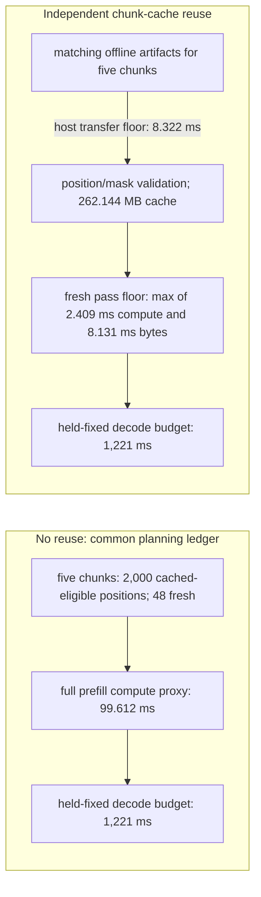
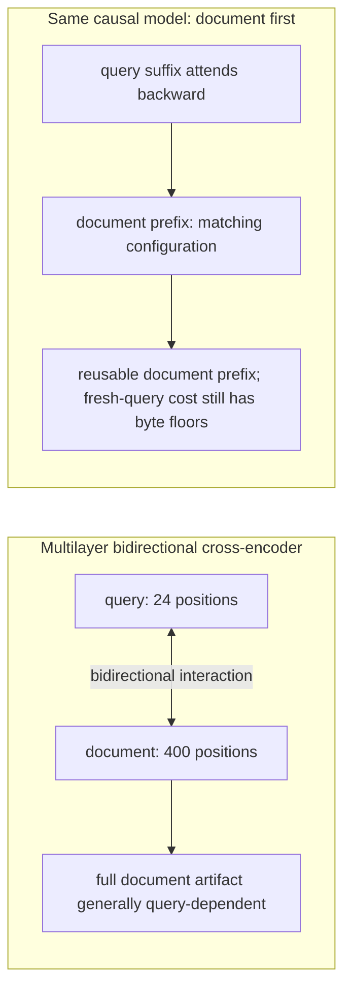
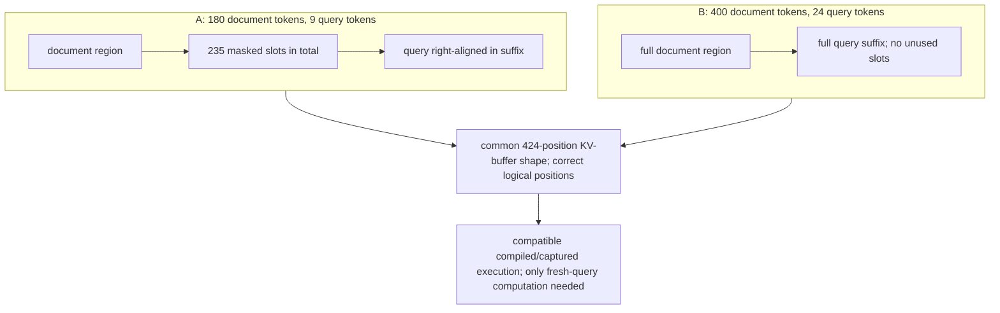
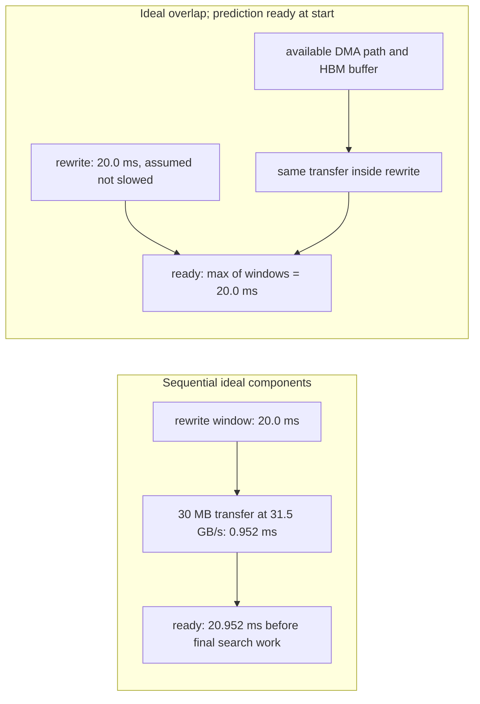
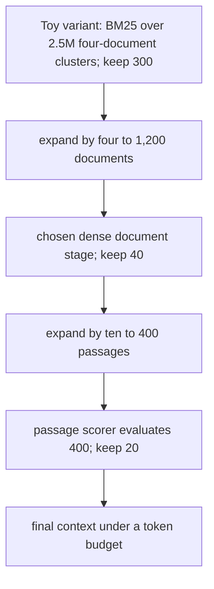
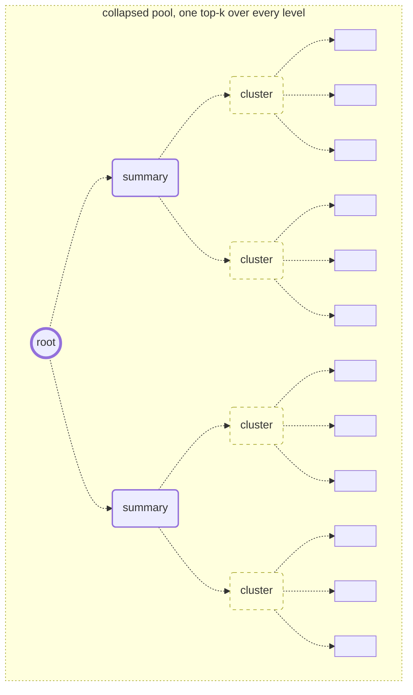

# Chapter 37: Latency, Cost, and Systems
[00-START-HERE](../00-START-HERE.md) · [01-READING-ROUTES](../01-READING-ROUTES.md) · [36\_provenance\_and\_adversarial\_robustness](../part-11-trust-robustness/36_provenance_and_adversarial_robustness.md) · [38\_distributed\_and\_federated\_rag](38_distributed_and_federated_rag.md)
Purpose: build separate models for per-request wall latency, stage operation/byte budgets, achieved throughput and cost; then validate caching, batching, fusion, overlap, cascades and summary indexing against the actual bottleneck and quality constraints.
## TL;DR
- Instrument query embedding, ANN search, reranking, generator prefill and decode, with queueing and transfer spans. Do not add stage percentiles to claim an end-to-end percentile.
- The revised serial planning proxy is about $`1{,}343.25\,\mathrm{ms}`$, of which $`1{,}221\,\mathrm{ms}`$ is the decode budget. These are conditional resource estimates, not a reproduced service trace.
- The weight-only bfloat16 prefill ridge occurs at about $`170`$ positions; extra traffic and small-shape inefficiency still matter. Decode batching amortizes weights but also reads each stream's private KV state and can increase individual token latency.
- Independent chunk caches change attention dependencies. Fixed-RoPE key re-offsetting preserves isolated-chunk relative positions; it does not recreate missing cross-chunk interactions. A short fresh query can remain bandwidth-bound after most prefill FLOPs are removed.
- Document-first causal reranking creates a reusable document artifact. Share cache-management infrastructure across models, not incompatible KV tensors. Static KV layouts aid fusion/capture, but dynamic-shape compilation is also possible.
- Prefetch overlap requires predictions, transfer and buffers to be ready inside an existing window without slowing its work. Funnels have expansion as well as reduction between granularities; the first stage sets a support-recall ceiling, not a floor.
- Recursive summaries can expose cross-document abstractions, but variable-length, overlapping RAPTOR structures are not guaranteed balanced single-root trees. Price summary construction and verify source fidelity.
- At $`B=32`$, the toy decode allocation is $`58.5\,\mathrm{ms}`$ per request but batch decode wall time is $`1{,}872\,\mathrm{ms}`$. The resulting optimistic cost allocation is about $`\$125.52`$ per million requests, not a $`180.75\,\mathrm{ms}`$ response-time promise.
## The story
Picture the RAG system as a warehouse that assembles one shipment per query.
Five stations touch the shipment. The clerk labels the order, the locator finds bins, the inspector ranks items, the packing station loads context, and the dispatch line emits the answer one token at a time.
In the single-stream planning model, dispatch rereads the large model weights for each incremental step. That can dominate time even when packing performs much more arithmetic. The story depends on model residency, precision, batch size, context length and achieved bandwidth; it is not a universal profile of every RAG service.
Reusable labels help only if their dependencies match. Independent chunk caches deliberately omit other chunks from their left context; document-first causal reranking can instead reuse exactly the document computation of the same causal model. Neither cached state is transferable to a different checkpoint merely because both systems read the same text.
A static buffer layout can let machinery replay a captured motion, while supported dynamic compilation can handle some changing dimensions. Masking and logical positions must preserve the intended score. Fusion can reduce intermediate memory traffic, but the saved bytes alone do not give a measured speedup.
When the raw catalog no longer fits beside the machinery, compression, sharding and host storage are alternatives to evaluate. Predictive prefetch can overlap part of a necessary transfer with an existing rewrite. Wrong predictions, late predictions or shared-memory contention can leave work on the critical path.
A funnel applies cheap selection before expensive inspection, expanding surviving groups into finer units between gates. An early gate can discard evidence irreversibly within that funnel. A summary index adds abstraction views, but those views can omit facts and must retain their source links.
The invoice and the stopwatch answer different questions. Batching shares weight reads across requests, lowering allocated hardware time per request even when each stream waits longer between tokens. Paid idle capacity, queueing, precision, traffic and quality constraints decide whether that theoretical saving reaches the bill.
## Decoder table

| Technical term | Plain-English meaning | Why it matters |
| --- | --- | --- |
| Median latency, or $`p_{50}`$ | The $`0.5`$ quantile of end-to-end request latency | Stage medians do not add to an end-to-end median; measure full traces |
| Five-stage budget | Embed, search, rerank, prefill and decode, with queues/transfers identified | A conditional serial budget is different from measured percentiles and overlapping resource work |
| Arithmetic intensity | FLOPs divided by actual bytes moved at the specified memory boundary | Weight-only intensity omits activations and private KV traffic |
| Roofline model | Optimistic resource floor $`\max(W/P_F,Q/\beta_H)`$ | Extra traffic, utilization and scheduling can raise actual time; compute and IO floors are not blindly additive |
| Ridge point | Rate ratio $`P_F/\beta_H`$; here $`170\,\mathrm{FLOP/B}`$ | A heuristic crossover, not proof every shape achieves the supplied rates |
| bfloat16 and 32-bit floating point (fp32) | Two-byte bf16 model storage and four-byte fp32 vector storage | Payload estimates exclude metadata, quantization scales, graph links and additional copies |
| Bi-encoder | Encode query and documents separately for a retrieval score | Short-query FLOP floors do not determine the actual embedding service latency |
| Prefill | Compute states/logits for the initial context | Can include the first answer-token logits; distinguish TTFT and subsequent incremental passes |
| Decode | Incrementally extend a sequence using prior KV state | The $`150`$-pass planning budget is about $`90.899\%`$ of the toy serial sum, not a universal share |
| Quantization | Reduce stored weight/vector precision or encode compressed representations | Can lower bytes while changing kernels, metadata, reconstruction and quality; latency does not follow bit width alone |
| Continuous batching | Schedule multiple live streams and share some model execution | Lowers amortized weight reads; private KV, capacity, queueing and per-token latency remain |
| TTFT | Time until the first streamed token, under a declared timing boundary | Include request queues, retrieval, transfers and prefill as applicable |
| Response cache | Reuse a prior response for a matching request context | Exact and semantic caches differ; paraphrases can hit a semantic cache, with correctness risks |
| Chunk KV cache | Reuse matching model keys/values for recurring evidence | Cache configuration and source/tenant permissions matter as well as content popularity |
| Cross-attention | Attention across text segments, here usually within decoder self-attention | Do not confuse cross-segment dependencies with a separate encoder-decoder cross-attention module |
| Cross-chunk attention loss | Isolated chunk states omit allowed interactions with preceding chunks | Mask-aware training can improve evaluated quality but cannot guarantee exact joint-prefill equivalence |
| Causal mask | Allow a position to use only allowed preceding/self positions | The document prefix is independent of a later query in the same causal model |
| Retrieval hit rate | Fraction of eligible computation-cache requests that hit under a policy | Does not alone determine the fraction of unique documents used once |
| Hot set and storage tier | Popularity-dependent cached artifacts and memory placement | Cache benefits compete with live KV, model weights and batching capacity |
| Position collision | Reused local position IDs give unintended cross-segment distances | Logical positions and the intended attention mask must match |
| RoPE re-offset | For fixed RoPE, compose a key rotation $`R(\Delta)`$ | Preserves isolated-chunk shift relationships, not missing cross-chunk states or arbitrary positional schemes |
| Provider prompt cache | Reuse a matching token-prefix computation under provider rules | Not arbitrary chunk reordering and not necessarily byte-for-byte source-string identity |
| Bidirectional cross-encoder | Let document and query states interact in both directions | Whole higher-layer document artifacts generally depend on the query; order alone does not remove that dependency |
| Bidirectional Encoder Representations from Transformers (BERT) | Encoder architecture family used for the size comparison | BERT-base-sized dimensions do not make unmodified bidirectional BERT a causal reusable-prefix reranker |
| Document-first causal decoder | Document prefix followed by a query under a causal mask | Enables matching document-prefix reuse across queries; model quality and load costs need validation |
| Query-first causal decoder | Query prefix followed by each document under a causal mask | Can reuse the query across candidates in one request but not the query-conditioned document across distinct queries |
| Kernel fusion | Combine compatible work while keeping some intermediate state on chip | Saved traffic can help, but bytes alone do not prove a speedup or that both stages previously reached HBM |
| Eager execution | Execute operations without whole-graph specialization | Some library kernels already fuse operations or reuse caches, so operation boundaries do not imply HBM round trips |
| FlashAttention | IO-aware tiled exact attention without a full stored score matrix | Linear auxiliary storage is not linear dense arithmetic or universally linear total HBM traffic |
| `torch.compile` | Compile supported graphs, including some dynamic shapes | Guards, specialization, graph breaks and startup affect reuse; fixed shapes are not mandatory for every compile |
| Compute Unified Device Architecture (CUDA) graph | Replay a captured compatible GPU execution | Stable buffers, shapes, dependencies and capture support matter, not just tensor dimensions |
| Static slot | Fixed document/query KV regions with masked unused slots | Physical layout is distinct from logical positions and the number of fresh positions actually computed |
| Attention mask | Specify allowed query/key interactions and padding | A wrong mask can change scores even when the hardware benchmark looks fast |
| Tensor shape | Dimensions of tensors at a kernel boundary | Reuse can be specialized or guarded-dynamic; changed shapes do not always retrace |
| Activation | Intermediate model value that may be kept or materialized | Traffic depends on fusion, cache behavior and implementation, not only tensor element count |
| Feed-forward network | Transformer per-position expansion/activation/contraction block | The stipulated $`24`$-position, width-$`3{,}072`$ bf16 intermediate is $`144\,\mathrm{KiB}`$ |
| Shape bucket | One of a small set of execution/layout capacities | Trades padding and traffic against compilation reuse, batching and queues |
| Central processing unit (CPU) and GPU pipeline | Overlap eligible host, transfer and device work | Only removes exposed time when predictions, dependencies, buffers and contention permit it |
| Dynamic random-access memory (DRAM) | Host memory that can hold larger indexes than a single GPU | Price/capacity and search bandwidth are deployment-specific; host placement is not the only large-index option |
| Inverted file (IVF) index | Partition vectors into lists and probe selected lists | IVFFlat retains raw payload; IVF-PQ/SQ compresses it with quality and reconstruction trade-offs |
| $`\mathrm{nlist}`$ | Number of IVF lists | The $`4\sqrt N`$–$`16\sqrt N`$ wiki heuristic is scoped to its sub-million branch, not a theorem at all scales |
| $`\mathrm{nprobe}`$ | Final IVF probe-list count, distinct from predicted prefetched data | Tune recall and cost; byte-budgeted prefetch handles skewed list sizes |
| Query rewrite | Generate a retrieval-oriented reformulation | Can supply an overlap window if already needed; adding an unnecessary rewrite can increase total latency |
| Cold index | Retrieval data not resident on its intended fast path | Cold placement and transfers can dominate; size alone does not predict a fixed millisecond latency |
| TeleRAG prefetch | Predict likely lists from the pre-retrieval query and move their data early | v1 uses a byte target and CPU search of missed final probe lists; cross-query hot-list caching is not assumed in that version |
| Hierarchical Navigable Small World (HNSW) search | Graph-based approximate-neighbor retrieval | Empirical favorable scaling does not guarantee logarithmic worst-case work, fixed p50 or unchanged recall |
| Retrieval funnel | Select coarse groups then expand/narrow finer candidates | Total cost includes every search/expansion; the narrowest output does not determine the bill alone |
| Top-$`k`$ | Retain a declared number or budget of high-ranked candidates | A fixed cutoff can lose evidence; increasing it changes downstream work but not necessarily all prompt lengths |
| Coarse-stage recall | Support retained by the early selector | A ceiling on later nested support recall, not a floor; outside retrieval changes the nesting assumption |
| Reciprocal Rank Fusion (RRF) | Combine rankings, for example lexical and dense | Need not be statistically independent; fusion itself does not shrink source search spaces |
| Recursive Abstractive Processing for Tree-Organized Retrieval (RAPTOR) | Recursive embedding, clustering and summarization with multi-resolution retrieval | Actual soft structures need not match a balanced single-root tree; summaries need source-fidelity and permission checks |
| Soft Gaussian-mixture clustering | Permit multiple cluster memberships | Can duplicate inputs/ancestors and invalidate simple disjoint-tree overhead bounds |
| Branching factor | Children per internal summary in a declared construction | Only the disjoint complete-$`c`$-ary toy gives asymptotic overhead $`1/(c-1)`$ |
| Cosine similarity | Normalized embedding dot product for nonzero vectors | A shared score function does not ensure score calibration or relevance across summary levels |
| Collapsed-tree retrieval | Search eligible nodes across levels in a shared pool | Use an actual token budget and handle duplicate coverage; not always exactly twenty nodes |
| Tree traversal | Select promising nodes and score their children level by level | Retained quotas differ from nodes scored, and a small upper level may have fewer than the quota |
| Cost per query | Paid resource spend divided by achieved completed throughput | Separate latency, per-request resource allocation, utilization, reserved capacity and hosted metered rates |
| Fixed index cost | Separately priced payload-only memory; toy $`\$0.3072/\mathrm{hour}`$ | The roughly $`0.680`$ QPS crossing assumes elastic compute allocation; avoid double-charging already-rented HBM |
| Variable compute cost | Per-request service allocation at a declared achieved operating point | Idle paid capacity adds cost; batching can improve unsaturated compute shapes as well as weight reuse |
| Formula symbols | $`N_g`$: generator parameters; $`N_r`$: reranker parameters; $`N_{\mathrm{vec}}`$: vector count; $`N_\ell`$: leaves; $`b_w`$: weight bytes; $`s_c,s_f`$: cached/fresh positions; $`L,d`$: declared layer/width; $`B`$: live decode streams; $`n_d`$: planned passes; $`P_F`$: FLOP rate; $`\beta_H`$: HBM rate; $`\pi`$: hourly price; $`u`$: per-request resource time; $`T`$: wall time; $`\lambda`$: completed QPS; $`U`$: utilization; $`\rho_i,e_i`$: retention/expansion; $`c`$: toy fan-in; $`h`$: height | Keep parameter count, corpus count, hardware rates, prices, private KV traffic, elapsed time and amortized allocation distinct; original symbol overloads do not justify mixing their units |

## Core mechanics
### Mathematical conventions
Use decimal units unless explicitly binary: $`1\,\mathrm{GB}=10^9\,\mathrm B`$, $`1\,\mathrm{KiB}=2^{10}\,\mathrm B`$ and $`1\,\mathrm{MiB}=2^{20}\,\mathrm B`$. Count one multiply-add as two FLOPs, keep intermediate precision, and round only reported results. Numerical hardware rates and service prices here are assumptions, not reproduced measurements.
Let $`P_F=3.4\times10^{14}\,\mathrm{FLOP/s}`$ and $`\beta_H=2.0\times10^{12}\,\mathrm{B/s}`$. For work $`W`$ and traffic $`Q`$, $`\max(W/P_F,Q/\beta_H)`$ is an optimistic roofline resource-time floor at those rates. It omits launch, scheduling, utilization, extra traffic, communication and contention. A FLOP-only quotient is not latency when the byte term is larger; merely exceeding a weight-only ridge does not guarantee achieved compute-bound execution.
For the generator toy use $`N_g=8\times10^9`$, $`L_g=32`$, $`d_g=4{,}096`$, $`b_w=2\,\mathrm{B/parameter}`$, eight KV heads of width $`128`$, $`s=2{,}048`$ context positions and $`n_d=150`$ planned incremental decode passes. The $`2N_g`$ parameter-linear proxy is approximate, including its treatment of embedding/output weights; causal attention counts are stated separately. We retain the chapter's one-pass-per-output planning convention: if the first of $`150`$ answer tokens is already emitted from prefill logits, only $`149`$ subsequent incremental passes are needed. Do not silently count both or present the rounded planning ledger as an exact token trace.
The baseline decoder uses the deliberately rounded mean KV-read budget $`q_{\mathrm{KV}}=0.28\,\mathrm{GB/pass/stream}`$. Actual cache length grows during generation; a fixed-rate average is a modeling simplification. The reranker uses $`N_r=110\times10^6`$, $`L_r=12`$, $`d_r=768`$; the baseline is bidirectional, whereas the later causal-cache example is a hypothetical same-size architecture, not unmodified BERT or a claimed HyperRAG backbone.
A serial sum applies to one request's service intervals under the stated schedule. In general $`Q_{0.5}(\sum_iT_i)\ne\sum_iQ_{0.5}(T_i)`$: stage medians do not establish end-to-end $`p_{50}`$. Queueing, streaming boundaries, overlap and tails require measured traces. Batched wall time, wall time divided by batch size and achieved cost per request are different units. Cost examples assume specified utilization/allocation; fixed always-on capacity cannot automatically be billed as fully elastic per-query work.
### 37.1 Where the milliseconds actually go
#### What
The opening interview asks for a plan in thirty seconds to move $`p_{50}`$ from roughly $`1.3\,\mathrm s`$ toward $`500\,\mathrm{ms}`$. Profile embedding, ANN search, reranking, prefill, decode and queueing; the calculations below are a serial resource-budget toy, not proof of that measured percentile.
Short query embedding and graph traversal can be overhead- or memory-limited. A small FLOP quotient alone cannot identify which limitation dominates an actual service span.
A $`110`$-million-parameter encoder on $`24`$ query positions has parameter-linear work $`2N_r(24)=5.28\times10^9\,\mathrm{FLOP}`$. An HNSW walk may score thousands of distances, but tokenization, launch/service overhead, graph access, memory placement and queueing must be measured rather than inferred from that count.
Measure every stage. Only convert arithmetic/bytes into an optimistic resource floor after declaring shapes, precision, residency, hardware rates and the execution schedule.
#### Why
The chapter uses an H100 PCIe $`80\,\mathrm{GB}`$ reference with an assumed $`340\,\mathrm{TFLOP/s}`$ processing rate and $`2{,}000\,\mathrm{GB/s}`$ HBM rate. These are not simultaneously measured rates for every small encoder, cached query or kernel. The compute rate is about $`44.97\%`$ of the cited $`756\,\mathrm{TFLOP/s}`$ dense peak; model FLOPs utilization is not established by a page calculation.
At these declared rates, the ridge is:

$$
R=\frac{P_F}{\beta_H}=\frac{3.4\times10^{14}\,\mathrm{FLOP/s}}{2.0\times10^{12}\,\mathrm{B/s}}=170\,\mathrm{FLOP/B}.
$$

If the parameter-linear pass reads the weights once and other traffic is ignored, its prefill intensity is:

$$
I_{\mathrm{prefill,lin}}\approx\frac{2N_gs}{N_gb_w}=\frac{2s}{b_w}.
$$

At $`b_w=2`$, this weight-only approximation equals the ridge at $`s=170`$ and exceeds it for $`s>170`$. That is a useful crossover heuristic, not a guarantee of compute-bound prefill: attention/activation traffic, padding, small GEMMs and implementation efficiency can change the regime.
A single incremental decode pass has one fresh position per stream. Its parameter-linear, weight-only intensity is:

$$
I_{\mathrm{decode,lin}}\approx\frac{2N_g}{N_gb_w}=\frac{2}{b_w}.
$$

At bfloat16 this is $`1\,\mathrm{FLOP/B}`$, $`170`$ times below the stated ridge. Parameter count cancels only in this weight-only approximation, not in total attention/cache traffic or measured latency. An eight-billion- and a seventy-billion-parameter model need not have the same total intensity or throughput.
For $`B`$ streams sharing one weight read, the corresponding expression is $`2N_gB/(N_gb_w+Bq_{\mathrm{KV}})`$ when private KV reads are included. Ignoring them gives $`2B/b_w`$, an optimistic simplification rather than unlimited linear throughput scaling.
#### Failure without it
Reducing the rerank depth from $`50`$ to $`10`$ cuts its modeled work by $`80\%`$. In the revised baseline that saves about $`6.9101\,\mathrm{ms}`$, only $`0.5144\%`$ of the total planning budget, assuming unchanged scores, per-pair work and scheduling. A different heavy reranker can change the bottleneck.
The same cut can remove answer-bearing candidates. Measure depth-dependent recall and answer quality rather than trading them for a small estimated saving without evidence.
A higher achieved FLOP rate helps a compute-limited stage. Increasing peak FLOPs alone does not remove a bandwidth-limited weight read when memory rate, precision and reuse stay unchanged.
The rounded $`0.28\,\mathrm{GB}`$ private-cache term is $`0.28/16.28\approx1.7199\%`$ of the single-stream decode traffic. At larger batches the weight term is shared while private KV traffic is not, so its importance changes; this is not a universal reason to ignore KV optimization.
#### Cost and complexity
The toy uses the Llama-3.1-8B-style dimensions stated in the conventions, with parameter count rounded to $`8\times10^9`$. Keys and values occupy $`2L_g(8)(128)(2)=131{,}072\,\mathrm{B/position}=128\,\mathrm{KiB/position}`$. These dimensions define storage; they do not make the FLOP proxy a benchmark of that released checkpoint.
The illustrative $`10^7`$-chunk store returns $`50`$ candidates. Retain the chapter-reported input budgets of $`8\,\mathrm{ms}`$ for embedding and $`6\,\mathrm{ms}`$ for search without claiming independent measurement or that they are stage medians.
For $`50`$ bidirectional rerank pairs of $`256`$ positions, parameter-linear work is exactly $`2.816\times10^{12}\,\mathrm{FLOP}`$. Add both dense attention matrix products in each of $`12`$ layers of width $`768`$:

$$
\begin{aligned}
W_{\mathrm{rerank}}&\approx50\left[2N_r(256)+4L_rd_r(256)^2\right]\\
&=2.9367959552\times10^{12}\,\mathrm{FLOP}.
\end{aligned}
$$

$$
\frac{W_{\mathrm{rerank}}}{P_F}\approx8.637635\,\mathrm{ms}.
$$

Five $`400`$-token chunks plus $`200`$ query/instruction tokens total $`2{,}200`$, not $`2{,}048`$. For a consistent worked layout, stipulate five such chunks ($`s_c=2{,}000`$) plus $`s_f=48`$ fresh query/instruction positions, totaling $`s=2{,}048`$. Do not call the original sum a rounding operation.
In an ideal causal-attention FLOP model, each of the $`s`$ queries attends its prefix including itself. Counting both score and value matrix products adds $`4L_gd_g\sum_{j=1}^{s}j`$ beyond the parameter-linear proxy:

$$
\begin{aligned}
W_{\mathrm{prefill}}&\approx2N_gs+2L_gd_gs(s+1)\\
&=3.3868048498688\times10^{13}\,\mathrm{FLOP}.
\end{aligned}
$$

The compute quotient is $`99.611907\,\mathrm{ms}`$. The chapter's $`2L_gd_gs^2`$ approximation omits the diagonal correction and is close here. Full-square masked kernels may execute extra work; activations, softmax, normalization and other overhead are not fully modeled. Treat this as an optimistic component estimate.
The weights occupy $`16\,\mathrm{GB}`$ in the toy. For $`150`$ planned incremental passes, a simple average past length $`2{,}048+(150-1)/2=2{,}122.5`$ gives about $`0.2782\,\mathrm{GB}`$ of KV reads per pass; retain $`0.28\,\mathrm{GB}`$ as an explicitly rounded planning input. With that input:

$$
t_{\mathrm{decode/pass}}\approx\frac{(16+0.28)\times10^9\,\mathrm B}{2.0\times10^{12}\,\mathrm{B/s}}=8.14\,\mathrm{ms}.
$$

The $`150`$-pass decode allocation is $`150(8.14)=1{,}221\,\mathrm{ms}`$. This bandwidth model omits dequantization, launches, sampling, cache writes and any nonresident weights. For exactly $`150`$ answer tokens when prefill already supplies the first token, replacing $`150`$ by $`149`$ reduces this particular ledger by one $`8.14\,\mathrm{ms}`$ pass.
The revised serial planning sum is $`8+6+8.637635\ldots+99.611907\ldots+1{,}221\approx1{,}343.249543\,\mathrm{ms}`$. Decode is about $`90.8990\%`$ of that sum. This is neither an observed $`p_{50}`$ nor a sum of independently measured percentiles.
Decode's parameter-linear work is $`2N_g(150)=2.4\times10^{12}\,\mathrm{FLOP}`$, excluding its attention work. Full prefill has about $`14.11`$ times that count, yet the decode bandwidth budget takes about $`12.26`$ times the prefill compute budget. The different resource limits, not FLOP count alone, explain this modeled contrast.
The resulting bandwidth-only single-stream rate is about $`122.85`$ incremental positions per second. It is an order-of-magnitude resource check, not a measured token rate or service guarantee.
#### Decisions and limits
- Instrument all stages, queues and data movement; optimize the product metric and the actual bottleneck.
- For total-response latency, test shorter outputs and supported weight quantization. Batching is principally a throughput/cost lever and may worsen per-stream token latency or TTFT; it is not automatically a latency fix.
- In this proxy, the nondecode budget is about $`122.25\,\mathrm{ms}`$. Holding it fixed, int8 decode gives about $`743.25\,\mathrm{ms}`$ total, while ideal int4 gives about $`443.25\,\mathrm{ms}`$. Actual quantized kernels, quality, metadata and cache formats must be measured.
- At the unchanged $`8.14\,\mathrm{ms}`$ pass rate, at most $`46`$ planned decode passes fit a $`500\,\mathrm{ms}`$ total budget under this simplified ledger. First-token accounting and output length must be defined consistently.
- Optimize prefill for TTFT. Do not dismiss small average stages if their queues or tails control the SLO; embedding and search together are slightly over $`1\%`$ of this example's serial sum.
- At fixed precision, a $`30`$B weight payload is $`3.75`$ times the $`8`$B payload. Holding the toy KV term fixed gives decode budgets $`4.521\,\mathrm s`$ in bf16 or $`2.271\,\mathrm s`$ in int8, not a general prediction for an actual $`30`$B architecture.
- Cut rerank depth or model size only with measured recall/quality tolerance; more FLOPs, fewer bytes and fewer output tokens change different parts of the budget.
### 37.2 KV-cache reuse for retrieved chunks
#### What
In an ordinary causal decoder, each chunk’s higher-layer keys and values depend on its tokens and all allowed left context. A cache is reusable only when the model, tokenizer, token sequence, prefix/mask, logical positions or valid re-offset rule, precision/layout and relevant version/security scope match.
At deterministic evaluation settings, a fixed isolated chunk under the same cache configuration has a reproducible artifact. “Tokens alone” is insufficient if the checkpoint, system prefix, adapters, attention mask, RoPE scaling or stochastic execution changes.
Precompute independent chunk states, retrieve eligible matching entries, place them in the intended logical position ranges, and compute the fresh query. This is exact for the deliberately independent-chunk attention configuration, not generally equivalent to jointly prefilling all chunks under the ordinary causal mask.
The motivating support workload has thousands of paraphrases, roughly twenty recurring question types and $`500`$ articles. Those counts alone do not establish cache hit rate, memory residency, popularity stability or that every request shares the same prefix.
#### Why
An exact response cache keys a request/response context; a semantic response cache can also match paraphrases, with its own correctness risks. Chunk KV reuse keys a model computation and can help distinct requests sharing evidence. Their hit rates and invalidation rules differ.
Use the reconciled layout $`s_c=2{,}000`$, $`s_f=48`$, $`s=s_c+s_f=2{,}048`$. Fresh queries attend all cached positions plus the lower-triangular fresh segment. The fresh attention rectangle must not be halved as though every query attended only half the cached context.
In the same causal-pair model, the fresh online work is:

$$
\begin{aligned}
W_{\mathrm{fresh}}&\approx2N_gs_f+4L_gd_g\left(s_fs_c+\frac{s_f(s_f+1)}2\right)\\
&=8.18948210688\times10^{11}\,\mathrm{FLOP}.
\end{aligned}
$$

This gives a $`2.408671\,\mathrm{ms}`$ compute floor and about $`97.5819\%`$ fewer modeled prefill FLOPs, not $`97.7\%`$ under the source's undercounted rectangle. It is not a $`2.4\,\mathrm{ms}`$ single-request latency prediction: the weights still have to be read for the fresh pass.
The cached $`2{,}000`$ positions occupy $`262{,}144{,}000\,\mathrm B=262.144\,\mathrm{MB}=250\,\mathrm{MiB}`$ at $`128\,\mathrm{KiB/position}`$. Merely reading this payload once from HBM has a $`0.131072\,\mathrm{ms}`$ byte floor, but adding that to the FLOP-only time omits the $`16\,\mathrm{GB}`$ weight read.
For HBM-resident caches with no additional materializing copy, an optimistic fresh-pass floor is $`\max(2.408671\,\mathrm{ms},(16\times10^9+262{,}144{,}000)/\beta_H)\approx8.131072\,\mathrm{ms}`$. The intensity is only about $`50.36\,\mathrm{FLOP/B}`$, below $`170`$. Relative to the $`99.611907\,\mathrm{ms}`$ full-prefill proxy, this is about $`12.25`$-fold, not a justified forty-fold latency saving. Offset rotation, extra reads/writes, launch overhead and small-shape efficiency can raise actual time.
With a stipulated effective one-way PCIe rate $`31.5\,\mathrm{GB/s}`$, host transfer costs $`8.322032\,\mathrm{ms}`$. If transfer and fresh inference do not overlap, the combined optimistic floor is $`16.453104\,\mathrm{ms}`$, about $`6.05`$-fold below the full-prefill proxy. A cache lookup, allocation, RoPE conversion or transfer hidden by another stage changes the ledger; do not call the source's $`10.7\,\mathrm{ms}`$ compute-plus-copy figure a complete single-stream roofline estimate.
#### Failure without it
An independently cached chunk B did not attend chunk A while its states were built. Reordering keys does not recreate those missing intermediate interactions.
This changed computation can harm cross-document comparison or synthesis. It may still work well on evaluated single-fact or multi-document tasks after suitable training; neither benefit nor loss is guaranteed for every workload.
TurboRAG's attention example shows much document-to-document attention remaining local, with the query attending retrieved documents. A causal document before the query cannot attend to that future query. Their fine-tuning matches the independent attention and reordered-position setting and recovers much of the evaluated quality gap; it does not prove the missing interactions are universally irrelevant.[\[1\]](https://arxiv.org/html/2410.07590v1)
Each isolated chunk may initially use local positions starting at zero. Reusing those duplicated positions changes cross-segment relative distances. Position handling must match the intended model and the mask used for training/evaluation.
For equal chunk length $`\ell`$, use logical positions $`0,\ldots,\ell-1`$ for the first and $`\ell,\ldots,2\ell-1`$ for the second; variable lengths use cumulative offsets. Under fixed-frequency standard RoPE, a global offset $`\Delta`$ can transform a cached key as $`K_{p+\Delta}=R(\Delta)K_p`$, preserving isolated-chunk relative dot products; values do not receive the RoPE rotation. This takes work over all affected key vectors and is not “free.” It does not reconstruct joint-chunk states. Dynamic scaling, special prefixes or non-shift-equivariant position mechanisms require separate validation.
With learned absolute position embeddings, merely rotating final keys generally cannot reproduce a recomputed sequence at new positions because positions influenced hidden states throughout the stack. Recompute or use a separately validated cache adaptation instead of assuming a universal cheap translation.
Provider prefix caching can complement this design when the beginning of a request repeats. It generally matches a reusable token prefix under provider-specific configuration, not arbitrary reordered chunks and not necessarily a byte-for-byte source-string test. Changing early retrieved chunks can invalidate later prefix reuse.[\[2\]](https://developers.openai.com/api/docs/guides/prompt-caching)
#### Cost and complexity
TurboRAG v1 reports LongBench multi-document QA TTFT speedup averaging $`8.6`$-fold and peaking at $`9.4`$-fold, on its A100/FlashAttention2 setup, with task-specific accuracy. Its $`98.46\%`$ FLOP reduction belongs to a separate fixed-$`8{,}192`$-context/$`128`$-query communication/batch experiment. Neither metric is a universal end-to-end latency reduction.[\[1\]](https://arxiv.org/html/2410.07590v1)
The chapter's independent $`2{,}048`$-position example instead gives a $`97.5819\%`$ prefill FLOP reduction and optimistic stage ratios about $`12.25`$ with HBM residency or $`6.05`$ with nonoverlapped host transfer. Different shapes, masks, hardware, batching and omitted overhead prevent numerical agreement from validating a measured speedup.
If every other budget, output length and decode traffic stays fixed, replacing $`99.611907\,\mathrm{ms}`$ by the $`16.453104\,\mathrm{ms}`$ host-cache floor reduces the $`1{,}343.249543\,\mathrm{ms}`$ total by about $`6.1909\%`$. HBM residency instead gives about $`6.8104\%`$. Actual latency/throughput can differ, and changed generation may change output length.
Figure $`37.2`$ holds the $`1{,}221\,\mathrm{ms}`$ decode budget fixed only for this comparison. The source's separate $`1{,}198\,\mathrm{ms}`$ value is not mixed into the revised common ledger. Decode's percentage of the smaller total changes even when its absolute time does not.
The nominal HBM-to-PCIe rate ratio here is $`2{,}000/31.5\approx63.49`$. That is a rate comparison, not a measured end-to-end cache speedup or proof that the link always sustains its nominal rate.
#### Decisions and limits
- Measure computation-cache hits, reuse distance and invalidations; budget cache construction, storage, loading, rotation and eviction as well as saved forwards.
- Keep eligible hot entries in HBM when they do not displace more valuable weights, live-request KV or batches. Host storage or recomputation may win for the tail.
- Validate independent-chunk attention and logical positions, including cross-document questions; use mask-aware training when the evaluated method requires it.
- Version cache keys for the exact model/configuration and enforce tenant permissions and source revocation on every read.
- Prefer copy-free views/appropriate layouts where valid, but do not assume concatenation or rotation has no memory traffic.
- Treat TTFT, long contexts, GPU service work and end-to-end latency as different objectives. Retain the bandwidth floor for the small fresh query rather than claiming the FLOP cut transfers directly to time.
### 37.3 Reordering a decoder to make caching possible
#### What
A standard multilayer bidirectional cross-encoder lets document and query information interact in both directions. Higher-layer document states generally depend on the query; this does not mean every first-layer key projection is already query-dependent.
Reordering the same input under a bidirectional mask does not by itself create an exact reusable whole-document KV artifact. Partial computation reuse or a changed attention architecture requires its own analysis.
Under an ordinary causal mask, a prefix cannot attend to later tokens. That dependency property, with matching positions/configuration, makes a prefix cache reusable within the same model computation.
Place the document before the query so the document artifact is independent of that later query, while query positions can attend back to the document. This is exact prefix reuse for the chosen causal model, not equivalence to a bidirectional cross-encoder.
HyperRAG uses document-query formatting, document-side KV reuse and a static attention layout, with model fine-tuning to match the format. Its paper does not establish the hypothetical $`110`$M timing example below as a measured result.[\[3\]](https://arxiv.org/html/2504.02921v1)
#### Why
In “high interest rate in Japan,” a bidirectional representation at “interest” can use the later word “rate” and the rest of the phrase. The word “rate” is the next word here, not three tokens later; exact tokenizer positions have not been specified.
A causal state at the earlier position cannot yet see those future words. Later causal positions and a final relevance head may nevertheless integrate the whole phrase, so this example does not prove every decoder reranker must rank worse.
Bidirectional and causal architectures expose different intermediate dependencies and reuse opportunities. Quality per FLOP is empirical; document-first ordering makes the expensive document prefix reusable without guaranteeing equal ranking quality for an arbitrary architecture swap.
Query-first ordering makes the query prefix reusable. It is usually less valuable across distinct requests, but the same query is shared across many candidate pairs within one request, so it is not categorically the “wrong” cache. The longer document remains conditioned on that query in higher layers.
#### Failure without it
A full bidirectional document cache generally changes with the query. If a method changes the mask or model to enable reuse, compare against that new model’s uncached execution and against the original ranking quality separately.
A query-first causal reranker can reuse a short query across candidate documents in a request. Document-first can reuse the much longer document across different requests; choose from measured lengths, hit rates, cache costs and quality rather than token order alone.
Fine-tune or validate the chosen causal input format and scoring head. A same-parameter-count substitution can regress, match or improve ranking; parameter count alone settles none of those outcomes.
A request cache-hit rate below $`5\%`$ means over $`95\%`$ of eligible lookup requests miss under that policy. It does not identify what fraction of unique cached documents were used exactly once: popularity, observation horizon, eviction, prewarming and invalidations affect that fraction.
#### Cost and complexity
For a separate hypothetical causal reranker, use $`N_r=110\times10^6`$, $`L_r=12`$, $`d_r=768`$, two-byte full-width keys/values, a $`400`$-position document and $`24`$-position query. These are BERT-base-sized dimensions with a changed causal mask, not an assertion that unmodified BERT or the paper's decoder backbone supports this exact cache.
The parameter-linear full-pair term and compute floor are:

$$
\begin{aligned}
W_{\mathrm{pair,lin}}&=2N_r(424)=9.328\times10^{10}\,\mathrm{FLOP},\\
W_{\mathrm{pair,lin}}/P_F&\approx0.274353\,\mathrm{ms}.
\end{aligned}
$$

The parameter-linear document-build term is:

$$
W_{\mathrm{doc,lin}}=2N_r(400)=8.8\times10^{10}\,\mathrm{FLOP},\qquad W_{\mathrm{doc,lin}}/P_F\approx0.258824\,\mathrm{ms}.
$$

The parameter-linear fresh-query term is:

$$
W_{\mathrm{query,lin}}=2N_r(24)=5.28\times10^9\,\mathrm{FLOP},\qquad W_{\mathrm{query,lin}}/P_F\approx0.015529\,\mathrm{ms}.
$$

The $`424/24\approx17.6667`$ ratio compares only parameter-linear work, not measured latency. Adding causal attention as in section $`37.1`$ gives full, document-build and fresh-query compute floors about $`0.284122`$, $`0.267519`$ and $`0.016603\,\mathrm{ms}`$, respectively. The FLOP counts partition exactly into build plus fresh work. But $`220\,\mathrm{MB}`$ of weights plus $`14.7456\,\mathrm{MB}`$ of document KV imply an optimistic warm fresh-pass byte floor $`0.1173728\,\mathrm{ms}`$ at batch one, already above the compute floor. Full-pair versus warm roofline proxies differ by about $`2.42`$-fold, not a justified $`17.7`$-fold latency saving.
For $`m`$ total uses, build cost $`T_b`$, full uncached cost $`T_f`$ and warm fresh-plus-load cost $`T_q`$, this explicit amortization model saves service time only when $`T_b+mT_q<mT_f`$. If $`T_f>T_q`$, then:

$$
m>\frac{T_b}{T_f-T_q}\quad(T_f>T_q).
$$

Under the linear-only no-I/O partition, the threshold is exactly $`m>1`$, so the second use is the first strict saving; “one repeat” and “one total use” are different. With the optimistic attention/byte floors above it becomes $`m>1.604321`$, still two total uses. At $`31.5\,\mathrm{GB/s}`$, transferring this document cache from host adds about $`0.468114\,\mathrm{ms}`$, making warm time about $`0.585487\,\mathrm{ms}`$—above the full-pair compute floor, so that particular model has no positive amortization crossing. Batching/overlap can change it. The document and query comprise $`94.3396\%`$ and $`5.6604\%`$ of positions, not necessarily the same shares of actual work or latency.
#### Decisions and limits
- Use document-first causal formatting when document-side reuse is the chosen design, and validate/fine-tune its ranking quality.
- Measure lookup hits and end-to-end amortization including build, load, invalidation, memory pressure and warm/cold mixes; do not infer unique-document reuse from a request hit rate.
- Keep both compute and memory floors for a tiny fresh query; a larger/batched model can inhabit another regime.
- Share tiering, eviction and telemetry infrastructure with generator caching where useful. Share actual KV tensors only when every model/configuration/dependency requirement matches; different reranker and generator checkpoints are not compatible merely because their source text is identical.
- Query-prefix reuse can still help within a request, and model-specific partial bidirectional reuse is not ruled out. Compare the complete designs rather than declaring one ordering universally optimal.
### 37.4 Kernel fusion, static layouts, and GPU-shaped design
#### What
Eager implementations commonly launch matrix multiplications, normalization, softmax and elementwise operations separately, although libraries may already fuse some work. A source-level operation boundary does not guarantee a separate kernel or an HBM round trip.
An intermediate may be written to and reread from HBM, remain in cache, or be kept on chip by a fused implementation. Traffic accounting must state which case it assumes.
A compatible fusion can keep intermediates on chip and reduce dispatch or memory traffic. Register pressure, occupancy, tiling and unsupported operations can offset that benefit, so benchmark the actual shape and mask.
FlashAttention tiles exact attention and uses online softmax to avoid materializing the full square attention matrix in HBM. It reduces IO and auxiliary storage, not the mathematical need to evaluate dense attention pairs.[\[4\]](https://arxiv.org/html/2205.14135v2)
Linear auxiliary-memory storage is not the same as linear total HBM traffic or linear FLOPs. In the original FlashAttention IO model, for sequence length $`s`$, head width $`d_h`$ and SRAM capacity $`M_S`$ scalar elements with $`d_h\le M_S\le sd_h`$, standard attention has $`\Theta(sd_h+s^2)`$ HBM accesses and FlashAttention $`\Theta(s^2d_h^2/M_S)`$. For fixed $`d_h,M_S`$, the latter still has a quadratic dependence on $`s`$; dense arithmetic remains quadratic as well.[\[4\]](https://arxiv.org/html/2205.14135v2)
`torch.compile` can trace/compile eligible graphs and fuse supported work; it also supports dynamic-shape tracing with guards and possible specialization. CUDA graphs replay a captured execution with compatible shapes, addresses and dependency constraints, often using fixed buffers. The two mechanisms are related serving tools, not identical compilation rules.[\[5\]](https://pytorch.org/docs/2.7/generated/torch.compile.html)
Repeated shapes are useful for specialized compilation and graph replay, but not a universal prerequisite for every compiled function. Shape changes can be handled dynamically, cause recompilation, or trigger a fallback depending on guards and supported operations.
#### Why
HyperRAG uses a static KV-input layout with a fixed document prefix region and query suffix region. Document states are retrieved; only query positions need new computation. A $`424`$-position KV buffer is not necessarily a new $`424`$-token forward pass.[\[3\]](https://arxiv.org/html/2504.02921v1)
Mask unused slots and assign logical position IDs according to the intended compact sequence, not automatically the physical padded slot indices. The attention mask, cache offsets, output head and query padding must agree.
A toy buffer with document capacity $`400`$ and query capacity $`24`$ has $`424`$ slots. A $`180`$-token document plus a nine-token query leaves $`235`$ masked slots, while a $`400`$-token document plus $`24`$ query tokens leaves none. They share a physical layout but not necessarily the same number of useful positions or logical relative distances.
The static shape can reuse a compatible compiled/captured execution and support batching. Correctness depends on logical positions and masks matching the intended model, plus any required stable-buffer/address constraints.
#### Failure without it
New shapes do not always retrace: supported dynamic dimensions may reuse a guarded graph. Specializations, graph breaks, unsupported masks and capture constraints can still cause new compilation or fallback work.
Compilation/capture startup and warm-up can exceed a short pass’s saving when the workload does not repeat often enough. Include those costs in deployment amortization, not the steady-state microbenchmark alone.
Padding to one large maximum can waste real computation if kernels execute on those padded positions. Merely allocating a large KV buffer with a short fresh-query kernel is a different cost model.
Validate score/ranking agreement against the intended uncached model with declared numerical tolerances, including mixed lengths, padding, offsets, cache hits/misses, dynamic shapes and batch changes. Equal tensor shapes alone do not guarantee correct semantics or bitwise-identical floating-point outputs.
#### Cost and complexity
For a separate traffic illustration, use a twelve-layer, width-$`768`$ stack with BERT-base-sized FFN expansion $`3{,}072`$ and bf16 activations. The causal warm-query example is not unmodified bidirectional BERT; those architectures' cache dependencies differ.
Assume $`24`$ fresh query positions per layer, with a valid document cache. Actual fresh-query latency still has the weight/cache floors in section $`37.3`$.
The FFN intermediate width is $`3{,}072`$. This example stipulates two otherwise materialized write-read round trips of that activation that a suitable fusion can eliminate.
Its intermediate activation is:

$$
A=24(3{,}072)(2\,\mathrm B)=147{,}456\,\mathrm B=144\,\mathrm{KiB}.
$$

Two write-read round trips mean four transfers, $`4A=589{,}824\,\mathrm B=576\,\mathrm{KiB}`$ per layer, if each really reaches HBM. Already-cached traffic or a different fusion pattern changes this count.
Across twelve layers this is $`7{,}077{,}888\,\mathrm B=7.077888\,\mathrm{MB}=6.75\,\mathrm{MiB}`$. At $`\beta_H`$, the byte quotient is $`3.538944\,\mu\mathrm s=0.003538944\,\mathrm{ms}`$. The source's $`0.00347\,\mathrm{ms}`$ conversion is not consistent with these exact inputs.
Adding that quotient to the $`0.015529\,\mathrm{ms}`$ parameter-linear compute floor would give $`0.019068\,\mathrm{ms}`$ and an $`18.5593\%`$ bookkeeping reduction. It is not a justified latency prediction: it omits the larger warm weight/cache floor, assumes the traffic is not overlapped, and assumes the fusion removes it all. Neither $`0.0190\to0.0155\,\mathrm{ms}`$ nor an eighteen-percent wall-time gain has been independently measured here.
Fusion may still help through reduced IO, launches and better execution, but those effects require an actual benchmark. A traffic floor cannot establish an additive penalty or a percentage speedup on its own.
FlashAttention's BERT-large training table reports $`20.0\to17.4`$ minutes on its eight-A100 setup: $`13\%`$ less elapsed time, equivalently $`20/17.4-1\approx14.94\%`$ higher speed. That is the basis for its roughly fifteen-percent speed claim, not validation of the different cached-query FFN example or a guarantee of a fifteen-percent latency reduction.[\[4\]](https://arxiv.org/html/2205.14135v2)
If an uncached bidirectional rerank implementation really executes all $`2{,}000`$ padded positions for each of $`50`$ pairs, parameter-linear work alone is:

$$
\begin{aligned}
W_{\mathrm{pad,lin}}&=2(110\times10^6)(2{,}000)(50)=2.2\times10^{13}\,\mathrm{FLOP},\\
W_{\mathrm{pad,lin}}/P_F&\approx64.705882\,\mathrm{ms}.
\end{aligned}
$$

That is $`2{,}000/256=7.8125`$ times the original parameter-linear work. Including the same bidirectional attention terms as section $`37.1`$ yields $`2.93728\times10^{13}\,\mathrm{FLOP}`$ and an $`86.390588\,\mathrm{ms}`$ compute floor, about ten times its $`8.637635\,\mathrm{ms}`$ baseline. This is not the cost of merely reserving a long static cache buffer while computing a short query.
#### Decisions and limits
- Compile/capture stable, repeated paths where startup amortizes. Benchmark dynamic-shape support instead of assuming every changed length retraces.
- Use validated shape buckets when padding and specialized kernels beat a dynamic path. The suggested $`512`$, $`1{,}024`$ and $`2{,}048`$ lengths are examples, not universally optimal cutoffs.
- Distinguish physical KV capacity from fresh positions actually executed. A padded buffer need not imply full padded recomputation.
- Check supported causal/independent masks and logical position semantics, plus numerical and ranking tolerances, before trusting a fused path.
- Tune batch and bucket together; low traffic and launch overhead can erase theoretical savings. Include compilation, cache initialization and warm-up in the deployment ledger.
### 37.5 CPU/GPU pipelining and prefetching
#### What
The raw payload of $`10^7`$ fp32 vectors of width $`768`$ is $`30.72\,\mathrm{GB}`$. With $`16\,\mathrm{GB}`$ of toy generator weights, the sum is $`46.72\,\mathrm{GB}`$, before graph links, identifiers, text, live KV, activations, other models and allocator overhead. It may fit an $`80\,\mathrm{GB}`$ card, but neither the earlier $`6\,\mathrm{ms}`$ search input nor a proposed $`200\,\mathrm{ms}`$ host search is guaranteed by payload size.
At $`5\times10^8`$ vectors, fp32 payload is $`1.536\,\mathrm{TB}`$, $`19.2`$ times $`80\,\mathrm{GB}`$. Ordinary fp16, int8 and packed int4 scalar payloads are still $`768`$, $`384`$ and $`192\,\mathrm{GB}`$. It is too strong to say quantization cannot close the gap: a hypothetical $`64`$-byte PQ code uses $`32\,\mathrm{GB}`$, plus $`4\,\mathrm{GB}`$ for eight-byte IDs, before other overhead and optional raw refinement vectors. Compression quality/search costs must be evaluated. Host DRAM, sharding and compression are alternatives; a tenfold per-GB price advantage is a service-specific assumption, not a hardware law.
An IVFFlat index groups all raw vectors and does not itself compress them. IVF with PQ/SQ stores codes instead; raw refinement vectors may live elsewhere. Probing fewer lists reduces searched payload, not necessarily the total resident index payload.
TeleRAG v1 predicts likely IVF clusters from the pre-retrieval input query and transfers their data during existing pre-retrieval generation. Once the final query is known, the GPU searches prefetched members of its target probe set while the CPU searches missed members of that set, then distances/results are merged. “The remainder” is not the whole unprobed corpus. Exact recovery relative to the chosen IVF probe set requires compatible scoring and complete merging; IVF recall itself remains approximate.[\[6\]](https://arxiv.org/html/2502.20969v1)
A DMA copy engine permits host-device transfer to overlap computation, but writes and retrieval can still contend for HBM, interconnects, CPU memory and destination buffers. The whole GPU is not necessarily idle, and overlap is not automatically free.
#### Why
For the raw fp32 vector payload alone, with corpus size and vector width kept separate from generator parameters:

$$
M_{\mathrm{vec}}=N_{\mathrm{vec}}d_v(4\,\mathrm B).
$$

The Faiss wiki gives $`4\sqrt{N_{\mathrm{vec}}}`$ to $`16\sqrt{N_{\mathrm{vec}}}`$ as a heuristic in its below-one-million-vector branch, with different example index recipes for larger ranges. Do not present it as a proved universal sizing rule or the official recommendation specifically for ten million vectors.[\[7\]](https://github.com/facebookresearch/faiss/wiki/Guidelines-to-choose-an-index)
Extrapolating the lower heuristic to $`10^7`$ gives $`12{,}649.110641\ldots`$, but $`\mathrm{nlist}=16{,}384`$ is merely a chosen toy configuration. Benchmark training sample size, assignments, list imbalance, search time and recall instead of calling that rounding an optimal cluster count.
At that chosen list count, the mean is $`10^7/16{,}384\approx610.351563`$ vectors per list. Under an equal-size average approximation, prefetching sixteen lists moves exactly $`30{,}000{,}000\,\mathrm B=30\,\mathrm{MB}`$ of raw vectors. Actual selected-list sizes are integer and can be highly skewed; IDs and other metadata add traffic.
Use a consistent nominal one-way link rate of $`31.5\,\mathrm{GB/s}`$ for a $`0.952381\,\mathrm{ms}`$ transfer quotient, or a stipulated effective $`25\,\mathrm{GB/s}`$ for $`1.2\,\mathrm{ms}`$. These are about $`4.76\%`$ and $`6\%`$ of a $`20\,\mathrm{ms}`$ window. The original $`0.94\,\mathrm{ms}`$ uses a differently rounded $`32\,\mathrm{GB/s}`$ rate; neither quotient is a guaranteed actual transfer time.
A one-billion-parameter bf16 rewriter has a $`2\,\mathrm{GB}`$ weight payload. A batch-one, weights-only $`2{,}000\,\mathrm{GB/s}`$ decode floor is $`1\,\mathrm{ms}`$ per pass, or $`20\,\mathrm{ms}`$ for twenty planned passes. Its prefill, KV reads, token accounting, launches and contention are additional; this toy does not measure an actual rewrite window.
If prediction is ready at time zero, transfer does not slow rewriting and no other dependency delays search, sequential readiness is $`20+0.952381\approx20.952381\,\mathrm{ms}`$ and ideal overlapped readiness is $`\max(20,0.952381)=20\,\mathrm{ms}`$. More generally $`T_{\mathrm{ready}}=\max(T_{\mathrm{rewrite}},T_{\mathrm{predict}}+T_{\mathrm{transfer}})`$ in this simplified parallel schedule. Final query embedding, CPU/GPU search and merge still follow.
#### Failure without it
Starting transfer only after rewrite returns removes this overlap. Calling the pipeline “pipelined” cannot change the dependency schedule.
Waiting for the final rewritten-query embedding prevents predicting during that rewrite. An initial-query embedding or another valid early signal can start prefetch, with its own computation time and accuracy.
Prefetch-only search can lose evidence when prediction misses. A concurrent CPU search of missed lists in the final IVF probe set can preserve the same candidate coverage, assuming it completes and its scores/results are merged correctly. This does not guarantee perfect corpus recall.
Without existing concurrent work there may be no useful rewrite window. Do not add an otherwise unnecessary generation solely to hide a shorter transfer; another independent stage could instead supply an overlap window if its dependencies permit.
#### Cost and complexity
The ideal ready-time reduction with the same $`31.5\,\mathrm{GB/s}`$ input is $`0.952381/20.952381\approx4.5455\%`$. It is not the full end-to-end RAG latency saving: search, merge, generation and prediction overhead remain.
Under the same average-list approximation, prefetching $`128`$ rather than sixteen lists moves $`240\,\mathrm{MB}`$, eight times the payload, giving $`7.619048\,\mathrm{ms}`$ at $`31.5\,\mathrm{GB/s}`$ or $`9.6\,\mathrm{ms}`$ at $`25\,\mathrm{GB/s}`$. These fit a hypothetical $`20\,\mathrm{ms}`$ window only if prediction/queueing and resource contention leave enough time and buffer space.
Transfer bytes, available time, prediction quality, search recall, buffers and CPU/GPU balance jointly constrain prefetch; the rewrite duration alone does not set a safe $`\mathrm{nprobe}`$. TeleRAG v1 budgets prefetch by bytes because list sizes are skewed, while final search probes and prefetched lists are distinct sets. A faster rewriter can expose previously hidden transfer.[\[6\]](https://arxiv.org/html/2502.20969v1)
Use HBM for selected retrieval data only when the expected search saving exceeds displaced serving capacity and transfer costs. A fully resident compressed/sharded design may be preferable; raw payload fitting alone does not establish useful headroom.
TeleRAG v1 starts with the input-query embedding; progressively refining from partial rewrites is an optional extension to validate, not an assumed feature of that version. It flushes prefetch for each new query and leaves cross-query hot-cluster management to future work. Version-specific later caching should not be silently attributed to v1.[\[6\]](https://arxiv.org/html/2502.20969v1)
Coalesce transfers only when reduced launch/driver overhead outweighs added delay. Measure realized bandwidth, rewrite interference, prediction misses, CPU completion, merge work and tail latency, not transfer overlap in isolation.
### 37.6 Funnel retrieval: coarse-to-fine cascades
#### What
In a growth scenario, $`10^7`$ chunks become $`2\times10^8`$ after more sources arrive, a twentyfold count increase. HNSW often has favorable empirical scaling, but logarithmic search cost or an unchanged $`p_{50}`$ is not a distribution-free guarantee. Fixed-depth recall can worsen as similar distractors, source distributions and graph construction change; corpus growth alone does not quantify that loss.
For a stage explicitly scoring $`k`$ candidates at constant per-item service cost $`c_r`$, its scorer work is $`kc_r`$. Batched wall time, early exits, token lengths and shared kernels can make actual time non-linear in $`k`$. Search cost is not always a full scan with constant per-corpus-item cost.
At a fixed granularity, successive reductions can be multiplied. With changing granularity, let stage $`i`$ retain fraction $`\rho_i`$ of its input count and let each survivor expand to an average $`e_i`$ finer units before the next stage:

$$
\begin{aligned}
n_i^{\mathrm{out}}&=\rho_i n_i^{\mathrm{in}},\qquad n_{i+1}^{\mathrm{in}}=e_i n_i^{\mathrm{out}},\\
n_m^{\mathrm{out}}&=n_1^{\mathrm{in}}\left(\prod_{i=1}^m\rho_i\right)\left(\prod_{i=1}^{m-1}e_i\right).
\end{aligned}
$$

FunnelRAG v3 uses BM25 on clustered documents (maximum cluster size about $`4`$K tokens), bge-reranker-v2-m3 as a document pre-ranker, and FiD-based post-ranking with finer passage selection. The middle step is not simply a dense bi-encoder search. The paper combines changing granularity, candidate quantity and model capacity; the dense-middle-stage arithmetic toy below is a related cascade variant, not its exact experimental recipe.[\[8\]](https://arxiv.org/html/2410.10293v3)
#### Why
A cheap early selector can keep later model inputs bounded as the corpus grows. Its own index, postings/search, rebuild and expansion costs still depend on corpus scale; cost is not determined solely by the narrowest stage.
For a deliberately separate $`100`$M-passage toy, group ten $`100`$-token passages per $`1{,}000`$-token document and four documents per $`4{,}000`$-token cluster. There are $`2.5`$M clusters. Keep $`300`$ clusters, expand to $`1{,}200`$ documents, keep forty documents with a chosen dense stage, expand to $`400`$ passages, and score them to retain twenty. The expansions by four and ten are necessary in the count formula.
The final expensive passage scorer sees $`400`$ inputs, not merely its twenty outputs. The middle stage sees $`1{,}200`$ documents; the sparse stage searches the clustered corpus. A full latency model must include all those stages, expansion and IO.
RRF combines rank lists, for example from sparse and dense retrieval, without itself shrinking either source search. The lists need not be statistically independent. Fusion can be used inside a cascade as well; fusion and narrowing answer different design questions.
#### Failure without it
Within a pure nested funnel that only expands retained groups, early support survival is a recall ceiling: later stages cannot recover an answer-bearing group already removed. It is not a lower bound or recall floor. Outside retrieval or another candidate branch can change that nesting assumption.
Track support/answer recall after each stage under matched queries and granularity mapping, including source coverage and uncertainty. End-to-end answer accuracy can obscure where evidence was dropped and need not equal retrieval recall.
Stale clustering, changed source mix, lexical mismatch or an overly narrow cutoff can lower early-stage recall. Monitor those failures and compare refresh/alternative first-stage strategies rather than assuming topic drift has a fixed effect.
Increasing a flat top-$`k`$ can increase downstream rerank/prompt work and distractor load, although a hard context cap may hold prompt length fixed. A larger window does not mathematically imply worse generation on every question.
#### Cost and complexity
The worked variant has $`10^8`$ disjoint passages of exactly $`100`$ tokens, so $`10^{10}`$ source tokens. This is a construction assumption, not an observed tokenization or copy of the paper's corpus.
A raw $`768`$-dimensional fp32 embedding per passage occupies $`307.2\,\mathrm{GB}`$ before IDs, index links, text and metadata. On an $`80\,\mathrm{GB}`$ device it needs a different placement/compression/sharding plan; it does not force one universally optimal architecture.
A chosen dense index with one vector per ten-passage document occupies $`30.72\,\mathrm{GB}`$, ten times less vector payload. This excludes the sparse cluster index, source text, passage scorer, reconstruction and any retained fine-grained vectors. It is not automatically a tenfold reduction in the complete system footprint.
Comparing $`10^8`$ passages with the final scorer's $`400`$ inputs gives $`250{,}000`$-fold, or $`\log_{10}(250{,}000)\approx5.39794`$ orders, in unit count. It is not a measured speedup: a practical flat baseline would also preselect candidates, rather than cross-encode all $`10^8`$ passages on every request.
FunnelRAG v3 reports nearly $`40\%`$ lower retrieval time with comparable or sometimes better answer recall on NQ/TQA under its tested configurations. This is retrieval overhead, not necessarily total RAG response time or an accuracy guarantee for every setting. Its scale includes about $`21`$M fine passages; the $`100`$M toy is about $`4.76`$ times that, not exactly one order of magnitude larger. Reported BM25 times rounded to $`0.00`$ do not make its actual work zero.[\[8\]](https://arxiv.org/html/2410.10293v3)
Build a cascade when measured index/search, reranker, memory, cold-start or refresh costs justify it and the early selector preserves enough evidence. “Tens of millions” is a planning heuristic, not a mathematical threshold; a small cold or expensive corpus can also benefit, and a large efficient flat index may not need this design.
Sparse-first is one inexpensive design, not a universal optimum. Paraphrase-heavy, multilingual, code or identifier workloads can need coarse dense, lexical, hybrid or routed selection. Validate both early-stage recall and total cost under the actual distributions.
Set each cutoff from measured conditional recall and the work it sends onward. Refresh affected clusters when source changes require it. A sparse prefilter may be a useful minimal rollout, but adds another exclusion point and cannot be declared harmless without evaluation.
### 37.7 Recursive summarization for thematic queries
#### What
The motivating $`300`$-page novel contrasts a local mentor lookup with a central-conflict question. Five local scene snippets may fail to express an adequate whole-book abstraction; their stated ranks and outcomes are illustrative, not a replicated evaluation.
A larger reader with enough original evidence may synthesize a theme itself. The narrower issue is that merely retrieving more similar leaves does not guarantee coverage of the relations needed for the question.
RAPTOR repeatedly embeds, clusters, summarizes and re-embeds, producing multi-resolution retrieval nodes with links to their source groups. Summaries add candidate abstractions, not externally verified facts.
RAPTOR v1 uses approximately $`100`$-token, sentence-preserving leaves, SBERT embeddings, reduced-space soft Gaussian-mixture clustering and GPT-3.5-turbo summaries. It recurses until further clustering is infeasible; it does not promise a perfectly balanced tree or exactly one root. Overlapping membership can produce shared-source/DAG-like structure rather than a disjoint partition.[\[9\]](https://arxiv.org/html/2401.18059v1)
Soft membership can let a passage support multiple themes, but can duplicate input and increase summary/storage work. It invalidates a simple disjoint-tree node bound unless overlap is explicitly controlled.
Only for a balanced, disjoint grouping toy with integer $`c\ge2`$, $`N_\ell\ge1`$ leaves, one parent per group of at most $`c`$ children and recursion to one root, let $`n_0=N_\ell`$ and:

$$
n_{j+1}=\left\lceil\frac{n_j}{c}\right\rceil,\qquad h=\left\lceil\log_c N_\ell\right\rceil+1.
$$

#### Why
A shared encoder allows the same similarity function to score leaves and summaries. It does not guarantee that score distributions across abstraction levels are calibrated or that a thematic query will prefer the appropriate level. Test relevance and provenance across levels.
Collapsed-tree retrieval ranks nodes across all levels in one pool. The paper's main setting caps selected text at $`2{,}000`$ tokens, roughly twenty nodes, rather than imposing exactly twenty regardless of summary length; its UnifiedQA setting uses a smaller context budget.[\[9\]](https://arxiv.org/html/2401.18059v1)
A factual query can favor leaves and a thematic query summaries, but this is an intended empirical behavior, not a mathematical consequence of cosine similarity. Duplicate ancestors/descendants can consume context without adding independent evidence.
A traversal strategy retains a quota of top nodes at each level and explores their children. It limits the resolution search, but scoring all eligible children can exceed the retained quota; it does not guarantee exactly $`k`$ results at every level if fewer nodes exist.
#### Failure without it
Increasing leaf depth can improve coverage and help the generator synthesize an answer, but does not create an explicitly stored summary claim or guarantee complete thematic evidence. Compare coverage, quality, context cost and direct long-context reading.
A larger encoder or reranker may improve which leaves are found. If the candidate texts do not themselves state the aggregate relation, scoring alone does not write it; the downstream generator may still infer it if enough evidence is present. Summary nodes are an additional design, not proof that other approaches cannot work.
Audit summary claims against source leaves, omissions, chronology, contradictions, citations and permissions. Repeated abstraction can amplify hallucination; a round-trip sample is useful evidence, not a guarantee for the entire tree.
A source change can stale all dependent summaries. Reclustering can also change membership and dependencies beyond the old ancestor chain; update the dependency graph and authorization/deletion propagation, not only one precomputed path.
#### Cost and complexity
For the simplified disjoint construction, stipulate exactly $`120{,}000`$ leaf-source tokens and $`100`$ tokens per leaf, giving $`1{,}200`$ leaves. Also stipulate $`100`$ tokens for every internal summary when counting summary tokens. Sentence preservation and actual model outputs would change these exact counts.
With $`c=10`$, the repeated-ceiling levels are $`1{,}200`$, $`120`$, $`12`$, $`2`$ and $`1`$: five levels including leaves. The last two levels contain partial groups, so not every summarization call has ten children.
Total nodes are $`1{,}335`$, including $`135`$ internal nodes. One embedding per node adds $`135/1{,}200=11.25\%`$ vector payload at the same dimension/precision, not a bound on all storage. One call per internal node means $`135`$ summarization calls, excluding retries, prompts and any reclustering work.
Under the stipulated hundred-token nodes, each nonroot node is included once in its parent input: $`1{,}334(100)=133{,}400`$ child-input tokens and $`135(100)=13{,}500`$ summary-output tokens, totaling $`146{,}900`$ processed positions before prompts. Typical lower groups have ten children, but the final partial groups have fewer. Soft overlap, variable outputs and context limits can substantially change this bill.
For this particular toy with a quota of twenty per level and direct scoring of eligible children, one traversal can score $`1+2+12+120+200=335`$ nodes while selecting $`1+2+12+20+20=55`$, including thirty-five summaries. That is not a universal traversal count, and it disproves the statement that twenty per level means exactly one hundred scored/returned nodes or eighty unwanted summaries here.
Collapsed exact search would score all $`1{,}335`$ nodes in this toy, then select under a token budget; an ANN index changes scoring cost and recall. Twenty exactly hundred-token nodes fit $`2{,}000`$ tokens before separators, but actual summaries vary in length. A high-level result can cover many leaves while also omitting needed details, so keep source access and context budgeting explicit.
RAPTOR v1's cross-system QuALITY table reports $`82.6\%`$ for RAPTOR+GPT-4 versus $`62.3\%`$ for the previous compared best, a $`20.3`$-percentage-point difference; HARD is $`76.2\%`$ versus $`54.7\%`$, or $`21.5`$ points. These are not relative percent reductions and do not isolate retrieval as the only change between those systems. A separate querying ablation on twenty QASPER stories favored collapsed retrieval under its tested budgets; it does not prove dominance on every task.[\[9\]](https://arxiv.org/html/2401.18059v1)
Consider hierarchical summaries when questions span long, linked documents, themes or changes over time. Independent short articles may benefit less, but neither document length alone nor article independence establishes a universal break-even or a theorem of no benefit.
Treat construction and refresh as background work only when the freshness/permission contract permits it. Price summarizer, embedding, clustering, token duplication and verification. Rebuild affected dependency groups after material changes, with an explicit stale-summary policy and authorization enforced on summaries as well as leaves.
For a complete disjoint $`c`$-ary tree, internal count is $`(N_\ell-1)/(c-1)`$, so the internal-to-leaf ratio approaches $`1/(c-1)`$. Ceilings/partial groups alter the exact count; variable fan-in and soft overlap can invalidate that estimate entirely. Larger fan-in can reduce node count but may lose detail or require longer input/output, so the storage-quality trade-off must be evaluated.
### 37.8 Cost per query, end to end
#### What
For resources $`j`$ with hourly price $`\pi_j`$ and provisioned count $`g_j`$, achieved end-to-end throughput $`\lambda>0`$ queries per second gives allocated infrastructure cost $`C_q=\sum_jg_j\pi_j/(3{,}600\lambda)`$ before other bills. For one paid resource with active service allocation $`u`$ seconds per query and utilization $`U`$, this becomes $`\pi u/(3{,}600U)`$ when $`\lambda u=U`$. Idle time, replication and separate CPU/network/storage capacity do not disappear from the invoice.
The chapter's simple sum is valid only for the specified same-price resource allocation, with $`u_i`$ in milliseconds per request and full utilization or equivalent elastic billing. The $`u_i`$ must be occupied resource-time allocations, not arbitrary end-to-end latency spans:

$$
C_{q,\mathrm{allocation}}=\frac{\pi}{3{,}600{,}000}\sum_i u_i\qquad\text{(milliseconds per request at the stated utilization).}
$$

At a fixed achieved FLOP rate, a saturated compute-bound batch of similar requests has roughly proportional work and similar compute allocation per request. Actual batching can still improve small-kernel utilization, change padding and kernel efficiency, or add queues. Do not assume every prefill/rerank is already saturated or that batching never helps it.
At the stated memory-bound operating point, decode can share one weight read across streams while reading their private KV states. The whole batch’s step latency and the per-request hardware allocation must both be reported.
Let $`Q_w=N_gb_w`$ and $`q_{\mathrm{KV}}`$ be bytes, use $`n_d`$ equal-length planned passes and $`B\ge1`$ streams, and assume one shared weight read per batch step plus private KV reads. The byte-only expressions are:

$$
\begin{aligned}
T_{\mathrm{decode,batch}}(B)&\approx\frac{n_d(Q_w+Bq_{\mathrm{KV}})}{\beta_H},\\
u_{\mathrm{decode}}(B)&=\frac{T_{\mathrm{decode,batch}}(B)}{B}\approx\frac{n_d}{\beta_H}\left(\frac{Q_w}{B}+q_{\mathrm{KV}}\right).
\end{aligned}
$$

The amortized $`u_{\mathrm{decode}}`$ falls toward a $`21\,\mathrm{ms}`$ private-KV floor as $`B`$ grows in this toy, while batch wall time increases with private traffic. At $`B=32`$, the per-step wall quotient is $`12.48\,\mathrm{ms}`$ versus $`8.14\,\mathrm{ms}`$ at $`B=1`$. Compute floors, capacity, varying sequence lengths, attention kernels and scheduling must also be checked before extrapolating.
#### Why
The revised nondecode allocation is $`8+6+8.637635\ldots+99.611907\ldots\approx122.249543\,\mathrm{ms}`$. For this illustrative bookkeeping model only, charge all these allocations at one $`\$2.50/\mathrm{GPU\!-\!hour}`$ rate. If ANN is on CPU or GPU work overlaps, a real multi-resource ledger must charge its actual resources instead of treating all wall spans as GPU time.
At $`B=1`$ and full utilization/equivalent elastic allocation, $`1{,}343.249543\,\mathrm{ms}`$ gives about $`\$0.000932812`$ per request, or $`\$932.81`$ per million. These are optimistic allocation costs, not a measured invoice or the cost of reserving idle capacity.
At $`B=32`$, keep the same nondecode per-request allocation for the saturated-compute toy. Decode's allocation and its corresponding batch wall time are:

$$
\begin{aligned}
u_{\mathrm{decode}}(32)&\approx150\frac{(16/32+0.28)\times10^9}{2.0\times10^{12}}\,\mathrm s=58.5\,\mathrm{ms},\\
T_{\mathrm{decode,batch}}(32)&=32u_{\mathrm{decode}}(32)=1{,}872\,\mathrm{ms}.
\end{aligned}
$$

Total allocated hardware time is about $`180.749543\,\mathrm{ms/request}`$, giving $`\$0.0001255205`$ per request or $`\$125.52`$ per million, about $`7.4316`$ times cheaper than the $`B=1`$ allocation. It does not mean a request completes in $`180.75\,\mathrm{ms}`$: batched decode alone takes the modeled $`1{,}872\,\mathrm{ms}`$ wall time, plus its prefill/scheduling/waiting.
Within that specific cost allocation, decode is $`58.5/180.749543\ldots\approx32.3652\%`$, prefill $`55.1105\%`$, and the remaining stages $`12.5243\%`$. These cost shares are not the individual response's wall-time shares at batch thirty-two.
#### Failure without it
Using an unbatched serial latency share as a production cost share can overstate or understate a component once resources, concurrency, utilization and queues change. Use actual billed resource-hours and achieved completed throughput, not a latency chart alone.
At $`B=32`$, weights contribute $`16/32=0.50\,\mathrm{GB}`$ per request/pass versus $`0.28\,\mathrm{GB}`$ private KV, so weights are still $`64.1026\%`$ of decode's byte allocation. Cache bytes exceed the shared weight term only for $`B>16/0.28\approx57.1429`$, or integer $`B\ge58`$ under this model. Halving only weight bytes with every other stage fixed saves about $`10.3735\%`$ of total allocation. But a real $`8`$B-to-$`4`$B model change also changes prefill and often layers/KV/quality: holding the toy attention/KV geometry fixed while halving parameter-linear generator work gives about $`37.0337\%`$ total allocation saving. That is an isolated sensitivity model, not an actual $`4`$B benchmark, but it shows the decode-only argument cannot rule out a proposed thirty-percent total saving.
Batch availability is not free. For an isolated fixed-size batch starting with its first request, assume independent interarrival times of mean $`1/\lambda`$ (for example, Poisson arrivals), with no existing backlog or service interference. The expected wait averaged over its $`B`$ members is $`(B-1)/(2\lambda)`$. For $`B=32`$, it is $`0.31\,\mathrm s`$ at $`50`$ QPS but about $`51.67\,\mathrm s`$ at $`0.3`$ QPS, before service queues. A continuous scheduler can admit requests without waiting to assemble every full batch; its achieved $`B`$, deadlines and inter-token tails must be measured rather than assuming every request waits for exactly thirty-one peers.
#### Cost and complexity
The $`10^7`$-vector, $`768`$-wide fp32 payload is $`30.72\,\mathrm{GB}`$ before graph, IDs, text and metadata. Memory-resident index provision, CPU/search and index builds can all have separate bills.
At a hypothetical separately allocated index-memory price $`\$0.01/(\mathrm{GB\!-\!hour})`$, this scoped payload costs exactly $`\$0.3072/\mathrm{hour}`$. Do not add that as a second HBM rental charge if the same memory capacity is already included in the GPU price. Actual host/index service pricing can include CPU, replicas, minimum sizes and request charges.
Comparing that fixed payload-only charge against the fully utilized/elastic $`\$0.0001255205\ldots`$ compute allocation gives $`0.3072/C_q\approx2{,}447.41`$ queries per hour, or $`0.679836`$ QPS. This is an accounting crossover under the assumptions, not a dedicated-server utilization threshold. At that low isolated traffic, batch thirty-two may be unavailable without pooling and unacceptable waiting.
Below this crossover, that fixed store charge exceeds that elastic variable-compute allocation; above it the ordering reverses within the model. If both a GPU at $`\$2.50/\mathrm{hour}`$ and the index at $`\$0.3072/\mathrm{hour}`$ are always on, both per-query fixed costs scale as $`1/\lambda`$ and have no such traffic crossover. Saying the index necessarily dominates low-volume dedicated serving is therefore incorrect.
Decode-only allocation at $`B=32`$ is $`\$0.000040625`$ per request. Dividing by $`150`$ planned output units gives about $`\$0.270833`$ per million such units, excluding input work, utilization loss, other resources and fixed costs. It is not a matched hosted-output price or a per-token wall latency.
Model cost as paid resource spend divided by achieved completed throughput, with enough capacity to meet TTFT and inter-token/tail objectives. Raise useful utilization when possible, but validate model-size, quantization and context choices against quality rather than assuming a universal order of operations.
After batching or another optimization, reprofile. Context length and rerank depth can affect both work and quality; generator parameter count also affects prefill, so compare the full new operating point rather than only its old decode share.
A $`50`$ QPS workload may justify dedicated batched capacity, while a $`0.3`$ QPS tenant with $`20`$ QPS bursts may benefit from shared/elastic capacity if cold-start and privacy constraints permit it. The toy fully utilized service allocation of $`180.749543\,\mathrm{ms}`$ corresponds to about $`5.53`$ QPS per GPU-equivalent; $`50`$ QPS requires about $`9.04`$ fully occupied equivalents, at least ten whole units before SLO headroom in that simplified model. Those are capacity floors, not a deployment recommendation based solely on the memory-cost crossover.
For a hosted API, use metered input, cached-input, output, reasoning/tool and other invoiced units under its actual rates. One blended rate does not uniquely identify separate input/output prices; obtain them or report the blended bill and usage assumptions instead of inventing a split. The provider’s internal fleet amortization is not directly observable from that rate.
## Diagrams
### Figure 37.1

$$
\begin{array}{lrr}
\text{Serial planning component}&\text{Budget (ms)}&\text{Share of sum}\\
\text{Embed}&8&0.596\%\\
\text{ANN search}&6&0.447\%\\
\text{Rerank}&8.638&0.643\%\\
\text{Prefill}&99.612&7.416\%\\
\text{Decode}&1{,}221&90.899\%\\
\text{Total}&1{,}343.250&100\%
\end{array}
$$

**Figure **$`37.1`$**:** One consistent serial planning ledger, not a measured latency percentile or a sum of stage medians. Rounded shares may not sum to exactly $`100\%`$. Decode dominates this specific unbatched proxy despite much larger prefill arithmetic. The former character bars did not provide a faithful common linear scale; the native equation ledger reports the quantities directly.
### Figure 37.2

**Figure **$`37.2`$**:** Under the independent-chunk mask and matching cache configuration, transformer work for $`2{,}000`$ recurring positions moves offline; fresh queries still attend to them. With no host-transfer overlap, the optimistic cache path is $`8.322032+8.131072\approx16.453104\,\mathrm{ms}`$, not merely the fresh FLOP time. Re-offsetting/loads still do work. Holding other stages and decode fixed gives about $`6.19\%`$ end-to-end planning reduction; the unchanged decode budget becomes a larger fraction of the smaller sum. This does not prove unchanged answer quality or actual latency.
### Figure 37.3

**Figure **$`37.3`$**:** Document-first causal execution permits exact prefix reuse within the chosen model; it is not equivalent to a bidirectional architecture. Query-first execution can still reuse the query across candidate pairs, but not the long document across different queries. Cache validity, transfer, model version and ranking quality must all be checked.
### Figure 37.4

**Figure **$`37.4`$**:** Physical layout and logical position semantics are distinct. The $`400+24=424`$ buffer layout can support specialized execution while caching the document; it does not imply every warm request recomputes all $`424`$ positions. Dynamic-shape compilation can also be valid. Masks, supported kernels, capture constraints and numerical/ranking agreement are correctness gates.
### Figure 37.5

**Figure **$`37.5`$**:** Reordering the same transfer can remove its exposed ready-time cost if prediction plus transfer fits the existing window without contention or dependency stalls. The ideal reduction is about $`4.5455\%`$ of the two-component sequential sum, not the full RAG latency saving. CPU/GPU search of the final probe set, score transfer and merge remain outside this simplified diagram.
### Figure 37.6

**Figure **$`37.6`$**:** This is the worked cascade variant, not FunnelRAG's exact BM25/bge-pre-ranker/FiD recipe. Counts can expand between granularities before narrowing within a stage. Total cost includes the wide first search, both expansions and every scoring input; a twenty-item output does not mean the ranker scored only twenty items. Early support survival is a recall ceiling within the nested candidate path.
### Figure 37.7

**Figure **$`37.7`$**:** A schematic, not the $`1{,}200`$-leaf worked tree or a guarantee that soft RAPTOR clustering yields a disjoint single-root tree. Collapsed retrieval pools all eligible levels and chooses within a context-token budget; it does not automatically calibrate scores across levels or verify summaries. Source links, overlap, permissions and update dependencies remain necessary.
### Figure 37.8

$$
\begin{array}{lrr}
\text{Optimistic per-request allocation}&B=1&B=32\\
\text{Decode share}&90.8990\%&32.3652\%\\
\text{Prefill share}&7.4157\%&55.1105\%\\
\text{Other-stage share}&1.6853\%&12.5243\%\\
\text{Allocated time (ms/request)}&1{,}343.249543&180.749543\\
\text{Cost per million requests (USD)}&932.812182&125.520516\\
\text{Decode batch wall time (ms)}&1{,}221&1{,}872
\end{array}
$$

**Figure **$`37.8`$**:** Cost allocation, not a comparison of individual response times. Weight reuse lowers per-request decode allocation at $`B=32`$, while the modeled decode batch wall time grows. The $`55.1105\%`$ prefill share assumes its saturated compute allocation is unchanged; utilization, dynamic batches, queues and separate resource prices change real cost shares. Rounded shares can differ slightly from $`100\%`$.
## Whiteboard pack
### What to draw
1. Draw the serial planning stages at $`8`$, $`6`$, $`8.638`$, $`99.612`$ and $`1{,}221\,\mathrm{ms}`$, and label the $`1{,}343.25\,\mathrm{ms}`$ sum “not measured p50.”
2. Add $`\max(W/P_F,Q/\beta_H)`$ and the $`170\,\mathrm{FLOP/B}`$ ridge; show that the $`48`$-position cached fresh pass still needs a weight read.
3. Split $`2{,}000`$ cached plus $`48`$ fresh positions. Put $`2.409\,\mathrm{ms}`$ under compute, $`8.131\,\mathrm{ms}`$ under the optimistic resident byte floor and $`8.322\,\mathrm{ms}`$ under nonoverlapped host transfer.
4. Contrast bidirectional joint dependencies with document-first causal prefix reuse; name query-first reuse within one request as a separate option.
5. Draw the fixed $`424`$-slot KV layout, masked gap and correct logical positions, without implying a full fresh forward over every slot.
6. Place the $`0.952\,\mathrm{ms}`$ transfer inside an assumed $`20\,\mathrm{ms}`$ window and label prediction/contended-copy limits.
7. Draw expansion between the funnel's shrinking selectors and distinguish summary nodes selected from nodes scored in traversal/collapsed retrieval.
8. Finish with $`58.5\,\mathrm{ms/request}`$ amortized decode versus $`1{,}872\,\mathrm{ms}`$ batch wall time. Label the roughly $`0.680`$ QPS memory-cost crossing “elastic-allocation only,” not a low-traffic dedicated-server law.
### Spoken script
> Start with a conditional resource ledger, not a sum of latency percentiles. This example assigns about $`1.34`$ seconds, mostly to single-stream decode weight reads. Cache dependencies, memory floors and actual shapes decide whether a reuse idea saves time. A tiny fresh query can remain bandwidth-bound after a large FLOP reduction. Prefetch helps only when predictions and transfers fit an existing window; a funnel must preserve evidence through its early selectors; summary trees must preserve facts and permissions. Finish with two stopwatches: batch wall time and allocated hardware time per request. Batching can reduce the bill without reducing a person's response latency. Price achieved throughput and paid capacity, then remeasure quality and tails.
## Interview traps
### Probe 1: Product wants $`p_{50}`$ below 500 ms. What do you change first?
Answer: profile end-to-end traces, queues and all stages; the $`1{,}343.25\,\mathrm{ms}`$ planning sum is not itself a measured median. Its decode budget is about $`90.899\%`$, so test shorter outputs or appropriate quantization. The toy int8 total is still about $`743\,\mathrm{ms}`$; ideal int4 about $`443\,\mathrm{ms}`$, subject to real kernels and quality. Batching can improve throughput while worsening token latency and is not automatically the way to meet a $`500\,\mathrm{ms}`$ response SLO. For TTFT, focus on the pre-first-token schedule instead.
### Probe 2: Can every repeated document be cached and served through one fast compiled path?
Answer: no. Reuse requires matching checkpoint, inputs, prefix/mask, positions, precision and permissions; independent chunk reuse also changes cross-chunk computation and must be validated. Document-first causal reranking can exactly reuse its own document prefix, but not a different model's state. A warm $`24`$-position query still has byte traffic, not just its tiny FLOP quotient. Static layouts help graph replay, while supported dynamic compilation is also possible; validate score/rank tolerances, masks and warm/cold cases.
### Probe 3: A production index becomes slow, and recall falls as the corpus grows. Is one system’s fix enough?
Answer: separate placement, retrieval coverage and downstream work. Compare compression, sharding and host placement; predict/prefetch during existing work only where its cost can be hidden and misses are covered within the final probe set. A nested funnel can cap expensive scoring while its first selector remains a support-recall ceiling. Monitor HNSW scaling and per-stage recall rather than treating logarithmic search or a fixed median as guaranteed.
### Probe 4: Why does a larger top-$`k`$ not fix thematic questions?
Answer: a larger leaf window can improve evidence coverage and let the reader synthesize a theme, but does not guarantee the needed relations or explicitly create a summary candidate. RAPTOR adds recursively summarized nodes. Collapsed retrieval uses a shared pool and a token budget, not necessarily exactly twenty nodes. The balanced $`1{,}200`$-leaf toy has $`1{,}335`$ nodes and $`11.25\%`$ extra vector payload; soft overlap and variable summaries change its construction and refresh cost. Validate summary fidelity and compare against direct reading or traversal.
### Probe 5: Decode is $`90.9\%`$ of latency. Is it also $`90.9\%`$ of production cost?
Answer: only under this toy's unbatched, same-price, fully utilized allocation. At $`B=32`$, decode's allocation is $`58.5\,\mathrm{ms/request}`$ and about $`32.365\%`$ of the modeled cost, but batch decode takes $`1{,}872\,\mathrm{ms}`$ wall time. Prefill is about $`55.110\%`$ of that allocation. A smaller generator also changes prefill, so decode-only accounting cannot rule out a thirty-percent saving. Use metered resource-hours, achieved throughput, queues, quality and fixed-capacity costs rather than a latency share alone.
## Key numbers

| Item | Exact source values and limits |
| --- | --- |
| H100 reference | Assume $`80\,\mathrm{GB}`$ PCIe reference; $`P_F=3.4\times10^{14}`$ FLOP/s; HBM $`2{,}000\,\mathrm{GB/s}`$; about $`44.97\%`$ of cited dense peak; ridge $`170\,\mathrm{FLOP/B}`$. These are input rates, not simultaneous measured throughput for every shape. |
| Query encoder | $`N_r=110\times10^6`$, $`24`$ query positions; parameter-linear work $`5.28\times10^9`$ FLOP. Retained chapter input $`8\,\mathrm{ms}`$ is not independently reproduced. |
| Five-stage planning ledger | Serial planning stages $`8`$, $`6`$, $`8.637635`$, $`99.611907`$ and $`1{,}221\,\mathrm{ms}`$; sum about $`1{,}343.249543\,\mathrm{ms}`$; decode $`90.8990\%`$. Not a measured percentile or sum of medians. The opening $`1.3\,\mathrm s`$ to $`500\,\mathrm{ms}`$ is an interview scenario. |
| Rerank | $`50`$ bidirectional pairs of $`256`$ positions. Parameter-linear count $`2.816\times10^{12}`$ FLOP; including specified square attention, $`2.936796\times10^{12}`$ FLOP and $`8.637635\,\mathrm{ms}`$ compute floor. Depth $`50\to10`$ saves about $`6.9101\,\mathrm{ms}`$ in this proxy. |
| Prefill | Use $`2{,}000`$ cached-eligible positions plus $`48`$ fresh, totaling $`2{,}048`$. The earlier $`2{,}000+200`$ is $`2{,}200`$, not a rounding to $`2{,}048`$. Causal-pair work about $`3.386805\times10^{13}`$ FLOP; compute floor $`99.611907\,\mathrm{ms}`$. |
| Decode | $`16\,\mathrm{GB}`$ weight payload and rounded $`0.28\,\mathrm{GB}`$ mean private KV read; $`8.14\,\mathrm{ms/pass}`$. Budget $`150`$ passes gives $`1{,}221\,\mathrm{ms}`$ and $`122.85`$ positions/s. If prefill emits the first of $`150`$ answer tokens, use $`149`$ later passes; simplified total then about $`1{,}335.109543\,\mathrm{ms}`$. |
| Larger generator check | $`30`$B versus $`8`$B multiplies weight bytes by $`3.75`$. Holding toy KV fixed, decode is $`4.521\,\mathrm s`$ bf16 or $`2.271\,\mathrm s`$ int8. For $`8`$B with all other allocations fixed, int8 total is about $`743.25\,\mathrm{ms}`$ and ideal int4 about $`443.25\,\mathrm{ms}`$; actual kernels/quality differ. |
| Reuse context | $`2{,}000`$ cached plus $`48`$ fresh positions; $`131{,}072\,\mathrm{B/position}`$; cache $`262.144\,\mathrm{MB}`$ or $`250\,\mathrm{MiB}`$. Corrected fresh causal work $`8.189482\times10^{11}`$ FLOP; $`2.408671\,\mathrm{ms}`$ compute floor, not complete latency. Toy support set has $`500`$ articles and roughly twenty question types. |
| HBM reuse | Cache-only HBM-read floor $`0.131072\,\mathrm{ms}`$, but weight-plus-cache fresh floor about $`8.131072\,\mathrm{ms}`$; about $`12.25`$-fold stage ratio under the optimistic model, not forty-fold. Extra traffic/rotation can raise it. |
| Host reuse | At $`31.5\,\mathrm{GB/s}`$, cache host transfer $`8.322032\,\mathrm{ms}`$. With no overlap, fresh floor plus copy is about $`16.453104\,\mathrm{ms}`$, stage ratio about $`6.05`$. HBM/link rate ratio about $`63.49`$, not an end-to-end speedup. |
| TurboRAG checks | Reported LongBench TTFT: average $`8.6`$-fold, peak $`9.4`$-fold, A100/FlashAttention2 setup. Reported $`98.46\%`$ compute cut is a separate $`8{,}192`$-context/$`128`$-query experiment. This chapter's corrected toy prefill FLOP cut is $`97.5819\%`$; fixed-other-stage end-to-end planning reductions are $`6.1909\%`$ host or $`6.8104\%`$ HBM. |
| Causal reranker | Toy linear floors: full $`0.274353\,\mathrm{ms}`$, build $`0.258824\,\mathrm{ms}`$, query $`0.015529\,\mathrm{ms}`$; linear count ratio $`17.6667`$. Attention-inclusive floors: full $`0.284122\,\mathrm{ms}`$, build $`0.267519\,\mathrm{ms}`$, fresh $`0.016603\,\mathrm{ms}`$. Warm byte floor $`0.1173728\,\mathrm{ms}`$; resident proxy ratio about $`2.42`$. Strict total-use threshold $`m>1.604321`$ in that proxy; host cache adds $`0.468114\,\mathrm{ms}`$ and removes this crossing. A low lookup hit rate does not determine one-use document frequency. |
| Fusion | Activation $`147{,}456\,\mathrm B`$ or $`144\,\mathrm{KiB}`$; stipulated two round trips $`576\,\mathrm{KiB/layer}`$; twelve layers $`7.077888\,\mathrm{MB}`$ or $`6.75\,\mathrm{MiB}`$. Byte floor $`3.538944\,\mu\mathrm s`$; no established eighteen-percent cached-query latency gain. FlashAttention's separate $`20.0\to17.4`$ minute training table means $`13\%`$ less time or about $`14.94\%`$ greater speed. |
| Global padding warning | Actually executing all $`2{,}000`$ positions for $`50`$ uncached pairs gives $`2.2\times10^{13}`$ parameter-linear FLOP and $`64.705882\,\mathrm{ms}`$; factor $`7.8125`$. Including the same bidirectional attention gives $`86.390588\,\mathrm{ms}`$, about tenfold the $`256`$-position baseline. Merely reserving a long KV buffer is not this computation. |
| Index scale | Raw fp32 vectors: $`10`$M cost $`30.72\,\mathrm{GB}`$; $`500`$M cost $`1.536\,\mathrm{TB}`$, $`19.2`$ times $`80\,\mathrm{GB}`$. Scalar int4 still costs $`192\,\mathrm{GB}`$ at that scale, but hypothetical $`64`$-byte PQ codes plus eight-byte IDs cost $`36\,\mathrm{GB}`$ before other overhead/raw refinement. Compression is not mathematically excluded. |
| Base prefetch | Chosen $`\mathrm{nlist}=16{,}384`$, mean about $`610.351563`$ vectors/list, sixteen mean-sized lists give $`30\,\mathrm{MB}`$. Transfer floors $`0.952381\,\mathrm{ms}`$ at $`31.5\,\mathrm{GB/s}`$ or $`1.2\,\mathrm{ms}`$ at $`25\,\mathrm{GB/s}`$. Ideal readiness $`20.952381\to20\,\mathrm{ms}`$ assumes prediction ready and no contention; $`4.5455\%`$ of those two components only. |
| Deeper prefetch | Under the same mean-list assumption, $`128`$ lists give $`240\,\mathrm{MB}`$ and $`7.619048`$ or $`9.6\,\mathrm{ms}`$ at the two stated link rates. Actual skew and prediction/search/merge can change exposed time; v1 TeleRAG uses a byte prefetch budget. |
| Funnel | Worked variant: $`100`$M passages; $`2.5`$M clusters keep $`300`$, expand to $`1{,}200`$ documents, keep forty, expand to $`400`$ passages, keep twenty. Raw dense payload $`307.2\to30.72\,\mathrm{GB}`$ for one vector per ten-passage document, not an all-in footprint ratio. Final scorer unit count is reduced $`250{,}000`$-fold versus all passages, not a full-system speedup. Published FunnelRAG instead uses BM25/bge pre-ranking/FiD; its nearly $`40\%`$ retrieval-time report is benchmark-scoped. |
| RAPTOR | Disjoint toy: $`120{,}000`$ source tokens, $`1{,}200`$ leaves, $`c=10`$, levels $`1{,}200,120,12,2,1`$; $`1{,}335`$ nodes, $`135`$ summaries, $`11.25\%`$ extra vector payload. Stipulated hundred-token nodes give $`133{,}400`$ summary-input and $`13{,}500`$ output tokens before prompts. Example traversal scores $`335`$ and selects $`55`$ nodes, not exactly one hundred. Primary QuALITY table difference is $`20.3`$ points across systems, not an isolated retrieval causal effect. |
| Batched cost | At $`\$2.50`$ per GPU-hour with the stated full-utilization allocation, $`B=1`$ gives about $`\$932.81`$ per million; $`B=32`$ about $`\$125.52`$, factor $`7.4316`$. Decode allocation $`58.5\,\mathrm{ms/request}`$ is not latency: batch wall decode $`1{,}872\,\mathrm{ms}`$. Total allocation $`180.749543\,\mathrm{ms/request}`$; decode share $`32.3652\%`$, prefill $`55.1105\%`$. |
| Fixed store | Scoped memory charge: $`30.72\,\mathrm{GB}`$ at $`\$0.01`$ per GB-hour gives $`\$0.3072`$ per hour. Elastic-compute allocation crossing about $`2{,}447.41`$ queries/hour, or $`0.679836`$ QPS; not a crossing between two always-on assets. Avoid double charging included HBM. Decode-only allocation about $`\$0.270833`$ per million planned output units. Traffic examples $`50`$ QPS or $`0.3`$ QPS with $`20`$ QPS bursts need actual capacity/queue analysis. |

[00-START-HERE](../00-START-HERE.md) · [01-READING-ROUTES](../01-READING-ROUTES.md) · [36\_provenance\_and\_adversarial\_robustness](../part-11-trust-robustness/36_provenance_and_adversarial_robustness.md) · [38\_distributed\_and\_federated\_rag](38_distributed_and_federated_rag.md)
