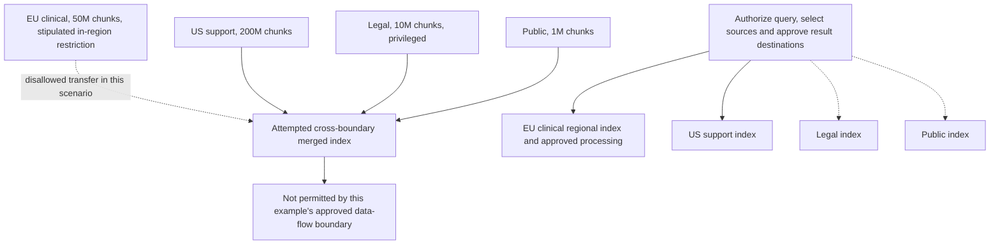
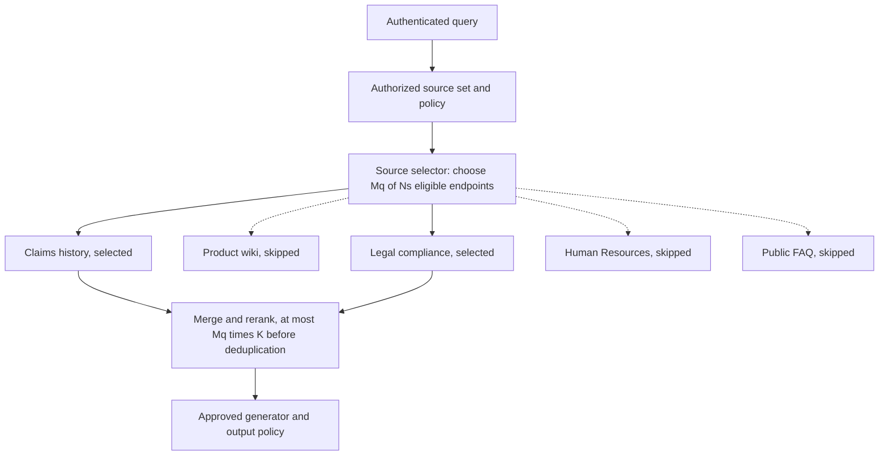
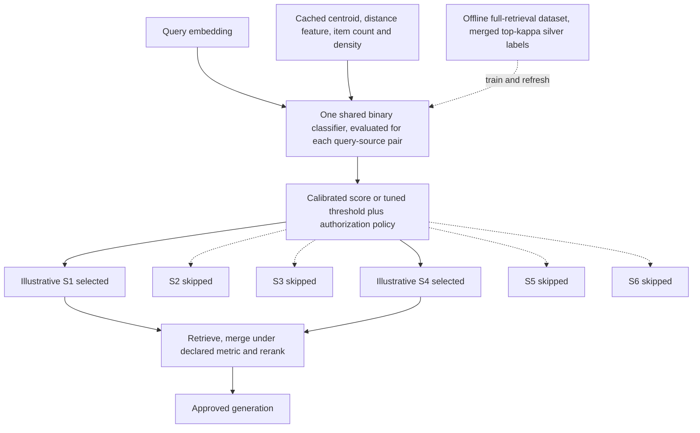
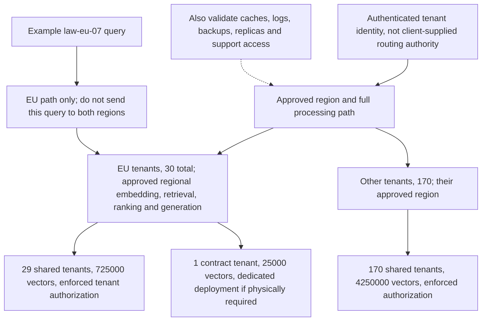
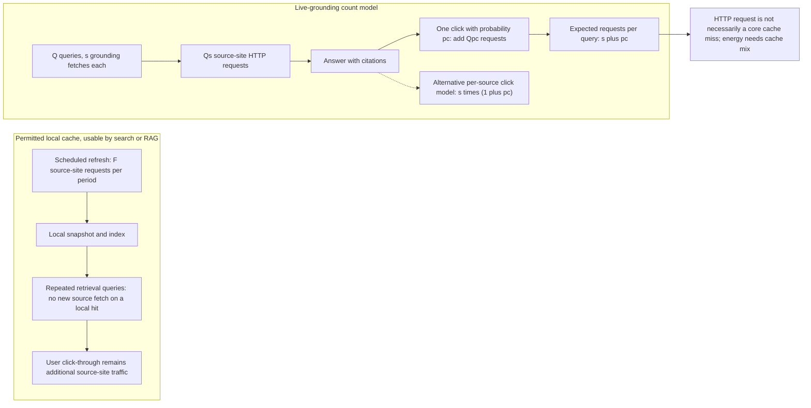

# Chapter 38: Distributed and Federated RAG
[00-START-HERE](../00-START-HERE.md) · [01-READING-ROUTES](../01-READING-ROUTES.md) · [37\_latency\_cost\_and\_systems](37_latency_cost_and_systems.md) · [39\_multimodal\_rag](39_multimodal_rag.md)
Purpose: design retrieval across independently governed sources while accounting separately for source coverage, request fan-out, deadline risk, index capacity, authorization, processing location and costs imposed on third parties. Federation is a coordination architecture, not an automatic privacy or compliance guarantee.
## TL;DR
- Keep governance boundaries where law, contract or policy requires them, but audit federation's query and result flows too; separate indexes alone do not prevent cross-border disclosure.
- Source selection reduces remote calls and candidate caps. Its latency benefit depends on the selected sources, conditional miss dependence, router overhead and result-completion policy, not source count alone.
- RAGRoute v1 uses one binary query-source model with cached source features. Its reported call/byte savings, architecture, batch timings and end-to-end results have different benchmark denominators.
- Authorize every retrieval path with a server-derived tenant identity. Regional storage does not prove regional processing, and a separate logical collection does not prove physically dedicated hardware.
- Distinguish GDPR response windows and erasure exceptions, HIPAA contracting chains, SOC 2 control evidence and a contractual deletion deadline. A daily six-hour rebuild can take up to thirty hours from a just-missed cutoff.
- Cache and bulk refresh can reduce source-side load in either search or RAG. Count user clicks consistently on both sides, and do not equate an HTTP request with an uncached backend request.
- Keep the arithmetic, evidence and promises bounded. The tenfold energy multiplier and infrastructure tariffs are assumptions; learned routing needs representative broadcast audits, and provenance does not establish truth or pay the source site's bill.
## The story
Imagine an international library consortium that answers questions for patrons.
Each library owns its books, staff rules, catalog, and building. Some collections must remain inside their country.
A central super-library may be disallowed by a collection-specific rule or contract. That is a stipulated boundary in this story, not a claim that every European collection is legally forbidden from crossing a border.
The consortium therefore keeps independently governed collections and coordinates retrieval. It must still decide which questions, returned passages and generated answers may leave each building; federation by itself does not settle those permissions.
A routing librarian chooses a set $`S(q)`$ from $`N_s`$ available libraries. Its size is $`M_q=|S(q)|`$, and each contacted library returns at most $`K`$ candidate books.
Broadcast asks every library and receives at most $`N_sK`$ candidates before duplicates are removed. A wait-for-all desk completes at the slowest response; deadlines or partial results can avoid that wait at a possible coverage cost.
Selective routing lowers the cap to $`M_qK`$. For a fixed subset it can reduce exposure to unnecessary slow participants, but selecting fewer intrinsically slower libraries or adding an expensive router need not improve latency.
RAGRoute is a trained routing clerk. One shared classifier evaluates each question-library pair using the question embedding and cached library features, rather than one fixed output neuron for each library.
An offline practice round broadcasts a representative set of questions, merges candidates under a declared retrieval rule and labels libraries contributing to its global top set. Those are silver labels for that retrieval rule, not independently adjudicated semantic relevance.
The consortium still checks the clerk. A small sample of questions goes to every library so managers can detect when new patrons or new collections make the clerk’s old habits stale.
The same consortium serves many member organizations. A tenant filter is like checking a patron’s library card before showing a shelf.
A correctly enforced card check controls authorized access across all read paths. It does not establish where books, their numerical representations, questions or answers are processed and retained.
A location commitment requires approved regional cataloging, retrieval, ranking and answer services, plus suitable logs, caches, backups and access controls. A separate collection can still share physical machinery; a dedicated room requires the corresponding deployment, not just a different label.
A do-not-serve marker can stop ordinary reads promptly if every path honors it. A later compaction, repair or rebuild can reclaim index storage; replicas, source records, logs and backups need their own deletion or retention handling.
The final inspection looks beyond the consortium’s own invoice. A live request to a public library makes that library spend energy and bandwidth even when the patron never pays it.
A catalog can reuse a permitted copy between refreshes. Live grounding can revisit source sites, and readers may open citations, but search users also click results. Compare like-for-like fetch and click policies rather than treating one architecture as inherently free.
A signed record or ledger can support integrity and attributed history under its trust assumptions. It does not prove the content true, establish all ownership rights, or reduce the number of visits that the public library must serve.
The complete design keeps legal boundaries intact, routes selectively, audits the router, separates isolation from geography, and counts costs that land outside its own walls.
## Decoder table


| Technical term | Plain-English meaning | Why it matters |
| --- | --- | --- |
| Retrieval-Augmented Generation (RAG) | Retrieved material conditions a generator | Distribution adds governance and data-flow decisions, not an automatic legal guarantee |
| Corpus | A collection of documents or chunks | Different ownership, permissions and update policies can require separate handling |
| Silo | Independently governed collection | Federation coordinates it without necessarily copying the entire corpus |
| Vector database | A service storing/searching numerical representations | Service boundaries do not by themselves prove authorization or residency |
| Vector index | Search structure over vectors | Payload, links, metadata, build workspace and serving capacity are distinct |
| Embedding | A source-derived numerical representation | Can carry identifiable or sensitive information; classification is policy/context dependent |
| Large Language Model (LLM) | Generator processing a query and evidence | Its location, logging, access and retention are part of the approved path |
| Dimension $`d`$ | Number of values per embedding | Raw payload is $`n_vdb_v`$, where $`b_v`$ is bytes per value |
| $`32`$-bit floating point (fp32) | $`4\,\mathrm{B/value}`$ | Decimal and binary memory units are not interchangeable |
| Approximate Nearest Neighbor (ANN) search | Search that may miss exact nearest vectors | Approximation and filtered-search budgets affect recall |
| Hierarchical Navigable Small World (HNSW) | A hierarchical graph ANN method | Neighbor-slot capacity is not the full resident index footprint |
| Resident copy | Declared data/index allocation held in memory | Not a universal necessity for all ANN designs; reserve workspace and headroom |
| Replication | Additional data/index copies for availability | Placement and failure domains matter in addition to multiplying payload |
| Sharding | Partitioning a logical system | Can include regional placement; hash sharding alone does not establish it |
| Federation | Coordinating independently governed systems | Queries, results and generation can still cross prohibited boundaries |
| Federated search | Selecting sources, querying them and merging results | Source coverage, scores and permissions all need validation |
| Source endpoint | Independently contacted retrieval service | Calls can return short lists and have query-dependent latency |
| Source selector | Rule/model selecting eligible endpoints | Cannot turn an unauthorized source into an authorized one |
| $`N_s`$ | Number of available source endpoints | Not vector count $`n_v`$; local pair-scoring work can still scale with $`N_s`$ |
| $`M_q=\vertS(q)\vert`$ | Number selected for a query | A mean selection count alone does not determine deadline-union probability |
| $`K`$ | Per-source result cap | Candidate cap is $`M_qK`$, before deduplication and short-list effects |
| HNSW degree $`m_H`$ | Graph connectivity/allocation parameter | At $`m_H=16`$, the stated base convention reserves $`32`$ slots; distinct from $`M_q`$ |
| Broadcast | Contact every eligible source | A retrieval baseline, not a semantic correctness guarantee |
| Fan-out | Parallel source calls | Wait-for-all time follows a maximum, not a sum of endpoint times |
| Candidate volume | Records entering merge before final selection | Counts do not uniquely identify bytes, unique evidence or quality |
| Tail latency | High quantile of an elapsed-time distribution | A source deadline-union probability is not itself an end-to-end quantile |
| Conditional source miss probability $`p_i(q)`$ | Chance a source misses its allocated deadline | Independent conditional events permit the product formula; shared failures do not |
| Service-Level Agreement (SLA) | Specified service commitment and remedies | Read its time, event, scope and exclusions rather than treating it as a probability model |
| CORI-style collection selection | Lexical selection using collection statistics | Low serving cost; stale statistics or vocabulary mismatch can hurt |
| Best Matching 25 (BM25) | Lexical relevance scoring family | Raw values depend on the variant and local collection statistics |
| Reciprocal Rank Fusion (RRF) | Combine ranks instead of raw score values | Avoids score units but does not guarantee comparable local relevance |
| Shared reranker | Common scorer applied to merged text | Must be authorized to see that text and evaluated for relevance/calibration |
| Raw score concatenation | Sort records using backend values | Requires compatible score definitions/scales, not merely the same ANN brand |
| Source hit rate | Declared source-contribution or usefulness rate | Define its oracle, denominator and query population |
| RAGRoute | One shared learned query-source binary model | Cached features avoid searching each source just to classify it |
| MIRAGE | Medical RAG benchmark with five source corpora in the paper | Top-$`32`$ answer accuracy $`72.22\%\to72.24\%`$ is not the MMLU savings experiment |
| MMLU | Subject-question benchmark; ten clustered Wikipedia sources in this paper | Reported largest savings accompany $`43.59\%\to43.29\%`$ answer accuracy |
| Fully connected classifier | RAGRoute hidden widths $`256`$, $`128`$, with one output logit | One query-source decision per input, not one fixed output for each corpus |
| Query embedding | Representation of the query | Feature construction, encoding cost and location remain part of the workflow |
| Source centroid | Mean source embedding | Requires a compatible representation and appropriate refresh/permissions |
| Source density/count/distance features | Other declared query-source descriptors | Do not replace them with an unspecified spread-only architecture |
| Per-source score | Sigmoid of a binary-model logit | Class weighting, model error and shift prevent automatic probability calibration |
| Score threshold | Decision boundary for selecting a source | Tune and audit recall/cost; zero selected sources needs a policy |
| Fixed top-$`M_q`$ | Select a fixed number of eligible source scores | A hard call cap, not a semantic coverage guarantee |
| Global top-$`\kappa`$ | Merged top set under a declared retrieval rule | Its contributors generate silver labels, not exhaustive human relevance |
| Silver label | Automatically derived query-source contribution label | Inherits retrieval depth, metric, corpus and baseline errors |
| Weighted binary cross-entropy | RAGRoute training loss with class imbalance weighting | Weighted optimum differs from an unweighted conditional label probability |
| Label-building broadcast | Full retrieval over the training query set | One dataset phase; future source/traffic changes can require refresh |
| Distribution shift | Change in queries, sources, policy or features | Can alter source coverage and calibrated thresholds |
| Sampled broadcast audit | Full retrieval on representative sampled queries | Costs extra calls and only detects failures relative to its defined oracle |
| Multi-tenancy | Several tenants share part of a service | Authorization, geography and dedicated-resource isolation are separate |
| Tenant identifier | Authenticated tenant key such as `tenant_id` | A client-supplied filter alone is not an authorization boundary |
| Filtered/pre-filtered ANN | Search constrained to eligible records | Can avoid fixed global-top-list starvation but does not guarantee exact recall or enough results |
| Post-filter | Remove ineligible global candidates before release | Can be access-safe yet return too few results; overretrieval and auditing may be needed |
| Data residency | Specified processing/storage location requirement | Must cover all relevant artifacts and services, not the vector store alone |
| Compliance | Applicable obligations and evidence | Architecture labels, contracts and attestations do not establish every obligation |
| Jurisdiction | Applicable legal territory | Can constrain placement; transfers need context-specific assessment |
| European Union (EU) | Region used by the stipulated in-region contract | GDPR itself is not a categorical prohibition on all outside-EU transfers |
| General Data Protection Regulation (GDPR) | EU personal-data regulation | Transfer mechanisms, erasure grounds/exceptions and response duties are distinct |
| Data Processing Agreement (DPA) | Contract governing a processing relationship | A specific in-region clause can be stricter than a general transfer rule |
| Regional stack | Approved end-to-end regional processing/retention path | Include embedding, retrieval, ranking, generation, caches, logs and backups |
| Embedding inversion | Recover source-related information from a representation | Demonstrated leakage motivates review, not a theorem that every vector is fully invertible |
| Health Insurance Portability and Accountability Act (HIPAA) | US healthcare privacy/security framework | Role-dependent contracting and safeguards are more than choosing a region |
| Protected Health Information (PHI) | Protected health information under the applicable HIPAA definitions | Downstream business-associate roles and contracts must be assessed |
| Business Associate Agreement (BAA) | Required contractual safeguards in applicable relationships | The subcontracting chain need not be one direct agreement from the customer to every vendor |
| SOC 2 Type II | Auditor report on scoped controls over a stated period | Not a universal security guarantee or proof of all processing locations |
| High availability (HA) | Redundant service design with a specified failure target | Three nodes alone do not establish achieved availability |
| Namespace | Product-specific logical separation mechanism | Do not equate its name with physical isolation or an independently verified boundary |
| Noisy neighbor | Shared-resource contention affecting another tenant | Can motivate dedicated resources without creating a legal residency rule |
| Right to erasure | Context-dependent removal obligation with legal grounds/exceptions | A response window and a contractual physical-deletion deadline are different |
| Soft delete | Logical serving exclusion | Not necessarily physical removal from every copy or retained artifact |
| Tombstone | Deletion marker honored by read paths | Test replicas, caches and ID lookups; the marker is not proof of legal erasure |
| Physical cleanup | Compaction, repair or rebuild that removes indexed allocations | Source stores, backups and legally retained records still need their own handling |
| Audit trail | Controlled record of relevant actions | Append-only integrity, minimized sensitive data, retention and location all matter |
| Externality | Cost incurred by a party outside the caller’s transaction | Source-side traffic/energy is not visible in the caller’s cloud invoice |
| Commons resource | Shared infrastructure/content funded outside each use | Use supported channels and sustainable access terms |
| Source site / core origin | Source HTTP service versus its backend after CDN/cache misses | A site fetch does not imply a core-datacenter cache miss |
| Refresh cycle | Schedule and invalidation policy for a local snapshot | Amortized machine fetches are $`F/Q`$ over the stated period, plus clicks and retries |
| Local retrieval cache | Permitted reusable grounding snapshot | Can reduce source traffic for search or RAG, with freshness and revocation duties |
| Live grounding | Source fetch during query serving | May hit a source cache; bytes, backend work and energy require measurement |
| Verification rate $`p_c`$ | Probability of a one-click verifier, or per-source marginal click rate | State which model is used; they yield different expectations |
| Marginal source cost | Additional source-side work from another query | Include live fetches, user clicks, refreshes and actual cache outcomes |
| C2PA | Content credential/provenance standard discussed by the chapter | An attributed integrity claim is not proof of truth or lower request volume |
| Public distributed ledger | Protocol-maintained shared history | Trust threshold, replication and consensus cost depend on the actual protocol |
| Signed hash | Signature binding an identified key to a digest | Supports integrity/attribution under key assumptions, not factual truth or all rights |
| Bot identification | Honest declaration of automated access | Do not hide identity to evade rate limits, blocks or source policy |
| robots.txt | Source policy file for automated crawling | Honor it alongside authorization, licensing and supported access terms |
| Application Programming Interface (API) | Supported programmatic access channel | Bulk or paid access may reduce repeated scraping; measure its own source load |


## Core mechanics
### Mathematical conventions
Use decimal storage units: $`1\,\mathrm{GB}=10^9\,\mathrm B`$; fp32 uses $`4\,\mathrm{B/value}`$. Keep intermediate precision, round only reported results and use $`\approx`$ for rounding or modeling approximations. Let $`n_v`$ count vectors, $`N_s`$ available source endpoints, $`M_q`$ selected endpoints, $`K`$ the per-source candidate cap and $`m_H`$ the HNSW degree parameter. This avoids using the same $`N`$ or $`M`$ for corpus size, source count and graph degree.
Candidate counts are upper bounds before deduplication when sources can return fewer than $`K`$. For a fixed selected set $`S(q)`$, independent conditional deadline misses with probabilities $`p_i(q)`$ give a product formula. A variable mean fan-out alone does not determine tail risk, and correlated outages, heterogeneous sources, timeouts and partial-result policies change the model. Router scores, silver source-label recall, snippet recall and end-to-end answer accuracy are different quantities.
Memory ledgers below cover declared payload/link allocations, not all-in resident memory, process overhead or failure headroom. Call-price arithmetic is a metered retrieval-only bill, excluding routing, audits, reranking, generation and fixed capacity unless stated. Reported paper results are not replicated experiments, and cross-benchmark numbers must not be combined into a single no-loss comparison.
Legal and contractual requirements are inputs to an approved design, not conclusions proved by equations. GDPR is not a blanket EU-only storage rule; a contract or another applicable rule can impose a stricter boundary. Location must cover the whole data flow, including queries, embeddings, returned chunks, generation, caches, logs, backups and support access. Logical exclusion is not the same as complete physical erasure.
For externalities, count requests to the source site separately from cache misses at that site's core datacenter. A live HTTP fetch may hit a CDN cache. The later $`r_E=10`$ energy ratio is a hypothetical sensitivity input, not a Wikimedia measurement; energy per served query is not energy per satisfied query without a satisfaction denominator.
### 38.1 Why there is no single vector database
#### Four forces and one hard boundary
- **What:** evaluate capacity, cost, critical-path latency and approved data flows before centralizing independently governed corpora.
- **Why:** common ownership can simplify operations, but permission and location constraints must be assessed separately.
- **Failure without it:** a capacity solution can still violate a stipulated processing or transfer restriction.
- **Cost or complexity:** payload, links, replicas, headroom, updates and service resources are modelable. Do not price away a requirement the organization is not permitted to waive.
Hundreds of millions of chunks create a capacity problem, but low latency does not mathematically require every index byte to be resident in RAM: disk-backed ANN, compression and tiering are alternatives to benchmark. Centralization and replication can change network, freshness and operational costs. In this example, the European clinical archive has an approved in-region restriction; do not infer that restriction solely from the word GDPR.
Sharding partitions a logical system; federation coordinates independently governed sources. Neither term proves common ownership or compliance. A sharded system can enforce regional placement, and a federation can still send protected results to an unauthorized central generator. Evaluate schemas, identity, keys, embedding compatibility, ingestion, ownership and the actual transfer path. Twelve hash shards do not by themselves establish a jurisdiction boundary.
#### Worked memory example
The stipulated silos hold $`200\times10^6`$ United States support chunks, $`50\times10^6`$ European clinical chunks, $`10\times10^6`$ privileged legal chunks and $`10^6`$ public chunks. Hence $`n_v=261\times10^6`$. At $`d=768`$ fp32 values, the raw vector payload is

```math
B_{\mathrm{vec}}=n_vd(4\,\mathrm B)=801{,}792{,}000{,}000\,\mathrm B=801.792\,\mathrm{GB}.
```

Under the common HNSW allocation convention, $`m_H=16`$ permits $`2m_H=32`$ neighbor slots at layer zero. Four-byte local identifiers budget $`128\,\mathrm{B/vector}`$; do not halve that per-node allocation because the graph is described as bidirectional. The scoped layer-zero link payload is $`33.408\,\mathrm{GB}`$, and

```math
\begin{aligned}
\frac{128}{768\times4}&=\frac1{24}\approx4.166667\%,\\
B_{\mathrm{vec+base}}&=801.792+33.408=835.2\,\mathrm{GB}.
\end{aligned}
```

This is not an all-in index-size guarantee or a refutation of every larger deployment multiplier. With the illustrative standard level law $`\Pr(\ell\ge j)=m_H^{-j}`$ and $`m_H`$ upper-layer slots, the expected upper-layer link allocation is another $`4m_H/(m_H-1)\approx4.266667\,\mathrm{B/vector}`$, or $`1.1136\,\mathrm{GB}`$ here. Vectors plus these expected links total $`836.3136\,\mathrm{GB}`$. Level headers, allocation capacity, labels/maps, metadata, source text, fragmentation and search/build workspace remain omitted.
If all declared payload could be packed without headroom into $`128\,\mathrm{GB}`$ usable-memory machines, the combined vector-plus-base model needs $`\lceil835.2/128\rceil=7`$ machines for one copy, or fourteen for two separately provisioned copies. Reserving twenty percent of that capacity gives $`\lceil835.2/(0.8\times128)\rceil=9`$ for one copy instead. These are capacity lower budgets, not an availability design.
If the four silos require separate machine pools, apply ceilings per silo: their vector-plus-base sizes are $`640`$, $`160`$, $`32`$ and $`3.2\,\mathrm{GB}`$, giving $`5+2+1+1=9`$ nominal machines, or eighteen for two copies, before headroom. The first pool exactly fills its nominal capacity, so any omitted bytes change that count. A forbidden transfer remains forbidden regardless of either arithmetic result.
#### Sanity check and decisions
The chapter-reported comparison uses about $`6.8\times10^6`$ English Wikipedia articles: $`261/6.8\approx38.382353`$. This divides chunks by articles, not comparable document or byte units. It is only a rough scale illustration, not evidence of thirty-eight Wikipedias of distinct content.
- Establish governance and transfer permissions before choosing a merge, partition or federation.
- Where a shared system is approved, choose sharding, compression and storage tiers from measured capacity and service constraints.
- Budget raw fp32 vectors as $`4n_vd`$ bytes and the declared HNSW base slots separately. The $`4.166667\%`$ ratio is scoped to $`d=768`$, $`m_H=16`$ and four-byte identifiers, not universal all-in overhead.
- Apply machine ceilings within required regions, silos and failure domains, then add explicit usable-capacity reserve and replication.
- A projected $`40\%`$ saving cannot override a nonwaivable requirement; quantify the feasible design instead of treating federation as proof of compliance.
### 38.2 Federated search and source selection
#### Selection before retrieval
- **What:** choose an authorized subset $`S(q)`$ of $`N_s`$ sources before retrieval, with $`M_q=|S(q)|`$.
- **Why:** avoid unnecessary remote calls and candidate processing while controlling missed evidence.
- **Failure without it:** broadcast can raise calls, payload and deadline exposure, but it is not guaranteed semantically correct or always slower.
- **Cost or complexity:** source features, routing, policy, monitoring and quality audits add work. The useful crossover is workload-specific, not a theorem at four sources.
Each source returns at most $`K`$ candidates, so the pre-deduplication caps are $`N_sK`$ for broadcast and $`M_qK`$ for selected retrieval. Equality requires full lists; heterogeneous $`K_i`$ use $`\sum_{i\in S}K_i`$. For wait-for-all parallel requests, a simplified service model is $`T_{\mathrm{route}}+\max_{i\in S}T_i+T_{\mathrm{merge}}`$, not the sum of endpoint latencies. With exact search, one common metric and a consistent total tie order, local top-$`K`$ results suffice to recover the global top-$`K`$. ANN misses or heterogeneous score spaces remove that exactness statement; none establishes semantic relevance.
For a fixed query and selected set, let $`E_i`$ mean source $`i`$ misses its allocated deadline. Under conditional independence,

```math
\Pr\!\left(\bigcup_{i\in S}E_i\mid q,S\right)=1-\prod_{i\in S}(1-p_i(q)).
```

If all conditional miss probabilities equal $`p=0.05`$ and the selected size is fixed, this becomes $`1-(1-p)^{M_q}`$. It gives $`1-0.95^8\approx0.336579569`$ for eight sources, $`1-0.95^{20}\approx0.641514078`$ for twenty, and $`1-0.95^3=0.142625`$ for three. The event is at least one source deadline miss, not automatically a failed answer or a measured end-to-end percentile. Without independence, the union is bounded only by $`\max_i p_i\le\Pr(\bigcup_iE_i)\le\min(1,\sum_i p_i)`$ for the stated marginals. A changing $`M_q`$ needs an expectation over selected sets and their conditional distributions; inserting its mean into the fixed-size formula is generally wrong.
Unnecessary calls can consume money and introduce distractors, but fewer candidates need not improve answer quality. Classical CORI-style collection selection uses lexical collection statistics and has low serving cost without a supervised neural router. Vocabulary mismatch and stale statistics can hurt it; embedding-based routing is another empirical trade-off, not a universal replacement.
#### Worked cost example
The insurer toy has $`N_s=8`$ sources: claims history, legal compliance, three regional policy stores, Human Resources, product wiki and public FAQ. Each returns up to $`K=40`$ candidates. Stipulate independent equal conditional deadline-miss probability $`p=0.05`$ and a hypothetical metered price of $`\$0.10`$ per thousand source calls, or $`\$0.0001/\mathrm{call}`$. This is not a current vendor quotation or a complete RAG bill.
With full lists, broadcast creates $`8\times40=320`$ candidate records before deduplication. The deadline-union probability is approximately $`33.657957\%`$. Eight metered calls cost $`\$0.0008`$ per user query, or $`\$800/\mathrm{day}`$ at $`10^6`$ user queries per day, excluding the rest of the system.
For a fixed-three-source policy with otherwise identical assumptions, the cap is $`3\times40=120`$ candidates, deadline-union probability $`14.2625\%`$, and call bill $`\$0.0003/\mathrm{query}`$ or $`\$300/\mathrm{day}`$. The retrieval-call saving is $`(800-300)/800=62.5\%`$. If three is only an average fan-out, the expected call/candidate arithmetic still applies under these uniform prices/caps, but the fixed-three tail probability does not follow.
RAGRoute is a separate reported experiment, not a learned continuation of this eight-source insurer toy. Its largest call/communication reductions are from MMLU, while the $`72.22\%\to72.24\%`$ accuracy pair is MIRAGE top-32. Combining them as one measured $`77.5\%`$ saving with no accuracy loss is unsupported. The next section keeps the experiment denominators separate.[\[1\]](https://arxiv.org/html/2502.19280v1)
#### Operating choices and claim limits
- The source's broadcast-at-three-or-four and selector-around-four-or-five defaults are heuristics. Compare authorization, recall, deadlines, actual critical paths and the router's cost.
- Begin with auditable policies where appropriate; hand rules can select several domains and need not be mutually exclusive.
- Budget tail risk with conditional source behavior and shared-outage dependence, not just a mean endpoint time.
- Log eligible, selected and skipped sources without exposing protected query content unnecessarily; audit source/query-type coverage as it changes.
- Calibrate comparable scores or apply a shared text reranker. RRF avoids raw score units, but local ranks from disjoint collections do not automatically encode comparable relevance.
- Sharing an embedding checkpoint is not sufficient by itself: normalization, score definitions, candidate policies and any local calibration must also match. Different ANN backends can still expose the same metric.
- Monthly/weekly reviews or a broadcast sample of one in a thousand are suggested cadences, not drift-detection guarantees. Define what failure the audit can observe.
### 38.3 RAGRoute: learning which sources to query
#### Architecture and labels
- **What:** train one shared binary query-source classifier, evaluated for every available authorized source.
- **Why:** cached source features can support cheap selective remote retrieval without online index access just to make the decision.
- **Failure without it:** broadcast may be expensive and fixed policies may miss evidence, but neither broadcast nor a learned router guarantees semantic correctness.
- **Cost or complexity:** query encoding, source-feature refresh, one pair score per source, calibration/threshold tuning, label broadcasts and independent audits. Local decision work still scales with $`N_s`$, even if remote calls scale with $`M_q`$.
RAGRoute v1 uses five feature groups: query embedding, source centroid, query-centroid distance, source item count and source density. A single three-layer network scores each query-source pair; it has hidden widths $`256`$ and $`128`$ and one output logit, not eight fixed source outputs. The hidden layers include LayerNorm, ReLU and Dropout. Source summaries are cached, so classification need not search the source index. Query embeddings, summaries and returned content still require appropriate permissions. The paper standardizes features and splits data at the question level; leaking pairs from one question across train/test would inflate the evaluation.[\[1\]](https://arxiv.org/html/2502.19280v1)
An offline label-building round broadcasts each training query to all $`N_s`$ sources, merges the retrieved candidates and selects a global top-$`\kappa`$ under the chosen common retrieval rule. The paper uses the configured retrieval depth for this merged top set. Define $`y_i(q)=1`$ if source $`i`$ contributes any item and zero otherwise. These labels measure contribution to that embedding-based oracle, not complete human relevance, all necessary evidence or legal authorization. Changing sources, retrieval depth or metric can change the labels, so “one offline broadcast” means one dataset-building phase, not a lifetime no-refresh guarantee. RAGRoute trains with class-weighted BCE-with-logits.[\[1\]](https://arxiv.org/html/2502.19280v1)
A sigmoid score is not automatically a calibrated source-usefulness probability, especially after class weighting. For a positive class weight $`w\gt 0`$ and true silver-label probability $`\eta`$, the unconstrained population optimum of weighted BCE is

```math
a^*=\frac{w\eta}{1+(w-1)\eta},\qquad \eta=\frac{a^*}{w-(w-1)a^*}.
```

Model error and shift still require held-out calibration; this inverse is an idealized identity, not a calibration guarantee. Scores for different sources need not sum to one. A “seventy-percent legal, thirty-percent finance” illustration is not a measured mixture or a limitation that hand rules cannot represent. Large-model routing can be more expensive, but its latency depends on the actual model, input, hardware and cache rather than a universal hundreds-of-milliseconds constant.[\[1\]](https://arxiv.org/html/2502.19280v1)
#### Worked RAGRoute example
The insurer example remains $`N_s=8`$, $`K=40`$. The paper's MIRAGE experiment instead has five medical corpora and $`7{,}663`$ questions; its MMLU experiment uses ten subject subsets with $`2{,}313`$ questions and ten synthetic sources formed by clustering one million Wikipedia snippets. These are not eight independently governed enterprise endpoints. MIRAGE uses MedCPT and exact FAISS IndexFlatL2 retrieval; MMLU uses Cohere Embed V3 embeddings. Benchmark recall is not evidence that any source may legally return its data to the central reader.[\[1\]](https://arxiv.org/html/2502.19280v1)
For MMLU, the paper reports source calls $`13{,}890\to3{,}126`$, a reduction of approximately $`77.494600\%`$ (reported as $`77.5\%`$), and communication $`73.3\to17.42\,\mathrm{MB}`$, approximately $`76.234652\%`$ less. MMLU answer accuracy is $`43.59\%\to43.29\%`$, a $`-0.30`$ percentage-point change. MIRAGE top-32 Table 2 reports $`72.22\%\to72.24\%`$ ($`+0.02`$ points); its top-10 row reports $`72.21\%\to72.00\%`$ ($`-0.21`$ points). Across MIRAGE top-32 question banks, call reductions range from $`28.93\%`$ to $`69.5\%`$, not uniformly $`77.5\%`$. The table's across-bank standard deviations are not a paired equivalence test or proof of zero quality loss.[\[1\]](https://arxiv.org/html/2502.19280v1)
In the ten-source MMLU call ledger, the implied mean selected count is

```math
\overline M_q=\frac{3{,}126}{13{,}890/10}\approx2.250540.
```

Applying the rounded $`77.5\%`$ reduction to an assumed eight-source system would instead give $`8(1-0.775)=1.8`$ sources on average, but that is a hypothetical transfer, not the reported experiment. Likewise $`320(1-0.762)=76.16`$ is only a fixed-bytes-per-candidate counterfactual; measured communication includes its actual payloads and protocol. It is not an independent inference of a $`1.9`$-source fan-out, and mean fan-out need not be an integer.[\[1\]](https://arxiv.org/html/2502.19280v1)
For a toy $`d=768`$ embedding with the paper's five features, assume both vectors are concatenated with three scalars, so the pair input width is $`2d+3=1{,}539`$. The paper-shaped network is $`1{,}539\to256\to128\to1`$. It has $`426{,}880`$ linear weights, $`385`$ linear biases and $`768`$ affine LayerNorm parameters, totaling $`428{,}033`$ learned scalars (about $`1.712132\,\mathrm{MB}`$ at fp32). Eight pairs cost approximately $`2(426{,}880)(8)=6{,}830{,}080`$ linear-layer FLOPs, excluding feature construction, normalization and activations. These counts are not CPU latency.
The paper measures a batch of thirty-two pair inferences at at most about $`0.3\,\mathrm{ms}`$ on an A100 and $`0.8\,\mathrm{ms}`$ on an AMD EPYC 7543 CPU. Dividing by thirty-two gives an amortized allocation, not an individual routing response time. Avoiding six parallel endpoint calls does not save six times their latency, and the measured batch timing does not establish a universal “thousands-fold” payoff.[\[1\]](https://arxiv.org/html/2502.19280v1)
#### Operating choices and claim limits
- Use calibrated thresholds, cost/recall constraints or a fixed source cap on the authorized set. Zero selected sources needs an explicit abstention, fallback or nonretrieval policy.
- Bootstrap with rules when representative labels are absent; later broadcasts are silver supervision, not a replacement for independent relevance/task evaluation.
- Refresh centroids, sizes and density features after material source changes. Scoring pairs locally still has a per-source cost.
- Audit representative queries with full retrieval under a declared oracle, and separately check answer/evidence quality. A full broadcast is only that retrieval baseline, not complete semantic truth.
- If an audit reuses already selected results and contacts only skipped sources, audit fraction $`a`$ gives expected calls $`\mathbb E[M_q]+a(N_s-\mathbb E[M_q])`$. At hypothetical $`N_s=8`$, $`\mathbb E[M_q]=1.8`$ and $`a=0.01`$, this is $`1.862`$ calls, not $`1.8`$ with a free audit; an independent duplicate broadcast would cost more.
- At $`10^6`$ daily queries, one percent produces $`10{,}000`$ audits and one in a thousand produces $`1{,}000`$. With zero observed failures in $`n`$ representative independent audits, a one-sided exact ninety-five-percent binomial upper bound is $`1-0.05^{1/n}`$: about $`0.029953\%`$ or $`0.299125\%`$ respectively. These assumptions and observable failure definition matter; a sample can still miss rare query classes or later drift.
- Increase or stratify audits for new sources, policy changes and audit-sensitive classes. Lowering thresholds or broadcasting changes cost and recall, not permissions. Do not stop auditing solely because a few months looked stable.
### 38.4 Multi-tenancy, compliance, and data residency
#### Three axes and two layers
- **What:** separate authorization, applicable legal/contractual requirements, physical processing/storage location and dedicated-resource isolation.
- **Why:** each property needs its own control and evidence.
- **Failure without it:** a correctly filtered collection can coexist with an out-of-region embedding, reranking, logging or generation call.
- **Cost or complexity:** approved regions, availability capacity, identity, vendor contracts, monitoring and complete deletion workflows add overhead beyond raw vector bytes.
Authorization asks which records and operations a caller may access. Compliance asks what obligations apply to the full lifecycle. Residency constrains specified processing and storage locations. Physical isolation asks whether infrastructure is dedicated. These properties overlap but none is proved merely by naming a tenant, region or collection.
A shared regional collection with a tenant key is a useful pattern if authorization derives the key from authenticated server-side identity and applies it to every read, ID lookup, cache and downstream evidence path. Filtered ANN usually avoids the starvation of a fixed global top-$`k`$ post-filter. It does not guarantee $`k`$ valid results when the tenant has fewer records, ANN search misses candidates or a search budget is insufficient. A post-filter can be access-safe if enforced before any unauthorized payload leaves the service, but may require adaptive overretrieval and still needs a recall audit. The existence of a metadata field alone does not make isolation airtight.
An out-of-region embedding request can disclose source text even if the final vector is stored locally. Queries, embeddings and returned chunks can also carry sensitive information; a prudent design classifies them using identifiability and the applicable policy rather than declaring every vector anonymous. The chapter cites Song and Raghunathan (2020) for embedding leakage examples, not a universal inversion theorem. GDPR Chapter V, Articles 44–49, governs relevant international transfers and permits specified mechanisms/conditions; it is not a categorical ban on all transfers outside the EU. A stricter in-region DPA is a separate input to this example.[\[1\]](https://eur-lex.europa.eu/eli/reg/2016/679/oj/eng)
Route each authenticated tenant to its approved stack before sending its query or text to a restricted service. Verify embedding, retrieval, reranking, generation, caches, logs, backups, replication and vendor/support access, not just vector-cluster placement. Logical collections/namespaces and dedicated shards can improve separation without proving physically dedicated hardware. If a contract requires physical isolation, provision and evidence the required dedicated infrastructure. Qdrant documentation describes shared payload-filtered collections, custom shards and collection overhead; “one collection per tenant” is not its universal default. Region and load sharding can coexist.[\[2\]](https://qdrant.tech/documentation/manage-data/multitenancy/)
#### Different compliance evidence
GDPR includes much more than location and erasure. For the specified upper-tier infringements, Article 83(5) provides an administrative-fine ceiling of $`\mathrm{EUR}\,20\times10^6`$ or, for an undertaking, $`4\%`$ of the preceding financial year's total worldwide annual turnover, whichever is higher. The two terms cross at $`20\times10^6/0.04=500\times10^6\,\mathrm{EUR}`$. This is a statutory upper framework with case-dependent factors, not an automatic charge, expected loss or a measured risk probability.[\[3\]](https://eur-lex.europa.eu/eli/reg/2016/679/oj/eng)
HIPAA contracting follows the covered-entity/business-associate/subcontractor roles and applicable exceptions. HHS explains that business associates must ensure that subcontractors creating, receiving, maintaining or transmitting PHI on their behalf accept the required restrictions and conditions. It is not necessarily one direct agreement from the customer to every downstream company. A deployment requiring a BAA chain cannot use a vendor that refuses the necessary agreement merely because it has a suitable region; agreements do not by themselves establish security or compliance.[\[4\]](https://www.hhs.gov/hipaa/for-professionals/covered-entities/sample-business-associate-agreement-provisions/index.html)
SOC 2 Type II reports describe an auditor examination of scoped controls over a stated period, not a general proof that every control always works or that data stayed in a named country. The chapter’s six-to-twelve-month observation window is a typical planning description, not a mandatory universal interval. Read the actual scope, exceptions and complementary customer controls. A report, a BAA and a region label are distinct pieces of evidence.
#### Erasure mechanics
HNSW deletion is implementation-dependent: logical markers, filtering, compaction, local repair or rebuilding are possible. A marker can enforce immediate serving exclusion only if all read paths and replicas honor it. It is not proof of removal from source stores, graph allocations, replicas, caches, logs and backups.
Article 12(3) generally requires information on action taken without undue delay and within one calendar month, with a possible two-further-month extension when justified and timely notified. Article 17 defines erasure grounds and exceptions, including relevant legal obligations/claims. Neither provision is a theorem that a tombstone automatically satisfies erasure or that a fixed thirty-day period universally applies. Define the request's applicable obligation, acknowledge it, record serving exclusion, complete the required removal/retention workflow and obtain legal review rather than promising compliance from an index operation alone.[\[3\]](https://eur-lex.europa.eu/eli/reg/2016/679/oj/eng)
#### Worked regional example
The worked platform has $`200`$ tenants with a stipulated equal $`25{,}000`$ chunks each, $`768`$ fp32 dimensions, and thirty EU law-firm tenants whose DPA requires the specified in-region processing. Equal allocation is the scenario assumption; an average alone would not establish that exactly thirty selected tenants own $`750{,}000`$ chunks.
The shared configuration has $`200\times25{,}000=5{,}000{,}000`$ vectors and raw payload $`5{,}000{,}000\times768\times4=15.36\,\mathrm{GB}`$. This excludes index links, metadata, workspace and replicas. Correct authorization can isolate eligible reads, but it does not meet an in-region requirement if restricted processing still occurs elsewhere.
The equal-size EU partition holds $`30\times25{,}000=750{,}000`$ vectors and exactly $`2.304\,\mathrm{GB}`$ raw payload; the other $`170`$ tenants hold $`4{,}250{,}000`$ vectors and $`13.056\,\mathrm{GB}`$. Their sum remains $`15.36\,\mathrm{GB}`$ because the base vectors are partitioned. Total deployed memory/cost need not stay constant: regional metadata, dedicated pools, replicas, spare capacity and logs can add overhead. Figure $`38.4`$ reconciles all thirty EU tenants as twenty-nine shared plus one dedicated tenant, not twenty-five plus one.
Use the chapter's hypothetical monthly cluster prices, not current vendor quotes: $`\$1{,}800`$ for the EU region's minimum three-node HA pool, $`\$2{,}400`$ for the original consolidated deployment and $`\$2{,}100`$ for the smaller non-EU deployment. The two-region bill is $`\$3{,}900/\mathrm{month}`$; the difference is $`\$1{,}500/\mathrm{month}`$, or $`62.5\%`$, and $`\$18{,}000/\mathrm{year}`$. The difference also equals the added $`\$1{,}800`$ pool less a $`\$300`$ global reduction.
The separate $`\$400/\mathrm{month}`$ pooled-EU-volume illustration is not a consistent marginal tariff that reconstructs all three prices: $`2{,}100+400=2{,}500`$, not $`2{,}400`$. It only illustrates that small data volume can face a fixed regional capacity floor. Dedicated hardware, legal/vendor work, transfer and operating costs may be additional; a three-node label alone does not prove a particular availability target.
The infrastructure premium can support a required control, but comparing a dollar bill to a euro statutory ceiling is not expected-loss analysis or insurance pricing. A probability, applicable infringement/penalty model, currency/date and other consequences would be needed for such a calculation. Compliance obligations are not optional merely because a speculative expected fine looks smaller. A company with only a few million euros of turnover does not make four percent the larger upper-tier term.
#### Operating choices and claim limits
- Use authenticated tenant policies and appropriate filtered/shared or dedicated deployments inside each approved region. A logical collection is not physically isolated hardware.
- Provision and validate an in-region path before promising it to the first relevant customer; do not wait until after signing an obligation that the stack cannot yet meet.
- Apply the organization's sensitive-data classification to source-derived embeddings, queries and generated artifacts; verify every service and retention path.
- Use serving exclusion promptly where appropriate, then the required physical/retention workflow. A legal hold can require preservation, not accelerated destruction; resolve conflicts with counsel.
- Send minimized audit events through a separately controlled append-only pipeline. The retrieval service may append authorized events but must not alter committed records; logs have their own access, residency and retention duties.
- In the stipulated $`50`$-million-vector case, a six-hour rebuild started only once per twenty-four hours can finish as late as $`24+6=30`$ hours after a just-missed snapshot cutoff. It does not guarantee physical completion within a twenty-four-hour commitment. Even with no other overhead, admission-to-start wait must be at most eighteen hours, with a snapshot including the deletion and a complete replica/copy workflow. Offer a narrower logical-removal promise only if it is permitted and explicitly distinguished.
### 38.5 RAG’s externalities: the commons and the energy bill
#### Origin costs and amortization
- **What:** count source-site HTTP requests, core-cache misses, bytes, energy and operator effort separately from the RAG team’s cloud bill.
- **Why:** public infrastructure can bear load that the caller does not pay for.
- **Failure without it:** traffic growth can trigger blocks and degrade service even while internal costs look low.
- **Cost or complexity:** permitted caches, scheduled refresh, source APIs/bulk feeds, attribution and traffic controls reduce repeated requests but need freshness, licensing and privacy policies.
An ideal local retrieval cache can serve repeated queries without another source-site fetch between refreshes. If it makes $`F`$ refresh requests over a period with $`Q`$ user queries, the amortized machine-fetch contribution is $`F/Q`$, not inherently zero. User click-through, retries and conditional refreshes are additional. Search and RAG can both use such a cache; neither label alone determines source load.
Wikimedia’s primary infrastructure post reports roughly $`50\%`$ growth in multimedia download bandwidth and at least $`65\%`$ of its resource-consuming core-site traffic coming from bots, despite bots accounting for about $`35\%`$ of pageviews. It explains that broad/long-tail bot access is more likely to bypass regional caches. These are operator observations about traffic and resource consumption, not a controlled energy-per-RAG-query measurement.[\[5\]](https://diff.wikimedia.org/2025/04/01/how-crawlers-impact-the-operations-of-the-wikimedia-projects/)
The checked primary post does not establish the chapter’s claimed tenfold energy premium. Retain $`r_E=10`$ only as a hypothetical uncached-to-cached request-energy ratio for a sensitivity example, not as a measured Wikimedia result. A live source-site HTTP request may hit that site’s cache, and a verification click may too. Measure actual cache-hit mix, bytes, backend work and energy before converting counts to a production energy or carbon claim.[\[5\]](https://diff.wikimedia.org/2025/04/01/how-crawlers-impact-the-operations-of-the-wikimedia-projects/)
#### Two click models in the source
Let $`s`$ be the number of grounding fetches per query and $`p_c`$ the probability of a verifying user. If each verifier opens exactly one source, expected source-site requests are $`s+p_c`$. If instead each of the $`s`$ sources is clicked with marginal probability $`p_c`$, linearity gives $`s(1+p_c)`$; independence of those clicks is not required for the expectation. With $`s=3`$, $`p_c=0.1`$, the values are $`3.1`$ and $`3.3`$ respectively. Figure $`38.5`$ now labels both models rather than depicting one click while evaluating the other.
#### Worked externality example
Take $`Q=10\times10^6`$ served queries per day, exactly $`s=3`$ live grounding fetches each, and exactly one click on a fraction $`p_c=0.1`$ of queries. Ignore retries, redirects, browser subresources and refreshes. Let $`e`$ be a cached source-site request’s energy and stipulate an uncached request costs $`r_Ee`$ with $`r_E=10`$. This hypothetical multiplier is not inferred from the traffic statistics above.
Grounding generates $`Qs=30\times10^6`$ source-site requests per day. Only under the extra assumption that every one is uncached does it consume $`10e`$ each, or $`300\times10^6e`$ per day. Counting a live HTTP fetch is not enough to establish that assumption.
The one-click model adds $`Qp_c=10^6`$ requests per day, for a total $`Q(s+p_c)=31\times10^6`$ and $`3.1`$ requests per served query. With core-cache-miss probabilities $`h_g`$ for grounding and $`h_c`$ for clicks, and the stipulated two-cost energy model,

```math
\frac{\mathbb E[E_{\mathrm{query}}]}e=s[1+(r_E-1)h_g]+p_c[1+(r_E-1)h_c].
```

Setting $`h_g=h_c=1`$ gives $`31e`$ per served query and $`310\times10^6e`$ per day. If grounding misses but clicks hit the source cache, it is $`30.1e`$; if all source requests hit, $`3.1e`$. These are scenario energies, not observations. Energy per satisfied query requires an additional satisfaction denominator and cannot simply be named $`31e`$.
For the per-source click model the same counts become $`33\times10^6`$ source-site requests per day and, only in the all-uncached sensitivity case, $`33e`$ per served query. A fair cached-search comparison must include its own refresh and user-click requests; “zero query-time fetches by the retrieval service” does not mean zero user traffic to the site. With a permitted local grounding cache hit fraction $`h_L`$, the one-click RAG count becomes $`Q[s(1-h_L)+p_c]+F`$ per period, where $`F`$ is refresh traffic. For $`h_L=0.95`$ this is $`2.5\times10^6+F`$ daily requests, not zero; cache placement/freshness and the energy of the caching system also matter.
#### Provenance is a different problem
A public ledger can support an agreed history under its protocol, identity and consensus assumptions. It does not prove source content true or lawful, and adding a record does not reduce source requests. Different consensus designs have different trust thresholds, replication, work and energy; no universal “honest majority” or “billions of computations per write” follows from the word ledger. Signed hashes with appropriate key management and a trusted timestamp/log can address some integrity and attribution needs more simply, but do not replace cross-party consensus when that is actually required. Compare concrete protocols and threat models before assigning costs.
#### Operating choices and claim limits
- Cache a permitted snapshot and refresh according to measured freshness needs. Preserve attribution, access controls, revocations and licensing obligations.
- Fetch live when the product's freshness need warrants it; count retries, redirects, bytes and source-cache outcomes, not only top-level URL counts.
- Identify automated traffic honestly and honor source policies, robots.txt, rate limits and supported API/bulk channels. Negotiate a data partnership rather than concealing identity or adding workers to evade a block.
- Make citation UI explicit about snapshot versus live verification; a fresh fetch may change the content and still must not be represented as the original grounding snapshot.
- Track machine fetches and user click-through separately. Apply comparable click/refresh assumptions to cached search and cached/live RAG.
- If traffic triples, reduce calls through suitable caching, deduplication and bulk refresh before raising concurrency. In the toy one-click model, holding total requests at the old $`31`$-million/day level requires about $`68.89\%`$ local grounding-cache hits at tripled traffic, before refresh/retry overhead; a generic two-thirds statement ignores the growing user-click term.
- Measure source load and negotiate access even for low-volume prototypes; neither a provenance credential nor an inexpensive internal bill proves sustainable external load.
## Diagrams
### Figure 38.1

Figure $`38.1`$: Capacity, cost and latency are design constraints; the example also stipulates a nonwaivable in-region requirement. Separate indexes avoid the proposed central copy only if query, result, ranking, generation and retention flows are approved too. Federation does not eliminate compliance duties, and GDPR alone is not a categorical no-transfer rule.
### Figure 38.2

Figure $`38.2`$: Source selection reduces remote-call and candidate caps, not each endpoint’s own service time. Deadline-union reduction uses fixed selected sets and conditional miss assumptions; an actual parallel critical path also includes the router, merge and completion policy. Candidate loss and authorization remain separate constraints.
### Figure 38.3

Figure $`38.3`$: This six-source illustration selects two sources; it is not the ten-source MMLU experiment or the eight-source insurer toy. RAGRoute v1 uses a shared query-source network with hidden widths $`256`$, $`128`$ and one logit. Local scoring still visits every source feature record, while remote retrieval visits the selected set. Weighted scores are not automatically calibrated probabilities or a distribution summing to one.[\[1\]](https://arxiv.org/html/2502.19280v1)
### Figure 38.4

Figure $`38.4`$: The equal-size example now accounts for all $`30`$ EU tenants as $`29+1`$ and all $`170`$ other tenants. The named EU query follows only its approved EU path. Region choice is not one-time proof of residency, and a logical collection is not physical isolation; validate the whole lifecycle and provision dedicated resources when the contract requires them.
### Figure 38.5

Figure $`38.5`$: Machine fetches, user clicks and core-cache misses have distinct denominators. With three grounding fetches, the one-click model gives $`s+p_c=3.1`$ expected requests, whereas per-source clicks give $`s(1+p_c)=3.3`$. Refresh and search-user clicks cannot disappear from a fair comparator. The $`31e`$ illustration additionally assumes a hypothetical tenfold ratio and that every counted request misses the source cache; it is not a reported energy result.
## Whiteboard pack
### What to draw
1. Draw independently governed corpora, approved data flows and any stipulated residency boundary; do not label all EU transfers forbidden merely because GDPR applies.
2. Separate a hypothetical combined-payload budget from per-region/per-silo rounding, headroom and replication.
3. Label $`N_s`$ endpoints, selected set $`S(q)`$, $`M_q=|S(q)|`$ and at most $`K`$ candidates per endpoint.
4. Draw authorization, source selection, retrieval, merge/rerank and the approved generator.
5. Write the conditional independent deadline-union formula and state the correlation/variable-fanout caveat.
6. Draw offline full retrieval producing metric-based top-$`\kappa`$ silver source labels, then one shared binary query-source classifier.
7. Keep pair classification, snippet recall and answer accuracy in separate boxes; attach each reported result to its benchmark.
8. Add sampled broadcast audits, their extra calls and a rare-failure detection budget.
9. Draw a complete approved regional path with shared/dedicated resources, including caches, logs, replicas and backups.
10. Separate serving exclusion from physical cleanup and write the daily-rebuild worst case $`24+6=30`$ hours.
11. Draw local refresh versus live grounding, with the same user-click accounting on both sides.
12. Write $`s+p_c`$ versus $`s(1+p_c)`$ and a separate core-cache-miss/energy model; label the tenfold input hypothetical.
### Spoken script
Distributed RAG starts with permissions and data flows, not just a database choice. I keep independently governed indexes where needed, select authorized sources and measure the resulting coverage, call bill and critical path. A learned router can imitate full-retrieval source contributions, but silver labels and a small score model do not guarantee semantic recall; I audit both retrieval and answers. Tenant authorization, region placement and dedicated hardware are separate controls. Finally, I count machine fetches, user clicks and backend cache misses separately, because cacheable source traffic and legal erasure promises cannot be inferred from the architecture’s name.
## Interview traps
### 1. Why not merge every embedding into one large vector database?
A merger may be feasible, cheaper or prohibited depending on actual ownership, contracts, data flows and law. Capacity arithmetic cannot override a stipulated restriction. Sharding can enforce approved regional placement if designed to do so; federation can still violate that placement if it exports protected queries or passages. The nominal $`835.2\,\mathrm{GB}`$ vector-plus-base budget and seven-machine combined packing count are not the nine-machine per-silo minimum, all-in memory, failure capacity or a compliance conclusion.
### 2. When does federated broadcast stop being a good default?
Use workload evidence, not a universal fourth-source threshold. A fixed wait-for-all broadcast has candidate cap $`N_sK`$ and, under independent equal conditional misses, deadline-union probability $`1-(1-p)^{N_s}`$. Correlation, source selection, timeouts and partial results change the result. Avoided parallel calls lower metered cost but their latencies do not add. Compare routing/merge overhead, source coverage, answer quality and tails; suggested three-or-four-source defaults are only heuristics.
### 3. How does RAGRoute learn without hand-labeling every query-source pair?
Broadcast a representative training set, merge candidates using a declared retrieval rule, label each contributing source and train one query-source binary model. The labels reproduce a top-set oracle, not all semantic evidence. RAGRoute v1 uses query/centroid/distance/count/density features, two hidden widths $`256`$, $`128`$, and one logit. Keep its MMLU savings and MIRAGE top-32 accuracy pair separate, and budget feature refresh and representative audits. Class-weighted BCE scores need calibration before a probability interpretation.[\[1\]](https://arxiv.org/html/2502.19280v1)
### 4. Does tenant_id filtering prove an EU tenant’s data stayed in the EU?
No. A tenant field or filter alone does not prove even logical isolation; enforcement must cover all read and downstream paths with authenticated identity. Regional storage plus embedding alone also omits ranking, generation, caches, logs, backups and access. A BAA or SOC 2 report cannot substitute for a full location review, and a separate collection does not prove dedicated physical hardware.
### 5. Why is a provenance ledger not the fix for RAG’s commons cost?
A credential or ledger may support attributed integrity/history under its trust model, but does not remove live fetches, verify factual truth or fund the source site. Cache permitted snapshots, refresh at a justified rate, use supported bulk/API access, attribute sources and measure machine/user traffic separately. Do not convert operator bandwidth statistics into a tenfold measured energy result or assign universal consensus cost without a concrete protocol.
## Key numbers


| Topic | Number or calculation | Meaning and limit |
| --- | --- | --- |
| Source figures | Five preserved Mermaid diagrams | All captions reconciled with the revised models |
| Source tables | No numbered source tables; two chapter aid tables | This row does not claim the chapter contains no tables |
| United States support silo | $`200\times10^6`$ chunks | Stipulated source population |
| EU clinical silo | $`50\times10^6`$ chunks | Example stipulates an in-region restriction; not an automatic GDPR no-transfer rule |
| Privileged legal silo | $`10\times10^6`$ chunks | Independently governed and authorized |
| Public silo | $`10^6`$ chunks | Public availability does not remove all usage obligations |
| Total merged scale | $`n_v=261\times10^6`$ vectors | Vector count, not source endpoint count |
| Vector width | $`d=768`$, fp32 $`4\,\mathrm{B/value}`$ | Raw payload assumptions |
| Raw vector memory | $`801.792\,\mathrm{GB}`$ | Exact $`261\times10^6\times768\times4`$ bytes |
| HNSW degree | $`m_H=16`$ | Common base allocation up to thirty-two neighbor slots |
| Neighbor bytes | $`128\,\mathrm{B/vector}`$; $`33.408\,\mathrm{GB}`$ total | Base-layer slot budget only |
| Raw bytes per vector | $`768\times4=3{,}072\,\mathrm B`$ | No metadata or identifiers included |
| HNSW overhead | $`128/3{,}072=1/24`$, about $`4.166667\%`$ | Relative to raw vectors, base links only |
| Larger overhead multipliers | $`1.5`$–$`2`$ is not this base-link ratio | Not refuted for all-in deployments or other dimensions/configurations |
| Vector-plus-base estimate | $`835.2\,\mathrm{GB}`$; with illustrative expected upper links $`836.3136\,\mathrm{GB}`$ | Other allocations/workspace/headroom omitted |
| Machine capacity | $`128\,\mathrm{GB}`$ nominal usable capacity in the toy | Check actual GB/GiB and process/OS reserve |
| Resident machine counts | Seven combined nominal; nine per-silo nominal | Combined model becomes nine with twenty-percent usable-capacity reserve |
| Two-copy machine counts | Fourteen combined nominal; eighteen per-silo nominal | Placement, quorum, fault capacity and headroom remain additional |
| Wikipedia count comparison | $`261/6.8\approx38.382353`$ | Chunks divided by articles, not equal content/byte units |
| Departmental shards probe | $`12`$ hash shards | Shard count alone does not enforce legal placement |
| Merger saving probe | $`40\%`$ projected | A scenario, not authority to override a nonwaivable restriction |
| Per-source deadline miss | $`p=0.05`$ | Equal conditional probability is stipulated |
| Eight-source union probability | $`1-0.95^8\approx0.336579569`$ | Fixed set and conditional independence |
| Twenty-source union probability | $`1-0.95^{20}\approx0.641514078`$ | At least one endpoint misses its allocated deadline |
| Three-source union probability | $`1-0.95^3=0.142625`$ | Not implied merely by mean fan-out three |
| Broadcast guideline | Three or four sources | Source heuristic, not a universal optimization boundary |
| Selector trigger | Around the fourth or fifth source | Re-evaluate actual cost, coverage and critical-path overhead |
| Healthy-source probability | $`1-p=0.95`$ | Not end-to-end answer correctness |
| Source metric cadence | Monthly or weekly examples | Cadence must reflect actual risk and rate of change |
| Low-frequency audit | $`a=0.001`$; $`1{,}000`$ audits/day at $`10^6`$ queries/day | Zero failures gives about a 0.299125-percent one-sided IID binomial upper bound, not zero risk |
| Insurer source count | $`N_s=8`$ | Not the five-source MIRAGE or ten-source MMLU experiment |
| Per-source candidate cap | $`K=40`$ | Short lists and duplicates can reduce unique volume |
| Assumed search-call price | $`\$0.10`$ per $`1{,}000`$ calls | Hypothetical metered source calls, not a current quote |
| Broadcast candidate cap | $`8\times40=320`$ | Records before deduplication, not a measured embedding wire format |
| Broadcast call cost | $`\$0.0008/\mathrm{query}`$ | Eight calls at the toy rate |
| Broadcast daily call bill | $`\$800`$ at $`10^6`$ queries/day | Retrieval-call component only |
| Fixed-three candidate cap | $`3\times40=120`$ | Tail calculation assumes fixed selection size |
| Fixed-three call cost | $`\$0.0003/\mathrm{query}`$ | Same uniform call-price assumption |
| Fixed-three daily bill | $`\$300`$ | No free router or audits implied |
| Static routing call saving | $`(800-300)/800=62.5\%`$ | Not a measured latency or answer-quality improvement |
| RAGRoute call saving | $`13{,}890\to3{,}126`$; about $`77.494600\%`$ | MMLU ten-source experiment, rounded to $`77.5`$ percent in the paper |
| RAGRoute communication saving | $`73.3\to17.42\,\mathrm{MB}`$; about $`76.234652\%`$ | MMLU byte ledger, not independent proof of a particular candidate count |
| RAGRoute answer accuracy | MIRAGE top-$`32`$: $`72.22\%\to72.24\%`$; MMLU: $`43.59\%\to43.29\%`$ | Different experiments; top-32 table change is +$`0.02`$ points, MMLU -0.30 points |
| Effective selected sources | MMLU $`3{,}126/(13{,}890/10)`$, approximately $`2.250540`$ | Applying rounded savings to a hypothetical eight-source system would give $`1.8`$, not the measured setting |
| Byte-to-candidate counterfactual | $`320(1-0.762)=76.16`$ | Only under fixed bytes per candidate; not a measured independent fan-out estimate |
| Paper-shaped toy classifier | Input $`2d+3=1{,}539`$; network $`1{,}539\to256\to128\to1`$ | One query-source pair per input; five feature groups at stipulated d=768 |
| Toy learned parameter count | $`426{,}880`$ weights, $`385`$ biases, $`768`$ normalization parameters; total $`428{,}033`$ | Linear weights, biases and affine LayerNorm parameters; not the original eight-output architecture |
| Reported batch routing time | Batch $`32`$: at most $`0.3\,\mathrm{ms}`$ A100, $`0.8\,\mathrm{ms}`$ EPYC | Primary reported batch timing, not a sub-0.1-ms per-query CPU latency claim |
| Avoided insurer calls | Fixed $`8\to2`$: six; hypothetical mean $`8\to1.8`$: $`6.2`$ | Do not turn either toy into measured MMLU savings |
| Network call duration | Tens of milliseconds in the chapter scenario | Parallel latencies do not add; measure which endpoint is critical |
| Routine router audit | $`a=0.01`$; $`10{,}000`$ audits/day at $`10^6`$ queries | Hypothetical mean calls becomes $`1.862`$ if already-selected calls are reused |
| Graded source illustration | Seventy-percent legal / thirty-percent finance | Not calibrated probabilities or a proof that hand rules cannot select both |
| LLM routing overhead | Model- and deployment-dependent | Hundreds of milliseconds is an illustrative comparison, not a universal constant |
| Router payoff claim | No established thousands-fold latency payoff | Reported batch timing and parallel remote calls do not imply it |
| Interview federation | $`12`$ sources | Source-count design scenario, not another evaluated benchmark |
| Opening tenant count | $`500`$ tenants | Separate opening/interview scenario, not the 200-tenant worked population |
| GDPR upper-tier ceiling | $`\max(\mathrm{EUR}\,20\times10^6,\,0.04V)`$ for an undertaking | Specified infringements and turnover basis; not expected loss; crossover EUR500 million |
| GDPR transfer provisions | Chapter V, Articles 44–49 | Mechanisms/conditions exist; a stricter DPA is a separate scenario requirement |
| HIPAA contracting | Applicable business-associate/subcontractor chain | Not necessarily a direct agreement with every downstream vendor |
| SOC 2 observation period | Six-to-twelve months is a chapter planning description | Read actual scope, period and exceptions; not proof of geography |
| Erasure response timing | Generally one calendar month; justified extension possible | Article 12(3) response duty differs from Article 17 grounds/exceptions and physical removal |
| Regional example tenants | $`200`$ equal-sized tenants | Twenty-five thousand chunks per tenant is stipulated, not inferred for a subset from an average |
| Total tenant vectors | $`200\times25{,}000=5{,}000{,}000`$ | Base allocation before replicas/index overhead |
| Total raw vector payload | $`15.36\,\mathrm{GB}`$ | Partition conserves raw vectors, not all deployment overhead |
| EU tenants | $`30`$ | DPA-defined in-region requirement |
| EU vectors | $`750{,}000`$; $`2.304\,\mathrm{GB}`$ raw | Exact under equal-size allocation |
| Figure EU shared pool | $`29`$ tenants; $`725{,}000`$ vectors | Corrected from twenty-five so the figure sums to thirty EU tenants |
| Figure EU dedicated pool | One tenant; $`25{,}000`$ vectors | Dedicated physical resources if required; a logical collection alone is insufficient |
| Other-region tenants | $`170`$ | Their own approved processing/retention path |
| Other-region vectors | $`4{,}250{,}000`$; $`13.056\,\mathrm{GB}`$ raw | EU plus other-region raw payload is exactly $`15.36`$ GB |
| EU HA floor | $`\$1{,}800/\mathrm{month}`$ for a three-node toy pool | Hypothetical price; node count alone does not establish availability |
| Original consolidated bill | $`\$2{,}400/\mathrm{month}`$ | Hypothetical complete comparison point |
| Post-split other-region bill | $`\$2{,}100/\mathrm{month}`$ | Hypothetical source assumption |
| Two-region total | $`\$3{,}900/\mathrm{month}`$ | Sum of the two declared regional bills |
| Residency premium | $`\$1{,}500/\mathrm{month}`$; $`62.5\%`$ | Added 1800 less 300 reduction; not an expected fine or insurance premium |
| Pooled EU volume illustration | $`\$400/\mathrm{month}`$ | Independent rough scenario; 2100+400 does not reconstruct the 2400 baseline |
| Annual infrastructure difference | $`\$18{,}000/\mathrm{year}`$ | Excludes unpriced legal/vendor work, access evidence and other overhead |
| Dedicated-tenant probe | Five of $`500`$ tenants | Separate contract scenario; logical collection is not physical hardware isolation |
| Deletion probe size | $`50\times10^6`$ vectors | Stipulated case, not a general HNSW rebuild measurement |
| Rebuild duration and cadence | Six hours; starts at most once per $`24`$ hours | A just-missed eligible cutoff can yield 30-hour completion |
| Contractual removal target | $`24`$ hours; no-overhead maximum start wait $`18`$ hours | Serving exclusion and complete physical removal are different promises |
| Energy sensitivity multiplier | $`r_E=10`$ is hypothetical | Checked Wikimedia primary post reports traffic/resource mix, not this energy ratio |
| Daily served queries | $`Q=10\times10^6`$ | No satisfaction fraction supplied |
| Grounding fetches per query | $`s=3`$ | Assumes one source-site request per chosen source, no retries/subresources |
| Grounding requests | $`Qs=30\times10^6/\mathrm{day}`$ | HTTP requests need not be core-cache misses |
| Grounding sensitivity energy | $`300\times10^6e/\mathrm{day}`$ | Only if all grounding requests are uncached at ten times cached energy |
| Verification rate | $`p_c=0.1`$ | Declare one-click-per-verifier versus per-source click model |
| One-click verification requests | $`Qp_c=10^6/\mathrm{day}`$ | One click for each clicking query |
| One-click total requests | $`Q(s+p_c)=31\times10^6/\mathrm{day}`$ | Refreshes, redirects, subresources and retries excluded |
| One-click hits per served query | $`s+p_c=3.1`$ | Not a measured source load or energy metric |
| Alternative per-source click model | $`s(1+p_c)=3.3`$; $`33\times10^6`$ requests/day | Different click assumption, not another evaluation of $`3.1`$ |
| Illustrative energy per served query | $`31e`$ only when $`h_g=h_c=1`$ and $`r_E=10`$ | If clicks hit, 30.1e; if all source requests hit, 3.1e; not per satisfied query |
| Ledger consensus work | Protocol-dependent; no supported billions-per-write constant | Provenance does not reduce source traffic or establish truth |
| Traffic tripling incident | Toy local-cache hit requirement about $`68.89\%`$ | Maintains old total requests in the one-click model, excluding refresh/retry costs |


[00-START-HERE](../00-START-HERE.md) · [01-READING-ROUTES](../01-READING-ROUTES.md) · [37\_latency\_cost\_and\_systems](37_latency_cost_and_systems.md) · [39\_multimodal\_rag](39_multimodal_rag.md)
