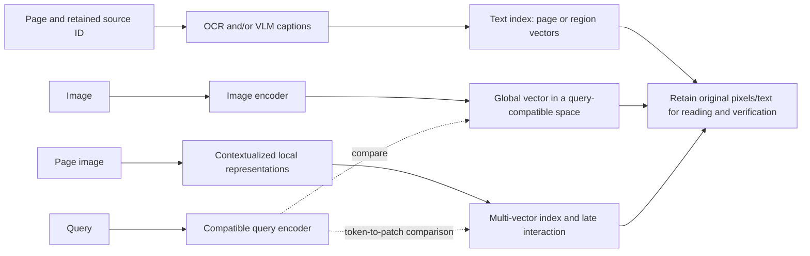
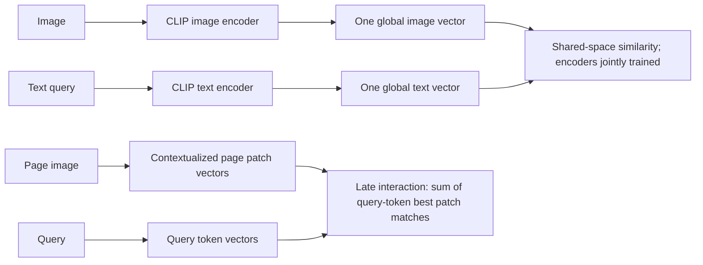
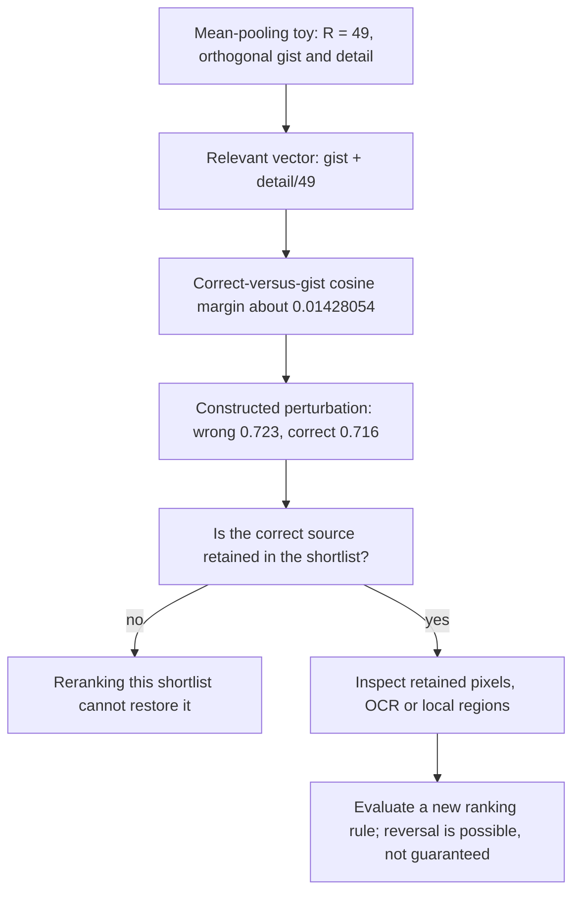
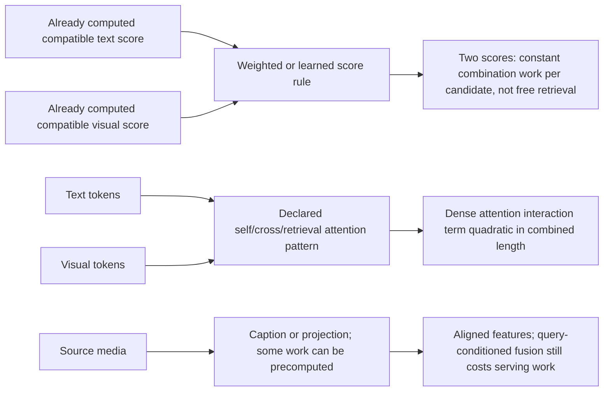
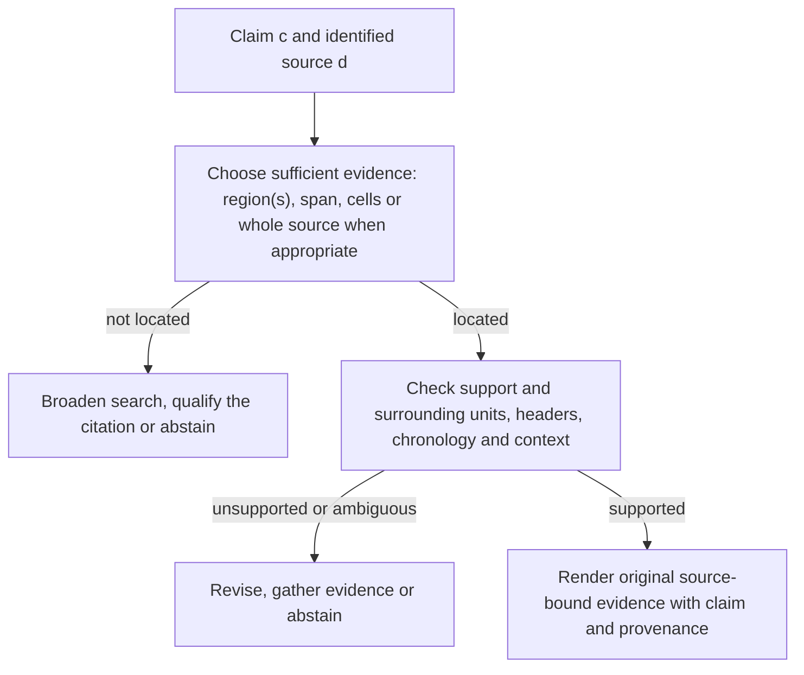
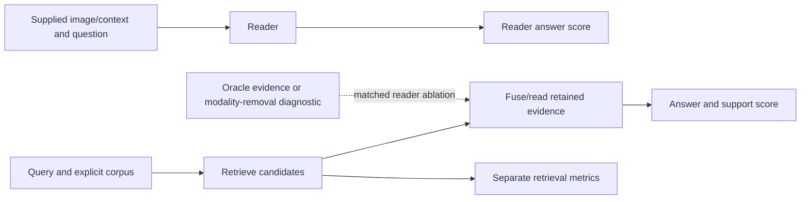

# Chapter 39: Multimodal RAG
[00-START-HERE](../00-START-HERE.md) · [01-READING-ROUTES](../01-READING-ROUTES.md) · [38\_distributed\_and\_federated\_rag](38_distributed_and_federated_rag.md) · [40\_graph\_rag](40_graph_rag.md)
Purpose: choose representations, retrieval units, calibration, fusion, time handling and source attribution for mixed-media RAG, while separating empirical model performance from conditional arithmetic and architectural guarantees.
## TL;DR
- Compare caption/text, global shared-space and page multi-vector indexes as design options, not universal generations of progress. Every encoding can lose useful detail; keep source pixels, text and identifiers addressable.
- CLIP is a jointly trained dual encoder, while ColPali keeps query-token and page-patch representations for late interaction. Neither architecture guarantees exact numbers, fairness, perfect composition or localization.
- Calibrate admission and cross-source ranking for the actual encoder, collection and query policy. Conditional pair false-positive rates are not collection-level false-admission probabilities or precision.
- Separate candidate coverage from order. Increasing top-$`k`$ can rescue a missed candidate for a stronger reader, but does not change the original scoring function. Reranking cannot restore a source that the candidate stage excluded.
- Score fusion, cross-attention and projected representations trade cost and information access, without guaranteeing agreement detection. Quadratic attention-pair ratios are not total-cost or latency multipliers.
- Use a video hierarchy that matches event duration and retain exact timestamps. A rotation alone cannot certify “before,” “after,” or cause; timestamp constraints can participate before retrieval.
- Localize evidence when needed, verify it in sufficient context and render original source-bound regions. Evaluate retrieval, generation and modality contribution separately, then compare matched systems with an appropriate paired or clustered uncertainty analysis.
## The story
Imagine a museum archive that stores reports, photographs, diagrams, recordings, and films. The archivist is the retriever. The curator is the large language model (LLM). The catalog is the index. A visitor’s question is the query.
The first cataloger writes captions. A caption may say “rising chart” but omit the axis value a visitor asks for. That detail is missing from this catalog representation; it may still be recoverable from the original chart if another retrieval path finds it.
The second cataloger gives text and images compatible catalog codes. A visitor can now search for a photograph using words without translating the photograph into a caption. One code still summarizes the whole object, so fine print can disappear.
Another cataloger keeps many local codes for a page. This can make cell labels and spatial details easier to retrieve, at a larger vector-payload bill. Resizing, patching, training and compression still prevent a promise that every exact value survives.
Catalog codes can reflect training correlations and miss entity bindings. The archivist audits the actual model and query types rather than assuming every caption-order effect or demographic difference has one cause. A local-content specialist may help, but its gains and errors need measurement.
Each gallery may use a different scoring scale. The archivist calibrates admission on its own query population and collection. One common cutoff is justified only when the resulting decision scores and costs are genuinely comparable.
A visitor asks about a tiny inscription in a broad courtyard. A global code can favor courtyard gist over the inscription. The archivist checks candidate coverage and lets a conservator inspect retained source detail; neither the shortlist nor the restored order is automatic.
The curator can combine scalar scores cheaply, or inspect language and visual content jointly at higher cost. More interaction permits agreement checks but does not guarantee correct reasoning. Dense attention-pair counts grow quadratically in the combined sequence, not necessarily in every component of the bill.
Films add time. The archive uses representative frames and smaller clips where needed, without treating all frames between cuts as redundant. For “before approval,” the archivist uses an explicit reference time and sequence-aware evidence; merely rotating catalog codes by time does not prove direction or cause.
A useful citation identifies the source and enough of its relevant region to check the claim. This may be a box, cell range, time span, multiple regions or the whole source for a genuinely global claim. Localization is a hypothesis, not a support verdict.
Finally, the museum distinguishes tests: supplied-image QA measures a reader, corpus search tests retrieval, and end-to-end RAG combines them. Both are legitimate when named accurately. Match the test population and stages to the product claim rather than calling one test fake.
## Decoder table

| Technical term | Plain-English meaning | Why it matters |
| --- | --- | --- |
| Multimodal RAG | Retrieval-augmented generation using text, visual, audio, temporal or other evidence | Name which modalities are queried, retrieved, read and cited |
| Modality | A data/signal type, such as text, image or audio | Distinct score scales and evidence units may need distinct handling |
| Caption/text indexing | Extracted text and/or generated descriptions form an index | Useful intermediate; it can omit detail but is not the only retrieval path |
| Optical character recognition (OCR) | Converts visible text into machine-readable symbols | Character recognition, layout and units can fail separately |
| Vision-language model (VLM) | A model that connects visual and language inputs/outputs | Supports captions, visual reading or retrieval; not an exact-value guarantee |
| Global shared-space indexing | Separately encoded queries and media are compared in compatible coordinates | Avoids a mandatory caption intermediate, not all compression |
| Contrastive Language-Image Pre-training (CLIP) | Jointly trained image and text encoders with a symmetric contrastive objective | Produces compatible global features; not a joint-input page encoder.[\[1\]](https://proceedings.mlr.press/v139/radford21a/radford21a.pdf) |
| Page-image multi-vector indexing | Represents a page with many local vectors for retrieval | Can retain useful local detail at larger payload; not lossless source storage |
| ColPali | PaliGemma-based page retrieval with local vectors and late interaction | Default paper configuration: $`1{,}024`$ image patches and a $`128`$-dimensional head.[\[2\]](https://arxiv.org/html/2407.01449v2) |
| ColBERT | Token-level representations scored by late interaction | Query-token best-match scores retain finer comparisons than one global dot product |
| Caption bottleneck | Useful source information omitted from an intermediate description | Limits a caption-only path; retained originals can support other paths |
| Mean pooling | Arithmetic mean, $`R^{-1}\sum_{i=1}^{R}v_i`$ | Localized features can be diluted under a specified linear construction |
| Patch embedding | A vector derived from an image region, often contextualized by a model | Not automatically exact OCR or a certified bounding box |
| Multi-vector index | Several stored representations per document/page | Payload grows with count, dimension and bytes per value |
| Late interaction | Combine query/local-document similarities after encoding | An exhaustive score can be expensive; candidate pruning can limit recall |
| Pivot language | An intermediate language used in a translation pipeline | Analogy for an information-losing intermediate, not equivalence of all encoders |
| LaBSE | A multilingual sentence-embedding approach | Direct cross-language comparison avoids a mandatory pivot description, not compression |
| 32-bit floating point (fp32) | $`4\,\mathrm B`$ per stored scalar | Multiply by stored count and dimension; overhead is additional |
| 16-bit floating point (fp16) | $`2\,\mathrm B`$ per stored scalar | Halves scalar payload relative to fp32, not all system memory |
| Joint encoding | Inputs interact inside a joint or cross-attending computation | Different from jointly training two separate encoders |
| Separate aligned encoders | Inputs are encoded separately into a compatible scoring space | CLIP uses this dual-encoder pattern; global and multi-vector readouts are separate choices |
| Global average pooling | Averages selected local features | CLIP variants do not all use a literal unweighted image mean |
| Class token | A learned token whose contextual representation may summarize an input | A global readout does not imply simple averaging of patches |
| AlignMamba | Local optimal transport plus global MMD for multimodal alignment | Evaluated on sentiment datasets; not a validated ColPali retrieval backend.[\[3\]](https://arxiv.org/html/2412.00833v1) |
| Approximate nearest neighbor (ANN) search | Finds likely close vectors without exhaustive scoring | Candidate-set maxima can differ from full-corpus maxima |
| Residual compression | Encodes deviations from reference centroids | Measure quality and complete index memory; text results need not transfer to pages |
| Product quantization | Compresses vector subspaces with learned codebooks | A memory/ranking trade-off, not lossless retrieval |
| Contrastive learning | Learns from matched and mismatched examples | Both positive and nominal-negative logits affect the loss |
| $`L_2`$ normalization | $`v\mapsto v/\lVert v\rVert_2`$ for nonzero $`v`$ | Makes a compatible-space inner product a cosine; does not calibrate relevance |
| Temperature $`\tau`$ | A positive scale in logits such as $`u^{\mathsf T}v/\tau`$ | Changes softmax sharpness, not source truth |
| InfoNCE | A contrastive log-softmax objective over positives and negatives | False negatives and pair-label scope matter |
| Position bias | Sensitivity to position/order unrelated to the intended decision | An empirical effect to measure on the specific model and prompt |
| Demographic bias | Unequal or harmful behavior across social groups | A task/population-specific audit; ImageNet accuracy does not establish parity |
| Gist-only bias | Global features favor broad scene content over queried detail | A useful failure description, not a theorem about every global vector |
| ARO benchmark | Attribute, relation and order probes for visual-language composition | Measures tested behavior; does not identify a unique cause or remedy |
| Entity-aware reranking | Rescores candidates with entity/local-content evidence | Cannot restore sources excluded by the shortlist; ordering gains need evaluation |
| Per-modality threshold | Admission policy fitted to a modality-specific decision score | Different raw scales do not mandate different thresholds after valid common calibration |
| Per-collection threshold | Admission policy fitted to a collection and query population | Null maxima depend on size/dependence and search policy, not just pair scores |
| Modality gap | Differences in learned modality distributions/geometry | Not by itself a numerical relevance calibration map |
| Dense Passage Retrieval (DPR) | A learned dense text-retrieval approach | Its scores are not automatically comparable with visual scores |
| Sentence-BERT (SBERT) | Sentence/text embeddings for similarity tasks | Cosine relevance calibration can change with collection and encoder |
| Admission threshold | A decision cutoff with declared false-admission and miss costs | A high raw score threshold alone does not prove high precision |
| Indicator function | $`\mathbb1[E]`$ equals one if $`E`$ holds, else zero | Turns a declared condition into a binary event; empty-corpus behavior must be defined |
| Calibration | Aligns decision scores with representative labeled outcomes | State base rates, candidate depth, query population and drift checks |
| Multi-granularity mismatch | A fine-grained query is compared with coarse document features | Local evidence may help, without a universal cosine-noise bound |
| Bi-encoder | Encodes query and candidate separately for a later score | Can be global or part of a richer multi-vector design |
| Cosine margin | $`s_{\mathrm{gold}}-s_{\mathrm{distractor}}`$ | With bounded additive score errors, margin above twice the bound protects order |
| Multimodal large language model (MLLM) | A language-model system with visual/audio or other input access | Can inspect retained evidence; cannot guarantee a correct listwise rank |
| Pointwise reranker | Scores each candidate separately | Can be prompted or trained; include repeated query and output cost |
| Listwise reranker | Processes multiple candidates jointly | Can compare candidates but has ordering, context and cost failure modes |
| DELG | A global/local visual retrieval design for recognition | An analogy, not an eight-photo performance guarantee |
| Fusion | Combines evidence or representations from sources/modalities | Occurs in text-only retrieval too; define missing-source and candidate-identity rules |
| BM25 | Lexical matching with term-frequency saturation and length normalization | Raw BM25 and cosine need a justified fusion rule |
| Automatic speech recognition (ASR) | Turns audio into text hypotheses | Confidence is not interchangeable with document relevance |
| Score fusion | Combines existing scalar scores or ranks | Combining two scores is constant work; computing them is not free |
| Attention fusion | Allows token/patch interactions across evidence | Permits, but does not guarantee, contradiction or agreement detection |
| Self-attention | Attention within a declared sequence | Dense interaction work is one quadratic term, not the entire bill |
| Cross-attention | Queries attend to another sequence | Work depends on both lengths and the connectivity pattern |
| Retrieval attention | An architecture-specific way to attend to retrieved representations | Specify access, masks and lengths rather than assuming one universal mechanism |
| Projected/unified fusion | Maps selected inputs into compatible features | Some work can be precomputed; query-conditioned fusion still costs serving compute |
| Multilayer perceptron (MLP) | A feed-forward network of affine maps and nonlinearities | Cost depends on dimensions and number of evaluated items |
| Vision Transformer (ViT) | A transformer over visual patch/token representations | Downstream readers may resample or omit tokens; input patches are not universal billed tokens |
| Classification (CLS) token | A designated learned/readout token | The attention-count toy includes one; not every VLM passes it downstream |
| Key frame | A selected representative frame for indexing or coding | Selection may miss transient events; a codec key frame is not a retrieval oracle |
| Shot | A contiguous take, often bounded by edits | One frame/shot is insufficient when relevant motion or internal events occur |
| Scene | A higher-level segment with related action/content | Can span shots; semantic boundaries need task-specific validation |
| Moving Picture Experts Group (MPEG) codec | A family of media-compression standards | Compression redundancy does not prove retrieval irrelevance |
| H.264 | A video coding standard with inter-frame prediction | Keep decoding/source requirements distinct from semantic segmentation |
| Order invariance | A representation is unchanged by input permutation | Plain set averaging is invariant unless ordered/positional features enter it |
| Rotary Position Embedding (RoPE) | Applies position-dependent block rotations | Can expose relative offsets; an even cosine counterexample defeats a universal direction guarantee |
| Rotation frequency $`\omega`$ | Angular rate, e.g. $`\mathrm{rad\,s^{-1}}`$ for time | A single plane repeats after its period; timestamps remain important |
| Correlation | Statistical association between events or features | Does not establish temporal order or a causal effect |
| Temporal direction versus causality | Before/after concerns ordering; cause is a stronger relationship | Evaluate directional retrieval separately from causal claims |
| Attributable to Identified Sources (AIS) | A support criterion relating interpretable claims to identified evidence | Does not mandate one box or exclude appropriate whole-source/multiple-region evidence |
| Portable Document Format (PDF) | A document format retaining page presentation | A page/source ID is a location, not proof that the cited claim is supported |
| Question answering (QA) | Producing an answer to a question | Name the supplied context, retrieval stages and scoring rule |
| Localization gate | Finds the region(s), span, cells or source context needed to check a claim | Localization can fail; whole-source evidence can be appropriate |
| Verification gate | Checks the claim against sufficient original evidence and context | A plausible box, caption or attention map is not verification |
| Bounding box | Coordinates defining an image/page rectangle | Validate coordinate convention, source version and contextual sufficiency |
| Timestamp span | A source-bound temporal interval | Keep reference event, exact times and neighboring context |
| Cell range | A specified table region including needed headers/units | Numerical attribution also needs denominator, period and arithmetic |
| MMed-RAG | A medical multimodal retrieval/QA/report research framework | Not clinical approval, proven deployment or guaranteed region attribution.[\[4\]](https://arxiv.org/html/2410.13085v2) |
| Multimodal-in, text-out | A reader accepts multiple modalities and emits text | Structured source coordinates can be rendered by deterministic tools |
| InstructBLIP | Instruction-aware visual-language modeling | Useful query-conditioned visual features are not certified explanations |
| Querying Transformer (Q-Former) | A learned query-based visual feature interface | Attention weights need not localize causal evidence |
| BLIP-2 | A visual-language system using a query interface to connect components | Architecture alone does not validate boxes or medical decisions |
| Multimodal-in, multimodal-out | A system emits media as well as reading it | Generated media and original-source evidence are distinct objects |
| NExT-GPT | A multimodal generation framework cited in the chapter | Not required to render original crops/clips from source-bound coordinates |
| Chain- or tree-of-retrieval | An iterative or branching evidence-search plan | Keep each step grounded in source identifiers; extra steps can add errors |
| Visual question answering (VQA) | Answering using supplied visual context, sometimes external knowledge too | Supplied-image reader quality and full corpus-based RAG are different tests |
| Benchmark task shape | Corpus, inputs, evidence access, metrics and stages of an evaluation | Counts from reader, retrieval and generation tests are not interchangeable |
| Top-$`k`$ evidence recall | Gold items in top $`k`$, divided by all gold items | Query hit-at-k instead asks whether at least one gold item was found; define denominator |
| Exact match and $`F_1`$ | Answer-level string equality and token-overlap metrics under declared normalization | Neither alone proves evidence support or retrieval correctness |
| Mean reciprocal rank (MRR) | Mean $`1/r`$ of first relevant rank; zero when absent | Specify candidate depth, tie handling and query aggregation |
| ROUGE-L | An overlap measure based on longest common subsequence | Not a direct test of source support, exact numeric correctness or causal reasoning |
| Ablation by modality removal | A matched comparison that removes specified input/evidence | Helps diagnose dependence; distribution shift and budget changes can confound it |
| Multiple-choice question (MCQ) | Chooses from supplied answer options | Chance level, options and templates differ from open-ended QA |
| Multimodal question answering (MMQA) | QA involving multiple evidence types | The label alone does not establish corpus size or which stages are tested |
| Standard error of a difference | Sampling variation of a specified comparison estimator | Paired covariance and shared-source clusters matter; independent variance is not an upper bound |
| McNemar’s test | A matched binary-outcome test using discordant pairs | Not a generic test for every score metric or correlated question cluster |
| Uncertainty of a measured gap | A confidence interval or decision analysis for the actual design | Not a universal noise floor; distinguish half-width, power and practical importance |

## Core mechanics
### Mathematical conventions
Storage uses decimal units: $`1\,\mathrm{MB}=10^6\,\mathrm B`$, $`1\,\mathrm{GB}=10^9\,\mathrm B`$, $`1\,\mathrm{TB}=10^{12}\,\mathrm B`$. fp32 and fp16 payloads use four and two bytes per stored value respectively. Keep full intermediate precision and round only reported results; $`\approx`$ marks rounding or modeling assumptions. Payload bytes are not complete resident index, raw-image, replication or serving memory.
Global versus multi-vector representation, separate versus cross-attending encoders, and training alignment are different design axes. CLIP jointly trains two separately evaluated encoders; it does not average an image encoder and a text encoder into one page vector by default. All cosine expressions require nonzero vectors and a common compatible space. A multi-vector index preserves more local representations, not lossless source pixels, exact OCR or certified localization.
The Gaussian examples describe conditional pair-score distributions, not measured CLIP data, precision, or a maximum over a corpus. A maximum requires a collection-size/dependence model. Normal distributions are unbounded approximations to bounded cosine scores. Calibrate on representative held-out query-level outcomes, with base rates, candidate depth and abstention policy stated.
Attention estimates count dense interaction positions at fixed architecture/width; projections, feed-forward blocks, visual encoding, batching, memory traffic and implementation change actual cost. Rotary time features can expose relative offsets but do not by themselves guarantee temporal direction or causal inference. Keep explicit source timestamps and original media addressable.
Accuracy gaps are percentage points unless explicitly relative. Independent-binomial standard errors, paired comparisons, confidence half-widths, power and practical importance are different concepts. Questions sharing an image, document, template or event can be correlated. Report primary-paper versions and denominators; no headline here is an independently replicated result.
### 39.1 Caption, shared-space and page-image indexing
#### What it is
The three lanes are useful design patterns, not mutually exclusive historical generations. Caption/text indexing runs OCR or a VLM, then embeds extracted text or a caption. Shared-space retrieval directly maps images and queries to compatible vectors. CLIP jointly trains an image encoder and a text encoder; it does not normally average their two outputs, require page-region parsing or consume both inputs jointly at retrieval. Page-image retrieval can retain many local representations: ColPali extends PaliGemma-3B with a $`128`$-dimensional head and ColBERT-style token-to-page late interaction. Its default paper configuration has $`1{,}024`$ image patches, not $`1{,}030`$ guaranteed pure patches.[\[1\]](https://proceedings.mlr.press/v139/radford21a/radford21a.pdf)[\[2\]](https://arxiv.org/html/2407.01449v2)
#### Why it exists
The pivot-language analogy concerns a particular bottleneck: an intermediate description can omit information. Direct multilingual or visual embeddings avoid that intermediate, not all compression. OCR, captions, image embeddings, local vectors and raw-source readers can be combined. Encoding a page as pixels also does not establish a lossless textual representation or an exact-value guarantee.
#### Failure without it
A caption like “upward trend” can omit the axis label, units and all cell values. If only that caption is retained, a later stage cannot consult the omitted source detail. If original pixels/text are retained and the page is retrieved by another signal, a stronger reader can still recover information absent from the index representation. Page-image indexing avoids a mandatory caption intermediate but resizing, visual encoding and retrieval errors remain. Choose it by measured coverage, exact-value reading, latency and budget, not an automatic superiority claim.
#### Cost, complexity, and decisions
For $`10{,}000`$ pages with two captioned regions each and a stipulated $`\$0.0005`$ per call, the generation-only bill is $`20{,}000\times\$0.0005=\$10`$. Two region captions do not automatically imply one page vector: this example explicitly aggregates them into one indexed page representation. Storing each separately would change vector count. One $`1{,}536`$-dimensional fp32 vector per page uses $`61{,}440{,}000\,\mathrm B=61.44\,\mathrm{MB}`$.
For a separate toy configuration, suppose each page stores $`1{,}030`$ local vectors of width $`128`$ in fp32. These are a stipulated stored-vector count, possibly including implementation-specific non-image tokens, not the paper's default pure-patch count. Each page uses $`527{,}360\,\mathrm B=527.36\,\mathrm{kB}`$, and the corpus uses $`5.2736\,\mathrm{GB}`$. The unrounded payload ratio is $`5{,}273.6/61.44\approx85.833333`$. A direct shared-space model only has the same memory shape if its dimension, precision and vector count are also the same.
At $`10^8`$ pages this toy multi-vector payload is $`52.736\,\mathrm{TB}`$ before index, media, replicas and overhead; whether that is prohibitive is a budget question. If exactly five percent of pages, rather than five percent of text or table area, take the large representation and the remainder take only the small one, the weighted payload ratio is $`0.95+0.05(85.833333\ldots)\approx5.241667`$. A dual-index copy of all pages would add storage. Segment by measured retrieval needs; a readable caption, OCR text and visual index can be complementary.
### 39.2 Global and multi-vector representations: a separate design axis
#### What it is
A global dual encoder maps an image and a text query separately into a common $`d`$-dimensional space. CLIP variants have different widths, including $`512`$ and $`768`$; shared training does not mean a single joint-input network. A multi-vector retriever keeps local query and document vectors and scores their interactions. ColPali uses a VLM to contextualize page patches and query tokens in a compatible $`128`$-dimensional space. Its favorable document-retrieval results are empirical, not proof of exact OCR, lossless page detail or bounding-box correctness. AlignMamba instead studies audio/visual/text sentiment fusion on CMU-MOSI and CMU-MOSEI with local optimal transport and global MMD alignment; it is not a measured ColPali retrieval backend.[\[1\]](https://proceedings.mlr.press/v139/radford21a/radford21a.pdf)[\[2\]](https://arxiv.org/html/2407.01449v2)[\[3\]](https://arxiv.org/html/2412.00833v1)
#### Why it exists
A $`200`$-page report with a $`40`$-row table and $`8`$-point footnotes can contain many separately queried facts. If page $`47`$ was already retrieved but the Q3 value is wrong, diagnose reading, resolution, context and arithmetic as well as ranking. A global vector can be an effective coarse selector without encoding every value for a dot-product reader. Local representations and high-resolution source access may help, but patch scores alone do not calculate the year-over-year change or certify a citation.
#### Failure without it
There is no dimension-independent theorem that every one-vector encoder has the same fixed recall ceiling, or that multi-vector retrieval stops scaling after a few thousand documents. Quality depends on training, precision, dimensionality, candidate search and workload. Exhaustive MaxSim for $`k`$ pages, $`L_q`$ query vectors, $`P`$ page vectors and width $`d`$ costs on the order of $`kL_qPd`$ dot-product work. A larger corpus motivates pruning, indexed token/patch candidates, compression or two-stage selection, not one universal size cutoff. A coarse stage can permanently exclude the gold page from downstream reranking; report its recall ceiling.
#### Cost, complexity, and decisions
In a different fp16 example, $`10{,}000\times768\times2=15{,}360{,}000\,\mathrm B=15.36\,\mathrm{MB}`$ for one global vector per page. A $`32\times32`$ grid has $`1{,}024`$ patches, and $`10{,}000\times1{,}024\times128\times2=2{,}621{,}440{,}000\,\mathrm B=2.62144\,\mathrm{GB}`$. The ratio is $`170.666667`$ approximately. This is not the earlier fp32/$`1{,}030`$-vector comparison with its different denominator.
A cheap shortlist can use a separately trained compatible global model, or a deliberately evaluated pooling/projection of the local vectors. A pooled $`128`$-vector cannot be dotted directly with an unrelated $`768`$-vector query. Normalize and align dimensions, audit shortlist recall, then compare local vectors in their own shared space. A few hundred candidates is a tuning choice, not a theorem.
The chapter cites a roughly six-to-tenfold ColBERTv2 text-index compression result; that is not a guaranteed visual-index compression ratio or preservation of exact values. Measure residual/PQ or lower-precision variants before declaring a memory target met. Halving numeric value precision halves vector payload only, not raw media, graph links, IDs or total resident cost. OCR can be sufficient for some prose; preserve local/raw evidence where the product requires it, and benchmark rather than imposing one encoder on every document.
### 39.3 CLIP’s three biases
#### What it is
For a batch of $`N\ge1`$ matched image-caption pairs, project both nonzero encoder outputs into a common space and normalize: $`u_i=f_{\mathrm{img}}(I_i)/\|f_{\mathrm{img}}(I_i)\|_2`$ and $`v_j=f_{\mathrm{txt}}(T_j)/\|f_{\mathrm{txt}}(T_j)\|_2`$. Let temperature $`\tau>0`$; a learned logit scale can equivalently parameterize its inverse.

$$
S_{ij}=\frac{u_i^{\mathsf T}v_j}{\tau},\qquad i,j\in\{1,\ldots,N\}.
$$

$$
S=\begin{bmatrix}S_{11}&\cdots&S_{1N}\\\vdots&\ddots&\vdots\\S_{N1}&\cdots&S_{NN}\end{bmatrix}.
$$

$$
\mathcal L=-\frac1{2N}\sum_{i=1}^{N}\left[
\log\frac{e^{S_{ii}}}{\sum_{j=1}^{N}e^{S_{ij}}}
+\log\frac{e^{S_{ii}}}{\sum_{j=1}^{N}e^{S_{ji}}}\right].
$$

The terms cover image-to-text and text-to-image matching. The batch has $`N`$ labeled positive positions and $`N^2-N`$ nominal negatives. All participate in the loss: an off-diagonal logit has a nonzero softmax gradient in general. Semantically compatible off-diagonal pairs can be false negatives. At $`N=1`$ this in-batch loss has no negative discrimination. This whole-pair supervision backpropagates through visual/text features, but supplies no explicit word-region labels or demographic-equality constraint.[\[1\]](https://proceedings.mlr.press/v139/radford21a/radford21a.pdf)
#### Why it exists
Whole-pair contrastive training can learn useful local or compositional features indirectly, but does not guarantee every entity binding, spatial relation or fairness criterion. Caption salience, data composition, architecture and objective can all affect behavior. A missing explicit constraint is not a proof that a particular bias must occur, or that all three named failure classes have one shared mathematical cause. Audit the deployed variant and population.
#### Failure without it
The chapter discusses demographic, caption-order and compositional failure examples, including ARO-style attribute/relation/order probes. Treat them as empirical failure modes to reproduce on the chosen encoder, not universal rates. The CLIP paper itself analyzes socially consequential biases and limitations; a strong global ImageNet score does not establish parity or exact grounding. Remedies can include data/objective changes, targeted fine-tuning, captions, local retrieval, verification and downstream reranking. No single downstream stage is guaranteed to be the only durable correction.[\[1\]](https://proceedings.mlr.press/v139/radford21a/radford21a.pdf)
#### Cost, complexity, and decisions
In the constructed $`15`$-students/one-monitor example, similarities $`0.17`$ and $`0.33`$ give an initial gap $`0.16`$. The range $`0.15`$–$`0.35`$ is not a universal true-pair range. If a new entity-aware score raises the classroom to $`0.29`$, it still loses to an unchanged $`0.33`$ close-up. A recovered top rank requires rescoring both candidates under the new rule and observing that ordering; scores from different rules are not directly comparable. Top-$`k=20`$ is a proposed coverage budget, not a guarantee the desired image survives.
The CLIP paper reports $`76.2\%`$ zero-shot ImageNet top-1 for its best/default ViT-L/14@336px evaluation, comparable to the original supervised ResNet-50 on that task. That is not a room-setup retrieval result.[\[1\]](https://proceedings.mlr.press/v139/radford21a/radford21a.pdf) Audit entity swaps, spatial reversals and relevant demographic groups with declared denominators and uncertainty. Route costly local readers using measured risk, coverage and tail latency; the scenario of doubled $`p_{99}`$ latency is an input, not a benchmark. A larger encoder or fine-tuning may help but is no guarantee of missing supervision.
### 39.4 Per-modality thresholds
#### What it is
The opening surface has four modality pools: text, image, video and geolocation. For query $`q`$, modality $`m`$ and a nonempty collection $`D_{m,c}`$, let $`s_{m,c}(q,d)`$ be a declared compatible score. An illustrative admission rule is

$$
A_{m,c}(q)=\mathbb1\!\left[\max_{d\in D_{m,c}}s_{m,c}(q,d)\ge\theta_{m,c}\right].
$$

For an empty collection define admission to be zero, or equivalently set its maximum to $`-\infty`$. A threshold can also depend on query features and a calibrated cost policy. Approximate search exposes a candidate-set maximum, not necessarily the exact maximum over the whole corpus. Index both collection and modality in the calibration record.
#### Why it exists
CLIP, DPR, SBERT, ASR confidence and geolocation distances do not automatically share a relevance scale. Even the same encoder can shift across collections, populations or candidate depths. A collection one hundred times smaller has a different null maximum in general, but size alone does not fix its direction or relevance precision without a score/dependence model. Modality-gap geometry is not itself a numerical calibration map.
Let $`F_0`$ be the CDF of a noise pair score and suppose, only for illustration, that all $`n`$ scores in a no-relevant-item collection are IID. Then

$$
\Pr(\max_{1\le i\le n}S_i\ge\theta\mid\text{all noise})=1-F_0(\theta)^n.
$$

This is not the pair false-positive rate $`1-F_0(\theta)`$. Correlated documents, ANN candidates and query-level mixture effects require their own analysis. Measure the deployed admission event directly where possible.
#### Failure without it
A raw cutoff can suppress almost all genuine image pairs while admitting text noise, but need not make every image score impossible. Pair precision also needs prevalence $`\pi`$: with nonzero admitted mass,

$$
\mathop{\mathrm{precision}}\nolimits=\frac{\pi\,\mathrm{TPR}}{\pi\,\mathrm{TPR}+(1-\pi)\,\mathrm{FPR}}.
$$

A high cutoff does not guarantee high precision without labels, base rates and stable distributions. Raw $`0.28`$ image and $`0.75`$ text scores are not a common ranking scale by default. Properly calibrated comparable probabilities with the same decision costs may justify a common threshold; otherwise tune collection-aware admission and fusion. A well-captioned web video calibration need not transfer to surveillance footage.
#### Cost, complexity, and decisions
Use the stipulated pair distributions, not measured CLIP results: text relevant/noise are $`\mathcal N(0.75,0.05^2)`$ and $`\mathcal N(0.35,0.10^2)`$; image relevant/noise are $`\mathcal N(0.30,0.03^2)`$ and $`\mathcal N(0.18,0.04^2)`$. With standard-normal CDF $`\Phi`$, pair admission probability is $`1-\Phi((\theta-\mu)/\sigma)`$.
At $`\theta=0.50`$, relevant-image admission is approximately $`1.30839\times10^{-11}`$, not mathematically zero. Relevant-text admission is approximately $`99.999971\%`$, and text-noise pair admission is $`6.680720\%`$. At $`\theta_{\mathrm{image}}=0.25`$, image-pair TPR and FPR are approximately $`95.220965\%`$ and $`4.005916\%`$. At $`\theta_{\mathrm{text}}=0.60`$, text-pair TPR and FPR are approximately $`99.865010\%`$ and $`0.620967\%`$.
These are not modality-admission recalls, precision or the probability that any result in a collection is noise. Under the all-noise IID toy, $`1{,}000`$ text candidates at the latter FPR yield about $`99.802863\%`$ probability of at least one above-threshold item; the analogous image probability rounds extremely close to one. Correlation changes those union probabilities. Ordinary normals also allow scores outside the cosine range, so these are local distributional illustrations, not exact bounded generative models.
Calibrate with representative held-out queries, relevant/irrelevant candidates, collection size and the actual retrieval/abstention policy. If only two of five modalities have labels, collect/audit labels for the others, expose uncertainty and use a controlled fallback or abstention rather than calling a guessed high cutoff “high precision.” A few offline hours is a planning estimate, not a guarantee of sufficient evidence. Reassess after encoder, collection, candidate-depth or traffic changes.
### 39.5 Multi-granularity noise correspondence and reranking
#### What it is
For an explicit mean-pooling toy, a $`224\times224`$ image with $`32\times32`$ patches has $`R=49`$. Take unit orthogonal directions $`g`$ (gist) and $`s`$ (queried detail), and assume averaging yields $`v_+=g+s/R`$ for the relevant item, $`v_-=g`$ for a distractor, and query $`q=g+s`$. These are stipulated linear features, not a literal account of every CLIP ViT or its class-token readout.

$$
\begin{aligned}
\cos(q,v_+)&=\frac{1+1/R}{\sqrt2\sqrt{1+1/R^2}}\approx0.721387321,\\
\cos(q,v_-)&=\frac1{\sqrt2}\approx0.707106781,\\
\Delta s&\approx0.014280540\qquad(R=49).
\end{aligned}
$$

The detail coefficient is $`1/49\approx0.020408`$, or about $`2.0408\%`$ of its per-patch coefficient in this construction. It is not a percentage of all information stored in the embedding. The old $`0.7215`$/$`0.0144`$ labels are replaced with values calculated before rounding.
#### Why it exists
Image/audio/video content can be highly localized, but compression, crop changes and ANN errors do not have a universal one-percent cosine perturbation. Measure them on the pipeline. If each score's additive error has magnitude at most $`\varepsilon`$, the order is guaranteed by a positive margin greater than $`2\varepsilon`$. For this toy, the half-margin is approximately $`0.007140270`$. Larger errors can permit a reversal, not force one. A local-content reader has access to evidence absent from a global score, but still needs an evaluated decision rule.
#### Failure without it
Increasing $`k`$ changes candidate coverage, not the original score. It can still improve end-to-end accuracy by giving a stronger reader the relevant item. The constructed reversal $`0.723`$ for a courtyard and $`0.716`$ for the correct crop is one possible perturbation, not a measured encoder-noise distribution. Widening an otherwise unchanged stipulated mean-pooling toy leaves its $`1/R`$ factor, but retraining/changing a representation can alter the features; this is not an impossibility theorem for larger models. A reranker restricted to the same inadequate summary may have no new evidence; retained pixels, OCR or regions change that restriction.
#### Cost, complexity, and decisions
For eight candidates, top-1 correctness is $`1/8=12.5\%`$ only under an explicitly exchangeable random-ranking/tie model with one relevant item, not merely because scores are close. Assume all eight reach the reader. With $`170`$ billed image-input tokens each, $`30`$ query tokens and $`20`$ output tokens, input is $`1{,}390`$ tokens. Stipulated prices of $`\$2.50`$ per million input and $`\$10`$ per million output give $`\$0.003475+\$0.0002=\$0.003675`$ per call. Visual token counts are model/resolution/billing assumptions, not a universal image tokenizer; prompts, retries, retrieval and raw-media costs are excluded.
Eight pointwise calls at $`200`$ input tokens each have $`1{,}600`$ input tokens before any omitted overhead/output, but neither their total cost nor latency follows from input count alone. Pointwise scoring can be prompted or trained; labeled-pair fine-tuning is an option, not an architectural requirement. Listwise prompting is also not automatically unbiased or cheaper at matched quality. Keep full-resolution evidence or a validated high-resolution crop available. Tune $`k`$ and any margin trigger on measured recall, error and latency. The cited DELG global/local landmark pattern is an analogy, not an eight-photo performance guarantee.
For a $`150\,\mathrm{ms}`$ $`p_{99}`$ budget with $`50`$ candidates and a self-hosted $`7`$-billion-parameter model, narrowing or using a smaller parallel scorer is a proposal to benchmark. Model size and candidate count alone do not prove the budget feasible; visual encoding, processed tokens, batching, queues and output decoding all matter.
### 39.6 Fusion: score, attention, unified
#### What it is
For candidate $`d`$, first define compatible/calibrated evidence features $`\widetilde s_t(q,d)`$ and $`\widetilde s_v(q,d)`$, a common candidate identity and a policy for missing modalities. A possible weighted rule is

$$
s(q,d)=\alpha\widetilde s_t(q,d)+(1-\alpha)\widetilde s_v(q,d),\qquad0\le\alpha\le1.
$$

For two already computed scalar features this combination is $`O(1)`$ per candidate, or $`O(J)`$ for $`J`$ modalities; encoding and retrieval are not free. Normalization of ranges is not probability calibration or statistical independence. A score-only rule cannot inspect details not present in its features, although an upstream feature may already encode cross-modal agreement. Cross-attention can inspect tokens/patches across modalities; its ability to detect agreement or contradiction is empirical. Within-modality self-attention and cross-modal attention are connectivity choices, not guarantees of task reasoning.
#### Why it exists
BM25, cosine and detector/ASR confidence need a justified fusion rule. A large dynamic range can dominate a raw sum, but does not prove the largest-range modality always wins. Text-only systems also use score/rank fusion, so fusion has single-modality analogues. Projected/unified representations can amortize some work at ingestion, while a query-conditioned fusion network still does serving work. Captioning or projection can lose evidence. Compare score, rank, local interaction and attention variants at matched candidate coverage, source access and quality.
#### Failure without it
At fixed width $`d`$ and $`L`$ layers, dense attention interaction work is $`O(LN^2d)`$; projection and feed-forward terms also contribute roughly $`O(LNd^2)`$. Sparse/cross-attention patterns, resampling, KV reuse and I/O-aware implementations change work or memory. An $`N^2`$ ratio counts interaction positions in this toy, not all model FLOPs, measured latency or price. A learned attention module can still ignore or misuse visual evidence. Diagnose retrieval relevance, cross-source agreement and generation separately.
#### Cost, complexity, and decisions
Take $`200`$ query-plus-text tokens. For a stipulated $`224\times224`$ ViT-L/14-style visual sequence, $`16\times16=256`$ patches plus one CLS token gives $`257`$ positions. A downstream generator may drop/resample the CLS or patch sequence; the example assumes all $`257`$ are passed. One image yields $`N=457`$ and $`208{,}849`$ dense interaction positions, $`5.221225`$ times the $`40{,}000`$ text baseline.
Add four more visual units to that first image, for five total. They add $`1{,}028`$ positions, giving $`N=1{,}485`$ and $`2{,}205{,}225`$ interactions, $`55.130625`$ times baseline. This is not the count for merely one additional diagram. Replacing the five units with stipulated $`20`$-token captions gives $`N=300`$ and a $`2.25`$ baseline ratio; one caption gives $`N=220`$ and $`1.21`$. The earlier $`2.9`$ label is arithmetically wrong.
At matched one- and five-unit counts, raw-visual/caption interaction ratios are approximately $`4.315062`$ and $`24.5025`$, not a universal five-to-fifty-fivefold economic advantage. Visual encoding, caption generation, lost quality and model constants are omitted. Use cheaper fusion where validated and send detail-dependent queries to appropriate source-aware readers; do not make normalization, single-digit $`k`$ or one architecture an unconditional production rule.
### 39.7 Time: hierarchy, temporal direction and causal limits
#### What it is
Frames, shots, scenes and recordings are different retrieval units. At $`24\,\mathrm{frames/s}`$, one hour contains $`86{,}400`$ frames. Cut detection identifies changes between takes, not every semantic event. A representative frame can be useful, but one frame per shot can miss motion, transient labels or a long uncut meeting's internal events. Keep clips, timestamps and adaptive event/audio/transcript segmentation where needed. Averaging an unordered set is invariant to permutation unless position/order information enters before pooling.
For one rotary plane let $`R(t)`$ rotate by $`\omega t`$, so $`\widetilde e(t)=R(t)e`$ and $`\widetilde e_1(t_1)^{\mathsf T}\widetilde e_2(t_2)=e_1^{\mathsf T}R(t_2-t_1)e_2`$. Relative offset affects the score. This algebra alone does not establish temporal direction or cause.
#### Why it exists
A direct counterexample uses the same unit vector at both event positions in one plane: their score is $`\cos(\omega(t_2-t_1))`$, which is unchanged when time order reverses. Different learned query/key projections can encode directional signals, but that needs an explicit model and evaluation. Causality is a stronger claim than observed order and requires additional assumptions/evidence. For “before approval,” define the approval's reference time and enforce or score the appropriate relation, rather than trusting an untrained rotary nearest neighbor. Applying blockwise rotations is $`O(d)`$; a generic dense matrix multiplication is unnecessary.
#### Failure without it
Timestamp metadata can participate in pre-filtering, query planning, compound ranking and segment selection; it is not inherently a disconnected post-filter. A post-filtered shortlist can starve valid temporal matches, so audit that policy. Reranking cannot infer discarded event order from an order-free summary alone, but can use retained source sequence and timestamps. A single-frequency rotation aliases after its period. Multiple frequencies and learned features can help within a validated range, not remove every ambiguity. Codec reference frames/deltas are a compression mechanism, not proof that all intervening frames lack retrieval value.
#### Cost, complexity, and decisions
In the exact four-second-shot toy, $`3{,}600`$ seconds gives $`900`$ nonoverlapping shots. Frame-vector payload is $`86{,}400\times768\times4=265{,}420{,}800\,\mathrm B=265.4208\,\mathrm{MB}`$; one vector per shot is $`2{,}764{,}800\,\mathrm B=2.7648\,\mathrm{MB}`$. The $`96`$-fold reduction concerns these vector payloads, not stored video bytes, recall or all serving cost.
At a stipulated serial $`15\,\mathrm{ms}`$ per chosen frame embedding, the two encoding sums are $`1{,}296\,\mathrm s=21.6\,\mathrm{min}`$ and $`13.5\,\mathrm s`$. Decode, selection, I/O, batching and additional audio/transcript work are excluded. A one-turn-per-$`3{,}600`$-second illustrative frequency is $`\omega=2\pi/3{,}600\,\mathrm{rad\,s^{-1}}`$. A $`240`$-second gap is $`2\pi/15\approx0.418879\,\mathrm{rad}=24^\circ`$, while events a full period apart alias in a single plane. This is a counterexample-rich illustration, not a recommended safe setting for procedural or forensic work. Preserve exact timestamps, original frames and sufficiently fine segments; evaluate order-sensitive tasks directly.
### 39.8 Generation and non-textual attribution
#### What it is
A real source identifier can still be too broad for efficient verification: a $`2{,}000\times2{,}000`$ radiograph, $`45`$-minute recording or $`40{,}000`$-row sheet may need a region, span or cell range. AIS-style support asks whether interpretable claims are supported by identified sources; it is not a theorem that every non-text source must have exactly one box or can never be checked as a whole. Localize when useful, then verify claim $`c`$ against region(s) $`r`$ and enough of source $`d`$ to retain units, headers, negation, chronology and context. OCR/cell lookup, transcript entailment and visual checks each have distinct failure modes.
#### Why it exists
A generic caption may fail to expose the pixels needed for a claim. Source-aware verification should consult the relevant original evidence, not only a caption proxy. MMed-RAG is research on domain-aware retrieval, adaptive context selection and preference fine-tuning over medical VQA/report data, not proof of clinical deployment, validated region attribution or safety of a medical decision. A failed localization can justify searching more broadly, qualified citation or abstention; a supplied region that fails support must not earn a stronger claim. Whole-source or multiple-region evidence can be appropriate for global/comparative claims.[\[4\]](https://arxiv.org/html/2410.13085v2)
#### Failure without it
Attention maps and prompted coordinates are hypotheses, not certified localization. InstructBLIP/BLIP-2-style query features do not turn heat maps into causal explanations or guaranteed boxes. A text-output model can emit a validated source ID, coordinates or timestamps as structured text; deterministic UI/tools can then display the original crop or clip. A multimodal-output generator such as the cited NExT-GPT is not required for this and newly generated media is not an original-source citation. Keep provenance-bound source selection separate from media generation, and verify complex claims across all needed regions.
#### Cost, complexity, and decisions
The lecture example spans $`2{,}700`$ seconds; the interval from $`31{:}02`$ to $`31{:}17`$ lasts $`15`$ seconds. Their ratio is exactly $`180`$, a reduction in footage a reviewer may need to view, not a demonstrated $`180`$-fold end-to-end verification cost saving. Locating the segment, context checks, inference and retries can add work. A $`60`$-word quote at $`250\,\mathrm{words/min}`$ takes $`14.4`$ seconds, only a rough human-review comparison.
For “Q3 churn was $`4.2\%`$,” point to the relevant PDF page/cells and retain the denominator, period and headers; a $`40`$-page citation may be too broad. A short source can sometimes be checked as a whole. Render original source-bound crops/spans using tools, regardless of whether the generator emits text or media. Log localization and support uncertainty separately. The scenario's $`2\%`$ wrong-region medical rate is hypothetical, not a validated acceptable risk or clinical measurement. Confidence gating can miss confident errors; use qualified clinical review and task-specific safety validation rather than treating a low-confidence-only escalation rule as sufficient.
### 39.9 Benchmarks and what they actually measure
#### What it is
A supplied-image reader test and a corpus-search test answer different questions. For a RAG item define query $`q`$, an explicitly supplied/referenced retrieval corpus $`C`$, answer $`y`$, evidence labels and retrieval cap $`k`$. A meaningful distractor corpus is larger than the support set; $`|C|\gg k`$ is a design description, not part of the mathematical definition. The pipeline can be written

$$
\widehat y=\mathop{\mathrm{GEN}}\nolimits(q,\mathop{\mathrm{RET}}\nolimits(q,C;k)).
$$

A conventional supplied-image VQA task does not require a search stage. Modeling its supplied visual context as size one is a convenient contrast, not a claim that every VQA dataset has a one-item external corpus. Some knowledge-intensive VQA/RAG tasks also search a much larger corpus. Two readers can tie on supplied evidence yet differ substantially end to end once retrieval is required.
#### Why it exists
Use a checklist: identify what is retrieved and from which corpus; report retrieval metrics as well as appropriate answer/support metrics; use modality-removal or oracle-evidence ablations to diagnose bottlenecks. Their absence limits causal conclusions, not necessarily the task's status as RAG. Compare matched candidate budgets, readers, prompts and evidence access.
REAL-MM-RAG v1 is primarily a page-retrieval benchmark, exposing table-heavy/rephrased-query weaknesses; it is not evidence that end-to-end fusion broadly degrades. VLR-Bench supplies five passages to test knowledge use in English, Chinese and Korean, not $`100{,}000`$ independent open-corpus search questions and not an established alias for VRAG-Bench. UniDoc-Bench v3 reports advantages of its text-plus-image fusion baseline under its own protocol; it does not establish a universal lower operating cost than text-only RAG. The NEUIR M2RAG paper includes corpus-based tasks for captioning, multimodal QA, fact verification and image reranking; name the component and source corpus rather than assuming all isolate retrieval away.[\[5\]](https://arxiv.org/html/2502.12342v1)[\[6\]](https://arxiv.org/html/2412.10151v1)[\[7\]](https://arxiv.org/html/2510.03663v3)[\[8\]](https://arxiv.org/html/2502.17297v2)
#### Failure without it
MRAG-Bench is genuinely vision-centric RAG: it provides $`16{,}130`$ images and $`1{,}353`$ human-annotated MCQs across nine scenarios, with query-image/question inputs and external image knowledge. Its retrieved-evidence and ground-truth-evidence settings test different bottlenecks. It is not just corpus-free single-image VQA, though it does not validate long financial-table reading. M2RAG's sizes depend on the task; the MM-QA corpus has $`389{,}750`$ image and $`544{,}459`$ text documents in v2. VLR's passage-use test and REAL-MM-RAG's retrieval test remain useful within their stated scope. A benchmark name, raw corpus count or a blended score cannot establish a full production pipeline's quality.[\[9\]](https://arxiv.org/html/2410.08182v2)[\[8\]](https://arxiv.org/html/2502.17297v2)
#### Cost, complexity, and decisions
MRAG-Bench v2 reports GPT-4o accuracy of $`68.68\%`$ without extra RAG evidence and $`74.50\%`$ with ground-truth image evidence, a $`5.82`$-percentage-point change. Its human comparison starts at $`38.47\%`$ and reports gains of $`33.16`$ points with ground-truth evidence and $`22.91`$ points with retrieved evidence. These are setting-specific absolute gaps, not a generic “human-level” claim or a $`33.16\%`$ relative gain. Query templates/scenarios and repeated underlying concepts also complicate an IID interpretation.[\[9\]](https://arxiv.org/html/2410.08182v2)
For a separate planning illustration, suppose two independent binomial accuracy estimates each have $`n`$ observations and the same planning accuracy $`p=0.73`$. Then

$$
\begin{aligned}
\mathrm{SE}_{\mathrm{ind}}&=\sqrt{\frac{2p(1-p)}n},\\
\mathrm{SE}_{\mathrm{ind}}(1{,}000)&=\sqrt{0.0003942}\approx0.019854471,\\
h_{95}&\approx1.96\,\mathrm{SE}_{\mathrm{ind}}\approx0.038914762.
\end{aligned}
$$

Here the last value is approximately $`3.891476`$ percentage points of nominal confidence half-width, not a universal detectable-gain floor. At $`n=1{,}600`$, SE is approximately $`0.015696337`$ and the half-width is $`3.076482`$ points. Compared with the illustrative $`1{,}000`$ observations, a sixty-percent larger sample tightens that half-width by approximately $`20.943058\%`$. The actual MRAG count is $`1{,}353`$, not $`1{,}000`$: the same independent planning calculation there gives about $`3.345534`$ points, and moving to $`1{,}600`$ tightens it by about $`8.042129\%`$. Neither establishes the actual uncertainty of benchmark-specific paired or nonbinary metrics.
For an independent-comparison target half-width $`h=0.02`$, the normal-approximation planning count per model is

$$
n=\left\lceil\frac{1.96^2\,2(0.73)(0.27)}{0.02^2}\right\rceil
=\lceil3{,}785.8968\rceil=3{,}786.
$$

This is a half-width calculation, not a powered superiority test or a lower bound on unique questions for paired evaluation. The more conservative independent planning value $`p=0.5`$ gives $`4{,}802`$ observations per model. Power additionally needs an alternative effect, decision rule and desired rejection probability.
When both systems answer the same binary-scored items, let $`D_i=\mathbb1[B_i\text{ correct}]-\mathbb1[A_i\text{ correct}]`$, with discordance probabilities $`p_{01}`$ and $`p_{10}`$ and mean gap $`\Delta=p_{01}-p_{10}`$. Under IID paired items,

$$
\mathop{\mathrm{Var}}\nolimits(\overline D)=\frac{p_{01}+p_{10}-\Delta^2}{n}.
$$

Positive covariance can reduce uncertainty, while negative covariance can increase it. Equal marginals $`0.73`$ allow discordance $`0.54`$, larger than the independent coefficient $`0.3942`$; the independent formula is not a conservative upper bound. McNemar's test addresses matched binary outcomes under its assumptions; paired intervals/bootstraps and document/image/template-cluster resampling may be needed for other metrics or dependence.
The human $`33.16`$-point change is numerically about $`8.52`$ times the illustrative $`3.891476`$-point half-width, but that ratio is not a matched significance test. A $`1.5`$-point paired gain can be distinguishable or not depending on discordances, sample design and uncertainty; do not reject or market it using an invented universal floor. Report the actual comparison and its practical importance, and match benchmark task/corpus shape to the product claim.
## Diagrams
### Figure 39.1

Figure $`39.1`$: Caption/text, global shared-space and multi-vector page indexes are composable design options, not guaranteed successive generations. Every representation can lose detail. The ColPali paper uses $`1{,}024`$ default image patches and a $`128`$-dimensional retrieval head; the separate $`1{,}030`$-stored-vector payload toy is not that default configuration.[\[2\]](https://arxiv.org/html/2407.01449v2)
### Figure 39.2

Figure $`39.2`$: CLIP is a dual encoder with shared-space training, not a joint-input encoder that averages image and text into one page vector. ColPali keeps local vectors for ColBERT-style MaxSim. Alignment, global-versus-local readout and separate-versus-cross-attending encoders are distinct design axes; neither lane guarantees exact values or localization.[\[1\]](https://proceedings.mlr.press/v139/radford21a/radford21a.pdf)[\[2\]](https://arxiv.org/html/2407.01449v2)
### Figure 39.3

| Image / caption logit | $`T_1`$ | $`T_2`$ | $`T_3`$ | $`T_4`$ |
| --- | --- | --- | --- | --- |
| $`I_1`$ | $`S_{11}`$ positive | $`S_{12}`$ negative | $`S_{13}`$ negative | $`S_{14}`$ negative |
| $`I_2`$ | $`S_{21}`$ negative | $`S_{22}`$ positive | $`S_{23}`$ negative | $`S_{24}`$ negative |
| $`I_3`$ | $`S_{31}`$ negative | $`S_{32}`$ negative | $`S_{33}`$ positive | $`S_{34}`$ negative |
| $`I_4`$ | $`S_{41}`$ negative | $`S_{42}`$ negative | $`S_{43}`$ negative | $`S_{44}`$ positive |

Figure $`39.3`$: The diagonal marks labeled positive image-caption pairs; off-diagonal nominal negatives also participate in both softmax losses and receive gradients. A compatible off-diagonal pair can be a false negative. Whole-pair supervision does not provide explicit word-region labels, but can learn local features indirectly; it is not proof that every failure shares one cause.[\[1\]](https://proceedings.mlr.press/v139/radford21a/radford21a.pdf)
### Figure 39.4

$$
\begin{array}{lccc}
\text{Stipulated pair population}&\theta&\mathrm{TPR}&\mathrm{FPR}\\
\text{Text}&0.50&\approx99.999971\%&\approx6.680720\%\\
\text{Image}&0.50&\approx1.30839\times10^{-11}&\text{not tabulated}\\
\text{Text}&0.60&\approx99.865010\%&\approx0.620967\%\\
\text{Image}&0.25&\approx95.220965\%&\approx4.005916\%
\end{array}
$$

Figure $`39.4`$: These are conditional Gaussian pair-score tails, with the tiny image TPR in the second row expressed as a fraction rather than a percent. They are not precision or maximum-over-collection admission rates. Under the separate all-noise IID assumption the latter is $`1-F_0(\theta)^n`$. A very small normal tail is positive; correlations, bounded score support, collection size and the deployed candidate policy matter. No distributions here were fitted to CLIP measurements.
### Figure 39.5

Figure $`39.5`$: The coefficient $`1/49`$ is about $`2.0408\%`$ of the stipulated detail feature, not a fraction of all information. Exact toy cosines are approximately $`0.721387321`$ and $`0.707106781`$. If both score errors are bounded by $`\varepsilon`$, margin greater than $`2\varepsilon`$ suffices to preserve order; no universal JPEG/ANN perturbation bound is established. A source-aware reader may help only if evidence survives candidate selection.
### Figure 39.6

Figure $`39.6`$: Score fusion cannot inspect information absent from its features; attention permits richer interaction but does not guarantee agreement detection. Summing $`J`$ existing scores is $`O(J)`$, while dense attention interaction is $`O(LN^2d)`$ at fixed layers/width. Projections/FFNs, encoders, memory and candidate search are additional costs. With five stipulated visual units the dense-pair baseline ratio is $`55.130625`$; five twenty-token captions give $`2.25`$, so their matched ratio is $`24.5025`$, not a total-price multiplier.
### Figure 39.7

$$
\begin{aligned}
R(t)&=\begin{bmatrix}\cos(\omega t)&-\sin(\omega t)\\\sin(\omega t)&\cos(\omega t)\end{bmatrix},
&\widetilde e(t)&=R(t)e,\\
\widetilde e_1(t_1)^{\mathsf T}\widetilde e_2(t_2)
&=e_1^{\mathsf T}R(t_2-t_1)e_2,\\
e_1=e_2&=(1,0)^{\mathsf T}
\quad\Longrightarrow\quad \text{score}=\cos(\omega\Delta t)=\cos(-\omega\Delta t).
\end{aligned}
$$

Figure $`39.7`$: Rotary features expose relative offsets, but the same-vector example cannot distinguish reversed order. A single frequency also aliases at a full period. Retain recording/scene/shot/clip hierarchy and exact timestamps, with additional segmentation for internal events; one frame per shot is a heuristic, not an information-preserving rule. Metadata may constrain retrieval before ranking. Neither rotation nor temporal order alone establishes cause.
### Figure 39.8

Figure $`39.8`$: Localization and verification are distinct checks, not an absolute ban on whole-source evidence. A global or comparative claim may require several regions or a whole short source. A text-output model can emit structured coordinates/timestamps for tools to display original evidence; a multimodal-output generator is unnecessary and generated media is not the original citation. Confidence is not a support certificate.
### Table 39.1

| Benchmark / checked version | Corpus or supplied context | Size / unit | Measured task | Retrieval scope |
| --- | --- | --- | --- | --- |
| MRAG-Bench v2 | External image knowledge | $`16{,}130`$ images; $`1{,}353`$ MCQs; nine scenarios | Vision-centric QA with retrieved or ground-truth evidence | Corpus-based image RAG, not a long-table reader test.[\[9\]](https://arxiv.org/html/2410.08182v2) |
| REAL-MM-RAG v1 | Financial/technical reports and slides | $`163`$ documents; $`8{,}604`$ pages; $`4{,}553`$ base queries | Page retrieval; original plus three rephrasings per base query | Retrieval benchmark, not an end-to-end generation result.[\[5\]](https://arxiv.org/html/2502.12342v1) |
| VLR-Bench | English, Chinese and Korean; five supplied passages | $`300`$ parallel evaluation examples; $`32{,}000`$ training examples/language | Multilingual visual knowledge use by a reader | Fixed supplied-context evaluation, not large open-corpus search.[\[6\]](https://arxiv.org/html/2412.10151v1) |
| UniDoc-Bench v3 | PDFs across eight domains | About $`70{,}000`$ pages; $`1{,}600`$ QA pairs | Document retrieval and QA under specified evidence budgets | End-to-end RAG comparisons under its own protocol.[\[7\]](https://arxiv.org/html/2510.03663v3) |
| M2RAG, NEUIR paper v2 | Task-specific corpora; MM-QA uses image and text documents | MM-QA: $`389{,}750`$ images; $`544{,}459`$ text documents | Captioning, MM-QA, fact verification and image reranking | Corpus-based component tasks, generally $`3{,}000`$ test items/component; not all are answer generation.[\[8\]](https://arxiv.org/html/2502.17297v2) |

Table $`39.1`$: Counts and scope refer to the cited primary-paper versions, not interchangeable question populations. REAL-MM-RAG totals sum Table S1; four phrasings do not create four independent semantic questions. VLR evaluation examples differ from its training data. MRAG-Bench performs real corpus-based visual RAG. M2RAG names multiple papers: this row means the NEUIR component benchmark, not another same-named generation framework. Match evidence budgets, metrics and task stages before comparing scores.[\[5\]](https://arxiv.org/html/2502.12342v1)[\[6\]](https://arxiv.org/html/2412.10151v1)[\[9\]](https://arxiv.org/html/2410.08182v2)[\[8\]](https://arxiv.org/html/2502.17297v2)
### Figure 39.9

Figure $`39.9`$: Supplied-context QA, corpus retrieval and end-to-end RAG are different legitimate tasks. Oracle evidence and modality removal can help diagnose a bottleneck; their absence limits the conclusions, rather than automatically making a benchmark “not RAG.” Use paired or clustered uncertainty analysis appropriate to the compared outcomes.
## Whiteboard pack
### What to draw
1. Draw caption/text, global shared-space and local multi-vector lanes as composable options; retain original source IDs and media.
2. Show CLIP's two separately evaluated, jointly trained encoders, then query-token/page-patch MaxSim as a different representation axis.
3. Draw the $`N\times N`$ CLIP logit matrix: mark diagonal positives and off-diagonal negatives; both contribute to the symmetric loss.
4. Separate conditional pair TPR/FPR from collection admission. Write $`1-F_0(\theta)^n`$ only with its all-noise IID assumptions; precision also needs prevalence.
5. Use the $`R=49`$ mean-pooling toy and margin $`0.014280540`$. Audit candidate recall before asking a source-aware reranker to change the ordering.
6. Label score combination $`O(J)`$ for existing scores and dense attention interaction $`O(LN^2d)`$, not total pipeline cost. Compare matched sequence counts.
7. Keep video hierarchy, clips and timestamps. Show the even-cosine rotary counterexample; direction needs an evaluated mechanism and is not causality.
8. Choose enough original evidence—one or multiple regions, span, cells or an appropriate whole source—then verify in context before rendering it.
9. End with separate supplied-context reader, corpus retrieval and full-pipeline tests; compare matched systems using actual paired/clustered uncertainty, not a universal “noise floor.”
### Spoken script
Start with the information a query needs, then choose complementary text, global-vector and local-vector indexes. CLIP is a dual encoder; a multi-vector page index keeps more local features without promising lossless reading. Calibrate admission for the real collection and distinguish pair scores from corpus maxima. Candidate coverage limits any reranker, and attention-pair counts describe only one cost term. Video needs segmentation appropriate to events and explicit timestamps; rotation is not a guarantee of before, after or cause. Cite enough original evidence to verify each claim in context. Finally, name whether a test measures a supplied-context reader, retrieval or the full RAG pipeline, and estimate uncertainty using the actual paired and clustered design.
## Interview traps
### 1. Why not caption every non-text item and keep the existing text stack?
A caption is a finite description, not necessarily a fixed-vocabulary model. It can omit exact numbers, relations or context. That information is unavailable to a caption-only index/reader; it is not permanently gone if the original source is retained and another path retrieves it. Combine captions, OCR, global/local vectors and source-aware reading according to measured needs rather than assuming any embedding preserves every detail.
### 2. Why can a strong CLIP retriever still fail multi-object queries?
CLIP contrastive training uses whole image-caption pair labels, including nominal negatives. It can learn local/compositional features indirectly, but does not guarantee exact region grounding, entity binding or demographic parity. Audit the deployed variant. Data and objective changes, fine-tuning, local evidence, retrieval, verification and reranking are possible remedies; an entity-aware reranker is not the only possible correction or a guarantee.
### 3. Should one similarity threshold and one fusion architecture serve every modality?
Not by default. Raw scores can differ across encoders, collections and candidate policies. Calibrated comparable probabilities with the same decision costs can support a common numerical threshold; otherwise fit admission and fusion to the actual workload. Do not confuse a pair FPR with precision or collection-level false admission. Evaluate score, local-interaction and attention variants at matched coverage, evidence access, quality and latency.
### 4. What changes when the corpus includes video and non-text citations?
Use shots as one possible hierarchy level, with finer clips or event/audio/transcript segmentation where a shot is too coarse. Retain exact timestamps and source sequence. Rotary features alone do not guarantee temporal direction, and sequence does not establish causality. For attribution, choose sufficient source-bound regions/spans/cells or an appropriate whole source, then verify support and context. Text output plus deterministic rendering tools can display original evidence.
### 5. When does a multimodal benchmark fail to support a RAG claim?
It answers a narrower question when evidence is supplied directly, or when retrieval, reader quality and modality contribution cannot be separated. Those tests can still be legitimate. Name the actual corpus, stages, metrics and evidence budgets, add diagnostic ablations where useful and match production task shape. A small score gain needs the actual paired/clustered uncertainty analysis and practical-value check; it is not automatically “noise.”
## Key numbers

| Number or threshold | Source context | Meaning or claim limit |
| --- | --- | --- |
| Indexing patterns | Three composable patterns | Caption/text, global shared-space and page multi-vector; not universal successive generations |
| Opening document query | $`200`$ pages; operating-margin question | A source-reading scenario, not an encoder guarantee |
| Default patches versus payload toy | $`1{,}024`$ image patches in ColPali; $`1{,}030`$ stored vectors in a separate toy | Do not equate all stored vectors with pure image patches.[\[2\]](https://arxiv.org/html/2407.01449v2) |
| Caption workload | $`10{,}000`$ pages; two regions/page | Twenty thousand calls; explicitly aggregate into one page vector for this example |
| Caption generation price | $`\$0.0005`$/call; $`\$10`$ total | Hypothetical generation-only price; vector count needs a separate aggregation policy |
| fp32 global shape | $`1{,}536`$ dimensions; $`4\,\mathrm B`$/value | One indexed global vector per modeled page |
| Global vector payload | $`61{,}440{,}000\,\mathrm B`$; $`61.44\,\mathrm{MB}`$ | Decimal units; no graph, source, metadata or replica overhead |
| Local fp32 payload/page | $`128`$ dimensions; $`527{,}360\,\mathrm B`$/page | Uses the stipulated 1030 stored vectors |
| Local fp32 corpus / ratio | $`5.2736\,\mathrm{GB}`$; about $`85.833333`$ times | Divide unrounded payloads with the same page count |
| Large payload scenario | $`10^8`$ pages; $`52.736\,\mathrm{TB}`$ | Raw local vectors only; feasibility depends on the budget |
| Mixed page allocation | $`95\%`$ small-only pages; $`5\%`$ local-only pages | About $`5.241667`$ times the all-small payload; not a five-percent table-area argument |
| Global embedding variants | $`512`$ or $`768`$ dimensions | Model-specific examples; not all variants have the same width |
| Table-reading scenario | $`40`$ rows | Local details can be separately queried; scores alone do not calculate them |
| Retrieved-page diagnosis | $`200`$ pages; $`8`$-point footnotes; page $`47`$ | A Q3 reading failure after correct page retrieval is not automatically a ranking failure |
| Separate fp16 scenario | $`10{,}000`$ pages; $`2\,\mathrm B`$/value | Different width and patch count from the earlier fp32 example |
| Precision reduction | fp32 to fp16: $`1/2`$ scalar payload | Not half of complete serving/index/source memory |
| fp16 global payload | $`15{,}360{,}000\,\mathrm B`$; $`15.36\,\mathrm{MB}`$ | One 768-dimensional vector/page |
| fp16 grid | $`32\times32=1{,}024`$ patches | Stipulated local shape for the second memory comparison |
| fp16 local corpus | $`128`$ dimensions; $`2.62144\,\mathrm{GB}`$ | 1024 local vectors/page, two bytes/value |
| Second memory ratio | About $`170.666667`$ times | Local/global payload under this second configuration only |
| Shortlist size | A few hundred candidates | A tuning proposal; evaluate coarse-stage recall and compatible embeddings |
| Text compression comparison | Roughly six-to-tenfold, chapter-reported | ColBERTv2 text-index result is not a measured visual-index guarantee |
| Scaling cutoff | No universal few-thousand-document limit | Indexing, pruning, compression and task quality determine feasibility |
| Contrastive batch labels | $`N`$ positives; $`N^2-N`$ nominal negatives | Both affect loss; semantically compatible off-diagonal pairs can be false negatives |
| Historical models | CLIP paper: 2021; later designs vary | A publication timeline is not a mathematical generation hierarchy |
| Room example | $`15`$ students; one monitor | Constructed entity-binding scenario |
| Illustrative cosine range | $`0.15`$ to $`0.35`$ | Not a universal true-pair score range |
| Initial room scores | $`0.17`$, $`0.33`$; gap $`0.16`$ | Scores compare two stipulated candidates under one rule |
| Proposed shortlist / new score | Top $`k=20`$; correct item $`0.29`$ | Still below an unchanged $`0.33`$ distractor; rescore both before claiming recovery |
| CLIP ImageNet result | $`76.2\%`$ zero-shot top-1 | Best/default ViT-L/14@336px in the paper; not room-setup retrieval.[\[1\]](https://proceedings.mlr.press/v139/radford21a/radford21a.pdf) |
| Tail-latency scenario | Doubled $`p_{99}`$ | An input failure scenario, not a replicated benchmark |
| Global raw cutoff | $`\theta=0.50`$ | Different conditional pair effects in the stipulated populations |
| Text pair distributions | $`\mathcal N(0.75,0.05^2)`$; $`\mathcal N(0.35,0.10^2)`$ | Relevant then noise; unbounded local approximations, not measured cosine data |
| Image pair distributions | $`\mathcal N(0.30,0.03^2)`$; $`\mathcal N(0.18,0.04^2)`$ | Relevant then noise; do not infer precision without prevalence |
| Relevant image at global cutoff | $`z=20/3`$; TPR about $`1.30839\times10^{-11}`$ | A positive probability as a fraction, not literally zero |
| Relevant text at global cutoff | $`z=-5`$; TPR about $`99.999971\%`$ | Less than one, conditional on a relevant text pair |
| Text noise at global cutoff | $`z=1.5`$; FPR about $`6.680720\%`$ | A pair-level false-positive rate, not collection admission |
| Image-specific raw cutoff | $`\theta_{\mathrm{image}}=0.25`$ | An illustrative tuned value, not a production recommendation |
| Image TPR at tuned cutoff | $`z=-5/3`$; about $`95.220965\%`$ | Calculate the normal tail before rounding z |
| Image FPR at tuned cutoff | $`z=1.75`$; about $`4.005916\%`$ | The IID all-noise maximum over 1000 candidates is much more likely to cross |
| Text-specific raw cutoff | $`\theta_{\mathrm{text}}=0.60`$ | An illustrative tuned value |
| Text TPR at tuned cutoff | $`z=-3`$; about $`99.865010\%`$ | Conditional relevant-pair admission |
| Text FPR at tuned cutoff | $`z=2.5`$; about $`0.620967\%`$ | All-noise IID 1000-item admission is about $`99.802863`$ percent, not this pair FPR |
| Calibration effort | A few offline hours is a planning input | Representative labels, query policy and drift determine adequacy |
| Two calibration scenarios | Four opening pools; five later modalities with only two labeled | Do not treat unmeasured thresholds as validated high precision |
| Collection-size contrast | $`100`$ times smaller | Can change null maxima; size alone does not specify score scale or precision |
| Mean-pooling grid toy | $`224\times224`$ pixels; $`32\times32`$ patches; $`R=49`$ | Stipulated linear features, not every CLIP readout |
| Detail coefficient | $`1/R=1/49\approx0.020408`$ | About $`2.0408`$ percent of its per-patch coefficient, not total information |
| Exact toy scores / margin | $`0.721387321`$; $`0.707106781`$; $`0.014280540`$ | Calculated before rounding, replacing inconsistent printed values |
| Constructed reversed scores | $`0.723`$ wrong; $`0.716`$ correct | One possible perturbation, not a measured universal noise bound |
| Eight-candidate chance | $`1/8=12.5\%`$ only under an exchangeable random-ranking model | Close scores alone do not imply uniform ranks |
| Billed visual-token toy | $`170`$/image; $`30`$ query; $`20`$ output tokens | Stipulated billing/resolution, not a universal image tokenizer |
| Listwise input count | $`8(170)+30=1{,}390`$ tokens | Assumes all eight candidates reach the reader |
| Token prices | $`\$2.50`$/million input; $`\$10`$/million output | Hypothetical and excludes search, retries and other overhead |
| Listwise bill | $`\$0.003675`$/call | Input $`0.003475`$ dollars plus output $`0.0002`$ dollars before rounding |
| Pointwise input | $`8\times200=1{,}600`$ tokens | Eight calls; their output/overhead and latency are separate |
| Reranking depth | $`k=10`$ to $`20`$ as a proposal | Tune on measured recall, quality and latency; not a universal maximum |
| Serving-budget proposal | $`150\,\mathrm{ms}`$ at $`p_{99}`$; $`50`$ candidates; $`7`$B model | Feasibility does not follow from model size and candidate count |
| Score combination work | $`O(1)`$ for two scores; $`O(J)`$ for $`J`$ | Only after those compatible scalar scores are computed |
| Dense attention term | $`O(LN^2d)`$ | One compute term; projections/FFNs also cost roughly O(LNd squared) |
| Text baseline | $`N=200`$; $`N^2=40{,}000`$ | Counts interaction positions, not total model FLOPs |
| Visual sequence toy | $`224/14=16`$; $`256`$ patches plus one CLS | Assumes the downstream generator retains all positions |
| One visual unit | $`257`$ positions | Architecture-specific stipulated count |
| One-image combined length | $`N=457`$; $`N^2=208{,}849`$ | 200 text positions plus one 257-position visual unit |
| One-image baseline ratio | $`5.221225`$ | Dense pair count relative to text baseline |
| Four more units after first image | $`1{,}028`$ extra positions; $`N=1{,}485`$ | Five visual units total, not merely one extra diagram |
| Five-unit baseline ratio | $`N^2=2{,}205{,}225`$; $`55.130625`$ times | Still not an end-to-end bill or latency multiplier |
| Caption lengths | $`15`$–$`25`$ tokens, stipulated $`20`$ | Caption generation and information loss are not free |
| One-caption baseline ratio | $`N=220`$; $`1.21`$ times | Matched one-unit count |
| Five-caption baseline ratio | $`N=300`$; $`2.25`$ times | Corrects $`2.9`$; matched raw/caption pair-count ratio is $`24.5025`$ |
| Hourly frame count | $`24\,\mathrm{frames/s}`$; $`86{,}400`$ frames | Exact for the stipulated constant frame rate and duration |
| Video duration | $`60\,\mathrm{min}=3{,}600\,\mathrm s`$ | Common time base for storage, encoding and frequency |
| Procedural reference event | $`31`$ minutes in an example | Explicit before/after relation needs a reference time, not just a pooled vector |
| Frame vector payload | $`768`$ dimensions; $`265{,}420{,}800\,\mathrm B`$ | $`265.4208`$ decimal MB in fp32, excluding video and index overhead |
| Shot toy | $`4\,\mathrm s`$/shot; $`900`$ shots | Exact equal duration assumption; real segmentation varies |
| One-vector-per-shot payload | $`2{,}764{,}800\,\mathrm B`$; $`2.7648\,\mathrm{MB}`$ | Same width and precision as the frame comparison |
| Payload reduction | $`96`$ times | Not a recall, original-video-size or complete serving-cost guarantee |
| Serial embedding input | $`15\,\mathrm{ms}`$/selected frame | Stipulated work per embedding, not measured batched end-to-end latency |
| All-frame serial encoding | $`1{,}296\,\mathrm s=21.6\,\mathrm{min}`$ | Excludes video decoding, selection and I/O |
| Shot serial encoding | $`13.5\,\mathrm s`$ | Excludes missed within-shot events and additional modalities |
| Illustrative angular frequency | $`\omega=2\pi/3{,}600`$ radians/second | Single-frequency full-period aliasing remains |
| Four-minute rotation | $`240\,\mathrm s`$; $`2\pi/15`$ radians; $`24^\circ`$ | About $`0.418879`$ radians; no guaranteed temporal direction or causal evidence |
| Radiograph context | $`2{,}000\times2{,}000`$ pixels | May need a region; global claims can require multiple regions or full source |
| Broad-source examples | $`45`$ minutes; $`40{,}000`$ rows | Source ID alone may be inefficient for verification |
| Localized lecture interval | $`31{:}02`$–$`31{:}17`$; $`15\,\mathrm s`$ | Validate exact source version and neighboring context |
| Viewing-duration ratio | $`2{,}700/15=180`$ | Not a measured total verification-cost saving |
| Human quote reading | $`60`$ words; $`250`$ words/min; $`14.4\,\mathrm s`$ | A rough reading-only comparison, not exactly fourteen seconds |
| Churn citation example | $`40`$ pages; claimed $`4.2\%`$ | Cite sufficient cells/headers, denominator and period; verify the claim |
| Medical wrong-region scenario | $`2\%`$ hypothetical | Not an empirically validated or acceptable clinical-risk threshold |
| Benchmark checklist | Three diagnostic questions | Corpus/stages, metrics and modality/oracle ablations; not a necessary mathematical definition |
| Benchmark comparison | Five named benchmarks | Different task shapes, corpora, paper versions and metrics |
| MRAG-Bench v2 | $`16{,}130`$ images; $`1{,}353`$ MCQs; nine scenarios | Human-annotated vision-centric corpus-based RAG.[\[9\]](https://arxiv.org/html/2410.08182v2) |
| REAL-MM-RAG v1 | $`163`$ documents; $`8{,}604`$ pages; $`4{,}553`$ base queries | Exact Table S1 totals; original plus three rephrasings, not independent new semantic items.[\[5\]](https://arxiv.org/html/2502.12342v1) |
| VLR-Bench | $`300`$ parallel evaluation examples; five supplied passages | Training has 32k examples per language; not 100k open-corpus evaluation items.[\[6\]](https://arxiv.org/html/2412.10151v1) |
| UniDoc-Bench v3 | About $`70{,}000`$ pages; $`1{,}600`$ QA pairs | Eight domains and specified evidence budgets; no universal cheaper-operation conclusion.[\[7\]](https://arxiv.org/html/2510.03663v3) |
| M2RAG MM-QA, NEUIR v2 | $`389{,}750`$ images; $`544{,}459`$ text documents | Task-specific corpus, not the count for every component.[\[8\]](https://arxiv.org/html/2502.17297v2) |
| M2RAG component tasks | Four tasks; generally 3000 test items/component | Captioning, MM-QA, fact verification and image reranking; stages and corpora differ.[\[8\]](https://arxiv.org/html/2502.17297v2) |
| MRAG GPT-4o example | $`68.68\%`$ without added evidence; $`74.50\%`$ with ground truth | $`5.82`$ percentage points under reported settings, not generic human-level performance.[\[9\]](https://arxiv.org/html/2410.08182v2) |
| Independent planning illustration | $`p=0.73`$; $`n=1{,}000`$ per model | Separate from the actual 1353-question MRAG benchmark and paired analysis |
| Independent SE at 1000 | $`\sqrt{0.0003942}\approx0.019854471`$ | Accuracy-fraction units; about $`1.985447`$ percentage points |
| Nominal normal interval | $`z=1.96`$ for $`95\%`$ | Approximation and assumptions must be stated |
| Independent half-width at 1000 | $`3.891476`$ percentage points | Confidence half-width, not a universal significance or detectable-effect floor |
| Independent illustration at 1600 | SE $`0.015696337`$; half-width $`3.076482`$ points | Not the paired benchmark interval; actual cluster structure may matter |
| Sample increase comparisons | $`60\%`$ more versus $`1{,}000`$; $`20.943058\%`$ tighter | Actual 1353-to-1600 planning half-width shrinks only about $`8.042129`$ percent |
| Two-point half-width target | $`h=0.02`$; $`n=3{,}786`$ per model | Independent p=$`0.73`$ planning, not power or minimum unique paired questions |
| Illustrative sample ratio | $`3.786`$ times the $`1{,}000`$ planning sample | Not the ratio to actual MRAG; conservative independent p=$`0.5`$ gives 4802/model |
| Human ground-truth comparison | $`+33.16`$ percentage points | Absolute reported gap; its $`8.52`$ ratio to a hypothetical half-width is not a significance test.[\[9\]](https://arxiv.org/html/2410.08182v2) |
| Small reported gap | $`1.5`$ percentage points | Can be distinguishable or not: use actual paired discordances, clusters, interval and practical value |

[00-START-HERE](../00-START-HERE.md) · [01-READING-ROUTES](../01-READING-ROUTES.md) · [38\_distributed\_and\_federated\_rag](38_distributed_and_federated_rag.md) · [40\_graph\_rag](40_graph_rag.md)
