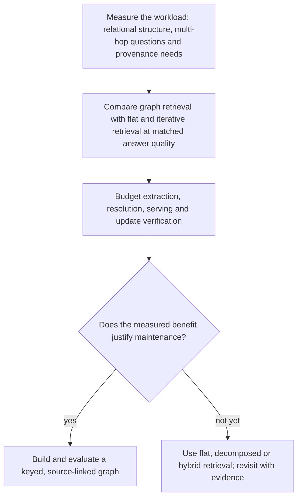
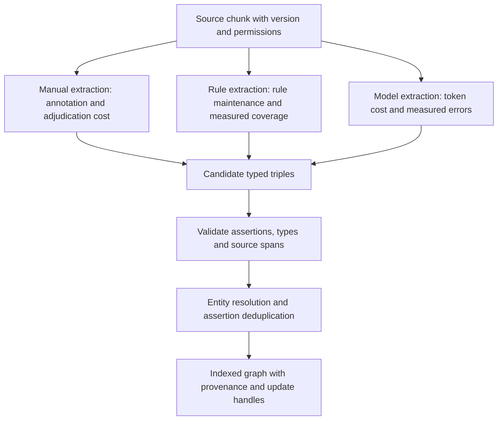
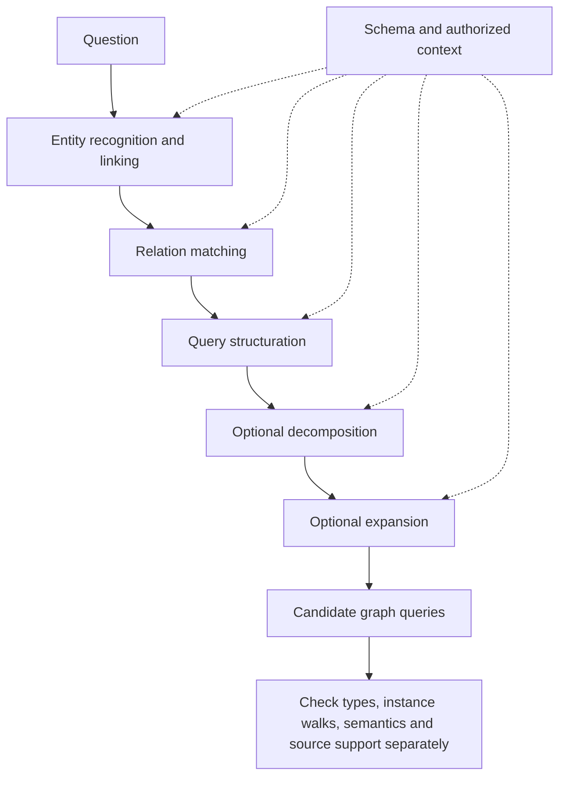
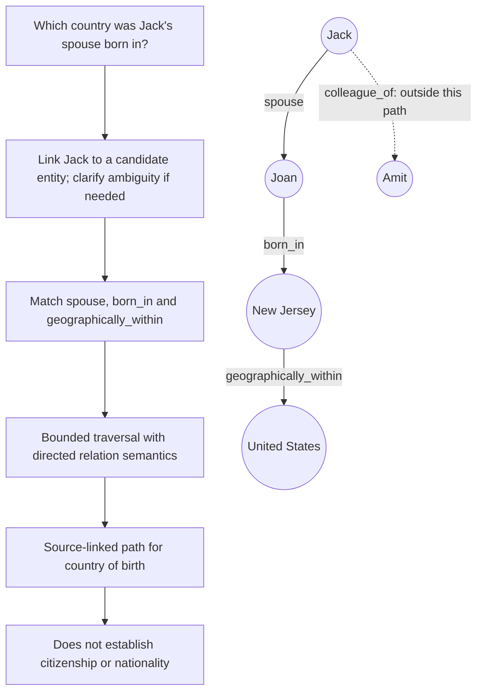
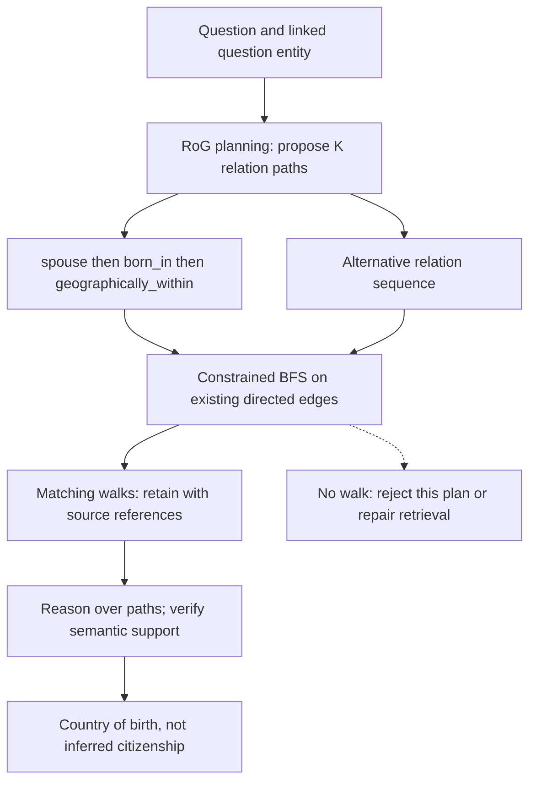
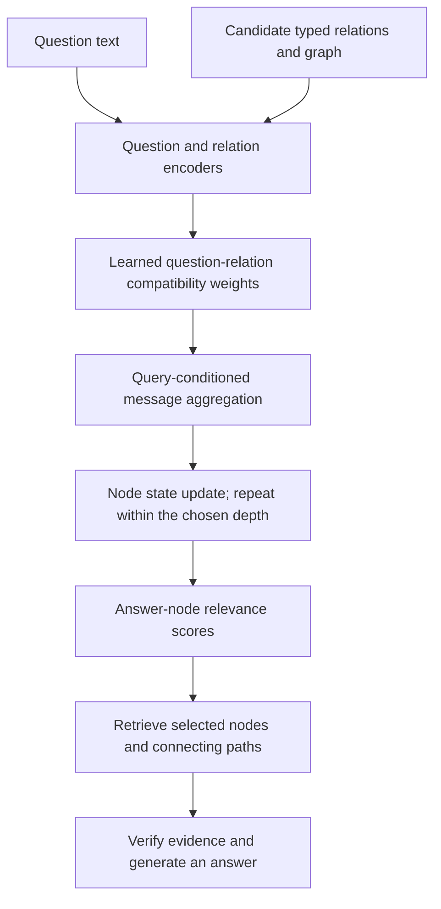
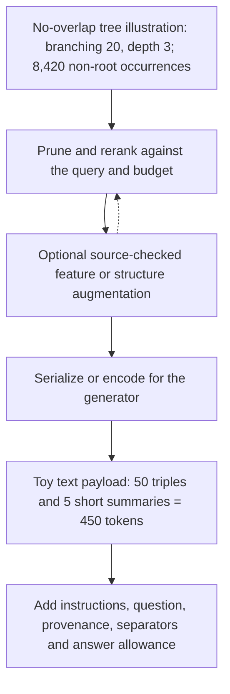
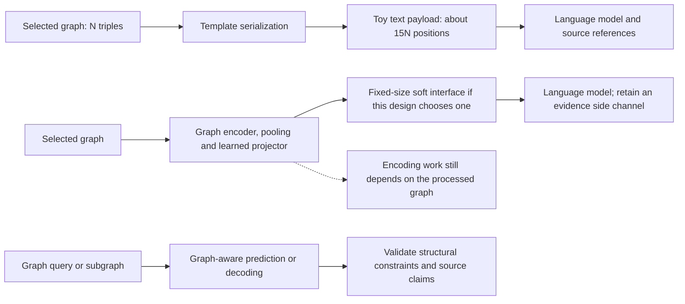
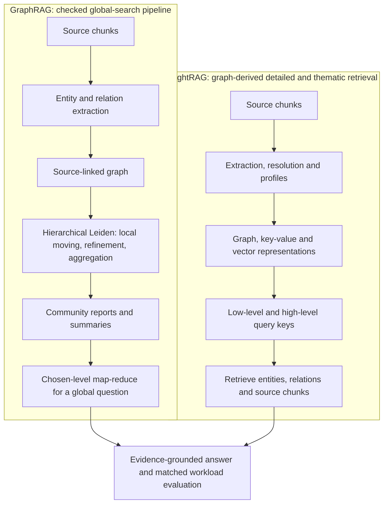

# Chapter 40: Graph RAG
[00-START-HERE](../00-START-HERE.md) · [01-READING-ROUTES](../01-READING-ROUTES.md) · [39\_multimodal\_rag](39_multimodal_rag.md) · [41\_end\_to\_end\_design\_drills](41_end_to_end_design_drills.md)
This chapter develops graph-based RAG as a testable design choice: typed extraction, query grounding, bounded retrieval, learned matching, organization, generation and summary-based search. A valid walk is evidence of graph connectivity, not automatically a valid inference or a true source claim.
## TL;DR
- Prefer the simplest system that meets the workload. Multi-hop structure, reusable relation types and maintainable provenance are useful graph-build gates, not necessary conditions for every legitimate graph use.
- Account for extraction, entity resolution, merges, indexing and recurring updates. Keep typed edges tied to source evidence; neither a valid schema nor a connected walk proves the intended claim.
- Recognition, linking, relation matching, decomposition, expansion and executable-query construction can share schema constraints. Five boxes are a design decomposition, not a universal fixed sequence.
- Bound traversal by query semantics, resources and evidence recall. Count intermediate levels as well as frontier leaves, and distinguish reverse search from reversing a relation's meaning.
- RoG plans relation paths then grounds them. ToG maintains a pruned beam; exponential unpruned-tree call counts are not its published fixed-width complexity.
- Learned graph retrieval still performs query-conditioned inference and can fail under shift. Its receptive field is generally up to its local layer depth, not exactly that many hops. Route unions are options to evaluate, not guarantees.
- Organize and verify sufficient source-backed evidence. Dense GNN transforms, dangling PageRank mass and all prompt overhead remain part of the bill. GraphRAG global summaries and LightRAG dual-level retrieval have different design emphases, without universal point/global dominance or free updates.
## The story
Think of the system as a rail network built for questions.
Flat retrieval is a shelf of timetables. It may return disconnected facts, or an iterative reader may join the right facts successfully. Compare that baseline before paying to maintain an explicit track map.
A graph is the track map. Entities are stations and typed relations are named tracks. A real route proves that tracks connect; it does not prove that a birthplace track means citizenship, or that an extracted track is true today.
First ask whether explicit links, constraints, repeated joins or provenance justify construction. Multi-hop demand and reusable relations are useful gates, but an existing graph or a single-hop audit requirement can also matter. If maintenance is unaffordable, narrow the scope, keep an incremental flat path or abstain rather than accept unsupported answers.
Construction lays candidate rails. Manual review, rules and LLMs have different costs and errors; none has a universal precision/recall ranking. Resolve entities, validate edge semantics and retain the source of each assertion. New evidence can change existing profiles, not merely append a disconnected track.
The query processor recognizes possible stations and relations, links them to the schema, plans variables and hops and expands aliases where needed. Schema and entity context can constrain every stage. One structured call can share input, but its proposed route still needs type, permission and instance validation.
A dispatcher can search from one anchor or from two endpoints using forward edges and reverse adjacency. Two-anchor search can save work when the query shape permits it; it is not always better with asymmetric degrees or extra constraints. Track visited states and a budget, rather than treating average branching as an exact count.
RoG proposes relation sequences and grounds them from linked question entities. Paths with no matching walk provide no graph evidence. Valid walks can still be irrelevant or support only a different conclusion, so the final reader and source checks remain necessary.
GNN-RAG learns how question and relation features should affect graph messages, then runs that matching at query time. Irrelevant messages need not decay automatically. Symbolic paths, multiple learned retrievers or flat evidence can be combined if their added recall justifies their cost; none guarantees coverage under shift.
The organizer is the switching yard. It removes excess cars, orders the useful ones, adds missing labels, and converts the consist into text or embeddings the generator can consume.
Verbalization pays text positions for selected facts. A learned pooling/projector can use a fixed soft-prompt interface, while its graph encoding still grows with the processed graph and may lose detail. A graph-shaped output also needs structural validation; keeping a graph format is not a guarantee of validity.
GraphRAG builds community summaries for global sense-making, while LightRAG retrieves with detailed and thematic keys over graph-derived information. Both need extraction quality, provenance and update discipline. Choose by matched workload evaluation rather than an architectural promise that one always wins.
## Decoder table


| Term | Decode | Why it matters |
| --- | --- | --- |
| Retrieval-Augmented Generation (RAG) | Generation conditioned on externally retrieved evidence | Measure retrieval and generation separately and together |
| Knowledge graph | A source-linked collection of entities and typed assertions | Connectivity is not automatically entailment or truth |
| Graph | $`G=(V,\mathcal R,E)`$ | Specify direction, multiplicity, provenance and permissions |
| Node set | $`V`$ contains entity nodes | A mention and a resolved entity are different objects |
| Relation vocabulary | $`\mathcal R`$ contains edge types | Labels need defined semantics, not just matching names |
| Edge set | $`E\subseteq V\times\mathcal R\times V`$ in the basic typed model | Separate repeated source assertions when provenance matters |
| Triple | $`(h,r,t)`$: head entity, relation, tail entity | A candidate triple needs source verification |
| Typed edge | A directed assertion with a named relation | Direction and relation meaning constrain valid paths |
| Graph-shaped domain | A workload with useful entities and relations | A graph can still lose to iterative flat retrieval |
| Recurring relation | A relation used across enough questions to justify tooling | Recurrence is a planning heuristic, not a formal necessity |
| Graph-build gate | Workload benefit, relational structure and maintenance budget | These are design tests, not necessary-and-sufficient conditions |
| Adjacency matrix | A matrix of node-to-node connectivity or typed values | The $`2.8125\,\mathrm{GB}`$ toy is binary and untyped |
| Edge list | A representation listing the stored edges | Triple payload is not a complete indexed graph footprint |
| Entity resolution | Deciding which mentions refer to the same entity | Source, time and identifier conflicts require adjudication |
| Assertion deduplication | Merging repeated assertions without losing provenance | The same relation label does not make two facts duplicates |
| Gleaning | A follow-up extraction pass for missed information | A second pass need not have the same billed token workload |
| Explicit graph format | A defined representation of nodes, typed edges and attributes | Choose a format that supports validation and updates |
| Schema | Entity types, relation types and allowed combinations | Schema-valid output need not match an instance walk |
| Entity recognition and linking | Find mentions and map them to candidate nodes | Ambiguity can require relinking or clarification |
| Relation extraction and matching | Map source or question phrases to typed relations | Do not substitute birthplace for nationality |
| Query structuration | Express a question in a structured query form | Check syntax, types, permissions and meaning |
| Query decomposition | Break a question into dependent retrieval subqueries | The dependency order and evidence chain must remain valid |
| Query expansion | Add useful terms or relation candidates | Expansion can introduce noise and unsupported assumptions |
| Grounded decomposition | A schema-aware decomposition checked against graph instances | Type compatibility alone is weaker than instance grounding |
| Entity linking | Resolve a query mention to graph node candidates | A wrong anchor can propagate or be repaired |
| Relation matching | Choose relations that express the requested meaning | An existing path need not answer that meaning |
| Breadth-first search (BFS) | Traverse successive levels within a finite budget | Count visited edges and intermediate levels, not only leaves |
| Bidirectional search | Search from two anchors with valid reverse adjacency | Reverse traversal does not reverse relation semantics |
| Branching factor | $`b`$: a no-overlap-tree planning parameter | Real graph degree, overlap and filtering change work |
| Search depth | $`h`$: the allowed path length | A hop cap can truncate legitimate evidence |
| Plan count | $`K`$: the number of candidate relation paths | More plans can add search, sequence and token cost |
| Reasoning on Graphs (RoG) | Plan relation paths, ground walks, then reason | Two batched request stages do not imply constant total cost |
| Think-on-Graph (ToG) | Iterative relation/entity search and globally bounded path pruning | Published call bound is $`2wh+h+1`$, not an expanding-tree sum |
| Constrained BFS | Traverse only edges matching a proposed relation sequence | Rejecting one empty plan does not prove real-world absence |
| Planning | Propose relation sequences or retrieval actions | Plans require grounding and may need repair |
| Reasoning | Use retrieved evidence to derive a supported answer | Separate valid inference from plausible narrative |
| GNN-RAG | Question-conditioned learned graph retrieval | Encoding and message passing still run at query time |
| Candidate relevance | Learned answer-node scoring | Intermediate states need not be calibrated probabilities |
| Relation compatibility | $`\omega(q,r)`$: learned question-relation matching | Weights need not sum to one or suppress every irrelevant edge |
| Graph message | $`\mathbf m_v^{(\ell)}`$: aggregated incoming information | Separate aggregation arithmetic from dense transformations |
| Message-passing depth | $`L`$ local layers reach at most $`L`$ hops | Skip/self paths retain nearer information; global attention changes scope |
| Oversmoothing | Node representations can become less distinguishable | Depth, topology and the chosen architecture affect the risk |
| Learned-symbolic union | Combine candidates from learned and symbolic routes | Added recall and added cost are empirical, not guaranteed |
| Organizer | Optional evidence pruning, ranking, augmentation and formatting | Functions may be interleaved rather than a fixed pipeline |
| Semantic pruning | Remove candidates using question relevance | Measure evidence recall after pruning |
| Structural pruning | Select evidence using topology or graph scores | Topology alone does not establish relevance or truth |
| Syntactic pruning | Use type or structural constraints to remove candidates | Valid syntax does not validate the source assertion |
| Dynamic pruning | Change selection as evidence or budgets evolve | Reevaluate after augmentation changes the candidate set |
| PageRank | A damped walk with teleportation and explicit dangling redistribution | Teleportation alone does not restore leaked dangling-node mass |
| Teleportation | A restart distribution with total mass $`1`$ | State the distribution and damping parameter |
| Reranking | Order candidates using a more selective scorer | Count inference cost and evaluate retained evidence quality |
| Feature augmentation | Add attributes or summaries to existing nodes | New text needs source checks and versioned provenance |
| Structure augmentation | Add or revise graph assertions | Track sources and make derived edges reversible |
| Verbalization | Serialize selected graph evidence as text | Token count grows with selected assertions and metadata |
| Projector | Map graph representations into a model input space | Soft positions are not lossless or free information |
| Embedding fusion | Condition generation on learned graph representations | A fixed interface does not fix graph-encoding work |
| Discriminative prediction | Score or classify graph candidates | A label head can coexist with explanatory generation |
| Graph-native output | Predict or decode graph-structured objects | Validate syntax, constraints and source claims |
| GraphRAG global search | Use community reports for global questions | Do not generalize one global pipeline to every GraphRAG mode |
| Leiden | Local moving, refinement and aggregation | Objective and resolution matter; not guaranteed global optimality |
| Modularity | $`Q_{\mathrm{mod}}`$: observed within-group edges versus a null model | The chapter’s formula is undirected with resolution $`1`$ |
| Map-reduce over reports | Combine community-level responses into an answer | Include report selection, context budgets and factual checks |
| LightRAG | Graph-derived profiles, vectors, dual-level keys and source chunks | No matching community hierarchy does not mean no indexing cost |
| Low-level keys | Detailed query cues, often entities or local relations | They are not an exclusive point-query guarantee |
| High-level keys | Thematic query cues | They can support broader retrieval without proving global completeness |
| Sense-making query | Ask for broad themes or connections across a corpus | Evaluate coverage and factual support, not preference alone |
| Point query | Ask for a specific verifiable fact | Either architecture needs workload-specific evaluation |


## Core mechanics
### Mathematical conventions
Storage uses decimal units: $`1\,\mathrm{MB}=10^6\,\mathrm B`$ and $`1\,\mathrm{GB}=10^9\,\mathrm B`$. A bit-packed binary matrix, a typed-triple payload and a complete indexed graph store different information; state their scope before taking a ratio. Identifier payload estimates omit aliases, properties, provenance, indexes, allocation and replicas.
All price/timing examples are stipulated workloads, not current quotes or replicated measurements. Keep intermediate precision. A repeated extraction pass doubles cost only if it repeats the same billed input/output workload. Call count, generated sequences, tokens, sequential rounds, latency and throughput are distinct quantities.
Let $`G=(V,\mathcal R,E)`$ with typed directed edges $`E\subseteq V\times\mathcal R\times V`$. An edge needs direction, meaning, provenance, time and access scope. Schema-valid labels do not establish an instantiated walk, and an instantiated walk does not by itself license the requested conclusion. Missing edges do not prove false real-world facts in an incomplete graph.
Tree branching estimates assume stipulated branching and no overlap; finite graph BFS with visited-state tracking is bounded by the explored vertices/edges. Fixed-width beam search is not an unpruned branching tree. The GNN arithmetic separates weighted aggregation, dense transforms and other model work; one scalar multiply-add is conventionally two FLOPs, not two multiply-adds.
PageRank below explicitly handles dangling mass. Modularity below uses an unweighted undirected projection at resolution one, not the original directed relation tensor. Leiden's connectivity guarantees concern its algorithm and objective assumptions, not truth of communities or a global modularity optimum. Evidence-removal ablations test dependence under a declared policy, not a logically decisive detector of parametric memory.
### 40.1 When a graph earns its place, and when it does not
#### What
Let $`V`$ be entity nodes, $`\mathcal R`$ relation labels and $`E`$ typed directed edges. A simple triple set omits qualifiers unless they are stored separately.

```math
G=(V,\mathcal R,E),\qquad E\subseteq V\times\mathcal R\times V.
```

Use three workload/economic questions as a starting build gate, not a theorem that a graph is justified only for multi-hop QA:
1. Do explicit joins, paths, constraints or source-linked relations improve the task beyond a simpler baseline?
2. Are relation meanings and identifiers stable enough to reuse and audit?
3. Can construction, corrections, deletion propagation and query-time access checks meet the budget and freshness requirement?
A negative answer favors a simpler, narrower or hybrid design. Dense/BM25 retrieval, iterative decomposition, SQL joins over existing structure and provenance metadata are alternatives. Existing graphs can be useful without new prose extraction. Do not interpret a rejected graph build as permission to return fragmented unsupported multi-hop answers.
#### Why
A basic dense retriever scores chunks without enforcing a joint path. A later retriever/reader can still assemble connected evidence. Graph traversal makes encoded reachability directly checkable; compare its task value at matched source access, compute and evidence budgets.
Reusable relations can amortize construction, but explicit provenance, constraints or an existing structured source can justify a graph without many repeated multi-hop questions. Named entities alone are not sufficient evidence of value.
Different relation systems and degree distributions need different traversal, community and learned-retrieval settings. Airport or citation networks are examples, not a guarantee of one topology in every dataset. Audit hub degree, direction, qualifiers and source coverage before reusing a radius or community resolution.
#### Failure without it
Building immediately after one multi-hop miss can spend heavily on a capability that iterative retrieval already fixes.
An undifferentiated related-to edge can reduce semantic selectivity, but co-occurrence/proximity graphs can still be useful for some tasks. Name the edge semantics rather than calling all such topology meaningless. Never treat proximity alone as a licensed causal, citizenship or clinical relation.
#### Cost and complexity
For $`10^6`$ chunks at $`300`$ tokens each, embedding processes $`3\times10^8`$ tokens. At a stipulated $`\$0.02`$ per million tokens, the token-only bill is $`\$6`$, excluding indexing and all operating overhead.
A separate hypothetical graph extractor processes $`450`$ input and $`100`$ output tokens/chunk, billed at $`\$3`$ and $`\$15`$ per million tokens respectively:

```math
C_{\mathrm{extract}}=10^6\!\left(450\frac{\$3}{10^6}+100\frac{\$15}{10^6}\right)=\$1{,}350+\$1{,}500=\$2{,}850.
```

The extraction/embedding token-bill ratio is $`2{,}850/6=475`$. If $`5\%`$ of chunks change monthly and unchanged chunks can safely be reused, $`50{,}000`$ changes cost $`\$0.30`$ to re-embed or $`\$142.50`$ to re-extract under the same token assumptions. Resolution, profile recomputation, indexing, deletion and downstream summaries may have a wider update footprint.
#### Decisions, ablation, and claim limit
Compare against iterative/decomposed flat retrieval at matched quality and source coverage. A recurrent typed-relationship benefit is a reason to continue, not proof that every graph component is useful. Ablate extraction, path enforcement and reader evidence separately.
Scope extraction to high-value relation meanings and preserve assertion provenance. The token bill depends on processed input and produced output, not a universal fixed price per triple. Corrections, entity merges and summary invalidation make it recurring work.
The $`\$2{,}850`$, $`\$6`$ and $`475`$ ratio compare constructed token workloads, not provider benchmarks. A six-hour rebuild can fit some same-day deadlines; it cannot fit a one-hour target if that complete rebuild is required before serving the change. Check queue time plus rebuild plus verification against the actual deadline, and distinguish immediate logical exclusion from complete physical removal.
### 40.2 Constructing the graph: extraction, cost, and quality
#### What
Prose extraction proposes triples $`(h,r,t)`$, while entity resolution, qualifiers, provenance and deduplication decide which assertions are stored. Deletion needs source-to-assertion backreferences; a triple supported by several sources must not be erased merely because one support disappears.
Three extraction paths place cost differently.
- Manual annotation can offer careful review but has disagreement, throughput and coverage limits; measure its quality rather than assuming perfection.
- Rules can be efficient and reproducible for a stable pattern/schema, with coverage and parsing limitations. CPU runtime and operating cost depend on workload; deterministic rules are not universally millisecond or zero-cost.
- LLM extraction can cover varied phrasing but can miss, merge or invent facts. Compare precision/recall, qualifiers, provenance and uncertainty on representative held-out data rather than asserting a universal recall advantage.
Explicit citations, foreign keys and validated SMILES can often be parsed without an LLM prose extractor. Parsing, identifier mapping and domain validation are still required. Valid syntax does not prove a molecular structure or cited claim is correct.
#### Why
Extraction and resolution determine available paths. Duplicate entities can split a path, while an incorrect merge can create false joins. Retain source versions, confidence/validation status and time/permission qualifiers so a structurally valid path can be checked for the intended claim.
For $`|V|=150{,}000`$ and $`|E|=500{,}000`$, a binary directed adjacency matrix with one bit per ordered pair, including diagonal cells, has:

```math
|V|^2=22{,}500{,}000{,}000\,\mathrm{bits}=2{,}812{,}500{,}000\,\mathrm B=2.8125\,\mathrm{GB}.
```

For a different information scope, storing each typed triple as three four-byte IDs gives the payload:

```math
500{,}000\times3\times4\,\mathrm B=6{,}000{,}000\,\mathrm B=6\,\mathrm{MB}.
```

The payload ratio is exactly $`2{,}812.5/6=468.75`$. The one-bit matrix stores only existence of some connection, not relation identity or multiple types; a relation-specific matrix needs additional storage. The triple payload omits node labels, attributes, adjacency indexes, qualifiers, provenance and replicas. It is a sparsity illustration, not a complete equivalent-feature memory comparison. Practical sparse topology uses on the order of $`|V|+|E|`$ identifiers, with representation-specific overhead.
#### Failure without it
All extraction strategies can fail. Manual work can scale with substantial staffing and cost; rules can work well in stable domains; unchecked LLM outputs can create noisy topology. Choose and audit the blend against precision, recall, correction effort and operational risk.
Exhaustive comparison of $`n`$ entity records takes $`n(n-1)/2`$ unordered pairs. Blocking, aliases, lexical keys or approximate embedding candidates can reduce work, at a possible missed-merge cost. No universal few-thousand-entity threshold or mandatory embedding blocker follows from the quadratic expression.
#### Cost and complexity
For a separate price scenario, use $`50{,}000`$ chunks of $`400`$ source tokens plus $`180`$ prompt tokens. Six triples at a stipulated total of $`14`$ serialized tokens each yield $`84`$ output tokens, including all output syntax only by assumption. At $`\$0.15`$ per million input and $`\$0.60`$ per million output:

```math
C_{\mathrm{chunk}}=580\frac{\$0.15}{10^6}+84\frac{\$0.60}{10^6}=\$0.0001374.
```

One pass costs $`50{,}000(\$0.0001374)=\$6.87`$. A second gleaning pass costs the same only if its billed input and output are identical; under that explicit toy, total is $`\$13.74`$. Real follow-up prompts may include prior extraction, extra checks and different output lengths. Gleaning need not always improve recall or preserve precision.
Six triples/chunk give $`300{,}000`$ raw triples and $`600{,}000`$ head/tail occurrences counted with multiplicity, not automatically $`300{,}000`$ entity mentions. If they resolve to $`150{,}000`$ unique entities, the occurrence-to-entity ratio is $`4{:}1`$. A separately measured $`300{,}000`$ mention-record count would have a $`2{:}1`$ ratio, but is not implied by the triple count. Embedding a $`400`$-token chunk at $`\$0.02`$ per million costs $`\$0.000008`$: single-pass extraction is $`17.175`$ times that, two equal passes $`34.35`$ times.
At $`5\%`$ weekly changed chunks, the same two-pass token toy processes $`2{,}500`$ chunks for $`\$0.687\approx\$0.69`$. A full $`\$13.74`$ extraction is exactly $`20`$ times this local token bill before rounding. Neither includes entity resolution, profile/summary invalidation, embeddings, storage, verification or global updates.
#### Decisions, ablation, and claim limit
Select manual, rule, LLM and explicit-parser paths by measured workload quality and risk. One LLM gleaning pass is an option, not a universal default; legal/clinical domains still require appropriately qualified validation and source evidence. Use safeguards for unsupported edges and ambiguous entity merges.
Use representative labeled examples to estimate precision, recall, qualifier errors and merge/split rates with uncertainty. A system at $`95\%`$ precision can still have inadequate recall; the reverse also matters. A few hundred items is a planning choice, not a coverage guarantee for rare high-stakes relations.
Incremental extraction plus scheduled resolution/community maintenance is one design. Track every affected entity, assertion, profile, summary and permission state. Additions, corrections and erasure are different operations; the same local-update assumption need not hold for all three.
### 40.3 Query processing: five sub-processes and grounded decomposition
#### What
A query processor proposes grounded query variables and constraints using the question, schema, entity candidates and graph-access policy. A schema is a vocabulary/type system, not the full instantiated graph.

```math
\widehat{\mathcal Q}=\Omega(q,\mathcal S,\mathcal A),
```

where $`\mathcal S`$ is the schema and $`\mathcal A`$ the permitted entity/context information. Recognition, relation-intent extraction, query construction, decomposition and expansion are five useful functions; their order, combination and necessity vary by task.
Recognition/extraction can be open-ended or schema-constrained. Entity linking, allowed relation labels, direction, argument types and access restrictions can help early stages as well as decomposition/expansion. Do not claim that only the last three functions ever consult the graph.
Executable output may be SPARQL for an RDF store or Cypher for a property graph. “Which novels were written by the author of 1984?” binds the book, finds its author and joins to authored works, with types and inverse direction declared. Apple/AAPL aliases can help entity linking, but an alias alone does not decide the intended company or validate a market-capitalization fact. Validate syntax, types, parameters and read permissions before execution.
#### Why
Schema-valid planning prevents out-of-vocabulary types/labels when constraints are enforced. It does not guarantee that any instantiated path exists or that the path answers the question. A graph can lack a true fact; distinguish syntax/type failure, empty search, budget truncation and genuine evidence support.
An empty response may mean invalid labels, a wrong link, missing data, permission filtering, ANN/pruning limits or no matching stored fact. Do not collapse these into a proof that the real-world fact is false.
An ambiguous acronym can produce the wrong anchor. Candidate reranking, clarification, relinking or multi-anchor search can repair it; traversal from one frozen wrong anchor cannot guarantee recovery. Evaluate linking separately and propagate its uncertainty.
#### Failure without it
Aliases, decomposition and structured query construction are useful ways to expose errors, not logically mandatory separate model calls. Some systems directly execute an unambiguous query or retrieve the right label without expansion. Treat a schema-valid but empty invented route as missing support, not permission to present parametric memory as retrieved evidence.
#### Cost and complexity
The timing/price proxy assumes $`600`$ schema tokens, $`50`$ question/intermediate tokens per schema-aware call, $`60`$ output tokens per function, $`\$0.15`$/million input, $`\$0.60`$/million output, $`80`$ decoded tokens/second and $`300\,\mathrm{ms}`$ fixed overhead/call. It ignores prefill differences, queues, retries and validation.
Three serial calls each consume $`650`$ input and $`60`$ output tokens, for $`1{,}950`$ input, $`180`$ output and $`\$0.0004005`$. The proxy duration is $`3(0.3)+180/80=3.15\,\mathrm s=3{,}150\,\mathrm{ms}`$.
One structured call reuses one $`650`$-token input and emits the same total $`180`$ output tokens. It costs $`\$0.0002055`$ and takes $`0.3+180/80=2.55\,\mathrm s=2{,}550\,\mathrm{ms}`$ under that proxy. The combined output length and quality are assumptions to test.
Cost falls by approximately $`48.689139\%`$ and proxy latency by $`19.047619\%`$, calculated before rounding. Decoder work is unchanged; two fixed overheads and duplicated schema input are removed. A graph/ANN lookup is not universally tens of milliseconds, so no fixed orders-of-magnitude bottleneck follows without measuring the deployed pipeline.
#### Decisions, ablation, and claim limit
Consider one structured call for related functions when shared schema input is large. Keep auditable fields and validate labels, variable bindings, temporal meaning and permissions. Consolidation can change quality and error coupling; compare against the serial baseline rather than assuming equivalence.
Use components matched to ambiguity and risk, bound expansion and allow clarification. The $`2.55\,\mathrm s`$ deterministic timing toy does not establish a measured $`p_{95}`$. If that duration applies to the latency target, it exceeds $`300\,\mathrm{ms}`$ and needs a different design, caching or asynchronous workflow; a mean/proxy is not a tail-latency bound.
The numerical example compares three schema-aware calls with one, not all five functions against one. Its savings arise from shared inputs and fixed overhead; measure prefill, decode, validation, errors, retries and tail latency before calling them production savings.
### 40.4 Heuristic retrieval: linking, matching, traversal
#### What
Heuristic graph retrieval has three separable steps.
1. Link one or more entity mentions to candidate anchor nodes, retaining ambiguity.
2. Match intended relations, directions, types and qualifiers to the stored schema.
3. Execute a bounded, permission-aware traversal and return sufficient source-linked paths, with truncation status.
For “Which country was Jack’s spouse born in?”, a toy path can join Jack to Joan via spouse, Joan to New Jersey via born-in, and New Jersey to the United States via geographic containment. This supports country of birth under those stipulated meanings. It does not establish nationality or citizenship: those need a citizen-of/nationality assertion or a separately justified rule. Mapping nationality to born-in/state-of is a semantic error even when the walk is connected.
Relation descriptions can improve paraphrase matching, but measure them against aliases and literal labels. Keep several candidates when warranted; a path that merely connects is not necessarily the correct relation interpretation. Respect relation direction, argument types, time and source credibility.
#### Why
Typed traversal enforces encoded reachability; it does not prove source truth or a valid conclusion. Flat retrieval plus a reader/query engine can also join the right assertions. Compare evidence sufficiency and relation semantics rather than treating connectivity as the only source of accuracy.
For an appropriate two-endpoint path query, search forward from one anchor and over predecessor adjacency from the other, meeting on compatible states. Reverse adjacency is a computational device, not permission to reverse relation meaning. Direction, type sequence and qualifiers may need to be part of the search state. Asymmetric degrees can erase the expected savings; one-anchor queries and many-endpoint joins have different search shapes.
#### Failure without it
Wrong links, relation mismatches, absent or false edges, permission filters and budget truncation can all prevent an answer. Increasing depth cannot repair every such failure. A connected path using the wrong semantics can be worse than an explicit “insufficient evidence.”
A three- or four-hop cap is a workload/resource heuristic, not proof that longer questions are planning failures. Some legitimate dependency chains need more hops. Use measured path recall, graph degrees and resource budgets, and report truncation or decompose when appropriate.
#### Cost and complexity
Under a roughly regular, nonoverlapping $`b`$-ary tree, deepest frontiers scale as $`b^h`$; complete visited levels sum $`1+b+\cdots+b^h`$. Balanced two-ended tree work is on the order of $`b^{\lceil h/2\rceil}+b^{\lfloor h/2\rfloor}`$. This is not an exact count for arbitrary average degree. Finite BFS with visited-state tracking costs $`O(|V_{\mathrm{seen}}|+|E_{\mathrm{examined}}|)`$; enumerating many walks may cost more than finding reachability.
For a no-overlap toy with $`b=12`$ and depth three, the single-source final frontier and all visited levels are:

```math
12^3=1{,}728,\qquad1+12+12^2+12^3=1{,}885.
```

Expanding both sides to depth two gives final-frontier counts and total visits, counting each side’s root:

```math
2(12^2)=288,\qquad2(1+12+12^2)=314.
```

The original $`288/1{,}728=1/6`$ compares only final frontiers, an $`83.333333\%`$ reduction, not the total touched-node count. The complete-level proxy gives $`314/1{,}885`$ and about $`83.342175\%`$ fewer visits. For an odd length-three path, depths one and two are sufficient in the ideal compatible-state case: $`(1+12)+(1+12+12^2)=170`$ visits, about $`90.981432\%`$ fewer. Overlap, early stopping, degree asymmetry, reverse access and constraints change actual work.
The chapter uses KG-GPT as an example of decomposing relation questions and matching labels with an LLM. A proxy of $`h+2`$ calls assumes one call per hop plus two fixed calls; it is not an architecture-independent lower bound. Linking, batching, schema size, retries and the implementation can change both calls and latency.
#### Decisions, ablation, and claim limit
Alias tables, entity reranking and relation-description embeddings are options. Roughly $`20`$ versus $`1{,}000`$ relation types are illustrative operating regimes, not universal thresholds for rules or LLMs. Tune ambiguity margins on labeled data; a small score gap is not a calibrated error probability.
Consider bidirectional search when two anchored endpoints and relation semantics permit it, with compatible reverse indexes and a budget. Use other path/join strategies for fan-out or multi-anchor questions. Ranked frontier pruning can improve efficiency but can also exclude a valid path; measure that recall cost.
Hold source coverage and candidate budget fixed when comparing traversal with flat retrieved triples. Disconnection identifies a candidate evidence-assembly issue, not proof that embeddings were adequate or uniquely responsible. Test link accuracy, relation semantics and the downstream join/reader separately.
### 40.5 Knowledge graphs as reasoning sources
#### What
Ground graph evidence by checking each asserted edge, its source, direction and qualifiers. Some valid conclusions require joins, constraints or arithmetic rather than one edge per natural-language inference step. A real walk can still be irrelevant, outdated or semantically insufficient; grounding reduces one hallucination channel, not every error.
A made-up intermediate entity or geographic edge is unsupported. A subtler failure uses only real birthplace/containment edges and calls the answer citizenship. Both the existence of the walk and the meaning of the requested conclusion must be checked.
RoG fine-tunes a planner to propose ordered relation paths, uses constrained BFS from question entities to retrieve matching entity walks, then prompts a reasoning model with those walks. It can provide interpretable supporting paths, but the presence of a walk does not guarantee answer correctness, source truth or reliable citation.[\[1\]](https://arxiv.org/html/2310.01061v2)
RoG training uses shortest relation paths between question and answer entities. This supplies path supervision drawn from the graph; it does not logically prevent an unconstrained generative model from emitting an invalid label or impossible combination. Validate or constrain proposals and ground their instances. The paper uses top-$`3`$ plans as an empirical trade-off, not a universal optimum.[\[1\]](https://arxiv.org/html/2310.01061v2)
#### Why
Relation names such as `born_in`, `located_in`, and `citizen_of` can sound similar while licensing different facts. Fluent free text does not reveal whether a hop exists.
A fully executed constrained search returns no path when the specified walk is absent from the searched permitted graph. Missing data, wrong anchors, resource caps and policy filters remain distinct reasons. A revised plan can be attempted safely if it is validated and grounded again; another model call does not inherently defeat grounding.
ToG instead maintains top-width reasoning paths and repeatedly prunes candidate relations and entities using an LLM, with intermediate answer-sufficiency evaluations. It sees local entity context, at inference-time cost. A globally pruned beam has different growth from expanding every branch forever.[\[2\]](https://arxiv.org/html/2307.07697v6)
#### Failure without it
A false intermediate entity invalidates the dependent inference chain, even if later statements happen to be true independently. A fluent narrative is not evidence that a valid source-supported walk exists.
Ungrounded free-form repair is risky, but grounded retry, relinking, clarification or searching a different allowed relation can be legitimate. Record failed plans, candidate limits and what new evidence caused a repair. Do not label a repaired assertion graph-supported until its support is checked.
#### Cost and complexity
Distinguish an unpruned tree with $`w`$ children per expanded node from a search that retains only $`w`$ paths globally. In the first toy, one model call at every internal node over $`h`$ expansion levels gives:

```math
C_{\mathrm{tree,expand}}=\sum_{j=0}^{h-1}w^j=
\begin{cases}(w^h-1)/(w-1),&w\ne1,\\h,&w=1.\end{cases}
```

At $`w=3`$, the unpruned toy has $`4`$ expansion calls at two hops or $`40`$ at four hops, then one final answer call: $`5`$ and $`41`$. They are not published ToG fixed-beam call counts. A simpler fixed-beam toy with one initial expansion and at most $`w`$ expansions per later level instead has at most $`1+w(h-1)+1`$ total calls, giving $`5`$ and $`11`$. ToG v6 actually includes two pruning stages and per-depth evaluation; its stated upper bound is $`2wh+h+1`$, giving $`15`$ and $`29`$ for these widths/depths. Early stopping and batching change realized calls and sequential rounds.[\[2\]](https://arxiv.org/html/2307.07697v6)
RoG has a planning-generation stage, graph search and answer generation. A single batched top-$`K`$ planning request plus one answer request can be counted as two model requests; beam decoding still produces multiple sequences and consumes tokens/compute. Grounding is not an LLM call, but is not free and can grow with depth/branching. Long retrieved paths, truncation or multiple reasoning requests can break a fixed two-request implementation.[\[1\]](https://arxiv.org/html/2310.01061v2)
At an artificial common $`\$0.002`$ per model request, the unpruned-tree totals cost $`\$0.010`$ and $`\$0.082`$ against a two-request $`\$0.004`$ proxy: ratios $`2.5`$ and $`20.5`$. The simplified fixed-beam four-hop proxy is $`\$0.022`$, ratio $`5.5`$; the ToG stated bounds would imply at most $`\$0.030`$ and $`\$0.058`$ under that same equal-price assumption, not measured charges. Real planning, pruning and reasoning calls have different lengths and prices, so none is an empirical ToG/RoG cost comparison.
#### Decisions, ablation, and claim limit
Compare plan-then-ground with hopwise selection on the actual ambiguity, relation sequence, neighborhood size and missing-edge pattern. Uncertain depth alone does not establish one winner. A shallow graph with large fan-out can still be expensive or ambiguous.
Tune $`K`$ using answer/path coverage, irrelevant paths, grounding failures, tokens and time. More plans can improve recall but also add search and decoding work, even inside one batched request. A wider beam cannot create a missing supporting edge. Neither no-grounded-path nor high model confidence alone establishes truth or completeness.
Remove a proposed load-bearing edge/path and compare answer, support, citations and abstention under a declared evidence-only policy. If redundant valid evidence remains, a supported answer need not change. If all adequate support is withheld but the same confident claim is still labeled retrieved, the policy failed; the unchanged answer alone does not prove which internal memory produced it. Control prompt leakage, stochasticity and alternative sources.
RoG relation planning omits some entity-neighborhood context. GNN or other retrievers can complement it, and the GNN-RAG paper evaluates unions. Such a union may add recall and noise; test each member at matched downstream budgets and keep assertion provenance. It is an option, not a universal robustness guarantee.[\[3\]](https://arxiv.org/html/2405.20139v1)
### 40.6 Learned retrieval: GNN-RAG and query-conditioned message passing
#### What
GNN-RAG trains a query-conditioned graph retriever offline, then encodes each new question and runs graph inference online. It retrieves candidate answers and paths for an LLM; it does not move all query-to-graph computation offline.[\[3\]](https://arxiv.org/html/2405.20139v1)
The paper encodes question and relation text with a shared language encoder and learned pooling. Different encoders, including its SBERT and relation-matching variants, retrieve complementary paths. A schematic of these features is:[\[3\]](https://arxiv.org/html/2405.20139v1)

```math
\mathbf q^{(k)}=\gamma_k(\mathop{\mathrm{LM}}\nolimits(q)),\qquad\mathbf r=\gamma_c(\mathop{\mathrm{LM}}\nolimits(\mathop{\mathrm{label}}\nolimits(r))).
```

A representative question-relation match in the paper is a neural function of the elementwise product, not a universally required softmax over all relation labels:

```math
\omega_k(q,r)=\phi(\mathbf q^{(k)}\odot\mathbf r).
```

For a compatible local GNN, aggregate messages over permitted incident edges, with direction handled by the chosen relation representation. One schematic incoming-edge form is:

```math
\mathbf m_v^{(\ell)}=\sum_{(u,r,v)\in E_q}\omega(q,r)\,\mathbf M_{uv}^{(\ell)}.
```


```math
\mathbf h_v^{(\ell+1)}=\psi_\ell(\mathbf h_v^{(\ell)},\mathbf m_v^{(\ell)}).
```

Here $`E_q`$ is the candidate subgraph and $`\mathbf M`$ and $`\psi`$ are architecture-specific message/update functions. After $`L`$ updates, the model scores candidate answers and extracts connecting shortest paths to linked question entities. A softmax can normalize candidate scores; normalization is not empirical probability calibration. Multiple seed indicators equal to one would be a mask, not a sum-to-one probability distribution.[\[3\]](https://arxiv.org/html/2405.20139v1)
#### Why
For a purely local one-hop-per-layer GNN with retained node features/skip paths, $`L`$ layers allow influence from nodes up to $`L`$ edges away in the candidate graph. They do not require all useful evidence to be exactly $`L`$ hops away. Global features/attention change that receptive-field statement. Unnormalized aggregation, degrees and learned transforms can amplify off-topic messages; decay is not guaranteed.
These equations state the generic query-conditioned matching and aggregation mechanism, not an exact reproduction of every GNN-RAG/ReaRev implementation. The paper uses answer-supervised node scoring and compares relation-language encoders; shortest-path extraction is a retrieval output, not a requirement that GNN training labels be shortest paths. The earlier universal head-normalization and one-seed-probability claims are not part of this schematic.[\[3\]](https://arxiv.org/html/2405.20139v1)
#### Failure without it
Sequential LLM traversal can dominate some serving paths; learned inference can reduce it but may fail under relation, entity, query or topology shift. Its speed and precision depend on candidate graph construction, encoder, hardware and batching. Neither route is automatically safer.
Over-smoothing is one possible deep-GNN failure, alongside over-squashing, oversize neighborhoods and training mismatch. More layers do not inevitably destroy every architecture. New nodes can be disruptive through features, degrees and context; new relation names may still be encoded. Compare the actual shift rather than promising a fixed precision or density ordering versus symbolic retrieval.
#### Cost and complexity
For a constructed candidate graph with $`500`$ nodes, $`2{,}000`$ directed edges (mean out-degree four), width $`d=768`$ and one scalar-weighted message per edge, count only the multiply-and-accumulate aggregation work:

```math
Ed=1{,}536{,}000\ \mathrm{MAC/layer},\qquad2Ed=3{,}072{,}000\ \mathrm{FLOP/layer}.
```

Three layers give $`4.608\times10^6`$ MACs, conventionally $`9.216\times10^6`$ FLOPs, not $`9.2`$ million multiply-adds. This excludes relation matching, multihead/relation transforms, nonlinear updates, encoder work and memory traffic. Just one $`768\times768`$ dense node transform for $`500`$ nodes costs $`294{,}912{,}000`$ MACs per layer. Kernel overhead might matter, but cannot be declared dominant from edge arithmetic alone.
The separate symbolic latency toy stipulates nine serial short calls at $`700\,\mathrm{ms}`$ each, hence $`6.3\,\mathrm s`$. “Three beam expansions across three hops” is a chosen nine-call cap, not the exact ToG implementation or a necessary sequential schedule; independent calls may be parallelized.
The learned timing toy stipulates $`50\,\mathrm{ms}`$ question encoding plus $`5\,\mathrm{ms}`$ graph inference, total $`55\,\mathrm{ms}`$. It omits candidate subgraph retrieval, path extraction, transport and answer generation. These are hypothetical timings, not measured latency proved by the FLOP count.

```math
\frac{6{,}300\,\mathrm{ms}}{55\,\mathrm{ms}}\approx114.545455.
```

This is a constructed retrieval-latency ratio under different stipulated routes. It is not automatically an end-to-end speedup or throughput ratio; concurrency, hardware occupancy, batching and the remaining pipeline change both. Count one graph batch over its actual nodes/edges, not an unpriced separate model invocation per answer candidate.
#### Decisions, ablation, and claim limit
A symbolic baseline is useful for instrumentation, not a mandatory launch sequence. Train learned retrieval when representative question-answer supervision, graph coverage and amortized cost justify it. Existing shortest-path metadata can help retrieval but does not replace validation under shift.
GNN-RAG evaluates a learned retriever alone, retrieval augmentation with RoG, and an ensemble of GNN encoders. A symbolic or dense union is not mandatory. Test added recall, extra noise, cost and downstream evidence limits, and log which route supplied each source-backed path.[\[3\]](https://arxiv.org/html/2405.20139v1)
Monitor query/data/schema drift and retrain or recalibrate when evidence warrants it, not only on schema changes or only on a calendar. Choose layer depth using measured paths and quality. Keep human-checkable paths/provenance alongside answer-node scores; shortest paths are useful candidates, not necessarily the correct semantic explanation.
Ablate each union member. If the GNN appears accurate only while the symbolic fallback supplies the hard tail, the union instrumentation should reveal that dependence.
### 40.7 Organizing: pruning, reranking, augmenting, verbalizing
#### What
An organizer can prune, rerank, augment context and serialize or project evidence. These functions can be interleaved; they need not all be present or always occur in one fixed order.
1. Bound the candidate graph while tracking support/path recall.
2. Rank sufficient evidence for the declared reader and token budget.
3. Add validated context or separately sourced assertions only when useful.
4. Serialize or project the retained evidence, preserving identifiers and verification access.
Semantic relevance, graph structure, linguistic distance and learned dynamic masks are different pruning signals. The cited QA-GNN/PipeNet/JointLK-style examples motivate these categories, not a universal five-layer pipeline or guaranteed precision. Collapsing duplicate assertions does not mean collapsing all edges with the same relation type; that would erase legitimate distinct facts.
Let $`v_i\gt 0`$ be teleport probabilities summing to one, $`0\le\alpha\lt 1`$ the link-following probability and $`d_j^{\mathrm{out}}`$ the out-degree. With dangling nodes redistributed according to $`v`$, a PageRank iteration is:

```math
\pi_i^{(t+1)}=(1-\alpha)v_i+\alpha\left[
\sum_{j:\,(j,i)\in E,\ d_j^{\mathrm{out}}\gt 0}\frac{\pi_j^{(t)}}{d_j^{\mathrm{out}}}
+v_i\sum_{j:\,d_j^{\mathrm{out}}=0}\pi_j^{(t)}\right].
```

Uniform $`v_i=1/N`$ and the conventional example $`\alpha=0.85`$ give a reusable structural score. Positive teleportation prevents closed components from permanently trapping mass under these assumptions; dangling redistribution is the explicit second sum, not something the teleport term alone fixes. Personalized $`v`$ can be query-dependent. Connectivity prominence is not answer relevance or source truth.
#### Why
A raw traversal can be large and weakly ordered. Query-aware reranking may help the reader, but candidate quality and prompt placement need measurement. A cross-encoder is one option, not a necessary condition for exposing evidence.
Feature augmentation leaves edge topology unchanged only when it changes attributes alone. Summaries can still inject incorrect content and need provenance/invalidation. Added external nodes or edges, such as ConceptNet assertions, require their own meaning, source and permission checks; they are not verified merely because the original graph lacked a connection.
Template serialization is often portable and easy to inspect. A trained projection can reduce soft-prompt positions but adds graph encoding, integration/training and attribution work; it is not universally cheaper per node or portable across incompatible base-model interfaces.
#### Failure without it
Large traversals can exceed context or bury evidence. A token-only decoder needs a serialization or a supported embedding interface, not an unparsed graph object. Ordering changes may help or harm depending on the reader; any pruning can remove the only supporting path.
#### Cost and complexity
For one illustrative iteration with uniform teleport over $`N=100`$, two inbound non-dangling neighbors at $`0.30`$ and $`0.50`$, out-degrees four and two, and zero dangling mass:

```math
\pi_i^{(t+1)}=\frac{0.15}{100}+0.85\!\left(\frac{0.30}{4}+\frac{0.50}{2}\right)=0.27775\approx0.278.
```

A distinct no-overlap branching tree with $`b=20`$ produces the following non-root edge/node occurrences through three hops:

```math
20+20^2+20^3=20+400+8{,}000=8{,}420.
```

At a stipulated seven serialized tokens per triple occurrence, that is $`58{,}940`$ tokens before the question, instructions, identifiers, output or syntax overhead. It is approximately $`7.194824`$ times an $`8{,}192`$-token window and $`1.798706`$ times a $`32{,}768`$-token window: it exceeds both, not merely leaves little room in the latter. Duplicate paths, finite graph overlap and filtering alter actual unique triples.
If pruning retains $`50`$ triples and adds five $`20`$-token node summaries, the evidence-only toy is:

```math
T_{\mathrm{evidence}}=50(7)+5(20)=450\ \mathrm{tokens}.
```

The $`450`$-token graph example and a separately stipulated $`2{,}000`$-token text funnel are different evidence budgets, not a quality-matched performance comparison. Account for instructions, source references and output headroom, and measure whether compression kept every load-bearing fact.
#### Decisions, ablation, and claim limit
Precomputed structural scores can cheaply prioritize a graph, but can over-favor hubs and miss rare query-specific evidence. Query-aware pruning may be necessary. Compare its recall/cost trade-off rather than making structural pruning a universal default.
Use degree/path estimates and hard resource budgets before choosing a scorer. The sum $`b+\cdots+b^h`$ is a tree proxy, not a general exact count from average degree. Small $`k\le5`$ can still contain ambiguous evidence that benefits from reranking; the “no middle” heuristic is not a correctness rule.
Both feature and structure augmentation can be reversible if versioned and source-linked, or hard to undo if their provenance is lost. Add validated assertions/context because they improve a task, not merely to force some plausible path to exist. Preserve the distinction between source evidence and generated summaries.
Ablate pruning, ranking, augmentation and serialization separately. Measure support/path recall, answer/support quality, unsupported additions, total tokens and actual latency. The chapter’s $`k=10`$ versus full $`128`$K example with flat measured accuracy and tripled $`p_{99}`$ is a hypothetical decision case, not a universal context law. Report sample uncertainty and hard multi-hop slices before concluding the extra context adds no value.
### 40.8 Generation: verbalize, fuse, or stay in graph space
#### What
Useful output/interface families include text generation, discriminative prediction and domain-structured generation. They can be combined; this is a taxonomy, not an exhaustive mutually exclusive classification.
- A language model may consume serialized triples, graph-derived soft vectors, text sources or a mixture and produce an explanation.
- A discriminative graph model predicts labels/scores, including node/link answers; an additional generator can explain them using source evidence.
- A domain-structured decoder emits graph/sequence output, such as a molecular representation, with explicit syntax/domain validation.
Verbalization renders selected assertions and qualifiers as text. A trained graph encoder/pool/projector can instead produce a chosen number of soft-prompt vectors in a supported LLM embedding interface. A fixed interface does not make graph encoding cost independent of graph size or guarantee retention of all facts.
Graph Neural Prompting uses a GNN, self/cross-modal processing, graph-level average pooling, a domain projector and a link-prediction training objective. Its paper describes a pooled graph-level representation. It does not establish that GNP uses the BLIP-2 Q-Former’s $`32`$-query budget; that number is a separate illustrative interface choice here.[\[4\]](https://arxiv.org/html/2309.15427v2)
Graph convolutions/transformers can be arranged in several architectures. A label head alone does not emit an open-prose explanation, but can be paired with a language model and explicit source paths. Structured output is not automatically a factual or chemically valid result.
#### Why
Template verbalization requires no additional serializer training, although the reader may still need adaptation. Its evidence positions grow with serialized assertions and tokenized labels. Pooling can fix decoder-side positions while graph encoding, attention, training and information loss remain. Domain-native output avoids an unnecessary natural-language intermediate when appropriate; still validate it.
#### Failure without it
Unpruned evidence can overflow context. Soft vectors alone do not expose a literal citation path, but source IDs/edges can remain available in a parallel provenance channel. Fusion does not force evidence to be destroyed. A separate explanation module can accompany a discriminative score; graph formatting does not itself guarantee validity.
#### Cost and complexity
Under a stipulated $`15`$ total serialized tokens per selected triple, $`40`$ triples require:

```math
T_{\mathrm{verbal}}=40(15)=600\ \mathrm{tokens}.
```

Two hundred triples require $`3{,}000`$ evidence tokens. Compare with a separately chosen fixed interface of $`k=32`$ soft-prompt positions, not a measured GNP configuration:

```math
600/32=18.75,\qquad3{,}000/32=93.75.
```

These are evidence-position ratios, not equal-quality compression guarantees or full compute/latency savings. A fixed $`k`$ retains the same interface length, but larger graphs still cost more to retrieve/encode and can lose relevant information in pooling. The checked GNP paper pools to a graph-level embedding; no mandatory $`32`$-vector Q-Former connection follows.[\[4\]](https://arxiv.org/html/2309.15427v2)
Five text chunks at $`250`$ tokens give $`1{,}250`$ evidence tokens, while the forty-triple toy gives $`600`$. Their source content and support coverage differ; neither is inherently larger at all graph sizes. Both must fit the full prompt plus output allowance and meet quality at matched task conditions.
#### Decisions, ablation, and claim limit
Verbalization is a reasonable inspectable baseline when selected evidence fits and citations matter. Compare trained fusion only when its integration, supervision, graph inference and support tracing are justified. A one-quarter regulated launch is a scenario constraint, not evidence that one interface is approved or sufficiently safe.
Use label/score heads for suitable prediction tasks and add source-backed explanations when required. Use graph/sequence outputs where the domain demands them and validate both structure and meaning. There is no universal mandatory switch just because an explanation is requested.
If fusion is used, retain original assertion/source identifiers and render a verified justification subset when needed. A plausible post-hoc textual path is not automatically what the model used; test support and attribution separately.
Withhold or replace evidence in controlled ablations and compare answer/support behavior, not only string equality. Redundant sources or an independently known correct answer can leave the output unchanged despite evidence use. Persistence without any valid support violates an evidence-only claim if presented as sourced, but does not by itself prove an internal mechanism.
### 40.9 GraphRAG vs LightRAG: communities vs dual-level keys
#### What
The checked GraphRAG global-query pipeline extracts entities/relationships and element descriptions, detects a hierarchical community partition, builds bottom-up community reports and answers with map-reduce over summaries at a selected level. Its target is corpus-wide sense-making. This describes the cited global method, not every current query mode or all graph-based RAG.[\[5\]](https://arxiv.org/html/2404.16130v2)
Leiden has local moving, partition refinement and aggregation phases. Omitting refinement makes the description resemble Louvain and loses the reason for Leiden’s improved connectivity guarantees. It can optimize modularity or a Constant Potts Model objective with specified resolution; it does not guarantee a global optimum. A community hierarchy is not the same construction as HNSW’s sampled search layers.[\[6\]](https://arxiv.org/html/1810.08473v3)
For the following toy, project to an unweighted undirected graph with no self-loops, adjacency $`A`$, degrees $`k_i`$, $`m\gt 0`$ edges and resolution one. Standard modularity is:

```math
Q_{\mathrm{mod}}=\frac1{2m}\sum_{i,j}\left(A_{ij}-\frac{k_i k_j}{2m}\right)\mathbb1[c_i=c_j].
```

LightRAG builds graph-derived entity/relation profiles and vector/key-value indexes, then uses low-level detail/entity-oriented and high-level thematic/relation-oriented query keys to retrieve graph information and associated source chunks. It avoids GraphRAG-style precomputed community reports in this design. That does not mean it has no descriptions, no graph context, no synthesis or zero indexing/merge cost.[\[7\]](https://arxiv.org/html/2410.05779v2)
#### Why
Precomputed community reports can help broad questions, though omitted facts still require source access/verification. LightRAG emphasizes efficient graph/vector retrieval and incremental additions. A plan-tier single-sign-on question might be served by either a simple flat lookup, structured data or a graph route; choose by workload evidence.[\[5\]](https://arxiv.org/html/2404.16130v2)[\[7\]](https://arxiv.org/html/2410.05779v2)
A full global map-reduce pass can be excessive for point lookup, but GraphRAG need not use that route for every query. LightRAG also targets high-level questions and synthesizes retrieved context; the absence of precomputed community reports does not make global answers impossible. Neither architectural name determines point accuracy, coverage, freshness or cost.
#### Failure without it
Incorrect edges can perturb degree, community assignments and summaries, but their influence is not guaranteed to damage every ancestor or every query. Co-occurrence edges may be useful under explicitly limited semantics. Version summaries and trace their supporting assertions to diagnose contamination.
Graph changes can affect communities beyond the edited chunk, so a batch repartition/rebuild can be costly. The affected set depends on algorithm, caching and update policy; complete regeneration is not a mathematical requirement after every edit. LightRAG-style additions can be incremental, but shared entity merges, changed descriptions, corrections and deletions may propagate beyond one chunk. The paper’s addition/union procedure alone does not prove correct erasure.[\[7\]](https://arxiv.org/html/2410.05779v2)
#### Cost and complexity
For undirected edges $`\{12,13,23,34\}`$, degrees are $`(2,2,3,1)`$ and $`2m=8`$. The partition $`\{1,2,3\}\mid\{4\}`$ has $`Q_{\mathrm{mod}}=-0.03125`$, while all four together give zero, a gain of $`0.03125`$ relative to that partition. But $`\{1,2\}\mid\{3,4\}`$ also gives zero. Exhaustive enumeration of all fifteen set partitions finds a tied maximum of zero. This toy neither uniquely selects the all-in-one partition nor proves that one added edge changed a previously unique optimum.
Construct an illustrative $`10{,}000`$-chunk corpus with $`30{,}000`$ nodes and four community levels containing $`3{,}000`$, $`300`$, $`30`$ and $`3`$ reports. Assume one LLM request/report and the same $`10{,}000`$ extraction requests in both designs:

```math
C_{\mathrm{reports}}=3{,}000+300+30+3=3{,}333.
```

The restricted request-count toy is $`13{,}333`$ versus $`10{,}000`$, ratio $`1.3333`$, premium $`33.33\%`$. It assumes these four report levels, no extra root report, one extraction call/chunk and no other profiling/merge/gleaning requests. LightRAG has additional indexing/description work too. Different request lengths/prices and parallelism prevent this from being an equal-cost or measured construction comparison.
If fifty new documents are explicitly assumed to be one chunk each, they contribute fifty base extraction requests under the same one-pass toy. Real documents can contain many chunks and update shared profiles. A batch policy that rebuilds all existing community reports would repeat $`3{,}333`$ report requests, before new reports; an incremental/cached policy can differ. This is a policy-dependent upper-work illustration, not an unavoidable per-update GraphRAG bill.
#### Decisions, ablation, and claim limit
Compare detailed/entity and thematic/global query slices, evidence access, update cost and answer quality before routing. The source’s roughly $`10{,}000`$-chunk, rare-edit region is only a planning heuristic; amortization also depends on query volume, community skew, model prices and required coverage. Neither LightRAG-for-facts nor GraphRAG-for-themes is a universal dominance rule.
At $`5\%`$ daily corpus growth and a one-hour freshness target, a hybrid incremental evidence path plus scheduled summaries is a possible design. Explicitly define which queries can use older reports, how fresh facts are retrieved, and how corrections/erasure invalidate cached assertions. A stale summary cannot silently satisfy a strict one-hour answer-freshness promise.
Audit extraction semantics, entity resolution and provenance before comparing retrieval architectures. If typed edges do not beat simpler co-occurrence/flat baselines, narrow or remove that component. Proximity graphs can still be legitimate under their stated scope; do not pass their edges off as stronger facts.
GraphRAG v2 evaluates global sense-making using LLM-judged comprehensiveness, diversity and empowerment, with directness as a control—not HotpotQA-style multi-hop exact correctness. LightRAG v2 also uses LLM pairwise judgments, including comprehensiveness, diversity, empowerment and overall preference. Different judged preferences do not establish factual correctness, universal superiority or a proven multi-hop weakness. Use matched local/global accuracy, support, human checks and uncertainty for the product claim.[\[5\]](https://arxiv.org/html/2404.16130v2)[\[7\]](https://arxiv.org/html/2410.05779v2)
The $`33.33\%`$ toy counts requests only. Separately, LightRAG’s legal-dataset comparison uses $`610`$ reports at roughly $`1{,}000`$ tokens for the selected GraphRAG retrieval level, versus fewer than $`100`$ keyword-generation/retrieval tokens in its own reported retrieval stage. Those scopes do not include the same complete downstream answer bill. Its doubled-corpus update illustration uses $`1{,}399\times2\times5{,}000=13{,}990{,}000`$ report tokens plus extraction. Neither is a universal current GraphRAG/LightRAG operating cost or the construction premium above.[\[7\]](https://arxiv.org/html/2410.05779v2)
## Diagrams
### Figure 40.1

**Figure **$`40.1`$**:** Relational structure, multi-hop demand and maintenance cost are useful design tests, not three necessary-and-sufficient conditions for a graph. A flat or hybrid retriever need not accept fragmented answers; iterative retrieval is a meaningful baseline.
### Figure 40.2

**Figure **$`40.2`$**:** No extraction family guarantees high precision or high recall. Measure both, distinguish triple counts from endpoint mentions, and include resolution, indexing and verification in the budget. A second extraction pass doubles token cost only if its billed workload equals the first pass.
### Figure 40.3

**Figure **$`40.3`$**:** These are query-processing functions, not a compulsory five-call sequence. Schema information can help entity and relation linking as well as structuration, decomposition and expansion. Schema-valid output need not match an existing walk or entail the requested answer.
### Figure 40.4

**Figure **$`40.4`$**:** Linking, relation matching and traversal are separate checks. The illustrated path supports a country-of-birth answer, assuming the assertions are correct and the geographic interpretation is appropriate. It does not establish citizenship or nationality: that requires different evidence. An ambiguous initial link may be repaired, not merely accepted.
### Figure 40.5

**Figure **$`40.5`$**:** RoG proposes relation paths and grounds them by constrained search from question entities. A path without an instance walk supplies no graph evidence; a surviving walk still needs semantic and source checks. Batched generation of several plans can share a model request, but search, sequence and token work can grow with the plan count and depth.[\[1\]](https://arxiv.org/html/2310.01061v2)
### Figure 40.6

**Figure **$`40.6`$**:** GNN-RAG learns question-conditioned graph matching and answer-node relevance. Compatibility weights and intermediate node states are not automatically normalized probabilities, and irrelevant messages need not decay to zero. Local message passing reaches at most the chosen layer depth unless another mechanism expands its receptive field.[\[3\]](https://arxiv.org/html/2405.20139v1)
### Figure 40.7

**Figure **$`40.7`$**:** Organization functions can be skipped, interleaved or repeated after augmentation. The raw no-overlap-tree serialization is $`8{,}420\times7=58{,}940`$ tokens, exceeding both an $`8{,}192`$-token and a $`32{,}768`$-token window. The $`450`$-token result is selected evidence only, not a complete prompt or a guarantee that sufficient evidence survives.
### Figure 40.8

**Figure **$`40.8`$**:** Text serialization grows with the chosen facts. A fixed soft-prompt interface bounds decoder input positions, not graph-encoding cost or information loss. Graph Neural Prompting uses graph-level pooling and projection; the chapter’s $`32`$-position comparison is a separate toy design, not its published interface size. Discriminative or graph-shaped outputs can coexist with text and require their own validation.[\[4\]](https://arxiv.org/html/2309.15427v2)
### Figure 40.9

**Figure **$`40.9`$**:** The checked GraphRAG global pipeline builds community reports; LightRAG uses graph-derived profiles, detailed/thematic keys and source chunks without the same community-report hierarchy. LightRAG still pays extraction, profile, merging and update costs. Neither this diagram nor one experiment proves that every GraphRAG update requires a full rebuild, that LightRAG updates are free, or that either architecture exclusively supports one question type.[\[5\]](https://arxiv.org/html/2404.16130v2)[\[7\]](https://arxiv.org/html/2410.05779v2)
## Whiteboard pack
### What to draw
1. Start with measured workload benefit versus flat, iterative and hybrid retrieval; the graph gates are heuristics, not a theorem.
2. Draw candidate triples, source validation, entity resolution and assertion deduplication; retain provenance and deletion handles.
3. Draw query-processing functions and connect schema information to every function that uses it; count actual requests rather than boxes.
4. Separate entity linking, relation matching, instance-walk search, semantic entailment and source truth.
5. Use Jack, Joan, New Jersey and the United States for country of birth; cross out the unsupported inference to nationality.
6. Draw bidirectional search with valid reverse adjacency and count all visited levels, not only the last frontier.
7. Compare RoG planning and constrained search with ToG’s globally bounded beam; do not label an unpruned tree as fixed-beam complexity.
8. Add GNN matching as a learned query-time computation, with at-most-$`L`$-hop local propagation and explicit MAC/FLOP conventions.
9. Draw optional, interleaved pruning, reranking and source-checked augmentation; use dangling-safe PageRank if it is selected.
10. Split generation into text, learned graph interfaces and structured prediction; fixed soft positions do not fix total encoding cost.
11. Contrast GraphRAG community reports with LightRAG profiles, query keys and source chunks; include Leiden refinement and update policy.
12. Circle an auditable path from each final claim through selected evidence to versioned source assertions; evaluate quality, latency, freshness and cost separately.
### Spoken script
A graph is a design choice to test, not an automatic requirement for multi-hop questions. Build source-linked typed assertions and distinguish schema validity, existing walks, valid inference and source truth. Plan or learn retrieval under explicit work budgets: a fixed beam is not an exponentially expanding tree, and GNN layers still run at query time. Organize evidence without silently dropping the necessary connection. A fixed graph-to-model interface can reduce decoder positions while graph computation and information loss remain. Compare community-summary and dual-key retrieval on the actual question mix, including factual correctness, coverage, freshness and full operating cost.
## Interview traps
### 1. The final answer is wrong. Which stage owns the failure?
Start by reproducing the failure and locating the first unsupported transition. Test the workload and architecture choice when relevant, but do not force every failure through a macro-level redesign. Isolate construction, linking, relation matching, traversal, organization and generation with versioned inputs. Inspect the exact assertion, direction, omitted hop, pruning decision or unsupported inference, then retest end-to-end quality and cost.
### 2. How do you prove that graph construction and traversal add value?
Compare graph retrieval with flat and iterative baselines at matched answer quality and evidence budgets. Measure extraction precision and recall, entity-resolution errors, assertion deduplication, source support and typed-edge validity separately. Holding the graph fixed, ablate linking, matching and traversal; measure coverage and downstream correctness as well as connectivity. A connected walk can still answer the wrong relation, and a useful graph may provide provenance or update benefits even when one flat chunk contains an answer.
### 3. What is the remove-the-evidence test for graph reasoning?
Record the paths and source spans, then remove or contradict selected evidence under a controlled evaluation. Check alternative paths, redundant chunks, prompt leakage and remaining instructions before interpreting an unchanged answer. Persistence alone does not prove parametric memory; answer changes alone do not prove faithful grounding. For learned-symbolic unions, ablate each route and their overlap, and enforce the intended source-only or abstention policy explicitly.
### 4. How do latency, consistency, and robustness trade across the pipeline?
Profile the actual pipeline before optimizing. The chapter’s $`3{,}150`$ versus $`2{,}550`$ milliseconds, approximately $`114.545455`$-fold GNN latency ratio, and $`450`$ selected-evidence tokens are constructed examples, not measured production guarantees or a throughput comparison. The $`288`$ bidirectional count covers only two last frontiers; symmetric full-level visits total $`314`$, and a balanced odd-depth split gives $`170`$. Validate schema and semantics, log evidence routes, test domain and schema drift, and measure the quality/freshness cost of depth limits, pruning, caching and route unions.
### 5. Is GraphRAG better than LightRAG because its reported evaluation looks stronger?
No. Name the question mix, evidence budgets and evaluation procedure first. The checked GraphRAG experiment emphasizes global sense-making, while LightRAG evaluates detailed and thematic retrieval; their capabilities are not mutually exclusive. Both use LLM-judged preference dimensions, so a preference win is not proof of factual correctness or better point-answer accuracy. Evaluate verifiable facts, global coverage, source faithfulness, update freshness, latency and complete cost on the workload that will ship.[\[5\]](https://arxiv.org/html/2404.16130v2)[\[7\]](https://arxiv.org/html/2410.05779v2)
## Key numbers


| Source section | Number or formula | Meaning and claim boundary |
| --- | --- | --- |
| $`40.1`$ | $`10^6\times300=3\times10^8`$ tokens | Constructed embedding workload |
| $`40.1`$ | $`\$6`$ at $`\$0.02`$ per million tokens | Embedding-only bill, excluding operating overhead |
| $`40.1`$ | $`450`$ input and $`100`$ output tokens per chunk | Constructed extraction token budget |
| $`40.1`$ | $`\$1{,}350+\$1{,}500=\$2{,}850`$ | Input plus output extraction charges |
| $`40.1`$ | $`2{,}850/6=475`$ | Extraction/embedding token-bill ratio, not complete system cost |
| $`40.1`$ | $`5\%`$ monthly change; $`50{,}000`$ chunks | Apply the fraction to the one-million-chunk corpus |
| $`40.1`$ | $`\$0.30`$ embedding; $`\$142.50`$ extraction | Changed-token billing under the same assumptions |
| $`40.1`$ | $`6\,\mathrm h`$ rebuild versus one-day or one-hour freshness | Can fit one day; cannot fit one hour if a full synchronous rebuild is required |
| $`40.2`$ | $`150{,}000`$ nodes; $`500{,}000`$ typed edges | A second independent constructed graph |
| $`40.2`$ | $`2.8125\,\mathrm{GB}`$; $`6\,\mathrm{MB}`$; $`468.75{:}1`$ | Untyped bit matrix versus three-uint32 triple payload; not feature-equivalent all-in footprints |
| $`40.2`$ | $`50{,}000`$ chunks; $`400+180=580`$ input tokens | Source plus extraction instructions per chunk |
| $`40.2`$ | $`6\times14=84`$ output tokens | Six serialized triples per chunk, not six endpoint mentions |
| $`40.2`$ | $`\$0.0001374`$ per chunk | Token bill with the stated input/output prices |
| $`40.2`$ | $`\$6.87`$ single pass; $`\$13.74`$ for two equal passes | Second pass doubles only under the equal-workload assumption |
| $`40.2`$ | $`300{,}000`$ triples; $`600{,}000`$ endpoints; $`4{:}1`$ | Endpoint occurrences per 150000 unique entities, if that entity count is assumed |
| $`40.2`$ | $`\$0.000008`$ embedding; ratios $`17.175`$ and $`34.35`$ | Single- and two-pass extraction relative to the embedding token bill |
| $`40.2`$ | $`2{,}500`$ changed chunks; $`\$0.687`$; $`20{:}1`$ | Five-percent weekly, two-equal-pass billing; full/local ratio uses unrounded costs |
| $`40.3`$ | $`600+50=650`$ input; $`60`$ output per subrequest | Constructed schema-plus-query budget |
| $`40.3`$ | $`80`$ output tokens/s; $`300\,\mathrm{ms}`$ fixed overhead | Latency proxy omits input-dependent prefill, queueing and validation |
| $`40.3`$ | $`1{,}950`$ input; $`180`$ output; $`\$0.0004005`$ | Three requests; illustrative elapsed time 3150 milliseconds |
| $`40.3`$ | $`650`$ input; $`180`$ output; $`\$0.0002055`$ | One consolidated request; illustrative elapsed time 2550 milliseconds |
| $`40.3`$ | $`48.689139\%`$ cost; $`19.047619\%`$ latency reduction | Derived before rounding; assumes unchanged output quality |
| $`40.4`$ | $`1{,}728`$ versus $`288`$ last-frontier occurrences | Full-level visits are 1885 versus 314; odd-depth balanced split gives 170 |
| $`40.4`$ | $`83.333333\%`$ frontier reduction; $`83.342175\%`$ full-level reduction | Symmetric depth-two searches versus depth-three single-anchor toy; not measured graph I/O |
| $`40.4`$ | $`3`$–$`4`$ hops | A budget heuristic; valid evidence can need more hops |
| $`40.4`$ | $`h+2`$ model-call proxy | Assumes one segmentation, one call per hop and one final answer; not a universal minimum |
| $`40.4`$ | About $`20`$ or $`1{,}000`$ relation types | Design heuristics requiring validation, not mandatory architecture cutoffs |
| $`40.5`$ | $`b=8`$; $`w=3`$; $`h=2`$ | Degree alone does not set calls: unpruned toy totals 5; published ToG bound is 15 |
| $`40.5`$ | $`h=4`$: tree $`41`$, simple fixed beam $`11`$, ToG bound $`29`$ | Different algorithms and call definitions must not be conflated |
| $`40.5`$ | $`2`$ batched RoG request stages | Not a guarantee of two calls in every implementation or constant token/search work |
| $`40.5`$ | $`\$0.010`$, $`\$0.082`$ versus $`\$0.004`$ | Equal 0.002-dollar/request toy: unpruned depth-two/depth-four tree versus RoG |
| $`40.5`$ | $`2.5`$ and $`20.5`$ cost ratios | Tree-to-RoG toy only; not measured ToG/RoG cost ratios |
| $`40.6`$ | $`500`$ nodes; $`2{,}000`$ edges; $`d=768`$ | Mean directed outdegree 4; scalar-weighted aggregation toy |
| $`40.6`$ | $`4.608\times10^6`$ MAC; $`9.216\times10^6`$ FLOP | Three-layer edge aggregation only; one MAC counts as two FLOPs |
| $`40.6`$ | $`9\times700\,\mathrm{ms}=6{,}300\,\mathrm{ms}`$ | Stipulated serial-model-call latency, not a benchmark |
| $`40.6`$ | $`50+5=55\,\mathrm{ms}`$ | Stipulated encoder-plus-GNN latency; excludes remaining stages |
| $`40.6`$ | $`6{,}300/55\approx114.545455`$ | Latency ratio, not measured end-to-end throughput |
| $`40.7`$ | $`\alpha=0.85`$; update $`0.27775\approx0.278`$ | One dangling-free PageRank update, not a solved stationary distribution |
| $`40.7`$ | $`20+400+8{,}000=8{,}420`$ | Non-root tree occurrences at branching 20 and depth 3 |
| $`40.7`$ | $`8{,}420\times7=58{,}940`$ tokens | Toy raw triple serialization |
| $`40.7`$ | $`50\times7+5\times20=450`$ tokens | Selected triples plus summaries; not a complete prompt |
| $`40.7`$ | $`58{,}940\gt 32{,}768\gt 8{,}192`$ | Raw payload exceeds both windows, by about $`1.798706`$ and $`7.194824`$ times |
| $`40.7`$ | $`k\le5`$ | Skipping reranking is a workload heuristic, not a correctness rule |
| $`40.7`$ | $`k=10`$ versus a $`128\mathrm K`$ context | The tail-size scenario is hypothetical; record actual token counts and omissions |
| $`40.8`$ | $`40\times15=600`$ text positions | Constructed triple serialization without extra metadata |
| $`40.8`$ | $`200\times15=3{,}000`$ text positions | Larger selected-graph example |
| $`40.8`$ | $`k=32`$ soft positions | Toy learned interface, not the published GNP interface size |
| $`40.8`$ | $`600/32=18.75`$; $`3{,}000/32=93.75`$ | Position ratios only; neither lossless compression nor total-compute savings |
| $`40.8`$ | $`5\times250=1{,}250`$ evidence tokens | Dense-chunk comparison is not a matched-quality experiment |
| $`40.9`$ | $`Q_{\mathrm{triangle}}=-0.03125`$; $`Q_{\mathrm{all}}=Q_{\mathrm{pairs}}=0`$ | Four-node toy has two tied maximizers among all 15 partitions |
| $`40.9`$ | $`10{,}000`$ chunks; $`30{,}000`$ nodes | Constructed hierarchy workload, not a published universal ratio |
| $`40.9`$ | $`3{,}000+300+30+3=3{,}333`$ report calls | Four specified levels; no extra root report or retry calls assumed |
| $`40.9`$ | $`13{,}333`$ versus $`10{,}000`$ calls | Common extraction baseline plus reports; profiles, merging and other work omitted |
| $`40.9`$ | $`1.3333`$ ratio; $`33.33\%`$ call-count premium | Not a measured vendor invoice or complete LightRAG/GraphRAG comparison |
| $`40.9`$ | $`50`$ new one-chunk documents; optional $`3{,}333`$ report redo | Fifty base calls only under one chunk/call per document; full redo is a chosen policy |
| $`40.9`$ | $`5\%`$ daily change; one-hour freshness target | A hybrid needs explicit invalidation, refresh and serving policy to meet this target |
| $`40.9`$ | $`10{,}000`$ chunks with rare edits | Community-summary planning heuristic, not a universal break-even threshold |


[00-START-HERE](../00-START-HERE.md) · [01-READING-ROUTES](../01-READING-ROUTES.md) · [39\_multimodal\_rag](39_multimodal_rag.md) · [41\_end\_to\_end\_design\_drills](41_end_to_end_design_drills.md)
