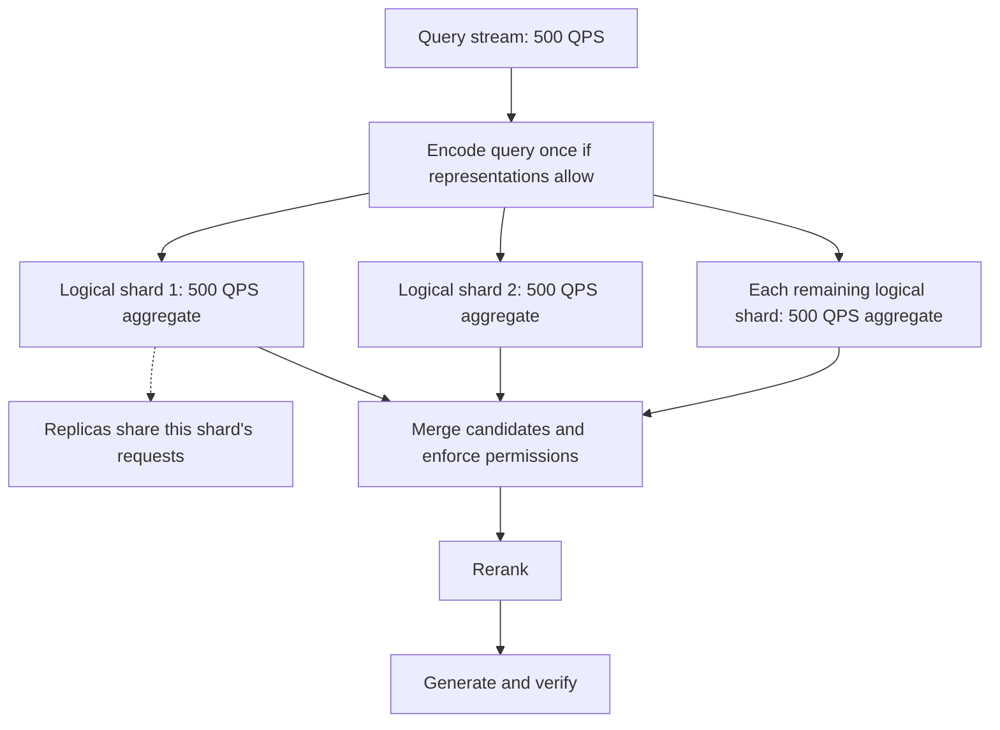
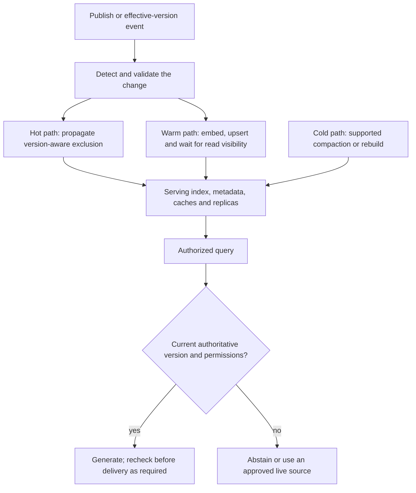
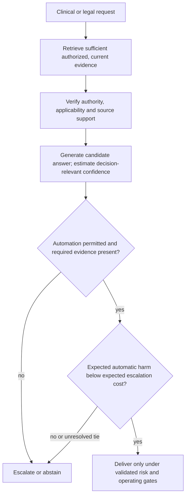
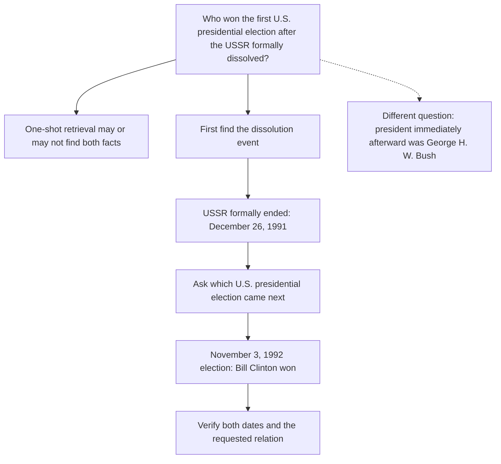
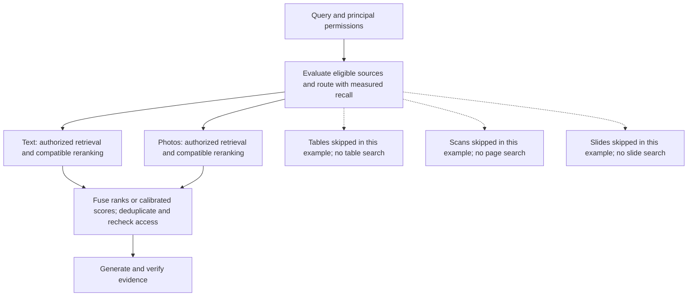
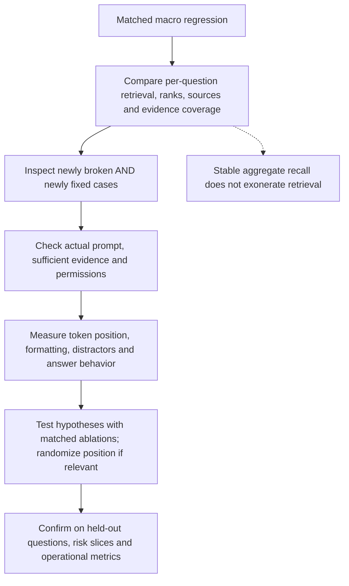
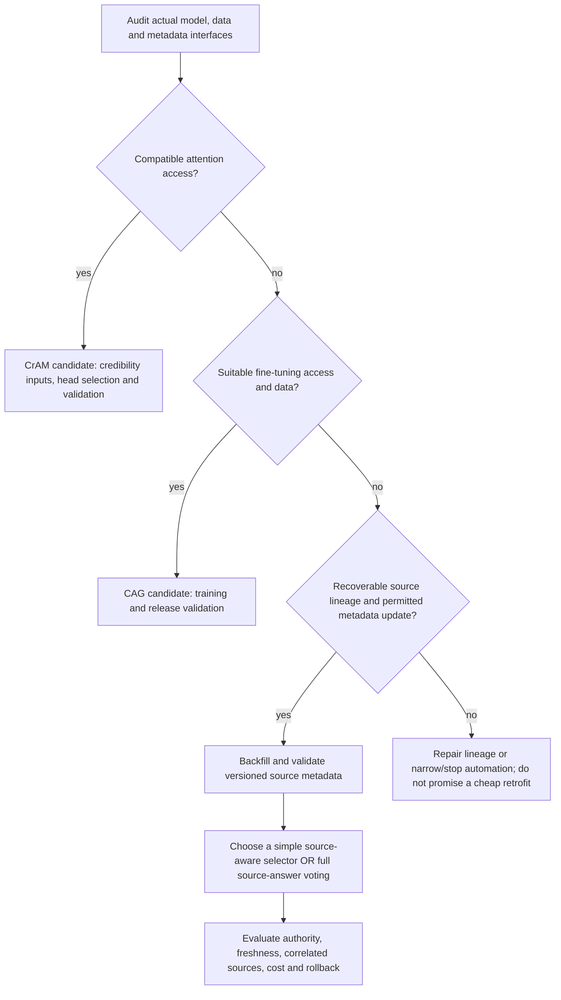

# Chapter 41: End-to-End Design Drills
[00-START-HERE](../00-START-HERE.md) · [01-READING-ROUTES](../01-READING-ROUTES.md) · [40\_graph\_rag](40_graph_rag.md) · [A1\_formula\_sheet](../appendices/A1_formula_sheet.md)
Purpose: Turn seven RAG design prompts into measurable architectures, explicit assumptions and testable trade-offs. Each calculation distinguishes a scoped payload or latency proxy from complete operating cost, measured tail performance and a safety guarantee.
## TL;DR
- Separate capacity, traffic, replication and tail latency. Every logical scatter-gather shard sees the system query stream, while replicas can share it. The $`320\,\mathrm{GB}`$ HNSW and $`10\,\mathrm{GB}`$ PQ toys are scoped payloads, not all-in footprints.
- Freshness needs detection, invalidation, ingestion, propagation and serving checks. A constant-size flag operation or a logarithm is not an end-to-end time guarantee; stale exclusion may require abstention until replacement evidence is ready.
- Derive an accept/escalate rule from explicit costs, then validate calibration and retained risk. Neither a confidence label nor $`80\%`$ macro-$`F_1`$ certifies a $`0.2\%`$ accepted-error target.
- Iterative retrieval can use an intermediate fact to form a new query, but one-shot retrieval is not mathematically incapable of finding bridge evidence. The consistent two-round timing toy gives $`2{,}560`$ milliseconds and a routed mean of $`1{,}669`$ milliseconds.
- Route authorized modality sources when the quality-adjusted savings exceed router overhead. A unified index can retain access controls and provenance; neither one index nor separate indexes guarantees them.
- Debug retrieval, evidence presence, token position, formatting and generation with matched ablations. Unchanged aggregate recall does not rule out retrieval regressions, and a middle-rank pattern is not causal proof.
- Audit the available access surfaces before a credibility retrofit. The stipulated API blocks CrAM; CAG needs suitable fine-tuning access and data. A source-aware selector is not automatically the published RA-RAG, which also generates and filters source-specific answers and votes over them.
## The story
Picture the whole chapter as a railway control room running one large station network.
The first board separates yard capacity from traffic, then adds duplicate yards for availability. Every logical scatter-gather yard receives each query, but a dispatcher can divide that yard’s requests among replicas. Storage and service demand interact; extra yards are not five copies of the whole corpus.
The timetable board separates detecting a change, blocking obsolete versions, inserting replacements and later cleanup. A passenger gets a current schedule only if the serving path checks authoritative versions and permissions; a quick local write alone does not establish freshness.
A safety officer compares expected harm with the expected cost of expert review, subject to rules that may require review regardless of confidence. The estimate needs domain validation; a high number on a dashboard is not a safety certificate.
Some journeys need a transfer name discovered at an earlier stop. Iterative retrieval can form that next query. It is helpful when the first search misses the bridge, not proof that a one-shot search could never find it.
Cargo platforms may use different encoders and permissions, or share a system that enforces both. Routing opens useful authorized platforms, but the switchboard itself has cost and can miss a necessary platform.
When performance falls, compare the same journeys before and after the change. Check question-level retrieval, evidence assembly, actual token position and answer behavior; a stable average can hide newly broken journeys.
For a retrofit, inspect what can change before promising a named method. A source field can enable grouping, but it cannot manufacture reliable authority or the extra answer-generation and voting steps required by a full credibility method.
## Decoder table

| Technical term | Plain-English meaning | Why it matters |
| --- | --- | --- |
| Workload axes | Indexed-vector capacity, traffic and per-query service demand | Different budgets interact; neither QPS nor vector bytes alone sizes the system |
| Indexed count $`N_{\mathrm{vec}}`$ | Number of indexed vectors, not automatically source documents | Chunking or patch encoding can multiply vector count |
| Vector dimension $`d`$ | Components per dense vector; $`d=768`$ in the toy | Dimension and precision determine vector payload, not complete index memory |
| Logical shard | One partition of an index | Every searched shard receives the query stream before replica load sharing |
| Shard and source counts | $`S_{\mathrm{shard}}`$ counts partitions; $`S_{\mathrm{src}}`$ counts origins | Use distinct meanings rather than transferring one section’s denominator |
| Scatter-gather | Fan a query to searched logical shards and merge candidates | Replicas of each shard can divide its requests |
| Bi-encoder | Encode query and documents separately | Parameter count does not fix output dimension or search latency |
| Approximate nearest-neighbor (ANN) search | Trade exactness for practical search work | Measure recall, CPU demand, concurrency and tail latency |
| HNSW graph | A hierarchical proximity index with neighbor links | Base-layer slots omit upper layers, metadata and allocation overhead |
| Complexity $`O(1)`$ and $`O(\log N)`$ | Asymptotic descriptions under specified assumptions | Local expected constant work or a logarithm is not an end-to-end time guarantee |
| 32-bit floating point (fp32) | $`4\,\mathrm B`$ per component; $`3{,}072\,\mathrm B`$ for $`768`$ components | This is vector payload only |
| HNSW $`M`$ and $`M_0`$ | Toy $`M=16`$, base-layer capacity $`M_0=2M=32`$ | Declared setting, not a default shared by all APIs |
| Product Quantization (PQ) | Encode subvectors using shared codebooks | Count per-vector codes, IDs, codebooks and index structures separately |
| PQ subquantizers $`m`$ | $`m=96`$ groups of $`8`$ dimensions | With 256 centroids per group, the code uses 96 bytes/vector |
| Section-specific $`k`$ | Centroid count, retrieval cutoff or documents per source | A common letter does not imply a common unit or denominator |
| Section-specific $`M`$ | HNSW neighbor parameter or routed-source count | Routing may choose none, some or all authorized sources |
| Scalar or binary quantization | Store components or vectors with fewer bits | Capacity savings and evidence recall require evaluation |
| IVF-PQ | Inverted lists containing compact product codes | Faiss-style $`96+8=104\,\mathrm B`$/entry before shared overhead |
| Compression ratio | Ratio of explicitly scoped byte budgets | A payload ratio is not a universal all-in memory or cost ratio |
| Usable RAM budget | Memory available for the declared resident structures | An exactly full payload leaves no room for omitted structures |
| Replication factor | $`R`$ copies of a logical shard | Replicas can share load; failure reserve is a separate requirement |
| Recall requirement | Required evidence-retention performance on a defined workload | State metric, cutoff, uncertainty and covered query slices |
| Freshness SLA | Specified delay and success condition after a source event | Define detection, visibility, percentile and safe failure behavior |
| Parametric memory | Information encoded in model weights | Not a keyed serving-data update mechanism |
| Catastrophic forgetting | Training updates damage previously learned behavior | A possible risk, not a theorem that every factual edit fails |
| Model editing | Modify selected model behavior through weights | Requires validation; not the default hot path for fee updates |
| Invalidation | Exclude obsolete or unauthorized versions from serving | Enforcement and propagation matter beyond one local flag |
| Warm ingestion | Validate and insert changed evidence | Queueing, retries and read visibility belong in latency |
| Tombstone | Logical deletion marker enforced on reads | Support and search degradation depend on implementation |
| Compaction | Clean or rebuild index structures | Schedule by measured memory, quality and service behavior |
| Version/recency check | Compare evidence with authoritative version and effective state | Timestamp age alone does not prove current truth |
| Append-only workload | New records do not supersede old facts by assumption | Revocations, security removals and corrections may still require exclusion |
| Calibrated confidence | Estimated probability aligned with observed outcomes in a defined population | Validation uncertainty, selection and shift limit its interpretation |
| Confidence $`p`$ | Decision-relevant estimated correctness probability | Raw token likelihood is not this quantity |
| Acceptance threshold $`p^*`$ | $`1-C_a/C_w`$ under the simplified loss model | Mandatory review and evidence eligibility remain separate |
| Wrong-answer cost $`C_w`$ | Expected harm from an accepted error in common cost units | Assume $`C_w>0`$; heterogeneous harms may need richer losses |
| Escalation cost $`C_a`$ | Expected review cost, delay and residual harm | Assume $`C_a\ge0`$, not automatically the cost of evidence tracing |
| Reject option | Choose automatic answering or escalation using expected loss | The algebra requires an appropriate probability and loss model |
| Acceptance gate | Final eligibility and risk decision before delivery | A high score cannot repair missing required evidence |
| Evidence trace | Versioned document, source and supporting span linked to a claim | Traceability is not itself factual correctness |
| Entity-linked graph | Typed assertions over resolved entities | False merges and false splits affect both precision and recall |
| Credibility-weighted evidence | Use estimated source reliability with relevance and authority | A reliable source can still be outdated or wrong on a specific claim |
| Causal tracing | Intervene on model components and measure output changes | Requires suitable internal access and careful interpretation |
| Attention head | One attention component inside a model | The stipulated black-box API does not expose CrAM’s intervention |
| Multi-hop question | A question requiring combined facts | One document can contain multiple facts; iteration is not always necessary |
| Hop facts $`f_i`$ and queries $`q_i`$ | Later queries can depend on validated earlier evidence | A false bridge can direct every later search off target |
| Missing-candidate failure | A needed item is absent from the current candidate pool | Reranking that fixed pool cannot add it; new retrieval can |
| IRCoT | Interleave retrieval and generated reasoning sentences | Intermediate text still needs evidence checks |
| Self-ask | Pose and answer explicit follow-up questions | A visible query format does not guarantee a correct decomposition |
| ITER-RETGEN | Use previous generation to guide later retrieval | Distinguish retrieval schedule from a minimum required hop count |
| FLARE | Use a predicted upcoming sentence and low-confidence tokens to trigger retrieval/regeneration | Not simply a final-answer confidence gate |
| Adaptive-RAG | Select no retrieval, single step or multiple steps | Real routing errors change both quality and latency |
| Silver routing label | A strategy label inferred from model outcomes | Not proof of the question’s minimum reasoning depth |
| Hop cap | Maximum permitted retrieval/reasoning work | At the cap, stop safely rather than force a confident answer |
| Modality source | A representation-specific retrieval source | Separate stores do not automatically enforce document permissions |
| Modality router | Select eligible sources under a relevance/quality policy | Budget feature checks, overhead and evidence misses |
| RAGRoute-style classifier | Score query-source pairs using compatible source features | Published text-source results do not validate every multimodal adaptation |
| Source centroid | Mean embedding within a compatible representation | A centroid from a different encoder need not be comparable |
| Query-type heuristic | A simple initial routing policy | Audit missed evidence and define an appropriate fallback |
| Shared embedding space | Map supported modalities into a joint representation | Score calibration and access controls still need validation |
| CLIP-style joint encoder | Map images and text into compatible learned representations | A baseline, not a universal winner or failure |
| Per-modality calibration | Validate score or decision meaning for each representation | A shared decision rule can work after suitable calibration |
| ColPali-style encoding | Roughly $`1{,}030`$ page vectors in a common setup | Not one vector per page or a universal fixed patch count |
| MaxSim | Sum query-token best matches across document/page representations | Its cost depends on query tokens, page vectors and candidate selection |
| Document-as-image encoding | Represent rendered pages visually | Preserves layout but needs footprint and evidence-quality measurements |
| Optical character recognition (OCR) | Extract text from page pixels | Compare errors, structure loss and cost with visual/hybrid methods |
| Authorization filtering | Enforce principal, tenant and document access | Source-level eligibility is not sufficient for mixed-grant sources |
| Per-source reranking | Refine candidates with a compatible scorer | Can precede validated rank or calibrated-score fusion |
| Cross-encoder reranker | Jointly score query and candidate | Text-only BERT cannot directly rerank raw photos |
| Reciprocal rank fusion (RRF) | Merge ranks rather than uncalibrated scores | Weights, depth, duplicates and permissions still matter |
| Visual question answering (VQA) | Answer a question about supplied visual content | Does not by itself test corpus routing or retrieval recall |
| Macro pass | Compare overall metrics on matched inputs | An average identifies a symptom, not its cause |
| Micro pass | Inspect selected individual cases | A regression diff is not an unbiased traffic sample |
| Mezzo pass | Analyze defined slices with denominators and uncertainty | Confirm hypotheses beyond handpicked examples |
| Scores $`m_0,m_1`$ | Matched before/after end-to-end metrics | Separate score noise and question-level transitions |
| Correct sets $`C_0,C_1`$ | Evaluation items correct before and after | Their overlap is needed to count regressions and fixes |
| Recall at $`k`$ | Evidence coverage at a specified common cutoff | Stable aggregate recall does not exonerate retrieval |
| nDCG | A rank-sensitive metric with declared gains and cutoff | Rank quality and final evidence use are different measurements |
| Diff set $`D`$ | $`D=C_0\setminus C_1`$ | Newly broken cases under fixed judgments, not all current failures |
| Gold-chunk presence | Marked support appears in the serialized prompt | Presence need not mean sufficient, current or nonconflicting evidence |
| Context assembly | Select and serialize evidence for generation | Measure the actual prompt, including truncation and permissions |
| Token-budget truncation | Remove content to fit a context budget | Can drop a needed hop even if one gold chunk remains |
| Rank bucket | A coarse relative chunk-rank group | Not the same as normalized token position |
| Rank $`r`$, context depth $`k`$, bucket $`d_{\mathrm{rank}}`$ | $`d_{\mathrm{rank}}=\lceil10r/k\rceil`$, for $`1\le r\le k`$ | Absent evidence is separate; small k leaves empty buckets |
| Exact match (EM) | Fraction matching the evaluation answer convention | Not automatic proof of source faithfulness or deployment safety |
| Macro-$`F_1`$ | Unweighted mean of class-specific F1 scores | Does not determine the overall error fraction |
| $`p_{50}`$ latency | Median response latency | Not a weighted mean of branch latencies |
| Lost in the middle | Observed position-sensitive evidence use in studied models/tasks | A deployment-specific cause needs controlled tests |
| Prompt-template diff | Compare instructions, fields, delimiters and ordering | Large effects are possible, not a promised double-digit change |
| Ranked-list truncation | Send fewer candidates to generation | An unchanged rank-six item cannot survive top-four truncation |
| Pipeline bisection | Replay component combinations or targeted reversions | Interactions can prevent a unique one-knob explanation |
| Access-surface audit | Check actual model, metadata, lineage and deployment interfaces | Do not choose a mechanism the configuration cannot expose |
| Hosted generation API | A service exposing specified model operations | This drill stipulates no attention or usable fine-tuning access |
| Foreign key | A verified mapping between chunk and document/origin | A plausible key name does not prove recoverable lineage |
| CrAM | Modify selected influential heads using document credibility | Model-specific internal access and validation are required |
| CAG | Credibility-aware fine-tuning in the cited baseline | Data/interface readiness determines feasibility, not a universal sprint rule |
| RA-RAG | Estimate reliability; generate/filter source answers; select and vote | Not merely a document selector before one combined generation |
| Source identity | Origin metadata with appropriate granularity and version | Domain duplicates may not be independent corroboration |
| Metadata-only update | Change supported fields without re-embedding | Verify API support, read visibility and rollback |
| Reliability estimate $`r_s`$ | A source-related credibility weight | Needs independent validation and drift/correlation checks |
| Selected sources $`K_{\mathrm{src}}`$ | Number retained by a relevance/reliability policy | Selection work and rejected-source checks can still cost calls |
| Estimation query count $`Q`$ | Questions used to infer source reliability | Two hundred is an experiment setting, not sufficient certification |
| Reliability-weighted vote | Aggregate normalized, filtered source-specific answers | A relevance-weighted document score is a different operation |
| Feature flag | Reversible control for a tested policy | Rollback still needs data consistency and release monitoring |
| Revalidation | Reassess model-specific interventions and credibility after change | Not a one-time promise attached to a mechanism name |

## Core mechanics
### Mathematical conventions
Use decimal storage: $`1\,\mathrm{GB}=10^9\,\mathrm B`$ and $`1\,\mathrm{MB}=10^6\,\mathrm B`$. Count indexed vectors, not source files, unless one vector per document is explicitly assumed. Vector/base-link payloads omit other index, metadata, text, cache, allocator and replica storage; capacity ceilings based on them are lower bounds.
Let $`\lambda`$ denote query rate and $`t_{\mathrm{CPU}}`$ CPU-seconds of search per query. At target utilization $`0<u<1`$, a logical shard needs approximately $`c\ge\lambda t_{\mathrm{CPU}}/u`$ search cores. With $`R`$ equally loaded replicas, replace $`\lambda`$ by $`\lambda/R`$ for each replica. Wall-clock search latency need not equal CPU service demand. Embedding, reranking, generation, networking and failure reserve are separate budgets.
All dollar prices, service times and example outcomes below are stipulated planning inputs, not measured SLAs or invoices. A weighted sum of route latencies is a mean, not a median or tail quantile. Keep full precision until reporting. Percentages and percentage-point changes are different units.
For the reject-option calculation, correctness has zero cost, an accepted error costs $`C_w>0`$, escalation has expected cost $`C_a\ge0`$, and $`p\in[0,1]`$ is a decision-relevant correctness probability. Regulatory, professional-review, evidence or permission rules can prohibit automation regardless of that comparison. Estimated calibration is uncertain and may not transfer across domains, subgroups, routing or distribution shift.
Aggregate recall, gold presence, answer correctness and causal faithfulness are separate measurements. A regression diagnosis requires matched inputs, question-level transitions, uncertainty and controlled ablations; a higher aggregate score does not exonerate a component. Correlated or copied sources do not provide independent corroboration.
### 41.1 Enterprise RAG over 100M documents at 500 QPS
#### What
Treat corpus size $`N_{\mathrm{vec}}`$ and query rate $`\lambda`$ as separate inputs, while recognizing that corpus size, index settings, hardware and compression also affect per-query work. The arithmetic below assumes $`N_{\mathrm{vec}}=10^8`$: one indexed vector per document only for this toy. Chunking or page patches can make the vector count much larger than the file count.
Capacity depends on the complete resident footprint and shard balance, not just raw vector bytes. Measure all index structures, metadata, caches and reserve before choosing the final node count.
Traffic sizing needs measured CPU/GPU service demand, batching, utilization, replication and tail latency for the chosen index. A single wall-clock latency does not by itself determine core throughput.
Scatter-gather can encode each query once, send it to every logical shard, merge candidates, rerank and generate. Replicas of a shard normally share its requests rather than each receiving every request. Approximate per-shard retrieval and final merging need recall evaluation.
#### Why
The example stipulates a $`110`$-million-parameter bi-encoder with $`d=768`$ output dimensions. Parameter count does not determine vector dimension, encoding latency or ANN time by itself.
At fp32, the vector payload alone is:
$$
768\times4\,\mathrm B=3{,}072\,\mathrm B\quad\text{per vector}.
$$
Under the common HNSW base-layer capacity convention, choose $`M=16`$ and $`M_0=2M=32`$ neighbor slots, each budgeted as a four-byte internal identifier. Occupancy, upper levels and other metadata are separate.
Treat $`M=16`$ as this drill’s setting, not a universal default shared by every hnswlib and Faiss API. Faiss exposes different index constructors and an HNSW memory budget that includes graph links; check the actual implementation and version.[\[1\]](https://github.com/facebookresearch/faiss/wiki/Faiss-indexes)
The base-layer link budget is $`32\times4=128\,\mathrm B`$ per vector. Adding it to fp32 payload gives $`3{,}200\,\mathrm B`$ per vector, or the following scoped subtotal—not a complete HNSW footprint:
$$
10^8(3{,}072+128)\,\mathrm B=3.2\times10^{11}\,\mathrm B=320\,\mathrm{GB}.
$$
PQ splits $`768`$ dimensions into $`96`$ subvectors of dimension $`8`$. With $`256=2^8`$ centroids per subquantizer, each code uses $`8`$ bits, so the code payload is $`96\,\mathrm B`$ per vector.
A hypothetical four-byte posting identifier gives $`100\,\mathrm B`$ per vector. Standard Faiss IVF-PQ uses eight-byte vector IDs, giving $`104\,\mathrm B`$ here, before shared tables and other overhead.[\[1\]](https://github.com/facebookresearch/faiss/wiki/Faiss-indexes)
$$
B_{\mathrm{PQ,4B\ ID}}=10^8(96+4)\,\mathrm B=10^{10}\,\mathrm B=10\,\mathrm{GB}.
$$
The toy ratio is $`3{,}200/100=32`$. Using the Faiss-style $`104\,\mathrm B`$ posting gives $`3{,}200/104\approx30.769231`$ and $`10.4\,\mathrm{GB}`$ for $`10^8`$ entries. The $`96\times256\times8`$ fp32 PQ codebook adds $`786{,}432\,\mathrm B`$ once; coarse centroids, list structures, optional precomputed tables and retained full vectors are additional.
With $`64\,\mathrm{GB}`$ available per capacity node, $`\lceil320/64\rceil=5`$ is only a lower-bound shard count for the raw subtotal. It exactly fills all five budgets; any positive omitted resident index storage forces more capacity under this fixed-budget design. A one-shard compressed payload is plausible, not an all-in fit guarantee, especially if full vectors are also retained for reranking.
#### Failure without it
Dividing $`500`$ QPS by the number of capacity shards is wrong for full scatter-gather: each logical shard receives $`500`$ QPS. Dividing that shard’s requests among replicas is a different operation.
Sizing only from QPS can create a memory-starved cluster even when compute is comfortable.
Compression can reduce capacity and rebuild requirements, but the raw representation may be justified by recall, update behavior or exact reranking needs. The QPS budget alone does not decide which representation is wasteful.
Partitioning one corpus across five graphs does not multiply the total data by five: each graph holds roughly $`N_{\mathrm{vec}}/5`$ vectors. Construction work, coordination and parallel wall time differ; five full-corpus replicas would instead replicate construction. Do not multiply full-corpus rebuild cost merely by capacity-shard count.
Compression and approximate search can lose evidence. Broader candidate retrieval and reranking may help but cannot guarantee recovery if the relevant item never enters the candidate pool. Evaluate recall and end-to-end quality at the chosen compression and search settings.
Scalar, binary and product quantization are options to benchmark, not mandatory replacements at a fixed memory boundary. Metadata or semantic routing can reduce shard fan-out only with authorization enforcement and measured evidence recall.
#### Cost and complexity
For a stipulated single-core CPU demand of $`8\,\mathrm{ms/query}`$, reciprocal service capacity is $`1/0.008=125`$ QPS per fully utilized core. This assumption is stronger than observing an $`8`$-millisecond wall-clock search on an unspecified threaded implementation.
At $`500`$ QPS, $`500(0.008)=4`$ cores is the saturation requirement per logical shard. A target utilization of $`u=0.5`$ implies $`8`$ aggregate search cores, before failures and other stages; saturation is not a safe tail-latency target.
Two replicas of a hypothetical five-shard raw subtotal use ten node slots, but that subtotal is not a valid final all-in capacity plan. With balanced replica load, each copy sees $`250`$ QPS and needs about $`4`$ search cores at $`50\%`$ target utilization under this CPU-demand toy. Provisioning for a replica failure needs a separate reserve calculation.
If the full compressed serving footprint fits one node, three replicas use three nodes. Balanced traffic gives $`500/3\approx166.666667`$ QPS per replica; the same CPU-demand toy implies $`\lceil500(0.008)/(3\times0.5)\rceil=3`$ cores per replica. IVF-PQ and HNSW need separately measured service demand; using the same value is only a comparison assumption.
A reported $`50\,\mathrm{GB}`$ dense index and $`10.5\,\mathrm{GB}`$ learned-sparse index on another corpus cannot validate this one: document count, vector dimension, representation and included structures must match. Treat it only as an unverified order-of-magnitude anecdote, not an independent check on the $`320`$ or $`10.4\,\mathrm{GB}`$ calculation.
At $`5{,}000`$ QPS with unchanged corpus and representation, capacity payload is unchanged, but replication, caches and service nodes may grow. The same assumed CPU demand requires $`40`$ aggregate saturation cores per searched logical shard.
Keeping the earlier $`u=0.5`$ policy gives $`5{,}000(0.008)/0.5=80`$ aggregate search cores, not $`40`$ headroom cores. Distribute this demand across replicas as appropriate; benchmark the changed concurrency and tail behavior.
Increase throughput replicas, optimize search or change partitioning according to measured bottlenecks. Smaller shards may reduce local work but add fan-out/merge overhead. More QPS neither universally requires nor universally forbids repartitioning.
### 41.2 A RAG system that must stay fresh
#### What
The fee assistant’s contract requires a published change to affect answers within $`15`$ minutes, and prohibits superseded fees beyond that window. Define the publication/effective event, clock, serving regions, success percentile and what happens when ingestion fails.
Separate detection, stale exclusion, replacement availability and background maintenance. The three-path design is an operational pattern, not a proof of a latency bound.
The hot path records a version-aware invalidation or deny rule and propagates it to all serving reads. Blocking a document with many chunks or caches can involve more than one operation.
The warm path validates, embeds and upserts changed chunks, then waits for the required read visibility. Queueing, retries, permissions, replicas and index refresh are part of publication-to-answer latency.
The cold path compacts tombstones or rebuilds when supported and needed. Keep obsolete versions excluded while maintenance runs; deletion/update capabilities are implementation-specific.
At retrieval and before delivery, check authoritative versions, effective dates, revocations and permissions. A timestamp-age test alone can accept a recently indexed but obsolete fact. If no valid evidence is available, abstain or use an approved live source.
#### Why
A nightly-only refresh cannot guarantee a much shorter freshness target. Scheduling delay is only one part of the end-to-end path.
For a fixed 24-hour refresh cycle versus a 15-minute target, the scheduling-delay supremum in SLA units is:
$$
\frac{1{,}440\,\mathrm{min}}{15\,\mathrm{min}}=96.
$$
A change at 09:00 followed by a midnight refresh waits $`15`$ hours, or $`900`$ minutes: $`900/15=60`$ SLA windows. A change just after a refresh can wait nearly $`1{,}440`$ minutes before processing even starts.
An in-memory hash lookup or one invalidation-record write may have expected $`O(1)`$ local work in corpus size. Detecting the change, identifying every affected chunk, durable replication and enforcing it across reads are not thereby constant-time or bounded by $`10\,\mathrm{ms}`$. That time is only a stipulated toy input.
For $`20`$ million chunks, the following logarithm is a scale reference. HNSW’s search/insertion behavior depends on its graph, dimensions, construction/search settings and implementation; this logarithm is not an exact hop count, worst-case complexity proof or millisecond bound:
$$
\log_2(20\times10^6)\approx24.253497.
$$
The toy assumes an embedding round trip near $`100\,\mathrm{ms}`$ and very short local insertion. Neither is a measured guarantee, and neither includes every queue, visibility, retry or propagation delay.
If the complete verified path really took $`0.1`$–$`0.3\,\mathrm s`$, a $`900\,\mathrm s`$ target would allow a factor of $`9{,}000`$–$`3{,}000`$, about $`3.95`$–$`3.48`$ decimal orders. That arithmetic does not establish that the real publication-to-answer path is subsecond.
#### Failure without it
An atomic version swap can be desirable when the replacement is ready within the target. If ingestion may miss the deadline, stale exclusion must not wait indefinitely for the swap; serve a safe fallback or abstention until the new version is available.
A full corpus reindex on every small change can make work depend on total corpus size rather than changed content. Incremental paths still need validation, consistency and rollback.
Model fine-tuning or editing is not an appropriate default hot path for live fee facts: it adds training, verification, uncertainty and potentially unrelated regressions. Whether a particular method meets a measured deadline is empirical, not a theorem that every weight change is too slow.
Replication lag, partial failures, stale caches and clock skew can expose old records. Version-aware serving gates help only if every relevant read enforces them and failure behavior is defined.
#### Cost and complexity
Compaction duration is workload- and implementation-dependent; it can be short or long. Budget its resource contention and keep the serving invalidation rules active throughout.
Choose maintenance triggers from measured tombstone burden, memory, recall, update rate and tail latency. Do not infer compaction need from a latency increase alone; compare against other sources of drift.
Elasticsearch documents a default one-second refresh for recently searched indexes. That is a visibility mechanism in a different implementation, not confirmation of a $`100`$–$`300`$-millisecond HNSW ingestion claim; an asynchronous refresh can itself add delay.[\[2\]](https://www.elastic.co/guide/en/elasticsearch/reference/current/near-real-time.html)
Keep live factual updates addressable in serving data where possible. Behavioral fine-tuning is a different intervention, not the only legitimate reason training might change.
A truly never-superseded append-only workload may not need semantic replacement invalidation. Permission revocations, security removals, retention rules and corrections can still require exclusion, so append-only storage does not by itself remove that obligation.
Report detection-to-block, publication-to-valid-replacement, read visibility and maintenance separately, with their percentiles and failure modes. Confirm the end-to-end target with serving probes rather than adding optimistic component minima.
### 41.3 High-stakes RAG: medicine and law
#### What
Place an evidence and acceptance gate before delivery. In high-stakes use, permissions, missing provenance or mandatory expert review can stop automation regardless of a model confidence score.
Let $`p`$ estimate correctness for this decision, let $`C_w>0`$ be expected harm from an accepted wrong answer, and let $`C_a\ge0`$ include escalation cost, delay and any residual harm. Costs need common units. The simplified model assigns zero cost to a correct automatic answer.
Expected automatic cost is $`(1-p)C_w`$, while expected escalation cost is $`C_a`$. Asymmetric error types, action-dependent harms, review imperfections or nonzero correct-answer cost require a richer loss model.
When automation is permitted, prefer it strictly under the following inequality; at equality the simplified costs tie:
$$
(1-p)C_w<C_a\quad\Longleftrightarrow\quad p>p^*=1-\frac{C_a}{C_w},\qquad C_w>0.
$$
For $`0<C_a<C_w`$, the interior threshold is $`p^*=1-C_a/C_w`$. If $`C_a\ge C_w`$, the numerical rule has no positive confidence floor; if $`C_a=0`$, strict preference for automation never occurs. These limiting cases do not override mandatory review.
This is a simplified cost-based reject-option derivation in the tradition of Chow’s optimal error/reject trade-off. It is not a theorem that a generative model’s score is calibrated or that cost minimization authorizes clinical/legal practice.[\[3\]](https://ieeexplore.ieee.org/document/1054406)
#### Why
With $`C_w=1`$ and $`C_a=0.05`$ in common hypothetical cost units, $`p^*=0.95`$. The units and harm assumptions must be justified for the actual product.
With the separately stipulated clinical values $`C_w=1{,}000`$ and $`C_a=2`$, the simplified threshold is:
$$
p^*=1-\frac{2}{1{,}000}=0.998.
$$
The threshold can change while the numerical model stays fixed. Calibration must still be revalidated if deployment domain, question mix, evidence, accepted subgroup or error severity changes; model identity alone does not preserve calibration.
A faster, reliable escalation path can lower expected escalation cost. A disclaimer does not automatically reduce the wrong-answer harm assumed in this model.
A governing requirement for expert review is a separate eligibility constraint, not necessarily an ordinary finite cost ratio that pushes a threshold near one. Confidence may prioritize review rather than authorize an autonomous answer.
#### Failure without it
Within this model, an interior threshold $`0.9`$ corresponds to $`C_a/C_w=0.1`$. A borrowed $`0.7`$, $`0.9`$ or $`0.95`$ is not justified without the loss model, calibration evidence and applicable operating constraints.
Token probabilities are not calibrated probabilities of a correct, safe, source-supported clinical or legal answer. Risk depends on the action and error type, not merely lexical confidence.
Some medical/legal questions require composed relations or historical validity that a single prose lookup misses. Others are simple; use the least complex evidence system that meets the verified need.
Entity-linked graphs are one option for composed facts, not a requirement. Resolution can cause both false merges and false splits, changing precision and recall in either direction. Validate relation semantics and provenance.
Check authority, effective dates, jurisdiction and subsequent treatment. A citation or a source-level reliability estimate does not prove the specific assertion is current or applicable.
Decompose risk where justified, but recomposition can create a high-risk action even when individual facts seem low risk. Gate the delivered decision as well as its subquestions.
#### Cost and complexity
In a hypothetical $`500`$-query score distribution, $`415`$ scores exceed $`0.95`$ and $`61`$ exceed $`0.998`$. These are routing counts, not evidence that either threshold achieves its advertised error risk.
The resulting coverage is $`415/500=83\%`$ versus $`61/500=12.2\%`$; the latter escalates $`439/500=87.8\%`$. Report observed correctness and uncertainty on the accepted population separately.
$`80\%`$ macro-$`F_1`$ is not equivalent to one error in five: it averages class-specific precision/recall combinations and does not fix the error rate. More importantly, a generic support judge does not certify $`0.2\%`$ accepted-answer risk. Under an illustrative independent Bernoulli model, even zero failures in $`61`$ accepted validation cases gives a one-sided $`95\%`$ error upper bound of about $`4.79\%`$, not $`0.2\%`$.
Use representative, held-out, post-selection validation. For zero observed independent failures at constant error probability, the one-sided $`95\%`$ upper bound is $`1-0.05^{1/n}`$; reaching at most $`0.002`$ needs $`n\ge\lceil\ln(0.05)/\ln(0.998)\rceil=1{,}497`$ zero-failure accepted cases. This conditional illustration does not cover correlation, adaptive threshold selection, severity-weighted harms or shift.
Attach document IDs, versions, sources and offsets to supported claims, and verify the spans actually support them. If required provenance is missing, block automation or escalate; raising a score threshold alone does not repair missing evidence.
Improved traceability may reduce audit cost or reveal risk, but it is not by definition a change in $`C_a`$, which denotes expected escalation cost here. Estimate its actual effect and retain any evidence eligibility rule independently of the numerical threshold.
Cross-source corroboration can help when sources are identifiable and not merely copies. Neither agreement nor a credibility model guarantees truth; test correlated misinformation, outdated authority and the incident’s failure modes.
### 41.4 Multi-hop question answering
#### What
A multi-hop question requires combining facts, not necessarily exactly one distinct document per fact. Write $`f_i`$ for an intermediate fact and $`q_i`$ for a retrieval query; later queries may depend on earlier evidence.
For a film-director/university/country question, one useful retrieval sequence discovers the director, then the university, then its location and the relevant country. A corpus may already contain a passage with several steps, so iteration is a workload-dependent remedy.
A useful pattern is $`q_i=\operatorname{FormQuery}(q,f_{<i},\mathcal E_{<i})`$, where $`\mathcal E_{<i}`$ is accumulated source evidence. Verify the intermediate fact before letting it determine later searches.
One-shot retrieval uses the original query, but dense semantics, a bridge-rich document or existing model knowledge can still retrieve intermediate evidence. It may miss unnamed bridge facts; it is not mathematically incapable of retrieving them.
IRCoT interleaves retrieval with generated reasoning sentences, using retrieval to inform later reasoning and those sentences to guide later search. This is the published method’s design, not a guarantee that its intermediate claims are correct.[\[4\]](https://aclanthology.org/2023.acl-long.557)
Self-ask explicitly poses follow-up questions, obtains answers through search and continues or stops. Log the explicit query, source spans and concise evidence summaries; a formatted follow-up can still ask the wrong question.
#### Why
Use an unambiguous historical example: “Who won the first U.S. presidential election held after the Soviet Union formally dissolved?” This is different from asking who was president immediately after the dissolution.
The Soviet Union formally ceased to exist on December 26, 1991. George H. W. Bush remained the U.S. president immediately afterward; calling that answer wrong to the original “right after” question is an error.[\[5\]](https://www.bush41library.gov/digital-research-room/finding-aid/foia/records-dissolution-soviet-union?page=1)
For the revised election question, identifying the December 1991 dissolution leads to the next presidential election, held November 3, 1992, which Bill Clinton won. Election victory and taking office are different events; do not silently replace one relation with another.[\[5\]](https://www.bush41library.gov/digital-research-room/finding-aid/foia/records-dissolution-soviet-union?page=1)[\[6\]](https://millercenter.org/president/george-h-w-bush/key-events)
An iterative reasoning query is flexible but can propagate an unsupported bridge. Evaluate search quality, intermediate factual support and final correctness independently; auditability depends on the recorded evidence, not the method’s label.
Explicit follow-up questions can be logged, cached or displayed with sources. Neither a fixed question/answer schema nor free-form reasoning guarantees success on comparison or aggregation tasks.
ITER-RETGEN uses earlier generation to guide subsequent retrieval. FLARE predicts an upcoming sentence, detects low-confidence tokens and can retrieve and regenerate that sentence; it is more specific than “retrieve on any low-confidence final token.” These are different retrieval schedules, not universally interchangeable hop counters.[\[7\]](https://aclanthology.org/2023.emnlp-main.495/)
#### Failure without it
A reranker cannot promote an absent item within a fixed candidate pool. Widening first-stage retrieval or issuing a bridge query can change that pool; neither is guaranteed to recover every missing hop-two document.
Unconditional iteration adds retrieval and model work even for questions that already have sufficient evidence. Context may grow or be bounded by summarization/selection; state the actual policy.
Require stopping, duplicate-query detection, resource budgets and a safe no-answer path. Reaching a hop cap is evidence of a budget stop, not proof that a factual answer exists.
Log retrieval actions, documents, query reformulations, versioned evidence and observable decision summaries. Do not treat a model’s generated rationale as a faithful causal trace; isolate decomposition, retrieval and bridge-support errors with ablations.
#### Cost and complexity
The constructed workload is $`70\%`$ single-hop and $`30\%`$ needing the two-intermediate-round route below. The main mean calculation assumes perfect routing; real misclassification changes both quality and latency.
Stipulate $`80\,\mathrm{ms}`$ per retrieval, $`50`$ decoded tokens/s, $`30`$ generated intermediate tokens per round and a $`60`$-token final answer. Thus intermediate decoding is $`600\,\mathrm{ms}`$ and final decoding $`1{,}200\,\mathrm{ms}`$. Omit prefill, queueing, networking, reranking and retries explicitly.
The one-shot proxy is one retrieval plus final decoding:
$$
80\,\mathrm{ms}+\frac{60}{50}\,\mathrm s=1{,}280\,\mathrm{ms}.
$$
Define the iterative route consistently: two rounds, each with one retrieval and $`30`$ intermediate tokens, then a $`60`$-token final answer using the accumulated evidence with no extra retrieval. It is $`2(80+600)+1{,}200=2{,}560\,\mathrm{ms}`$, exactly twice the one-shot proxy.
The previously printed $`3{,}240\,\mathrm{ms}`$ belongs to three such intermediate rounds: $`3(680)+1{,}200`$. It cannot be derived from $`2(680)+1{,}200`$. If final generation performs a separate retrieval, add its latency instead of hiding it in either result.
For sensitivity only, a three-round slow route gives a perfectly routed mean of $`5+0.7(1{,}280)+0.3(3{,}240)=1{,}873\,\mathrm{ms}`$. Keep this separate from the main two-round example.
A stipulated $`5\,\mathrm{ms}`$ classifier perfectly routes the stated mix in the main two-round illustration:
$$
\mathbb E[T]_{\mathrm{routed}}=5+0.7(1{,}280)+0.3(2{,}560)=1{,}669\,\mathrm{ms}.
$$
Against always taking the two-round $`2{,}560\,\mathrm{ms}`$ route, the mean reduction is $`1-1{,}669/2{,}560\approx34.804688\%`$. This is a weighted mean, not a measured median or tail latency, and assumes no routing errors.
Adaptive-RAG reports no-retrieval, single-step and multi-step routing, trained with silver model-outcome labels plus dataset-based inductive bias. Its reported route times of $`0.35`$, $`3.08`$ and $`27.18`$ seconds are experiment-specific; $`27.18/3.08\approx8.824675`$, not this drill’s latency multiplier or a universal tenfold law.[\[8\]](https://arxiv.org/html/2403.14403)
Evaluate a router’s confusion matrix and end-to-end cost/quality rather than assuming perfect labels or a universal required hop count. Model-generated silver labels reflect which tested strategy succeeded, not a proven minimum number of reasoning steps.
Datasets can provide supporting-fact annotations or single-/multi-hop construction signals, but these do not directly label the optimal retrieval policy for every model. Adaptive-RAG combines such inductive bias with predicted outcomes; “no natural dataset has any hop labels” is too broad.[\[8\]](https://arxiv.org/html/2403.14403)
The cost of false extra retrieval and false early stopping is workload-dependent. Tune using explicit losses and measured answer risk; extra retrieval can introduce distractors, so biasing toward more work is not always safer.
A three- or four-round cap is a planning heuristic, not a correctness guarantee. Escalate or report insufficient evidence when the budget runs out; high stakes can favor early human review rather than unconditional iteration.
An $`800\,\mathrm{ms}`$ median target is not met by either main proxy: even the one-shot path is $`1{,}280\,\mathrm{ms}`$. In the deterministic perfectly routed mix, the median is $`1{,}285\,\mathrm{ms}`$ while the mean is $`1{,}669\,\mathrm{ms}`$. Shorter output, caching, different serving or a different task may help, but routing alone does not satisfy that target.
A maintained, source-linked graph can sometimes replace repeated search with traversal. Graph construction, update freshness, relation semantics and query planning remain costs; not every multi-hop problem is already encoded in it.
### 41.5 Multimodal enterprise search
#### What
The hypothetical inventory has $`40`$ million text chunks, $`6`$ million tables, $`3`$ million scanned pages, $`2`$ million photos and $`1`$ million slide decks: $`52`$ million heterogeneous items, not necessarily $`52`$ million vectors. A deck can contain many slides and a page encoder can emit many patch vectors.
Modality-specific retrievers are one useful design. Each representation needs relevance evaluation, provenance, query-time authorization and a declared score/fusion rule. A unified system can preserve the same metadata and access policy.
RAGRoute’s checked design uses query embedding, source centroid, query-centroid distance, source size and density. It was tested over compatible text embedding sources, not proved as a drop-in router across arbitrary incomparable modality encoders. A multimodal adaptation needs compatible features and training/audit data; it may route to none, some or all authorized sources.[\[9\]](https://arxiv.org/html/2502.19280v1)
Enforce source-level eligibility before routing where possible, and document/tenant permissions on every searched source and final result. Locally rank compatible evidence, then fuse using a validated rule. Source-only permission checks are insufficient for mixed-grant indexes.
#### Why
A shared embedding space does not by itself calibrate relevance scores or preserve modality-specific evidence. Conversely, separate indexes do not by themselves solve calibration or permissions. Compare a unified representation with specialized routes at matched quality.
A CLIP-style image/text encoder is a baseline, not proof that every multimodal space fails. Tables, OCR, images and slides have different information needs; the useful representation and fusion policy depend on the query and corpus.
ColPali-style page retrieval commonly uses roughly $`1{,}030`$ page vectors including patch/special-token representations, with query-token MaxSim late interaction. Count vectors, dimensions, pages and search settings for the selected implementation. Skip that work only when routing safely preserves the needed page evidence.[\[10\]](https://arxiv.org/html/2407.01449v2)
Merging indexes need not erase provenance or grants. Preserve source IDs, document versions, modality and authorization filters whether the store is unified or partitioned; validate access isolation and recall under filters.
The toy restricts finance tables to two departments. Enforce actual principal/document permissions, not merely a modality label or a router’s semantic prediction.
A skipped index can avoid its search and candidate reranking work. Feature construction, policy checks, router inference, audits and cached source-summary maintenance can still incur cost.
#### Failure without it
Full fan-out can spend work on irrelevant sources, but parallelism, coverage needs and router mistakes determine end-to-end trade-offs. Count aggregate resource consumption separately from elapsed latency.
Removing unauthorized results only after fusion can let restricted items affect ranking, candidate availability, counts or timing. Design authorization enforcement for the actual threat model; neither one shared index nor a post-filter automatically provides isolation.
Do not add uncalibrated heterogeneous scores as if they were comparable. Rank fusion, calibrated scores or a trained multimodal reranker are alternatives to evaluate.
RRF can merge per-source ranks without assuming raw score comparability, but still needs duplicate handling, depth/weight choices, authorization and quality validation. There is no mathematical rule that a shared space or full fan-out is acceptable only when the source count is at most two.
Single-image VQA does not validate corpus routing or evidence recall. Use retrieval-and-answer tasks with distractors, multi-source evidence and permission-sensitive slices appropriate to the enterprise design.
#### Cost and complexity
Stipulate $`k=20`$ candidates per source and $`0.195\,\mathrm{ms}`$ of serial reranking work per candidate using modality-compatible scorers. A text BERT cross-encoder does not directly score raw photos, and real scorer costs can differ by modality and batch.
With equal unit costs and serial execution, full fan-out produces 100 candidates and the following reranking-work proxy:
$$
(5)(20)(0.195\,\mathrm{ms})=19.5\,\mathrm{ms}\quad\text{of serial work}.
$$
Routing this return-policy/packaging-photo query to text and photos gives 40 candidates in the same equal-unit-cost toy:
$$
(2)(20)(0.195\,\mathrm{ms})=7.8\,\mathrm{ms}\quad\text{of serial work}.
$$
Candidate count falls $`60\%`$ and serial reranking work falls by $`19.5-7.8=11.7\,\mathrm{ms}`$. This is not automatically an $`11.7`$-millisecond latency saving with parallel/batched scoring; router overhead and route misses also matter. In this serial-only comparison, router overhead below $`11.7\,\mathrm{ms}`$ is necessary to preserve that isolated saving if everything else is equal.
Skipping tables, scans and slides can also avoid their search work. With heterogeneous per-source candidate costs $`c_i`$, reranking saving is $`1-\sum_{i\in\mathcal A}k_i c_i/\sum_{i\in\mathcal S}k_i c_i`$, not necessarily the unweighted candidate reduction; $`\mathcal A`$ is the selected set and $`\mathcal S`$ the full eligible set.
RAGRoute reports MMLU call reduction $`13{,}890\to3{,}126`$ (about $`77.494600\%`$) and communication reduction $`73.3\to17.42\,\mathrm{MB}`$ (about $`76.234652\%`$). Its MMLU accuracy is $`43.59\%`$ versus $`43.29\%`$, a $`0.30`$-percentage-point drop; MIRAGE top-32 is separately $`72.22\%`$ versus $`72.24\%`$. Neither experiment validates the toy’s $`60\%`$ multimodal saving or proves identical accuracy.[\[9\]](https://arxiv.org/html/2502.19280v1)
A query-type heuristic can be a starting policy, but needs labeled audits and a fallback when evidence may be missed. Full fan-out is reasonable whenever its measured coverage/cost trade-off beats routing, not only below an arbitrary two-source cutoff.
Page-image encoding can preserve layout that OCR loses; OCR, structural parsing, captions and hybrids may be preferable on other slices. Benchmark the actual answer/evidence loss, vector footprint, indexing cost and serving demand rather than assigning one modality a universally correct ingestion method.
### 41.6 Debugging a RAG system that got worse
#### What
Reproduce baseline $`m_0`$ and post-deploy $`m_1`$ on matched inputs, versions, decoding settings and evaluation labels. Report uncertainty, newly fixed cases and newly broken cases, not only a macro difference.
Compare old and new retrieval at the same diagnostic cutoff $`k`$, including per-question evidence coverage, rank-sensitive metrics, permissions, duplicates and source quality. A change in cutoff must not be mistaken for a better retriever.
If retrieval loses evidence, inspect embeddings, corpus snapshots, indexing, filters and candidate assembly. Improvements elsewhere can coexist with that failure, so inspect slices rather than reverting blindly.
Even when aggregate recall holds or improves, inspect question-level transitions. Define the newly broken set using matched baseline and new answer judgments:
$$
D=C_0\setminus C_1,\qquad G=C_1\setminus C_0,\qquad |C_1|-|C_0|=|G|-|D|.
$$
$`C_0`$ and $`C_1`$ are the same evaluation questions answered correctly before and after. $`D`$ excludes newly fixed cases, so it is a regression-localization sample, not an unbiased sample of all failures or traffic.
Check the actual serialized prompt, not merely a retriever log: sufficient evidence may be missing, truncated, conflicting, unauthorized or present without all required hops. A gold-chunk flag is only a proxy for usable support.
For integer rank $`1\le r\le k`$ and $`k\ge1`$, the following chunk-rank bucket lies in $`\{1,\ldots,10\}`$. Absent evidence has no rank and must be a separate group. With fewer than ten chunks some buckets are empty; unequal chunk sizes make rank a poor proxy for token position:
$$
d_{\mathrm{rank}}=\left\lceil\frac{10r}{k}\right\rceil,\qquad1\le r\le k,\quad k\ge1.
$$
Report group counts and intervals across the full matched evaluation, including absent-evidence cases. Control question difficulty and evidence sufficiency, and randomize evidence position while holding content fixed to test a positional explanation.
#### Why
Stable or improved aggregate recall does not exonerate retrieval: it can hide lost questions, worse ranks, duplicates, conflicting sources or incomplete multi-hop evidence. Nor does it prove the new reranker should be kept unchanged.
Missing sufficient evidence in the final prompt suggests a retrieval/assembly/filter/truncation problem. Compare the actual transition points to locate it; do not label every missing gold chunk an augmentation-only bug.
A middle-position association is a hypothesis consistent with reported lost-in-the-middle effects, not causal proof. Difficulty, length, distractors and evidence quality can confound it; test matched position interventions.[\[11\]](https://arxiv.org/abs/2307.03172)
A flat rank slice does not rule out position effects or prompt problems. Compare actual token offsets, separators, instructions, model versions and decoding with controlled ablations. Prompt sensitivity can be large, but a generic double-digit claim is not a predicted effect for this deployment.
#### Failure without it
A guess about the newest component can remove a useful change and preserve the bug. Conversely, aggregate retrieval gains do not justify keeping every part of a bundled retrieval change.
Under fixed labels and evaluation conditions, each item in the diff set was correct before and wrong after. With stochastic generation or judgment noise, repeat or assess uncertainty before treating each difference as a stable regression.
A recovered mean can hide new failure pockets or evaluation overfitting. Validate on held-out cases, domain/risk slices, evidence coverage and operational metrics.
Candidate-pool width and generator-context depth are separate controls. A broad rerank pool can feed a shorter evidence-complete prompt; evaluate whether necessary supporting items survive.
Replay component combinations or use factorial/bisected ablations for bundled changes. Interactions can matter, so changing one knob at a time may not uniquely identify the cause.
#### Cost and complexity
The hypothetical baseline retrieves five candidates, sends three roughly $`200`$-token chunks ($`600`$ evidence tokens) and scores $`68\%`$ EM on $`500`$ questions: $`340`$ correct and $`160`$ wrong. Use a common cutoff when separately comparing diagnostic retrieval recall.
The bundled deploy retrieves twenty and sends ten chunks, about $`2{,}000`$ evidence tokens. At $`59\%`$ EM, $`295`$ are correct and $`205`$ wrong. These constructed outcomes are not a reproduced benchmark.
The change is $`59\%-68\%=-9`$ percentage points, or $`45`$ fewer correct answers. It is not an eight-point change or a nine-percent relative decrease; the relative decrease is $`9/68\approx13.235294\%`$.
Separate diagnostic measurements at a common cutoff report evidence recall $`71\%\to86\%`$ and final-prompt gold presence $`68\%\to84\%`$. They count different stages and do not prove every question improved or that all present evidence was sufficient.
If $`|D|=90`$, the endpoints imply $`45`$ newly fixed cases: $`250`$ both correct, $`90`$ newly broken, $`45`$ newly fixed and $`115`$ both wrong. In a random sample of $`30`$ broken cases, $`22/30\approx73.333333\%`$ have the marked gold chunk. Its illustrative Wilson $`95\%`$ interval is roughly $`55.55\%`$–$`85.82\%`$; this sample does not estimate all-query gold presence.
The stipulated slice accuracies are $`81\%`$ in buckets 1–2, $`44\%`$ in 3–7 and $`76\%`$ in 8–10. Report denominators, absent-evidence handling and uncertainty; these percentages alone need not reproduce the aggregate $`59\%`$. Selection into rank buckets can be confounded.
Try a top-four prompt as one controlled intervention, but compare reranker changes, context selection/order, fixed-evidence prompts and format changes before declaring a cause. Verify multi-hop evidence recall and high-risk slices after shortening.
The stated intervention yields $`74\%`$ EM ($`370/500`$), a $`15`$-point improvement over the deploy and six points above baseline, while gold presence falls to $`79\%`$. Four $`200`$-token chunks use $`800`$ evidence tokens, $`60\%`$ fewer than ten chunks. These are hypothetical outcomes requiring independent validation.
A median gold rank of two out of four gives $`\lceil10(2)/4\rceil=5`$, still a middle rank bucket, not an edge. A rank-six item cannot survive unchanged-order top-four truncation. Different before/after medians can reflect changed cohorts or ordering; they do not prove that the same evidence moved from the middle to an edge.
### 41.7 Retrofitting credibility onto an existing pipeline
#### What
The hypothetical inherited system is 18 months old: a flat vector store, a hosted generator, no planned downtime and missing source metadata. Audit the actual permissions, APIs and data lineage rather than assuming all hosted services expose the same controls.
An incident preferred a two-year-old blog to an authoritative regulatory bulletin. Age alone does not establish falsehood; inspect applicability, authority, version and the specific conflicting claim. This drill stipulates no attention access and no usable fine-tuning surface.
Audit generator access and chunk metadata before comparing mechanisms.
CrAM identifies influential attention heads with an extended causal-tracing procedure and modifies attention using document credibility scores. The stipulated black-box generation API does not expose this intervention. The method also needs usable credibility information; attention modification is not a truth detector.[\[12\]](https://arxiv.org/html/2406.11497v2)
The CAG baseline described by CrAM fine-tunes a model on credibility-aware prompts/examples. Availability of a suitable fine-tuning interface, data and validation determines feasibility. Engineer-weeks or a two-week impossibility is a scenario assumption, not an inherent lower bound for every deployment.[\[12\]](https://arxiv.org/html/2406.11497v2)
Published RA-RAG estimates source reliability iteratively, retrieves from reliable/relevant sources, generates source-specific answers, filters unsupported/misaligned answers, and aggregates answer votes. It need not change model weights, but it is not merely a document-ranking layer before one generator call.[\[13\]](https://arxiv.org/html/2410.22954v1)
Its weighted majority vote operates on normalized source-specific answers, not directly on document relevance scores. Relevance and reliability are distinct; copied sources or correlated errors can defeat apparent consensus. The original study emphasizes closed-ended answers.[\[13\]](https://arxiv.org/html/2410.22954v1)
A source-aware post-retrieval selector can be a smaller retrofit, but label it as a design inspired by source reliability rather than the full published RA-RAG. Grouping a global top-k pool does not guarantee k documents from every source; source-filtered retrieval or additional queries may be required.
#### Why
Legacy chunks may contain only an identifier, vector and text. Inspect whether a reliable document foreign key or reversible chunk mapping actually exists; do not infer source identity from an identifier’s name alone.
An upstream document record may retain source identity, license, author, authority, effective date and revision. Domain alone can be too coarse, and different domains may repeat one origin.
If verified keys connect chunk to document to origin, backfill versioned source metadata. Test missing/ambiguous joins and permission propagation before updating production records.
A supported metadata-only update can avoid re-embedding or recrawling. Whether the store accepts it, how it becomes visible and whether evidence origins are recoverable must be checked; a missing lineage map can require a more expensive repair.
#### Failure without it
For this API-only configuration CrAM is unavailable. A different hosted service with an explicit compatible attention-control interface would be a different configuration; do not use “hosted” alone as a universal technical proof.
CAG is unavailable under the stipulated no-fine-tuning interface. If fine-tuning later becomes available, readiness of data, access, validation and rollout capacity—not a universal sprint-duration rule—determines feasibility.
Source-aware reliability lookup and source-specific voting require identifiable origins or a justified alternative grouping. A source field alone does not establish reliable authority or complete source-specific candidate coverage.
Choosing from benchmark accuracy before checking these surfaces can select a mechanism the system cannot run.
An initial access-surface audit can be brief, but five minutes is an illustrative planning target, not a verified audit or incident-response SLA.
For self-hosting, CrAM head selection and credibility validation are model- and setup-dependent. Reassess after weight, architecture, task or source changes; a universal 100–300-head prescription or generic adversarial-injection score is unsupported by the checked setup.[\[12\]](https://arxiv.org/html/2406.11497v2)
#### Cost and complexity
The metadata-only machine-time illustration contains $`2{,}000{,}000`$ chunks. Engineering, lineage recovery, review, rollback planning and source-reliability estimation are separate work.
Stipulate a sustained join throughput of $`50{,}000`$ rows/s, with compatible keys and no missing-row work:
$$
\frac{2{,}000{,}000\,\mathrm{rows}}{50{,}000\,\mathrm{rows/s}}=40\,\mathrm s.
$$
At a sustained $`2{,}000`$ metadata updates/s, writes take $`1{,}000\,\mathrm s`$. Serial join plus writes is $`1{,}040\,\mathrm s\approx17.333333`$ minutes. This is not a promise of a sub-20-minute production rollout: API limits, retries, replication, checks and contention are omitted.
The simplified selection toy has $`S_{\mathrm{src}}=40`$ sources and $`k=3`$ documents each, hence $`120`$ candidates. Keeping $`K_{\mathrm{src}}=5`$ sources retains $`15`$ documents. This assumes the per-source candidates exist; obtaining them may add source-filtered retrieval and reranking.
With equal document lengths, the retained document/evidence-token fraction changes as follows. It is not a complete system cost reduction:
$$
1-\frac{15}{120}=0.875=87.5\%\quad\text{of equal-length document payload}.
$$
At $`500`$ tokens/document and $`\$0.01`$ per $`1{,}000`$ input tokens, one combined prompt has $`60{,}000`$ document tokens costing $`\$0.60`$, versus $`7{,}500`$ costing $`\$0.075`$. Instructions, questions, output tokens, selection and extra calls are excluded; context feasibility must also be checked.
The isolated document-input saving is $`\$0.525`$ per query or $`\$26{,}250`$ per $`50{,}000`$ queries/day. Full RA-RAG adds source-specific generation/filtering and reliability-estimation costs, so this subtraction is not its measured net saving.
The checked RA-RAG v1 experiments use three to nine constructed sources, top-three documents/source and $`\kappa=4`$, with $`200`$ queries for reliability estimation and $`1{,}400`$ test queries/dataset. The idealized calculation $`1-4/1{,}000=99.6\%`$ is not a measured 1,000-source token-reduction result from those experiments.[\[13\]](https://arxiv.org/html/2410.22954v1)
$`1{,}000/40=25`$, with $`\log_{10}(25)\approx1.397940`$ decimal orders—not two orders. A source-count ratio does not directly predict token or total-cost savings when relevance checks, source lengths and per-source generation differ.
A $`200`$-query reliability exercise across all $`40`$ sources can require $`8{,}000`$ source-query answers before filtering, iterations and separate validation. RA-RAG’s original estimation can use unlabeled questions; latent consensus is not ground-truth certification. Use independent fact-checks, domain slices, uncertainty and drift checks to evaluate the resulting weights.[\[13\]](https://arxiv.org/html/2410.22954v1)
Ship a tested, source-aware policy behind a feature flag only if permissions, truth/freshness checks, latency and quality meet the release gates. Record whether it is a simple selector or the full answer-voting pipeline, and which missing resources would make CAG or CrAM feasible.
## Diagrams
### Figure 41.1

**Figure **$`41.1`$**:** Full scatter-gather sends the system query rate to each logical shard, not necessarily every replica. Count indexed vectors and the complete resident footprint for capacity, then measure service demand, fan-out, replication and tail latency. The $`320\,\mathrm{GB}`$ raw subtotal is not an all-in five-node deployment guarantee.
### Figure 41.2

**Figure **$`41.2`$**:** Separate exclusion, replacement visibility and background maintenance, including change detection and propagation. A local constant-size operation or optimistic insertion estimate is not a serving-wide freshness bound. When the old fact is blocked but the new fact is unavailable, the safe result may be no automatic answer.
### Figure 41.3

**Figure **$`41.3`$**:** Under the simplified loss assumptions, prefer automation when $`(1-p)C_w<C_a`$, equivalently $`p>1-C_a/C_w`$ for $`C_w>0`$. Mandatory review and missing evidence remain separate gates. Calibration uncertainty and residual accepted risk require validation; a confidence threshold is not a clinical or legal safety certificate.
### Figure 41.4

**Figure **$`41.4`$**:** An intermediate date can guide a second query, but one-shot retrieval is not guaranteed to fail. Clinton is the election winner for the revised question; Bush is correct for the original question about who was president immediately after dissolution. More retrieval does not excuse changing the question.[\[5\]](https://www.bush41library.gov/digital-research-room/finding-aid/foia/records-dissolution-soviet-union?page=1)[\[6\]](https://millercenter.org/president/george-h-w-bush/key-events)
### Figure 41.5

**Figure **$`41.5`$**:** Skipped sources avoid their search/candidate-scoring work, not all feature, router, policy or maintenance cost. The two-source choice is hypothetical and must preserve required evidence. A unified authorized index is also a valid baseline; no two-source cutoff establishes when routing is worthwhile.
### Figure 41.6

**Figure **$`41.6`$**:** The diagnostic path generates hypotheses rather than ruling out components from one average. Presence is not sufficiency, chunk rank is not token position, and an observational U-shape is not causal proof. Repeated or controlled tests are needed when generation or judgments are stochastic.
### Figure 41.7

**Figure **$`41.7`$**:** The stipulated API has neither attention control nor suitable fine-tuning. A metadata backfill may enable a source-aware policy, but published RA-RAG also needs source-specific answer generation, filtering and weighted voting. Missing keys, unsupported metadata writes or absent validation can defeat a sprint plan; neither “hosted” nor a source field alone settles feasibility.[\[12\]](https://arxiv.org/html/2406.11497v2)[\[13\]](https://arxiv.org/html/2410.22954v1)
## Whiteboard pack
### Numbered drawing order
1. Write indexed-vector count and QPS separately; add complete storage, service demand, replicas and tail targets.
2. Draw full scatter-gather to logical shards, then split each shard’s load across replicas.
3. Add change detection, hot exclusion, warm read visibility and cold maintenance, with authoritative serving checks.
4. Write the simplified risk inequality and separate mandatory review/evidence gates from confidence.
5. Show an intermediate fact forming a new query; preserve the requested relation and verify both facts.
6. Draw authorized modality routes and their compatible scorers; label router overhead, evidence misses and fusion rules.
7. Compare newly broken and fixed cases, sufficient prompt evidence and actual token position; test rather than assume the cause.
8. Finish with actual access surfaces, recoverable lineage, a source-aware selector versus full RA-RAG, and a reversible validated rollout.
### 90 to 100 word script
> Separate vector capacity from query traffic, then budget replicas, service demand and tail latency. Every logical scatter-gather shard sees the query stream; replicas share it. Freshness needs detection, exclusion, visible replacement and serving checks. High-stakes automation needs validated risk estimates plus mandatory review rules. Iteration can discover bridge facts but must preserve the question. Route authorized modalities when quality-adjusted savings justify overhead. Debug per-question retrieval and actual prompts, not aggregate recall alone. Finally, audit access and source lineage. A source-aware selector is not full RA-RAG: source-specific generation, filtering and answer voting add work.
## Interview traps
### Probe 1: How do 100 million documents, 500 QPS, and a 15-minute freshness SLA change one architecture?
Answer: Count indexed vectors and all resident structures, measure per-query service demand, and distinguish logical shards from load-sharing replicas. Add version-aware exclusion, asynchronous replacement with verified visibility, background maintenance and serving checks. Capacity nodes do not establish freshness; component minima do not establish the publication-to-answer SLA.
### Probe 2: A clinical question is both low-confidence and multi-hop. Which problem do you solve first?
Answer: If required evidence is missing, obtain it within a safe resource budget or escalate; do not force a clinical system to finish a chain before seeking review. Validate the delivered decision’s probability and expected harm, then apply $`(1-p)C_w<C_a`$ only if automation is otherwise permitted. A disclaimer, a larger top-$`k`$ or a high raw token probability cannot substitute for supported evidence and professional-review requirements.
### Probe 3: Why not place text, tables, scanned contracts, photos, and slides in one shared index?
Answer: A shared index can work if representations, authorization, provenance and fusion are validated. Separate modality routes can reduce expensive work, but their overhead and misses must be measured. Use compatible scorers and ranks/calibrated scores; there is no universal two-source cutoff for a shared space or full broadcast.
### Probe 4: Recall improves from $`71\%`$ to $`86\%`$, yet exact match falls from $`68\%`$ to $`59\%`$. Do you revert the reranker?
Answer: Do not decide from the two averages. Audit matched per-question retrieval, newly broken/fixed cases, sufficient serialized evidence, actual token positions and bundled changes. The toy’s top-four intervention reaches $`74\%`$ EM, but does not prove position causality or automatically vindicate the reranker. Rank two of four is still a middle bucket under the chapter’s formula.
### Probe 5: Leadership wants CrAM after a credibility incident, but generation uses a hosted API. What ships this sprint?
Answer: The stipulated API blocks CrAM and CAG. Verify a usable lineage join and metadata update, then test a reversible source-aware policy with authority/freshness checks. Calling it full RA-RAG requires source-specific generation, filtering and voting, whose latency and costs must be budgeted. If lineage or validation is missing, narrow or stop automation instead of promising a sprint-sized fix.
## Key numbers

| Drill | Checked calculation and claim boundary |
| --- | --- |
| Interview setup | A $`30`$-second sketch is an interview target, not a production sizing exercise |
| Enterprise workload | $`10^8`$ indexed vectors and $`500`$ QPS; documents equal vectors only by assumption |
| Encoder vectors | $`110`$ million parameters, $`d=768`$, fp32: $`3{,}072\,\mathrm B`$/vector; parameter count does not fix d |
| HNSW base links | $`M=16`$, $`M_0=32`$; $`32\times4=128\,\mathrm B`$/vector before upper layers and metadata |
| Raw scoped subtotal | $`3{,}200\,\mathrm B`$/vector; $`320\,\mathrm{GB}`$ for $`10^8`$ vectors, not all-in memory |
| PQ layout | $`96`$ groups of $`8`$ dimensions; $`256`$ centroids/group; $`96\,\mathrm B`$ codes; shared codebook $`786{,}432\,\mathrm B`$ |
| PQ posting payloads | Four-byte toy ID: $`100\,\mathrm B`$, $`10\,\mathrm{GB}`$, ratio $`32`$; Faiss eight-byte ID: $`104\,\mathrm B`$, $`10.4\,\mathrm{GB}`$, ratio $`30.769231`$ |
| Node memory | $`64\,\mathrm{GB}`$ usable is a stipulated budget, not a hardware default; count all resident structures |
| Capacity lower bound | $`\lceil320/64\rceil=5`$ exactly fills the subtotal; omitted positive storage requires more capacity. One compressed shard is conditional |
| Search throughput | Assumed $`8\,\mathrm{ms}`$ CPU/query gives $`125`$ saturation QPS/core; at $`500`$ QPS, $`4`$ saturation or $`8`$ cores at utilization $`0.5`$ |
| Replica sizing | Five subtotal shards with two copies gives ten slots, not an all-in deployment. Three compressed replicas share load if the full footprint fits |
| Unmatched storage anecdote | $`50\,\mathrm{GB}`$ dense versus $`10.5\,\mathrm{GB}`$ sparse elsewhere does not validate this representation or corpus |
| Traffic expansion | $`5{,}000`$ QPS gives $`40`$ saturation or $`80`$ aggregate cores/logical shard at $`u=0.5`$ under the same CPU assumption |
| Freshness target | $`15\,\mathrm{min}=900\,\mathrm s`$ from a declared event, with visibility and failure behavior specified |
| Nightly scheduling miss | $`1{,}440/15=96`$ delay-window supremum; 09:00 to midnight is $`900`$ minutes or $`60`$ windows |
| Freshness toy inputs | $`20`$ million chunks; $`10\,\mathrm{ms}`$ local invalidation and $`100\,\mathrm{ms}`$ embedding are assumptions, not serving-wide guarantees |
| HNSW scale reference | $`\log_2(20\times10^6)\approx24.253497`$; not exactly 24 graph hops or a latency bound |
| Conditional timing margin | $`0.1`$–$`0.3\,\mathrm s`$ versus $`900\,\mathrm s`$ is $`9{,}000`$–$`3{,}000`$ times; about $`3.95`$–$`3.48`$ orders, if complete-path timing is real |
| Refresh and maintenance | Compaction duration is workload-dependent; Elasticsearch’s default one-second refresh is a different visibility mechanism, not HNSW validation |
| Tombstone symptom | A hypothetical $`30\%`$ latency increase over three months suggests investigation, not proof of tombstone causation |
| Missing-ingestion symptom | A launch-only index can become stale six months later; event detection and serving checks must be tested |
| General risk gate | $`C_w=1`$, $`C_a=0.05`$ gives $`p^*=0.95`$ under the simplified losses and eligibility constraints |
| Clinical risk gate | $`C_w=1{,}000`$, $`C_a=2`$ gives $`p^*=0.998`$; not a certified clinical automation rule |
| Gate coverage counts | $`415/500=83\%`$; $`61/500=12.2\%`$; $`439/500=87.8\%`$ escalate. These score counts do not validate retained error risk |
| Confidence limit | $`80\%`$ macro-$`F_1`$ does not mean $`20\%`$ error. With zero failures, $`61`$ IID cases give about $`4.792395\%`$ upper error; $`1{,}497`$ are needed for $`0.2\%`$ at one-sided $`95\%`$ |
| Faithfulness probe | Two systems at $`92\%`$ judged support can have different harmful-error rates; the residual $`8\%`$ and judge uncertainty need independent risk analysis |
| Threshold warning | Under interior simplified costs, $`p^*=0.9`$ implies $`C_a/C_w=0.1`$; copied $`0.7`$, $`0.9`$, $`0.95`$ thresholds are unjustified without validation |
| Reject-option scope | Chow-style cost-based rejection assumes specified losses and probabilities; review requirements are a separate constraint |
| Hop workload mix | $`70\%`$ single-route and $`30\%`$ two-intermediate-round route; perfect classifier is a toy assumption |
| Candidate depths | A pool of $`10`$ or $`100`$ can still miss bridge evidence; a reranker cannot add an item absent from its fixed pool |
| Hop unit work | $`80\,\mathrm{ms}`$ retrieval; $`50`$ tokens/s; $`30`$ intermediate tokens give $`600\,\mathrm{ms}`$; $`60`$ final tokens give $`1{,}200\,\mathrm{ms}`$ |
| One-shot proxy | $`80+1{,}200=1{,}280\,\mathrm{ms}`$; excluded prefill and serving overhead remain |
| Two-round iterative proxy | $`2(80+600)+1{,}200=2{,}560\,\mathrm{ms}`$, exactly twice one shot. Three rounds instead give $`3{,}240\,\mathrm{ms}`$ |
| Adaptive mean | $`5+0.7(1{,}280)+0.3(2{,}560)=1{,}669\,\mathrm{ms}`$; $`34.804688\%`$ below the always-two-round route |
| External route timing | Adaptive-RAG experiment: $`0.35`$, $`3.08`$, $`27.18`$ seconds by route; multi/one ratio $`8.824675`$, not a universal timing law |
| Hop cap | Three or four rounds is a budget heuristic; reaching it must permit abstention or escalation |
| Tight median target | $`800\,\mathrm{ms}`$ is below even the $`1{,}280\,\mathrm{ms}`$ one-shot proxy; the deterministic routed median is $`1{,}285`$, not its $`1{,}669`$ mean |
| Heterogeneous inventory | $`40+6+3+2+1=52`$ million items across text, tables, scans, photos and decks; item count is not vector count |
| Restricted modality | Tables limited to two departments in the toy; enforce per-document/tenant grants, not only source labels |
| Page representation | About $`1{,}030`$ vectors/page in a common ColPali setup; patch configuration and pages/deck affect capacity |
| Reranking unit | $`k=20`$ candidates/source; $`0.195\,\mathrm{ms}`$ each is an equal-cost serial-work assumption using compatible scorers |
| Full modality work | $`5\times20=100`$ candidates; $`19.5\,\mathrm{ms}`$ serial reranking, not a general batched wall time |
| Two-source work | $`2\times20=40`$ candidates; $`7.8\,\mathrm{ms}`$ serial work; $`60\%`$ fewer candidates and $`11.7\,\mathrm{ms}`$ less work before overhead |
| RAGRoute experiments | MMLU: about $`77.494600\%`$ fewer calls, $`76.234652\%`$ less transfer; accuracy $`43.59\%\to43.29\%`$. MIRAGE top-32 separately: $`72.22\%\to72.24\%`$ |
| Router break-even | No universal two-source cutoff. Compare routing overhead, evidence misses and weighted search/scoring savings |
| Debug baseline | $`500`$ questions; $`68\%`$ EM means $`340`$ correct/$`160`$ wrong; three $`200`$-token chunks give $`600`$ evidence tokens |
| Debug deploy | $`59\%`$ EM means $`295`$ correct/$`205`$ wrong; ten chunks give $`2{,}000`$ evidence tokens |
| Regression arithmetic | $`-9`$ percentage points, $`45`$ fewer correct; relative decrease $`9/68\approx13.235294\%`$ |
| Stage-specific evidence | At matched diagnostic cutoff, recall $`71\%\to86\%`$; prompt gold presence $`68\%\to84\%`$. Neither exonerates retrieval or proves sufficient support |
| Paired and micro counts | $`90`$ newly broken implies $`45`$ fixed, $`250`$ both correct, $`115`$ both wrong. In a broken-case sample, $`22/30\approx73.333333\%`$ have the marked gold chunk |
| Mezzo observations | $`81\%`$, $`44\%`$, $`76\%`$ across rank groups need denominators, absent-evidence handling and controlled causal checks |
| Top-four intervention | $`74\%`$ EM, $`79\%`$ gold presence, $`800`$ evidence tokens; $`15`$-point improvement from deploy. Rank $`2/4`$ is bucket $`5`$, not an edge |
| Format sensitivity | Prompt format can matter; neither a flat rank slice nor a generic double-digit example diagnoses this deployment |
| Retrofit scenario | $`18`$-month system, two-year-old blog incident, two-week planning window; age alone does not establish falsehood |
| Access audit | A five-minute initial check is an illustration, not a full security/lineage/feasibility audit guarantee |
| CrAM scope | Model-specific influential-head intervention; the checked setup does not justify a universal $`100`$–$`300`$-head or $`91.3\%`$ injection-performance claim |
| Backfill machine time | $`2{,}000{,}000/50{,}000=40\,\mathrm s`$ join; $`2{,}000{,}000/2{,}000=1{,}000\,\mathrm s`$ writes; serial $`1{,}040\,\mathrm s\approx17.333333`$ minutes before other work |
| Source-selection toy | $`40`$ sources, $`3`$ documents/source gives $`120`$ candidates; retaining $`5`$ sources gives $`15`$ documents. Full RA-RAG adds answer generation/filtering/voting |
| Source reduction scope | $`1-15/120=87.5\%`$ equal-length payload cut. $`1-4/1{,}000=99.6\%`$ is idealized arithmetic, not the checked paper’s measured 1000-source result |
| Source-scale comparison | $`1{,}000/40=25`$; $`\log_{10}(25)\approx1.397940`$ orders. Source counts do not fix token or total-cost ratios |
| Input-token toy | $`500`$ tokens/document at $`\$0.01/1{,}000`$ tokens: $`\$0.60`$ versus $`\$0.075`$ for document inputs only |
| Isolated daily saving | $`\$0.525`$/query times $`50{,}000`$/day gives $`\$26{,}250`$/day, before selector, extra generation, outputs, calibration and operating costs |

[00-START-HERE](../00-START-HERE.md) · [01-READING-ROUTES](../01-READING-ROUTES.md) · [40\_graph\_rag](40_graph_rag.md) · [A1\_formula\_sheet](../appendices/A1_formula_sheet.md)
